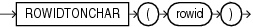

## Syntax



> ```
> ROWIDTONCHAR(rowid)
> ```
>
> [Copyright ©](https://docs.oracle.com/pls/topic/lookup?ctx=en/legal&id=cpyr) 2026,1996, Oracle and/or its affiliates.


[Description of the illustration rowidtonchar.eps](https://docs.oracle.com/en/database/oracle/oracle-database/19/sqlrf/img_text/rowidtonchar.html)

## Purpose

`ROWIDTONCHAR` converts a rowid value to `NVARCHAR2` data type. The result of this conversion is always in the national character set and is 18 characters long.

**See Also:** in [*Oracle Database Globalization Support Guide*](https://docs.oracle.com/pls/topic/lookup?ctx=en/database/oracle/oracle-database/19/sqlrf&id=NLSPG-GUID-AFCE41ED-775B-4A00-AF38-C436776AE0C5) for the collation derivation rules, which define the collation assigned to the character return value of `ROWIDTONCHAR`

## Examples

The following example converts a rowid value to an `NVARCHAR2` string:

```md
SELECT LENGTHB( ROWIDTONCHAR(ROWID) ) Length, ROWIDTONCHAR(ROWID)
   FROM employees
   ORDER BY length;

    LENGTH ROWIDTONCHAR(ROWID
---------- ------------------
        36 AAAL52AAFAAAABSABD
        36 AAAL52AAFAAAABSABV
. . .
```