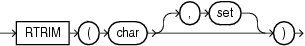

## Syntax



> ```
> RTRIM(char [, set ])
> ```
>
> [Copyright ©](https://docs.oracle.com/pls/topic/lookup?ctx=en/legal&id=cpyr) 2026,1996, Oracle and/or its affiliates.


[Description of the illustration rtrim.eps](https://docs.oracle.com/en/database/oracle/oracle-database/19/sqlrf/img_text/rtrim.html)

## Purpose

`RTRIM` removes from the right end of *char* all of the characters that appear in *set*. This function is useful for formatting the output of a query.

If you do not specify *set*, then it defaults to a single blank. `RTRIM` works similarly to `LTRIM`.

Both *char* and *set* can be any of the data types `CHAR`, `VARCHAR2`, `NCHAR`, `NVARCHAR2`, `CLOB`, or `NCLOB`. The string returned is of `VARCHAR2` data type if *char* is a character data type, `NVARCHAR2` if *char* is a national character data type, and a LOB if *char* is a LOB data type.

**See Also:**

- [LTRIM](LTRIM.md)
- in [*Oracle Database Globalization Support Guide*](https://docs.oracle.com/pls/topic/lookup?ctx=en/database/oracle/oracle-database/19/sqlrf&id=NLSPG-GUID-AFCE41ED-775B-4A00-AF38-C436776AE0C5) for the collation determination rules, which define the collation `RTRIM` uses to compare characters from *set* with characters from *char*, and for the collation derivation rules, which define the collation assigned to the character return value of this function

## Examples

The following example trims all the right-most occurrences of less than sign (`<`), greater than sign (`>`), and equal sign (`=`) from a string:

```md
SELECT RTRIM('<=====>BROWNING<=====>', '<>=') "RTRIM Example"
  FROM DUAL;

RTRIM Example
---------------
<=====>BROWNING
```