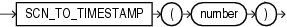

## Syntax



> ```
> SCN_TO_TIMESTAMP(number)
> ```
>
> [Copyright ©](https://docs.oracle.com/pls/topic/lookup?ctx=en/legal&id=cpyr) 2026,1996, Oracle and/or its affiliates.


[Description of the illustration scn\_to\_timestamp.eps](https://docs.oracle.com/en/database/oracle/oracle-database/19/sqlrf/img_text/scn_to_timestamp.html)

## Purpose

`SCN_TO_TIMESTAMP` takes as an argument a number that evaluates to a system change number (SCN), and returns the approximate timestamp associated with that SCN. The returned value is of `TIMESTAMP` data type. This function is useful any time you want to know the timestamp associated with an SCN. For example, it can be used in conjunction with the `ORA_ROWSCN` pseudocolumn to associate a timestamp with the most recent change to a row.

**Div:**

Notes:

- The usual precision of the result value is 3 seconds.
- The association between an SCN and a timestamp when the SCN is generated is remembered by the database for a limited period of time. This period is the maximum of the auto-tuned undo retention period, if the database runs in the Automatic Undo Management mode, and the retention times of all flashback archives in the database, but no less than 120 hours. The time for the association to become obsolete elapses only when the database is open. An error is returned if the SCN specified for the argument to `SCN_TO_TIMESTAMP` is too old.

**See Also:** [ORA\_ROWSCN Pseudocolumn](ORA_ROWSCN-Pseudocolumn.md) and [TIMESTAMP\_TO\_SCN](TIMESTAMP_TO_SCN.md)

## Examples

The following example uses the `ORA_ROWSCN` pseudocolumn to determine the system change number of the last update to a row and uses `SCN_TO_TIMESTAMP` to convert that SCN to a timestamp:

```md
SELECT SCN_TO_TIMESTAMP(ORA_ROWSCN) FROM employees
   WHERE employee_id = 188;
```

You could use such a query to convert a system change number to a timestamp for use in an Oracle Flashback Query:

```md
SELECT salary FROM employees WHERE employee_id = 188;
    SALARY
----------
      3800

UPDATE employees SET salary = salary*10 WHERE employee_id = 188;
COMMIT;

SELECT salary FROM employees WHERE employee_id = 188;
    SALARY
----------
     38000
```
```md
SELECT SCN_TO_TIMESTAMP(ORA_ROWSCN) FROM employees
   WHERE employee_id = 188;
SCN_TO_TIMESTAMP(ORA_ROWSCN)
---------------------------------------------------------------------------
28-AUG-03 01.58.01.000000000 PM

FLASHBACK TABLE employees TO TIMESTAMP
   TO_TIMESTAMP('28-AUG-03 01.00.00.000000000 PM');

SELECT salary FROM employees WHERE employee_id = 188;
    SALARY
----------
      3800
```