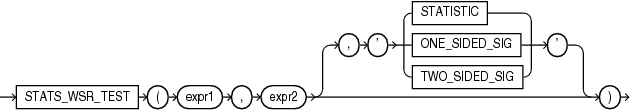

## Syntax



> ```
> STATS_WSR_TEST(expr1, expr2
>                [, { 'STATISTIC'
>                   | 'ONE_SIDED_SIG'
>                   | 'TWO_SIDED_SIG'
>                   }
>                ]
>               )
> ```
>
> [Copyright ©](https://docs.oracle.com/pls/topic/lookup?ctx=en/legal&id=cpyr) 2026,1996, Oracle and/or its affiliates.


[Description of the illustration stats\_wsr\_test.eps](https://docs.oracle.com/en/database/oracle/oracle-database/19/sqlrf/img_text/stats_wsr_test.html)

## Purpose

`STATS_WSR_TEST` is a Wilcoxon Signed Ranks test of paired samples to determine whether the median of the differences between the samples is significantly different from zero. The absolute values of the differences are ordered and assigned ranks. Then the null hypothesis states that the sum of the ranks of the positive differences is equal to the sum of the ranks of the negative differences.

This function takes two required arguments: *expr1* and *expr2* are the two samples being analyzed. The optional third argument lets you specify the meaning of the `NUMBER` value returned by this function, as shown in Table 7-10. For this argument, you can specify a text literal, or a bind variable or expression that evaluates to a constant character value. If you omit the third argument, then the default is `'TWO_SIDED_SIG'`.

Table 10 STATS\_WSR\_TEST\_\* Return Values

| Argument | Return Value Meaning |
| --- | --- |
| `'STATISTIC'` | The observed value of Z |
| `'ONE_SIDED_SIG'` | One-tailed significance of Z |
| `'TWO_SIDED_SIG'` | Two-tailed significance of Z |

One-sided significance is always with respect to the upper tail. The high value (the value whose rejection region is the upper tail) is *expr1*.