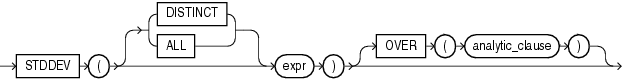

## Syntax



> ```
> STDDEV([ DISTINCT | ALL ] expr)
>    [ OVER (analytic_clause) ]
> ```
>
> [Copyright ©](https://docs.oracle.com/pls/topic/lookup?ctx=en/legal&id=cpyr) 2026,1996, Oracle and/or its affiliates.


[Description of the illustration stddev.eps](https://docs.oracle.com/en/database/oracle/oracle-database/19/sqlrf/img_text/stddev.html)

**See Also:** “ [Analytic Functions](Analytic-Functions.md) ” for information on syntax, semantics, and restrictions

## Purpose

`STDDEV` returns the sample standard deviation of *expr*, a set of numbers. You can use it as both an aggregate and analytic function. It differs from `STDDEV_SAMP` in that `STDDEV` returns zero when it has only 1 row of input data, whereas `STDDEV_SAMP` returns null.

Oracle Database calculates the standard deviation as the square root of the variance defined for the `VARIANCE` aggregate function.

This function takes as an argument any numeric data type or any nonnumeric data type that can be implicitly converted to a numeric data type. The function returns the same data type as the numeric data type of the argument.

**See Also:** [Table 2-8](Data-Type-Comparison-Rules.md) for more information on implicit conversion

If you specify `DISTINCT`, then you can specify only the *query\_partition\_clause* of the *analytic\_clause*. The *order\_by\_clause* and *windowing\_clause* are not allowed.

## Aggregate Examples

The following example returns the standard deviation of the salaries in the sample `hr.employees` table:

```md
SELECT STDDEV(salary) "Deviation"
   FROM employees;

 Deviation
----------
3909.36575
```

## Analytic Examples

The query in the following example returns the cumulative standard deviation of the salaries in Department 80 in the sample table `hr.employees`, ordered by `hire_date`:

```md
SELECT last_name, salary,
   STDDEV(salary) OVER (ORDER BY hire_date) "StdDev"
   FROM employees
   WHERE department_id = 30
   ORDER BY last_name, salary, "StdDev";

LAST_NAME                     SALARY     StdDev
------------------------- ---------- ----------
Baida                           2900 4035.26125
Colmenares                      2500 3362.58829
Himuro                          2600  3649.2465
Khoo                            3100 5586.14357
Raphaely                       11000          0
Tobias                          2800  4650.0896
```