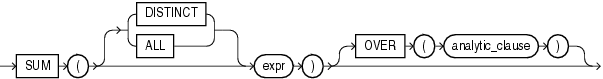

## Syntax



> ```
> SUM([ DISTINCT | ALL ] expr)
>    [ OVER (analytic_clause) ]
> ```
>
> [Copyright ©](https://docs.oracle.com/pls/topic/lookup?ctx=en/legal&id=cpyr) 2026,1996, Oracle and/or its affiliates.


[Description of the illustration sum.eps](https://docs.oracle.com/en/database/oracle/oracle-database/19/sqlrf/img_text/sum.html)

**See Also:** “ [Analytic Functions](Analytic-Functions.md) ” for information on syntax, semantics, and restrictions

## Purpose

`SUM` returns the sum of values of *expr*. You can use it as an aggregate or analytic function.

This function takes as an argument any numeric data type or any nonnumeric data type that can be implicitly converted to a numeric data type. The function returns the same data type as the numeric data type of the argument.

**See Also:** [Table 2-8](Data-Type-Comparison-Rules.md) for more information on implicit conversion

If you specify `DISTINCT`, then you can specify only the *query\_partition\_clause* of the *analytic\_clause*. The *order\_by\_clause* and *windowing\_clause* are not allowed.

**See Also:** “ [About SQL Expressions](About-SQL-Expressions.md) ” for information on valid forms of *expr* and “ [Aggregate Functions](Aggregate-Functions.md) ”

## Aggregate Example

The following example calculates the sum of all salaries in the sample `hr.employees` table:

```md
SELECT SUM(salary) "Total"
     FROM employees;

     Total
----------
    691400
```

## Analytic Example

The following example calculates, for each manager in the sample table `hr.employees`, a cumulative total of salaries of employees who answer to that manager that are equal to or less than the current salary. You can see that Raphaely and Cambrault have the same cumulative total. This is because Raphaely and Cambrault have the identical salaries, so Oracle Database adds together their salary values and applies the same cumulative total to both rows.

```md
SELECT manager_id, last_name, salary,
   SUM(salary) OVER (PARTITION BY manager_id ORDER BY salary
   RANGE UNBOUNDED PRECEDING) l_csum
   FROM employees
   ORDER BY manager_id, last_name, salary, l_csum;

MANAGER_ID LAST_NAME                     SALARY     L_CSUM
---------- ------------------------- ---------- ----------
       **100 Cambrault                      11000      68900**
       100 De Haan                        17000     155400
       100 Errazuriz                      12000      80900
       100 Fripp                           8200      36400
       100 Hartstein                      13000      93900
       100 Kaufling                        7900      20200
       100 Kochhar                        17000     155400
       100 Mourgos                         5800       5800
       100 Partners                       13500     107400
       **100 Raphaely                       11000      68900**
       100 Russell                        14000     121400
. . .
       149 Hutton                          8800      39000
       149 Johnson                         6200       6200
       149 Livingston                      8400      21600
       149 Taylor                          8600      30200
       201 Fay                             6000       6000
       205 Gietz                           8300       8300
           King                           24000      24000
```