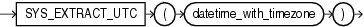

## Syntax



> ```
> SYS_EXTRACT_UTC(datetime_with_timezone)
> ```
>
> [Copyright ©](https://docs.oracle.com/pls/topic/lookup?ctx=en/legal&id=cpyr) 2026,1996, Oracle and/or its affiliates.


[Description of the illustration sys\_extract\_utc.eps](https://docs.oracle.com/en/database/oracle/oracle-database/19/sqlrf/img_text/sys_extract_utc.html)

## Purpose

`SYS_EXTRACT_UTC` extracts the UTC (Coordinated Universal Time-formerly Greenwich Mean Time) from a datetime value with time zone offset or time zone region name. If a time zone is not specified, then the datetime is associated with the session time zone.

## Examples

The following example extracts the UTC from a specified datetime:

```md
SELECT SYS_EXTRACT_UTC(TIMESTAMP '2000-03-28 11:30:00.00 -08:00')
   FROM DUAL;

SYS_EXTRACT_UTC(TIMESTAMP'2000-03-2811:30:00.00-08:00')
-----------------------------------------------------------------
28-MAR-00 07.30.00 PM
```