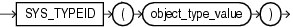

## Syntax



> ```
> SYS_TYPEID(object_type_value)
> ```
>
> [Copyright ©](https://docs.oracle.com/pls/topic/lookup?ctx=en/legal&id=cpyr) 2026,1996, Oracle and/or its affiliates.


[Description of the illustration sys\_typeid.eps](https://docs.oracle.com/en/database/oracle/oracle-database/19/sqlrf/img_text/sys_typeid.html)

## Purpose

`SYS_TYPEID` returns the typeid of the most specific type of the operand. This value is used primarily to identify the type-discriminant column underlying a substitutable column. For example, you can use the value returned by `SYS_TYPEID` to build an index on the type-discriminant column.

You can use this function only on object type operands. All final root object types-final types not belonging to a type hierarchy-have a null typeid. Oracle Database assigns to all types belonging to a type hierarchy a unique non-null typeid.

**See Also:** [*Oracle Database Object-Relational Developer’s Guide*](https://docs.oracle.com/pls/topic/lookup?ctx=en/database/oracle/oracle-database/19/sqlrf&id=ADOBJ002) for more information on typeids

## Examples

The following examples use the tables `persons` and `books`, which are created in “ [Substitutable Table and Column Examples](CREATE-TABLE.md) ”. The first query returns the most specific types of the object instances stored in the `persons` table.

```md
SELECT name, SYS_TYPEID(VALUE(p)) "Type_id" FROM persons p;

NAME                      Type_id
------------------------- --------------------------------
Bob                       01
Joe                       02
Tim                       03
```

The next query returns the most specific types of authors stored in the table `books`:

```md
SELECT b.title, b.author.name, SYS_TYPEID(author)
   "Type_ID" FROM books b;

TITLE                     AUTHOR.NAME          Type_ID
------------------------- -------------------- -------------------
An Autobiography          Bob                  01
Business Rules            Joe                  02
Mixing School and Work    Tim                  03
```

You can use the `SYS_TYPEID` function to create an index on the type-discriminant column of a table. For an example, see “ [Indexing on Substitutable Columns: Examples](CREATE-INDEX.md) ”.