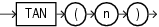

## Syntax



> ```
> TAN(n)
> ```
>
> [Copyright ©](https://docs.oracle.com/pls/topic/lookup?ctx=en/legal&id=cpyr) 2026,1996, Oracle and/or its affiliates.


[Description of the illustration tan.eps](https://docs.oracle.com/en/database/oracle/oracle-database/19/sqlrf/img_text/tan.html)

## Purpose

`TAN` returns the tangent of *n* (an angle expressed in radians).

This function takes as an argument any numeric data type or any nonnumeric data type that can be implicitly converted to a numeric data type. If the argument is `BINARY_FLOAT`, then the function returns `BINARY_DOUBLE`. Otherwise the function returns the same numeric data type as the argument.

**See Also:** [Table 2-8](Data-Type-Comparison-Rules.md) for more information on implicit conversion

## Examples

The following example returns the tangent of 135 degrees:

```md
SELECT TAN(135 * 3.14159265359/180)
   "Tangent of 135 degrees"  FROM DUAL;

Tangent of 135 degrees
----------------------
                   - 1
```