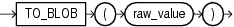

## Syntax

## to\_blob::=



> ```
> TO_BLOB ( raw_value )
> ```
>
> [Copyright ©](https://docs.oracle.com/pls/topic/lookup?ctx=en/legal&id=cpyr) 2026,1996, Oracle and/or its affiliates.


[Description of the illustration to\_blob.eps](https://docs.oracle.com/en/database/oracle/oracle-database/19/sqlrf/img_text/to_blob.html)

## Purpose

`TO_BLOB` (raw) converts `LONG` `RAW` and `RAW` values to `BLOB` values.

From within a PL/SQL package, you can use `TO_BLOB` (raw) to convert `RAW` and `BLOB` values to `BLOB`.

## Examples

The following hypothetical example returns the `BLOB` of a `RAW` column value:

```md
SELECT TO_BLOB(raw_column) blob FROM raw_table;

BLOB
-----------------------
00AADD343CDBBD
```