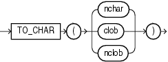

## Syntax

## to\_char\_char::=



> ```
> TO_CHAR(nchar | clob | nclob)
> ```
>
> [Copyright ©](https://docs.oracle.com/pls/topic/lookup?ctx=en/legal&id=cpyr) 2026,1996, Oracle and/or its affiliates.


[Description of the illustration to\_char\_char.eps](https://docs.oracle.com/en/database/oracle/oracle-database/19/sqlrf/img_text/to_char_char.html)

## Purpose

`TO_CHAR` (character) converts `NCHAR`, `NVARCHAR2`, `CLOB`, or `NCLOB` data to the database character set. The value returned is always `VARCHAR2`.

When you use this function to convert a character LOB into the database character set, if the LOB value to be converted is larger than the target type, then the database returns an error.

**See Also:** in [*Oracle Database Globalization Support Guide*](https://docs.oracle.com/pls/topic/lookup?ctx=en/database/oracle/oracle-database/19/sqlrf&id=NLSPG-GUID-AFCE41ED-775B-4A00-AF38-C436776AE0C5) for the collation derivation rules, which define the collation assigned to the character return value of this function

## Examples

The following example interprets a simple string as character data:

```md
SELECT TO_CHAR('01110') FROM DUAL;

TO_CH
-----
01110
```

Compare this example with the first example for [TO\_CHAR (number)](TO_CHAR-number.md).

The following example converts some `CLOB` data from the `pm.print_media` table to the database character set:

```md
SELECT TO_CHAR(ad_sourcetext) FROM print_media
      WHERE product_id = 2268;

TO_CHAR(AD_SOURCETEXT)
--------------------------------------------------------------------
******************************
TIGER2 2268...Standard Hayes Compatible Modem
Product ID: 2268
The #1 selling modem in the universe! Tiger2's modem includes call management
and Internet voicing. Make real-time full duplex phone calls at the same time
you're online.
**********************************
```

**TO\_CHAR (character) Function: Example**

The following statements create a table named `empl_temp` and populate it with employee details:

```md
CREATE TABLE empl_temp
  (
     employee_id NUMBER(6),
     first_name  VARCHAR2(20),
     last_name   VARCHAR2(25),
     email       VARCHAR2(25),
     hire_date   DATE DEFAULT SYSDATE,
     job_id      VARCHAR2(10),
     clob_column CLOB
  );

INSERT INTO empl_temp
VALUES(111,'John','Doe','example.com','10-JAN-2015','1001','Experienced Employee');

INSERT INTO empl_temp
VALUES(112,'John','Smith','example.com','12-JAN-2015','1002','Junior Employee');

INSERT INTO empl_temp
VALUES(113,'Johnnie','Smith','example.com','12-JAN-2014','1002','Mid-Career Employee');

INSERT INTO empl_temp
VALUES(115,'Jane','Doe','example.com','15-JAN-2015','1005','Executive Employee');
```

The following statement converts CLOB data to the database character set:

```md
SELECT To_char(clob_column) "CLOB_TO_CHAR"
FROM   empl_temp
WHERE  employee_id IN ( 111, 112, 115 );

CLOB_TO_CHAR
--------------------
Experienced Employee
Junior Employee
Executive Employee
```