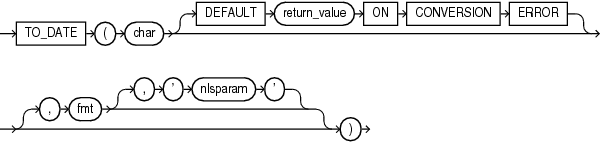

## Syntax



> ```
> TO_DATE(char [ DEFAULT return_value ON CONVERSION ERROR ]
>   [, fmt [, 'nlsparam' ] ])
> ```
>
> [Copyright ©](https://docs.oracle.com/pls/topic/lookup?ctx=en/legal&id=cpyr) 2026,1996, Oracle and/or its affiliates.


[Description of the illustration to\_date.eps](https://docs.oracle.com/en/database/oracle/oracle-database/19/sqlrf/img_text/to_date.html)

## Purpose

`TO_DATE` converts *char* to a value of `DATE` data type.

For *char*, you can specify any expression that evaluates to a character string of `CHAR`, `VARCHAR2`, `NCHAR`, or `NVARCHAR2` data type.

**Note:** This function does not convert data to any of the other datetime data types. For information on other datetime conversions, refer to [TO\_TIMESTAMP](TO_TIMESTAMP.md), [TO\_TIMESTAMP\_TZ](TO_TIMESTAMP_TZ.md), [TO\_DSINTERVAL](TO_DSINTERVAL.md), and [TO\_YMINTERVAL](TO_YMINTERVAL.md).

The optional `DEFAULT` *return\_value* `ON` `CONVERSION` `ERROR` clause allows you to specify the value this function returns if an error occurs while converting *char* to `DATE`. This clause has no effect if an error occurs while evaluating *char*. The *return\_value* can be an expression or a bind variable, and it must evaluate to a character string of `CHAR`, `VARCHAR2`, `NCHAR`, or `NVARCHAR2` data type, or null. The function converts *return\_value* to `DATE` using the same method it uses to convert *char* to `DATE`. If *return\_value* cannot be converted to `DATE`, then the function returns an error.

The *fmt* is a datetime model format specifying the format of *char*. If you omit *fmt*, then *char* must be in the default date format. The default date format is determined implicitly by the `NLS_TERRITORY` initialization parameter or can be set explicitly by the `NLS_DATE_FORMAT` parameter. If *fmt* is `J`, for Julian, then *char* must be an integer.

**Caution:** It is good practice *always* to specify a format mask (*fmt*) with `TO_DATE`, as shown in the examples in the section that follows. When it is used without a format mask, the function is valid *only* if *char* uses the same format as is determined by the `NLS_TERRITORY` or `NLS_DATE_FORMAT` parameters. Furthermore, the function may not be stable across databases unless the explicit format mask is specified to avoid dependencies.

The *‘nlsparam’* argument specifies the language of the text string that is being converted to a date. This argument can have this form:

```md
'NLS_DATE_LANGUAGE = language'
```

Do not use the `TO_DATE` function with a `DATE` value for the *char* argument. The first two digits of the returned `DATE` value can differ from the original *char*, depending on *fmt* or the default date format.

This function does not support `CLOB` data directly. However, `CLOB` s can be passed in as arguments through implicit data conversion.

**See Also:** “ [Datetime Format Models](Format-Models.md) ” and “ [Data Type Comparison Rules](Data-Type-Comparison-Rules.md) ” for more information

## Examples

The following example converts a character string into a date:

```md
SELECT TO_DATE(
    'January 15, 1989, 11:00 A.M.',
    'Month dd, YYYY, HH:MI A.M.',
     'NLS_DATE_LANGUAGE = American')
     FROM DUAL;

TO_DATE('
---------
15-JAN-89
```

The value returned reflects the default date format if the `NLS_TERRITORY` parameter is set to ‘ `AMERICA` ’. Different `NLS_TERRITORY` values result in different default date formats:

```md
ALTER SESSION SET NLS_TERRITORY = 'KOREAN';

SELECT TO_DATE(
    'January 15, 1989, 11:00 A.M.',
    'Month dd, YYYY, HH:MI A.M.',
     'NLS_DATE_LANGUAGE = American')
     FROM DUAL;

TO_DATE(
--------
89/01/15
```

The following example returns the default value because the specified expression cannot be converted to a `DATE` value, due to a misspelling of the month:

```md
SELECT TO_DATE('Febuary 15, 2016, 11:00 A.M.'
       DEFAULT 'January 01, 2016 12:00 A.M.' ON CONVERSION ERROR,
       'Month dd, YYYY, HH:MI A.M.') "Value"
  FROM DUAL;

Value
---------
01-JAN-16
```