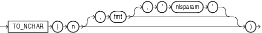

## Syntax

## to\_nchar\_number::=



> ```
> TO_NCHAR(n [, fmt [, 'nlsparam' ] ])
> ```
>
> [Copyright ©](https://docs.oracle.com/pls/topic/lookup?ctx=en/legal&id=cpyr) 2026,1996, Oracle and/or its affiliates.


[Description of the illustration to\_nchar\_number.eps](https://docs.oracle.com/en/database/oracle/oracle-database/19/sqlrf/img_text/to_nchar_number.html)

## Purpose

`TO_NCHAR` (number) converts *n* to a string in the national character set. The value *n* can be of type `NUMBER`, `BINARY_FLOAT`, or `BINARY_DOUBLE`. The function returns a value of the same type as the argument. The optional *fmt* and *‘nlsparam’* corresponding to *n* can be of `DATE`, `TIMESTAMP`, `TIMESTAMP` `WITH` `TIME` `ZONE`, `TIMESTAMP` `WITH` `LOCAL` `TIME` `ZONE`, `INTERVAL` `MONTH` `TO` `YEAR`, or `INTERVAL` `DAY` `TO` `SECOND` data type.

**See Also:**

- “ [Security Considerations for Data Conversion](Data-Type-Comparison-Rules.md) ”
- in [*Oracle Database Globalization Support Guide*](https://docs.oracle.com/pls/topic/lookup?ctx=en/database/oracle/oracle-database/19/sqlrf&id=NLSPG-GUID-AFCE41ED-775B-4A00-AF38-C436776AE0C5) for the collation derivation rules, which define the collation assigned to the character return value of this function

## Examples

The following example converts the `customer_id` values from the sample table `oe.orders` to the national character set:

```md
SELECT TO_NCHAR(customer_id) "NCHAR_Customer_ID"  FROM orders
   WHERE order_status > 9
   ORDER BY "NCHAR_Customer_ID";

NCHAR_Customer_ID
----------------------------------------
102
103
148
148
149
```