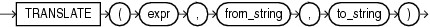

## Syntax



> ```
> TRANSLATE(expr, from_string, to_string)
> ```
>
> [Copyright ©](https://docs.oracle.com/pls/topic/lookup?ctx=en/legal&id=cpyr) 2026,1996, Oracle and/or its affiliates.


[Description of the illustration translate.eps](https://docs.oracle.com/en/database/oracle/oracle-database/19/sqlrf/img_text/translate.html)

## Purpose

`TRANSLATE` returns *expr* with all occurrences of each character in *from\_string* replaced by its corresponding character in *to\_string*. Characters in *expr* that are not in *from\_string* are not replaced. The argument *from\_string* can contain more characters than *to\_string*. In this case, the extra characters at the end of *from\_string* have no corresponding characters in *to\_string*. If these extra characters appear in *expr*, then they are removed from the return value.

If a character appears multiple times in *from\_string*, then the *to\_string* mapping corresponding to the first occurrence is used.

You cannot use an empty string for *to\_string* to remove all characters in *from\_string* from the return value. Oracle Database interprets the empty string as null, and if this function has a null argument, then it returns null. To remove all characters in *from\_string*, concatenate another character to the beginning of *from\_string* and specify this character as the *to\_string*. For example, `TRANSLATE` (*expr*, ‘ `x0123456789` ’, ‘ `x` ’) removes all digits from *expr*.

`TRANSLATE` provides functionality related to that provided by the `REPLACE` function. `REPLACE` lets you substitute a single string for another single string, as well as remove character strings. `TRANSLATE` lets you make several single-character, one-to-one substitutions in one operation.

This function does not support `CLOB` data directly. However, `CLOB` s can be passed in as arguments through implicit data conversion.

**See Also:**

- “ [Data Type Comparison Rules](Data-Type-Comparison-Rules.md) ” for more information and [REPLACE](REPLACE.md)
- in [*Oracle Database Globalization Support Guide*](https://docs.oracle.com/pls/topic/lookup?ctx=en/database/oracle/oracle-database/19/sqlrf&id=NLSPG-GUID-AFCE41ED-775B-4A00-AF38-C436776AE0C5) for the collation determination rules, which define the collation `TRANSLATE` uses to compare characters from *expr* with characters from *from\_string*, and for the collation derivation rules, which define the collation assigned to the character return value of `TRANSLATE`

## Examples

The following statement translates a book title into a string that could be used (for example) as a filename. The *from\_string* contains four characters: a space, asterisk, slash, and apostrophe (with an extra apostrophe as the escape character). The *to\_string* contains only three underscores. This leaves the fourth character in the *from\_string* without a corresponding replacement, so apostrophes are dropped from the returned value.

```md
SELECT TRANSLATE('SQL*Plus User''s Guide', ' */''', '___') FROM DUAL;

TRANSLATE('SQL*PLUSU
--------------------
SQL_Plus_Users_Guide
```