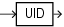

## Syntax



> ```
> UID
> ```
>
> [Copyright ©](https://docs.oracle.com/pls/topic/lookup?ctx=en/legal&id=cpyr) 2026,1996, Oracle and/or its affiliates.


[Description of the illustration uid.eps](https://docs.oracle.com/en/database/oracle/oracle-database/19/sqlrf/img_text/uid.html)

## Purpose

`UID` returns an integer that uniquely identifies the session user (the user who logged on).

**See Also:** [USER](USER.md) to learn how Oracle Database determines the session user

## Examples

The following example returns the UID of the session user:

```md
SELECT UID FROM DUAL;
```