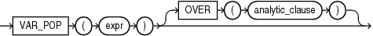

## Syntax



> ```
> VAR_POP(expr) [ OVER (analytic_clause) ]
> ```
>
> [Copyright ©](https://docs.oracle.com/pls/topic/lookup?ctx=en/legal&id=cpyr) 2026,1996, Oracle and/or its affiliates.


[Description of the illustration var\_pop.eps](https://docs.oracle.com/en/database/oracle/oracle-database/19/sqlrf/img_text/var_pop.html)

**See Also:** “ [Analytic Functions](Analytic-Functions.md) ” for information on syntax, semantics, and restrictions

## Purpose

`VAR_POP` returns the population variance of a set of numbers after discarding the nulls in this set. You can use it as both an aggregate and analytic function.

This function takes as an argument any numeric data type or any nonnumeric data type that can be implicitly converted to a numeric data type. The function returns the same data type as the numeric data type of the argument.

**See Also:** [Table 2-8](Data-Type-Comparison-Rules.md) for more information on implicit conversion

If the function is applied to an empty set, then it returns null. The function makes the following calculation:

```md
SUM((expr - (SUM(expr) / COUNT(expr)))2) / COUNT(expr)
```

**See Also:** “ [About SQL Expressions](About-SQL-Expressions.md) ” for information on valid forms of *expr* and “ [Aggregate Functions](Aggregate-Functions.md) ”

## Aggregate Example

The following example returns the population variance of the salaries in the `employees` table:

```md
SELECT VAR_POP(salary) FROM employees;

VAR_POP(SALARY)
---------------
     15141964.9
```

## Analytic Example

The following example calculates the cumulative population and sample variances in the `sh.sales` table of the monthly sales in 1998:

```md
SELECT t.calendar_month_desc,
   VAR_POP(SUM(s.amount_sold))
      OVER (ORDER BY t.calendar_month_desc) "Var_Pop",
   VAR_SAMP(SUM(s.amount_sold))
      OVER (ORDER BY t.calendar_month_desc) "Var_Samp"
  FROM sales s, times t
  WHERE s.time_id = t.time_id AND t.calendar_year = 1998
  GROUP BY t.calendar_month_desc
  ORDER BY t.calendar_month_desc, "Var_Pop", "Var_Samp";

CALENDAR    Var_Pop   Var_Samp
-------- ---------- ----------
1998-01           0
1998-02  2269111326 4538222653
1998-03  5.5849E+10 8.3774E+10
1998-04  4.8252E+10 6.4336E+10
1998-05  6.0020E+10 7.5025E+10
1998-06  5.4091E+10 6.4909E+10
1998-07  4.7150E+10 5.5009E+10
1998-08  4.1345E+10 4.7252E+10
1998-09  3.9591E+10 4.4540E+10
1998-10  3.9995E+10 4.4439E+10
1998-11  3.6870E+10 4.0558E+10
1998-12  4.0216E+10 4.3872E+10
```