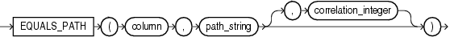
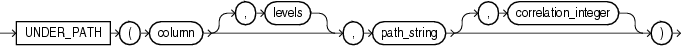

XML conditions determine whether a specified XML resource can be found in a specified path.

## EQUALS\_PATH Condition

The `EQUALS_PATH` condition determines whether a resource in the Oracle XML database can be found in the database at a specified path.

Use this condition in queries to `RESOURCE_VIEW` and `PATH_VIEW`. These public views provide a mechanism for SQL access to data stored in the XML database repository. `RESOURCE_VIEW` contains one row for each resource in the repository, and `PATH_VIEW` contains one row for each unique path in the repository.

***equals\_path\_condition::=***



> ```
> EQUALS_PATH
>     (column, path_string [, correlation_integer ])
> ```
>
> [Copyright ©](https://docs.oracle.com/pls/topic/lookup?ctx=en/legal&id=cpyr) 2026,1996, Oracle and/or its affiliates.


[Description of the illustration equals\_path\_condition.eps](https://docs.oracle.com/en/database/oracle/oracle-database/19/sqlrf/img_text/equals_path_condition.html)

This condition applies only to the path as specified. It is similar to but more restrictive than `UNDER_PATH`.

For *path\_string*, specify the (absolute) path name to resolve. This can contain components that are hard or weak resource links.

The optional *correlation\_integer* argument correlates the `EQUALS_PATH` condition with its ancillary functions `DEPTH` and `PATH`.

**See Also:** UNDER\_PATH Condition, [DEPTH](DEPTH.md), and [PATH](PATH.md)

**Example**

The view `RESOURCE_VIEW` computes the paths (in the `any_path` column) that lead to all XML resources (in the `res` column) in the database repository. The following example queries the `RESOURCE_VIEW` view to find the paths to the resources in the sample schema `oe`. The `EQUALS_PATH` condition causes the query to return only the specified path:

```md
SELECT ANY_PATH FROM RESOURCE_VIEW
   WHERE EQUALS_PATH(res, '/sys/schemas/OE/www.example.com')=1;

ANY_PATH
-----------------------------------------------
/sys/schemas/OE/www.example.com
```

Compare this example with that for UNDER\_PATH Condition.

## UNDER\_PATH Condition

The `UNDER_PATH` condition determines whether resources specified in a column can be found under a particular path specified by *path\_string* in the Oracle XML database repository. The path information is computed by the `RESOURCE_VIEW` view, which you query to use this condition.

Use this condition in queries to `RESOURCE_VIEW` and `PATH_VIEW`. These public views provide a mechanism for SQL access to data stored in the XML database repository. `RESOURCE_VIEW` contains one row for each resource in the repository, and `PATH_VIEW` contains one row for each unique path in the repository.

***under\_path\_condition*::=**



> ```
> UNDER_PATH (column [, levels ], path_string
>              [, correlation_integer ]
>            )
> ```
>
> [Copyright ©](https://docs.oracle.com/pls/topic/lookup?ctx=en/legal&id=cpyr) 2026,1996, Oracle and/or its affiliates.


[Description of the illustration under\_path\_condition.eps](https://docs.oracle.com/en/database/oracle/oracle-database/19/sqlrf/img_text/under_path_condition.html)

The optional *levels* argument indicates the number of levels down from *path\_string* Oracle should search. For *levels*, specify any nonnegative integer.

The optional *correlation\_integer* argument correlates the `UNDER_PATH` condition with its ancillary functions `PATH` and `DEPTH`.

**See Also:** The related condition EQUALS\_PATH Condition and the ancillary functions [DEPTH](DEPTH.md) and [PATH](PATH.md)

**Example**

The view `RESOURCE_VIEW` computes the paths (in the `any_path` column) that lead to all XML resources (in the `res` column) in the database repository. The following example queries the `RESOURCE_VIEW` view to find the paths to the resources in the sample schema `oe`. The query returns the path of the XML schema that was created in [XMLType Table Examples](CREATE-TABLE.md):

```md
SELECT ANY_PATH FROM RESOURCE_VIEW
   WHERE UNDER_PATH(res, '/sys/schemas/OE/www.example.com')=1;

ANY_PATH
----------------------------------------------
/sys/schemas/OE/www.example.com/xwarehouses.xsd
```