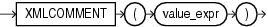

## Syntax



> ```
> XMLCOMMENT ( value_expr )
> ```
>
> [Copyright ©](https://docs.oracle.com/pls/topic/lookup?ctx=en/legal&id=cpyr) 2026,1996, Oracle and/or its affiliates.


[Description of the illustration xmlcomment.eps](https://docs.oracle.com/en/database/oracle/oracle-database/19/sqlrf/img_text/xmlcomment.html)

## Purpose

`XMLComment` generates an XML comment using an evaluated result of *value\_expr*. The *value\_expr* must resolve to a string. It cannot contain two consecutive dashes (hyphens). The value returned by the function takes the following form:

```md
<!--string-->
```

If *value\_expr* resolves to null, then the function returns null.

**See Also:** [*Oracle XML DB Developer’s Guide*](https://docs.oracle.com/pls/topic/lookup?ctx=en/database/oracle/oracle-database/19/sqlrf&id=ADXDB1620) for more information on this function

## Examples

The following example uses the `DUAL` table to illustrate the `XMLComment` syntax:

```md
SELECT XMLCOMMENT('OrderAnalysisComp imported, reconfigured, disassembled')
   AS "XMLCOMMENT" FROM DUAL;

XMLCOMMENT
--------------------------------------------------------------------------------
<!--OrderAnalysisComp imported, reconfigured, disassembled-->
```