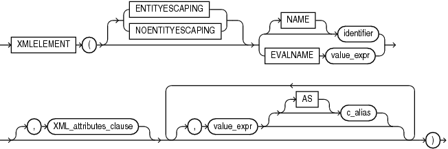
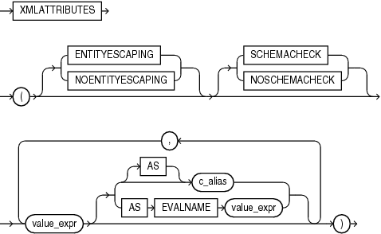

## Syntax



> ```
> XMLELEMENT ( [ ENTITYESCAPING | NOENTITYESCAPING ]
>    { ( [ NAME ] identifier ) | ( EVALNAME value_expr ) }
>    [ , XML_attributes_clause ]
>    [ , value_expr [ [ AS ] c_alias ]]...
>  )
> ```
>
> [Copyright ©](https://docs.oracle.com/pls/topic/lookup?ctx=en/legal&id=cpyr) 2026,1996, Oracle and/or its affiliates.


[Description of the illustration xmlelement.eps](https://docs.oracle.com/en/database/oracle/oracle-database/19/sqlrf/img_text/xmlelement.html)

## XML\_attributes\_clause::=



> ```
> XMLATTRIBUTES
>   ( [ ENTITYESCAPING | NOENTITYESCAPING ]
>     [ SCHEMACHECK | NOSCHEMACHECK ]
>     value_expr [ { [AS] c_alias } | { AS EVALNAME value_expr } ]
>       [, value_expr [ { [AS] c_alias } | { AS EVALNAME value_expr } ] ]...
>   )
> ```
>
> [Copyright ©](https://docs.oracle.com/pls/topic/lookup?ctx=en/legal&id=cpyr) 2026,1996, Oracle and/or its affiliates.


[Description of the illustration xml\_attributes\_clause.eps](https://docs.oracle.com/en/database/oracle/oracle-database/19/sqlrf/img_text/xml_attributes_clause.html)

## Purpose

`XMLElement` takes an element name for *identifier* or evaluates an element name for `EVALNAME` *value\_expr*, an optional collection of attributes for the element, and arguments that make up the content of the element. It returns an instance of type `XMLType`. `XMLElement` is similar to `SYS_XMLGen` except that `XMLElement` can include attributes in the XML returned, but it does not accept formatting using the `XMLFormat` object.

The `XMLElement` function is typically nested to produce an XML document with a nested structure, as in the example in the following section.

For an explanation of the `ENTITYESCAPING` and `NONENTITYESCAPING` keywords, refer to [*Oracle XML DB Developer’s Guide*](https://docs.oracle.com/pls/topic/lookup?ctx=en/database/oracle/oracle-database/19/sqlrf&id=ADXDB1620).

You must specify a value for Oracle Database to use an the enclosing tag. You can do this by specifying *identifier*, which is a string literal, or by specifying `EVALNAME` *value\_expr*. In the latter case, the value expression is evaluated and the result, which must be a string literal, is used as the identifier. The identifier does not have to be a column name or column reference. It cannot be an expression or null. It can be up to 4000 characters if the initialization parameter `MAX_STRING_SIZE` `=` `STANDARD`, and 32767 characters if `MAX_STRING_SIZE` `=` `EXTENDED`.

The objects that make up the element content follow the `XMLATTRIBUTES` keyword. In the *XML\_attributes\_clause*, if the *value\_expr* is null, then no attribute is created for that value expression. The type of *value\_expr* cannot be an object type or collection. If you specify an alias for *value\_expr* using the `AS` clause, then the *c\_alias* or the evaluated value expression (`EVALNAME` *value\_expr*) can be up to 4000 characters if the initialization parameter `MAX_STRING_SIZE` `=` `STANDARD`, and 32767 characters if `MAX_STRING_SIZE` `=` `EXTENDED`.

**See Also:** “ [Extended Data Types](Data-Types.md) ” for more information on `MAX_STRING_SIZE`

For the optional *value\_expr* that follows the *XML\_attributes\_clause* in the diagram:

- If *value\_expr* is a scalar expression, then you can omit the `AS` clause, and Oracle uses the column name as the element name.
- If *value\_expr* is an object type or collection, then the `AS` clause is mandatory, and Oracle uses the specified *c\_alias* as the enclosing tag.
- If *value\_expr* is null, then no element is created for that value expression.
	**See Also:** [SYS\_XMLGEN](SYS_XMLGEN.md)

## Examples

The following example produces an `Emp` element for a series of employees, with nested elements that provide the employee’s name and hire date:

```md
SELECT XMLELEMENT("Emp", XMLELEMENT("Name",
   e.job_id||' '||e.last_name),
   XMLELEMENT("Hiredate", e.hire_date)) as "Result"
   FROM employees e WHERE employee_id > 200;

Result
-------------------------------------------------------------------
<Emp>
  <Name>MK_MAN Hartstein</Name>
  <Hiredate>2004-02-17</Hiredate>
</Emp>

<Emp>
  <Name>MK_REP Fay</Name>
  <Hiredate>2005-08-17</Hiredate>
</Emp>

<Emp>
  <Name>HR_REP Mavris</Name>
  <Hiredate>2002-06-07</Hiredate>
</Emp>

<Emp>
  <Name>PR_REP Baer</Name>
  <Hiredate>2002-06-07</Hiredate>
</Emp>

<Emp>
  <Name>AC_MGR Higgins</Name>
  <Hiredate>2002-06-07</Hiredate>
</Emp>

<Emp>
  <Name>AC_ACCOUNT Gietz</Name>
  <Hiredate>2002-06-07</Hiredate>
</Emp>

6 rows selected.
```

The following similar example uses the `XMLElement` function with the *XML\_attributes\_clause* to create nested XML elements with attribute values for the top-level element:

```md
SELECT XMLELEMENT("Emp",
      XMLATTRIBUTES(e.employee_id AS "ID", e.last_name),
      XMLELEMENT("Dept", e.department_id),
      XMLELEMENT("Salary", e.salary)) AS "Emp Element"
   FROM employees e
   WHERE e.employee_id = 206;

Emp Element
---------------------------------------------------------------
<Emp ID="206" LAST_NAME="Gietz">
  <Dept>110</Dept>
  <Salary>8300</Salary>
</Emp>
```

Notice that the `AS` *identifier* clause was not specified for the `last_name` column. As a result, the XML returned uses the column name `last_name` as the default.

Finally, the next example uses a subquery within the *XML\_attributes\_clause* to retrieve information from another table into the attributes of an element:

```md
SELECT XMLELEMENT("Emp", XMLATTRIBUTES(e.employee_id, e.last_name),
   XMLELEMENT("Dept", XMLATTRIBUTES(e.department_id,
   (SELECT d.department_name FROM departments d
   WHERE d.department_id = e.department_id) as "Dept_name")),
   XMLELEMENT("salary", e.salary),
   XMLELEMENT("Hiredate", e.hire_date)) AS "Emp Element"
   FROM employees e
   WHERE employee_id = 205;

Emp Element
-------------------------------------------------------------------
<Emp EMPLOYEE_ID="205" LAST_NAME="Higgins">
  <Dept DEPARTMENT_ID="110" Dept_name="Accounting"/>
  <salary>12008</salary>
  <Hiredate>2002-06-07</Hiredate>
</Emp>
```