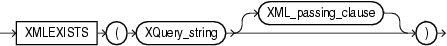
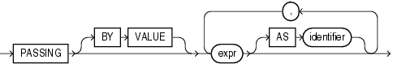

## Syntax



> ```
> XMLEXISTS ( XQuery_string [ XML_passing_clause ] )
> ```
>
> [Copyright ©](https://docs.oracle.com/pls/topic/lookup?ctx=en/legal&id=cpyr) 2026,1996, Oracle and/or its affiliates.


[Description of the illustration xmlexists.eps](https://docs.oracle.com/en/database/oracle/oracle-database/19/sqlrf/img_text/xmlexists.html)

## XML\_passing\_clause::=



> ```
> PASSING [ BY VALUE ]
>     expr [ AS identifier ]
>       [, expr [ AS identifier ]
>       ]...
> ```
>
> [Copyright ©](https://docs.oracle.com/pls/topic/lookup?ctx=en/legal&id=cpyr) 2026,1996, Oracle and/or its affiliates.


[Description of the illustration xml\_passing\_clause.eps](https://docs.oracle.com/en/database/oracle/oracle-database/19/sqlrf/img_text/xml_passing_clause.html)

## Purpose

`XMLExists` checks whether a given XQuery expression returns a nonempty XQuery sequence. If so, the function returns `TRUE`; otherwise, it returns `FALSE`. The argument *XQuery\_string* is a literal string, but it can contain XQuery variables that you bind using the *XML\_passing\_clause*.

The *expr* in the *XML\_passing\_clause* is an expression returning an `XMLType` or an instance of a SQL scalar data type that is used as the context for evaluating the XQuery expression. You can specify only one *expr* in the `PASSING` clause without an identifier. The result of evaluating each *expr* is bound to the corresponding identifier in the *XQuery\_string*. If any *expr* that is not followed by an `AS` clause, then the result of evaluating that expression is used as the context item for evaluating the *XQuery\_string*. If *expr* is a relational column, then its declared collation is ignored by Oracle XML DB.

**See Also:** [*Oracle XML DB Developer’s Guide*](https://docs.oracle.com/pls/topic/lookup?ctx=en/database/oracle/oracle-database/19/sqlrf&id=ADXDB0400) for more information on uses for this function and examples