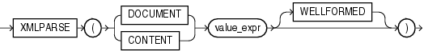

## Syntax



> ```
> XMLPARSE
>   ({ DOCUMENT | CONTENT } value_expr [ WELLFORMED ]
>   )
> ```
>
> [Copyright ©](https://docs.oracle.com/pls/topic/lookup?ctx=en/legal&id=cpyr) 2026,1996, Oracle and/or its affiliates.


[Description of the illustration xmlparse.eps](https://docs.oracle.com/en/database/oracle/oracle-database/19/sqlrf/img_text/xmlparse.html)

## Purpose

`XMLParse` parses and generates an XML instance from the evaluated result of *value\_expr*. The *value\_expr* must resolve to a string. If *value\_expr* resolves to null, then the function returns null.

- If you specify `DOCUMENT`, then *value\_expr* must resolve to a singly rooted XML document.
- If you specify `CONTENT`, then *value\_expr* must resolve to a valid XML value.
- When you specify `WELLFORMED`, you are guaranteeing that *value\_expr* resolves to a well-formed XML document, so the database does not perform validity checks to ensure that the input is well formed. **See Also:** [*Oracle XML DB Developer’s Guide*](https://docs.oracle.com/pls/topic/lookup?ctx=en/database/oracle/oracle-database/19/sqlrf&id=ADXDB1620) for more information on this function

## Examples

The following example uses the `DUAL` table to illustrate the syntax of `XMLParse`:

```md
SELECT XMLPARSE(CONTENT '124 <purchaseOrder poNo="12435">
   <customerName> Acme Enterprises</customerName>
   <itemNo>32987457</itemNo>
   </purchaseOrder>'
WELLFORMED) AS PO FROM DUAL;

PO
-----------------------------------------------------------------
124 <purchaseOrder poNo="12435">
   <customerName> Acme Enterprises</customerName>
   <itemNo>32987457</itemNo>
   </purchaseOrder>
```