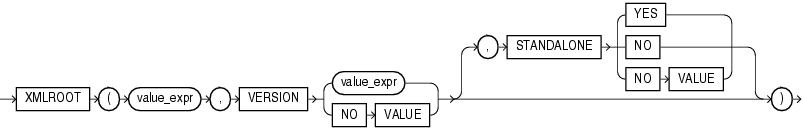

**Note:** The `XMLROOT` function is deprecated. It is still supported for backward compatibility. However, Oracle recommends that you instead use the SQL/XML function `XMLSERIALIZE` with a version number. See [*Oracle XML DB Developer’s Guide*](https://docs.oracle.com/pls/topic/lookup?ctx=en/database/oracle/oracle-database/19/sqlrf&id=ADXDB-GUID-55FE9CED-5B25-4DA2-9F9E-921DF8276EB8) for more information on the `XMLSERIALIZE` function.

## Syntax



> ```
> XMLROOT
>   ( value_expr, VERSION
>   { value_expr | NO VALUE }
>   [, STANDALONE { YES | NO | NO VALUE } ]
>   )
> ```
>
> [Copyright ©](https://docs.oracle.com/pls/topic/lookup?ctx=en/legal&id=cpyr) 2026,1996, Oracle and/or its affiliates.


[Description of the illustration xmlroot.eps](https://docs.oracle.com/en/database/oracle/oracle-database/19/sqlrf/img_text/xmlroot.html)

## Purpose

`XMLROOT` lets you create a new XML value by providing version and standalone properties in the XML root information (prolog) of an existing XML value. If the *value\_expr* already has a prolog, then the database returns an error. If the input is null, then the function returns null.

The value returned takes the following form:

```md
<?xml version = "version" [ STANDALONE = "{yes | no}" ]?>
```
- The first *value\_expr* specifies the XML value for which you are providing prolog information.
- In the `VERSION` clause, *value\_expr* must resolve to a string representing a valid XML version. If you specify `NO` `VALUE` for `VERSION`, then the version defaults to 1.0.
- If you omit the optional `STANDALONE` clause, or if you specify it with `NO` `VALUE`, then the standalone property is absent from the value returned by the function.

## Examples

The following statement uses the `DUAL` table to illustrate the syntax of `XMLROOT`:

```md
SELECT XMLROOT ( XMLType('<poid>143598</poid>'), VERSION '1.0', STANDALONE YES)
   AS "XMLROOT" FROM DUAL;

XMLROOT
--------------------------------------------------------------------------------
<?xml version="1.0" standalone="yes"?>
<poid>143598</poid>
```