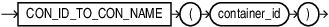

## Syntax



> ```
> CON_ID_TO_CON_NAME (container_id)
> ```
>
> [Copyright ©](https://docs.oracle.com/pls/topic/lookup?ctx=en/legal&id=cpyr) 2026,1996, Oracle and/or its affiliates.


[Description of the illustration con\_id\_to\_con\_name.eps](https://docs.oracle.com/en/database/oracle/oracle-database/19/sqlrf/img_text/con_id_to_con_name.html)

## Purpose

`CON_ID_TO_CON_NAME` takes as an argument a container `CON_ID` and returns the container `NAME`.

For `CON_ID` you must specify a number or an expression that resolves to a number. The function returns a `NUMBER` value.

This function is useful in a multitentant container database (CDB). If you use this function in a non-CDB, then it returns 0.

## Example

```md
SELECT CON_ID, NAME FROM V$CONTAINERS;
    CON_ID         NAME
   ---------       -------------
       1           CDB$ROOT
       2           PDB$SEED
       3           CDB1_PDB1
       4           SALESPDB
```

The following statement returns the container `NAME` given the container `CON_ID` 4:

```md
SELECT CON_ID_TO_CON_NAME(4) "CON_NAME" FROM DUAL;
     CON_NAME
     --------
     SALESDB
```