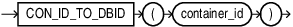

## Syntax



> ```
> CON_ID_TO_DBID(container_id)
> ```
>
> [Copyright ©](https://docs.oracle.com/pls/topic/lookup?ctx=en/legal&id=cpyr) 2026,1996, Oracle and/or its affiliates.


[Description of the illustration con\_id\_to\_dbid.eps](https://docs.oracle.com/en/database/oracle/oracle-database/19/sqlrf/img_text/con_id_to_dbid.html)

## Purpose

`CON_ID_TO_DBID` takes as an argument a container `CON_ID` and returns the container `DBID`. For `CON_ID` you must specify a number or an expression that resolves to a number. The function returns a `NUMBER` value.

This function is useful in a multitentant container database (CDB). If you use this function in a non-CDB, then it returns 0.

## Example

```md
SELECT CON_ID, NAME, DBID FROM V$CONTAINERS;

CON_ID      NAME           DBID
-------     ------------   ---------------
   1        CDB$ROOT       2048400776
   2        PDB$SEED       2929762556
   3        CDB1_PDB1      3483444080
   4        SALESPDB       2221053340
```

The following statement returns the container `DBID` given the container `CON_ID` 4:

```md
SELECT CON_ID_TO_DBID(4) FROM DUAL;
    DBID
    -------------
    2221053340
```