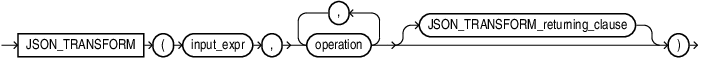
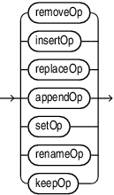
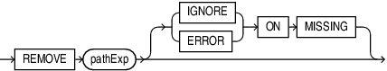
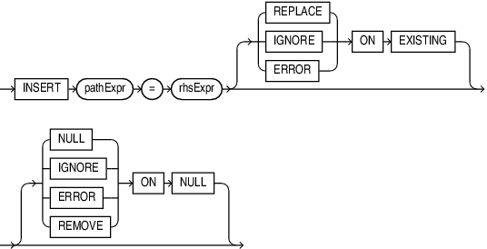
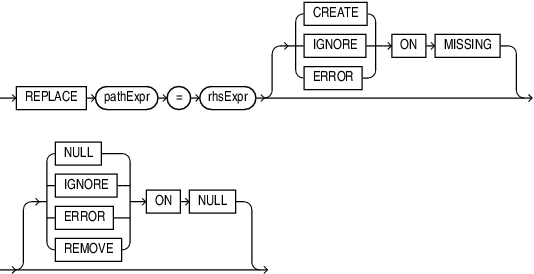
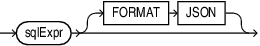
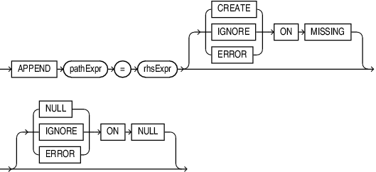
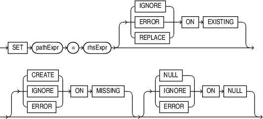
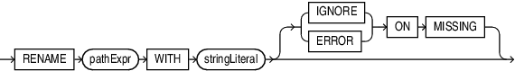
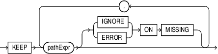

## Syntax



> ```
> JSON_TRANSFORM ( input_expr , operation [ , operation ]... [ JSON_TRANSFORM_returning_clause ] )
> ```
>
> [Copyright ©](https://docs.oracle.com/pls/topic/lookup?ctx=en/legal&id=cpyr) 2026,1996, Oracle and/or its affiliates.


[Description of the illustration json\_transform.eps](https://docs.oracle.com/en/database/oracle/oracle-database/19/sqlrf/img_text/json_transform.html)

## JSON\_TRANSFORM\_returning\_clause::=

[Description of the illustration json\_transform\_returning\_clause.eps](https://docs.oracle.com/en/database/oracle/oracle-database/19/sqlrf/img_text/json_transform_returning_clause.html)

## JSON\_passing\_clause::=

For details on *JSON\_passing\_clause* see [JSON\_EXISTS Condition](SQL-JSON-Conditions.md).

## operation::=



> ```
> removeOp
>      | insertOp
>      | replaceOp
>      | appendOp
>      | setOp
>      | renameOp
>      | keepOp
> ```
>
> [Copyright ©](https://docs.oracle.com/pls/topic/lookup?ctx=en/legal&id=cpyr) 2026,1996, Oracle and/or its affiliates.


[Description of the illustration operation.eps](https://docs.oracle.com/en/database/oracle/oracle-database/19/sqlrf/img_text/operation.html)

## removeOp::=



> ```
> REMOVE pathExpr [ (IGNORE | ERROR) ON MISSING ]
> ```
>
> [Copyright ©](https://docs.oracle.com/pls/topic/lookup?ctx=en/legal&id=cpyr) 2026,1996, Oracle and/or its affiliates.


[Description of the illustration remove\_op.eps](https://docs.oracle.com/en/database/oracle/oracle-database/19/sqlrf/img_text/remove_op.html)

## insertOp::=



> ```
> INSERT pathExpr = rhsExpr [ ( REPLACE | IGNORE | ERROR) ON EXISTING ]
>      [ ( NULL | IGNORE | ERROR | REMOVE ) ON NULL ]
> ```
>
> [Copyright ©](https://docs.oracle.com/pls/topic/lookup?ctx=en/legal&id=cpyr) 2026,1996, Oracle and/or its affiliates.


[Description of the illustration insert\_op.eps](https://docs.oracle.com/en/database/oracle/oracle-database/19/sqlrf/img_text/insert_op.html)

## replaceOp::=



> ```
> REPLACE pathExpr = rhsExpr [ ( CREATE | IGNORE | ERROR) ON MISSING ]
>     [ ( NULL | IGNORE | ERROR | REMOVE ) ON NULL ]
> ```
>
> [Copyright ©](https://docs.oracle.com/pls/topic/lookup?ctx=en/legal&id=cpyr) 2026,1996, Oracle and/or its affiliates.


[Description of the illustration replace\_op.eps](https://docs.oracle.com/en/database/oracle/oracle-database/19/sqlrf/img_text/replace_op.html)

## rhsExpr::=



> ```
> sqlExpr [ FORMAT JSON ]
> ```
>
> [Copyright ©](https://docs.oracle.com/pls/topic/lookup?ctx=en/legal&id=cpyr) 2026,1996, Oracle and/or its affiliates.


[Description of the illustration rhs\_expr.eps](https://docs.oracle.com/en/database/oracle/oracle-database/19/sqlrf/img_text/rhs_expr.html)

## appendOp::=



> ```
> APPEND pathExpr = rhsExpr [ ( CREATE | IGNORE | ERROR) ON MISSING ]
>     [ ( NULL | IGNORE | ERROR) ON NULL ]
> ```
>
> [Copyright ©](https://docs.oracle.com/pls/topic/lookup?ctx=en/legal&id=cpyr) 2026,1996, Oracle and/or its affiliates.


[Description of the illustration append\_op.eps](https://docs.oracle.com/en/database/oracle/oracle-database/19/sqlrf/img_text/append_op.html)

## setOp::=



> ```
> SET pathExpr = rhsExpr [ (IGNORE | ERROR | REPLACE) ON EXISTING ]
>     [ ( CREATE | IGNORE | ERROR) ON MISSING ] [ ( NULL | IGNORE | ERROR) ON NULL ]
> ```
>
> [Copyright ©](https://docs.oracle.com/pls/topic/lookup?ctx=en/legal&id=cpyr) 2026,1996, Oracle and/or its affiliates.


[Description of the illustration set\_op.eps](https://docs.oracle.com/en/database/oracle/oracle-database/19/sqlrf/img_text/set_op.html)

## renameOp::=



> ```
> RENAME pathExpr WITH stringLiteral [ (IGNORE | ERROR) ON MISSING ]
> ```
>
> [Copyright ©](https://docs.oracle.com/pls/topic/lookup?ctx=en/legal&id=cpyr) 2026,1996, Oracle and/or its affiliates.


[Description of the illustration rename\_op.eps](https://docs.oracle.com/en/database/oracle/oracle-database/19/sqlrf/img_text/rename_op.html)

## keepOp::=



> ```
> KEEP ( pathExpr [( IGNORE | ERROR ) ON MISSING ] ) ...
> ```
>
> [Copyright ©](https://docs.oracle.com/pls/topic/lookup?ctx=en/legal&id=cpyr) 2026,1996, Oracle and/or its affiliates.


[Description of the illustration keep\_op.eps](https://docs.oracle.com/en/database/oracle/oracle-database/19/sqlrf/img_text/keep_op.html)

## Purpose

Use *JSON\_TRANSFORM* to modify JSON documents input to the function. You can change the JSON document (or pieces of the JSON document), by specifying one or more modifying operations that perform changes to the JSON data. The modified JSON document is returned as output.

You can input any SQL data type that supports JSON data. For example, the input can be a `VARCHAR2` column with or without an `IS JSON` check constraint, or a function call returning JSON data.

## Examples

**Example 1: Update a JSON Column with a Timestamp**

```md
UPDATE t SET jcol = JSON_TRANSFORM(jcol, SET '$.lastUpdated' = SYSTIMESTAMP)
```

**Example 2: Remove a Social Security Number before Shipping JSON to a Client**

```md
SELECT JSON_TRANSFORM (jcol, REMOVE '$.ssn') FROM t WHERE ...
```

## JSON\_TRANSFORM\_returning\_clause

The default output data type matches the data type of the input.

For input data type `VARCHAR2` of any size, the default output data type is `VARCHAR2(4000)`.

For a fuller discussion of *JSON\_TRANSFORM* with examples, see [Oracle SQL Function JSON\_TRANSFORM](https://docs.oracle.com/pls/topic/lookup?ctx=en/database/oracle/oracle-database/19/sqlrf&id=ADJSN-GUID-7BED994B-EAA3-4FF0-824D-C12ADAB862C1).