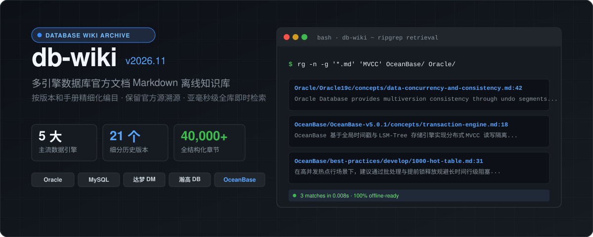
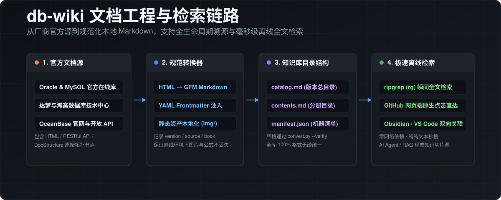

# db-wiki

<p align="center">
  
</p>

<p align="center">
  <a href="README.zh-CN.md">中文</a> · <strong>English</strong>
</p>

An offline-ready Markdown reading library for Oracle, MySQL, Dameng, HighGo, and OceanBase official documentation, organized by version and manual for instant full-text search and offline reading.

Start with [Oracle 19c](Oracle/Oracle19c/catalog.md), [MySQL 8.4](MySQL/MySQL8.4/catalog.md), [Dameng DM8](dameng/dm8/catalog.md), [HighGo V9](highgo/highgov9/catalog.md), [OceanBase V5.0.1](OceanBase/OceanBase-v5.0.1/catalog.md), or [OceanBase Best Practices](OceanBase/best-practices/catalog.md), or choose a manual by task below.

---

## Overview

Designed for database administrators (DBAs) and backend software engineers, this repository gathers core architecture concepts, SQL syntax references, system views, performance tuning guides, backup/recovery, and high availability topics. Each chapter preserves official source URLs and version metadata for provenance verification. Oracle and MySQL chapters are mainly in English; Dameng, HighGo, and OceanBase chapters are mainly in Chinese.

---

## Examples and Version Entry Points

The collection currently indexes **5 major database engines** across **21 editions and practice tracks**, comprising over 40,000+ structured Markdown chapters:

| Database version | Manual directories | Reading entry points |
| --- | ---: | --- |
| Oracle 11g | 45 | [Version catalog](Oracle/Oracle11g/catalog.md) · [Database Concepts](Oracle/Oracle11g/concepts/contents.md) |
| Oracle 12c | 12 | [Version catalog](Oracle/Oracle12c/catalog.md) · [Database Concepts](Oracle/Oracle12c/concepts/contents.md) |
| Oracle 19c | 17 | [Version catalog](Oracle/Oracle19c/catalog.md) · [Database Concepts](Oracle/Oracle19c/concepts/contents.md) |
| Oracle 21c | 23 | [Version catalog](Oracle/Oracle21c/catalog.md) · [Database Concepts](Oracle/Oracle21c/concepts/contents.md) |
| MySQL 5.6 | 2 | [Version catalog](MySQL/MySQL5.6/catalog.md) · [Reference Manual](MySQL/MySQL5.6/reference-manual/contents.md) |
| MySQL 5.7 | 2 | [Version catalog](MySQL/MySQL5.7/catalog.md) · [Reference Manual](MySQL/MySQL5.7/reference-manual/contents.md) |
| MySQL 8.0 | 2 | [Version catalog](MySQL/MySQL8.0/catalog.md) · [Reference Manual](MySQL/MySQL8.0/reference-manual/contents.md) |
| MySQL 8.4 | 1 | [Version catalog](MySQL/MySQL8.4/catalog.md) · [Reference Manual](MySQL/MySQL8.4/reference-manual/contents.md) |
| MySQL 9.7 | 2 | [Version catalog](MySQL/MySQL9.7/catalog.md) · [Reference Manual](MySQL/MySQL9.7/reference-manual/contents.md) |
| MySQL 26.7 | 1 | [Version catalog](MySQL/MySQL26.7/catalog.md) · [Reference Manual](MySQL/MySQL26.7/reference-manual/contents.md) |
| MySQL 26.10 | 1 | [Version catalog](MySQL/MySQL26.10/catalog.md) · [Reference Manual](MySQL/MySQL26.10/reference-manual/contents.md) |
| Dameng DM7 | 21 | [Version catalog](dameng/dm7/catalog.md) · [System Administrator's Manual](dameng/dm7/administrator/contents.md) |
| Dameng DM8 | 56 | [Version catalog](dameng/dm8/catalog.md) · [System Administration](dameng/dm8/administrator/contents.md) |
| HighGo V4.5 | 23 | [Version catalog](highgo/highgov45/catalog.md) · [Installation Manual](highgo/highgov45/develop-installation-manual/contents.md) |
| HighGo V9 | 24 | [Version catalog](highgo/highgov9/catalog.md) · [Administrator's Guide](highgo/highgov9/safety-administrator-guide/contents.md) |
| OceanBase V5.0.1 (Distributed) | 28 | [Version catalog](OceanBase/OceanBase-v5.0.1/catalog.md) · [Introduction](OceanBase/OceanBase-v5.0.1/learn-more-about-oceanbase/contents.md) |
| OceanBase V4.6.0 (Distributed) | 30 | [Version catalog](OceanBase/OceanBase-v4.6.0/catalog.md) · [Introduction](OceanBase/OceanBase-v4.6.0/learn-more-about-oceanbase/contents.md) |
| OceanBase V4.5.0 (Distributed) | 29 | [Version catalog](OceanBase/OceanBase-v4.5.0/catalog.md) · [Introduction](OceanBase/OceanBase-v4.5.0/learn-more-about-oceanbase/contents.md) |
| OceanBase V4.4.2 (Distributed) | 31 | [Version catalog](OceanBase/OceanBase-v4.4.2/catalog.md) · [Introduction](OceanBase/OceanBase-v4.4.2/learn-more-about-oceanbase/contents.md) |
| OceanBase V4.3.5 (Distributed) | 31 | [Version catalog](OceanBase/OceanBase-v4.3.5/catalog.md) · [Introduction](OceanBase/OceanBase-v4.3.5/learn-more-about-oceanbase/contents.md) |
| OceanBase V4.2.5 (Distributed) | 25 | [Version catalog](OceanBase/OceanBase-v4.2.5/catalog.md) · [Introduction](OceanBase/OceanBase-v4.2.5/learn-more-about-oceanbase/contents.md) |
| OceanBase V4.1.0 (Distributed) | 16 | [Version catalog](OceanBase/OceanBase-v4.1.0/catalog.md) · [Introduction](OceanBase/OceanBase-v4.1.0/learn-more-about-oceanbase/contents.md) |
| OceanBase V4.4.2 LTS (Standalone) | 17 | [Version catalog](OceanBase/OceanBase-standalone-v4.4.2/catalog.md) · [Introduction](OceanBase/OceanBase-standalone-v4.4.2/learn-more-about-oceanbase/contents.md) |
| OceanBase V4.3.5 LTS (Standalone) | 18 | [Version catalog](OceanBase/OceanBase-standalone-v4.3.5/catalog.md) · [Introduction](OceanBase/OceanBase-standalone-v4.3.5/learn-more-about-oceanbase/contents.md) |
| OceanBase V4.2.5 LTS (Standalone) | 17 | [Version catalog](OceanBase/OceanBase-standalone-v4.2.5/catalog.md) · [Introduction](OceanBase/OceanBase-standalone-v4.2.5/learn-more-about-oceanbase/contents.md) |
| OceanBase Best Practices | 10 | [Version catalog](OceanBase/best-practices/catalog.md) · [Deployment](OceanBase/best-practices/deploy/contents.md) |

### Browse by Common Tasks

The links below demonstrate high-frequency administrative tasks. For other versions, start from the corresponding version catalog.

| Task | Oracle 19c | Dameng DM8 | OceanBase Best Practices |
| --- | --- | --- | --- |
| Manage instances & objects | [Administrator's Guide](Oracle/Oracle19c/administrators-guide/contents.md) | [System Administrator's Manual](dameng/dm8/administrator/contents.md) | [Table Design](OceanBase/best-practices/database-design/contents.md) |
| Look up SQL syntax & functions | [SQL Language Reference](Oracle/Oracle19c/sql-language-reference/contents.md) | [SQL Language Manual](dameng/dm8/sql-language/contents.md) | [Application Development](OceanBase/best-practices/develop/contents.md) |
| Write stored procedures & blocks | [PL/SQL Language Reference](Oracle/Oracle19c/pl-sql-language-reference/contents.md) | [SQL Programming](dameng/dm8/sql-programming/contents.md) | [PL Performance Analysis](OceanBase/best-practices/develop/1200-pl-sql-perf-analysis.md) |
| Analyze performance & tune SQL | [SQL Tuning Guide](Oracle/Oracle19c/sql-tuning-guide/contents.md) | [SQL Tuning](dameng/dm8/administrator/sql-tuning.md) | [Performance Tuning](OceanBase/best-practices/performance-tuning/contents.md) |
| Back up, restore & high availability | [Backup and Recovery User's Guide](Oracle/Oracle19c/backup-and-recovery-users-guide/contents.md) | [Backup and Restore](dameng/dm8/backup-restore/contents.md) | [High Availability](OceanBase/best-practices/high-availability/contents.md) |
| Look up parameters & system views | [Database Reference](Oracle/Oracle19c/reference/contents.md) | [Dynamic Views](dameng/dm8/administrator/dynamic-management.md) | [Diagnostics & Troubleshooting](OceanBase/best-practices/diagnostic/contents.md) |

---

## Architecture and Workflow

<p align="center">
  
</p>

### Navigation & Provenance Mechanism

1. **Select Version**: Open the target edition's `catalog.md` from the version matrix to find relevant manuals.
2. **Locate Chapter**: Open `contents.md` within the selected book directory to locate specific sections. Paths are relative to that manual folder.
3. **Verify Official Source**: Inspect the YAML Frontmatter (`version`, `source`, and `tags`) at the top of each chapter to verify origin and applicability.

---

## Quick Start & Usage

Browse directly on GitHub by following the links above without installing any local dependencies. To read and query the documentation fully offline, clone this repository:

```bash
# 1. Clone the offline knowledge base
git clone https://github.com/HuangChenning/db-wiki.git
cd db-wiki
```

Open `Oracle/Oracle19c/concepts/contents.md` and click the first chapter to start reading.

### High-Speed Local Full-Text Search

Install [ripgrep](https://github.com/BurntSushi/ripgrep) (`rg`) to perform sub-millisecond full-text searches across all manuals. Use `-g '*.md'` to filter out image assets:

```bash
# Search for transaction isolation and locks across Oracle 19c concepts
rg -n -g '*.md' 'transaction' Oracle/Oracle19c/concepts

# Search for DMRMAN tool command usage in Dameng DM8 backup manual
rg -n -g '*.md' 'DMRMAN' dameng/dm8/backup-restore

# Cross-version search for read-write separation in OceanBase
rg -n -g '*.md' 'read-write separation' OceanBase/best-practices OceanBase/OceanBase-v5.0.1
```

---

## Limitations & Caveats

- **Version-Specific Behavior**: Parameters, system variables, internal catalogs, and SQL syntax differ across major and minor releases. Always check your exact production database version.
- **Scope Boundary**: This repository contains a curated, structured Markdown collection of official documentation. It does not represent the entirety of vendor product lines, nor does it guarantee real-time synchronization.
- **Original Language Preservation**: The English and Chinese READMEs provide identical navigation structures, while chapter contents preserve their original vendor language (English for Oracle/MySQL, Chinese for domestic databases).
- **Markdown Formatting Nuances**: Contents are converted and normalized from vendor portals. Minor discrepancies in complex nested tables, diagrams, or cross-document links may occur; always verify with the `source` URL for mission-critical operations.
- **Copyright & Source Attribution**: All original content copyrights belong to their respective database vendors and copyright holders.

---

## Contributing

Contributions, fixes, and documentation feedback are welcome:

1. **Reporting Issues**: Open an Issue specifying the database engine, version, manual name, chapter path, and official `source` URL.
2. **Adding or Updating Manuals**: Follow the `skills/db-online-docs-to-markdown` specification. Ensure `catalog.md`, `contents.md`, `manifest.json`, and localized `img/` assets are generated, and verify with `python3 skills/db-online-docs-to-markdown/scripts/convert.py --manifest <path>/manifest.json --verify`.
3. **Sync Navigation**: When manuals are added, updated, or moved, update the corresponding counts and links in both `README.md` and `README.zh-CN.md` within the same pull request.
