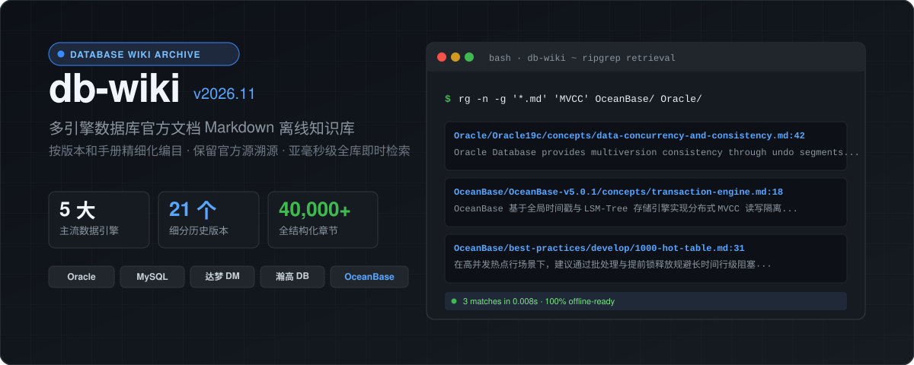
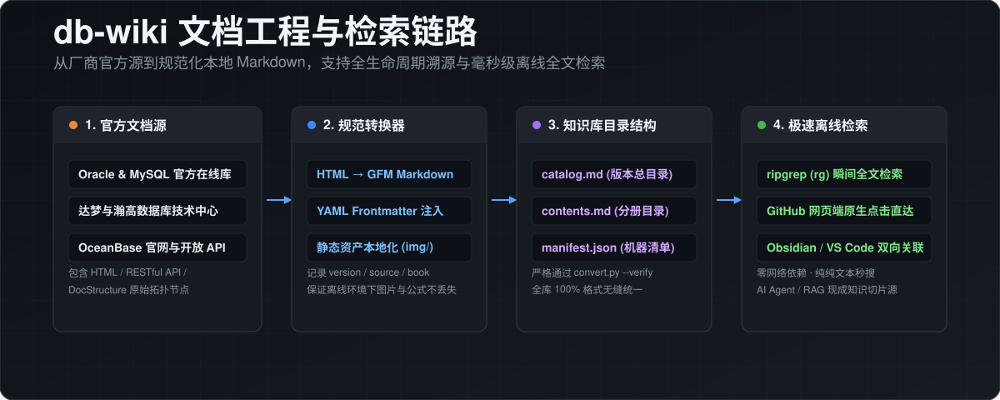

# db-wiki

<p align="center">
  
</p>

<p align="center">
  <strong>中文</strong> · <a href="README.md">English</a>
</p>

Oracle、MySQL、达梦、瀚高与 OceanBase 数据库官方文档的 Markdown 阅读库，按版本和手册精细化编目，支持亚毫秒级全库即时全文检索与 100% 离线阅读。

从 [Oracle 19c](Oracle/Oracle19c/catalog.md)、[MySQL 8.4](MySQL/MySQL8.4/catalog.md)、[达梦 DM8](dameng/dm8/catalog.md)、[瀚高 V9](highgo/highgov9/catalog.md)、[OceanBase V5.0.1](OceanBase/OceanBase-v5.0.1/catalog.md) 或 [OceanBase 最佳实践](OceanBase/best-practices/catalog.md) 开始，也可以直接按下方任务选择手册。

---

## 概述

面向数据库管理员 (DBA) 与后端开发人员，收录数据库核心架构概念、SQL 语法参考、系统参数、性能调优、备份恢复及高可用等关键主题。每一篇章节均完整保留官方来源与版本元数据，便于核对溯源；Oracle 与 MySQL 正文主要为英文，达梦、瀚高和 OceanBase 正文主要为中文。

---

## 收录示例与版本入口

当前知识库已收录 **5 大主流数据库引擎**，覆盖 **21 个细分版本与实践分支**，包含超 40,000+ 篇全结构化 Markdown 章节：

| 数据库版本 | 手册目录数 | 阅读入口 |
| --- | ---: | --- |
| Oracle 11g | 45 | [版本总目录](Oracle/Oracle11g/catalog.md) · [数据库概念](Oracle/Oracle11g/concepts/contents.md) |
| Oracle 12c | 12 | [版本总目录](Oracle/Oracle12c/catalog.md) · [数据库概念](Oracle/Oracle12c/concepts/contents.md) |
| Oracle 19c | 17 | [版本总目录](Oracle/Oracle19c/catalog.md) · [数据库概念](Oracle/Oracle19c/concepts/contents.md) |
| Oracle 21c | 23 | [版本总目录](Oracle/Oracle21c/catalog.md) · [数据库概念](Oracle/Oracle21c/concepts/contents.md) |
| MySQL 5.6 | 2 | [版本总目录](MySQL/MySQL5.6/catalog.md) · [参考手册](MySQL/MySQL5.6/reference-manual/contents.md) |
| MySQL 5.7 | 2 | [版本总目录](MySQL/MySQL5.7/catalog.md) · [参考手册](MySQL/MySQL5.7/reference-manual/contents.md) |
| MySQL 8.0 | 2 | [版本总目录](MySQL/MySQL8.0/catalog.md) · [参考手册](MySQL/MySQL8.0/reference-manual/contents.md) |
| MySQL 8.4 | 1 | [版本总目录](MySQL/MySQL8.4/catalog.md) · [参考手册](MySQL/MySQL8.4/reference-manual/contents.md) |
| MySQL 9.7 | 2 | [版本总目录](MySQL/MySQL9.7/catalog.md) · [参考手册](MySQL/MySQL9.7/reference-manual/contents.md) |
| MySQL 26.7 | 1 | [版本总目录](MySQL/MySQL26.7/catalog.md) · [参考手册](MySQL/MySQL26.7/reference-manual/contents.md) |
| MySQL 26.10 | 1 | [版本总目录](MySQL/MySQL26.10/catalog.md) · [参考手册](MySQL/MySQL26.10/reference-manual/contents.md) |
| 达梦 DM7 | 21 | [版本总目录](dameng/dm7/catalog.md) · [系统管理员手册](dameng/dm7/administrator/contents.md) |
| 达梦 DM8 | 56 | [版本总目录](dameng/dm8/catalog.md) · [系统管理](dameng/dm8/administrator/contents.md) |
| 瀚高 V4.5 | 23 | [版本总目录](highgo/highgov45/catalog.md) · [安装手册](highgo/highgov45/develop-installation-manual/contents.md) |
| 瀚高 V9 | 24 | [版本总目录](highgo/highgov9/catalog.md) · [管理员指南](highgo/highgov9/safety-administrator-guide/contents.md) |
| OceanBase V5.0.1（分布式） | 28 | [版本总目录](OceanBase/OceanBase-v5.0.1/catalog.md) · [OceanBase 简介](OceanBase/OceanBase-v5.0.1/learn-more-about-oceanbase/contents.md) |
| OceanBase V4.6.0（分布式） | 30 | [版本总目录](OceanBase/OceanBase-v4.6.0/catalog.md) · [OceanBase 简介](OceanBase/OceanBase-v4.6.0/learn-more-about-oceanbase/contents.md) |
| OceanBase V4.5.0（分布式） | 29 | [版本总目录](OceanBase/OceanBase-v4.5.0/catalog.md) · [OceanBase 简介](OceanBase/OceanBase-v4.5.0/learn-more-about-oceanbase/contents.md) |
| OceanBase V4.4.2（分布式） | 31 | [版本总目录](OceanBase/OceanBase-v4.4.2/catalog.md) · [OceanBase 简介](OceanBase/OceanBase-v4.4.2/learn-more-about-oceanbase/contents.md) |
| OceanBase V4.3.5（分布式） | 31 | [版本总目录](OceanBase/OceanBase-v4.3.5/catalog.md) · [OceanBase 简介](OceanBase/OceanBase-v4.3.5/learn-more-about-oceanbase/contents.md) |
| OceanBase V4.2.5（分布式） | 25 | [版本总目录](OceanBase/OceanBase-v4.2.5/catalog.md) · [OceanBase 简介](OceanBase/OceanBase-v4.2.5/learn-more-about-oceanbase/contents.md) |
| OceanBase V4.1.0（分布式） | 16 | [版本总目录](OceanBase/OceanBase-v4.1.0/catalog.md) · [OceanBase 介绍](OceanBase/OceanBase-v4.1.0/learn-more-about-oceanbase/contents.md) |
| OceanBase V4.4.2 LTS（集中式） | 17 | [版本总目录](OceanBase/OceanBase-standalone-v4.4.2/catalog.md) · [集中式版简介](OceanBase/OceanBase-standalone-v4.4.2/learn-more-about-oceanbase/contents.md) |
| OceanBase V4.3.5 LTS（集中式） | 18 | [版本总目录](OceanBase/OceanBase-standalone-v4.3.5/catalog.md) · [集中式版简介](OceanBase/OceanBase-standalone-v4.3.5/learn-more-about-oceanbase/contents.md) |
| OceanBase V4.2.5 LTS（集中式） | 17 | [版本总目录](OceanBase/OceanBase-standalone-v4.2.5/catalog.md) · [集中式版简介](OceanBase/OceanBase-standalone-v4.2.5/learn-more-about-oceanbase/contents.md) |
| OceanBase 最佳实践 | 10 | [版本总目录](OceanBase/best-practices/catalog.md) · [安装部署](OceanBase/best-practices/deploy/contents.md) |

### 按解决任务查阅

以下链接以日常运维高频关注点为例，其他版本请从对应总目录进入。

| 要解决的问题 | Oracle 19c | 达梦 DM8 | OceanBase 最佳实践 |
| --- | --- | --- | --- |
| 管理实例与数据库对象 | [管理员指南](Oracle/Oracle19c/administrators-guide/contents.md) | [系统管理员手册](dameng/dm8/administrator/contents.md) | [数据表设计](OceanBase/best-practices/database-design/contents.md) |
| 查询 SQL 语法与函数 | [SQL 语言参考](Oracle/Oracle19c/sql-language-reference/contents.md) | [SQL 语言手册](dameng/dm8/sql-language/contents.md) | [应用开发](OceanBase/best-practices/develop/contents.md) |
| 编写存储过程与程序块 | [PL/SQL 语言参考](Oracle/Oracle19c/pl-sql-language-reference/contents.md) | [SQL 程序设计](dameng/dm8/sql-programming/contents.md) | [PL 性能分析](OceanBase/best-practices/develop/1200-pl-sql-perf-analysis.md) |
| 分析性能与优化 SQL | [SQL 调优指南](Oracle/Oracle19c/sql-tuning-guide/contents.md) | [SQL 调优](dameng/dm8/administrator/sql-tuning.md) | [性能调优实践](OceanBase/best-practices/performance-tuning/contents.md) |
| 备份、还原与高可用 | [备份与恢复用户指南](Oracle/Oracle19c/backup-and-recovery-users-guide/contents.md) | [备份与还原](dameng/dm8/backup-restore/contents.md) | [高可用最佳实践](OceanBase/best-practices/high-availability/contents.md) |
| 查找参数与系统视图 | [数据库参考](Oracle/Oracle19c/reference/contents.md) | [动态视图](dameng/dm8/administrator/dynamic-management.md) | [诊断与排障](OceanBase/best-practices/diagnostic/contents.md) |

---

## 架构与查阅流程

<p align="center">
  
</p>

### 查阅与溯源机制

1. **选定版本**：从版本矩阵打开对应版本的 `catalog.md`，按主题查找手册。
2. **定位章节**：打开手册目录中的 `contents.md`，按原书编目快速定位内容。所有路径均相对于该总目录所在文件夹。
3. **核对原文**：在每一章节开头的 YAML Frontmatter 中查看 `version`、`source` 及 `tags`，确认适用版本与官方在线出处。

---

## 快速开始与使用

在 GitHub 网页上直接点击链接即可在线浏览，无需安装任何数据库或前端环境。若需离线检索与阅读，建议克隆本仓库并在本地终端使用：

```bash
# 1. 克隆离线知识库
git clone https://github.com/HuangChenning/db-wiki.git
cd db-wiki
```

打开 `Oracle/Oracle19c/concepts/contents.md`，点击第一章即可开始阅读。

### 本地高速全文检索

推荐安装 [ripgrep](https://github.com/BurntSushi/ripgrep)（`rg`），在仓库根目录下执行亚毫秒级全文检索。使用 `-g '*.md'` 限定正文文件，避免扫描图片等静态二进制资源：

```bash
# 在 Oracle 19c 概念手册中查找事务与锁机制
rg -n -g '*.md' 'transaction' Oracle/Oracle19c/concepts

# 在达梦 DM8 备份手册中查找 DMRMAN 工具指令
rg -n -g '*.md' 'DMRMAN' dameng/dm8/backup-restore

# 在 OceanBase 最佳实践与 V5.0.1 中跨版本搜索读写分离指南
rg -n -g '*.md' '读写分离' OceanBase/best-practices OceanBase/OceanBase-v5.0.1
```

---

## 注意事项与收录限制

- **版本强绑定**：不同数据库及小版本的系统参数、默认行为、系统视图与 SQL 语法存在差异，请务必核对当前生产环境的具体版本。
- **收录范围边界**：本仓库为精选官方手册的结构化 Markdown 阅读库，不代表厂商官方的全部在线产品线，亦不保证与官网实时静默同步。
- **原始语言保留**：中英文 README 提供同等层级的导航体系，正文内容保留官方发布时的原始语言（Oracle/MySQL 为英文，国产数据库为中文）。
- **Markdown 转换格式微差**：文档内容由官方文档工程化清洗而来，个别复杂嵌套表格、绘图或内联超链接可能存在渲染偏差；关键生产操作建议核对章节内的 `source` 官方原文。
- **版权与来源声明**：文档原始知识产权与版权归各数据库厂商及权利人所有。

---

## 贡献指南

欢迎补充、校正或反馈文档缺失：

1. **反馈问题**：请提交 Issue，注明数据库引擎、具体版本号、手册名称、章节相对路径以及官方对应 `source` 链接。
2. **新增/更新手册**：必须遵循 `skills/db-online-docs-to-markdown` 规范，生成完整的 `catalog.md`、`contents.md`、`manifest.json` 及局部 `img/` 静态资源，并执行 `python3 skills/db-online-docs-to-markdown/scripts/convert.py --manifest <path>/manifest.json --verify` 确保通过校验。
3. **同步维护**：若调整或新增手册，须在同一提交中同步更新 `README.md` 与 `README.zh-CN.md` 的收录统计与入口链接。
