## 第7章 创建和配置DM 数据库

`DM`数据库可以在安装`DM`软件时创建，也可以在安装`DM`软件之后，通过数据库配置工具或`dminit`来手工创建数据库，创建数据库时要使用初始化参数。

## 7.1 创建DM 数据库

用户创建数据库之前，需要规划数据库，如数据库名、实例名、端口、文件路径、簇大小、页大小、日志文件大小、`SYSDBA`和`SYSAUDITOR`等系统用户的密码等，然后可以使用图形化界面或者`dminit`创建数据库。用户可以在安装`DM`数据库软件时创建数据库，也可以在安装之后创建数据库。

在创建数据库之前需要做如下准备工作：

1. 规划数据库表和索引，并估算它们所需的空间大小；
2. 确定字符集。所有字符集数据，包括数据字典中的数据，都被存储在数据库字符集

中，用户在创建数据库时可以指定数据库字符集，如不指定则使用默认字符集

```
GB18030；
```

3. 配置数据库时区，如中国是`+8:00` 时区；
4. 设置数据库簇大小、页大小、日志文件大小，在数据库创建时由`EXTENT_SIZE,`

`PAGE_SIZE, LOG_SIZE`初始化参数来指定，并且在数据库创建完成之后不能修改此参数。

创建数据库之前，必须满足以下必要条件：

1. 安装必需的`DM` 软件，包括为操作系统设置各种环境变量，并为软件和数据库文件

建立目录结构；

2. 必须有足够的内存来启动`DM` 数据库实例；
3. 在执行`DM` 的计算机上要有足够的磁盘存储空间来容纳规划的数据库。

## 7.2 使用数据库配置工具创建数据库

数据库配置工具提供了一个图形化界面来引导用户创建和配置数据库。使用数据库配置工具来创建数据库是用户的首选，因为数据库配置工具更趋于自动化，当使用数据库配置工具安装完成时，数据库也做好了使用准备工作。数据库配置工具可以通过`DM`数据库安装之后作为一个独立的工具来启动。数据库配置工具可以执行以下任务：

1. 创建数据库；
2. 改变数据库的配置；
3. 删除数据库；
4. 管理模板；
5. 自动存储管理；
6. 注册数据库服务。

### 7.2.1 启动数据库配置工具

数据库配置工具可以通过`DM`支持的模板或用户自定义的模板来创建数据库。

通过下列步骤来启动数据库配置工具（以`Windows`操作系统为例）：

56

## 第7 章 创建和配置DM 数据库

1. 使用通过验证的具有管理权限组的成员登录到计算机上，安装`DM` 数据库软件，并

创建和运行数据库；

2. 在`Windows` 操作系统中启动数据库配置工具。选择“开始`”→“`程序`”→“`达梦数据

库`”→“`客户端`”→“`数据库配置工具”，启动数据库配置工具，将出现数据库配置工具界面，按照数据库配置工具操作，如图`7.1`所示。


图`7.1`启动数据库配置工具

### 7.2.2 使用数据库配置工具创建数据库

在数据库配置工具操作窗口中，选择“创建数据库”选项启动能够创建和配置一个数据库的向导，如图`7.2`所示。这个向导引导用户完成以下操作：

1. 数据库模板；
2. 数据库目录；
3. 数据库标识；
4. 数据库文件；
5. 初始化参数；
6. 口令管理；
7. 创建示例库；
8. 创建摘要；
9. 创建数据库。

57

## 第7 章 创建和配置DM 数据库

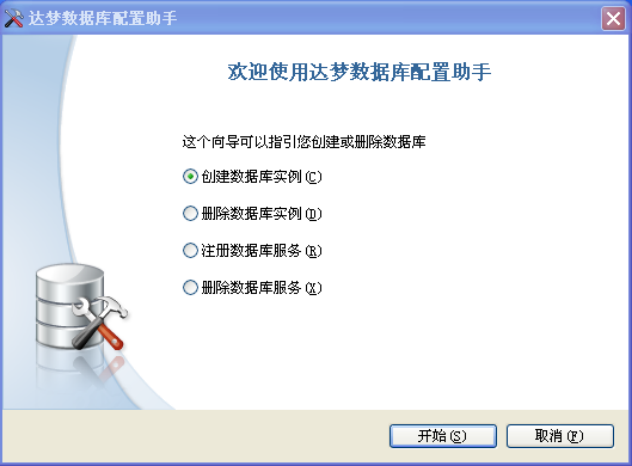

图`7.2`数据库配置工具操作界面

#### 7.2.2.1 数据库模板

在这个窗口中可以选择需要创建数据库的类型，`DM`预定义了一些模板，如一般用途、联机分析处理模板或联机事务处理模板，用户还可以选择是否以配置状态启动数据库，以及数据库初始模式(包括普通、主库、备库模式)。如图`7.3`所示。

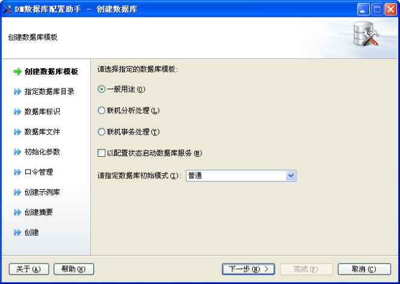

图`7.3`数据库模板选择

#### 7.2.2.2 数据库目录

指定数据库目录。如图`7.4`所示。

58

## 第7 章 创建和配置DM 数据库

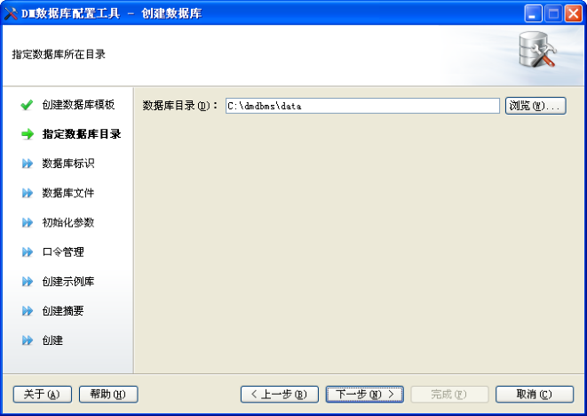

图`7.4`指定数据库目录

#### 7.2.2.3 数据库标识

在“数据库名（D）”文本框中，输入数据库名；在“实例名（I）”文本框中输入数据库实例名；在“端口（P）”文本框中，输入端口号。如图`7.5`所示。

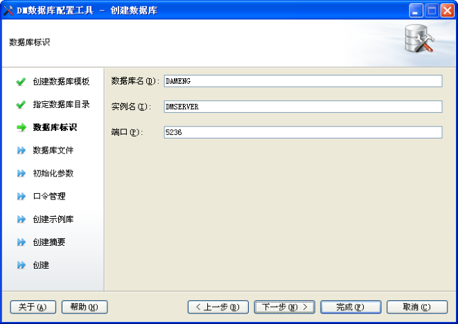

图`7.5`设置数据库标识

#### 7.2.2.4 数据库文件

如图`7.6`所示，此界面包含三个选项卡：“控制文件”、“数据文件”和“日志文件”，可以通过双击路径来更改文件路径。

59

## 第7 章 创建和配置DM 数据库

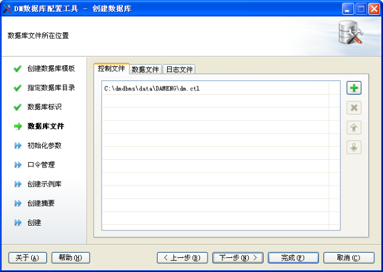

图`7.6`设置数据库文件路径

控制文件与配置文件类似，控制文件对系统的运行及性能有很大的影响，但不同的是，配置文件中的配置项可以随意更改，而控制文件中的控制信息一般在系统第一次创建完毕后就不能随意更改，所以控制文件不是一个文本文件，而是一个二进制文件。另外控制文件一旦被破坏或丢失仍就无法手工重新创建，基于这一点，对控制文件的保护显得尤为重要。

整个系统中只有一个控制文件，其中存储的控制信息包括主要数据文件路径、日志文件路径、`LSN`信息等。由于控制文件对系统至关重要，如果控制文件损坏，系统将无法启动，因此，`DM`允许在创建数据库时指定多个控制文件的镜像。这些控制文件的内容是一模一样的，系统每次写控制文件时会顺序对它们进行修改。如果系统在写某一个控制文件时发生硬件故障导致该文件损坏，可以通过其他的控制文件来恢复这个损坏的控制文件，之后重新启动数据库。

数据文件“数据文件”选项卡用来指定系统表空间路径、用户表空间路径、回滚表空间路径和临时表空间路径。同时还可以指定系统表空间镜像、用户表空间镜像、回滚表空间镜像路径。三个镜像文件是分别和系统表空间、用户表空间、回滚表空间一模一样的文件，当系统表空间、用户表空间、回滚表空间文件损坏时，就可以使用相应的镜像文件来替换。

数据文件是数据库中最重要的文件类型之一，这是数据最终要存储的地方，每个数据库至少有一个与之相关的数据文件，通常情况下，将会有多个。为了理解`DM Server`如何组织这些文件，以及数据在它们内部是如何组织的，必须理解数据页和簇的概念，它们都是`DM``Server`用于保存数据库对象的分配单元。

数据页是系统进行磁盘`IO`和缓冲区调度的单元，其大小在数据库创建时就固定下来了，而且一旦固定就不可更改，它们的容量也都是相同的。所有数据页的格式大致相同。

簇是数据文件中一个连续的分配空间，簇由多个数量固定的数据页组成。数据文件对空间的标识都以簇为单位，每个数据文件都维护着两条链，一条为半空簇的链，另一条为自由簇的链，其中半空链用于标识文件中所有被用过一部分的簇，自由链则标识文件中所有未被用过的簇。通常情况下，系统在分配空间时，以簇为单位分配会更有效。

日志文件重做日志文件对于`DM Server`是至关重要的。它们用于存储数据库的事务日志，以便系统在出现系统故障和介质故障时能够进行故障恢复。在`DM Server`中，任何修改数据库

60

## 第7 章 创建和配置DM 数据库

的操作都会产生重做日志，这样，当系统出现故障时，通过分析日志可以知道在故障发生前系统做了哪些动作，并可以重做这些动作使系统恢复到故障之前的状态。

#### 7.2.2.5 初始化参数

数据文件使用的簇大小，即每次分配新的段空间时连续的页数，只能是16 页或32 页，缺省使用16 页。

数据文件使用的页大小，可以为`4K`、`8K`、`16K`或`32K`，选择的页大小越大，则`DM`支持的元组长度也越大，但同时空间利用率可能下降，缺省使用`8K`。

日志文件使用的大小，默认是64，范围为64 和2048 之间的整数，单位为M。如图`7.7`所示。

时区设置，默认是`+08:00`，范围为`-12:59`和`+14:00`之间，如图`7.7`所示。

页面检查，默认是不启用，选项包括不启用、简单检查、严格检查，如图`7.7`所示。

字符集，默认是`GB18030`，选项包括`GB18030`、`Unicode`、`EUC-KR`，如图`7.7`所示。

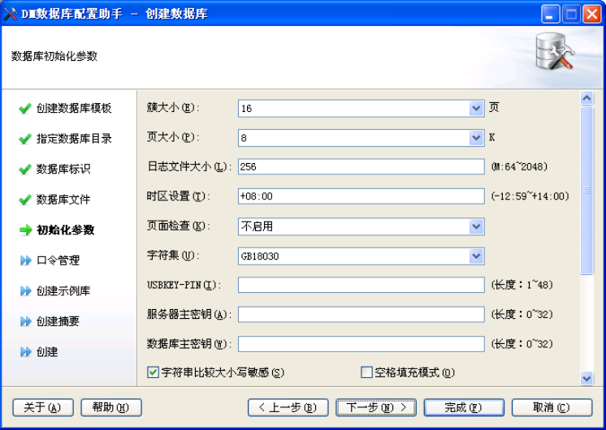

图`7.7`初始化参数

#### 7.2.2.6 口令管理

为了数据库管理安全，提供了为数据库的`SYSDBA`和`SYSAUDITOR`系统用户指定新口令功能，如果安装版本为安全版，将会增加`SYSSSO`和`SYSDBO`用户的密码修改。用户可以选择为每个系统用户设置不同口令（留空表示使用默认口令），也可以为所有系统用户设置同一口令。口令必须是合法的字符串，不能少于9 个或多于48 个字符。如图`7.8`所示。

61

## 第7 章 创建和配置DM 数据库

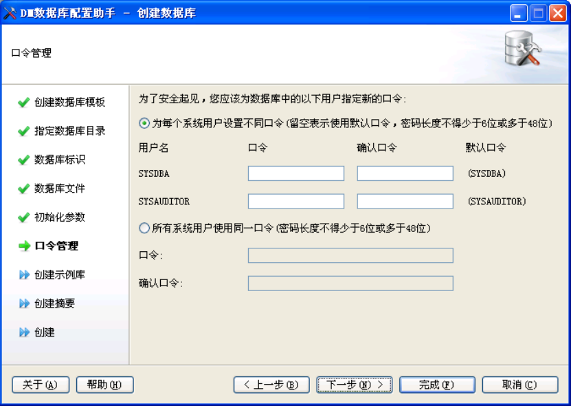

图`7.8`口令管理

#### 7.2.2.7 创建示例库

示例库`BOOKSHOP`模拟武汉代理图书的某销售公司，该公司欲建立在线购物平台来拓展其代理产品的销售渠道。该示例在`DM`各演示程序中使用。安装该示例后，将在数据库中创

```
建BOOKSHOP 表空间，同时创建RESOURCES、PERSON、PRODUCTION、PURCHASING、
```

`SALES`、`OTHER`这6 个模式和相关的表。如图`7.9`所示。

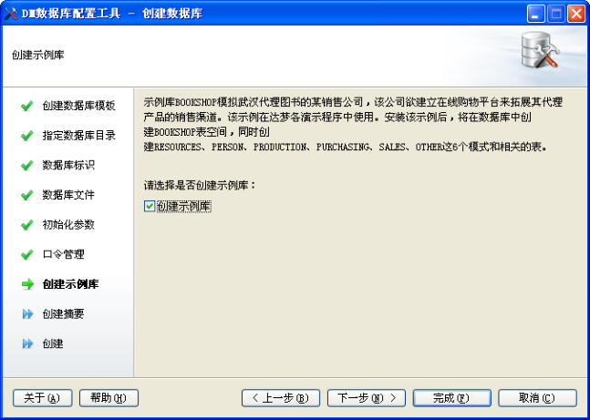

图`7.9`创建示例库62

## 第7 章 创建和配置DM 数据库

#### 7.2.2.8 创建摘要

列举创建数据库纲要，会列举创建时指定的数据库名、示例名、数据库目录、端口、控制文件路径、数据文件路径、日志文件路径、簇大小、页大小、日志文件大小、标识符大小写是否敏感、是否使用`unicode`等信息，方便用户确认创建信息是否符合自己的需求，及时返回修改。如图`7.10`所示。

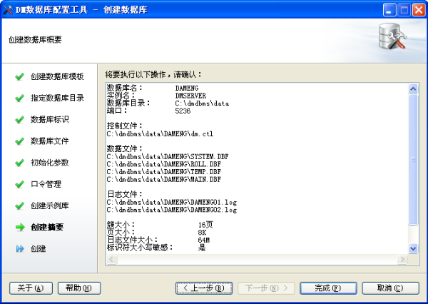

图`7.10`创建摘要

#### 7.2.2.9 创建数据库

核对完创建信息后，开始创建数据库、创建并启动实例、创建示例库。如图`7.11`所示。

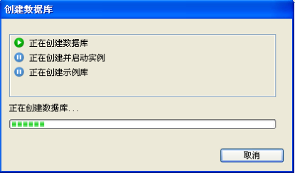

图`7.11`创建数据库

安装完成之后将显示对话框，提示安装完成或错误反馈信息，如图`7.12`所示。

63

## 第7 章 创建和配置DM 数据库

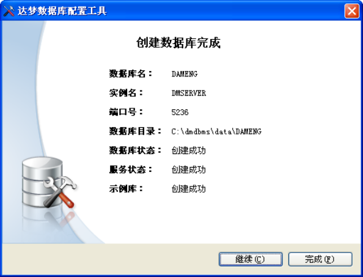

图`7.12`创建数据库完成

如果数据库配置工具运行在`Linux`、`Solaris`、`AIX`和`HP-UNIX`系统中，使用非`root`系统用户在创建数据库完成时，将弹出提示框，提示应以`root`系统用户执行以下命令，用来创建数据库的随机启动服务，如图`7.13`所示。

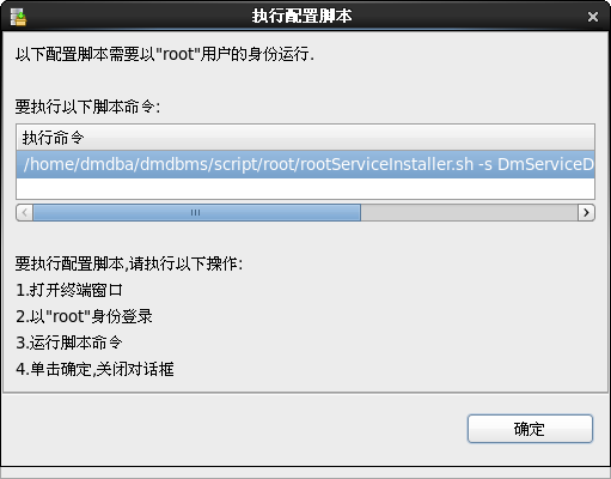

图`7.13`执行命令提示

## 7.3 使用dminit 创建数据库

在安装`DM`的过程中，用户可以选择是否创建初始数据库，如果当时没有创建，也可以在完成安装后，利用初始化库工具`dminit`来创建。系统管理员可以利用该工具提供的各种参数，设置数据库存放路径、段页大小、是否对大小写敏感以及是否使用`unicode`，创建出满足用户需要的初始数据库。该工具位于安装目录的`bin\`目录下。

在`Windows“`命令提示符”窗口中输入带参数的`dminit`命令启动`dminit`工具，命令

```
格式为dminit [para=value][para=value]……，参数说明见表7.1。
```

64

## 第7 章 创建和配置DM 数据库

表`7.1 dminit`工具参数说明备参数含义取值注已有`INI`文件的路径，此`INI`文件用合法的路径。文件路径长度最大为`257(`含结束可

```
INI_FILE
```

于将其所有参数值作为当前新生成符)，不包括文件名选`INI`文件的参数值初始数据库存放的路径，默认路径为合法的路径。文件路径长度最大为`257(`含结束可

```
PATH
```

`dminit.exe`当前所在的工作目录符)，不包括文件名选初始数据库控制文件的路径，默认值

```
windows 下是
```

合法的路径。文件路径长度最大为`257(`含结束可

```
CTL_PATH  PATH\DB_NAME\dm.ctl，linux 下
```

符)，不包括文件名选

```
是/PATH/DM_NAME/dm.ctl（粗体表
```

示前面设置的参数）初始数据库日志文件的路径，默认值

```
windows 下是
PATH\DB_NAME\DB_NAME01.log
```

和合法的路径。文件路径长度最大为`257(`含结束

```
PATH\DB_NAME\DB_NAME02.log，
```

可`LOG_PATH`符)，不包括文件名。日志文件路径个数不超过`linux`下是选10 个

```
PATH/DB_NAME/DB_NAME01.log
```

和

```
PATH/DB_NAME/DB_NAME02.log
```

（粗体表示前面设置的参数）数据文件使用的簇大小，即每次分配新可`EXTENT_SIZE`只能是16 页或32 页之一，缺省使用16 页的段空间时连续的页数选数据文件使用的页大小，可以为`4K`、`8K`、`16K`或`32K`之一，选择的页大小可`PAGE_SIZE`越大，则`DM`支持的元组长度也越大，只能是`4K`、`8K`、`16K`或`32K`之一选但同时空间利用率可能下降，缺省使用

```
8K
```

日志文件使用的簇大小，以M为单位， 可`LOG_SIZE` 64 和2048 之间的整数默认每个日志文件大小为`256M`选标识符大小写敏感，默认值为Y。当大小写敏感时，小写的标识符应用双引号可`CASE_SENSITIVE`括起，否则被转换为大写；当大小写不只能是`Y, y, N, n,1,0`之一选敏感时，系统不自动转换标识符的大小写，在标识符比较时也不区分大小写`CHARSET/UNICODE_FLAG`字符集选项。0 代表`GB18030,1`代表可取值0、1 或2 之一。默认值为0`UTF-8,2`代表韩文字符集`EUC-KR`选2 表示清理建库目录下所有文件；

1 表示覆盖所有同名文件； 可

```
AUTO_OVERWRITE  只能是0,1,2 之一
```

0 表示不覆盖所有同名文件； 选默认值为0。

`VARCHAR`类型对象的长度是否以字符为单位。 可`LENGTH_IN_CHAR`取值0 或1。默认值为0 1：是，设置为以字符为单位时，定义选长度并非真正按照字符长度调整，而是65

## 第7 章 创建和配置DM 数据库

将存储长度值按照理论字符长度进行放大。所以会出现实际可插入字符数超过定义长度的情况，这种情况也是允许的。同时，存储的字节长度8188 上限仍然不变，也就是说，即使定义列长度为8188 字符，其实际能插入的字符串占用总字节长度仍然不能超过8188；

0：否，所有`VARCHAR`类型对象的长度以字节为单位字符类型在计算`HASH`值时所采用的可`USE_NEW_HASH` `HASH`算法类别。0：原始`HASH`算法；取值0 或1选1：改进的`HASH`算法。默认值为1。

初始化时设置`SYSDBA`的密码，默认为可`SYSDBA_PWD`合法的字符串，长度在6 到48 个字符之间

```
SYSDBA  选
```

初始化时设置`SYSAUDITOR`的密码， 可`SYSAUDITOR_PWD`合法的字符串，长度在6 到48 个字符之间默认为`SYSAUDITOR`选可`DB_NAME`初始化数据库名字，默认是`DAMENG`有效的字符串，不超过128 个字符选初始化数据库实例名字，默认是可`INSTANCE_NAME`有效的字符串，不超过128 个字符

```
DMSERVER  选
```

初始化时设置`dm.ini`中的可

```
PORT_NUM  取值范围：1024~65534
PORT_NUM，默认5236  选
```

格式为[正负号]小时[：分钟]（正负号和分钟为可`TIME_ZONE`初始化时区，默认是东八区可选）。时区设置范围为：`-12:59~+14:00`选是否启用页面内容校验，0：不启用；

可

`PAGE_CHECK` 1：简单校验；2：严格校验(使用`CRC16`取值范围：`0~2`

选

算法生成校验码)。默认0`RAC_NODE`高性能集群的节点数目取值范围`2~16`，单站点时不写可选可`EXTERNAL_CIPHER_NAME`设置默认加密算法有效的字符串，不超过128 个字符选可`EXTERNAL_HASH_NAME`设置默认`HASH`算法有效的字符串，不超过128 个字符选可`EXTERNAL_CRYPTO_NAME`设置根密钥加密引擎有效的字符串，不超过128 个字符选可`SVR_KEY`服务器主密钥，用于加密数据库主密钥合法的字符串，最长为32 个字节选数据库主密钥，用于加密库内密钥，如可`DB_KEY`合法的字符串，最长为32 个字节用户加密密钥、列加密密钥选可`ENCRYPT_PWD`全库加密密钥合法的字符串，最长为32 个字节选全库加密密钥使用的算法名。算法可以是`DM`内部支持的加密算法，或者是第可`ENCRYPT_NAME`合法的字符串，最长为128 个字节三方的加密算法。默认使用选

```
"AES256_ECB"算法加密
```

可`RLOG_ENC_FLAG`设置日志文件是否加密取值`Y/N`，`y/n`，`1/0`，默认N选66

## 第7 章 创建和配置DM 数据库

可`USBKEY_PIN` `USBKEY PIN,`用于加密服务器根密钥合法的字符串，最长为48 个字节选设置字符串比较时，结尾空格填充模式可`BLANK_PAD_MODE`取值0 或1。0 不兼容，1 兼容。默认为0是否兼容`ORACLE`选可`SYSTEM_MIRROR_PATH`指定`system.dbf`文件的镜像路径绝对路径，默认为空选可`MAIN_MIRROR_PATH`指定`main.dbf`文件的镜像路径绝对路径，默认为空选可`ROLL_MIRROR_PATH`指定`roll.dbf`文件的镜像路径绝对路径，默认为空选初始化时设置`dm.ini`中的可`MAL_FLAG`取值0 或1`MAL_INI`，默认0 选初始化时设置`dm.ini`中的可

```
ARCH_FLAG  取值0 或1
```

`ARCH_INI`，默认0 选`Mpp`系统内的库初始化时设置可`MPP_FLAG`取值0 或1`dm.ini`中的`mpp_ini`，默认0。 选指定初始化配置文件路径。初始化配置文件是一个保存了各数据文件路径设可`CONTROL`置等信息的文本。使用`control`初始主要用于将数据文件放在裸设备或`rac`环境下选化时，若文件已存在，系统会屏幕打印提示，然后直接覆盖可`DCP_MODE`是否是`DCP`代理模式取值：1 是；0 否。默认值为0选取值范围：`1024~65534`。当`DCP_MODE=1`时，可`DCP_PORT_NUM` `DCP`代理模式下管理端口该参数才有效选初始化时设置`SYSSSO`的密码，默认为可`SYSSSO_PWD` `SYSSSO`，仅在安全版本下可见和可设合法的字符串，长度在6 到48 个字符之间选置初始化时设置`SYSDBO`的密码，默认为可`SYSDBO_PWD` `SYSDBO`，仅在安全版本下可见和可设合法的字符串，长度在6 到48 个字符之间选置是否是四权分立。默认值为0（不使用），四权分立的具体权限见附录7。 可`PRIV_FLAG`只能是0 或1默认情况下，使用三权分立。 选仅在安全版本下可见和可设置指定初始化过程中生成的日志文件所合法的路径。文件路径长度最大为`257(`含结束可

```
ELOG_PATH
```

在路径符)，不包括文件名选可`HELP`显示帮助信息选

说明：`dminit`一般是要有参数的，如果没有带参数，系统就会引导用户设置。另外，参数、等号和值之间不能有空格。`Help`参数的后面不用添加`’=’`号。

命令举例：

```
dminit PATH=c:\dm7data PAGE_SIZE=16
```

如果创建成功，则屏幕显示如图`7.13`所示。此时在c盘根目录下出现`dm7Data`文件夹，内容包含初始数据库`DAMENG`的相关文件和初始化文件`dm.ini`。将`dm.ini`文件拷贝到`DM`安装目录的`bin`下，`DM`服务器就可以启动该初始数据库了。

67

## 第7 章 创建和配置DM 数据库

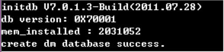

图`7.14`创建成功后的屏幕显示

## 7.4 注册数据库服务

注册数据库服务，该功能用于将使用命令行工具生成的数据库，重新注册成系统服务，方便用户管理与控制。

用户注册数据库服务可以通过图形化界面和`shell`脚本两种方式，本节讲述的是通过数据库配置工具注册数据库服务，通过`shell`脚本注册数据库服务详细操作请参见`7.8`节数据库服务配置脚本。如图`7.16`所示。

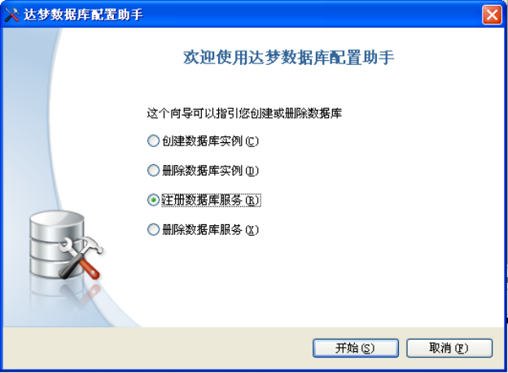

图`7.16`选择操作方式

用户选择`dm.ini`文件来注册相应的数据库，并可修改相应的端口号和实例名，也可以选择是否以配置状态启动数据库，如图`7.17`所示。

68

## 第7 章 创建和配置DM 数据库

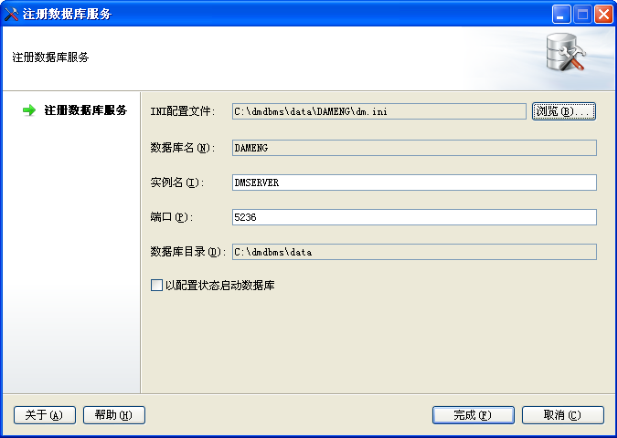

图`7.17`要删除的数据库

正在注册数据库服务，如图`7.18`所示。

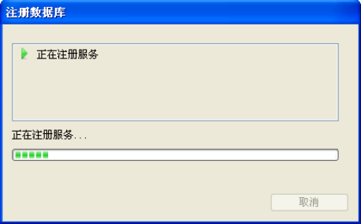

图`7.18`注册数据库服务

注册完成之后将显示对话框，提示完成或错误反馈信息，如图`7.19`所示。

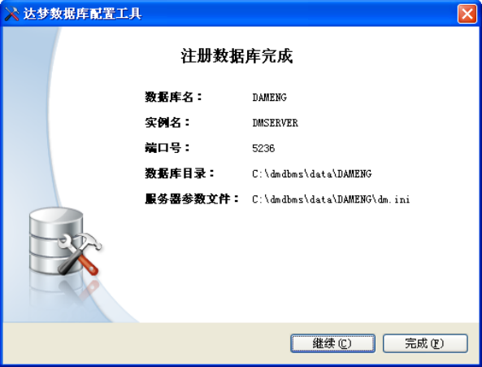

图`7.19`注册数据库完成69

## 第7 章 创建和配置DM 数据库

## 7.5 查看数据库信息

登录数据库管理工具，通过表空间属性，可以查看数据文件路径、总空间大小、空闲空间大小、使用率。如图`7.20`所示。

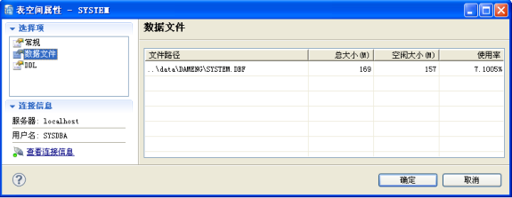

`7.20`查看数据文件

通过`DM`控制台工具，查看实例配置属性，如图`7.21`所示，可以查看到如下信息：文件位置、实例名、内存池和缓冲区、线程、查询、检查点、输入输出、数据库、日志、事务、安全、兼容性、请求跟踪、进程守护、`ORACLE`数据类型兼容和配置文件。

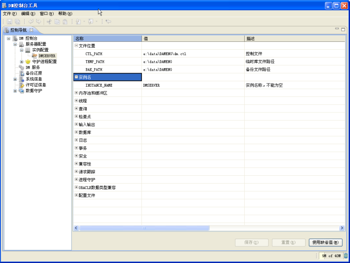

`7.21`查看数据文件

## 7.6 删除数据库

删除数据库，包括删除数据库的数据文件、日志文件、控制文件和初始化参数文件。为了保证删除数据库成功，必须保证`dmserver`已关闭。

可以使用数据库配置工具来删除数据库。如图`7.22`所示。

70

## 第7 章 创建和配置DM 数据库


图`7.22`选择操作方式

根据数据库名称，选择要删除的数据库，如图`7.23`所示，也可以通过指定数据库配置文件删除数据库。

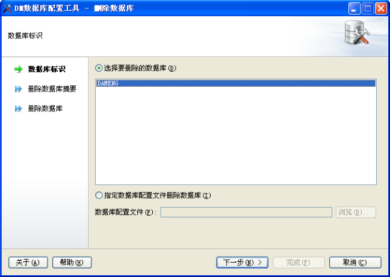

图`7.23`要删除的数据库

确认将删除的数据库名、实例名、数据库目录，如图`7.24`所示。

71

## 第7 章 创建和配置DM 数据库

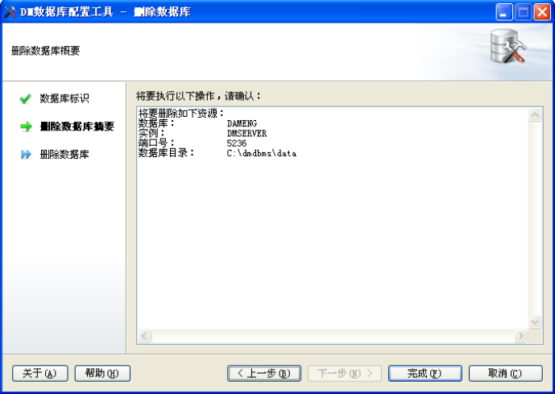

图`7.24`删除数据库概要

首先停止实例，然后删除实例，最后删除数据库，如图`7.25`所示。

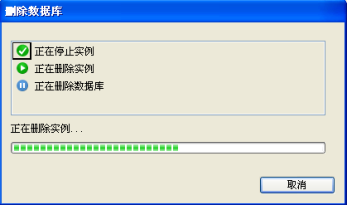

图`7.25`删除数据库

删除完成之后将显示对话框，提示完成或错误反馈信息，如图`7.26`所示。

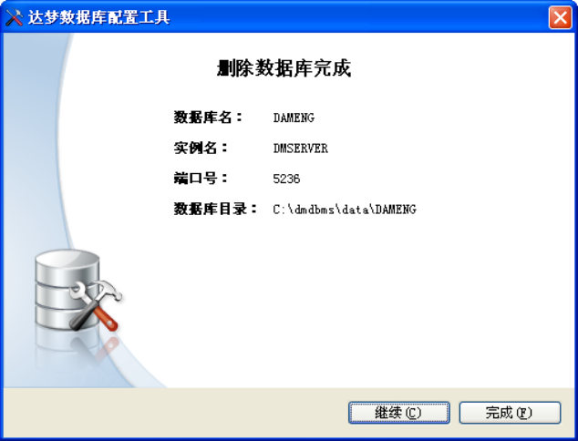

图`7.26`删除数据库完成72

## 第7 章 创建和配置DM 数据库

如果数据库配置工具运行在`Linux`、`Solaris`、`AIX`和`HP-UNIX`系统中，使用非`root`系统用户在删除数据库完成时，将弹出提示框，提示应以`root`系统用户执行以下命令，用来删除数据库的随机启动服务，如图`7.27`所示。

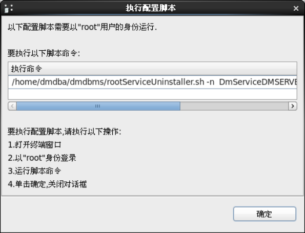

图`7.27`执行命令提示

## 7.7 删除数据库服务

删除数据库服务，只删除用于启动和停止数据库的服务文件，不会删除数据库的数据文件、日志文件、控制文件和初始化参数文件。

用户删除数据库服务可以通过图形化界面和`shell`脚本两种方式，本节讲述的是通过数据库配置工具删除数据库服务，通过`shell`脚本删除数据库服务详细操作请参见`7.8`节数据库服务配置脚本。如图`7.28`所示。

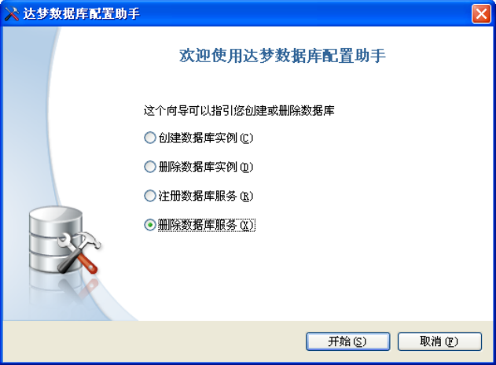

图`7.28`选择操作方式

根据数据库服务名称，选择要删除的数据库服务，如图`7.29`所示，也可以通过指定数据库配置文件删除数据库服务。

73

## 第7 章 创建和配置DM 数据库

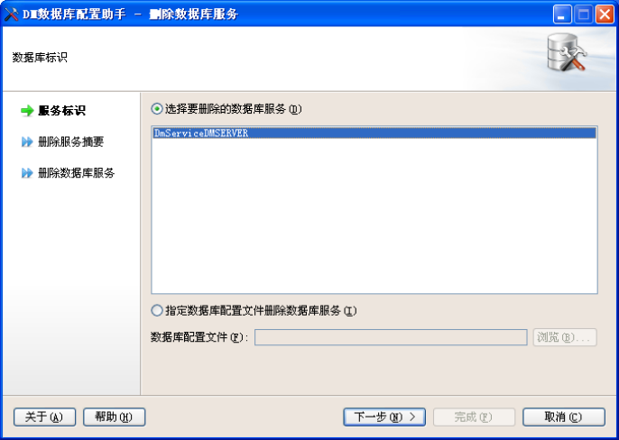

图`7.29`要删除的数据库服务

确认将删除的数据库名、实例名、数据库服务名、数据库目录，如图`7.30`所示。

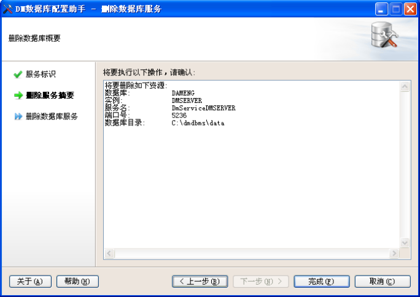

图`7.30`删除数据库概要

首先检查数据库服务，然后删除数据库服务，如图`7.31`所示。

74

## 第7 章 创建和配置DM 数据库

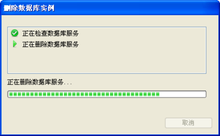

图`7.31`删除数据库服务

删除完成之后将显示对话框，提示完成或错误反馈信息，如图`7.32`所示。

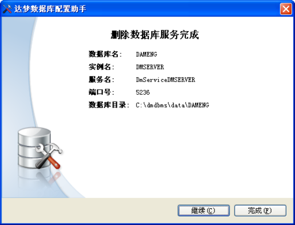

图`7.32`删除数据库服务完成

如果数据库配置工具运行在`Linux`、`Solaris`、`AIX`和`HP-UNIX`系统中，使用非`root`系统用户在删除数据库服务完成时，将弹出提示框，提示应以`root`系统用户执行以下命令，用来删除数据库的随机启动服务，如图`7.33`所示。


75

## 第7 章 创建和配置DM 数据库

图`7.33`执行命令提示

## 7.8 数据库服务配置脚本

在`Linux`、`Solaris`、`AIX`和`HP-UNIX`系统下，创建和删除系统随机启动服务需要`root`权限，所以用户运行数据库服务配置脚本时需要使用`root`用户运行配置脚本，用来创建或删除达梦数据库的随机启动服务。

数据库服务配置脚本默认位置在数据库安装目录下的`script`目录下的`root`目录中，包含`root_db_service_installer.sh`服务安装脚本文件和`rootServiceUninstaller.sh`服务卸载脚本文件。

### 7.8.1 服务安装脚本文件

服务安装脚本文件即为`root_db_service_installer.sh`。参数如下表：

标志参数说明`-F` `INI`文件路径指定数据库服务所需要的`INI`文件路径`-N`数据库实例名指定数据库的实例名`-M` `OPEN`或`MOUNT`指定数据库启动方式，可选`-S`数据库服务名如果已存在数据库服务脚本文件，可直接指定服务名。即脚本文件名。如果设置此参数则忽略`–F`、`–N`、`–M``-H`帮助

使用方法如下：

首先使用`root`系统用户登录或切换至`root`系统用户。

假设数据库的`ini`所在路径为`/opt/dmdbms/data/DAMENG/dm.ini`，此数据库的实例名为`DMSERVER`。

1. 通过`ini` 文件注册服务，命令如下：

```
./root_db_service_installer.sh –f /opt/dmdbms/data/DAMENG/dm.ini –n DMSERVER
```

2. 通过服务名创建服务。非`root` 系统用户通过数据库配置工具创建数据库完成时，

会在安装目录的`bin`目录下生成数据库服务文件，文件名为`DmService+`实例名，此文件名即为数据库的服务名。用户可通过此服务名创建数据库随机启动服务。命令如下：

```
./root_db_service_installer.sh –s DmServiceDMSERVER
```

### 7.8.2 服务卸载脚本文件

服务卸载脚本文件即为`rootServiceUninstaller.sh`。参数如下表：

标志参数说明`-A`删除所有的数据库随机启动服务`-N`数据库服务名删除指定的数据库随机启动服务`-H`帮助

使用方法如下：

首先使用`root`系统用户登录或切换至`root`系统用户。

1. 删除所有的数据库服务。命令如下：

```
./rootServiceUninstaller.sh –a
```

2. 删除指定的数据库服务。假设存在数据库随机启动服务`DmServiceDMSERVER`，

命令如下：

76

## 第7 章 创建和配置DM 数据库

```
./rootServiceUninstaller.sh –n DmServiceDMSERVER
```

77
