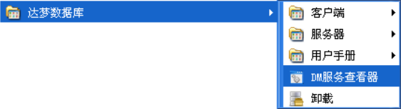
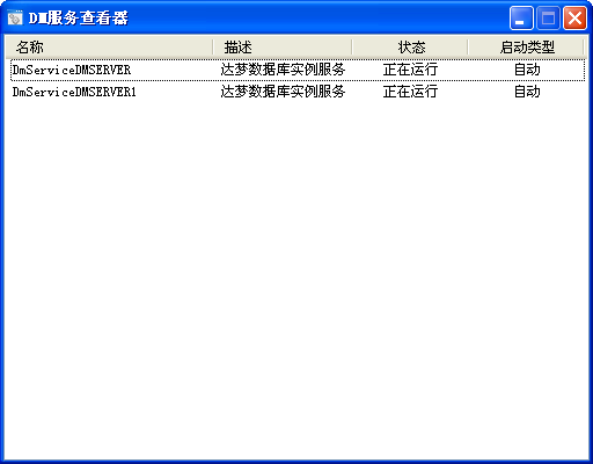
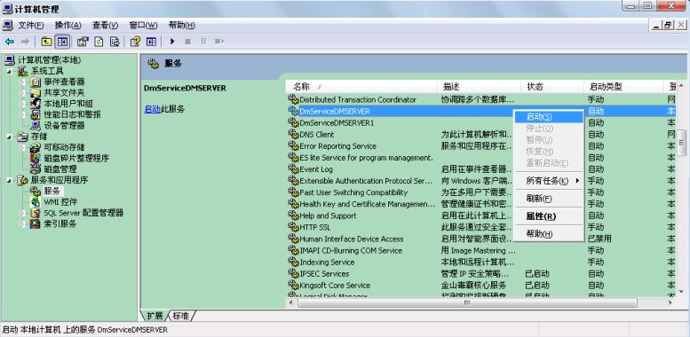
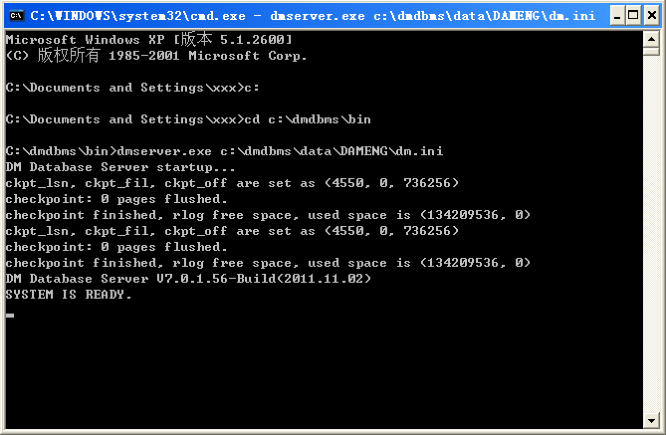
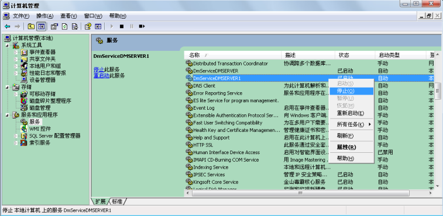
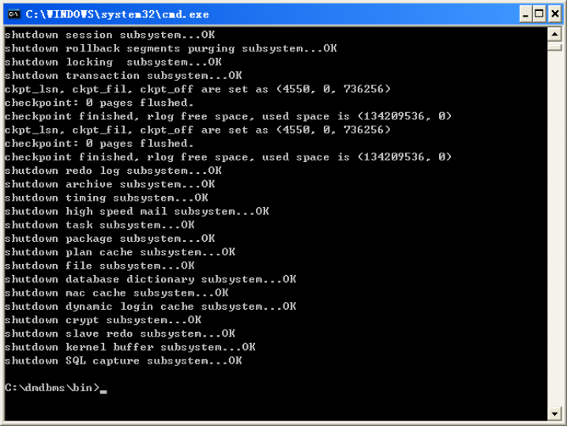

## 第8章 启动和关闭数据库

`DM`支持多种操作系统。常用的操作系统基本上可以划分为`Windows`操作系统和`Linux`操作系统。下面分别介绍这两种操作系统下启动和关闭`DM`数据库的操作。

## 8.1 启动数据库

### 8.1.1 Windows 系统

1. 菜单方式

安装`DM`数据库后(默认情况下安装成功后`DM`服务会自动启动)，在`Windows`的开始菜单选项中选择如图`8.1`所示的菜单项中的`DM`服务查看器可以启动`DM`数据库。



图`8.1 DM`数据库菜单方式启动1

点击`DM`服务查看器选项后，会弹出如图`8.2`所示的界面：



图`8.2 DM`数据库菜单方式启动2

在弹出界面中选中所要启动的数据库，点击鼠标右键，在菜单栏中选择启动。

2. `Windows` 服务方式

安装`DM`数据库并且新建一个`DM`实例后。`Windows`的服务中会自动增加一项和该实例名对应的服务。例如新建一个实例名为`DMSERVER`的`DM`数据库，`Windows`的服务中会增加一项名称为`“DmServiceDMSERVER”`的服务。打开`Windows`的管理工具，选择“服务”，打

78

## 第8 章 启动和关闭数据库

开`Windows`服务控制台，如图`8.3`所示，选择`“DmServiceDMSERVER”`，用鼠标在工具栏点击启动按钮或者点击鼠标右键，在菜单栏中选择“启动”，启动`DM`数据库。



图`8.3 DM`数据库服务方式启动

3. 命令行方式

进入`DM`安装目录下的`bin`目录，直接打开应用程序`dmserver`就可以启动`DM`数据库。

或者先打开`Windows`命令提示符工具，在命令工具中执行命令进入`DM`服务器的目录，再执行`dmserver`的命令启动`DM`数据库，如图`8.4`所示。



图`8.4 DM`数据库命令行方式启动

命令行方式启动参数如下：

```
dmserver [ini_file_path] [-noconsole] [mount]
```

说明：

1. `Dmserver` 命令行启动参数可指定`dm.ini` 文件的路径，非控制台方式启动及指定

数据库是否以`MOUNT`状态启动。关于数据库状态见下一节介绍；

2. `Dmserver` 启动时可不指定任何参数，默认使用当前目录下的`dm.ini` 文件，如果

当前目录不存在`dm.ini`文件，则无法启动；

3. `Dmserver` 启动时可以指定`-noconsole` 参数。如果以此方式启动，则无法通过在

控制台中输入服务器命令。

当不确定启动参数的使用方法时，可以使用`help`参数，将打印出格式、参数说明和使

79

## 第8 章 启动和关闭数据库

用示例。使用方法如下：

```
dmserver help
```

当以控制台方式启动`Dmserver`时，用户可以在控制台输入一些命令，服务器将在控制台打印出相关信息或执行相关操作。支持的命令见下表。

表`8.1 Dmserver`控制台支持的命令命令操作EXIT 退出服务器LOCK 打印锁系统信息TRX 打印等待事务信息CKPT 设置检查点BUF 打印内存池中缓冲区的信息MEM 打印服务器占用内存大小SESSION 打印连接个数DEBUG 打开DEBUG 模式

### 8.1.2 Linux 系统

1. 菜单方式

安装`DM`数据库后(默认情况下安装成功后`DM`服务会自动启动)，在`Linux`的开始菜单选项中选择启动服务器菜单项可以启动`DM`数据库。启动方式类似`Windows`。

2. `Linux` 服务方式

安装`DM`数据库后，在`/etc/rc.d/init.d`中有名称为`DmService`开头的文件，文件全名为`DmService+`实例名（例：如果实例名为`DMSERVER`，则相对应的服务文件为`DmServiceDMSERVER`）。以实例名为`DMSERVER`为例，在终端输

```
入./DmServiceDMSERVER start 或者service DmServiceDMSERVER start 即可启
```

动`DM`数据库。

3. 命令行方式

在终端进入`DM`安装目录下的`bin`目录，执行`./dmserver`启动`DM`数据库，参数选项

```
同Windows。
```

### 8.1.3 检查LICENSE

无论是在何种操作系统下运行，`DM`数据库在启动时都会进行`LICENSE`检查。若`LICENSE`过期或`KEY`文件与实际运行环境不配套，`DM`服务器会强制退出。

可通过查看`V$LICENSE`了解所安装的`DM`数据库的`LICENSE`信息。

## 8.2 数据库状态和模式

`DM`数据库包含以下几种状态：

1. 配置状态（`MOUNT`）：不允许访问数据库对象，只能进行控制文件维护、归档配置、

数据库模式修改等操作；

2. 打开状态（`OPEN`）：不能进行控制文件维护、归档配置等操作，可以访问数据库对

80

## 第8 章 启动和关闭数据库

象，对外提供正常的数据库服务；

3. 挂起状态（`SUSPEND`）：与`OPEN` 状态的唯一区别就是，限制磁盘写入功能；一旦

修改了数据页，触发`REDO`日志、数据页刷盘，当前用户将被挂起。

`OPEN`状态与`MOUNT`和`SUSPEND`能相互转换，但是`MOUNT`和`SUSPEND`之间不能相互转换。

`DM`数据库包含以下几种模式：

1. 普通模式（`NORMAL`）：用户可以正常访问数据库，操作没有限制；
2. 主库模式（`PRIMARY`）：用户可以正常访问数据库，所有对数据库对象的修改强制

生成`REDO`日志，在归档有效时，发送`REDO`日志到备库；

3. 备库模式（`STANDBY`）：接收主库发送过来的`REDO` 日志并重做。数据对用户只读。

三种模式只能在`MOUNT`状态下设置，模式之间可以相互转换。

一般情况下，数据库为`NORMAL`模式，如果不指定`MOUNT`状态启动，则自动启动到`OPEN`状态。

在需要对数据库配置时（如配置数据守护、数据复制），服务器需要指定`MOUNT`状态启动。当数据库模式为非`NORMAL`模式（`PRIMARY`、`STANDBY`模式），无论是否指定启动状态，服务器启动时自动启动到`MOUNT`状态。

## 8.3 关闭数据库

### 8.3.1 Windows 系统

1. 菜单方式

在`Windows`的开始`->`程序菜单中选择达梦数据库`->DM`服务查看器，在弹出的界面中，选中要关闭的数据库，点击鼠标右键，在菜单栏中选择停止。

2. `Windows` 服务方式

安装`DM`数据库并且新建一个`DM`实例后。`Windows`的服务中会自动增加一项和该实例名对应的服务。例如新建一个实例名为`DMSERVER1`的`DM`数据库，`Windows`的服务中会增加一项名称为`“DmServiceDMSERVER1”`的服务。打开`Windows`的管理工具，选择服务，打开`Windows`服务控制台，如图`8.5`所示，选择`“DmServiceDMSERVER1”`，用鼠标在工具栏点击停止按钮或者点击鼠标右键，在菜单栏中选择停止，关闭`DM`数据库。

81

## 第8 章 启动和关闭数据库



图`8.5 DM`数据库服务方式停止

3. 命令行方式

在启动数据库的命令工具中输入`exit`，然后回车，关闭`DM`数据库。如图`8.6`所示。



图`8.6 DM`数据库命令行方式停止

### 8.3.2 Linux 系统

1. 菜单方式

在`Linux`的开始菜单中选择关闭数据库的菜单项可以关闭`DM`数据库。关闭方式类似

```
Windows。
```

2. `Linux` 服务方式

进入`/etc/rc.d/init.d`，以实例名为`DMSERVER`为例，在命令行工具中输入`./DmServiceDMSERVER stop`即可关闭`DM`数据库。

82

## 第8 章 启动和关闭数据库

3. 命令行方式

在启动数据库的命令工具中输入`exit`，然后回车，退出`DM`数据库。关闭方式类似

```
Windows。
```

83
