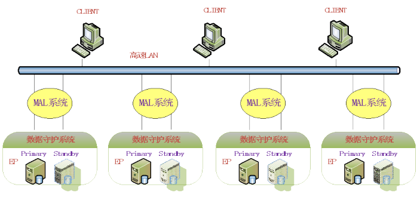

## 29.1 概述

为了支持海量数据存储和处理、高并发处理、高性价比、高可用性等需求，提供高端数据仓库解决方案，达梦数据库提供了大规模并行处理`MPP`架构，以极低的成本代价，为客户提供业界领先的计算性能。达梦采用完全对等无共享（`share-nothing`）的`MPP`架构，支持`SQL`并行处理，可自动化分区数据和并行查询，各实例无`I/O`冲突。

`MPP`系统工作起来就像是一台单独的计算机，由于采用自动化的并行处理，在分析型数据仓库等`OLAP`应用中，查询性能比传统的单节点数据库大大提高。

`MPP`系统为新一代数据仓库所需的大规模数据和复杂查询提供了先进的软件级解决方案，具有业界先进的架构和高度的可靠性，能帮助企业管理好数据，使之更好的服务于企业，推动数据依赖型企业的发展。

## 29.2 基本概念

```
1. MPP
```

`Massive Parallel Processing`，大规模并行处理。`MPP`架构最多可以同时部署1024 个节点，采用统一的并行操作数据库引擎，将数据分散在不同的数据库节点上，在高速的内部网络环境下，对于海量数据的并发查询可极大地减少`I/O`，提高查询效率。

2. 执行节点（`EP`）

`MPP`环境内每个实际运行的实例节点称为一个执行节点（基于主备的`MPP`环境内备库除外）。

3. 主、从`EP`

`MPP`是对等无共享架构，对整个系统来说，每个节点作用都是一样的，用户可以连接到其中的任何一个进行操作。对每个用户会话来说，执行节点具有主从之分。用户会话实际连接的那个节点称为主`EP`，其余的节点都称为从`EP`。

## 29.3 体系架构

达梦的`MPP`架构提供数据存储和查询的自动化并行，插入的数据会根据表定义的类型被自动分区保存到相应的节点，查询时在各节点的数据库引擎上并行执行查询，并将所有结果数据自动汇集到主查询节点上，数据无共享、无`I/O`冲突。

可靠性方面，提供了数据守护方案，满足用户对数据可靠性、安全性的需求，解决由于硬件故障、自然灾害等原因导致的数据库服务长时间中断问题。`MPP`系统中的每个节点都可配置数据守护系统，增加多个节点数据的完整冗余镜像。节点和镜像节点之间可以互相转换成`MPP`系统中的执行节点。

247第26 章大规模并行处理MPP

系统体系架构图如下图所示：



图`29.1 MPP`体系架构客户端可连接任意一个`EP`站点进行操作，所有`EP`对客户来说都是对等的。图中互为镜像的节点是配置了守护进程的主备库，在主库发生故障时可以通过备库接管将镜像备库切换为主库，继续提供对外服务，大大提高了系统的可用性和可靠性，为了更加严格的保证系统可靠性，目前`MPP`主备系统不再支持自动切换模式。在确保节点安全的情况下，用户也可以不用配置数据守护系统。

`MPP`系统内每个节点只负责自身部分数据的读写，执行计划是完全并行执行，完全无`I/O`冲突，充分利用硬件资源，只是额外增加了数据在节点间相互传递的通信时间，在高速局域网内，通信时间占整体时间的比例更小，更能体现大规模并行处理的优势，随着系统规模的扩大，并行支路越多，优势越明显。

通用数据库主要是是针对`OLTP`处理功能设计的，在运行大量小规模交易查询数据时效果最好。从结构上来说，采用了完全共享或磁盘共享架构。完全共享体系局限于单节点服务器，通常价格比较昂贵，其扩展性和性能受到相应的限制。磁盘共享体系允许系统带有多个服务器实例，这些实例与`SAN`或其它共享存储设备相连。这种体系需要通过一个狭窄的数据管道将所有`I/O`信息过滤到昂贵的共享磁盘子系统。

与此相比，基于硬件的数据仓库平台也采用完全无共享体系。在这种体系下，通讯功能部署在一个高宽带网络互连体系上，用户通过一个主控制节点执行并行查询。该体系的一个重要优势就是每个节点都有一个通往本地磁盘的独立高速通道，不但简化了体系，还提供良好的扩展性。但这些平台所面临的困难是需要价格昂贵的专用硬件，显著增加了系统成本。

达梦`MPP`的完全对等无共享体系架构结合了完全无共享体系的优点，在此基础上又前进了一步，通过软件提升处理能力，它不需要价格昂贵的专用硬件，也不采用增加主控制节点来协调所有并行处理的主从式方法，而是各个节点完全对等，更进一步简化了体系的实现，也消除了系统可能存在的主节点瓶颈问题。

综上所述，将主流架构特点比较列于下表中

表`29.1`主流架构特点比较架构名称特点完全共享局限于单节点服务器，价格昂贵，扩展性、性能受限。

共享磁盘允许多个服务器实例共享存储设备，可有效解决单实例负载问题，具有一定的扩展性，但当节点增加到一定程度以后，由于对`I/O`资源、锁资源等的激烈竞争，反而导致性能的下降，扩展性和性能在系统规模变大时受限。同时共享磁盘等硬件成本也十分昂贵。

完全不共享部署在高速网络，各节点相对独立，无共享`I/O`，扩展性和性能良好，缺点是某些此类架构的系统基于硬件，价格昂贵，成本高，系统中有一个主控节点，系统规模扩充时可能成为瓶颈，主控节点无备份，容易形成单点故障。

248第26 章大规模并行处理MPP完全对等不共享`DM7`采用的是`MPP`架构，继承了完全不共享架构的优点，且各节点完全对等，不需要专用硬件，不存在主控节点，消除了潜在瓶颈以及单节点故障问题。

## 29.4 支持的功能

### 29.4.1  支持多种分布

支持随机分布、复制分布（`fully`）、哈希分布、范围分布、`LIST`列表分布等多种分布表的类型，用户可根据实际情况选择合适的分布类型。详见《`DM_SQL`》中建表语法部分。

### 29.4.2  函数和过程

支持系统内部函数、用户定义的函数、过程等。支持函数、过程中的查询语句，支持过程中动态执行语句。

### 29.4.3  支持触发器

支持系统所有的触发器类型，包括事件触发器、时间触发器、`DML`触发器、视图触发器（`Instead of`触发器）等。

### 29.4.4  支持分区表

支持水平分区表、垂直分区表，即实现“数据分布后再分区”。在数据分布到各节点的基础上后，再在单个节点上将数据再次分区，可进一步提高查询性能。分布的类型和分区的类型可以混合搭配，比如建立范围分布的水平分区堆表。

### 29.4.5  自增列和序列

所有节点维护一个可以同步的自增列和序列值。`mpp`下暂时不支持创建带自增列的表的聚簇索引。

### 29.4.6  支持大字段

`MPP`下支持带大字段的表。

### 29.4.7  支持列存储

1. 支持`HFS` 表

借助巨型表空间优化列存储数据的读写效率，从而实现对列存储表数据装载以及查询扫描的性能提升。`MPP`下对巨型列存储表数据进行分布，进一步提高了列存储的读写性能。

249第26 章大规模并行处理MPP

### 29.4.8  支持事务的ACID 特性

`MPP`系统中，实现了事务的两阶段提交，包括预提交阶段和提交阶段。借助`monitor`协调作用，在单个或多个节点故障重启时，依然能保证事务的`ACID`特性，保证了`MPP`系统的可靠性。

## 29.5 数据加载

支持数据快速加载，`MPP`下分布表的数据在主`EP`上实现重分发，用法和普通表的加载一样。

## 29.6 环境配置

达梦的`MPP`环境包含两种配置模式。一种是普通配置模式，一种是基于主备的配置模式。

当用户对系统的可靠性要求不高、系统可中断、能保证节点安全或进行简单的`MPP`测试时，只需使用普通配置模式，否则可使用基于主备的的配置模式。

基于主备的配置模式下，如果主库出现故障，可以等待主库恢复或者使用命令手动接管故障主库，以继续对外提供服务。

### 29.6.1  普通配置

普通配置模式下，每个执行节点`EP`不配置数据守护系统，系统中只包含所有`EP`节点。

下面举例包含2 个实例节点的`MPP`普通配置，步骤如下：

1. 规划

表`29.2`普通配置节点规划实例名机器`IP`服务器端口`MAL`端口`MPP_SEQNO`

```
EP01 192.168.0.1  5236  5269  0
EP02 192.168.0.2  5237  5270  1
2. 配置dm.ini
```

首先，初始化`EP01`，`EP02`两个库，两个库的`dm.ini`参数要求完全一致。然后分别配置两个库中的`dm.ini`。

`EP01`的`dm.ini`配置如下：

```
INSTANCE_NAME  = EP01
PORT_NUM       =  5236
MAL_INI        =  1
MPP_INI         =  1
```

> `EP02`的`dm.ini`配置如下：

```
INSTANCE_NAME = EP02
PORT_NUM       =  5237
MAL_INI        =  1
```

250第26 章大规模并行处理MPP

```
MPP_INI         =  1
3. 配置dmmal.ini
```

两个实例配置一样，直接拷贝即可。

```
[mal_inst1]
mal_inst_name = EP01
mal_host      = 192.168.0.1
mal_port      = 5269
mal_inst_host  = 192.168.0.1
mal_inst_port  = 5236
[mal_inst2]
mal_inst_name = EP02
mal_host      = 192.168.0.2
mal_port      = 5270
mal_inst_host  = 192.168.0.2
mal_inst_port  = 5237
4. 配置dmmpp.ctl
```

`dmmpp.ctl`是一个二进制文件，用户不能直接配置。用户需要首先配置`dmmpp.ini`，然后利用`dmctlcvt`工具进行转换得到生成`dmmpp.ctl`文件。两个实例使用相同的`ctl`文件，只需拷贝一份。

```
表29.3 dmmpp.ini 配置项
```

配置项配置含义

可选项，是否采用两阶段方式提交事务。

```
MPP_2PC_FLAG
```

取值0，1。0：不采用，1：采用。默认0，一般使用默认即可。

`[SERVICE_NAME]`标识每个实例的选项名`MPP_SEQ_NO`实例在`mpp`系统内的序号，取值范围为`0~1023``MPP_INST_NAME`节点实例名`dmmpp.ini`配置如下：

```
[service_name1]
mpp_seq_no    = 0
mpp_inst_name = EP01
[service_name2]
mpp_seq_no    = 1
mpp_inst_name = EP02
```

利用工具转换成`dmmpp.ctl`。示例如下：

```
dmctlcvt t2c d:\dameng\dmmpp.ini d:\dameng\dmmpp.ctl
```

以上步骤完成之后，只需分别启动两个实例节点，如果能够登录成功，说明配置成功了。

### 29.6.2  基于主备的配置

基于主备的`MPP`环境配置比普通配置步骤稍复杂一些。`MPP`主备系统由`MPP`监控器`(MPP_MONITOR)`、多个`MPP`节点`(EP)`和`EP`的备库共同组成。配置`MPP`系统，涉及到的文件如下：

- 对于`MPP_MONITOR` 和每个`EP` 站点，需要配置两个文件：`dmmal.ini` 和

251第26 章大规模并行处理MPP

```
dmmpp.ctl；
```

- 对于每个`EP`，需要启用`dm.ini` 中的`MAL_INI`、`ARCH_INI` 和`MPP_INI` 参数；
- 对于每个`EP` 备库，需要启用`dm.ini` 中的`MAL_INI` 和`ARCH_INI`。

下面以一个具体的实例，说明基于主备的`MPP`系统的配置过程。配置节点数为2。主库实例名为`EP01`，`EP02`，备库实例名分别为`EP11`、 `EP22`。配置步骤如下：

1. 规划

主库：

表`29.4`基于主备的配置节点规划—主库实例名机器`IP`端口`MAL`端口`MPP_SEQNO`

```
EP01 192.168.0.28 5236  5269  0
EP02 192.168.0.29 5237  5270  1
```

备库：

表`29.5`基于主备的配置节点规划—备库实例名对应主库机器`IP`端口`MAL`端口

```
EP11  EP01  192.168.0.30 5238  5271
EP22  EP02  192.168.0.31 5239  5272
```

监控器：

表`29.6`基于主备的配置节点规划—监控器

监控器机器`IP` `MAL`端口

```
MONITOR  192.168.0.32  5280
```

2. 初始化库

基于主备的`MPP`配置，要求主备库数据严格一致，因此用户配置主备时，需要保证这一点。所以只需初始化主库的库即可。`Windows`下初始化库脚本如下：

```
--192.168.0.28 上
dminit path=D:\MPP_ARCH_TEST\ep01
--192.168.0.29 上
dminit path=D:\MPP_ARCH_TEST\ep02
```

3. 检查主库的数据库状态是否一致

要求主库的状态严格一致，即`lsn`值严格一致。

`--`启动`ep01`服务器，以`mount`方式

```
dmserver D:\MPP_ARCH_TEST\ep01\DAMENG\dm.ini mount
```

`--`启动命令行工具`disql`，登录主数据库查询`LSN`值

```
SQL>select file_lsn, cur_lsn from v$rlog;
```

`--`启动`ep02`服务器，以`mount`方式

```
dmserver D:\MPP_ARCH_TEST\ep02\DAMENG\dm.ini mount
```

`--`启动命令行工具`disql`，登录主数据库查询`LSN`值

```
SQL>select file_lsn, cur_lsn from v$rlog;
```

如果`ep01`和`ep02`的`file_lsn`、`cur_lsn`值完全一致，说明主库的数据库状态完全一致，那么退出达梦服务，执行步骤4，否则返回步骤2。

4. 备库数据准备

各`EP`的备库的数据准备，理论指导详见数据守护相关文档。

本例中使用拷贝的方式，将主库数据拷贝到备库目录下，保证绝对路径完全一致。

```
将 192.168.0.28 的 D:\MPP_ARCH_TEST\ep01  拷贝到  192.168.0.30 的
D:\MPP_ARCH_TEST\ep01
```

252第26 章大规模并行处理MPP

```
将 192.168.0.29 的 D:\MPP_ARCH_TEST\ep02  拷贝到  192.168.0.31 的
D:\MPP_ARCH_TEST\ep02
5. 配置dm.ini
```

`192.168.0.28 ep01`目录下，实例`EP01`配置如下：

```
INSTANCE_NAME = EP01
PORT_NUM     = 5236
MAL_INI       =  1
MPP_INI        =  1
ARCH_INI  =  1
```

`192.168.0.31 ep02`目录下，实例`EP22`配置如下：

```
INSTANCE_NAME = EP22
PORT_NUM     = 5239
MAL_INI       =  1
ARCH_INI  =  1
```

`192.168.0.29 ep02`目录下，实例`EP02`配置如下：

```
INSTANCE_NAME = EP02
PORT_NUM     = 5237
MAL_INI        =  1
MPP_INI        =  1
ARCH_INI  =  1
```

`192.168.0.30 ep01`目录下，实例`EP11`配置如下：

```
INSTANCE_NAME = EP11
PORT_NUM     = 5238
MAL_INI       =  1
ARCH_INI  =  1
6. 配置dmmal.ini
```

`monitor`和所有`EP`主备站点共用同一套`dmmal.ini`。

所以请确保如下目录下都拷贝了`dmmal.ini`文件：

```
192.168.0.32 的D:\MPP_ARCH_TEST\monitor；--新创建一个monitor 文件夹，用来存放
```

`dmmal.ini`和下面介绍的`dmmpp.ctl`文件。

```
192.168.0.28 的D:\MPP_ARCH_TEST\ep01\DAMENG；
192.168.0.30 的D:\MPP_ARCH_TEST\ep01\DAMENG。
192.168.0.29 的D:\MPP_ARCH_TEST\ep02\DAMENG；
192.168.0.31 的D:\MPP_ARCH_TEST\ep02\DAMENG；
```

`dmmal.ini`的配置如下：

```
MAL_CHECK_INTERVAL  = 3
MAL_CONN_FAIL_INTERVAL = 3
[mal_inst1]
mal_inst_name = EP01
mal_host      = 192.168.0.28
mal_port      = 5269
mal_inst_host  = 192.168.0.28
mal_inst_port  = 5236
[mal_inst2]
mal_inst_name = EP02
mal_host      = 192.168.0.29
mal_port      = 5270
mal_inst_host  = 192.168.0.29
mal_inst_port  = 5237
```

253第26 章大规模并行处理MPP

```
[mal_inst3]
mal_inst_name = EP11
mal_host      = 192.168.0.30
mal_port      = 5271
mal_inst_host  = 192.168.0.30
mal_inst_port  = 5238
[mal_inst5]
mal_inst_name = EP22
mal_host      = 192.168.0.31
mal_port      = 5272
mal_inst_host  = 192.168.0.31
mal_inst_port  = 5239
[monitor]
mal_inst_name = monitor
mal_host      = 192.168.0.32
mal_port      = 5280
7. 配置dmmpp.ctl
```

`monitor`和所有`EP`站点共用同一套`dmmpp.ctl`文件。

所以请确保如下目录下都拷贝了`dmmpp.ctl`文件：

```
192.168.0.32 的D:\MPP_ARCH_TEST\monitor；
192.168.0.28 的D:\MPP_ARCH_TEST\ep01\DAMENG；
192.168.0.30 的D:\MPP_ARCH_TEST\ep01\DAMENG。
192.168.0.29 的D:\MPP_ARCH_TEST\ep02\DAMENG；
192.168.0.31 的D:\MPP_ARCH_TEST\ep02\DAMENG；
```

`dmmpp.ctl`是一个二进制文件，用户不能直接配置。需要首先配置`dmmpp.ini`，然后利用`ctlcvt`工具进行转换生成`dmmpp.ctl`文件。

`dmmpp.ini`配置如下：

```
[service_name1]
mpp_seq_no    = 0
mpp_inst_name = EP01
[service_name2]
mpp_seq_no    = 1
mpp_inst_name = EP02
```

利用工具转换成`dmmpp.ctl`。示例如下：

```
dmctlcvt  t2c  D:\MPP_ARCH_TEST\ep01\dmmpp.ini
D:\MPP_ARCH_TEST\ep01\dmmpp.ctl
8. 配置dmarch.ini
```

`192.168.0.28`目录`ep01`中，实例`EP01`配置如下：

```
[ARCHIVE_LOCAL1]
ARCH_TYPE  = LOCAL
ARCH_DEST  = D:\MPP_ARCH_TEST\ep01\DAMENG\arch
ARCH_FILE_SIZE = 128
```

`ARCH_SPACE_LIMIT` `= 0 #`归档文件限制，单位`MB`，取值范围（`1024~4294967294`），0 表示无空间限制

```
[ARCHIVE_MPP1]
ARCH_TYPE  = MARCH
ARCH_DEST  = EP11
```

254第26 章大规模并行处理MPP

`192.168.0.30`目录`ep01`中，实例`EP11`配置如下：

```
[ARCHIVE_LOCAL1]
ARCH_TYPE  = LOCAL
ARCH_DEST  = D:\MPP_ARCH_TEST\ep01\DAMENG\arch
ARCH_FILE_SIZE  = 128
```

`ARCH_SPACE_LIMIT` `= 0` #归档文件限制，单位`MB`，取值范围（`1024~4294967294`），0表示无空间限制

```
[ARCHIVE_MPP1]
ARCH_TYPE  = MARCH
ARCH_DEST  = EP01
```

`192.168.0.29`目录`ep02`中，实例`EP02`配置如下：

```
[ARCHIVE_LOCAL1]
ARCH_TYPE  = LOCAL
ARCH_DEST  = D:\MPP_ARCH_TEST\ep02\DAMENG\arch
ARCH_FILE_SIZE  = 128
```

`ARCH_SPACE_LIMIT` `= 0 #`归档文件限制，单位`MB`，取值范围（`1024~4294967294`），0 表示无空间限制

```
[ARCHIVE_MPP1]
ARCH_TYPE  = MARCH
ARCH_DEST  = EP22
```

`192.168.0.31`目录`ep02`中，实例`EP22`配置如下：

```
[ARCHIVE_LOCAL1]
ARCH_TYPE  = LOCAL
ARCH_DEST  = D:\MPP_ARCH_TEST\ep02\DAMENG\arch
ARCH_FILE_SIZE = 128
```

`ARCH_SPACE_LIMIT` `= 0` #归档文件限制，单位`MB`，取值范围（`1024~4294967294`），0表示无空间限制

```
[ARCHIVE_MPP1]
ARCH_TYPE  = MARCH
ARCH_DEST  = EP02
```

每个`EP`站点和备库将必须配置本地归档，主库归档配置中包含所有备库，每个备库归档配置包含主库和其它备库。

9. 启动主库和备库

为设置服务器状态和模式，服务器需要以`mount`方式启动。

```
--192.168.0.28
dmserver D:\MPP_ARCH_TEST\ep01\DAMENG\dm.ini mount
--192.168.0.30
dmserver D:\MPP_ARCH_TEST\ep02\DAMENG\dm.ini mount
--192.168.0.29
dmserver D:\MPP_ARCH_TEST\ep02\DAMENG\dm.ini mount
--192.168.0.31
dmserver D:\MPP_ARCH_TEST\ep01\DAMENG\dm.ini mount
```

10. 设置实例的状态和模式

通过如下`DISQL`命令实现将各站点分别设置为主库或备库模式。分别将`EP01`、`EP02`设置为主库，将`EP11`、`EP22`设置为备库。

```
通过DISQL 命令登录EP01(192.168.0.28：5236),执行
```

255第26 章大规模并行处理MPP

```
SQL>alter database primary;
通过DISQL 命令登录EP02(192.168.0.29：5237),执行
SQL>alter database primary;
通过DISQL 命令登录EP11(192.168.0.30：5238),执行
SQL>alter database standby;
通过DISQL 命令登录EP22(192.168.0.31：5239),执行
SQL>alter database standby;
11. 启动mpp_monitor
```

`windows`下启动脚本：

```
dmmpp_monitor path=D:\MPP_ARCH_TEST\monitor
```

参数`path`为`dmmal.ini`和`dmmpp.ctl`等配置文件以及`montior`运行过程中产生日志文件的存放目录。

基于主备配置的`MPP`系统，`monitor`必需按主备模式启动，即`MODE=0`。`mpp_monitor`工具参数如下表所示。

表`29.7 MPP_MONITOR`工具参数说明参数含义备注`dmmpp.ctl`、`dmmal.ini`的绝对目录或者当前目录，最大长度为256`PATH`必选参数字节`THREAD_INTERVAL`检查`EP`站点的间隔时间，取值范围`1~10`秒，默认值1 可选参数检查站点间网络超时的间隔时间, 取值范围0 或`3~1800`秒, 默认`SITE_INTERVAL`值，不检测超时（此值一般在`dmmal.ini`中的可选参数

```
mal_check_interval 为0 时才设置）
```

`monitor`启动模式，取值范围`0~1`，默认值为0。0 表示`monior`以`MODE`主备模式启动；1 表示`monitor`以非主备方式启动，仅处理事务的故可选参数障恢复。

`-NOCONSOLE`以服务方式启动可选参数`HELP`打印帮助信息可选参数

12. `MPP` 系统的退出

对于普通配置的`MPP`，用户正常退出各个`EP`站点即可，`EP`站点之间的关闭顺序没有先后之分；对于基于主备的配置，用户需首先退出监控器，然后再退出各个`EP`站点，最后退出`EP`备用站点。

### 29.6.3  监控器使用说明

设置好主备库的状态和模式后，按照先启动所有实例，最后启动`dmmpp_monitor`的次序启动`MPP`主备系统，主备库都以`MOUNT`配置方式启动，次序不分先后。监控器成功启动后，其运行时相关信息记录在`monitor`的配置文件目录的名为`dmmpp_monitor.log`的文件中。

`MPP_monitor`监控器的命令说明如下：

帮助`help`：

```
h
+-----------------------+------------------------------+
|help/h                 |   帮助信息                   |
+-----------------------+------------------------------+
|show                   |   MPP 主备信息                |
+-----------------------+------------------------------+
```

256第26 章大规模并行处理MPP`|switchover`备库实例名 | 切换至指定备库 |

```
+-----------------------+------------------------------+
```

`|takeover`主库实例名 | 接管指定的主库 |

```
+-----------------------+------------------------------+
|exit                   |   退出                       |
+-----------------------+------------------------------+
```

详细信息`show`：

```
show
------------------------------MPP 系统信息汇总------------------------------
```

`EP`站点数`: 2`系统状态: 正常

```
切换模式:  NON AUTO FAILOVER
```

站点号实例名实例模式实例状态`FLSN CLSN SLSN SSLSN`

```
0      EP01    PRIMARY   OK       21198   21198   21198   21198
EP11    STANDBY   OK       21198   21198   21198   21198
1      EP02    PRIMARY   OK       21198   21198   21198   21198
EP22    STANDBY   OK       21198   21198   21198
21198------------------------------------------------------------------------
```

站点号用来标识各个`EP`站点，每组站点下可以查看主节点和对应的备库节点信息。

1. 主库故障处理

使用场景：`EP`主站点故障。把`EP01`关闭模拟`EP01`故障，监视器检测到`EP01`故障后自动打印的信息及查看的系统信息如下:

```
2013-09-30 15:02:10  设置主库实例EP01 为ERROR 状态
show
------------------------------MPP 系统信息汇总------------------------------
```

`EP`站点数`: 2`系统状态: 存在`EP`故障

```
切换模式:  NON AUTO FAILOVER
```

站点号实例名实例模式实例状态`FLSN CLSN SLSN SSLSN`

```
0      EP01    PRIMARY   ERROR   21198   21198   21198   21198
EP11    STANDBY   OK       21198   21198   21198   21198
1      EP02    PRIMARY   OK       21198   21198   21198   21198
EP22    STANDBY   OK       21198   21198   21198   21198
-------------------------------------------------------------------------
```

重新启动主库，主库会自动恢复，查看信息如下:

`2013-09-30 15:06:30`设置主库实例`EP01`为`OK`状态

```
show
------------------------------MPP 系统信息汇总------------------------------
```

`EP`站点数`: 2`系统状态: 正常

```
切换模式:  NON AUTO FAILOVER
```

站点号实例名实例模式实例状态`FLSN CLSN SLSN SSLSN`257第26 章大规模并行处理MPP

```
0      EP01    PRIMARY   OK        22704    22704    22704    22704
EP11    STANDBY   OK        22704    22704    22704    22704
1      EP02    PRIMARY   OK        21198    21198    21198    21198
EP22    STANDBY   OK        21198    21198    21198    21198
-------------------------------------------------------------------------
```

2. 备库故障恢复

备库故障，将`EP22`退出后，`mpp_monitor`自动检测并查看信息显示如下：

```
2013-09-30 15:38:15  备库实例EP22 故障
show
------------------------------MPP 系统信息汇总------------------------------
```

`EP`站点数`: 2`系统状态: 正常

```
切换模式:  NON AUTO FAILOVER
```

站点号实例名实例模式实例状态`FLSN CLSN SLSN SSLSN`

```
0      EP01    PRIMARY   OK        22704    22704     22704    22704
EP11    STANDBY   OK        22704    22704     22704    22704
1      EP02    PRIMARY   OK        21198    21198     21198    21198
EP22    STANDBY   ERROR     21198   21198     21198    21198
-------------------------------------------------------------------------
```

重新启动备库，备库可以自动恢复到系统中：

```
2013-09-30 15:47:42  设置主库实例EP02 为RECOVERY 状态
```

`2013-09-30 15:47:44`主库`EP02`的备库实例`EP22`恢复成功`2013-09-30 15:47:44`设置主库实例`EP02`为`OK`状态

```
show
------------------------------MPP 系统信息汇总------------------------------
```

`EP`站点数`: 2`系统状态: 正常站点号实例名实例模式实例状态`FLSN CLSN SLSN SSLSN`

```
0      EP01    PRIMARY   OK        22704    22704    22704    22704
EP11    STANDBY   OK        22704   22704   22704   22704
1      EP02    PRIMARY   OK        21198   21198   21198   21198
EP22    STANDBY   OK 21198   21198   21198   21198
-------------------------------------------------------------------------
```

查看`monitor`目录下的日志文件：

```
2013-09-30 15:38:15  备库实例EP22 故障
```

`2013-09-30 15:47:42`试图为主库实例`EP02`添加备库实例`EP22``2013-09-30 15:47:42`设置备库实例`EP22`的参数`mpp_ini`为0 成功`2013-09-30 15:47:42 MPP`监视器设置备库实例`EP22`为`OPEN`状态成功

```
2013-09-30 15:47:42  实例EP22 信息: 系统状态(OPEN), 系统模式(STANDBY),
slsn(21198)
2013-09-30 15:47:42  设置主库实例EP02 为RECOVERY 状态
2013-09-30 15:47:43  EP02 进入SUSPEND 状态
```

258第26 章大规模并行处理MPP`2013-09-30 15:47:44`主站点`EP02`与备库实例`EP22`完成同步

```
2013-09-30 15:47:44  实例EP02 OPEN 成功
```

`2013-09-30 15:47:44`主库`EP02`的备库实例`EP22`恢复成功`2013-09-30 15:47:44`设置主库实例`EP02`为`OK`状态

3. 手动主备切换

使用场景：`MPP`系统由故障状态恢复正常后，原来的备库变为`MPP`站点主库，原来的`MPP`站点主库变为备库。若原`MPP`站点主库性能比原备库性能要高出很多，那么就会将原主库恢复为`MPP`站点主库的需求。使用手动主备切换，可以完成此项功能。

手动切换前系统状态如下：

```
show
------------------------------MPP 系统信息汇总------------------------------
```

`EP`站点数`: 2`系统状态: 正常

```
切换模式:  NON AUTO FAILOVER
```

站点号实例名实例模式实例状态`FLSN CLSN SLSN SSLSN`

```
0      EP11    PRIMARY   OK        24210   24210     24210   24210
EP01    STANDBY   OK        24210   24210     24210   24210
1      EP02    PRIMARY   OK        21198   21198     21198   21198
EP22    STANDBY   OK 21198   21198     21198   21198
-----------------------------------------------------------------------
```

输入`switchover EP01`，将`EP01`切换为主库：

```
switchover ep01
```

`2013-09-30 16:05:31 MPP`监视器设置主库实例`EP11`为`MOUNT`状态成功`2013-09-30 16:05:31 MPP`监视器设置主库实例`EP11`为`STANDBY`模式成功

```
2013-09-30 16:05:31  设置站点EP11 的mpp_ini 为0 参数成功
2013-09-30 16:05:31  实例EP01 apply keep buf 成功
```

`2013-09-30 16:05:31 MPP`监视器设置备库实例`EP01`为`MOUNT`状态成功`2013-09-30 16:05:31 MPP`监视器设置备库实例`EP01`为`PRIMARY`模式成功`2013-09-30 16:05:31`设置备库实例`EP01`的参数`mpp_ini`为1 成功

```
2013-09-30 16:05:31  MPP 主节点EP11 切换至备用节点EP01
2013-09-30 16:05:31  更新归档成功
```

`2013-09-30 16:05:31 MPP`系统配置信息广播至控制文件成功`2013-09-30 16:05:31 MPP`监视器设置备库实例`EP11`为`OPEN`状态成功`2013-09-30 16:05:32 MPP`监视器设置主库实例`EP01`为`OPEN`状态成功

```
2013-09-30 16:05:32  手动切换成功
```

输入`show`命令，再次查看当前`MPP`配置情况：

```
show
------------------------------MPP 系统信息汇总------------------------------
```

`EP`站点数`: 2`系统状态: 正常

```
切换模式:  NON AUTO FAILOVER
```

站点号实例名实例模式实例状态`FLSN CLSN SLSN SSLSN`

```
0      EP01    PRIMARY   OK       25716    25716    25716    25716
EP11    STANDBY   OK       25716    25716    25716    25716
```

259第26 章大规模并行处理MPP

```
1      EP02    PRIMARY   OK       21198    21198    21198    21198
EP22    STANDBY   OK 21198    21198    21198    21198
-----------------------------------------------------------------------
```

`switchover`能成功执行的条件：

1. 主库处于`OK` 状态
2. 备库处于正常备库
3. `MPP` 系统处于正常状态

手动切换过程中，若遇故障，则处理办法如下：

`a)`主库正常，备库正常，则备库成功成为主库，主库成为备库，`MPP`系统进入正常状态`b)`主库正常，备库故障，或者两者都故障，则不进行切换，`MPP`系统恢复正常状态，故障备库等待系统故障恢复`c)`主库故障，备库正常，则备库成为主库，`MPP`系统进入正常状态，故障主库等待系统故障恢复

4. 备库接管主库

备库接管的条件：

`a)`主库故障`b)`存在正常的备库`c)` `MPP`系统状态`ERROR`场景如下：主库实例`EP01`故障，备库实例`EP11`正常，可以使用命令`takeover`手动进行接管，将备库变成主库。接管前的状态为：

```
show
------------------------------MPP 系统信息汇总------------------------------
```

`EP`站点数`: 2`系统状态: 存在`EP`故障

```
切换模式:  NON AUTO FAILOVER
```

站点号实例名实例模式实例状态`FLSN CLSN SLSN SSLSN`

```
0      EP01    PRIMARY   ERROR    25716    25716    25716    25716
EP11    STANDBY   OK        25716    25716    25716    25716
1      EP02    PRIMARY   OK        21198    21198    21198    21198
EP22    STANDBY   OK 21198    21198    21198    21198
-------------------------------------------------------------------------
```

接管后：

```
takeover ep01
```

`2013-10-11 10:33:47`主库实例`EP01`出现故障, 系统试图进行主备切换

```
2013-10-11 10:33:47  实例EP11 apply keep buf 成功
2013-10-11 10:33:47  选择EP11 作为新主库
2013-10-11 10:33:47  EP11 进入MOUNT 状态
2013-10-11 10:33:47  EP11 变为主库模式
```

`2013-10-11 10:33:59`设置主库实例`EP11`为`OK`状态

```
2013-10-11 10:33:59  设置站点EP11 的mpp_ini 为1 参数成功!
2013-10-11 10:33:59  实例EP11 OPEN 成功
2013-10-11 10:33:59  MPP 系统主备切换完毕
```

260第26 章大规模并行处理MPP

```
2013-10-11 10:34:00  接管实例EP01 成功
show
------------------------------MPP 系统信息汇总------------------------------
```

`EP`站点数`: 2`系统状态: 正常

```
切换模式:  NON AUTO FAILOVER
```

站点号实例名实例模式实例状态`FLSN CLSN SLSN SSLSN`

```
0      EP11   PRIMARY  OK      27222        27222        27222        27222
EP01   STANDBY  ERROR  GET FAILED  GET FAILED  GET FAILED GET FAILED
1      EP02   PRIMARY  OK  21198 21198 21198 21198
EP22   STANDBY  OK  21198 21198 21198 21198
------------------------------------------------------------------------
```

实例`EP01`故障，无法获取`LSN`信息，因此显示均为`GET FAILED`。

注：`TAKEOVER`命令要慎用！！！！需要确保备库在主库故障前是正常状态，即备库接收了主库故障前的所有日志。如果备库是主库故障后才启动的，或者还未恢复完成，可能导致主备数据不一致的风险。

5. `MPP` 系统故障恢复

无论是基于主备的`MPP`系统，还是普通配置的`MPP`，若事务采用两阶段方式提交，即配置文件`dmmpp.ini`设置了`mpp_2pc_flag = 1`，当`MPP`系统在运行过程中，出现网络故障或节点故障时，都需要借助`monitor`完成`MPP`系统的故障恢复。

对于主备配置的`MPP`，当系统出现故障时，无需特殊处理，`monitor`会自动完成故障修复；对于普通配置的`MPP`，需要用户手动以`MODE=1`的方式启动`monitor`完成故障修复，启动参数参考表`30.7 MPP_MONITOR`工具参数说明。

6. `MPP` 系统退出

对于普通配置的`MPP`，用户正常退出各个`EP`站点即可，`EP`站点之间的关闭顺序没有先后之分；对于基于主备的配置，用户需首先退出监控器，然后再退出各个主库实例，最后退出备库实例。

## 29.7 并行查询计划

在`MPP`模式下，查询是通过并行查询计划来进行。所谓的`MPP`并行查询计划，是在单节点的查询计划中合适的位置插入了通讯操作符，负责主从`EP`相互之间的数据移动和同步。

目前包含4 个通讯操作符，详细信息见下表：

表`29.8`通讯操作符名称功能`MPP GATHER`主`EP`收集所有数据，从`EP`将数据发送到主`EP``MPP COLLECT`用于替换顶层`MPP GATHER`，除了收集数据到主节点，还增加主从节点间的同步执行功能，防止从节点不断发送数据到主节点造成邮件堆积`MPP DISTRIBUTE`各`EP`间相互分发数据`MPP BRODCAST`类似`MPP GATHER`，收集数据，还包含聚集函数运算功能`MPP SCATTER`主`EP`发散数据到所有从`EP`，一般和`MPP GATHER`配合使用261第26 章大规模并行处理MPP

## 29.8 MPP 常见用法

`MPP`常见用法汇总如下：

1.获取当前会话连接的`EP`的`MPP`序号

```
select sf_get_self_ep_seqno();
```

2.根据`rowid`获取本行数据来自哪个`EP`

```
select sf_get_ep_seqno(rowid);
```

3.获取`EP`节点配置信息

```
select * from v$mpp_cfg_item where sf_get_ep_seqno(rowid) =
sf_get_self_ep_seqno();
```

4.获取当前会话连接的实例名

```
select name from v$instance where sf_get_ep_seqno(rowid) =
sf_get_self_ep_seqno();
```

5.获取`MPP`系统内所有`EP`的所有会话

```
select * from v$sessions;
```

6.获取当前连接的实例上的所有会话

```
select * from v$sessions where sf_get_ep_seqno(rowid) =
sf_get_self_ep_seqno();
```

7.获取实例`EP01`上的所有会话

```
select * from v$sessions where sf_get_ep_seqno(rowid) = (select
distinct ep_seqno from v$mpp_cfg_item where inst_name ='EP01');
```

8.获取连接实例上的表`test`使用空间

```
select table_used_pages('SYSDBA','TEST');
```

9.获取每个实例上的表`test`使用空间

```
select table_used_pages('SYSDBA','TEST'), name from v$instance;
```

10.获取所有实例上的表`test`总共使用的空间

```
select  sum(total_size)  from  (select
table_used_pages('SYSDBA','TEST') total_size, name from v$instance);
```

262附录
