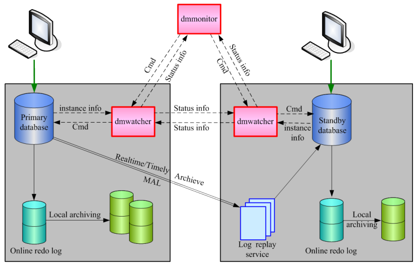

`DM`数据守护（`Data Watch`）的实现原理非常简单：将主库（生产库）产生的`Redo`日志传输到备库，备库接收并重新应用`Redo`日志，从而实现备库与主库的数据同步。`DM`数据守护的核心思想是监控数据库状态，获取主、备库数据同步情况，为`Redo`日志传输与重演过程中出现的各种异常情况提供一系列的解决方案。

`DM`数据守护系统结构参考图`2.1`。主要由主库、备库、`Redo`日志、`Redo`日志传输、`Redo`日志重演、守护进程（`dmwatcher`）、监视器（`dmmonitor`）组成。



图`2.1`数据守护系统结构图

数据库与数据库实例数据库（Database）是一个文件集合（包括数据文件、临时文件、重做日志文件和控制文件），保存在物理磁盘或文件系统中。

数据库实例（Instance）就是一组操作系统进程（或者是一个多线程的进程）以及一些内存。通过数据库实例，可以操作数据库，一般情况下，我们访问、修改数据库都是通过数据库实例来完成的。

本文档将不再严格区分数据库和数据库实例的概念，很多地方会笼统的以库来代替。考虑到数据守护系统中，数据库实例名是唯一的，为了更准确的进行描述，很多情况下我们会以实例xxx 来标记某一个主库或者备库。

11

主库`Primary`模式，提供完整数据库服务的实例，一般来说主库是用来直接支撑应用系统的生产库。

备库`Standby`模式，提供只读数据库服务的实例，一般来说备库用来容灾，并可以承担数据库备份、查询等只读功能，不过备库临时表支持`Insert/Delete/Update`操作。

备库支持临时表修改主要基于两个因素：一是临时表数据的修改不会产生`Redo`日志，主备库临时表数据无法同步；二是提供更大灵活性，适应更多应用场景。

`Redo`日志`Redo`日志记录物理数据页内容变动情况，是数据库十分重要的一个功能，在数据库系统故障（比如服务器掉电）重启时，利用`Redo`日志可以把数据恢复到故障前的状态。

`Redo`日志也是数据守护的实现基础，数据库中`Insert`、`Delete`、`Update`等`DML`操作以及`Create TABLE`等`DDL`操作最终都会体现为对某一个或者多个物理数据页的修改，因此备库通过重做`Redo`日志可以与主库数据保持一致。

`Redo`日志传输主备库之间的`Redo`日志传输，以日志缓冲区`RLOG_BUF`为单位，主库通过`MAL`系统发送`Redo`日志到备库。各种不同数据守护类型的区别，就在于主库日志缓冲区`RLOG_BUF`的发送时机，以及备库收到`Redo`日志后的处理策略。

`Redo`日志重演`Redo`日志重演的过程，就是备库收到主库发送的`Redo`日志后，在物理数据页上，重新修改数据的过程。`Redo`日志重演由专门的`Redo`日志重演服务完成，重演服务严格按照收到的`Redo`日志的先后顺序，还原主库修改物理数据页的操作，并在重演过程中生成备库自身的`Redo`日志写入联机日志文件。

守护进程守护进程（`dmwatcher`）是数据守护系统的核心工具，监控数据库实例的运行状态和主备库数据同步情况，在出现故障时启动各种处理预案。守护进程是各种消息的中转站，接收数据库实例、其他守护进程、以及监视器发送的各种消息；同时，守护进程也会将收到的数据库实例消息转发给其他守护进程和监视器。守护进程必须和被守护的数据库实例部署在同一台机器上。

监视器

12

监视器（`dmmonitor`）用来监控守护系统内守护进程、数据库实例信息，执行用户输入命令、监控实例故障、实现自动切换等。监视器一般配置在数据库实例和守护进程以外的机器上。

## 2.1 系统特性

### 2.1.1 主要特性

`DM`数据守护的主要特性包括：

完整功能的主库主库几乎没有任何功能上的限制，可以提供与`Normal`模式几乎完全一样的数据库功能。限制操作只有三项：不支持联机恢复表、不支持修改表空间文件名、不支持修改`arch_ini`参数。

活动的备库基于独特的字典缓存技术和日志重演技术，备库在`Open`状态下执行数据同步，是真正意义上的热备库；在实现异地容灾的同时，用户可以只读的方式访问备库，执行报表生成、数据备份等功能，减轻主库系统的负载，提高资源利用率。

多重数据保护每个备库都是一个完整的数据库备份，可以同时配置多个备库，为数据安全提供全方位的保护。

高可用性当主库出现故障时，可以快速将备库切换为主库，继续提供数据库服务，确保数据库服务不中断。切换过程一般在数秒钟之内完成。

多种守护模式提供自动切换和手动切换两种守护模式，满足用户不同需求。其中，配置自动切换的前提是已经部署确认监视器。在提供第三方机器部署确认监视器情况下，可以配置为故障自动切换模式，主库出现故障时，系统自动将备库切换为主库对外提供数据库服务。

多种守护类型提供实时主备、`MPP`主备、读写分离集群和本地守护等四种类型的数据守护，适应各种应用需求。

13

故障自动重连配置、使用连接服务名访问数据库，在发生主备库切换后，接口会自动将连接迁移到新的主库上。

故障库自动重加入主库故障，发生主备库切换。故障主库重启后，可以自动切换为`Standby`模式，作为备库重新加入数据守护系统。

历史数据自动同步故障备库重启，同步历史数据的过程无需用户干预，主库自动发送历史归档`Redo`日志到备库，进行数据同步。

自动负载均衡配置读写分离集群，可以将只读操作分流到备库上进行，来减轻主库访问压力，提高数据库系统的吞吐量。读写分离的过程由`JDBC`等接口配合服务器自动完成，无需用户干预。

滚动升级可以在不间断数据库服务的情况下，滚动地对数据守护系统中的主备库进行数据库软件版本升级。

灵活的搭建方式可以在不间断数据库服务的情况下，将单节点数据库升级为主备系统。`DM`提供多种工具来完成数据守护搭建过程，如`SHELL`脚本或`DM`部署管理工具，均能方便地完成数据守护搭建。

完备的监控工具通过命令行监控工具`dmmonitor`、`DM`部署管理工具可以实时更新、监控主备库的状态和数据同步情况。

完善的监控接口提供完善的数据守护监控接口，可以定制监控项，并方便地集成到应用系统中。

丰富的守护命令提供主备库切换、强制接管等功能，通过简单的命令，就可以实现主备库角色互换、故障接管等功能。

14

`DM`的单节点和主库提供读未提交（`Read Uncommitted`）、读提交（`Read``Committed`）和串行化（`Seriablizable`）三种事务隔离级，可重复读（`Repeatable Read`）升级为更严格的串行化事务隔离级。但是，备库只支持读提交（`Read Committed`）事务隔离级别：

不能访问所有未提交事务的修改-可以访问所有已提交事务的修改-

### 2.1.2 主要改进

在总结`DM`数据守护`V1.0`版本设计方案与用户使用反馈的基础上，`V2.0`版本进行了一些重要改进，为用户提供更好的使用体验：

1.检测并处理组分裂检测并处理组分裂场景，是`DM`数据守护`V2.0`的一个重大改进。在`V1.0`版本中，主备库之间的数据一致性完全由用户保证，备库强制接管后，没有办法检查重新恢复的主库是否可以作为备库重新加入主备系统。在`V2.0`版本中，我们引入控制文件`dmwatcher.ctl`，将备库接管时的相关信息，记录在守护进程控制文件`dmwatcher.ctl`中，故障主库恢复后，根据`dmwatcher.ctl`控制文件中信息来判断是否满足故障重加入条件。

2.支持`TCP`协议，取消`UDP`协议数据库实例与守护进程、守护进程与守护进程、以及守护进程与监视器之间的信息传递，都是基于`TCP`协议完成的。相比于采用`UDP`协议的`DM`数据守护系统`V1.0`版本，使用`TCP`协议的`V2.0`版本，具有以下优势：

`1)`支持跨网段部署数据守护系统，降低部署的硬件要求；

`2)`支持在一台物理机器上搭建数据守护系统，方便测试环境搭建；

`3)`更加简化、统一的配置文件和配置参数。

3. 实时主备`/MPP` 主备/读写分离集群均支持故障自动切换

数据守护系统配置为自动切换模式，主库故障时，备库可以自动切换为主库，这个过程叫作故障自动切换。在`V1.0`版本中，只有实时主备支持故障自动切换，在`V2.0`版本中，`MPP`主备和读写分离集群也支持故障自动切换。

4. 任意场景支持强制接管，避免繁琐的手工`SQL` 干预

实时主备`/MPP`主备/读写分离三种类型全部实现了强制接管命令。

15

在`V1.0`版本中，实时守护没有监视器命令，需要手工执行一系列`SQL`语句完成强制接管，比较繁琐；读写分离集群和`MPP`主备提供了强制接管命令，但使用场景受限，比如待接管备库处于`MOUNT`状态的情况下，无法通过强制接管命令将备库切换为主库。并且强制接管后，用户无法判断主备库数据是否一致，存在较大的数据安全隐患。

在`V2.0`版本中，实时主备`/MPP`主备/读写分离集群都支持强制接管命令，并且根据守护进程控制文件信息，可以判断强制接管后，是否产生组分裂，主备库数据是否可以恢复到一致状态。

5. 配置参数调整，风格统一、步骤简化。提供多种搭建数据守护的自动化工具

在`V1.0`版本中，实时主备、`MPP`主备和读写分离集群，各自有一套配置参数。在`V2.0`版本中，将三类守护系统统一为一套配置参数，并且简化掉一部分配置，大大提高了数据守护系统的搭建效率。

在`V2.0`版本中，除了支持手动搭建数据守护系统， `DM`还提供多种自动化工具来完成数据守护搭建过程，如`SHELL`脚本、`DM`部署管理工具均能简便灵活的完成数据守护系统的搭建。

## 2.2 基本概念

在介绍数据守护主要功能之前，我们先熟悉几个基本概念，只有充分理解这些概念，才能更加深入地理解数据守护。

### 2.2.1 数据库模式

`DM`支持3 种数据库模式：`Normal`模式、`Primary`模式和`Standby`模式。

```
Normal 模式
```

提供正常的数据库服务，操作没有限制。正常生成本地归档，但不发送实时归档（`Realtime`）、`MPP`归档（`MArch`）、即时归档（`Timely`）、和异步归档（`Async`）。

```
Primary 模式
```

提供正常的数据库服务，操作有极少限制。该模式下功能限制包括：不支持联机恢复表、不支持修改表空间文件名、不支持修改`arch_ini`参数。正常生成本地归档，支持实时归档（`Realtime`）、`MPP`归档（`MArch`）、即时归档（`Timely`）和异步归档（`Async`）。`Primary`模式下，所有的数据库对象修改操作都强制生成`Redo`日志。

16

```
Standby 模式
```

可以执行数据库备份、查询等只读数据库操作。正常生成本地归档，正常发送异步归档`Redo`日志；但实时归档（`Realtime`）、`MPP`归档（`MArch`）、即时归档（`Timely`）均强制失效。

三种模式可以相互切换，模式切换必须在`Mount`状态下执行。切换的`SQL`语句如下：

将数据库切换为`Primary`模式：

```
alter database primary;
```

将数据库切换为`Standby`模式：

```
alter database standby;
```

将数据库切换为`Normal`模式：

```
alter database normal;
```

### 2.2.3 数据库状态

`DM`的数据库状态包括：

```
Startup 状态
```

系统刚启动时设置为`Startup`状态。

```
After Redo 状态
```

系统启动过程中联机日志重做完成后，回滚活动事务前设置为`After Redo`状态。非`Standby`模式的实例在执行`alter database open`操作前，也会将系统设置为`After``Redo`状态。

`Open`状态数据库处于正常提供服务的状态，但不能进行归档配置等操作。

`Mount`状态数据库在`Mount`状态下，限制`Redo`日志刷盘，不能修改数据，不能访问表、视图等数据库对象，但可以执行修改归档配置、控制文件和修改数据库模式等操作，也可以执行一些不修改数据库内容的操作，比如查询动态视图或者一些只读的系统过程。

系统从`Open`状态切换为`Mount`状态时，需要回滚所有活动事务，但不会断开用户连接，也不会强制`Buffer`中的脏页刷盘。

```
Suspend 状态
```

17

数据库在`Suspend`状态下，限制`Redo`日志刷盘，可以访问数据库对象，甚至可以修改数据，但是一旦执行`COMMIT`等操作触发`Redo`日志写盘时，当前操作将被挂起。

相比`Open`到`Mount`的状态切换，`Open`到`Suspend`的状态切换更加简单、高效，不会回滚任何活动事务，在状态切换完成后，所有事务可以继续执行。

一般在修改归档状态之前将系统切换为`Suspend`状态，比如备库故障恢复后，在历史数据（归档日志）同步完成后，需要重新启用实时归档功能时：

1. 将系统切换为`Suspend` 状态，限制`Redo` 日志写入联机`Redo` 日志文件。
2. 修改归档状态为`Valid`。
3. 重新将数据库切换为`Open` 状态，恢复`Redo` 日志写入功能。
4. 备库与主库重新进入实时同步状态。

另外，实时归档、`MPP`归档失败时（比如网络故障导致），`Primary`实例将试图切换成`Suspend`状态，防止后续的日志写入。因为一旦写入，主备切换时，有可能备库没有收到最后那次的`RLOG_BUF`，导致主库上多一段日志，很容易造成主备数据不一致。当实例成功切换为`SUSPEND`状态时，可直接退出，强制丢弃多余的日志，避免主备数据不一致。

```
Shutdown 状态
```

实例正常退出时设置为`Shutdown`状态。

after redo startup mount open suspend shutdown

图`2.2`数据库状态转换

不同数据库状态之间的转换规则，如图`2.2`所示。用户可以通过`SQL`语句进行数据库状态切换：`1. Open`状态与`Mount`状态可以相互切换；`2. Open`状态与`Suspend`状态可以相互切换；`3. Mount`和`Suspend`状态不能直接转换；4. 其他状态为系统内部状态，用户不能主动干预。

切换数据库状态的`SQL`如下：

1. 将数据库修改为`Open` 状态。当系统处于`Primary/Standby` 模式时，必须强制

加上`force`子句。

18

```
alter database open [force];
```

2. 将数据库修改为`Mount` 状态。

```
alter database mount;
```

3. 将数据库修改为`Suspend` 状态。

```
alter database suspend;
```

由于`dmwatcher`根据数据库模式、状态等信息作为故障处理、故障恢复的

```
dm.ini
```

依据，建议在配置数据守护过程中，修改参数`ALTER_MODE_STATUS`为0，限制用户直接通过`SQL`语句修改数据库状态、模式，避免`dmwatcher`做出错误的决策。

### 2.2.3 LSN 介绍

`LSN`（`Last Sequence Number`）是由系统自动维护的`Bigint`类型数值，具有自动递增、全局唯一特性，每一个`LSN`值代表着`DM`系统内部产生的一个物理事务。物理事务（`Physical Transaction`，简称`ptx`）是数据库内部一系列修改物理数据页操作的集合，与数据库管理系统中事务（`Transaction`）概念相对应，具有原子性、有序性、无法撤销等特性。

`DM`数据库中与`LSN`相关的信息，可以通过查询`V$RLOG`表来获取。`DM`主要包括以下几种类型的`LSN`值：

- `CUR_LSN`  是系统已经分配的最大`LSN` 值。物理事务提交时，系统会为其分配

一个唯一的`LSN`值，大小等于`CUR_LSN + 1`，然后再修改`CUR_LSN=CUR_LSN+1`。

`FILE_LSN`是已经写入联机`Redo`日志文件的最大`LSN`值。每次将`Redo`日志-缓冲区`RLOG_BUF`写入联机`Redo`日志文件后，都要修改`FILE_LSN`值。

`FLUSH_LSN`是已经发起日志刷盘请求，但还没有真正写入联机`Redo`日志文件的-最大`LSN`值。

`CKPT_LSN`是检查点`LSN`，所有`LSN <= CKPT_LSN`的物理事务修改的数据页，-都已经从`Buffer`缓冲区写入磁盘，`CKPT_LSN`由检查点线程负责调整。

与`DM`数据守护相关的`LSN`信息有：

- `CLSN` 与`CUR_LSN` 保持一致，数据库已经分配的最大`LSN` 值。
- `FLSN` 与`FILE_LSN` 保持一致，已写入联机日志文件的`LSN` 值。

19

- `SLSN` 是`Standby LSN` 的缩写，是备库收到的最后一个`RLOG_BUF` 的最大`LSN`

值，与主库的`FLUSH_LSN`保持一致。

`SSLSN`是`Second Standby LSN`的缩写，实时主备或`MPP`主备中备库收到的-倒数第二个`RLOG_BUF`的最大`LSN`值。在读写分离集群中`SLSN == SSLSN`。

`TAKEOVER_LSN`备库接管时的`SLSN`值，记录在`dmwatcher.ctl`文件中。同-一守护进程组中故障库恢复时，根据是`TAKEOVER_LSN`和故障库的`FILE_LSN`值，来判断故障库数据是否可以恢复。

### 2.2.4 Redo 日志

`Redo`日志包含了所有物理数据页的修改内容，`Insert/delete/update`等`DML`操作、`Create Table`等`DDL`操作，最终都会转化为对物理数据页的修改，这些修改都会反映到`Redo`日志中。一般说来一条`Insert`等`SQL`语句，在系统内部会转化为多个相互独立的物理事务来完成，物理事务提交时会将产生的`Redo`日志写入缓冲区`RLOG_BUF`中。

一个物理事务包含一个或者多个`Redo`记录（`Redo Record`），每条`Redo`记录（`RREC`）都对应一个修改物理数据页的动作。根据记录内容的不同，`RREC`可以分为两类：物理`RREC`和逻辑`RREC`。

物理`RREC`记录的是数据页的变化情况，内容包括：操作类型、修改数据页地址、页内偏移、数据页上的修改内容，如果是变长类型的`Redo`记录，在`RREC`记录头之后还会有一个两字节的长度信息。

逻辑`RREC`记录的是一些数据库逻辑操作步骤，主要包括：事务启动、事务提交、事务回滚、字典封锁、事务封锁、B树封锁、字典淘汰等。

逻辑`RREC`记录是专门为数据守护增加的记录类型，用来解决备库重演`Redo`日志与用户访问备库之间的并发冲突，以及主库执行`DDL`后导致的主备数据库字典缓存不一致问题。

备数据库解析到逻辑`RREC`记录时，根据记录内容，生成相应的事务，封锁对应的数据库对象，并从字典缓存中淘汰过期的字典对象。

20

```
PTX_header  data
```


```
PTX
```

> flag len LSN `RREC1` `RREC2` `...` `RRECn`

```
RREC_header  data
```

物理


> ADDR `...`

> `RREC` type `len`

> (ts_id、fil_id、 page_id、offset_id)

```
data
```

或逻辑


```
...
```

> `RREC` type sub_type `len`

```
图2.3 PTX/RREC 结构图
```

### 2.2.5 Redo 日志缓冲区

`Redo`日志缓冲区`RLOG_BUF`是`DM`数据库内部的一个数据结构，用来优化、提升`Redo`日志刷盘效率。物理事务提交时将`Redo`日志写入到`RLOG_BUF`中，在数据库事务提交或`RLOG_BUF`缓冲区被写满时触发日志刷盘动作。日志刷盘线程负责将`RLOG_BUF`中的`Redo`日志写入联机日志文件，如果配置了`Redo`日志归档，日志刷盘线程还将负责触发归档动作。

`DM`数据守护系统中，主库以`RLOG_BUF`缓冲区为最小单位，发送`Redo`日志到备库。

`RLOG_BUF`由一系列的`RLOG_PAGE`组成，`RLOG_PAGE`是物理事务的保存载体，一个`RLOG_PAGE`可以保存一个或多个物理事务信息，一个物理事务、甚至一条`Redo`记录也可能需要存放到多个`RLOG_PAGE`中。

21 First page Last page


RPAGE1 RPAGE2 RPAGEn页头页头页头

> (len、magic、seqno) (len、magic、seqno) (len、magic、seqno)

> ptx ptx ptx ptx

…

> ptx ptx Begin_lsn End_lsn

```
图2.4 RLOG_BUF 结构图
```

### 2.2.6 KEEP_BUF 介绍

实时主备和`MPP`主备系统中，备库将最新收到的`RLOG_BUF`保存在内存中，不马上启动重演，这个`RLOG_BUF`我们称之为`KEEP_BUF`。引入`KEEP_BUF`的主要目的是，避免下述场景中，主库故障重启后不必要的主备切换，减少用户干预。

场景说明（实时主备或`MPP`主备）：

1.用户登录主库A执行

```
create table tx(c1 int);
insert into tx values(1);
commit;
```

其中`commit`操作将触发实时（或`MPP`）归档，发送`RLOG_BUF`到备库B。

2.备库B收到`RLOG_BUF`，响应主库A，并启动日志重演。

3.主库A在`RLOG_BUF`写入联机日志文件之前故障。

4.主库A重新启动后，由于`RLOG_BUF`没有写入联机日志文件，之前插入`tx`表的数据丢失；但此时备库B已经重演日志成功，`tx`表中已经插入一行数据。

上述场景中，主备库数据不再保持一致，必须将备库B切换为主库，并重新从B同步数据到A。如果配置的是手动切换模式，则必须要有用户干预，进行备库接管后，才能恢复

22

数据库服务。

引入`KEEP_BUF`后，备库B收到主库A发送的`RLOG_BUF`，并不会马上启动日志重演，主库A重启后，守护进程A检测到备库B存在`KEEP_BUF`，通知备库B丢弃`KEEP_BUF`后，直接`Open`主库A，就可以继续提供数据库服务。并且，这些操作是由守护进程自动完成，不需要用户干预。

如果备库自动接管、或者用户发起备库接管命令，那么备库的`KEEP_BUF`将会启动重演，不管主库是否已经将`KEEP_BUF`对应的`Redo`日志写入联机日志文件中，备库接管时的`TAKEOVER_LSN`一定是大于等于主库的`FILE_LSN`。当故障主库重启后，仍然可以作为备库，自动重新加入数据守护系统。

备库`KEEP_BUF`日志重演的时机包括：

1. 收到主库的重演命令，并且备库的`SLSN` 满足重演条件

主库会定时每5 秒将`FILE_LSN`等信息发送到备库，当主库`FILE_LSN ==`备库`SLSN`时，表明主库已经将`KEEP_BUF`对应的`Redo`日志写入联机日志文件中，此时备库会启动`KEEP_BUF`的日志重演。

2. 备库收到新的`RLOG_BUF`

备库收到新的`RLOG_BUF`时，会将当前保存的`KEEP_BUF`日志重演，并将新收到的`RLOG_BUF`再次放入`KEEP_BUF`中。

3. 备库切换为新主库

在监视器执行`SWITCHOVER`或`TAKEOVER`命令，或者确认监视器通知备库自动接管时，备库会在切换为`PRIMARY`模式之前，启动`KEEP_BUF`的日志重演。

读写分离集群先将`RLOG_BUF`写入主库联机`Redo`日志文件，再将`RLOG_BUF`发送到备库，因此它的即时备库没有`KEEP_BUF`。

### 2.2.7 联机Redo 日志文件

`DM`数据库默认包含两个联机`Redo`日志文件（如`DAMENG01.log`、`DAMENG02.log`，系统内部分别称为0 号文件、1 号文件），用来保存`Redo`日志，`RLOG_BUF`顺序写入联机`Redo`日志文件中，当一个日志文件写满后，自动切换到另外一个`Redo`日志文件。其中0

23

号文件是`Redo`日志主文件，在日志主文件头里保存了诸如`CKPT_LSN`，`CKPT_FILE`，

```
CKPT_OFFSET，FILE_LSN 等信息。系统故障重启时，从[CKPT_FILE, CKPT_OFFSET]
```

位置开始读取`Redo`日志，解析`RREC`记录，并重新修改对应数据页内容，确保将数据恢复到系统故障前状态。

随着检查点（`Checkpoint`）的推进，对应产生`Redo`日志的数据页从数据缓冲区（`DATA``Buffer`）写入磁盘后，联机`Redo`日志文件可以覆盖重用、循环使用，确保`Redo`日志文件不会随着日志量的增加而增长。

任何数据页从`Buffer`缓冲区写入磁盘之前，必须确保修改数据页产生的`Redo`日志已经写入到联机`Redo`日志文件中。

下图说明了联机日志文件、日志缓冲区`RLOG_BUF`以及相关各`LSN`之间的关系。

CKPT_LSN有效日志RLOG_BUF FILE_LSN可用日志联机日志文件待写入日志空间FLUSH_LSN RLOG_BUF FLUSH_LSN +1 CUR _LSN图`2.5`联机`Redo`日志文件与日志缓冲区在联机日志文件中，可以覆盖写入`Redo`日志的文件长度为可用日志空间；不能被覆盖，系统故障重启需要重做部分，为有效`Redo`日志，有效`Redo`日志的`LSN`取值范围是`(CKPT_LSN,FILE_LSN]`；已经被发起日志刷盘请求，但还没有真正写入联机`Redo`日志文件的区间为`(FILE_LSN,FLUSH_LSN]`，称为待写入日志空间。

### 2.2.8 归档介绍

归档是实现数据守护系统的重要技术手段，根据功能与实现方式的不同，`DM`数据库的归档可以分为5 类：本地归档、实时归档、`MPP`归档、即时归档和异步归档。

24

#### 2.2.8.1 本地归档

`Redo`日志本地归档（`LOCAL`），就是将`Redo`日志写入到本地归档日志文件的过程。

配置本地归档情况下，`Redo`日志刷盘线程将`Redo`日志写入联机`Redo`日志文件后，对应的`RLOG_BUF`由专门的归档线程负责写入本地归档日志文件中。

与联机`Redo`日志文件可以被覆盖重用不同，本地归档日志文件不能被覆盖，写入其中的`Redo`日志信息会一直保留，直到用户主动删除；如果配置了归档日志空间上限，系统会自动删除最早生成的归档`Redo`日志文件，腾出空间。

`DM`提供了按指定的时间或指定的`LSN`删除归档日志的系统函数，但用户需要谨慎使用。

例如，在守护系统中，如果备库故障了，主库继续服务，主库的日志在继续增长。此时如果删除尚未同步到备库的主库归档日志，那么等待备库重启之后，会由于备库收到的日志缺失导致主备库无法正常同步数据。相关的系统函数分别为`SF_ARCHIVELOG_DELETE`

```
_BEFORE_TIME 和SF_ARCHIVELOG_DELETE_BEFORE_LSN。
```

本地归档文件在配置的归档目录下生成并保存，文件命名规则为：日志归档名_年月日时分秒毫秒`.log`，如：`ARCHIVE_LOCAL1_20151014153933458.log`。如果磁盘空间不足，且没有配置归档日志空间上限（或者配置的上限超过实际空间），系统将自动挂起，直到用户主动释放出足够的空间后继续运行。

为了最大限度的保护数据，当磁盘空间不足导致归档写入失败时，系统会挂起等待，直到用户释放出足够的磁盘空间。

当磁盘损坏导致归档日志写入失败时，系统会强制`HALT`。

#### 2.2.8.2 实时归档

与本地归档写入本地磁盘不同，实时归档（`Realtime`）需要将主库上产生的`Redo`日志，通过`MAL`系统发送到备库，实时归档是实时主备的实现基础。实时归档只有在主库配置为`Primary`模式时才能生效，一个主库只能配置一个实时备库。

实时归档的执行流程是，主库将`Redo`日志（`RLOG_BUF`）写入联机`Redo`日志文件前，将`Redo`日志发送到配置为`Standby`模式的备库，备库收到`Redo`日志（`RLOG_BUF`）后放入`KEEP_BUF`，并将原有的`KEEP_BUF`中的内容加入日志重演任务系统后，马上响应主库，而不是等待`Redo`日志重演结束再响应主库，主库收到响应消息，确认备库已经收到

25

`Redo`日志，再将`Redo`日志写入联机`Redo`日志文件中。

#### 2.2.8.3 MPP 归档

`MPP`归档（`MArch`）是实现`MPP`主备的基础，`MPP`归档的原理、流程与实时归档基本一致，主要区别是：

1． 实时归档只能配置1 个备库，`MPP`归档可以配置`1~8`个备库。

2． 实时归档不支持`Huge`表数据传递，`MPP`归档支持`Huge`表数据传递。

#### 2.2.8.4 即时归档

即时归档（`Timely`）在主库将`Redo`日志写入联机`Redo`日志文件后，再通过`MAL`系统将`Redo`日志发送到备库。即时归档是读写分离集群的实现基础，与实时归档的主要区别是发送`Redo`日志的时机不同。一个主库可以配置`1~8`个即时备库。

根据备库重演`Redo`日志和响应主库时机的不同，即时归档分为两种模式：事务一致模式和高性能模式。即时归档模式根据配置文件`dmarch.ini`中的`ARCH_WAIT_APPLY`配置项来确定，配置为1 就是事务一致模式，配置为0 就是高性能模式，`ARCH_WAIT_APPLY`缺省值是1。

事务一致模式主库事务`commit`触发`Redo`日志刷盘和即时归档，备库收到主库发送的`Redo`日志要在重演完成后再响应主库，主库才能响应用户`commit`成功。事务一致模式下，同一个事务的`SELEC`语句不管在是主库执行，还是在备库执行，查询结果都满足`Read``Commit`隔离级要求。

高性能模式与实时归档一样，备库收到主库发送的`Redo`日志后，马上响应主库再启动日志重演。高性能模式下，备库与主库的数据同步存在一定延时（一般情况下延迟时间非常短暂，用户几乎感觉不到），不能严格保证事务一致性。

事务一致模式，主备库之间严格维护事务一致性，但主库要等备库`Redo`日志重演完成后，再响应用户的`commit`请求，事务`commit`时间会变长，存在一定的性能损失。高性能模式则通过牺牲事务一致性，来获得更高的性能和提升系统的吞吐量。用户应该根据实际情况，选择合适的即时归档模式。

26

#### 2.2.8.5 异步归档

异步归档（`Async`），由主、备库上配置的定时器触发，根据异步备库的`CUR_LSN`信息，扫描本地归档目录获取`Redo`日志，并通过`MAL`系统将`Redo`日志发送到异步备库。

异步备库的`Redo`日志重演过程与实时归档等其他类型的归档完全一致。

每个`Primary`或`Standby`模式的数据库，最多可以配置8 个异步备库，`Normal`模式下配置的异步备库会被自动失效。

异步备库可以级联配置，异步备库本身也可以作为源库配置异步备库。理论上守护系统中可配置的异步备库的总数目只受`MAL`系统最大节点数（2048）的限制。

#### 2.2.8.6 归档区别

表`2.1`归档类型比较类型本地归档实时归档`MPP`归档即时归档异步归档比较备库数量 0 1 `1~8` `1~8` `1~8`通过`MAL`传递否是是是是数据归档时机写入联机日志写入联机日志写入联机日志写入联机日志定时启动后，再写入本前，发送到备库前，发送到备库后，发送到备库地归档日志文件归档写入( 发归档线程日志刷盘线程日志刷盘线程日志刷盘线程异步归档线程送)支持`Huge`表否否是否否

```
数据来源  RLOG_BUF  RLOG_BUF  RLOG_BUF/  RLOG_BUF  本地归档文件
HUGE_BUFFER
```

失败处理磁盘空间不足`Suspend`数据`Suspend`数据`Suspend`数据不做处理，等待时，系统挂起库，保持归档状库，保持归档状库，并设置归档下次触发继续等待用户释放态不变，等待守态不变，等待守为无效状态发送27出足够的磁盘护进程干预护进程干预空间。

磁盘损坏导致写入失败时，系统会强制

```
HALT
```

备库响应时机无收到立即响应收到立即响应事务一致模式：收到立即响应重演完成后响应；

高性能模式：收到立即响应

```
源库模式  Primary  Primary  Primary  Primary  Primary
Standby  Standby
Normal
目标库模式  无  Standby  Standby  Standby  Standby
```

任意一个备库的实时归档`/MPP`归档/即时归档失败（即使其他备库归档成功了），主库都会切换为`Suspend`状态。

#### 2.2.8.7 归档状态

本地归档、实时归档、`MPP`归档和即时归档均包含两种状态：`Valid`和`Invalid`。

异步归档只有一种归档状态：`Valid`。

> `Valid`归档有效，正常执行各种数据库归档操作。

-

- `Invalid`  归档无效，主数据库不发送日志到备数据库。

在不同的归档类型中，归档状态转换时机不同。具体转换时机描述如下：

1. 主备库启动后，主库`->`备库的归档默认是`Valid` 状态，守护进程`Open` 主库前，

会将主库`->`备库的归档状态修改为`Invalid`状态。

2. 备库故障恢复，同步主库数据完成后，守护进程先将主库修改为`Suspend` 状态，

28

并将主库`->`备库的归档状态从`Invalid`修改为`Valid`。当守护进程再次`Open`主库后，主备库数据重新恢复为一致状态。

3. 实时备库、`MPP` 备库故障，守护进程处理`Failover` 过程中，将主库`->`备库的归

档状态修改为`Invalid`。

4. 读写分离集群中，主库发送归档失败后，直接将主库`->`备库的归档改为`Invalid`

状态。

5. 异步归档始终保持`Valid` 状态，一旦归档失败马上返回，等待下一次触发再继续

发送。

实时归档、`MPP`归档、即时归档只对`Primary`模式的主库有效，备库上配置的实时归档、`MPP`归档、即时归档状态没有实际意义，始终保持`Valid`状态。

### 2.2.9 MAL 系统

`MAL`系统是基于`TCP`协议实现的一种内部通信机制，具有可靠、灵活、高效的特性。

`DM`通过`MAL`系统实现`Redo`日志传输，以及其他一些实例间的消息通讯。

### 2.2.10 OGUID

数据守护唯一标识码，配置数据守护时，需要由用户指定`OGUID`值。其中数据库的`OGUID`在`MOUNT`状态下由系统函数`SP_SET_OGUID`设置，守护进程和监视器的`OGUID`值在配置文件中设定。

同一守护进程组中的所有数据库、守护进程和监视器，都必须配置相同的`OGUID`值，取值范围为`0~2147483647`。

### 2.2.11 守护进程组

配置了相同`OGUID`的两个或多个守护进程，构成一个守护进程组。为方便管理，对每个守护进程组进行命名，守护进程组中的所有守护进程和监视器，必须配置相同的组名。

29

### 2.2.12 组分裂

同一守护进程组中，不同数据库实例的数据出现不一致，并且无法通过重演`Redo`日志，重新同步数据的情况，我们称为组分裂。引发组分裂的主要原因包括：

1. 即时归档中，主库在将`Redo` 日志写入本地联机`Redo` 日志文件之后，发送`Redo`

日志到备库之前出现故障，导致主备库数据不一致，为了继续提供服务，执行备库强制接管。

此时，当故障主库重启后，就会引发组分裂。

2. 故障备库重新完成数据同步之前，主库硬件故障，并且长时间无法恢复；在用户接

受丢失部分数据情况下，为了尽快恢复数据库服务，执行备库强制接管，将备库切换为主库。

此时，如果故障主库重启，也会造成组分裂。

检测到组分裂后，守护进程会修改控制文件为分裂状态，被分裂出去的数据库需要通过备份还原等技术手段重新恢复，或者按照分裂库修复步骤重新将数据恢复到一致状态。

### 2.2.13 脑裂

脑裂是同一个守护进程组中，同时出现两个或者多个活动主库，并且这些主库都接收用户请求，提供完整数据库服务。一旦发生脑裂，将无法保证数据一致性，对数据安全造成严重后果。

`DM`数据守护系统为预防脑裂做了大量工作，例如故障自动切换模式数据守护，必须配置确认监视器。确认监视器启动故障切换之前，会进行严格的条件检查，避免脑裂发生。守护进程一旦检测到脑裂发生，会马上强制退出主库，等待用户干预，避免数据差异进一步扩大。

造成脑裂的主要原因有两个：网络不稳定或错误的人工干预。为了避免出现脑裂，我们建议：

1. 设置`dm.ini` 参数`ALTER_MODE_STATUS=0`，限制用户进行直接通过`SQL` 修改

数据库模式和状态。

2. 提供稳定、可靠的网络环境。
3. 配置自动切换数据守护时，将确认监视器部署在独立的第三方机器上，不要与某一

个数据库实例部署在一起，避免由于网络问题触发自动故障切换，导致脑裂发生。

4. 通过人工干预，将备库切换为主库之前，一定要确认主库已经发生故障，避免主库

30

活动情况下，备库强制接管，人为造成脑裂。

## 2.3 术语定义

数据守护系统包含主库、备库、守护进程、监视器等诸多部件，在主备库切换、故障处理等场景下，仅以主库或者备库这些称谓，已经无法准确描述对应部件。为了更加清晰的描述数据守护系统，特别定义以下术语。

表`2.2`数据守护术语术语含义实时主备配置实时归档的主备系统`MPP`主备配置`MPP`归档的主备系统读写分离集群配置即时归档的主备系统实时主库[实例名] 实时主备系统中`Primary`模式的库实时备库[实例名] 实时主备系统中`Standby`模式的库`MPP`主库[实例名] `MPP`主备系统中`Primary`模式的库`MPP`备库[实例名] `MPP`主备系统中`Standby`模式的库即时主库[实例名] 读写分离主备系统中`Primary`模式的库即时备库[实例名] 读写分离主备系统中`Standby`模式的库异步备库[实例名] 异步归档目标库，`Standby`模式异步源库[实例名] 异步归档源库，`Primary/Standby`模式都可故障主库[实例名] 发生故障的`Primary`模式实例故障备库[实例名] 发生故障的`Standby`模式实例数据一致备库[实例名] 主库到当前备库归档处于有效状态，备库与主库数据保持一致可恢复备库[实例名] 主库到当前备库归档处于失效状态，备库与主库数据存在差异，但主库归档日志涵盖备库缺失的数据分裂库[实例名] 与主库数据不一致，且无法通过重做归档日志将数据恢复到一致状态的库守护进程组[组名] 配置了相同`OGUID`的两个或多个守护进程，构成一个守护进程组监视器基于监视器接口实现的命令行工具，用于监控、管理数据守护系统确认监视器运行在确认模式下的监视器31

配置数据守护时，不要将数据库实例名配置为`Primary/Standby`，避免在描述对象时产生歧义。

## 2.4 实时主备

实时主备系统由主库、实时备库、守护进程和监视器组成。通过部署实时主备系统，可以及时检测并处理各种硬件故障、数据库实例异常，确保持续提供数据库服务。

### 2.4.1 主要功能

实时主备系统主要功能包括：

1. 实时数据同步

主备库通过实时归档完成数据同步，实时归档要求主库将`RLOG_BUF`发送到备库后，再将`RLOG_BUF`写入本地联机`Redo`日志文件。但要注意的是，备库确认收到主库发送的`Redo`日志，并不保证备库已经完成重演这些`Redo`日志，因此主备库之间的数据同步存在一定的时间差。

2. 主备库切换

主备库正常运行过程中，可以通过监视器的`Switchover`命令，一键完成主备库角色转换。主备库切换功能可以确保在软、硬件升级，或系统维护时，提供不间断的数据库服务。

3. 自动故障处理

备库故障，不影响主库正常提供数据库服务，守护进程自动通知主库修改实时归档为`Invalid`状态，将实时备库失效。

4. 自动数据同步

备库故障恢复后，守护进程自动通知主库发送归档`Redo`日志，重新进行主备库数据同步。并在历史数据同步后，修改主库的实时归档状态为`Valid`，恢复实时备库功能。

备库接管后，原主库故障恢复，守护进程自动修改原主库的模式为`Standby`，并重新作为备库加入主备系统。

5. 备库接管

主库发生故障后，可以通过监视器的`Takeover`命令，将备库切换为主库，继续对外提供服务。如果配置为自动切换模式，确认监视器可以自动检测主库故障，并通知备库接管，

32

这个过程不需要人工干预。

6. 备库强制接管

如果执行`Takeover`命令不成功，但主库可能由于硬件损坏等原因无法马上恢复，为了及时恢复数据库服务，`DM`提供了`Takeover Force`命令，强制将备库切换为主库。但需要由用户确认主库故障前，主库与接管备库的数据是一致的（主库到备库的归档是`Valid`状态），避免引发守护进程组分裂。

执行`Takeover Force`有可能引发组分裂，而`Takeover`命令是在确保不会产生组分裂情况下才允许执行。

### 2.4.2 归档流程

实时归档是实时主备数据同步的基础，其流程如下图所示：

主库备库

发送MAL接收强制HALT 日志生成触发失败 TASK线程试图失败写日志线程SUSPEND 发送RLOG_BUF否，响应失败校验是否合法成功成功是SUSPEND联机日志刷盘替换KEEP_BUF将替换掉的归档日志刷盘KEKP_BUF放入APPLY线程队列响应成功重做日志图`2.6`实时归档流程图

主库生成联机`Redo`日志，当触发日志写文件操作后，日志线程先将`RLOG_BUF`发送到备库，备库接收后进行合法性校验（包括日志是否连续、备库状态是否`Open`等），不合法则返回错误信息，合法则作为`KEEP_BUF`保留在内存中，原有`KEEP_BUF`的`Redo`日志

33

加入`Apply`任务队列进行`Redo`日志重演，并响应主库日志接收成功。

## 2.5 MPP 主备

`MPP`主备是在`DM MPP`集群系统基础上，将每个节点配置为主库，并相应的配置1 个或者多个备库，每个节点的主、备库构成一个守护进程组，这些守护进程组一起构成了一个`MPP`主备系统。因此，`MPP`主备系统包含多个守护进程组，每个守护进程组都是一个单独的、增强版本的实时主备系统，这些守护进程组相互独立，具备实时主备的基本功能，可以进行主备切换、备库接管操作。

`MPP`主备的主要目的是为`DM MPP`集群提供数据可靠性保障，备库只做数据容灾、备份，`MPP`备库并不是`MPP`集群的一部分，只是某个`MPP`节点（主库）的镜像。`MPP`备库不参与`MPP`操作，与其他`MPP`备库之间也没有任何关系，甚至`MPP`备库`dm.ini`配置中的`MPP_INI`参数也是设置为0 的。因此，`MPP`备库只能以单节点方式提供只读服务，但不提供全局的`MPP`只读服务。

`MPP`主备系统中，一个守护进程`dmwatcher`可以监控、管理多个守护进程组的数据库实例。一般来说，一台物理机器上，可以部署1 个`MPP`节点主库和多个`MPP`节点备库，充分利用硬件资源，节省投资。

下图以三个`MPP`节点，每个节点配备两个备库为例，说明`MPP`主备系统的结构。

服务器EP2 dmwatcher EP0" EP1"EP0 dmwatcher EP1' EP2' 服务EP1器dmwatcher服 EP0' EP2"务器

图`2.7 MPP`主备系统图

34

### 2.5.1 归档流程

`MPP`主备的实现基础是`MPP`归档，`MPP`归档流程与实时归档基本一致：主库先将`Redo`日志发送到备库，再写入本地联机`Redo`日志文件中。归档流程参考下图：

主库备库

发送MAL接收强制HALT 日志生成触发失败 TASK线程试图失败写日志线程SUSPEND 发送RLOG_BUF否，响应失败校验是否合法成功成功是SUSPEND联机日志刷盘替换KEEP_BUF将替换掉的归档日志刷盘KEKP_BUF放入APPLY线程队列响应成功重做日志

图`2.8 MPP`归档流程图

### 2.5.2 功能扩展

与实时主备系统相比，`MPP`主备扩充了部分功能，包括：

- 支持多个备库    每个`MPP` 节点（主库）可以配置`1~8` 个`MPP` 备库。
- 支持`Huge` 表数据同步   主库上的`Huge` 表修改，可以通过`MPP` 归档同步到`MPP`

备库。

- 维护`dmmpp.ctl` 控制文件  `dmmpp.ctl` 文件记录`MPP` 集群中的节点信息，在主

备库切换、或者备库接管后，必须将新的主库信息更新到`dmmpp.ctl`文件中。

表`2.3`实时主备、`MPP`主备比较35类型实时主备`MPP`主备比较备库数量 1 `1~8`归档类型实时归档`MPP`归档归档时机写入联机日志前，发送到备库写入联机日志前，发送到备库`Huge`表数据同步不支持支持

```
数据来源  RLOG_BUF  RLOG_BUF/HUGE_BUFFER
```

更新`dmmpp.ctl`否是

### 2.5.3 Huge 表日志

`Huge`表的存储使用独立的数据文件系统，分别存储在数据文件和辅助表中。数据文件存放数据；辅助表存放控制信息。数据文件不以数据页作为`IO`基本单位，所以数据修改无法产生常规的`Redo`日志；而其辅助表是一个普通的使用数据页存储的表，数据修改会产生`Redo`日志。

数据区（`section`）是`Huge`表操作的基本单位，`Huge`表数据根据行号写入不同数据分区，同一行所有列的数据所属的数据区号必定相同。按照`Huge`表的存储方式，每个数据区都包含数据区数据（`section data`）和数据区辅助信息（`section info`），其中，数据区数据来自数据文件，数据区信息来自于辅助表。

`Huge`表的刷盘请求，要求将所有列、相同数据区号的内容都写入磁盘。每一个数据区刷盘，包含两个动作：1）数据区写入数据文件；2）写入辅助表信息。所以，`Huge`表的归档流程与一般归档流程不同，包括以下步骤：

1. 数据区内容写入磁盘前，先通过`MAL` 系统发送给备库，并等待备库响应。
2. 备库收到数据区内容后，先缓存到内存中，再响应主库。
3. 主库收到备库响应后，将数据区内容写入磁盘。
4. 主库发送所有列数据区内容到备库、并写入本地磁盘后，生成一个特殊的`Redo` 日

志，标记`Huge`表数据刷盘动作。

5. 主库更新辅助表信息，由于辅助表是普通表，因此更新过程正常生成`Redo` 日志。
6. 主库触发`Redo` 日志刷盘，先将日志发送到备库，等待备库响应后再写入本地联机

`Redo`日志文件中。

36

7. 备库重做`Huge` 表数据刷盘`Redo` 日志时，将之前缓存的数据区内容写入磁盘。
8. 随后重做更新辅助表的`Redo` 日志。

同步`Huge`表历史数据的流程也存在一定差异：

1. 备库初始化环境，装载缺失的数据信息，清理所有数据区数据缓存。
2. 主库发送本地归档日志。
3. 备库重做`Huge` 数据刷盘日志时，缓存对应`Huge` 表`ID`、数据区号等信息；辅助

表相关的`Redo`日志正常重做。

4. 主库同步历史归档完成后，守护进程增加了一个步骤，通知主库发送`Huge` 表数据。

`1)`主库从备库获取缺失的`Huge`表`ID`、数据区号等信息。

`2)`主库根据这些信息，读取对应的数据区，并发送给备库。

`3)`对于每个数据区，备库接收到数据区后，将其写入到对应的数据文件中，写入完成后发送确认消息给主库；主库在收到确认消息后再发送下一个数据区。

`4)`主库完成所有数据区的数据发送后，通知备库数据发送完成。

`5)`备库接收到数据发送完成的消息后，清理缺失的数据信息。

`6)`主库通知守护进程`HFS`数据文件的恢复完成。

5. 数据同步完成。

在同步数据过程中，备库在重做`Huge`数据刷盘日志时缓存的`Huge`表`ID`、数据区号等信息只有在恢复完成后才会清理。如果在同步数据过程中备库再次故障，这些缓存没有被清理，备库重启后会装载这些数据信息等待恢复。

### 2.5.4 dmmpp.ctl 维护

`DM MPP`集群中，每个节点都是一个独立数据库实例，他们之间的联系信息记录在`dmmpp.ctl`控制文件中。每个节点都保存一个`dmmpp.ctl`文件，并要求文件内容在所有节点都是完全一致的。

`dmmpp.ctl`里的信息主要包括：系统状态、`MPP`总节点数、文件校验码、故障节点数、故障节点序号、配置项名、实例名、实例节点序号，以及根据节点数和实例序号生成的哈希映射数组等。

当某个节点的守护进程组执行主备切换后，需要修改`dmmpp.ctl`中对应实例的信息，

37

将新主库实例名替换原主库实例名。否则，其他`MPP`节点仍然会将信息发送到原主库；但主备切换后，原主库已经变成`Standby`模式，`Insert/Delete/Update`等非只读操作将会报错。因此`MPP`主备系统中，任何`MPP`节点主库信息发生变化后，必须相应的修改全部`MPP`节点上的`dmmpp.ctl`文件。

对整个`MPP`集群来说，`MPP`节点主备切换就是某个节点的主实例信息名发生变化。比如0 号节点发生主备切换，只要在`dmmpp.ctl`中将0 号节点对应的`mpp_inst_name`修改为新的主库实例名，并修改新`MPP`主节点`dm.ini`配置项`MPP_INI`为1。

下面根据图`2.7 MPP`主备系统图，举例说明一个节点主备切换时相应的控制文件是如何变化的。由于`dmmpp.ctl`是二进制文件，为了便于识别，下面列出的是对应转换的文本格式内容。原始配置如下：

```
[service_name1]  #配置项名
mpp_seq_no  = 0  #节点序号
mpp_inst_name  = EP0  #节点实例名
[service_name2]
mpp_seq_no  = 1
mpp_inst_name  = EP1
[service_name3]
mpp_seq_no  = 2
mpp_inst_name  = EP2
```

将`EP0`和`EP0'`切换后，`dmmpp.ctl`中对应的实例信息如下，可以看出配置项中只有节点实例名`EP0`变化为`EP0'`了，节点序号以及其他配置项的内容都保持不变：

```
[service_name1]  #配置项名
mpp_seq_no  = 0  #节点序号
mpp_inst_name  = EP0'  #节点实例名
[service_name2]
mpp_seq_no  = 1
mpp_inst_name  = EP1
[service_name3]
mpp_seq_no  = 2
mpp_inst_name  = EP2
```

38

`MPP`集群中用户登录某个节点创建一个主会话连接（`session)`时，该节点通过`MAL`系统会主动发起到集群中其他所有节点的登录请求，在其他所有节点上建立对应的镜像会话`(msession)`，镜像会话和主会话会一直保持连接。当主会话断开连接，会通知所有镜像会话释放。或者当一个镜像会话释放（比如节点故障），主会话节点能够检测到并通知其他镜像会话全部释放，主会话再断开。

因此当`MPP`主备切换时，由于主节点发生变化，该节点上存在的所有主会话和镜像会话都要被释放，会将整个`MPP`集群的所有连接强制断开，切换过程中同时会阻止新的登录请求。主备切换完成后，恢复正常状态，接受登录请求，新连接会登录到新的主节点上。

## 2.6 读写分离集群

读写分离集群是基于即时归档实现的高性能数据库集群，不但提供数据保护、容灾等数据守护基本功能，还具有读写操作自动分离、负载均衡等特性。和`MPP`主备一样，读写分离集群最多可以配置8 个备库，提供数据同步、备库故障自动处理、故障恢复自动数据同步等功能，也支持自动故障切换和手动故障切换两种守护模式。

一般情况下，应用系统中查询等只读操作的比例远大于`Insert/Delete/Update`等`DML`操作，修改对象定义等`DDL`操作的比例则更低。但是，这些操作往往混杂在一起，在高并发、高压力情况下，会导致数据库性能下降，响应时间变长。借助读写分离集群，将只读操作自动分发到备库执行，可以充分利用备库的硬件资源，降低主库的并发访问压力，进而提升数据库的吞吐量。

读写分离集群不依赖额外的中间件，而是通过数据库接口与数据库之间的密切配合，实现读、写操作自动分离特性。`DM`的`JDBC`、`DPI`、`DCI`、`ODBC`、`Provider`等接口都可以用来部署读写分离集群。

根据是否满足读提交事务隔离级特性，读写分离集群可以配置为事务一致模式和高性能两种模式。简单的说，事务一致模式下，不论一个`Select`语句是在备库执行、还是在主库执行，其查询结果集都是一样的。高性能模式则不能保证查询是一致的，备库的数据与主库的数据同步存在一定的延迟，当`Select`语句发送到备库执行时，返回的有可能是主库上一个时间点的数据。

39

### 2.6.1 归档流程

读写分离集群的实现基础是即时归档。即时归档与实时归档、`MPP`归档存在一定差异：

1. 主库先将日志写入本地联机`Redo` 日志文件中，再发送`RLOG_BUF` 到备库。
2. 备库日志重演时机有两种选择：
- 事务一致模式  要求备库在重演`Redo` 日志完成后再响应主库。
- 高性能模式  与实时归档、`MPP` 归档一样，收到`Redo` 日志后，马上响应主库。
3. 即时归档的同步机制，可以保证备库的`Redo` 日志不会比主库的`Redo` 日志多，因

此即时备库不需要`KEEP_BUF`，收到`RLOG_BUF`直接加入到`Apply`任务系统，启动`Redo`日志重演。

4. 备库故障、或者主备库之间网络故障，导致发送`RLOG_BUF` 失败后，主库马上修

改即时归档为`Invalid`状态，并切换数据库为`Suspend`状态。

5. 即时归档修改为`Invalid` 状态后，会强制断开对应该备库上存在影子会话的用户

会话，避免只读操作继续分发到该备库，导致查询数据不一致。

40

主库备库

MAL接收日志生成触发TASK线程发送写日志线程否，直接响应失败校验是否合法联机日志刷盘是否（高性能模式）立即响应是否事务一致成功模式归档日志刷盘发送日志是失败APPLY线程强制HALT设置归档无效失败完成后响应重做日志试图归档日志刷盘SUSPEND成功SUSPEND

图`2.9`即时归档流程

### 2.6.2 实现原理

实现读写分离集群的基本思路是：利用备库提供只读服务、无法修改数据的特性，优先将所有操作发送到备库执行，一旦备库执行报错，则发送到主库重新执行。通过备库“试错”这么一个步骤，自然地将只读操作分流到备库执行。并且，备库“试错”由接口层自动完成，对应用透明。

读写分离集群数据库连接创建流程：

1. 用户发起数据库连接请求。
2. 接口（`JDBC`、`DPI` 等）根据服务名配置`(dm_svc.conf)`登录主库。
3. 主库挑选一个有效即时备库的`IP/Port` 返回给接口。
4. 接口根据返回的备库`IP` 和`Port` 信息，向备库发起一个连接请求。

41

5. 备库返回连接成功信息。
6. 接口响应用户数据库连接创建成功。

接口在备库上创建的连接，是读写分离集群自动创建的；对用户而言，就是在主库上创建了一个数据库连接。下面以配置了两个备库的读写集群为例，说明读写分离集群的连接创建流程。

主库备库1 备库2 3 3 4 5 2 2 4 5接口(JDBC、DPI...)6 6 1 1用户1 用户2

图`2.10`读写分离连接创建

读写分离集群语句分发流程：

1. 接口收到用户的请求。
2. 接口优先将`SQL` 发送到备库执行。
3. 备库执行并返回执行结果。如果接口收到的是备库执行成功消息，则转到第6 步，

如果接口收到的是备库执行失败消息，则转到第4 步。

4. 重新将执行失败的`SQL` 发送到主库执行。只要第3 步中的`SQL` 在备库执行失败，

则同一个事务后续的所有操作（包括只读操作）都会直接发送到主库执行。

5. 主库执行并返回执行结果给接口。一旦主库上执行的写事务提交，则下次继续从第

1 步开始执行。

6. 接口响应用户并将执行结果返回给用户。

42

主库备库4 2 3 5接口(JDBC、DPI...)6 1用户

图`2.11`读写分离集群语句分发流程

执行举例说明：

`--`数据准备

```
create table t(c1 int);
```

`--`事务开始`select * from t;` `--`首先在备库上执行`insert into t values(1);` `--`写操作转移到主库上执行`select * from t;` `--`事务未提交，还在主库上执行`commit;` `--`事务提交`select * from t;` `--`事务已提交，重新转移到备库上执行

### 2.6.3 事务一致性

读写分离集群通过`JDBC`、`DPI`等接口自动分发语句，一个事务包含的多个语句可能分别在备库和主库上执行，但执行结果与单独在一个数据库实例上完全一致，满足读提交事务隔离级特性。

下面以两段伪代码`trx1`和`trx2`为例，说明读写分离的特性和如何实现事务隔离级。

```
trx1:  trx2:
update t set c1 = 2;  rs = select c1 from t;
commit;  fetch c1 from rs into var_x;
insert into tx values(var_x);
```

43

```
commit;
```

根据读写分离特性，`trx1`的`update`在主库执行；`trx2`的`select`语句在备库执行，`insert`语句转到主库执行，并且`trx2`的`insert`语句的插入值，是从之前执行的`select`结果集中获取。

下面根据即时归档流程，结合`trx2`执行`select`语句时机和以及`trx1`的不同状态进行讨论，详细地说明读写分离集群是如何实现提交事务隔离级别的。

第一种情况，`trx2`执行`select`时，`trx1`的`commit`还未执行。

`trx2`的`select`语句，不管是在主库还是备库执行，查询结果都是`trx1`更新t表之前的值，`var_x = 1`。

第二种情况，`trx2`执行`select`时，`trx1`的`commit`已经执行完成。

`trx2`的`select`语句，不管是在主库还是备库执行，查询结果都是`trx1`更新t表后的值，`var_x = 2`。

第三种情况，`trx2`执行`select`时，`trx1`正在执行`commit`。

`trx2`的`select`查询结果，与两个语句在系统内部的执行顺序有关，`var_x`的值可能是1 或者2。但由于`trx1`的`commit`并没有明确响应用户，`var_x`的最终值取决于数据库管理系统的实现策略，不管返回1 还是2，都符合读提交事务隔离级。

为了保证主备库上的一致性，目前读写分离集群有下列一些类型的语句不会在备库上执行，都在主库上执行：

1. 设置会话、事务为串行化隔离级语句。

```
2. 表对象上锁语句（lock table xx in exclusive mode）。
```

3. 查询上锁语句（`select for update`）。
4. 备份相关系统函数（由于备份文件放在主库上，备库查询不到）。
5. 自治事务操作（内部可能有提交操作）。
6. 包操作（比如有些操作将文件创建在备库上，主库上后续找不到）。
7. 动态视图查询（和上下文相关，主备实例上可能不一样）。
8. 设置自增列操作语句（`SET IDENTITY_INSERT TABLE ON`）。
9. 临时表查询（临时表不产生日志）。
10. 访问`@@IDENTITY`、`@@ERROR` 等全局变量。

```
11. SF_GET_PARA_STRING_VALUE、SF_GET_PARA_DOUBLE_VALUE 等函数。
```

44

读写分离集群中，当一个`SQL`从备库切换到主库执行时，主库会启动一个新的事务，主库事务与备库事务没有任何联系，事务`ID`也完全不同。备库事务`ID`与主库事务`ID`分配机制并不相同，主库的事务`ID`取值范围是`[1 ~`

```
0x7FFFFFFFFFFF] ，备库事务ID 取值范围是[0x800000000000 ~
```

`0xFFFFFFFFFFFF]`；备库事务`ID`是一个内存值，每次重启后都从`0x800000000000`开始重新分配；主库事务`ID`是一个物理值，一旦分配后，就不会再重复分配。

### 2.6.4 性能调整

根据读写分离语句分发流程可以发现，当一个应用系统中，只读事务占绝大多数情况下，可能出现备库高负载、高压力，主库反而比较空闲的情况。为了实现负载均衡，更好的利用主备库的硬件资源，`JDBC`等数据库接口提供了配置项，允许将一定比例的只读事务分发到主库执行。因此，用户应该根据主备库的负载情况，灵活调接口的分发比例`rwPercent`配置项，以获得最佳的数据库性能。

备库数量是影响读写分离集群性能的一个重要因素，备库越多则每个备库需要承担的任务越少，有助于提升系统整体并发效率。但同时要考虑另外一个因素，事务一致模式下，主库要等所有备库重演`Redo`日志完成后，才能响应用户；虽然备库的`Redo`日志重演是并行进行的，但`Redo`日志是串行发送，因此随着备库的增加，即时归档时间会变长，最终降低非只读事务的响应速度。因此，部署多少备库，也需要综合考虑硬件资源、系统性能等各种因素。

配置为高性能模式，则是提升读写分离集群的另一个有效手段。如果应用系统对查询结果实时性要求并不太高，并且事务中修改数据的操作也不依赖同一个事务中的查询结果。那么，通过修改`dmarch.ini`中的`ARCH_WAIT_APPLY`配置项为0，将读写分离集群配置为高性能模式，可以大幅提高系统整体性能。如果应用包含以下代码逻辑，则不适合使用高性能模式：

`--tx1`事务开始`insert into t values(1);` `--`写操作在主库上执行`commit;` `--`事务提交45`--tx2`事务开始`select top 1 c1 into var1 from t; --tx1`事务已提交，`select`操作重新转移到备库上执行。高性能模式下备库可能还没有重做日志，查不出`tx1`中插入的结果

```
update t set c1 = var1 + 1 where c1 = var1;  --更新不到数据
```

此外，根据读写分离特性，合理的规划应用的事务逻辑，也可以获得更佳的性能：

1. 尽可能将事务规划为只读事务和纯修改事务，避免无效的备库试错。
2. 读操作尽量放在写操作之前，用备库可读的特点来分摊系统压力。

## 2.7 异步备库

异步备库一般用于历史数据统计、周期报表等对数据实时性要求不高的业务场合。异步归档时机可以选择在源库空闲的时候，可避免源库的业务高峰期同步数据对性能的影响。

每个`Primary`或者`Standby`模式的库，都可以配置最多8 个异步备库。配置了异步备库的`Primary`或者`Standby`模式的库，统称为源库。可以在实时主备、`MPP`主备和读写分离集群的主库和备库上配置异步备库，异步备库可级联配置，异步备库本身也可以作为源库配置异步备库。理论上守护系统中可配置的异步备库的数目只受`MAL`系统最大节点数（2048）的限制。

一个异步备库只能有一个源库，这个限制由用户在配置时保证。配置异步备库十分简单，确保源库和异步备库之间的`MAL`链路是正常的，在源库的`dm.ini`中打开定时器`TIMER_INI`开关，同时配置文件`dmtimer.ini`，由定时器定时触发源库发送归档日志到异步备库即可。异步归档的最小触发间隔是1 分钟。

46源源源源库库库库异备异异异备备备图`2.12`错误/正确/级联异步备库配置47
