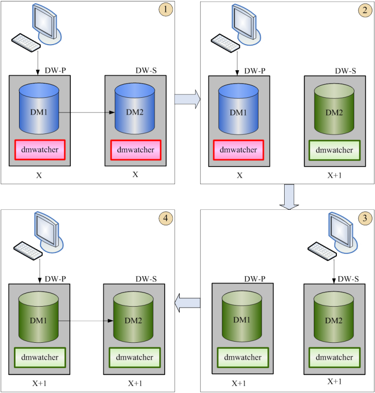

本章以1 个主库、2 个备库的读写分离集群（主库A、备库B、和备库C）为例，对一些常见的数据守护场景进行说明，并相应的介绍各种监视器命令的执行流程。

## 6.1 正常运行状态

守护系统正常运行时，同一个守护进程组中，只有一个主库，其他的都是备库。

主库处于`Open`状态，主库守护进程也处于`Open`状态，守护进程控制文件是`Valid`有效状态。

所有备库也处于`Open`状态，所有备库守护进程处于`Open`状态，守护进程控制文件是`Valid`有效状态。

主库到所有备库的归档也都处于`Valid`有效状态。

`MPP`主备系统中，所有主库的`dmmpp.ctl`都处于一致状态。

## 6.2 数据守护的启动

`Normal`模式的库默认以`Open`状态启动，也可以通过增加启动参数`Mount`，将数据库启动到`Mount`状态。而`Primary/Standby`模式的库启动后，自动进入`Mount`状态，因此，数据守护系统启动时，所有数据库实例处于`Mount`状态。所有守护进程处于`Startup`状态。

`Local`类型的守护进程，直接`Open`数据库实例，并修改守护进程状态为`Open`。其他类型的守护进程，需要相互协调信息，自动将数据库实例切换到`Open`状态，并将守护进程状态也切换为`Open`。

非`Local`类型守护进程将`Standby`模式数据库实例切换为`Open`状态的条件是：

1.守护进程控制文件有效，并且没有标记为分裂状态。

2.检测到活动主库（`Primary/Open`），并且主备库数据保持一致（根据`LSN`判断）、或者是活动主库的可恢复备库。

3.守护进程`Open`数据库实例后，再将自己切换为`Open`状态。

因此，在检测到活动主库之前，备库一直保持`Mount`状态，守护进程保持`startup`状态，分裂备库也会一直保持`mount`状态。

93

非`Local`类型守护进程将`Primary`模式数据库实例切换为`Open`状态的条件是：

1.守护进程控制文件有效，并且没有标记为分裂状态。

2.守护进程组内所有数据库已经启动（不一定处于`Open`状态）。

3.根据数据库模式、`LSN`信息判断，监控的数据库不是其他数据库的可恢复备库。

`4.MPP`主备的`Primary`模式实例`Open`前，检查是否收到`dmmpp.ctl`信息，如果没有则报错（可能是配置错误，比如`dm.ini`中的`MPP_INI`配置项没有设置）。

数据守护系统启动流程，会设置主库`MPP`归档/实时归档/即时归档为`Invalid`状态。`Primary`模式数据库实例切换为`Open`状态时，需要回滚活动事务、`Purge`已提交事务，并重构回滚段，会引发数据变化，`LSN`增长，因此数据守护启动完成后，主备库数据肯定是处于不一致状态。

主库守护进程`Open`主库后，会修改`INST_RECOVER_TIME`内存值为0（默认60 秒），确保备库`Open`后，马上启动故障恢复流程，同步主库数据完成后，重新将归档设置为`Valid`状态。

如果在故障恢复流程完成之前，主库故障，将无法执行备库接管；备库强制接管会引发守护进程组分裂。

读写分离集群，在`Timely`归档变为`Valid`之前，不会在备库上创建数据库连接，只读操作也无法分流到对应的备库。

## 6.3 强制Open 实例

正常情况下，守护进程`dmwatcher`可以自动`Open`数据库实例，但某些情况下（比如备库硬件故障无法启动），数据守护系统不满足`6.2`介绍的启动条件，我们可以通过监视器执行`Open instance`命令，强制`Open`数据库实例。主备库都可以强制`Open`，其执行流程如下：

假设需要强制`Open`数据库A，只需要启动一个监视器，并在控制台上输入`Open``instance A`即可完成强制启动。

如果实例A是`Standby`模式，强制`Open`的执行流程如下：

1. 通知A 的守护进程切换为`Open Force` 状态

94

2. 通知实例执行`Open` 操作
3. 通知守护进程切换`Open` 状态

如果实例A是`Primary`模式，强制`Open`的执行流程如下：

1. 通知A 的守护进程切换为`Open Force` 状态
2. 修改A 的`MPP` 归档/实时归档/即时归档状态为无效
3. 修改守护进程控制文件，增加实例A 强制`Open` 记录项
4. 通知实例执行`Open` 操作
5. 通知守护进程切换`Open` 状态

`Primary`模式数据库实例切换为`Open`状态时，需要回滚活动事务、`Purge`已提交事务，并重构回滚段，会引发数据变化，`LSN`增长。因此，强制`Open`主库后，需要在守护进程控制文件中增加强制`Open`项。并且，这个操作可能会引发守护进程组分裂，比如：

1. 主库A 故障
2. 备库B 接管，成为主库
3. B 故障
4. A 重启，并强制`Open`
5. A 和B 数据不一致，并且无法恢复到一致状态。此时，B 起来，就产生守护进程组

分裂强制`Open`主库前，会设置主库`MPP`归档/实时归档/即时归档为`Invalid`状态。

强制`Open`主库命令，会修改主库守护进程`INST_RECOVER_TIME`内存值为0（默认60 秒），确保备库`Open`后，马上启动故障恢复流程，同步主库数据完成后，重新将归档设置为`Valid`状态。

如果在故障恢复流程完成之前，主库故障，将无法执行备库接管；备库强制接管会引发守护进程组分裂。

## 6.4 关闭数据守护系统

退出守护系统时，必须按照一定的顺序来关闭守护进程和实例。特别是自动切换模式，如果退出守护进程或主备库的顺序不正确，可能会引起主备切换，甚至造成守护进程组分裂。

95

通过监视器执行`Stop Instance`命令关闭数据守护系统，是最简单、安全的方式。

命令执行成功后，数据库实例正常关闭。但守护进程并没有真正退出，而是将状态切换为`Shutdown`状态。

`Stop Instance`命令内部流程如下：

`1)`通知守护进程切换为`Shutdown`状态`2)`通知主库退出`3)`通知其他备库退出如果使用手动方式关闭数据守护系统，请严格按照以下顺序：

`1)`如果启动了确认监视器，先关闭确认监视器（防止自动接管）`2)`关闭备库守护进程（防止重启实例）`3)`关闭主库守护进程（防止重启实例）

```
4) Shutdown 主库
5) Shutdown 备库
```

先关闭主库再关闭备库，顺序一定不能错。

因为主库`Shutdown`过程中，需要`Purge`所有已提交事务，会修改数据，并产生`Redo`日志。如果先`Shutdown`备库，会导致主库发送归档日志失败，并且由于主库已经处于`Shutdown`状态，会导致主库异常关闭。

## 6.5 主备库切换

主库维护，滚动升级等场景，可以执行`Switchover`命令，实现主备库切换。如果存在多个备库，需要先执行`Choose Switchover`命令，选出守护进程组中可以切换的备库。

`Choose Switchover`命令选择可切换备库的条件如下：

1. 主库守护进程是`Open` 状态
2. 备库守护进程是`Open` 状态
3. 主、备库守护进程控制文件`dmwatcher.ctl` 相同，且为`Valid` 状态
4. 主库正常运行
5. 备库正常运行
6. 主库处于`Open` 状态
7. 备库处于`Open` 状态

96

8. 主库到备库的归档是`Valid` 状态

假定选出的可切换备库是B，`Switchover`切换流程如下：

1. 通知主备库守护进程，切换为`Switchover` 状态
2. 通知主库`(A) Mount`
3. 实时守护或`MPP` 守护类型下，通知备库`(B) APPLY KEEP_BUF`
4. 通知备库`(B) Mount`
5. 通知`(A)` 切换为`Standby` 模式
6. `MPP` 守护类型下，通知`(A)` 修改`MPP_INI` 为0
7. 通知`(B)` 切换为`Primary` 模式
8. 通知`(B)` 修改归档状态为无效
9. 通知守护进程`(B)`修改控制文件，增加一条切换记录
10. `MPP` 守护类型下，通知先更新执行`Switchover` 命令的守护进程组，更新主库的

`dmmpp.ctl`文件，再通知更新其他组主库的`dmmpp.ctl`文件

11. 通知新的备库`(A) Open`
12. 通知新的主库`(B) Open`
13. 通知守护进程切换为`Open` 状态
14. 清理所有守护进程上记录的监视器信息

主备库切换在实现逻辑上等同于主备库正常状态下，用户主动发起的`Takeover`操作。`Swithover`完成后，主备库之间数据是不完全同步的；要由新主库B的守护进程通过`Recover`流程，重新同步数据和`dmwatcher.ctl`到新备库A。

`Switchover`命令，会修改切换后主库守护进程`INST_RECOVER_TIME`内存值为0（默认60 秒），确保尽快启动故障恢复流程，同步主库数据完成后，重新将归档设置为`Valid`状态。在故障恢复流程完成之前，再次执行`Switchover`命令会报错，如果主库故障，备库接管将会报错；备库强制接管会引发守护进程组分裂。

97

## 6.6 主库故障、备库接管

当出现硬件故障（掉电、存储损坏等）原因，主库无法启动，并且主库短期不能恢复情况下，可使用备库接管功能，将备库切换为主库继续对外服务。

故障自动切换模式下，确认监视器会自动选择符合条件的备库进行接管。故障手动切换模式下，可以先在监视器上执行`Choose Takeover`命令，选出守护进程组中可以接管的备库。

为了避免备库接管后，造成守护进程组分裂，执行`Takeover`必须满足下列条件：

1. 主库是`Primary` 模式、`Open` 状态时，产生故障
2. 主库守护进程故障，故障前是`Open/Recovery` 状态；或者主库守护进程正常
3. 故障主库到接管备库的归档状态为`Valid`
4. 故障主库与接管备库之间的`MAL` 链路断开
5. 接管备库是`Standby` 模式、`Open` 状态
6. 接管备库的`dmwatcher.ctl` 控制文件状态为`Valid`
7. 故障主库和接管备库的`dmwatcher.ctl` 控制文件相同

假设主库A故障时，选出接管备库B，在监视器上输入`Takeover`命令，就可以执行备库接管。备库接管的执行流程包括：

1. 监视器通知守护进程切换为`Takeover` 状态
2. 实时`/MPP` 守护类型下，通知备库`(B) APPLY KEEP_BUF`
3. 通知备库`(B) Mount`
4. 通知`(B)` 切换为`Primary` 模式
5. 通知`(B)` 修改`MPP` 归档/实时归档/即时归档状态为`Invalid`
6. 通知守护进程`(B)`修改控制文件， 增加一条接管记录
7. `MPP` 守护类型下，通知接管守护进程组更新主库的`dmmpp.ctl` 文件，再通知更新

其他守护进程组主库的`dmmpp.ctl`文件

8. 通知新的主库`(B) Open`
9. 通知守护进程切换为`Open` 状态

98

例如，主库C故障，备库B接管。执行`Takeover`命令后，会修改守护进程`(B)`的`INST_RECOVER_TIME`内存值为0（默认60 秒），确保尽快启动`B->C`的故障恢复流程，同步主库数据完成后，重新将`B->C`的归档设置为`Valid`状态。在故障恢复流程完成之前，主库（B）故障，备库（C）无法接管；强制备库（C）接管会引发守护进程组分裂。

## 6.7 备库强制接管

有些情况下，备库接管会失败，但主库不能启动或者及时恢复对外服务的情况下，可以使用`Takeover Force`命令，进行备库强制接管。强制接管具有一定的风险，可能导致备库和故障主库数据不一致，而造成部分数据的丢失，出现数据库分裂的情况，所以应该慎重使用。

比如主库和守护进程故障时，监视器未启动，用户启动监视器后，由于监视器并未收到故障主库任何信息，因此不满足`Takeover`条件，执行`Takeover`会报错。如果用户可确认主库故障时主备数据是一致的（比如故障时主库未执行操作，主备库归档有效的，并且两者的`SLSN`一致）、或者丢失小部分数据的影响可忽略、或者丢失小部分数据的影响小于主库持续宕机造成的影响，则可以考虑执行`takeover force`强制接管。

强制接管，先通过`Choose Takeover Force`选出符合接管条件的备库，再执行`Takeover Force`命令。备库强制接管时，如果接管备库是处于`Mount`状态`/Standby`模式的库，则会自动`Open`备库，其他执行流程与备库接管一致。强制接管的条件包括：

1. 不存在活动主库
2. 备库守护进程处于`Open` 或`Startup` 状态
3. 备库实例运行正常
4. 备库是`Standby` 模式
5. 备库处于`Open` 或`Mount` 状态
6. 备库`SLSN` 必须是所有备库中最大的
7. 备库守护进程控制文件必须有效

99

与`Takeover`命令一样，`Takeover Force`命令会修改主库守护进程的`INST_RECOVER_TIME`内存值为0（默认60 秒），确保尽快启动故障恢复流程。

强制接管具有一定的风险，可能导致备库和故障主库数据不一致，而造成部分数据的丢失、数据库分裂，所以应该综合考虑当时情况，慎重使用。

## 6.8 主库故障重启（备库接管前重启）

主库故障后立即重启，此时主库的守护进程变成`Startup`状态，重新进入守护进程的启动流程，将所有备库归档设置成无效状态，并重新`Open`主数据库。`Open`成功后继续作为主库，当检测到备库正常时会启动`Recovery`处理流程，重新同步主备库数据。

## 6.9 备库故障处理

备库产生故障时，主库的处理流程对手动切换、自动切换模式处理上有些差异。对于手动切换模式，检测到备库故障，满足`Failover`条件时，立即切换到`Failover`状态。自动切换模式备库数据库异常，如果备库守护进程是活动的，主库守护进程直接切换到`Failover`状态；如果备库守护进程一起故障，则切换为`Confirm`确认状态，等待确认监视器的确认消息，详情参考`4.2`状态确认。

主库`Failover`条件：

1. 备库实例故障
2. 主库`->`故障备库的归档状态是`Valid`
3. 主库和故障备库之间的`MAL` 链路断开、或者主库处于`Suspend` 状态

主库`Failover`处理流程：

1. `Suspend` 主数据库
2. 设置主库`->`故障备库归档无效
3. 重新`Open` 主库

## 6.10 公共网络故障

主库公共网络故障，主备库正常、内部网络正常情况下，用户无法连接主库执行正常的

100

数据库操作。这种情况下，用户可以通过`Switchover`命令，将备库切换为主库，确保数据库服务不受影响。

读写分离集群，备库公共网络故障，主备库正常、内部网络正常情况下，用户的所有请求会自动分发到主库执行。

## 6.11 内部网络故障

`DM`数据守护对内部网络的可靠性提出了很高的要求，但是在实际应用中（比如异地容灾），存在很多不可控因素，内部网络无法保证绝对可靠。守护进程和守护进程之间、守护进程和监视器之间会超时机制来检测是否出现故障，当内部网络出现故障时，超过设置时间未收到远程消息，会认定远程故障。

下面的表格说明内部网络故障场景以及守护进程的处理策略：

表`6.1`故障场景和处理策略手动切换处理策略自动切换处理策略故障类型主库内外部网卡正常时，归档失败，主库挂起，主库主库守护进程保持`confirm`状态，确认监视器部网卡`FAILOVER`，归档设置无效，异步工作。 自动寻找备库自动接管。详见`4.2`、`4.3`节故障备库内外部网卡正常时，归档失败，主库挂起，主库主库守护进程`FAILOVER`，归档设置无效，异部网卡`FAILOVER`，归档设置无效，异步工作。 步工作。详见`4.2`、`4.3`节故障主备库外部网卡正常时，归档失败，主库挂起，主库主库守护进程`FAILOVER`，归档设置无效，异交换机`FAILOVER`，归档设置无效，异步工作。 步工作。详见`4.2`、`4.3`节故障主备网外部网卡正常时，归档失败，主库挂起，主库主库守护进程保持`confirm`状态，备库不会自卡同时`FAILOVER`，归档设置无效，异步工作。 动切换故障

自动切换模式下，当发生主库内部网络故障，其他网络均正常，归档失败，主库`SUSPEND`，导致连接主库的会话被挂起，一直无法返回，备库自动接管后，这些会话连接无法自动切换到新主库上。为此，达梦采用超时机制断开由于归档失败导致挂起时的所有会

101

话，通过配置`dm.ini`中的`SESS_FREE_IN_SUSPEND`实现，默认`60s`。

网络故障恢复后，对于手动切换模式，没有强制接管的情况下，主库的守护进程会自动判断备库是否能加入，能加入则启动`RECOVERY`流程。对于自动切换模式已经被接管的情况，守护进程会将故障主库强制退出（`shutdown`），故障主库重启后，还需要守护进程再去判断是否可作为备库重加入守护系统，如果可以，则启动恢复流程（切换为`standy`模式，重新将实例`open`），如果不能，才修改为分裂状态。

当内部网络是由于拔掉网线、或者禁用网卡等原因导致的故障，`MAL`系统检测到链路断开的时间由`dmmal.ini`中配置的`MAL_CHECK_INTERVAL`以及`MAL_CONN_FAIL_INTERVAL`决定。会话的中断时间会比杀掉实例、掉电等花费的时间长。

下面举例说明：

```
dmmal.ini 配置
MAL_CHECK_INTERVAL      = 10
MAL_CONN_FAIL_INTERVAL = 10
dmwatcher.ini 配置
DW_ERROR_TIME  = 10
```

拔掉备库网线后，主库上`mal`检测线程根据`MAL_CHECK_INTERVAL`间隔检查，时间`<=10s`，检查认定网络故障需要`10s`，再加上守护进程认定远程网络故障时间`DW_ERROR_TIME`为`10s`，在最坏的情况下，应用连接等待主库响应最长的时间可能会是三个时间的累加，也许会达到`30s`。

## 6.12 故障库数据同步

当实例由于各种原因故障，重启或者网络恢复后，守护进程会自动判断能否加入当前主库系统，判断条件和数据恢复处理流程详见细`3.1.8`故障恢复处理章节。恢复的中间过程可通过附录中的动态视图进行查看。

## 6.13 备库重建

当主备库所在硬件出现故障、或者数据库文件损坏导致数据损毁时，可按照数据守护搭建一章中介绍的几种方式来重新准备数据。

重建库要选定一个当前有效库或者一个历史备份。

102

下面以备库B数据损坏，重新配置数据为例，说明备库重建流程：

1. 重新初始化数据库

```
./dminit path=/dm7/data
```

2. 启动`DIsql` 登录主库A，执行联机备份

```
SQL> BACKUP DATABASE FULL BACKUPSET '/dm7/data/BACKUP_FILE_01';
```

3. 将备份文件拷贝至B 所在的机器上，执行脱机还原与恢复

```
./dmrman CTLSTMT="RESTORE DATABASE '/dm7/data/DAMENG/dm.ini' FROM BACKUPSET
'/dm7/data/BACKUP_FILE_01'"
./dmrman CTLSTMT="Recover DATABASE '/dm7/data/DAMENG/dm.ini' FROM BACKUPSET
'/dm7/data/BACKUP_FILE_01'"
4. 重新配置B 的dm.ini、dmmal.ini、dmarch.ini 和dmwatcher.ini 配置文
```

件，并拷贝主库的`dmwatcher.ctl`文件

5. 以`mount` 方式启动B

```
./dmserver /dm7/data/DAMENG/dm.ini mount
```

6. `DIsql` 登录B，设置`OGUID`

```
SQL>sp_set_oguid(82379);
```

7. 修改数据库模式为`Standby`

```
SQL>alter database standby;
```

8. 启动B 的守护进程

```
./dmwatcher /dm7/data/DAMENG/dmwatcher.ini
```

执行以上步骤后，恢复B的准备过程已经完成。接下来，数据守护系统会将B作为备库重加入数据守护系统，A的守护进程会自动通知同步数据到B，最终恢复主备库数据到一致状态。

如果数据规模比较大、联机备份耗时较长、应用压力比较大的情况下，主库联机备份、备库脱机还原过程中，主库可能又新产生了大量归档日志。使用上述步骤重建备库后，主库向备库同步历史数据的时间会比较久，主备库数据在比较长的一段时间内处于不一致状态。

用户还可以利用归档备份、还原和归档恢复功能，将备库数据恢复到更加接近主库最新状态，有效减少备库加入主备系统后，历史数据同步时间。执行步骤如下：

9. 重新初始化数据库

103

```
./dminit path=/dm7/data
```

10. 启动`DIsql` 登录主库A，执行联机备份

```
SQL> BACKUP DATABASE FULL BACKUPSET '/dm7/data/BACKUP_FILE_02' WITHOUT LOG;
```

11. 将备份文件拷贝至B 所在的机器上，执行脱机还原

```
./dmrman CTLSTMT="RESTORE DATABASE '/dm7/data/DAMENG/dm.ini' FROM BACKUPSET
'/dm7/data/BACKUP_FILE_02'"
```

12. 启动`DIsql` 登录主库A，查看备份集的`BEGIN_LSN`，并从`BEGIN_LSN` 开始备份

主库的归档日志。（这里假设查询到的备份集`BEGIN_LSN`是38491）

```
SQL> SELECT BACKUP_NAME,BEGIN_LSN FROM V$BACKUPSET;
SQL> BACKUP ARCHIVE LOG FROM LSN 38491 BACKUPSET '/dm7/data/ARCH_BAK_02';
```

13. 将归档备份集拷贝至B 所在的机器，还原归档后、利用这些归档日志进行数据库

恢复

```
./dmrman CTLSTMT="RESTORE ARCHIVE LOG FROM BACKUPSET '/dm7/data/ARCH_BAK_02' TO
ARCHIVEDIR '/dm7/data/arch'"
./dmrman CTLSTMT="Recover DATABASE '/dm7/data/DAMENG/dm.ini' WITH ARCHIVEDIR
'/dm7/data/arch'"
14. 重新配置B 的dm.ini、dmmal.ini、dmarch.ini 和dmwatcher.ini 配置文
```

件，并拷贝主库的`dmwatcher.ctl`文件

15. 以`mount` 方式启动B

```
./dmserver /dm7/data/DAMENG/dm.ini mount
```

16. `DIsql` 登录B，设置`OGUID`

```
SQL>sp_set_oguid(82379);
```

17. 修改数据库模式为`Standby`

```
SQL>alter database standby;
```

18. 启动B 的守护进程

```
./dmwatcher /dm7/data/DAMENG/dmwatcher.ini
```

## 6.14 守护进程组分裂

组分裂的概念和导致分裂的场景参考`2.2.12`一节，对于分裂的数据库需要进行人工

104

干预，重新准备数据或者对分裂数据进行修复后，才允许重新加入守护系统。

借助监视器的`show`命令、或者`tip`命令可以查看守护系统中是否发生实例的分裂，对于已发生的分裂，可以借助以下方法找出分裂产生的原因：

1. 查看分裂实例的服务器`log` 日志，查找带有`“[!!!”`和`“!!!]”`标签的`log` 信息，

`log`信息格式形如`“[!!! LOG_INFO !!!]”`，记录有实例分裂的详细原因。

2. 如果分裂实例的守护进程控制文件状态不是`Valid`，可借助监视器的`show`

`dmwatcher ctl`命令，根据修改状态的那条记录信息对应的`DESC`字段找出原因。

3. 根据服务器和监视器的`log` 日志，找出历史操作信息，分析产生分裂的原因。

发生分裂后，用户需要选择适当的主库作为最新主库。当库的数据量不太大、重新准备数据时间不需太长的情况下，可简单采用备库重建的方法加入系统。当数据量非常大，备库重建短时间内无法完成，可考虑使用分裂库修复的方式修复好分裂库后，再重新加入系统。

## 6.15 dmmpp.ctl 不一致

`MPP`主备环境，在某些故障场景中，可能会出现`dmmpp.ctl`控制文件不一致的情况，可以借助监视器的`check mppctl`和`recover mppctl`命令来检测和恢复。

正常运行时，所有`MPP`主节点的`dmmpp.ctl`文件内容是完全一致的。如果某个组中的主备库实例发生改变（如执行`switchover`、`takeover`等），导致`dmmpp.ctl`变化，需要及时同步到所有组的主库节点上。

在执行数据同步过程中可能发生故障，导致`dmmpp.ctl`未同步，就可能造成控制文件的不一致。例如，两节点`MPP`，分成两个守护进程组（`GRP1`和`GRP2`），组`GRP1`包含两个实例（主库`GRP1_MPP_EP01`和备库`GRP1_MPP_EP11`），组`GRP2`包含两个实例（主库`GRP2_MPP_EP02`和备库`GRP2_MPP_EP22`）。在监视器上执行`switchover`命令，将`GRP1`的两个实例进行切换。

当执行到`switchover`流程中更新`dmmpp.ctl`文件时，可能会出现下列故障情况，导致`dmmpp.ctl`处于不一致状态。

1. 更新`GRP1` 的`dmmpp.ctl` 文件时，监视器故障或者链路断开等原因导致更新失败，

`GRP1`和`GRP2`的`dmmpp.ctl`文件都没有更新，但`GRP1`的主库已经切换为

```
GRP1_MPP_EP11。
```

2. 更新`GRP1` 的`dmmpp.ctl` 文件成功，但更新`GRP2` 的`dmmpp.ctl` 失败，`GRP1`

105

和`GRP2`的`dmmpp.ctl`文件不一致。

这两种不一致状态可以通过`recover mppctl`命令尝试重新恢复到一致状态。

监视器执行`recover mppctl`的步骤如下：

1. `dmmonitor` 根据当前守护系统中的主库信息，重新生成有效的`dmmpp.ctl` 文件。
2. `dmmonitor` 将有效的`dmmpp.ctl` 文件内容发送给主库。

如果存在主库故障，还没有处理时，`recover mppctl`会跳过故障组，只恢复存在有效主库组的`dmmpp.ctl`文件。故障组主库恢复正常后，需要重新调用`recover mppctl`进行恢复。`dmmpp.ctl`文件不一致时，`MPP`无法正常提供数据库功能。

## 6.16 确认监视器未启动

故障自动切换模式下，确认监视器必须一直处于启动状态，如果故障前未启动确认监视器，主库故障后备库并不会自动切换为主库。

故障自动切换模式下，确认监视器故障或者未启动，如果主备库之间出现网络故障，主库守护进程会处于确认状态，实例处于挂起`SUSPEND`状态。当主库守护进程检测到网络恢复正常后，即使在没有确认监视器的情况下，也会变成`FAILOVER`状态，后续进行正常的备机恢复处理，而不会一直处于`CONFIRM`确认状态。

启动一个监视器，通过该监视器的`show monitor`命令可以查看连接到指定守护进程的所有监视器信息，以此可以检查确认监视器是否启动了。

## 6.17 备库维护

守护进程正常运行时，如果需要主动维护备库，并且不启动主库的`failover`故障处理流程（可参考`6.9`备库故障处理），可以通过监视器命令调整主库守护进程的恢复时间间隔，并主动将备库归档失效来达到目的。

监视器提供`set recover time`命令和`set arch invalid`命令支持备库的主动维护操作。

其中`remove instance`命令包含了设置恢复间隔、通知归档失效以及通知备库退出的操作，如果用户想简化手工操作步骤，可直接使用`remove instance`来完成，如果暂

106

时不需要退出备库，可结合`set recover time`命令和`set arch invalid`命令来完成，具体命令使用说明如下：

```
1. set recover time 和 set arch invalid 命令
```

`set recover time`命令可动态设置主库守护进程内存中对指定备库的恢复间隔，在将备库归档失效之前，需要先使用此命令对需要主动维护的备库设置一个较大的间隔值，然后再使用`set arch invalid`命令，修改主库到备库的归档为无效状态，执行过这两个操作后，即可正常退出备库，执行维护操作。

执行`set arch invalid`将备库归档失效，是为了防止备库退出后，主库启动故障处理流程，执行`suspend`等操作影响正常的应用执行。而在此之前先执行`set recover time`是为了防止在备库归档失效之后，实际退出之前，主库的守护进程立马发起`recover`恢复流程，又重新将备库归档置为有效状态，在备库退出后，还会执行故障处理的情况发生。

```
2. remove instance 命令
```

`remove instance`命令包含有以下4 个操作步骤，此命令主要是为了简化备库维护的手工操作步骤，一次完成将指定备库移出守护进程组的所有操作。

`1)`通知主库设置指定备库的恢复间隔为`86400 s`（相当于执行`set recover time`命令）`2)`通知主库修改指定备库的归档状态无效（相当于执行`set arch invalid`命令）`3)`通知切换备库的守护进程为`SHUTDOWN`状态`4)`通知备库正常退出另外此命令也支持异步备库的执行，对于异步备库，会跳过步骤1）、2），直接执行步骤3）、4），执行退出操作。

此命令执行成功后，在备库维护工作完成重启之后，主库内存中对指定备库的恢复间隔时间仍然是`86400 s`，如果想尽快启动恢复流程，需要再通过手工执行`set recover time`命令调整指定备库的恢复间隔，此限制只针对非`local`守护类型的备库。

## 6.18 滚动升级

通过`DM`数据守护，可以确保数据库服务不中断情况下，实现滚动升级。

这里以一主一备的配置方式举例说明，如图图`6.1`所示。

假设初始状态为主库`DM1`，部署在`DW_P`机器上，备库`DM2`，部署在`DW_S`机器上，监

107

视机`DW_M`滚动升级操作步骤如下：

1. 关闭备库`DM2` 的守护进程，正常关闭备库实例`DM2`；这个过程中，主库`DM1` 的守

护进程会检测到备库故障，并进行故障处理，修改归档状态无效。

2. 升级`DW_S`，重新安装新版本服务器，或者直接将新的执行程序和动态库替换旧版

本

3. 启动`DM2` 实例，启动`DM2` 的守护进程
4. 等待历史数据同步完成，`DM2` 重新加入数据守护系统（可以通过监视器`DW_M` 查看

数据守护系统是否恢复正常）

5. 关闭主库`DM1` 的守护进程，正常关闭实例`DM1`；使用监视器的接管命令将`DM2` 接

管为新的主库。

6. 升级`DW_P`，重新安装新版本服务器，或者直接将新的执行程序和动态库替换旧版

本

7. 启动`DM1` 实例，启动`DM1` 的守护进程
8. 等待历史数据同步完成，`DM1` 作为备库重新加入数据守护系统（可以通过监视器

`DW_M`查看数据守护系统是否恢复正常）

9. 在`DW_M` 监视器控制台上输入`Switchover` 命令，重新将`DM1` 切换为主库，至此

滚动升级完成。

108



图`6.1`滚动升级

多个备库的情况，可同样参考上面的步骤1 到步骤4，先统一升级所有备库实例，步骤5 中，可任意选择一个升级后的备库接管，最后升级主库完成后，再借助`Switchover`命令切换主备库。

由于涉及回滚段改造，`DB_VERSION`版本号为`0x00070005`的数据库无法滚动升级到`0x00070006`版本。由于日志压缩格式重构，`0x00070007`版本数据库无法滚动升级到`0x00070008`版本。

## 6.19 备库文件损坏

重演`Redo`日志过程中，如果访问数据文件失败（用户通过操作系统命令删除、或者文件所在存储故障、或者表空间处于`Offline`状态），备库会强制`Halt`，相关错误信息会写

109

入日志文件中。因此，建议用户在确保主库不会修改对应表空间文件情况下，执行`Offline`备库表空间操作；或者先通过`Remove Instance`命令将备库移出守护进程组后，再进行`Offline`表空间操作。

如果是由于备库表空间处于`Offline`状态，导致备库故障，但数据文件本身并没有损坏情况下，我们可以直接在备库执行`Alter tablespace ts1 online;`避免备库重演`Redo`日志异常。

如果备库数据文件损坏，则可以通过表空间还原、或者还原指定数据文件来修复。在数据修复前，要先通过监视器执行`remove instance`命令将对应备库移出守护进出组，数据修复完成后，再重新将备库加入守护进程组。

修复的前提条件是有备库的完全备份集或者该表空间的备份集，可以任选其中一个备份集，来执行修复操作。

参考步骤：

以下示例中备库所在的守护进程组名为`GRP1`，备库实例名为`GRP1_RT_02`，备库数据文件存放路径为`F:\data`，备库上发生损坏的表空间名称为`TS1`，当前已经有一个完全备份集“`DBBAK`”和一个`TS1`的表空间备份集“`TS1BAK`”。

完全备份示例：

```
BACKUP DATABASE FULL BACKUPSET 'DBBAK';
```

表空间`TS1`备份示例：

```
BACKUP TABLESPACE TS1 BACKUPSET 'TS1BAK';
```

对表空间`TS1`进行数据修复：

修复方法1：

1. 使用监视器命令将备库移出守护环境

命令格式：

```
remove instance [group_name.]inst_name
```

只有一组时可以省略组名`group_name`，如果没有登录监视器，则需要先在监视器上执行`login`登录命令。

```
remove instance GRP1.GRP1_RT_02
```

110

此命令会通知主库将备库归档失效，强制设置主库到备库的恢复间隔为24 小时，并关闭备库的守护进程，将备库实例退出。

在命令执行时，如果备库由于数据文件损坏已经被强制`halt`，则备库的退出操作会执行失败，如果备库被强制`halt`后监视器又重启过，没有收到过备库的历史消息，命令会执行失败，可参考“修复方法2”的步骤进行修复。

`2.MOUNT`方式重新启动备库实例启动时，如果存在有损坏的数据文件，对应的表空间会被置为`offline`状态，可以通过还原表空间或者还原指定的数据文件进行修复，使用`disql`登录备库，选择其中一种还原方式执行即可。

- 还原表空间

```
RESTORE TABLESPACE TS1 FROM BACKUPSET 'TS1BAK';
```

- 还原指定的数据文件

`1)`查找数据文件路径

`--`通过动态视图查找需要还原的数据文件路径，必要时，可以导出`dm.ctl`文件定位表空间

```
select id,path from v$datafile;
行号       ID          PATH
---------- ----------- -------------------------------------
1          0           f:\data\DAMENG\SYSTEM.DBF
2          0           f:\data\DAMENG\ROLL.DBF
3          0           f:\data\DAMENG\TEMP.DBF
4          0           f:\data\DAMENG\MAIN.DBF
5          NULL        文件[f:\data\DAMENG\ts1.dbf]不存在
```

`2)`使用查到的数据文件路径执行还原

```
RESTORE TABLESPACE TS1 DATAFILE 'f:\data\DAMENG\ts1.dbf' FROM BACKUPSET
'TS1BAK';
```

3. 打开备库的守护进程监控

步骤`1 remove instance`命令执行完成后，会将关闭备库的守护进程监控功能，备库的守护进程处于`SHUTDOWN`状态，需要在监视器上执行下面命令，打开守护进程监控，：

```
startup dmwatcher GRP1
```

正常情况下，监控打开后，主库正常的情况下，守护进程会将备库自动`OPEN`（这里不

111

考虑备库发生分裂的情况），主库的守护进程在24 小时之后才会启动`recovery`流程恢复备库，此时主备库之间并不会有数据同步操作（`remove instance`命令将备库的`recover`恢复间隔设置为24 小时）。

如果此时主库故障，备库的守护进程无法执行自动`OPEN`操作，可以借助监视器的强制`OPEN`命令将备库手动`OPEN`，如果没有登录监视器，则需要先在监视器上执行`login`登录命令。

```
open instance GRP1.GRP1_RT_02
4. Online 表空间
```

使用`disql`登录备库，执行下面语句`Online TS1`表空间：

```
ALTER TABLESPACE TS1 ONLINE;
```

5. 使用监视器命令设置备库的恢复间隔

如步骤3 中描述，`remove instance`命令会强制设置主库的守护进程在24 小时之后再启动到备库的恢复间隔，如果需要立即启动主备库之间的数据同步，将备库恢复正常，可以使用监视器的`set recover time`命令将恢复间隔设置为0，如果没有登录监视器，则需要先在监视器上执行`login`登录命令。

```
set recover time GRP1.GRP1_RT_02 0
```

命令执行完成后，主库的守护进程会启动`recovery`流程，待主备数据同步到一致状态后，备库即恢复到正常状态，重加入守护系统成功。

修复方法2：

此修复过程使用`disql`执行语句来完成，备库示例环境同修复方法1，在修复期间不允许启动守护进程，避免`disql`执行语句报错，另外需要根据情况修改`dm.ini`的配置参数。执行命令前，备库已经被`halt`，或者手动退出，守护进程也正常`exit`退出。

1. 根据情况修改`dm.ini` 的配置参数

查看`dm.ini`中的`ALTER_MODE_STATUS`参数，如果配置为0（不允许手动修改实例的模式/状态），则需要将此参数暂时修改为1，后续需要执行`OPEN FORCE`操作将实例强制`OPEN`。

`ALTER_MODE_STATUS` `= 1` #允许手工方式修改实例模式/状态

```
ENABLE_OFFLINE_TS  = 1  #允许offline 表空间
```

`2. MOUNT`方式重新启动备库，不启动备库的守护进程实例启动时，如果存在有损坏的数据文件，对应的表空间会被置为`offline`状态。

112

使用`disql`登录备库：

`1)`将备库强制`OPEN`

```
ALTER DATABASE OPEN FORCE;
```

`2)`还原表空间或还原指定的数据文件，选择其中一种还原方式即可。

`a.`还原表空间：

```
RESTORE TABLESPACE TS1 FROM BACKUPSET 'TS1BAK';
```

`b.`还原指定的数据文件：

`1)`查找数据文件路径

`--`通过动态视图查找需要还原的数据文件路径，必要时，可以导出`dm.ctl`文件定位表空间

```
select id,path from v$datafile;
行号       ID          PATH
---------- ----------- -------------------------------------
1          0           f:\data\DAMENG\SYSTEM.DBF
2          0           f:\data\DAMENG\ROLL.DBF
3          0           f:\data\DAMENG\TEMP.DBF
4          0           f:\data\DAMENG\MAIN.DBF
5          NULL        文件[f:\data\DAMENG\ts1.dbf]不存在
```

`2)`使用查到的数据文件路径执行还原

```
RESTORE TABLESPACE TS1 DATAFILE 'f:\data\DAMENG\ts1.dbf' FROM BACKUPSET
'TS1BAK';
```

`3. Online`还原过的表空间使用`disql`登录备库，执行以下语句：

```
ALTER TABLESPACE TS1 ONLINE;
```

4. 改回`dm.ini` 的配置参数

如果在步骤1 中修改过`ALTER_MODE_STATUS`参数，需要再执行此步骤，重新将其修改为0，否则可跳过此步骤。

`ALTER_MODE_STATUS` `= 0` #不允许手工方式修改实例模式/状态

```
ENABLE_OFFLINE_TS  = 2  #不允许备库offline 表空间
```

> `5.MOUNT`方式重新启动备库，启动备库的守护进程

113

守护进程组中有正常主库的情况下，备库的守护进程会通知备库自动`Open`，可以参考修复方法1 中的步骤5，在监视器上执行`set recover time`命令，通知主库的守护进程立即启动备库的恢复流程，将备库恢复到正常状态，如果没有登录监视器，执行此命令前需要先在监视器上执行`login`登录命令。

```
set recover time GRP1.GRP1_RT_02 0
```

命令执行完成后，主库的守护进程会启动`recovery`流程，待主备数据同步到一致状态后，备库即恢复到正常状态，重加入守护系统成功。

引发备库表空处于`Offline`状态的主要原因包括：

1.直接在备库上执行`Offline`表空间操作

2.在主库上执行`Offline`表空间操作后，执行`Switchover`命令进行主备库切换

3.备库数据文件损坏，启动时自动将对应表空间变成`Offline`状态主库表空间`Offline/online`操作，不会生成`Redo`日志，也不会同步到备库，也就是说主库的表空间`Offline/online`操作不会影响备库。但用户可以直接登录备库执行`Offline/Online`表空间操作，同样，备库的表空间`Offline/online`操作也不会影响主库。

## 6.20 实时/读写分离/MPP 备库数据同步情况分析

正常情况下实时`/MPP`备库数据与主库数据基本一致，可以通过监视器的`show`命令观察主备库的`LSN`差距来大致了解数据同步情况，如果主备库的`LSN`值差距很小，说明主备库数据基本一致。当备库的`LSN`值远小于主库`LSN`值时，就需要引起重视，分析原因。

主备库`LSN`值相差很大的情况下，可以借助监视器的`show`命令查看状态来进行分析，下面的分析以守护系统中存在正常主库为前提，如果主库发生故障，是无法再向备库同步数据的，需要等主库恢复正常后，再观察主备库的`LSN`同步情况。

1. 备库的守护进程状态是否正常（`WSTATUS` 字段）

如果`WSTATUS`是`ERROR`状态，说明监视器接收备库的守护进程消息超时，需要查看守护进程是否故障，如果发生故障，则需要根据守护进程日志分析故障原因，待守护进程恢复正常后再观察备库的`LSN`增长情况。

如果`WSTATUS`是`SHUTDOWN`状态，说明备库的守护进程监控被关闭，需要借助监视器的`startup dmwatcher`命令打开监控，打开之后再观察备库的`LSN`增长情况。

114

2. 备库实例状态是否正常（`INST_OK` 字段）

如果`INST_OK`字段是`ERROR`状态，说明备库的守护进程接收备库实例消息超时，需要确认备库实例是否故障，如果发生故障，则需要根据服务器日志分析故障原因，待备库恢复正常后，再观察`LSN`增长情况。

3. 备库归档状态是否有效（`RSTAT` 字段）

1）备库的`RSTAT`字段是`INVALID`状态需要等主库的守护进程发起`recover`流程，同步主备库数据。

使用监视器的`show`命令，查看主库的守护进程状态，如果已经处于`recovery`状态，可以使用`disql`登录主库查询`V$RECOVER_STATUS`视图，查看当前的恢复信息，如果正在恢复的是其他备库，则需要等待其他备库恢复完成。

如果主库的守护进程不是`recovery`状态，则需要根据`3.1.8`故障恢复处理小节描述的`recovey`条件来判断备库是否满足恢复条件，如果不满足条件，则需要根据不满足的情况来做不同的处理。

2）备库的`RSTAT`字段是`VALID`状态如果备库归档处于有效状态，并且备库实例是`OPEN`状态，主库也是正常`OPEN`状态，则说明主备库在正常同步数据，可以通过监视器的`show`命令查看备库的`lsn`是否在持续增长，以及备库的`slsn/sslsn`与`cur_lsn/file_lsn`的差值，如果差值很大，说明备库上有比较多的日志堆积。

可以登录备库查询`v$rapply_sys/v$rapply_log_task`视图来查看日志的堆积情况，如果日志堆积数量超过3000 并且新收到的日志重演任务数和未处理的任务数差值超过1000，则备库会执行强制`halt`处理。

## 6.21 异步备库数据同步情况分析

源库通过配置的定时器来定时同步数据到异步备库，可以根据定时器的时间间隔，使用监视器的`show`命令来观察异步备库的`LSN`是否在定期增长，或者使用监视器的`show arch``info`命令来查看源库到异步备库的数据同步情况。

如果这两种方式都没有观察到源库到异步备库的数据同步，则需要从以下几个方面来分析原因：

1. 源库是否配置正确

115

`1)`源库的`dmarch.ini`中是否有异步归档配置项，是否有定时器名称配置`ARCH_TIMER_NAME`，并且需要和`dmtimer.ini`中的定时器名称一致。

`2)`源库的数据文件目录下是否有定时器配置文件`dmtimer.ini`。

`3)`源库的`dm.ini`中的`TIMER_INI`是否配置为1。

`4)`源库的`dmmal.ini`中是否有异步备库的配置项，并且守护系统中所有实例的`dmmal.ini`的内容完全一致。

`5)`源库是否唯一，同一个异步备库只能配置在一个源库上。

可使用`disql`登录源库，查询`v$dm_arch_ini`和`v$dm_timer_ini`视图来确认配置信息是否正确。

2. 源库和异步备库状态是否正常

通过监视器的`show`命令查看源库和异步备库状态，如果源库或异步备库发生故障，则不会再同步数据，需要等两者都恢复正常后，再观察异步备库的数据同步情况。

3. 源库到异步备库的`mal` 链路是否正常

通过监视器的`show arch info`观察源库到异步备库的`mal`链路状态，如果处于`DISCONNECTED`状态，也无法正常同步数据，需要等链路重建成功后，再观察异步备库的数据同步情况。

4. 定时器是否满足触发条件

查看源库的`dmtimer.ini`中的触发条件，或者`disql`登录源库，通过`v$dm_timer_ini`视图查看定时器的触发条件，包括起始时间、触发频率等，再根据操作系统当前时间来判断是否满足触发条件，可能会有人为修改操作系统时间导致定时器无法触发的情况，如果不满足触发条件，也无法同步数据到异步备库。

## 6.22 注意事项

1. 守护进程、监视器启动后，如果收不到其他守护进程消息，检查端口、`OGUID` 等

配置，并确认是否消息被防火墙屏蔽。

2. 备库故障重启，主库同步归档日志失败，可以查看监视器的`Recovery` 信息，或

者查看数据库日志信息、`dmwatcher`日志信息，检查失败原因。如果是主库归档日志不完整、或者主备库日志不连续等原因造成同步失败，则需要尽快重新重建备库。

3. 建议使用故障手动切换模式数据守护系统。如果配置故障自动切换方式模式，则必

116

须配置确认监视器。

4. 同时配置数据守护和高可靠集群（`HIGH-AVAILABILITY`，简称`HA`）软件情况下，

```
需要将dmwatcher.ini 的INST_AUTO_RESTART 设置为0，避免dmwatcher 与HA 软
```

件同时启动`dmserver`实例。同时，配置`dm.ini`中的`HA_INST_CHECK_IP/HA_INST_CHECK_PORT`参数，避免由于`HA`软件故障，引发多个`dmserver`实例同时操作一份数据，导致数据损坏。

5. 用户应该使用“正常接管”方式将备库切换为主库，在无法正常接管的情况下，再

考虑使用 “强制接管”方式，但“强制接管”前一定要确认主备库数据是一致的，避免引发组分裂。

6. 根据磁盘空间情况，合理设置`dmarch.ini` 的`ARCH_SPACE_LIMIT` 值，防止磁

盘空间被归档日志文件占满。

7. 备库重做新建数据库文件操作时，缺省按照主库的目录进行创建，如果创建失败则

会将文件创建到`dm.ini`中指定的`SYSTEM_PATH`目录下。

8. `DM` 根据`dm.ini` 参数`TS_MAX_ID/TS_FIL_MAX_ID` 分配表空间和文件对象内存

存放空间，用户需要确保主备库参数一致。如果配置不一致，比如：主库`TS_MAX_ID >`备库`TS_MAX_ID`、并且新建表空间`ID >`备库`TS_MAX_ID`情况下，主库创建表空间成功，备库重演创建表空间操作时检测到`ID`越界会强制退出系统。

9. 守护进程通过当前系统时间与最后一次接收消息时间的差值，来检测目标对象是否

异常，因此修改操作系统时间，可能会导致误判系统出现故障，不建议在数据守护系统运行过程中调整操作系统时间。

10. 主库修改表空间的`cache` 方式的`DDL` 操作，不会同步到备库。备库不允许修改表

空间的`cache`方式。

11. 默认配置下，主备库都允许执行`Offline` 表空间操作，并且主库的`Offline` 表

空间操作不会同步到备库。如果用户直接登录备库`Offline`表空间，重做`Redo`日志访问此表空间，将导致备库强制退出。因此，针对备库的表空间`Offline`操作要十分谨慎。用户可以修改`dm.ini`配置参数`ENABLE_OFFLINE_TS = 2`，限制备库`Offline`表空间操作，降低误操作概率。

12. 主库上新建表空间或增加文件等操作，当备库磁盘空间不足时，备库上重做日志会

导致宕机。

117

13. 两节点主备MPP 环境，交叉配置环境中，创建表空间必须使用相对路径。例如，

CREATE TABLESPACE TS4 DATAFILE 'TS4.DBF' SIZE 128;

118
