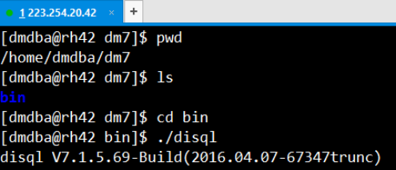
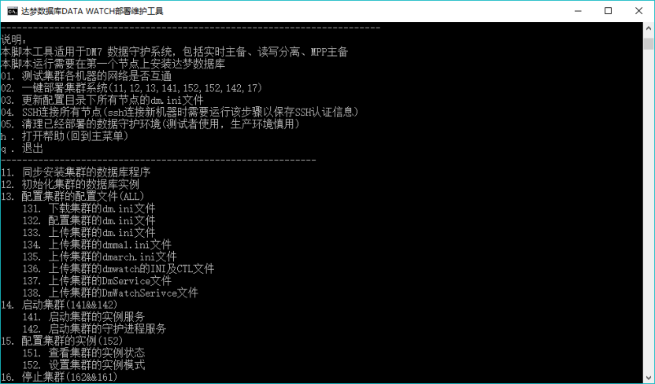
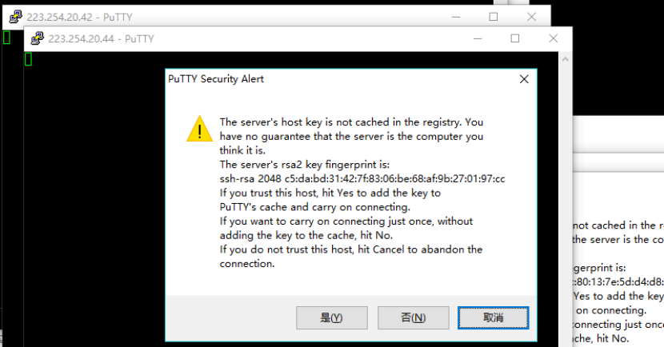
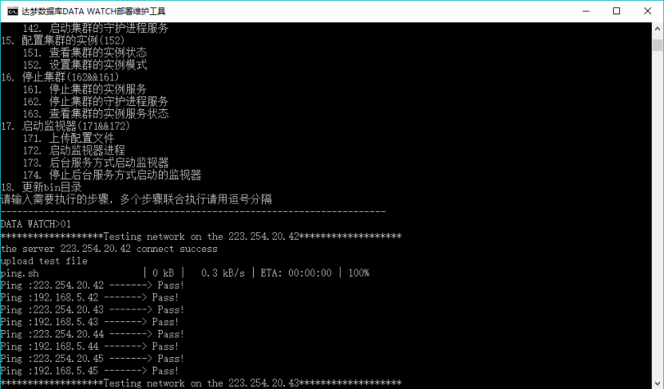
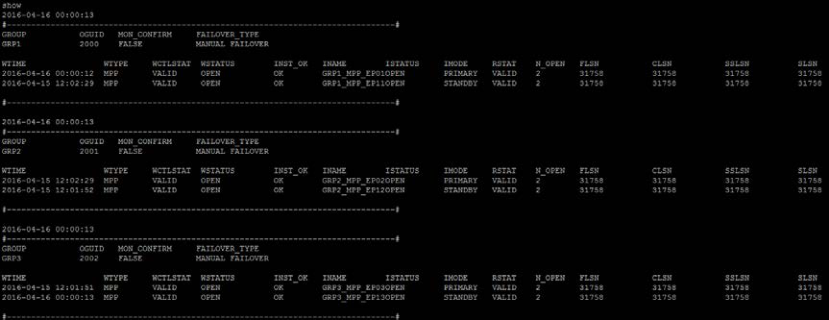
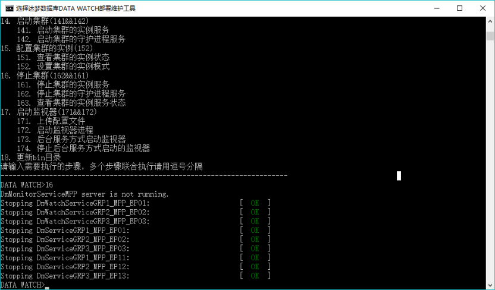
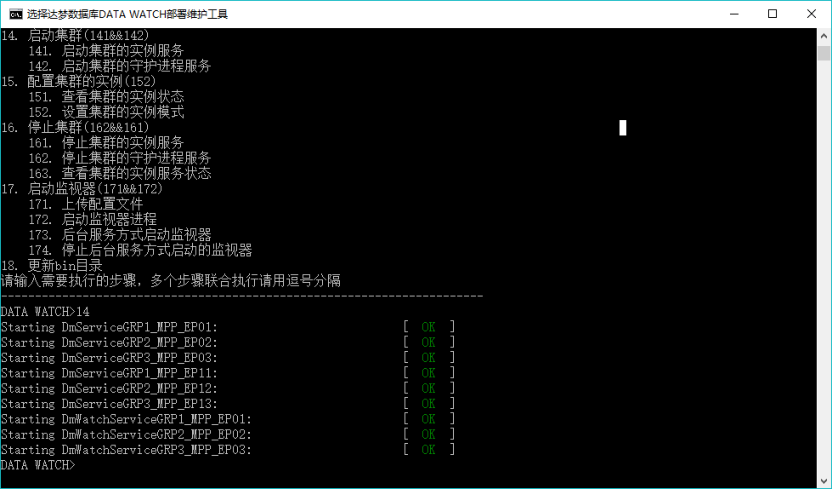
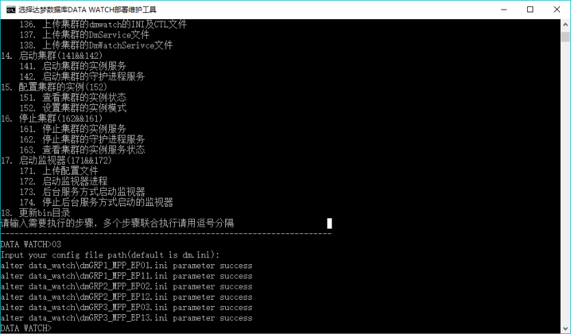
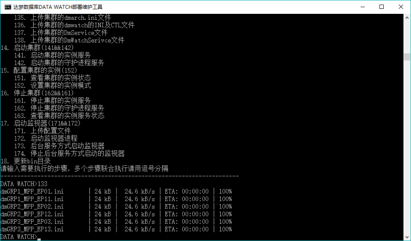

`DM`数据守护系统包含诸多部件，需要在多个节点部署。部署过程包括数据准备、配置文件修改，数据一致性确认等多个步骤。纯手工方式搭建往往费时费力，各个节点配置参数的修改也容易出错。为了简化数据守护系统搭建过程，提高配置效率，我们提供了一套脚本

DataWatch.zip

部署工具，支持数据守护系统的自动化部署。其实现原理是，使用`VBS`脚本生成搭建数据守护系统所用到的所有配置文件，通过`Putty`工具与集群所在的`Linux`服务器进行交互，并使用`BAT`批处理文件实现数据守护系统的搭建。

`DM_CTL_V1.0`工具中把不同类型的数据守护系统，统称为集群。根据归档类型的不同，又将集群类型分为：读写分离集群（`TIMELY`）、数据守护集群（`REALTIME`）和`MPP`主备集群（`MARCH`）。

更新发布在达梦公司内部交流工具：为知笔记技术简报\达梦集群部署工具

## 8.1 配置文件

`DataWatch\data_watch.conf`该文件为默认的配置文件，可参照该进行创建新的配置文件。

```
编辑：data_watch.conf
```

#请养成用`dmdba`用户的习惯#此部署工具需要在`Windows`系统上运行，确保该`Windows`机器可通过外网连接到集群所有机器。集群机器必须是`linux`机器，支持`ssh`。

```
#groupadd dinstall
#useradd -g dinstall dmdba
#passwd dmdba
```

#配置文件

```
[GLOBAL]
DM_PATH       = /home/dmdba/dm7           #达梦安装目录，若是/opt/dmdbms/bin，取bin 所在的目录，即
```

178

```
/opt/dmdbms
```

`DATA_PATH = /home/dmdba/data #`集群数据目录，确保该目录只存储该集群数据`ARCH_PATH = /home/dmdba/arch #`根据实际修改 #实例的本地归档路径，为

```
/home/dmdba/arch/GDYH_RT 或/arch/GDYH_MPP_EPXX
```

`BAK_PATH = /home/dmdba/dbbak #`根据实际修改 #实例的数据库备份的默认路

```
径，为/home/dmdba/dbbak/GDYH_RT 或/dbbak/GDYH_MPP_EPXX
DB_INIT_PARA  = page_size=16 extent_size=32   #数据库初始化参数
```

`DB_NAME = GDYH #`数据库名称,也是数据文件所在路径，`data`所在目录为：`/home/dmdba/data/GDYH(_MPP)`

```
DB_INST_PORT  = 5236       #数据库实例端口号,MPP 的备库端口为(DB_INST_PORT+1)
OGUID          = 12000      #OGUID，代表集群的唯一标识
```

`DW_TYPE = MARCH #`搭建的集群类型：读写分离`:TIMELY,`数据守护：`REALTIME,MPP`主备`:MARCH``DW_MODE = MANUAL #`故障切换模式：故障自动切换`(AUTO)`，故障手动切换`(MANUAL)``AUTO_RESTART = 1 #`实例自动重启，1 表示自动重启，0 表示不自动重启`INST_RECOVER_TIME = 60 #`主库守护进程启动恢复的间隔时间`INST_ERROR_TIME = 10 #`本地数据库故障认定时间`DW_ERROR_TIME = 10 #`远程主（备）机守护进程故障认定时间`ARCH_WAIT_APPLY = 1 #`配置为即时归档方式时，是否需要等待备库做完日志，1 表示需要，0 表示不需要。

`[MAIL]#`一般不用改参数

```
MAL_SYS_BUF_SIZE=1000
MAL_BUF_SIZE=1000
MAL_VPOOL_SIZE=1000
MAL_CHECK_INTERVAL=5
MAL_CONN_FAIL_INTERVAL=5
MAL_COMPRESS_LEVEL=10
```

#各节点配置#第1 个`NODE`代表主库，后面的`NODE`代表多台备库`,IP`地址不能重复，1 个`IP`地址只能对应1 个`NODE`，且部署时只需要第1 个`NODE`机器上的`DM_PATH`路径下存在`bin`目录即可，其它机器不需要手工安装达梦数据库179#对于读写分离集群，第2 个以后的`IP`地址均为即时备库。

#对于数据守护集群，第2 个`IP`地址是实时备库，第3 个以后的`IP`地址为异步备库,异步备库的序号为奇数时其源为主库，异步备库的序号为偶数时其源为实时备库。

#对于`MPP`主备集群，每个`IP`地址代表一个`MPP`的`EP`节点,交叉互备，`IP`地址不允许重复#实例名命名规则：

```
#MPP 集群: 主库 GRP(i)_MPP_EP0(i),备库 GRP(i)_MPP_EP1(i),i 代表第i 个节点。
#数据守护: 主库 GRP1_RT_01, 备库 GRP1_RT_02  异步备库 GRP1_LOCAL_0(i)
#读写分离: 主库 GRP1_RWW_01, 备库 GRP1_RWW_0(i)
[NODE1]
MAL_HOST = 192.168.5.42     #内网IP
INST_HOST = 223.254.20.42   #外网IP
INST_UID  = dmdba
INST_PWD  = hust4400
[NODE2]
MAL_HOST = 192.168.5.43
INST_HOST = 223.254.20.43
INST_UID  = dmdba
INST_PWD  = hust4400
[NODE3]
MAL_HOST = 192.168.5.44
INST_HOST = 223.254.20.44
INST_UID  = dmdba
INST_PWD  = hust4400
[MONITOR]
MON_MAL_HOST = 192.168.5.45    #内网IP
```

180

```
MON_INST_HOST = 223.254.20.45  #外网IP
MON_INST_UID  = dmdba
MON_INST_PWD  = hust4400
```

1. 根据集群服务器的资源，修改`NODE(1..x)`的`IP` 地址及用户名密码，推荐用非`root`

用户。

2. 手工配置`NODE1` 机器的`DM_PATH`，确保该路径下存在达梦数据库的`bin` 目录。
3. 根据需要，配置相关的参数：

`1)` `DW_TYPE`表示将要搭建的集群类型，读写分离`:TIMELY,`数据守护：`REALTIME,`

```
MPP 主备:MARCH
```

`2)` `DW_MODE`表示集群的故障切换模式：故障自动切换模式`(AUTO)`，故障手动切换模式`(MANUAL)`。

`3)` `DM_PATH`表示达梦安装目录，即`bin`所在的目录。

`4)` `DATA_PATH`表示集群数据目录，即`data`所在的目录。

`5)` `DB_INIT_PARA`表示集群实例初始化时的参数，如页大小、大小写敏感等。

`6)` `DB_NAME`表示数据库的名称，初始化实例时用到的`PATH`，即为

```
(DATA_PATH+DB_NAME)：/home/dmdba/data/GDYH(_MPP) 。
```

`7)` `DB_INST_PORT`表示数据库实例的端口号。对于`dmmal.ini`中的`MAL_PORT`、

```
MAL_DW_PORT 依次为 DB_INST_PORT+10 、DB_INST_PORT+20 。即
DB_INST_PORT=5236 ，则 MAL_PORT=5246 、MAL_DW_PORT=5256 ，而
DW_PORT= DB_INST_PORT+30,即DW_PORT=5266 而对于MPP+主备来说，备
```

库的相应端口号为主库相应实例的端口号`+1`。

`8)` `DW_PORT`表示本机守护进程与数据库实例的`TCP`通信端口。

`9)` `OGUID`表示集群的唯一的标识，请确保多套集群间的该值不会重复。

`10)` `AUTO_RESTART`表示本机的数据库实例故障后，本机的守护进程是否自动将实例拉起来。

`11)` `INST_ERROR_TIME`表示本机的数据库故障认定时间。

`12)` `DW_ERROR_TIME`表示远程主（备）机守护进程故障认定时间`13)` `ARCH_WAIT_APPLY`表示配置为即时归档方式时，是否需要等待备库做完日志，1 表示需要，0 表示不需要

181

## 8.2 搭建步骤

1. 配置好`data_watch.conf` 文件后，检查相关的集群机器环境，并确保在第1 个

`node`的`dm_path`路径下存在达梦数据库的`bin`目录。其它机器上不存在该目录。



2. 运行`data_watch.bat`，并回车：



3. 运行04，保存`SSH` 的认证信息：

182



依次点击“是”。

4. 运行01，测试集群机器间的网络情况：



5. 运行02，一键部署集群：

02 其实依次运行了：`11,12,13,141,152,152,142,17`。当然也可以手工依次运行

```
11,12,13,141,152,152,142,17 这些步骤，等同于02。
```

6. 运行172，启动监视器。查看集群的状态，此时集群的状态正常：

183



7. 至此集群搭建完成。上述以搭建`MPP` 主备集群为例，搭建实时主备集群、读写分

离集群同样的步骤，只需要将`DW_TYPE`改为`REALTIME`、`TIMELY`即可。

## 8.3 集群维护

### 8.3.1 重启集群

1. 停止集群

在集群部署工具中，运行16，停止集群。该步骤等同于`162,161`，即先停止守护进程服务，再停止数据库实例服务。另停止集群前，会先停止监视器的服务。



2. 启动集群

184

在集群部署工具中，运行14，启动集群。该步骤等同于`141,142`，即先启动数据库实例服务，再启动守护进程服务。



### 8.3.2 批量更新dm.ini 参数

1. 配置`DataWatch\dm.ini (`注：最后一行不能为空行)

```
MAX_OS_MEMORY                   = 100
MEMORY_POOL                     = 8000
N_MEM_POOLS                     = 4
BUFFER                           = 2000
BUFFER_POOLS                    = 10
MAX_BUFFER                      = 2000
HUGE_BUFFER                     = 8000
RECYCLE                          = 8
SORT_BUF_SIZE                   = 2
```

2. 在集群部署工具中，运行03，输入`dm.ini (`若配件文件名称为`dm.ini`，可不

输入，直接回车)

185



则在`DataWatch\data_watch`目录下，将相应的`dm.ini`中的参数更新完成

3. 运行133，将更新后的`dm.ini` 配置文件，上传到集群服务器上。



4. 重启集群，使相应的参数生效。

### 8.3.3 配置dm_svc.conf

在`DataWatch\data_watch`目录下会自动生成集群的`dm_svc.conf`配置文件，请自行复制它到客户端机器的相关目录下：`dm_svc.conf`配置文件，`Windows`平台下位于`%SystemRoot%\system32`目录，`Linux`平台下位于`/etc`目录。

186

```
TIME_ZONE=(480)
LANGUAGE=(en)
DM_GDYH_MPP=(223.254.20.42:1236,223.254.20.42:1237,223.254.20.43:1236,223.25
4.20.43:1237,223.254.20.44:1236,223.254.20.44:1237)
LOGIN_PRIMARY=(1)
SWITCH_TIME=6000
SWITCH_INTERVAL=500
```

### 8.3.4 达梦集群部署工具的维护

达梦集群部署工具，是通过`DataWatch\bin\CONFIG.VBS`这个`VBS`脚本来生成达梦集群的配置文件、部署步骤的`BAT`，并通过`putty`工具与集群服务器进行`ssh`交互，包括执行命令、上传下载配置文件、上传下载数据库文件。

对于达梦集群部署工具的维护，主要从下述2 方面进行：

1. 定位出错的步骤，并查看相关的`BAT` 文件。

在集群步骤过程，若运行133 步骤出错，则在`DataWatch\data_watch`文件夹下，编辑打开`133.BAT`，检查其内容是否生成正确

```
pscp -batch -pw hust4400 DM_CONF\dmGRP1_MPP_EP01.ini dmdba@223.254.20.42:/home/dmdba/data/GDYH_MPP_EP01/DAMENG/dm.ini
pscp -batch -pw hust4400 DM_CONF\dmGRP1_MPP_EP11.ini dmdba@223.254.20.43:/home/dmdba/data/GDYH_MPP_EP01/DAMENG/dm.ini
pscp -batch -pw hust4400 DM_CONF\dmGRP2_MPP_EP02.ini dmdba@223.254.20.43:/home/dmdba/data/GDYH_MPP_EP02/DAMENG/dm.ini
pscp -batch -pw hust4400 DM_CONF\dmGRP2_MPP_EP12.ini dmdba@223.254.20.44:/home/dmdba/data/GDYH_MPP_EP02/DAMENG/dm.ini
pscp -batch -pw hust4400 DM_CONF\dmGRP3_MPP_EP03.ini dmdba@223.254.20.44:/home/dmdba/data/GDYH_MPP_EP03/DAMENG/dm.ini
pscp -batch -pw hust4400 DM_CONF\dmGRP3_MPP_EP13.ini dmdba@223.254.20.42:/home/dmdba/data/GDYH_MPP_EP03/DAMENG/dm.ini
```

若发现生成的`133.BAT`内容出错，则打开编辑`DataWatch\bin\CONFIG.VBS`

```
2. 修改CONFIG.VBS
```

编辑`CONFIG.VBS`，搜索`133.BAT`，定位到生成`133.BAT`的方法，查看具体出错的地方并修正。

3. 再次运行`data_watch.bat`，查看生成的`133.BAT` 的内容是否正确。

187
