`DM`部署工具`deploy.exe`提供数据守护的图形化搭建与管理功能。该工具位于安装目录的`tool`目录下，例如：`/dmdbms/tool/deploy.exe`。双击就可以打开。搭建与管理的守护类型有三种：`MPP`主备、实时主备和读写分离主备。每一种类型都分为两大步骤：部署和监控。图形界面如下：

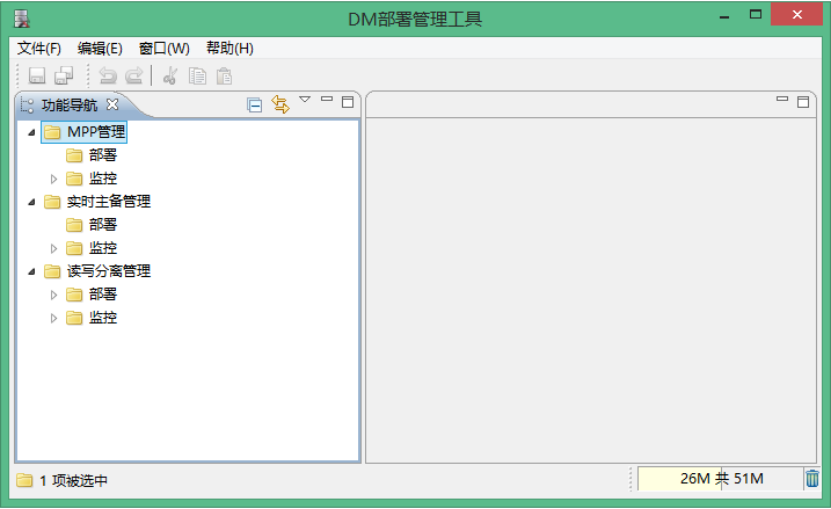

图`9.1 deploy`工具主页面

本章以实时主备管理为例，来介绍数据守护的搭建过程。`MPP`管理、读写分离管理等更多详情，请参考`deploy`工具帮助文档。

## 9.1 实时主备管理

下面将介绍实时主备管理是如何搭建的。实时主备管理分为两大步骤：部署和监控。部署和监控的自动化搭建操作一气呵成，不需要各自单独进行配置。

### 9.1.1 部署

部署主界面。

188

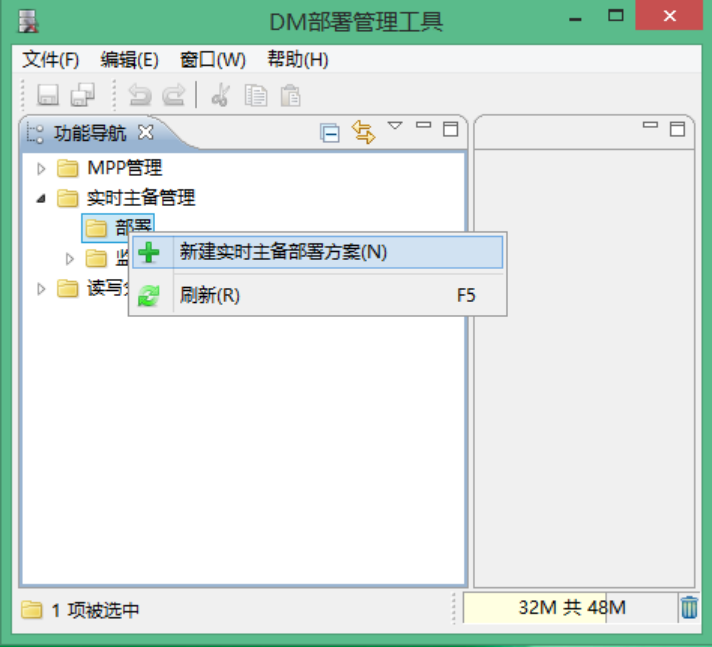

图`9.2`部署界面-新建右键，选择新建实时主备部署方案：

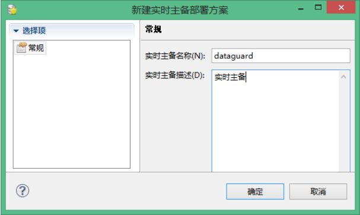

图`9.3`部署界面-常规点击“确定”以后，进入选择“数据库代理”阶段：

189

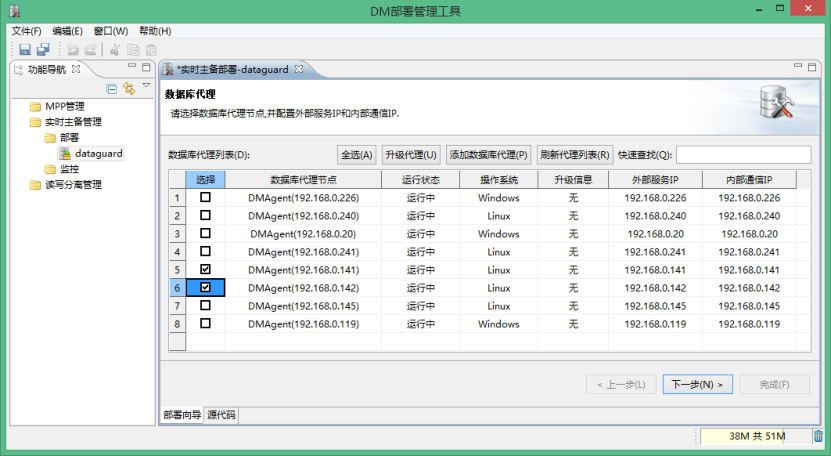

图`9.4`数据库代理界面参数详解：

全选：全选所有数据库代理节点。

升级代理：在线升级代理版本。

添加数据库代理：添加新的数据库代理节点。

刷新代理列表：刷新数据库代理节点列表。

快速查找：输入IP 地址，快速查找指定代理节点。

点击“下一步”，进入“数据准备”界面：

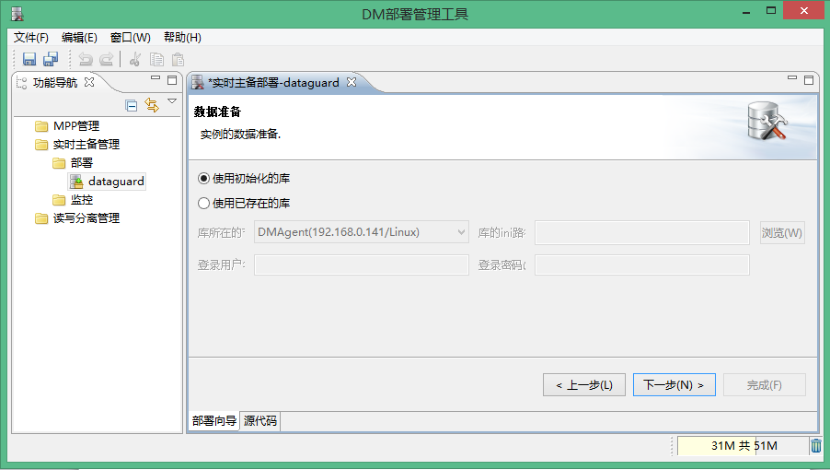

190

图`9.5`数据库准备界面参数详解：

使用初始化的库：初始化一个新库，作为守护系统的实例。

使用已存在的库：指定已经存在的库作为守护系统的实例。指定库所在的IP、INI 路径、库的登录用户名和密码。

点击“下一步”，进入“数据库初始化参数”设置界面：

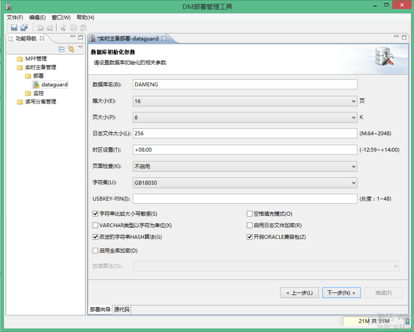

图`9.6`数据库初始化参数界面点击“下一步”，进入“数据库密码参数”设置界面：

191

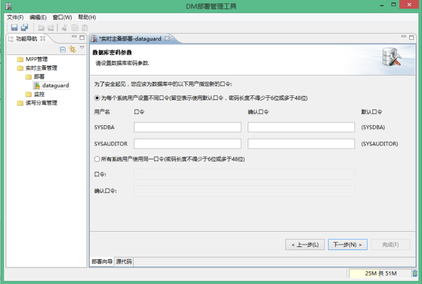

图`9.7`数据库密码参数界面点击“下一步”，进入“实例规则”设置界面，配置实例的机器分布和规划端口。

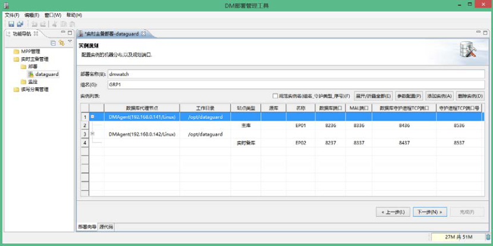

图`9.8`实例规则界面参数详解：

规范实例名（组名_守护类型_序号）：勾选此项后，实例名由系统自动生成，用户不能修改。

参数配置：设置实例列表里的参数。

添加实例：添加异步备库，添加之后会出现在实例列表的源库中。

删除实例：删除选中的实例。

192

点击“下一步”，进入“配置dm.ini”界面，配置dm.ini 相关属性。

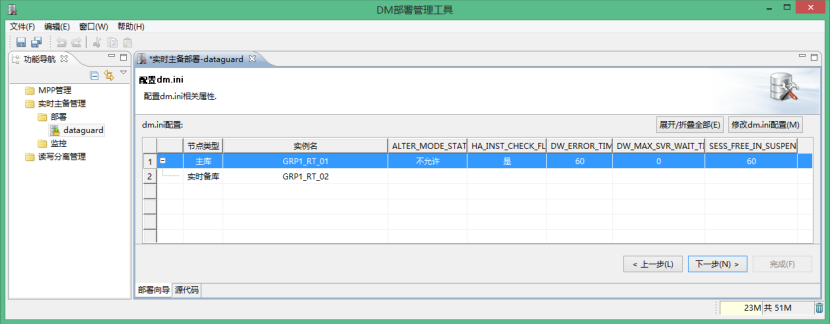

图`9.9`配置`dm.ini`界面参数说明：

修改dm.ini 配置：修改列表中的dm.ini 参数。

点击“下一步”，进入“配置dmmal.ini”界面，配置dmmal.ini 相关属性。

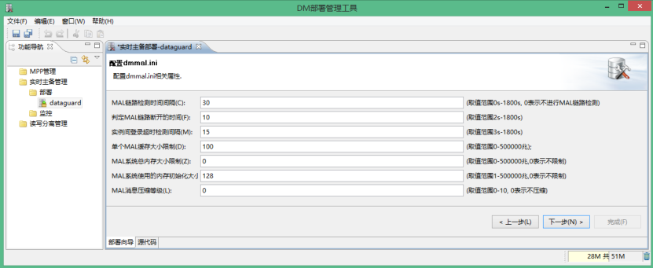

图`9.10`配置`dmmal.ini`界面点击“下一步”，进入“配置dmarch.ini”界面，配置dmarch.ini 的属性，异步备库需要配置定时器信息。

193

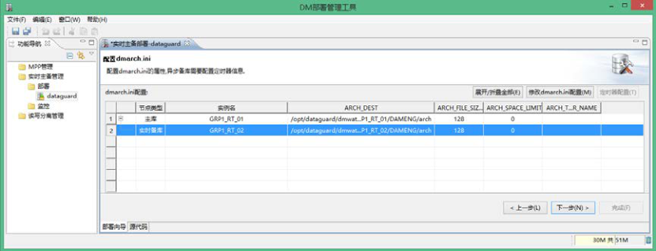

图`9.11`配置`dmarch.ini`界面点击“下一步”，进入“配置dmwatcher.ini”界面，配置dmwatcher.ini 的属性。

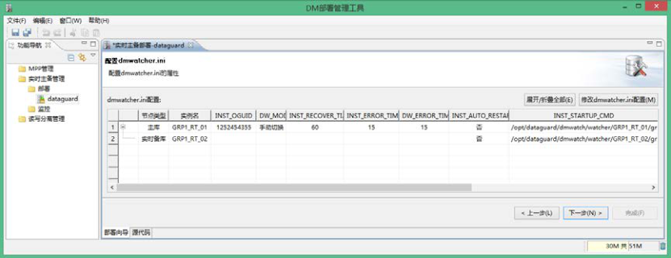

```
图9.10 配置dmwatcher.ini 界面
```

点击“下一步”，进入“配置监视器”界面，配置监视器相关属性。

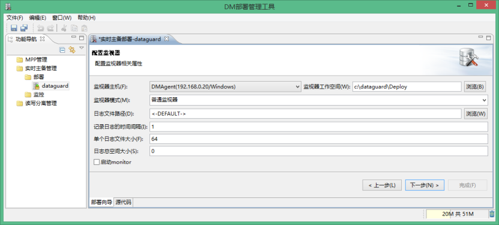

图`9.11`配置监视器界面点击“下一步”，进入“服务器配置文件”界面，请选择上传的服务器文件。

194

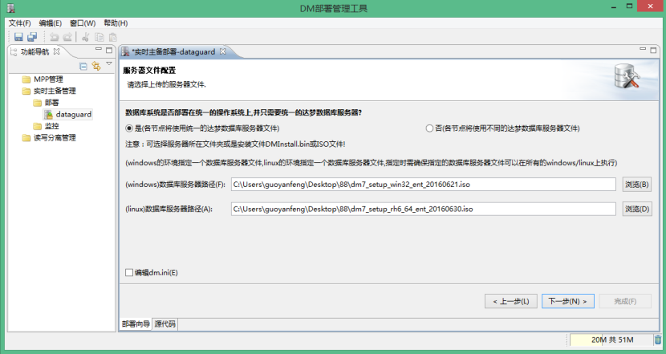

图`9.12`服务器文件配置界面点击“下一步”，开始解析数据库服务器文件。解析的结果如下：

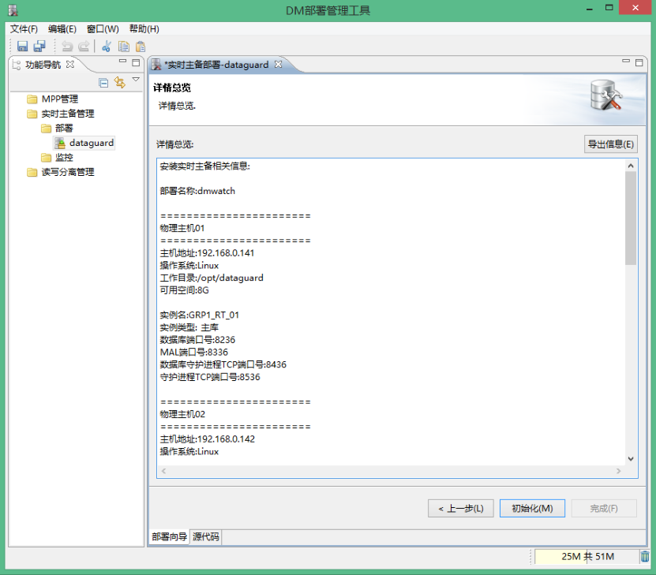

图`9.13`详情总览点击“初始化”，开始执行初始化任务。结果如下：

195

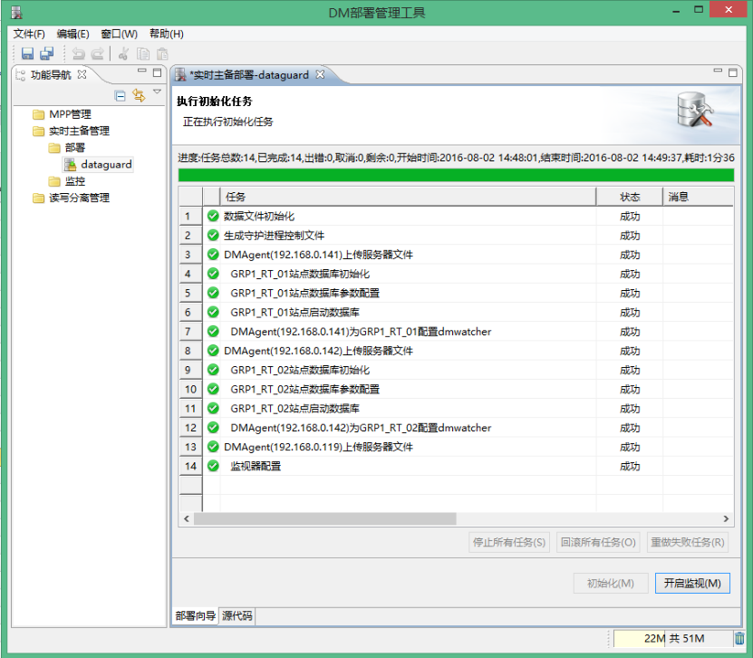

图`9.14`执行初始化任务界面点击“开始监控”。

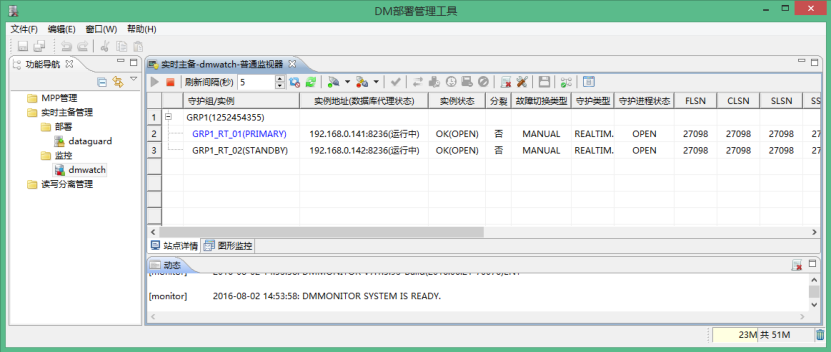

图`9.15`配置完成至此，数据守护搭建完成。

196

### 9.1.2 监控

如果用户想监控现有的数据守护系统，可以使用“导入实时监控方案”，或者直接“扫描实时主备监控方案”。选择监控即可。监控界面如下：

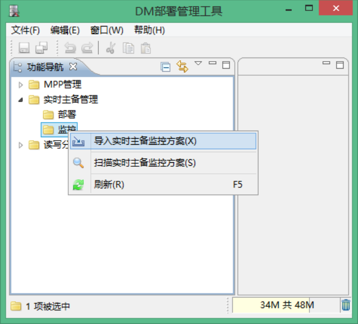

图`9.16`监控页面本节以扫描实时主备监控方案为例。使用9.1.2 节中配置的dmmonitor.ini，保存在C:\Users\guoyanfeng\Desktop\88 文件夹中。

197

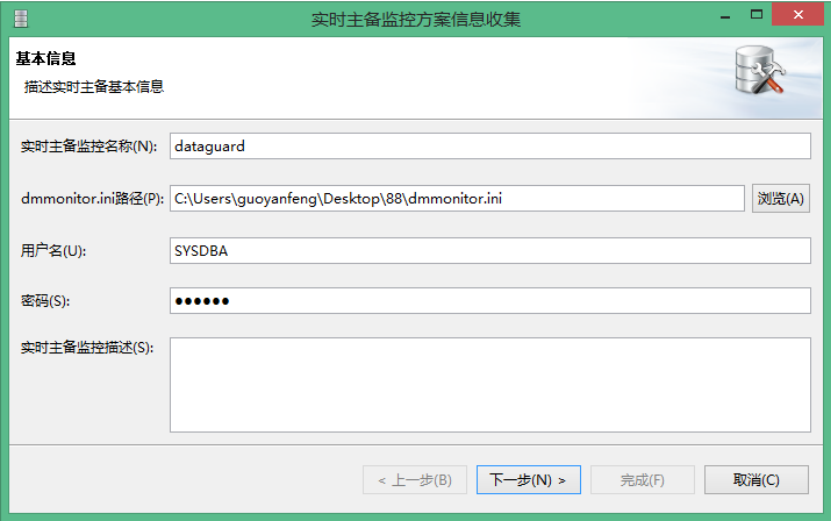

图`9.17`监控页面-基本信息点击“下一步”，进入“连接节点”界面。

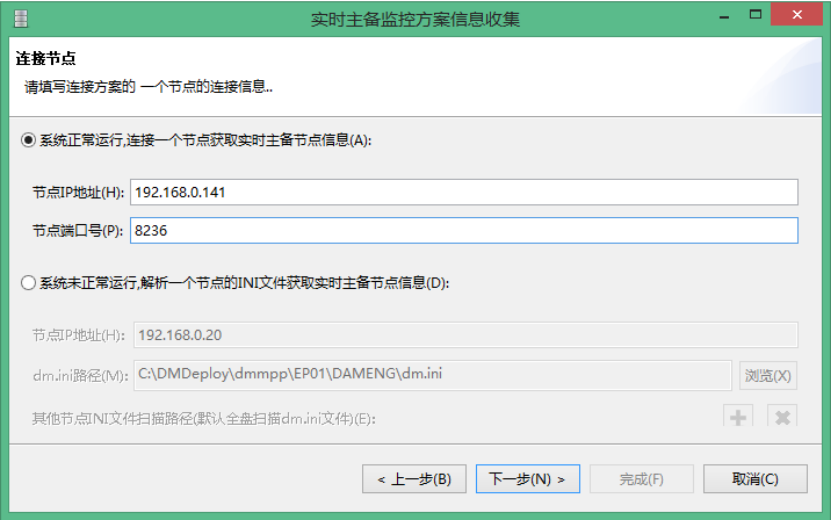

图`9.18`监控页面-连接节点点击“下一步”，进入实时主备节点信息确认。

198

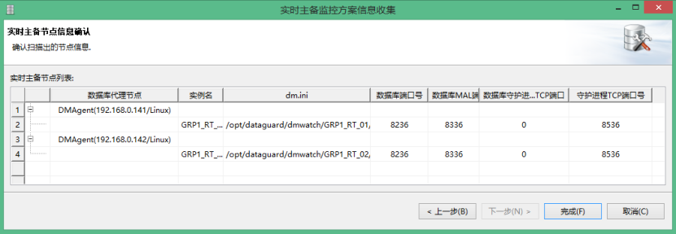

图`9.19`监控页面-实时主备节点信息确认点击“完成”，就启动了一个已存在的实时主备监控方案。如下图的dataguard。如果想查看更多的监控信息，右击dataguard，查看属性。

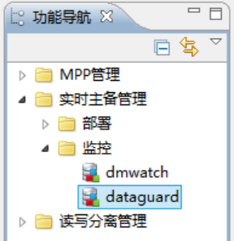

图`9.18`监控页面-启动完成

199
