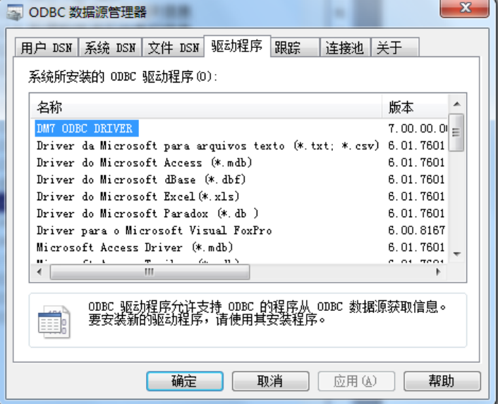
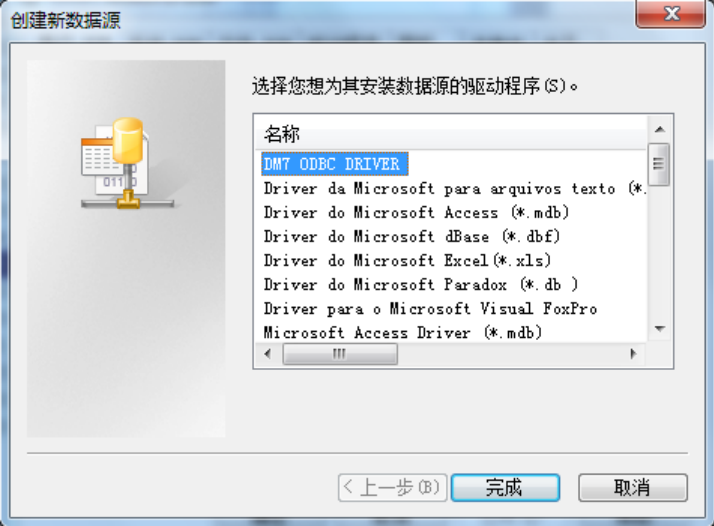
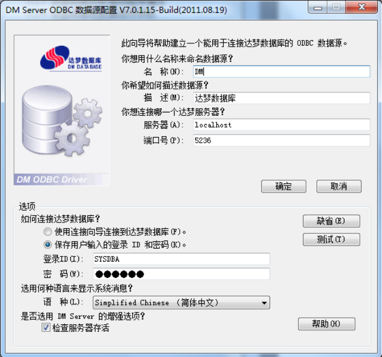
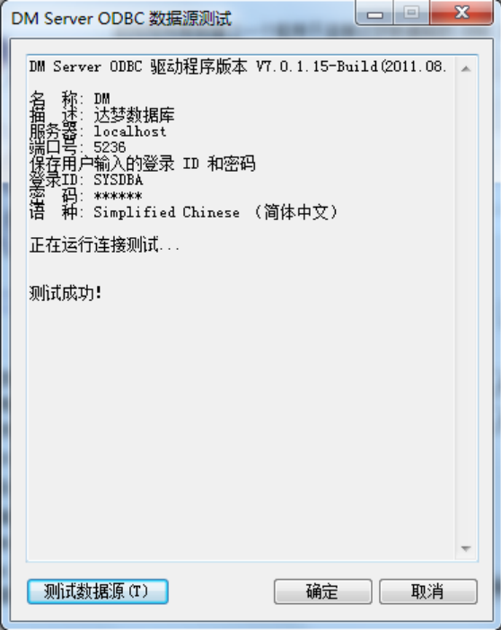
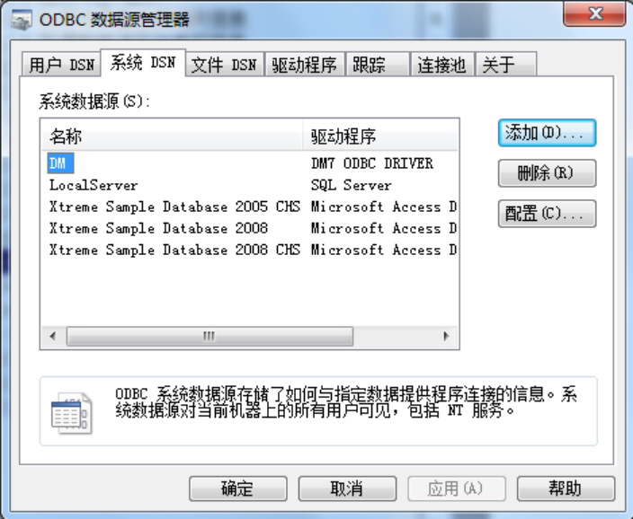
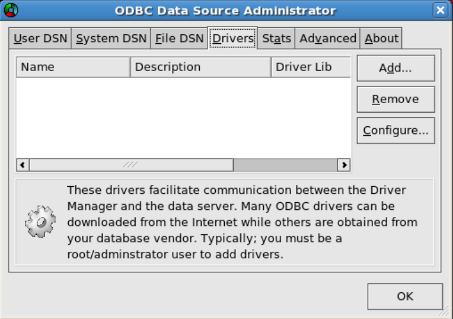
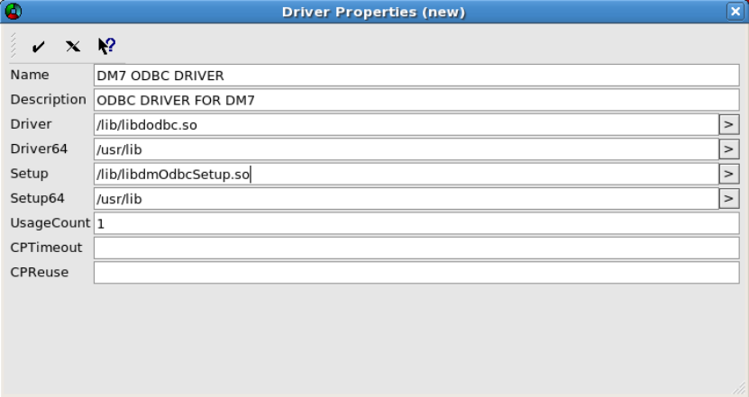
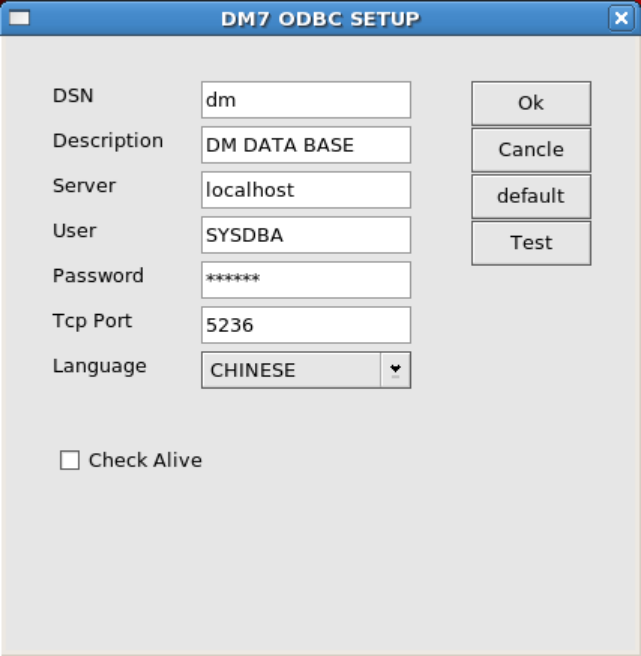

## 第3 章 DMODBC 编程指南

本章结合DM 数据库的特点，比较全面系统地介绍ODBC 的基本概念以及DM ODBC DRIVER 的使用方法，以便用户更好地使用DM ODBC 编写应用程序。

ODBC 提供访问不同类型的数据库的途径。结构化查询语言SQL 是一种用来访问数据库的语言。通过使用ODBC，应用程序能够使用相同的源代码和各种各样的数据库交互。这使得开发者不需要以特殊的数据库管理系统DBMS 为目标，或者了解不同支撑背景的数据库的详细细节，就能够开发和发布客户/服务器应用程序。

DM ODBC 3.0 遵照Microsoft ODBC 3.0 规范设计与开发，实现了ODBC 应用程序与DM 的互连接口。用户可以直接调用DM ODBC 3.0 接口函数访问DM，也可以使用可视化编程工具如C++ Builder、PowerBuilder 等利用DM ODBC 3.0 访问DM。

在DM 客户端软件安装过程中，如果选择了安装ODBC 驱动程序的相关选项，安装工具可完成将DM ODBC 3.0 驱动程序复制到硬盘，并在Windows 注册表中登记DMODBC 驱动程序信息的工作。若使用的是拷贝版，在Windows 系统上手动注册odbc 驱动的方法为：

创建注册文件（例如installDmOdbc.reg），文件内容为：

REGEDIT4[HKEY_LOCAL_MACHINE\Software\ODBC\ODBCINST.INI\ODBC Drivers]"DM7 ODBC DRIVER"="Installed"[HKEY_LOCAL_MACHINE\Software\ODBC\ODBCINST.INI\DM7 ODBC DRIVER]"Driver"="%DM_HOME%\\bin\\dodbc.dll" //此处修改成你的dodbc.dll 所在目录"Setup"="%DM_HOME%\\bin\\dodbc.dll" //此处修改成你的dodbc.dll 所在目录

要进一步使用DM ODBC 驱动程序，请阅读本章以了解ODBC 数据源管理方法。

## 3.1 数据类型

客户程序可以通过SQLGetTypeInfo 函数来获取DM ODBC 3.0 支持的数据类型信息。

由SQLGetTypeInfo 返回的数据类型是数据源所支持的数据类型，它们是预备用于DDL（DataDefinitionLanguage）语句的。

调用DM ODBC 3.0 的SQLGetTypeInfo，返回支持的数据类型如表3.1 所示：

表3.1 数据类型列表类型名类型描述Char(n) 固定串长度为n的字符串，n<=8188 Varchar(n) 最大字符串长度为n的可变长度字符串，n<=8188 Binary(n) 固定长度为n的二进制数据，n<=8188 Varbinary(n) 最大长度为n的可变长度二进制数据，n<=8188 Image 影像数据类型，可变长度的二进制数据，最大长度为2G-1 Text 文本数据类型，可变长度的字符数据，最大长度为2G-1 Bit 单个二进制位数据Tinyint 精度为3，刻度为0 的有符号精确数字，取值范围-128…127 Smallint 精度为5，刻度为0 的有符号精确数字，取值范围-32,768…32,767 Int 精度为10，刻度为0 的有符号精确数字，取值范围-2[31]…2[31]-1

## 第3 章 DMODBC 编程指南

Bigint 精度为19，刻度为0 的有符号精确数字值，取值范围-2[63]…2[63]-1二进制精度为24 的有符号近似数字值，取值范围0 或者绝对值为：

Real 10[-38]…10[38]二进制精度为53 的有符号近似数字值，取值范围0 或者绝对值为：

Float 10[-308]…10[308]二进制精度为53 的有符号近似数字值，取值范围0 或者绝对值为：

Double 10[-308]…10[308]Decimal(p,s) 精度为p，刻度为s的有符号精确数字值，1≤p≤38，s≤p Numeric(p,s) 精度为p，刻度为s的有符号精确数字值，1≤p≤38，s≤p Date 日期数据类型，年月日字段，格式与Gregorian（罗马）日历一致Time(p) 时间数据类型，时分秒字段，精度p指定了秒的精度Timestamp(p) 时间戳数据类型，年月日时分秒字段，精度p指定了秒的精度年间隔，即两个日期之间的年数字，p为时间间隔的首项字段精度Interval year(p)(后面简称为：首精度)Interval month(p) 月间隔，即两个日期之间的月数字，p为时间间隔的首精度Interval year(p) to month 年月间隔，即两个日期之间的年月数字，p为时间间隔的首精度Interval day(p) 日间隔，即为两个日期/时间之间的日数字，p为时间间隔的首精度Interval hour(p) 时间隔，即为两个日期/时间之间的时数字，p为时间间隔的首精度Interval minute(p) 分间隔，即为两个日期/时间之间的分数字，p为时间间隔的首精度秒间隔，即为两个日期/时间之间的秒数字，p为时间间隔的首精度，Interval second(p,q)q为时间间隔秒精度日时间隔，即为两个日期/时间之间的日时数字，Interval day(p) to hour p为时间间隔的首精度日时分间隔，即为两个日期/时间之间的日时分数字，Interval day(p) to minute p为时间间隔的首精度日时分秒间隔，即为两个日期/时间之间的日时分秒数字，Interval day(p) to second(q)p为时间间隔的首精度，q为时间间隔秒精度时分间隔，即为两个日期/时间之间的时分数字，Interval hour(p) to minute p为时间间隔的首精度时分秒间隔，即为两个日期/时间之间的时分秒数字，Interval hour(p) to second(q)p为时间间隔的首精度，q为时间间隔秒精度分秒间隔，即为两个日期/时间之间的分秒间隔，Interval minute(p) to second(q)p为时间间隔的首精度，q为时间间隔秒精度

注：变长字符串的最大长度受页大小的约束，最大长度为页大小的一半且不超过8188个字节。

## 3.2 支持的函数

客户程序可以通过SQLGetFunctions 函数来获取DM ODBC 3.0 支持的函数信息。由SQLGetFunctions 返回的函数列表是数据源所支持的函数。

以下按照类型分类列出了DM ODBC 3.0 提供的函数。应用程序能够通过调用SQLGetFunctions 来获得指定函数的支持信息。

## 第3 章 DMODBC 编程指南

### 3.2.1 连接到数据源

下面的函数用于连接到数据源：

1. SQLAllocHandle：分配环境、连接、语句或者描述符句柄；
2. SQLConnect：建立与驱动程序或者数据源的连接。访问数据源的连接句柄包含了

状态、事务申明和错误信息的所有连接信息；

3. SQLDriverConnect：与SQLConnect 相似，用来连接到驱动程序或者数据源。但它

比SQLConnect 支持数据源更多的连接信息，它提供了一个对话框来提示用户设置所有的连接信息以及系统信息表没有定义的数据源；

4. SQLBrowseConnect：支持一种交互方法来检索或者列出连接数据源所需要的属性

和属性值。每次调用函数可以获取一个连接属性字符串，当检索完所有的属性值，就建立起与数据源的连接，并且返回完整的连接字符串，否则提示缺少的连接属性信息，用户根据此信息重新输入连接属性值再次调用此函数进行连接。

达梦支持的连接关键字及取值范围：

名称说明DRIVER DM ODBC 驱动的名字：DM7 ODBC DRIVER DSN 数据源名称SERVER 目标服务器，ip 地址或者服务名TCP_PORT 端口号UID 用户名PWD 密码LANGUAGE 使用的语言信息：ENGLISH，CHINESE SSL_PATH 加密文件路径SSL_PWD 加密文件密码MPP_LOGIN MPP 登陆方式：MPP_GLOBAL，MPP_LOCAL CHARACTER_CODE 编码信息FAST_INSERT 是否配置快速插入：TRUE，FALSE RW_SEPARATE 是否配置读写分离：TRUE，FALSE RW_SEPARATE_PERCENT 读写分离的比例：0~100

### 3.2.2 获取驱动程序和数据源信息

下面的函数用来获取驱动程序和数据源信息：

1. SQLDataSources：能够被调用多次来获取应用程序使用的所有数据源的名字；
2. SQLDrivers：返回所有安装过的驱动程序清单，包括对它们的描述以及属性关键字；
3. SQLGetInfo：返回连接的驱动程序和数据源的元信息；
4. SQLGetFunctions：返回指定的驱动程序是否支持某个特定函数的信息；
5. SQLGetTypeInfo：返回指定的数据源支持的数据类型的信息。

### 3.2.3 设置或者获取驱动程序属性

下面的函数用来设置或者获取驱动程序属性：

## 第3 章 DMODBC 编程指南

1. SQLSetConnectAttr：设置连接属性值；
2. SQLGetConnectAttr：返回连接属性值；
3. SQLSetEnvAttr：设置环境属性值；
4. SQLGetEnvAttr：返回环境属性值；
5. SQLSetStmtAttr：设置语句属性值；
6. SQLGetStmtAttr：返回语句属性值。

### 3.2.4 设置或者获取描述符字段

下面的函数用来设置或者获取描述符字段：

1. SQLGetDescField：返回单个描述符字段的值；
2. SQLGetDescRec：返回当前描述符记录的多个字段的值；
3. SQLSetDescField：设置单个描述符字段的值；
4. SQLSetDescRec：设置描述符记录的多个字段。

### 3.2.5 准备SQL 语句

下面的函数用来准备SQL 语句：

1. SQLPrepare：准备要执行的SQL 语句；
2. SQLBindParameter：在SQL 语句中分配参数的缓冲区；
3. SQLGetCursorName：返回与语句句柄相关的游标名称；
4. SQLSetCursorName：设置与语句句柄相关的游标名称；
5. SQLSetScrollOptions：设置控制游标行为的选项。

### 3.2.6 提交SQL 请求

下面的函数用来提交SQL 请求：

1. SQLExecute：执行准备好的SQL 语句；
2. SQLExecDirect：执行一条SQL 语句；
3. SQLNativeSql：返回驱动程序对一条SQL 语句的翻译；
4. SQLDescribeParam：返回对SQL 语句中指定参数的描述；
5. SQLNumParams：返回SQL 语句中参数的个数；
6. SQLParamData：与SQLPutData 联合使用在运行时给参数赋值；
7. SQLPutData：在SQL 语句运行时给部分或者全部参数赋值。

### 3.2.7 检索结果集及其相关信息

下面的函数用来检索结果集及其相关信息：

1. SQLRowCount：返回INSERT、UPDATE 或者DELETE 等语句影响的行数；
2. SQLNumResultCols：返回结果集中列的数目；
3. SQLDescribeCol：返回结果集中列的描述符记录；
4. SQLColAttribute：返回结果集中列的属性；

## 第3 章 DMODBC 编程指南

5. SQLBindCol：为结果集中的列分配缓冲区；
6. SQLFetch：在结果集中检索下一行元组；
7. SQLFetchScroll：返回指定的结果行；
8. SQLGetData：返回结果集中当前行某一列的值；
9. SQLSetPos：在取到的数据集中设置游标的位置。这个记录集中的数据能够刷新、

更新或者删除；

10. SQLBulkOperations：执行块插入和块书签操作，其中包括根据书签更新、删除或

者取数据；

11. SQLMoreResults：确定是否能够获得更多的结果集，如果能就执行下一个结果集的

初始化操作；

12. SQLGetDiagField：返回一个字段值或者一个诊断数据记录；
13. SQLGetDiagRec：返回多个字段值或者一个诊断数据记录。

### 3.2.8 取得数据源系统表的信息

下面的函数用来取得数据源系统表的信息：

1. SQLColumnPrivileges：返回一个关于指定表的列的列表以及相关的权限信息；
2. SQLColumns：返回指定表的列信息的列表；
3. SQLForeignKeys：返回指定表的外键信息的列表；
4. SQLPrimaryKeys：返回指定表的主键信息的列表；
5. SQLProcedureColumns：返回指定存储过程的参数信息的列表；
6. SQLProcedures：返回指定数据源的存储过程信息的列表；
7. SQLSpecialColumns：返回唯一确定某一行的列的信息，或者当某一事务修改一行

的时候自动更新各列的信息；

8. SQLStatistics：返回一个单表的相关统计信息和索引信息；
9. SQLTablePrivileges：返回相关各表的名称以及相关的权限信息；
10. SQLTables：返回指定数据源中表信息。

### 3.2.9 终止语句执行

下面的函数用来终止语句执行：

1. SQLFreeStmt：终止语句执行，关闭所有相关的游标，放弃没有提交的结果，选择

释放与指定语句句柄相关的资源；

2. SQLCloseCursor：关闭一个打开的游标，放弃没有提交的结果；
3. SQLCancel：放弃执行一条SQL 语句；
4. SQLEndTran：提交或者回滚事务。

### 3.2.10 中断连接

下面的函数处理中断连接的任务：

1. SQLDisconnect：关闭指定连接；
2. SQLFreeHandle：释放环境、连接、语句或者描述符句柄。

## 第3 章 DMODBC 编程指南

## 3.3 建立ODBC 连接

### 3.3.1 申请环境与连接句柄

客户程序要和一个远程的服务器或数据库进行通讯，必须首先和这个服务器或数据库建立连接。下面我们将要介绍如何通过ODBC 建立一个连接以及使用连接。

为了建立一个ODBC 数据源连接，需要使用到环境句柄以及连接句柄。句柄有一个层次的概念，一个连接句柄总是和一个唯一的环境句柄相联系的，所有的连接句柄必须在环境句柄释放之前释放。

客户程序可以通过调用函数SQLAllocHandle 来申请一个环境句柄，调用函数SQLAllocHandle 时必须传入句柄选项SQL_HANDLE_ENV，当申请环境句柄成功之后，可以在此环境句柄上申请连接句柄。申请环境句柄和连接句柄的代码示范如下：

#include <windows.h>#include <sql.h>#include <sqltypes.h>#include <sqlext.h>/* 检测返回代码是否为成功标志，当为成功标志时返回TRUE，否则返回FALSE */#define RC_SUCCESSFUL(rc) ((rc) == SQL_SUCCESS || (rc) == SQL_SUCCESS_WITH_INFO)/* 检测返回代码是否为失败标志，当为失败标志时返回TRUE，否则返回FALSE */#define RC_NOTSUCCESSFUL(rc) (!(RC_SUCCESSFUL(rc)))HENV henv; /* 环境句柄 */HDBC hdbc; /* 连接句柄 */SQLRETURN sret; /* 返回代码 */void main(void){/* 申请一个环境句柄 */SQLAllocHandle(SQL_HANDLE_ENV, NULL, &henv);

/* 设置环境句柄的ODBC 版本 */SQLSetEnvAttr(henv, SQL_ATTR_ODBC_VERSION, (SQLPOINTER)SQL_OV_ODBC3,SQL_IS_INTEGER);

/* 申请一个连接句柄 */SQLAllocHandle(SQL_HANDLE_DBC, henv, &hdbc);

/* 释放连接句柄 */SQLFreeHandle(SQL_HANDLE_DBC, hdbc);

/* 释放环境句柄 */SQLFreeHandle(SQL_HANDLE_ENV, henv);

}

### 3.3.2 如何与数据源进行连接

ODBC 的连接是从数据源开始的，数据源是ODBC 对一个特定的数据库的别称。为了访问由数据源提供的数据，你的程序中必须首先建立和数据源之间的连接，在环境和连接句

## 第3 章 DMODBC 编程指南

柄正确分配之后，才能通过这些连接管理数据访问。

为了产生建立连接时必要的参数，必须完成以下的几项工作：

1. 调用SQLAllocHandle 申请一个环境句柄；
2. 调用SQLAllocHandle 申请一个连接句柄；
3. 创建一个数据源DSN；
4. 一个有效的用户ID；
5. 一个对应于这个用户ID 的口令；
6. 其它的一些提供给驱动程序的参数信息。

连接ODBC 数据源时，ODBC 提供三种不同的连接函数，即SQLConnect、SQLDriverConnect 和SQLBrowseConnect，每个函数都有不同的参数以及不同级别的一致性，如表3.2 所示：

表3.2 连接到数据源的ODBC 函数

函数 ODBC 版本一致性主要参数SQLConnect 1.0 核心级 hdbc，数据源，用户ID，口令SQLDriverConnect 1.0 1 级 hdbc，窗口句柄，输入连接字符串SQLBrowseConnect 1.0 2 级 hdbc，输入连接字符串，输出连接字符串

SQLConnect 是连接ODBC 数据源的最基本的方法，在所有的一致性级别上都支持。

SQLConnect 函数有以下参数：连接句柄、数据源名称、数据源名称长度、用户名（用户ID）、用户名长度、用户口令以及口令长度。返回代码有：SQL_SUCCESS，SQL_SUCCESS_WITH_INFO，SQL_ERROR 或者 SQL_INVALID_HANDLE。使用SQLConnect 函数连接数据源的代码示范如下：

sret = SQLConnect(hdbc, (SQLCHAR *)"DM", SQL_NTS, (SQLCHAR *)"SYSDBA", SQL_NTS, (SQLCHAR*)"SYSDBA", SQL_NTS);

if (RC_NOTSUCCESSFUL(sret)) {/* 连接数据源失败! */…进行相应的错误处理…exit(0);

}

SQLDriverConnect 提供了比SQLConnect 更灵活的方法来建立ODBC 连接。它支持以下几种连接：要求更多连接参数的数据源，对话框提示用户输入所有的连接信息以及没有在系统信息表中定义的数据源。

SQLDriverConnect 提供以下的连接方法：

1. 用一个连接字符串建立一个连接，这个字符串包括建立连接的所有数据，如DSN，

一个或多个用户ID 及其口令，以及其他的数据库所需要的连接信息；

2. 用一个并不完整的连接字符串来建立连接，使得ODBC 驱动程序管理器来提示用

户输入所需要的连接信息；

3. 用一个没有在系统信息表中登记的数据源建立连接，驱动程序自动提示用户输入连

接信息；

4. 用一个连接字符串建立连接，这个字符串在DSN 配置文件中是确定的。

SQLDriverConnect 函数fDriverCompletion 参数说明：

1. SQL_DRIVER_PROMPT：设置此选项用来显示一个对话框来提示用户输入连接信

息；

2. SQL_DRIVER_COMPLETE：如果函数调用中包含了足够的信息，ODBC 就进行连

接，否则弹出对话框提示用户输入连接信息，此时等同于SQL_DRIVER_PROMPT；

## 第3 章 DMODBC 编程指南

3. SQL_DRIVER_COMPLETE_REQUIRED：这个参数与SQL_DRIVER_COMPLETE

参数唯一的不同是用户不能改变由函数提供的信息；

4. SQL_DRIVER_NOPROMPT：如果函数调用时有足够的信息，ODBC 就进行连接，

否则返回SQL_ERROR。

使用SQLDriverConnect 连接数据源的代码示范如下：

SQLCHAR szConnStrIn[256] = "DSN=DM;DRIVER=DM ODBC DRIVER;

UID=SYSDBA;PWD=SYSDBA;TCP_PORT=5236";

SQLCHAR szConnStrOut[256];

SQLSMALLINT cbConnStrOut;

sret = SQLDriverConnect(hdbc, NULL, szConnStrIn, SQL_NTS, szConnStrOut, 256, &cbConnStrOut,SQL_DRIVER_NOPROMPT);

if (RC_NOTSUCCESSFUL(sret)) {/* 连接数据源失败! */…进行相应的错误处理…exit(0);

}

SQLBrowseConnect 函数与SQLDriverConnect 函数相似，但是调用SQLBrowseConnect函数时，程序在运行时可以再形成一个连接字符串，使用这个函数可以用一个交互的方式来决定连接到数据源时所需要的一些信息。

使用SQLBrowseConnect 函数连接数据源的代码示范如下：

SQLCHAR szConnStrIn[256] = "";

SQLCHAR szConnStrOut[256];

SQLSMALLINT cbConnStrOut;

strcpy(szConnStrIn, "DRIVER=DM ODBC DRIVER");

sret = SQLBrowseConnect(hdbc, szConnStrIn, SQL_NTS, szConnStrOut, 256, &cbConnStrOut);

if (sret != SQL_NEED_DATA) {/* 连接数据源失败! */…进行相应的错误处理…exit(0);

}strcpy(szConnStrIn, "SERVER=127.0.0.1;TCP_PORT=5236");//TCP_PORT=5236 可选sret = SQLBrowseConnect(hdbc, szConnStrIn, SQL_NTS, szConnStrOut, 256, &cbConnStrOut);

if (sret != SQL_NEED_DATA) {/* 连接数据源失败! */…进行相应的错误处理…exit(0);

}strcpy(szConnStrIn, "UID=SYSDBA;PWD=SYSDBA;");

sret = SQLBrowseConnect(hdbc, szConnStrIn, SQL_NTS, szConnStrOut, 256, &cbConnStrOut);

if (sret != SQL_SUCCESS) {/* 连接数据源失败! */…进行相应的错误处理…exit(0);

}

## 第3 章 DMODBC 编程指南

/*连接成功*/

### 3.3.3 设置与取得连接的属性

建立连接之后，应用程序可以通过调用SQLSetConnectAttr 函数来设置连接属性，对连接进行全方面的管理。表3.3 列出了一些常用的连接属性。

表3.3 常用的连接属性

属性描述用来设置访问模式，即只读或者读写连接模式，SQL_ATTR_ACCESS_MODE可以用来优化并发控制策略。不支持。

SQL_ATTR_ASYNC_ENABLE 是否支持异步执行。

SQL_ATTR_AUTOCOMMIT 是否使用自动提交功能。

SQL_ATTR_CONNECTION_TIMEOUT 设定连接上的超时。

SQL_ATTR_CURRENT_CATALOG 当前连接使用的编目。

SQL_ATTR_LOGIN_TIMEOUT 设定登录超时。不支持。

SQL_ATTR_ODBC_CURSORS 设置驱动程序管理器使用游标的方式。

SQL_ATTR_PACKET_SIZE 设置网络传输包的大小。不支持。

SQL_ATTR_QUIET_MODE 使弹出对话框有效/无效。

更多的连接属性，用户可以参考《Microsoft ODBC 3.0 程序员参考手册》，在这里不做详细介绍。

应用程序可以通过调用SQLGetConnectAttr 函数来取得当前连接的属性。

设置与取得连接属性的代码示范如下：

SQLINTEGER AUTOCOMMIT_MODE;

/* 设置连接句柄属性，关闭自动提交功能 */SQLSetConnectAttr(hdbc, SQL_ATTR_AUTOCOMMIT, (SQLPOINTER)SQL_AUTOCOMMIT_OFF,SQL_IS_INTEGER);

/* 取得连接句柄属性，取得提交的模式 */SQLGetConnectAttr(hdbc, SQL_ATTR_AUTOCOMMIT, (SQLPOINTER)&AUTOCOMMIT_MODE,sizeof(SQLINTEGER), NULL);

### 3.3.4 断开与数据源之间的连接

如果要终止客户程序与服务器之间的连接，客户程序应当完成以下的几个操作：

1. 调用SQLFreeHandle 释放语句句柄，关闭所有打开的游标，释放相关的语句句柄

资源。（在非自动提交模式下，需事先提交当前的事务）；

2. 调用函数SQLDisconnect 关闭所有的连接；
3. 调用SQLFreeHandle 释放连接句柄及其相关的资源；
4. 调用SQLFreeHandle 释放环境句柄及其相关的资源；

一个完整的连接管理示范代码如下：

#include <windows.h>#include <sql.h>#include <sqltypes.h>

## 第3 章 DMODBC 编程指南

#include <sqlext.h>/* 检测返回代码是否为成功标志，当为成功标志返回TRUE，否则返回FALSE */#define RC_SUCCESSFUL(rc) ((rc) == SQL_SUCCESS || (rc) == SQL_SUCCESS_WITH_INFO)/* 检测返回代码是否为失败标志，当为失败标志返回TRUE，否则返回FALSE */#define RC_NOTSUCCESSFUL(rc) (!(RC_SUCCESSFUL(rc)))HENV henv; /* 环境句柄 */HDBC hdbc; /* 连接句柄 */HSTMT hsmt; /* 语句句柄 */SQLRETURN sret; /* 返回代码 */SQLINTEGER AUTOCOMMIT_MODE;

void main(void){/* 申请一个环境句柄 */SQLAllocHandle(SQL_HANDLE_ENV, NULL, &henv);

/* 设置环境句柄的ODBC 版本 */SQLSetEnvAttr(henv, SQL_ATTR_ODBC_VERSION, (SQLPOINTER)SQL_OV_ODBC3,SQL_IS_INTEGER);

/* 申请一个连接句柄 */SQLAllocHandle(SQL_HANDLE_DBC, henv, &hdbc);

sret = SQLConnect(hdbc, (SQLCHAR *)"DM", SQL_NTS, (SQLCHAR *)"SYSDBA", SQL_NTS, (SQLCHAR*)"SYSDBA", SQL_NTS);

if (RC_NOTSUCCESSFUL(sret)) {/* 连接数据源失败! */SQLFreeHandle(SQL_HANDLE_DBC, hdbc);

SQLFreeHandle(SQL_HANDLE_ENV, henv);

exit(0);

}/* 设置连接句柄属性，关闭自动提交功能 */SQLSetConnectAttr(hdbc, SQL_ATTR_AUTOCOMMIT, (SQLPOINTER)SQL_AUTOCOMMIT_OFF,SQL_IS_INTEGER);

/* 取得连接句柄属性，取得提交的模式 */SQLGetConnectAttr(hdbc, SQL_ATTR_AUTOCOMMIT, (SQLPOINTER)&AUTOCOMMIT_MODE,sizeof(SQLINTEGER), NULL);

/* 申请一个语句句柄 */SQLAllocHandle(SQL_HANDLE_STMT, hdbc, &hsmt);

…在这里可以使用语句句柄进行相应的数据库操作…/* 释放语句句柄 */SQLFreeHandle(SQL_HANDLE_STMT, hsmt);

/* 提交连接上的事务 */SQLEndTran(SQL_HANDLE_DBC, hdbc, SQL_COMMIT);

/* 断开与数据源之间的连接 */SQLDisconnect(hdbc);

/* 释放连接句柄 */SQLFreeHandle(SQL_HANDLE_DBC, hdbc);

## 第3 章 DMODBC 编程指南

/* 释放环境句柄 */SQLFreeHandle(SQL_HANDLE_ENV, henv);

}

## 3.4 ODBC 应用程序编程的基本步骤

### 3.4.1 Windows 上创建ODBC 数据源

在客户使用ODBC 方法访问一个DM 数据库服务器之前，必须先对自己的应用程序所用的ODBC 数据源进行配置。本节将介绍如何为你的应用程序安装和配置ODBC 数据源。

在客户机上配置ODBC 数据源的步骤：

1. 在控制面板上访问ODBC 构件，显示ODBC 数据源管理器对话框，如图3.1 所示：

ODBC 数据源管理器对话框包含的标签如下：

1) 用户DSN：添加、删除或配置本机上的数据源，它们只可由当前用户使用；

2) 系统DSN：添加、删除或配置本机上的数据源，它们可由任何用户使用；

3) 文件DSN：添加、删除或配置在分离文件中的数据源。这些文件可以被安装了同样数据库驱动器的用户共享；

4) 驱动程序：列出了安装在客户机上的数据库驱动器；

5) 跟踪：用于测试你的数据库应用程序。它跟踪客户机和数据库服务器之间的ODBC API 的调用；

6) 连接池：允许不同的应用程序自动复用多个连接。这有助于限制和数据库服务器的通信过载；

7) 关于：显示主要ODBC 组件的版本。

图3.1 ODBC 数据源管理器对话框

## 第3 章 DMODBC 编程指南

2. 设置和配置一个系统DSN，请单击系统DSN 标签，单击添加按钮增加一个新的

DSN，显示如图3.2 所示的对话框。

图3.2 创建新数据源对话框

3. 选择DM ODBC 3.0 驱动程序即DM ODBC DRIVER，单击完成按钮，显示如图3.3

所示的DM ODBC 3.0 数据源配置对话框。

图3.3 创建新的DM 数据源对话框

4. 输入数据源的名称、一个简单的描述，并选择你想要连接的数据库服务器的名字、

## 第3 章 DMODBC 编程指南

使用的端口号、验证登录用户ID 真伪的方式，如果使用DMServer 验证方式则需要输入登录数据源的ID 以及密码等信息，选择系统提示信息的语种，以及选择是否使用DMServer 的增强选项。

5. 单击测试按钮测试你配置的数据源是否正确，得到数据源测试报告如图3.4 所示，

如果测试成功，可以单击确定按钮以保存你设置的新的系统数据源，如图3.5 所示：

图3.4 数据源测试报告

## 第3 章 DMODBC 编程指南

图3.5 完成系统数据源的设置

6. 单击确定按钮关闭ODBC 数据源管理器对话框。

### 3.4.2 Linux 上创建ODBC 数据源

DMODBC 在Linux 操作系统上的使用依赖于UnixODBC 库，如果UnixODBC 未安装在系统目录下，则为了能使DMODBC 能找到需要的库文件，用户需要设置系统环境变量LD_LIBRARY_PATH 指向动态库。另外，如果安装的UnixODBC 生成的动态库名称不是libodbcinst.so（如libodbcinst.so.1.0.0 或者libodbcinst.so.2.0.0 等），则需要对实际库文件建立符号链接。

在Linux 上配置ODBC 数据源的方式有两种，手动配置和图形配置。本节将介绍如何为你的应用程序安装和配置ODBC 数据源。

1. 手动配置

1) 编辑/etc/odbcinst.ini，输入如下内容：

[DM7 ODBC DRIVER]Description = ODBC DRIVER FOR DM7 Driver = /lib/libdodbc.so 2) 编辑/etc/odbc.ini，输入如下内容：

[dm]Description = DM ODBC DSN Driver = DM7 ODBC DRIVER SERVER = localhost UID = SYSDBA PWD = SYSDBA

## 第3 章 DMODBC 编程指南

TCP_PORT = 5236 1) odbc.ini 中的Driver 内容一定要与odbcinst.ini 中的达梦驱动定义的节点名称相同。

2) odbc.ini 中的SERVER 可以输入数据库服务器的IP。

2. 图形配置

图形配置方式与Windows 上基本相同。

1) 安装unixODBC。可以从www.unixodbc.org 上下载最新的unixODBC 进行安装。

2) 运行ODBCConfig，显示如图3.6 所示的对话框。

图3.6 ODBC 数据源配置对话框

3) 安装DM 数据库的ODBC 驱动程序。点击Drivers 页面，单击Add...按钮，显示如图3.7 所示的对话框。

## 第3 章 DMODBC 编程指南

图3.7 配置DM 数据库ODBC 驱动

在Name、Description、Driver 和Setup 中分别填入数据库驱动的名称、描述、数据库驱动程序和驱动安装程序，然后点击"√"保存退出。

4) 设置System DSN。点击System DSN 页面，单击Add...按钮，列表中会显示已经安装好的数据库驱动程序，这里选中刚安装的DM 数据库驱动，点击OK 按钮，显示如图3.8 所示对话框。

图3.8 配置System DSN

## 第3 章 DMODBC 编程指南

填入DSN 的名称、描述、服务器地址、用户名、密码、端口等相关信息。点击OK保存退出。

5) 单击OK 按钮关闭ODBC 数据源管理器对话框。

### 3.4.3 ODBC 应用程序编写的基本步骤

应用程序使用ODBC 访问数据源，可以按照以下几个基本步骤进行：

1. 调用函数SQLAllocHandle 申请环境、连接句柄，调用函数SQLSetEnvAttr 设置环

境句柄属性，调用函数SQLSetConnectAttr 设置连接句柄属性，调用连接函数SQLConnect、SQLDriverConnect 或SQLBrowseConnect 连接相关的数据源；

2. 调用函数SQLAllocHandle 申请语句句柄，通过语句句柄应用程序可以执行SQL 语

句进行相关的SQL 操作。调用函数SQLPrepare 对SQL 语句和操作进行准备，调用SQLDescribeCol、SQLDescribeParam 等函数取得相关的描述信息，依据描述信息调用SQLBindCol、SQLBindParam 等函数绑定相关的列和参数，然后调用SQLExecute 执行SQL 语句，实现相关的SQL 操作。应用程序也可以调用函数SQLExecDirect 直接执行SQL 语句进行相关的SQL 操作；

3. 应用程序可以通过调用ODBC 编目函数SQLTables、SQLColumns、SQLStatistics

等取得数据源相关的字典信息；

4. 如果连接属性自动提交选项设置为手动提交状态，应用程序可以调用函数

SQLEndTran 来提交或回滚事务，进行相关的事务处理；

5. 调用函数SQLFreeHandle 来释放申请的语句句柄；
6. 调用函数SQLDisconnect 来断开应用程序与数据源之间的连接；
7. 调用函数SQLFreeHandle 来释放申请的连接、环境句柄。

使用ODBC 编程的基本步骤如图3.9 所示：

## 第3 章 DMODBC 编程指南

步骤1：连接SQLAllocHandle(ENV)SQLSetEnvAttr SQLAllocHandle(DBC)SQLConnectAttr步骤2：初始化SQLGerlnfo SQLAllocHandle(STMT)SQLSetStmtAttr步骤3:执行编目函数或SQLBindParameter SQLExecDirect

语句类型？

1.选择或编目函数 2.修改/删除/插入 3.其他步骤4a：读取结果步骤4b：读取行计数SQLNumResultCols SQLRowCount SQLDescribeCol SQLBindCol SQLFetch SQLGetData SQLCloseCursor步骤5：执行事务SQLEndTran步骤6：解除与数据源的连接SQLFreeHandle（STMT）SQLDisconnect SQLFreeHandle（DBC）SQLFreeHandle（ENV）图3.9 直接使用ODBC 函数开发应用程序的基本步骤

下面是一个调用DM ODBC 3.0 的简单实例：

#include <windows.h>#include <stdio.h>#include <sql.h>#include <sqltypes.h>#include <sqlext.h>

## 第3 章 DMODBC 编程指南

/* 检测返回代码是否为成功标志，当为成功标志返回TRUE，否则返回FALSE */#define RC_SUCCESSFUL(rc) ((rc) == SQL_SUCCESS || (rc) == SQL_SUCCESS_WITH_INFO)/* 检测返回代码是否为失败标志，当为失败标志返回TRUE，否则返回FALSE */#define RC_NOTSUCCESSFUL(rc) (!(RC_SUCCESSFUL(rc)))HENV henv; /* 环境句柄 */HDBC hdbc; /* 连接句柄 */HSTMT hsmt; /* 语句句柄 */SQLRETURN sret; /* 返回代码 */char szpersonid[11]; /*人员编号*/long cbpersonid=0;

char szname[51]; /*人员姓名*/long cbname=0;

char szphone[26]; /*联系电话*/long cbphone=0;

void main(void){/* 申请一个环境句柄 */SQLAllocHandle(SQL_HANDLE_ENV, NULL, &henv);

/* 设置环境句柄的ODBC 版本 */SQLSetEnvAttr(henv, SQL_ATTR_ODBC_VERSION, (SQLPOINTER)SQL_OV_ODBC3,SQL_IS_INTEGER);

/* 申请一个连接句柄 */SQLAllocHandle(SQL_HANDLE_DBC, henv, &hdbc);

SQLConnect(hdbc, (SQLCHAR *)"DM", SQL_NTS, (SQLCHAR *)"SYSDBA", SQL_NTS, (SQLCHAR*)"SYSDBA", SQL_NTS);

/* 申请一个语句句柄 */SQLAllocHandle(SQL_HANDLE_STMT, hdbc, &hsmt);

/* 立即执行查询人员信息表的语句 */SQLExecDirect(hsmt, (SQLCHAR *)"SELECT personid, name, phone FROM person.person;", SQL_NTS);

/* 绑定数据缓冲区 */SQLBindCol(hsmt, 1, SQL_C_CHAR, szpersonid, sizeof(szpersonid), &cbpersonid);

SQLBindCol(hsmt, 2, SQL_C_CHAR, szname, sizeof(szname), &cbname);

SQLBindCol(hsmt, 3, SQL_C_CHAR, szphone, sizeof(szphone), &cbphone);

/* 取得数据并且打印数据 */printf("人员编号人员姓名联系电话\n");

for (;;) {sret = SQLFetchScroll(hsmt, SQL_FETCH_NEXT, 0);

if (sret == SQL_NO_DATA_FOUND)break;

printf("%s %s %s\n", szpersonid, szname, szphone);

}/* 释放语句句柄 */SQLFreeHandle(SQL_HANDLE_STMT, hsmt);

/* 断开与数据源之间的连接 */

## 第3 章 DMODBC 编程指南

SQLDisconnect(hdbc);

/* 释放连接句柄 */SQLFreeHandle(SQL_HANDLE_DBC, hdbc);

/* 释放环境句柄 */SQLFreeHandle(SQL_HANDLE_ENV, henv);

}

## 3.5 使用存储过程和函数

DM 允许用户创建和使用存储模块，下面介绍如何在DMODBC 应用中使用存储过程和函数。

### 3.5.1 存储过程与函数字典信息的获取

DM ODBC 3.0 支持字典函数SQLProcedures 的调用，用户可以调用此函数来获取DM存储过程与函数的字典信息。

调用方法如下：

SQLProcedures(stmt, (SQLCHAR*)"SYSTEM", SQL_NTS, (SQLCHAR*)"SYSDBA",SQL_NTS, (SQLCHAR*)"TEST_PROC",SQL_NTS);

返回字典信息格式如表3.4 所列。

表3.4 字典信息说明表编号字典项相关说明1 PROCEDURE_CAT 存储模块编目信息2 PROCEDURE_SCHEM 存储模块模式信息3 PROCEDURE_NAME 存储模块名4 NUM_INPUT_PARAMS DM 暂时没有返回此项信息5 NUM_OUTPUT_PARAMS DM 暂时没有返回此项信息6 NUM_RESULT_SETS DM 暂时没有返回此项信息7 REMARKS DM 暂时没有返回此项信息8 PROCEDURE_TYPE 存储模块的类型

DM ODBC 3.0 支持字典函数SQLProcedureColums 的调用，用于返回存储模块的参数信息。

调用方法如下：

SQLProcedureColumns(stmt,(SQLCHAR*)"SYSTEM",SQL_NTS,(SQLCHAR*)"SYSDBA", SQL_NTS, (SQLCHAR*)"TEST_PROC", SQL_NTS, NULL, 0);

返回字典信息格式如表3.5 所列。

表3.5 字典信息说明表编字典项相关说明号1 PROCEDURE_CAT 存储模块编目信息2 PROCEDURE_SCHEM 存储模块模式信息3 PROCEDURE_NAME 存储模块名

## 第3 章 DMODBC 编程指南

4 COLUMN_NAME 参数名5 COLUMN_TYPE 参数的类型，即为输入参数还是输出参数6 DATA_TYPE 参数的SQL 数据类型7 TYPE_NAME 参数的类型名8 COLUMN_SIZE 参数的精度9 BUFFER_LENGTH 参数所占用的字符长度10 DECIMAL_DIGITS 参数的刻度仅对数值类型有效，仅为10 或者2，如果为10 表示为精确数字，11 NUM_PREC_RADIX如果为2 表示为非精确数字12 NULLABLE 参数是否接收空值标志13 REMARK 参数说明14 COLUMN_DEF 参数的缺省值15 SQL_DATA_TYPE 参数的SQL 数据类型16 SQL_DATETIME_SUB 日期时间类型或者时间间隔类型的子代码17 CHAR_OCTET_LENGTH 字符数据类型以字节计算的最大长度，非字符类型返回空值18 ORDINAL_POSITION 参数的顺序19 IS_NULLABLE 参数是否包含空值

### 3.5.2 存储模块的创建

用户可以使用SQLExecDirect 函数执行创建存储模块的SQL 语句来创建存储模块，如下例所示：

SQLExecDirect(stmt, (SQLCHAR *)"create or replace procedure test_proc (c1 in int) as declare c2 int begin c2 := c1 + 100;

end;", SQL_NTS);

### 3.5.3 存储模块的调用

调用存储模块的方法可以分为两种情况。

1. 立即调用

如果存储过程需要设置参数，那么在调用存储模块的时候就已经为所有的IN、INOUT类型的参数进行了赋值，带有OUT 属性的参数的值是通过取得存储过程结果集的方法获取的。立即执行存储过程的示例如下：

SQLExecDirect(hsmt,(SQLCHAR*)"call test_proc(123);",SQL_NTS);

2. 参数调用

这种调用方法指的是在调用模块的时候，其参数值用问号来代替，发送给服务器之后，服务器返回参数的准备信息，用户依据服务器返回的参数描述信息进行参数绑定，然后执行，其参数的处理方法与普通的参数处理方法相同。

DM 支持存储模块返回多个结果集的处理，多结果集的切换通过SQLMoreResult 函数切

## 第3 章 DMODBC 编程指南

换，下面通过一个实例来说明如何使用。

#include <windows.h>#include <stdio.h>#include <sql.h>#include <sqltypes.h>#include <sqlext.h>HENV env;

HDBC dbc;

HSTMT stmt;

RETCODE ret;

short i;

short cols;

char colname[129];

char coldata[256];

void main(void){SQLAllocHandle(SQL_HANDLE_ENV, NULL, &env);

SQLSetEnvAttr(env, SQL_ATTR_ODBC_VERSION, (SQLPOINTER)SQL_OV_ODBC3, SQL_IS_INTEGER);

SQLAllocHandle(SQL_HANDLE_DBC, env, &dbc);

SQLConnect(dbc, (SQLCHAR *)"DM", SQL_NTS, (SQLCHAR *)"SYSDBA", SQL_NTS, (SQLCHAR*)"SYSDBA", SQL_NTS);

SQLAllocHandle(SQL_HANDLE_STMT, dbc, &stmt);

SQLExecDirect(stmt, (SQLCHAR *)"drop table test_table1;", SQL_NTS);

SQLExecDirect(stmt, (SQLCHAR *)"drop table test_table2;", SQL_NTS);

SQLExecDirect(stmt, (SQLCHAR *)"create table test_table1 (t1col int);", SQL_NTS);

SQLExecDirect(stmt, (SQLCHAR *)"insert into test_table1 values(100);", SQL_NTS);

SQLExecDirect(stmt, (SQLCHAR *)"create table test_table2 (t2col varchar(10));", SQL_NTS);

SQLExecDirect(stmt, (SQLCHAR *)"insert into test_table2 values('hello!');", SQL_NTS);

SQLExecDirect(stmt, (SQLCHAR *)"create or replace procedure test_proc as begin select * from test_table1;select * from test_table2;end;", SQL_NTS);

SQLExecDirect(stmt, (SQLCHAR *)"call test_proc;", SQL_NTS);

SQLNumResultCols(stmt, &cols);

for (i=1; i<=cols; i++){SQLDescribeCol(stmt, i, (SQLCHAR *)colname, 129, NULL, NULL, NULL, NULL, NULL);

printf("%s ", colname);

}printf("\n");

for ( ; ; ){ret = SQLFetch(stmt);

if (ret == SQL_NO_DATA_FOUND) break;

for (i=1; i<=cols; i++){

## 第3 章 DMODBC 编程指南

SQLGetData(stmt, i, SQL_C_CHAR, coldata, 256, NULL);

printf("%s ", coldata);

}printf("\n");

}SQLMoreResults(stmt);

SQLNumResultCols(stmt, &cols);

for (i=1; i<=cols; i++){SQLDescribeCol(stmt, i, (SQLCHAR *)colname, 129, NULL, NULL, NULL, NULL, NULL);

printf("%s ", colname);

}printf("\n");

for ( ; ; ){ret = SQLFetch(stmt);

if (ret == SQL_NO_DATA_FOUND) break;

for (i=1; i<=cols; i++){SQLGetData(stmt, i, SQL_C_CHAR, coldata, 256, NULL);

printf("%s ", coldata);

}printf("\n");

}SQLFreeHandle(SQL_HANDLE_STMT, stmt);

SQLDisconnect(dbc);

SQLFreeHandle(SQL_HANDLE_DBC, dbc);

SQLFreeHandle(SQL_HANDLE_ENV, env);

}
