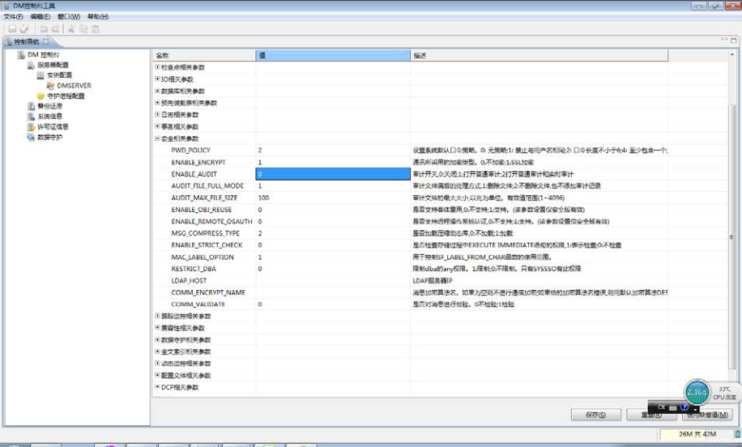
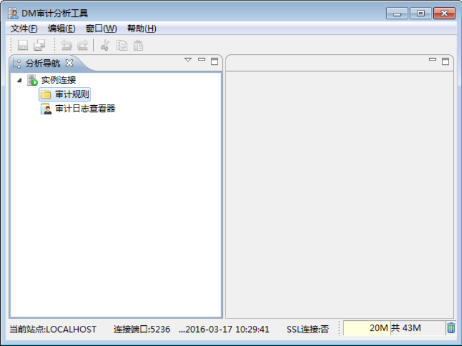
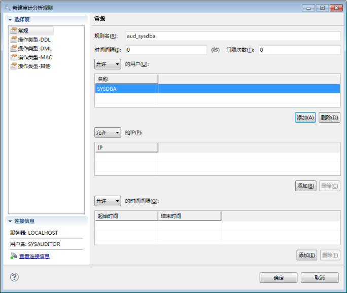
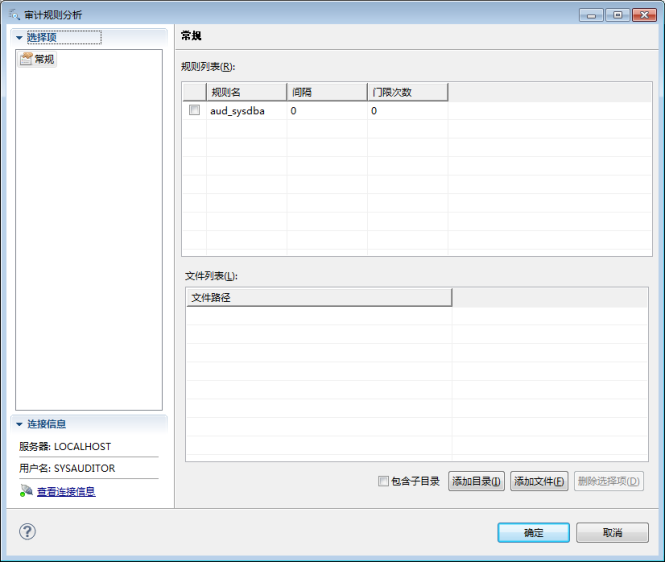
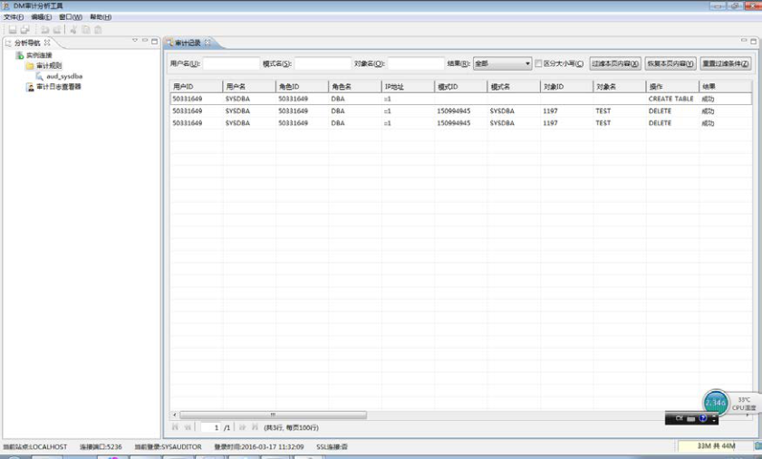
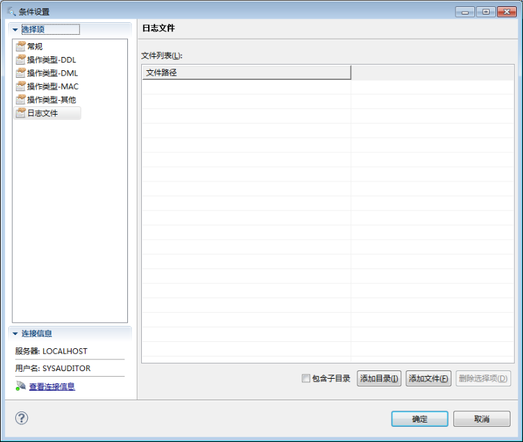

审计机制是`DM`数据库管理系统安全管理的重要组成部分之一。`DM`数据库除了提供数据安全保护措施外，还提供对日常事件的事后审计监督。`DM`具有一个灵活的审计子系统，可以通过它来记录系统级事件、个别用户的行为以及对数据库对象的访问。通过考察、跟踪审计信息，数据库审计员可以查看用户访问的形式以及曾试图对该系统进行的操作，从而采取积极、有效的应对措施。

## 5.1 审计开关

在`DM`系统中，专门为审计设置了开关，要使用审计功能首先要打开审计开关。审计开关由`DM`的`INI`参数`ENABLE_AUDIT`控制，有三种取值：

- 0：关闭审计
- 1：打开普通审计
- 2：打开普通审计和实时审计

`ENABLE_AUDIT`的缺省值为0，即关闭审计。

审计开关必须由具有`DBA`权限的管理员进行设置。

可以使用以下两种方式之一打开/关闭审计开关。

使用客户端工具`Consle`-`DBA`用户在`DM`控制台`Console`工具中，配置`DM`数据库的`ENABLE_AUDIT`参数值，如下图所示。

70



图`5.1`使用`Console`工具配置审计开关

使用系统过程-`DBA`用户也可以使用系统过程`SP_SET_PARA_VALUE`来配置`ENABLE_AUDIT`参数值，关于`SP_SET_PARA_VALUE`的详细介绍请参考《`DM_SQL`》。

例如，将`ENABLE_AUDIT`置为1，同时修改文件和内存参数。

```
SP_SET_PARA_VALUE(1, 'ENABLE_AUDIT',1);
```

## 5.2 审计的设置与取消

数据库审计员指定被审计对象的活动称为审计设置，只有具有`AUDIT DATABASE`权限的审计员才能进行审计设置。`DM`提供审计设置系统过程来实现这种设置，被审计的对象可以是某类操作，也可以是某些用户在数据库中的全部行踪。只有预先设置的操作和用户才能被`DM`系统自动进行审计。

`DM`允许在三个级别上进行审计设置，如表`5.1`所示。

表`5.1`审计级别说明审计级别系统的启动与关闭，此级别的审计无法也无需由用户进行设置，只要审计开系统级关打开就会自动生成对应审计记录语句级导致影响特定类型数据库对象的特殊`SQL`或语句组的审计。如`AUDIT`71

```
TABLE 将审计CREATE TABLE、ALTER TABLE 和DROP TABLE 等语句
```

对象级审计作用在特殊对象上的语句。如`test`表上的`INSERT`语句

审计设置存放于`DM`字典表`SYSAUDIT`中，进行一次审计设置就在`SYSAUDIT`中增加一条对应的记录，取消审计则删除`SYSAUDIT`中相应的记录。

### 5.2.1 语句级审计

语句级审计的动作是全局的，不对应具体的数据库对象。其审计选项如表`5.2`所示。

表`5.2`语句级审计选项审计选项审计的数据库操作说明`ALL`所有的语句级审计选项所有可审计操作

```
CREATE USER
```

`USER` `ALTER USER`创建／修改／删除用户操作

```
DROP USER
CREATE ROLE
```

`ROLE`创建／删除角色操作

```
DROP ROLE
CREATE TABLESPACE
```

创建／修改／删除表空间操

```
TABLESPACE  ALTER TABLESPACE
```

作

```
DROP TABLESPACE
CREATE SCHEMA
```

创建／删除／设置当前模式

```
SCHEMA  DROP SCHEMA
```

操作

```
SET SCHEMA
CREATE TABLE
```

`ALTER TABLE`创建／修改／删除／清空基

```
TABLE
DROP TABLE  表操作
TRUNCATE TABLE
CREATE VIEW
```

`VIEW` `ALTER VIEW`创建／修改／删除视图操作

```
DROP VIEW
CREATE INDEX
```

`INDEX`创建／删除索引操作

```
DROP INDEX
CREATE PROCEDURE
```

创建／修改／删除存储模块

```
PROCEDURE  ALTER PROCEDURE
```

操作

```
DROP PROCEDURE
```

72

```
CREATE TRIGGER
```

创建／修改／删除触发器操

```
TRIGGER  ALTER TRIGGER
```

作

```
DROP TRIGGER
CREATE SEQUENCE
```

`SEQUENCE` `ALTER SEQUENCE`创建／修改/删除序列操作

```
DROP SEQUENCE
CREATE CONTEXT INDEX
```

创建／修改／删除全文索引

```
CONTEXT  ALTER CONTEXT INDEX
```

操作

```
DROP CONTEXT INDEX
CREATE SYNONYM
```

`SYNONYM`创建／删除同义词

```
DROP SYNONYM
```

`GRANT` `GRANT`授予权限操作`REVOKE` `REVOKE`回收权限操作`AUDIT` `AUDIT`设置审计操作`NOAUDIT` `NOAUDIT`取消审计操作

```
INSERT TABLE  INSERT INTO TABLE  表上的插入操作
UPDATE TABLE  UPDATE TABLE  表上的修改操作
DELETE TABLE  DELETE FROM TABLE  表上的删除操作
SELECT TABLE  SELECT FROM TABLE  表上的查询操作
EXECUTE
```

`CALL PROCEDURE`调用存储过程或函数操作

```
PROCEDURE
CREATE PACKAGE
```

`PACKAGE`创建／删除包规范

```
DROP PACKAGE
CREATE PACKAGE BODY
```

`PACKAGE BODY`创建／删除包体

```
DROP PACKAGE BODY
CREATE POLICY
```

`MAC POLICY` `DROP POLICY`创建／修改／删除策略

```
ALTER POLICY
CREATE LEVEL
```

`MAC LEVEL` `ALTER LEVEL`创建／修改／删除等级

```
DROP LEVEL
CREATE COMPARTMENT
MAC COMPARTMENT DROP COMPARTMENT  创建／修改／删除范围
ALTER COMPARTMENT
```

73

```
CREATE GROUP
```

`DROP GROUP`创建／修改／删除组，更新

```
MAC GROUP
ALTER GROUP  父组
ALTER GROUP PARENT
CREATE LABEL
```

`MAC LABEL` `DROP LABEL`创建／修改／删除标记

```
ALTER LABEL
USER SET LEVELS
```

`USER SET COMPARTMENTS`设置用户等级／范围／组／

```
MAC USER
USER SET GROUPS  特权
USER SET PRIVS
INSER TABLE POLICY
```

`MAC TABLE` `REMOVE TABLE POLICY`插入／取消／应用表标记

```
APPLY TABLE POLICY
SESSION LABEL
```

保存／取消会话标记

```
SESSION ROW LABEL
```

`MAC SESSION`设置会话默认标记

```
RESTORE DEFAULT LABELS
```

设置会话行标记

```
SAVE DEFAULT LABELS
CHECKPOINT  CHECKPIONT  检查点（checkpoint）
SAVEPOINT  SAVEPOINT  保存点
```

`EXPLAIN` `EXPLAIN`显示执行计划`NOT EXIST`分析对象不存在导致的错误`DATABASE` `ALTER DATABASE`修改当前数据库操作

```
LOGIN
```

`CONNECT`登录／退出操作

```
LOGOUT
COMMIT  COMMIT  提交操作
ROLLBACK  ROLLBACK  回滚操作
SET TRX ISOLATION
```

设置事务的读写属性和隔离

```
SET TRANSACTION
SET TRX READ WRITE
```

级别

设置语句级审计的系统过程如下：

```
VOID
SP_AUDIT_STMT(
```

74

```
TYPE  VARCHAR(30),
USERNAME  VARCHAR (128),
WHENEVER  VARCHAR (20)
)
```

参数说明：

`TYPE`语句级审计选项，即上表中的第一列`USERNAME`用户名，`NULL`表示不限制`WHENEVER`审计时机，可选的取值为：

- `ALL`：所有的
- `SUCCESSFUL`：操作成功时
- `FAIL`：操作失败时

例1，审计表的创建、修改和删除。

```
SP_AUDIT_STMT('TABLE', 'NULL', 'ALL');
```

例2，对`SYSDBA`创建用户成功进行审计。

```
SP_AUDIT_STMT('USER', 'SYSDBA', 'SUCCESSFUL');
```

例3，对用户`USER2`进行的表的修改和删除进行审计，不管失败和成功。

```
SP_AUDIT_STMT('UPDATE TABLE', 'USER2', 'ALL');
SP_AUDIT_STMT('DELETE TABLE', 'USER2', 'ALL');
```

取消语句级审计的系统过程如下：

```
VOID
SP_NOAUDIT_STMT(
TYPE  VARCHAR(30),
USERNAME  VARCHAR (128),
WHENEVER  VARCHAR (20)
)
```

参数说明：

`TYPE`语句级审计选项，即上表中的第一列`USERNAME`用户名，`NULL`表示不限制

75

`WHENEVER`审计时机，可选的取值为：

- `ALL`：所有的
- `SUCCESSFUL`：操作成功时
- `FAIL`：操作失败时

使用说明：

取消审计语句和设置审计语句进行匹配，只有完全匹配的才可以取消审计，否则无法取消审计。

例1，取消对表的创建、修改和删除的审计。

```
SP_NOAUDIT_STMT('TABLE', 'NULL', 'ALL');
```

例2，取消对`SYSDBA`创建用户成功进行审计。

```
SP_NOAUDIT_STMT('USER', 'SYSDBA', 'SUCCESSFUL');
```

例3，取消对用户`USER2`进行的表的修改和删除的审计。

```
SP_NOAUDIT_STMT('UPDATE TABLE', 'USER2', 'ALL');
SP_NOAUDIT_STMT('DELETE TABLE', 'USER2', 'ALL');
```

### 5.2.2 对象级审计

对象级审计发生在具体的对象上，需要指定模式名以及对象名。其审计选项如表`5.3`所示。

表`5.3`对象级审计选项

```
审计选项(SYSAUDITRECORDS
PROCEDURE
表中operation 字段对应的内  TABLE  VIEW  COL  TRIGGER
FUNCTION
```

容)

```
INSERT  √  √  √
UPDATE  √  √  √
DELETE  √  √  √
SELECT  √  √  √
EXECUTE  √
MERGE INTO  √  √
EXECUTE TRIGGER  √
LOCK TABLE  √
```

`ALL(`所有对象级审计选项) √ √ √ √ √

设置对象级审计的系统过程如下：

76

```
VOID
SP_AUDIT_OBJECT (
TYPE  VARCHAR(30),
USERNAME  VARCHAR (128),
SCHNAME  VARCHAR (128),
TVNAME  VARCHAR (128),
WHENEVER  VARCHAR (20)
)
VOID
SP_AUDIT_OBJECT (
TYPE  VARCHAR(30),
USERNAME  VARCHAR (128),
SCHNAME  VARCHAR (128),
TVNAME  VARCHAR (128),
COLNAME       VARCHAR (128),
WHENEVER  VARCHAR (20)
)
```

参数说明：

`TYPE`对象级审计选项，即上表中的第一列`USERNAME`用户名`SCHNAME`模式名，为空时置‘`null`’`TVNAME`表、视图、存储过程名不能为空

```
COLNAME  列名
```

`WHENEVER`审计时机，可选的取值为：

- `ALL`：所有的
- `SUCCESSFUL`：操作成功时
- `FAIL`：操作失败时

例1，对`SYSDBA`对表`PERSON.ADDRESS`进行的添加和修改的成功操作进行审计。

77

```
SP_AUDIT_OBJECT('INSERT', 'SYSDBA', 'PERSON', 'ADDRESS', 'SUCCESSFUL');
SP_AUDIT_OBJECT('UPDATE', 'SYSDBA', 'PERSON', 'ADDRESS', 'SUCCESSFUL');
```

例2，对`SYSDBA`对表`PERSON.ADDRESS`的`ADDRESS1`列进行的修改成功的操作进行审计。

```
SP_AUDIT_OBJECT('UPDATE','SYSDBA','PERSON','ADDRESS','ADDRESS1','SUCCESSFUL');
```

取消对象级审计的系统过程如下：

```
VOID
SP_NOAUDIT_OBJECT (
TYPE  VARCHAR(30),
USERNAME  VARCHAR (128),
SCHNAME  VARCHAR (128),
TVNAME  VARCHAR (128),
WHENEVER  VARCHAR (20)
)
VOID
SP_NOAUDIT_OBJECT (
TYPE  VARCHAR(30),
USERNAME  VARCHAR (128),
SCHNAME  VARCHAR (128),
TVNAME  VARCHAR (128),
COLNAME       VARCHAR (128),
WHENEVER  VARCHAR (20)
)
```

参数说明：

`TYPE`对象级审计选项，即上表中的第一列`USERNAME`用户名`SCHNAME`模式名，为空时置‘`null`’

78

`TVNAME`表、视图、存储过程名不能为空

```
COLNAME  列名
```

`WHENEVER`审计时机，可选的取值为：

- `ALL`：所有的
- `SUCCESSFUL`：操作成功时
- `FAIL`：操作失败时

使用说明：

取消审计语句和设置审计语句进行匹配，只有完全匹配的才可以取消审计，否则无法取消审计。

例1，取消对`SYSDBA`对表`PERSON.ADDRESS`进行的添加和修改的成功操作的审计。

```
SP_NOAUDIT_OBJECT('INSERT', 'SYSDBA', 'PERSON', 'ADDRESS', 'SUCCESSFUL');
SP_NOAUDIT_OBJECT('UPDATE', 'SYSDBA', 'PERSON', 'ADDRESS', 'SUCCESSFUL');
```

例2，取消对`SYSDBA`对表`PERSON.ADDRESS`的`ADDRESS1`列进行的修改成功操作的审计。

```
SP_NOAUDIT_OBJECT('UPDATE','SYSDBA','PERSON','ADDRESS','ADDRESS1','SUCCESSFUL
');
```

### 5.2.3 语句序列审计

`DM`还提供了语句序列审计功能，作为语句级审计和对象级审计的补充。语句序列审计需要审计员预先建立一个审计规则，包含N条`SQL`语句（`SQL1,SQL2`……），如果某个会话依次执行了这些`SQL`语句，就会触发审计。

建立语句序列审计规则的过程包括下面三个系统过程。

```
VOID
SP_AUDIT_SQLSEQ_START(
NAME  VARCHAR (128)
```

）

```
VOID
SP_AUDIT_SQLSEQ_ADD(
```

79

```
NAME  VARCHAR (128),
SQL  VARCHAR (8188)
)
VOID
SP_AUDIT_SQLSEQ_END(
NAME  VARCHAR (128)
)
```

参数说明：

`NAME`语句序列审计规则名`SQL`需要审计的语句序列中的`SQL`语句使用说明：

建立语句序列审计规则需要先调用`SP_AUDIT_SQLSEQ_START`，之后调用若干次`SP_AUDIT_SQLSEQ_ADD`，每次加入一条`SQL`语句，审计规则中的`SQL`语句顺序根据加入`SQL`语句的顺序确定，最后调用`SP_AUDIT_SQLSEQ_END`完成规则的建立。

例如，建立一个语句序列审计规则`AUDIT_SQL1`。

```
SP_AUDIT_SQLSEQ_START('AUDIT_SQL1');
SP_AUDIT_SQLSEQ_ADD(' AUDIT_SQL1', 'SELECT NAME FROM TEST1;');
SP_AUDIT_SQLSEQ_ADD(' AUDIT_SQL1', 'SELECT ID ROM TEST2;');
SP_AUDIT_SQLSEQ_ADD(' AUDIT_SQL1', 'SELECT * FROM TEST3;');
SP_AUDIT_SQLSEQ_END(' AUDIT_SQL1');
```

可使用下面的系统过程删除指定的语句序列审计规则。

```
VOID
SP_AUDIT_SQLSEQ_DEL(
NAME  VARCHAR (128)
```

）

参数说明：

`NAME`语句序列审计规则名

80

例如，删除语句序列审计规则`AUDIT_SQL1`。

```
SP_AUDIT_SQLSEQ_DEL(' AUDIT_SQL1');
```

### 5.2.4 关于审计设置的一些说明

- 只要审计功能被启用，系统级的审计记录就会产生；
- 在进行数据库审计时，审计员之间没有区别，可以审计所有数据库对象，也可取消

其他审计员的审计设置；

- 语句级审计不针对特定的对象，只针对用户；
- 对象级审计针对指定的用户与指定的对象进行审计；
- 在设置审计时，审计选项不区分包含关系，都可以设置；
- 在设置审计时，审计时机不区分包含关系，都可以进行设置；
- 如果用户执行的一条语句与设置的若干审计项都匹配，只会在审计文件中生成一条

审计记录。

## 5.3 审计文件管理

`DM`审计信息存储在审计文件中。审计文件存放在数据库的`SYSTEM_PATH`指定的路径，即数据库所在路径。审计文件命名格式为“`AUDIT_GUID_`创建时间`.log`”，其中“`GUID`”为`DM`给定的一个唯一值。

审计文件的大小可以通过`DM`的`INI`参数`AUDIT_MAX_FILE_SIZE`指定。当单个审计文件超过指定大小时，系统会自动切换审计文件，自动创建新的审计文件，审计记录将写入新的审计文件中。`AUDIT_MAX_FILE_SIZE`为动态系统级参数，缺省值为`100M`，`DBA`用户可通过系统过程`SP_SET_PARA_VALUE`对其进行动态修改，有效值范围为`1~4096M`。

随着系统的运行，审计记录将会不断增加，审计文件需要更多的磁盘空间。在极限情况下，审计记录可能会因为磁盘空间不足而无法写入审计文件，最终导致系统无法正常运行。

对这种情况的处理有两种策略，通过设置`DM`的`INI`参数`AUDIT_FILE_FULL_MODE`进行配置。当将`AUDIT_FILE_FULL_MODE`置为1 时，将删除最老的审计文件，直至有足够的空间创建新审计文件；当将`AUDIT_FILE_FULL_MODE`置为2 时，将不再写审计记录，默认值为1。`AUDIT_FILE_FULL_MODE`为静态参数，可通过系统过程`SP_SET_PARA_VALUE`进行修改，但是修改需要重新启动`DM`数据库服务器才能生效。

81

两种策略都会导致审计记录的缺失，因此，管理员应该及时对审计文件进行备份。

若系统审计人员已对历史审计信息进行了充分分析，不再需要某个时间点之前的历史审计信息，可使用下面的系统过程删除指定时间点之前的审计文件，但是不会删除`DM`当前正在使用的审计文件。

```
VOID
SP_DROP_AUDIT_FILE(
TIME_STR  VARCHAR(128),
TYPE  INT
);
```

参数说明：

`TIME_STR`：指定的时间字符串`TYPE`：审计文件类型，0 表示删除普通审计文件，1 表示删除实时审计文件例如，指定删除`2015-12-6 16:30:00`以前的普通审计文件。

```
SP_DROP_AUDIT_FILE('2015-12-6 16:30:00',0);
```

`DM`审计文件支持文件加密，审计管理员可使用下面的系统过程设置审计文件加密：

```
VOID
SP_AUDIT_SET_ENC(
NAME  VARCHAR(128),
KEY  VARCHAR(128)
)
```

参数说明：

`NAME`加密算法名，可使用`DM`支持的加密算法，见表`7.1`；也支持用户自定义加密算法，见第8 章加密引擎介绍`KEY`加密密钥

82

## 5.4 审计信息查阅

当使用`DM`提供的审计机制进行了审计设置后，这些审计设置信息都记录在数据字典表`SYSAUDITOR.SYSAUDIT`中，结构如下表所示。审计类型用户可以查看此数据字典表查询审计设置信息。

```
表5.4 SYSAUDITOR.SYSAUDIT 表结构
```

序号列数据类型说明

```
1  LEVEL  SMALLINT 审计级别
2  UID  INTEGER 用户ID
```

3 `TVPID` `INTEGER`表/视图/触发器/存储过程函数`ID`

```
4  COLID  SMALLINT 列ID
5  TYPE  SMALLINT 审计类型
6  WHENEVER SMALLINT 审计情况
```

只要`DM`系统处于审计活动状态，系统按审计设置进行审计活动，并将审计信息写入审计文件。审计记录内容包括操作者的用户名、所在站点、所进行的操作、操作的对象、操作时间、当前审计条件等。审计用户可以通过动态视图`SYSAUDITOR.V$AUDITRECORDS`查询系统默认路径下的审计文件的审计记录，动态视图的结构如下表所示。

```
表5.5 SYSAUDITOR.V$AUDITRECORDS 结构
```

序号列数据类型说明

```
1  USERID  INTEGER  用户ID
2  USERNAME  VARCHAR(128) 用户名
3  ROLEID  INTEGER  角色ID。
```

没有具体角色的用户和`SQL`序列审计，没用角色信息。

```
4  ROLENAME  VARCHAR(128) 角色名。
```

没有具体角色的用户和`SQL`序列审计，没用角色信息。

```
5  IP  VARCHAR(25)  IP 地址
6  SCHID  INTEGER  模式ID
7  SCHNAME  VARCHAR(128) 模式名
8  OBJID  INTEGER  对象ID
9  OBJNAME  VARCHAR(128) 对象名
10  OPERATION  VARCHAR(128) 操作类型名
11  SUCC_FLAG  CHAR(1)  成功标记
12  SQL_TEXT  VARCHAR(8188) SQL 文本
```

83

```
13  DESCRIPTION VARCHAR(8188) 描述信息
14  OPTIME  DATETIME  操作时间
```

例如，`SYSAUDITOR`进行如下的审计设置：

```
/*-------- SYSAUDITOR/SYSAUDITOR ----------*/
SP_AUDIT_OBJECT('INSERT', 'SYSDBA', 'PERSON', 'ADDRESS', 'SUCCESSFUL');
SP_AUDIT_OBJECT('UPDATE', 'SYSDBA', 'PERSON', 'ADDRESS', 'SUCCESSFUL');
```

之后查询`SYSAUDITOR.SYSAUDIT`数据字典表，可以看到对应的审计设置记录：

```
SELECT * FROM SYSAUDITOR.SYSAUDIT;
行号       LEVEL       UID         TVPID       COLID       TYPE
---------- ----------- ----------- ----------- ----------- -----------
WHENEVER
-----------
1          2           50331649    1196        -1          50
1
2          2           50331649    1196        -1          53
1
```

以`SYSDBA`登录，对表`PERSON.ADDRESS`进行插入和删除操作：

```
/*-------- SYSDBA/SYSDBA --------*/
INSERT INTO PERSON.ADDRESS(ADDRESS1,ADDRESS2,CITY,POSTALCODE)
VALUES('AAA','','BBB','111111');
DELETE FROM PERSON.ADDRESS WHERE ADDRESS1='AAA';
COMMIT;
再以SYSAUDITOR 登录，查询SYSAUDITOR.V$AUDITRECORDS，可以看到SYSDBA
```

刚才的插入操作生成的审计记录：

```
/*-------- SYSAUDITOR/SYSAUDITOR ----------*/
SELECT * FROM SYSAUDITOR.V$AUDITRECORDS WHERE USERNAME='SYSDBA';
行号       USERID      USERNAME ROLEID      ROLENAME IP  SCHID       SCHNAME
---------- ----------- -------- ----------- -------- --- ----------- -------
```

84

```
OBJID       OBJNAME OPERATION SUCC_FLAG
----------- ------- --------- ---------
SQL_TEXT
------------------------------------------------------------------
-
DESCRIBTION OPTIME
----------- ---------------------------
1          50331649    SYSDBA   67108864    DBA      ::1 150995945   PERSON
1196        ADDRESS INSERT    Y
INSERT INTO PERSON.ADDRESS(ADDRESS1,ADDRESS2,CITY,POSTALCODE)
VALUES(
'AAA','','BBB','111111');
2016-03-15 15:07:49.000000
```

由于并没有相关的审计设置，`SYSDBA`之前执行的`DELETE`操作没有生成审计记录。

## 5.5 审计实时侵害检测

当将`INI`参数`ENABLE_AUDIT`置为2 时，开启审计实时侵害检测功能。

实时侵害检测系统用于实时分析当前用户的操作，并查找与该操作相匹配的实时审计分析规则，如果规则存在，则判断该用户的行为是否是侵害行为，确定侵害等级，并根据侵害等级采取相应的响应措施。

### 5.5.1 创建与删除实时侵害检测规则

当`INI`参数`ENABLE_AUDIT=2`时，具有`AUDIT DATABASE`权限的用户可以使用下面的系统过程创建实时侵害检测规则。

```
VOID
SP_CREATE_AUDIT_RULE(
RULENAME  VARCHAR(128),
OPERATION  VARCHAR(30),
USERNAME  VARCHAR(128),
```

85

```
SCHNAME  VARCHAR(128),
OBJNAME  VARCHAR(128),
WHENEVER  VARCHAR(20),
ALLOW_IP  VARCHAR(1024),
ALLOW_DT  VARCHAR(1024),
INTERVAL  INTEGER,
TIMES  INTERGER
);
```

参数说明：

`RULENAME`创建的审计实时侵害检测规则名`OPERATION`审计操作名，取值可选项下表

```
OPERATION 可选项
CREATE USER
DROP USER
ALTER USER
CREATE ROLE
DROP ROLE
CREATE TABLESPACE
DROP TABLESPACE
ALTER_TABLESPACE
CREATE SCHEMA
DROP SCHEMA
SET SCHEMA
CREATE TABLE
DROP TABLE
TRUNCATE TABLE
CREATE VIEW
ALTER VIEW
DROP VIEW
ALTER VIEW
CREATE INDEX
DROP INDEX
CREATE PROCEDURE
ALTER PROCEDURE
DROP PROCEDURE
CREATE TRIGGER
```

86

```
DROP TRIGGER
ALTER TRIGGER
CREATE SEQUENCE
DROP SEQUENCE
CREATE CONTEXT INDEX
DROP CONTEXT INDEX
ALTER CONTEXT INDEX
GRANT
REVOKE
AUDIT
NOAUDIT
CHECKPOINT
CREATE POLICY
DROP POLICY
ALTER POLICY
CREATE LEVEL
ALTER LEVEL
DROP LEVEL
CREATE COMPARTMENT
DROP COMPARTMENT
ALTER COMPARTMENT
CREATE GROUP
DROP GROUP
ALTER GROUP
ALTER GROUP PARENT
CREATE LABEL
DROP LABEL
ALTER LABEL
REMOVE TABLE POLICY
APPLY TABLE POLICY
USER SET LEVELS
USER SET COMPARTMENTS
USER SET GROUPS
USER SET PRIVS
USER REMOVE POLICY
SESSION LABEL
SESSION ROW LABEL
RESTORE DEFAULT
LABELS
SAVE DEFAULT LABELS
```

87

```
SET TRX ISOLATION
SET TRX READ WRITE
CREATE  PACKAGE
DROP  PACKAGE
CREATE PACKAGE BODY
DROP PACKAGE BODY
CREATE SYNONYM
DROP SYNONYM
INSERT
SELECT
DELETE
UPDATE
EXECUTE
EXECUTE TRIGGER
MERGE INTO
LOCK TABLE
UNLOCK USER
ALTER DATABASE
SAVEPOINT
COMMIT
ROLLBACK
CONNECT
DISCONNECT
EXPLAIN
STARTUP
SHUTDOWN
```

`USERNAME`用户名，没有指定或`'NULL'`表示所有用户`SCHNAME`模式名，没有时指定为`'NULL'``OBJNAME`对象名，没有时指定为`'NULL'`

```
WHENEVER  审计时机，取值ALL/SUCCESSFUL/FAIL
ALLOW_IP  IP 列表，以’,’隔开。例如'"192.168.0.1","127.0.0.1"'
```

`ALLOW_DT`时间串，格式如下：

`ALLOW_DT::= <`时间段项`>{,<`时间段项`>}`<时间段项`> ::= <`具体时间段`> | <`规则时间段><具体时间段`> ::= <`具体日期`> <`具体时间`> TO <`具体日期`> <`具体时间><规则时间段`> ::= <`规则时间标志`> <`具体时间`> TO <`规则时间标志`> <`具体时间>88

```
<规则时间标志> ::= MON | TUE | WED | THURS | FRI | SAT | SUN
```

`INTERVAL`时间间隔，单位为分钟`TIMES`次数例1，创建一个审计实时侵害检测规则`DANGEROUS_SESSION`，该规则检测每个星期一8：00 至9：00 的所有非本地`SYSDBA`的登录动作。

```
SP_CREATE_AUDIT_RULE ('DANGEROUS_SESSION','CONNECT', 'SYSDBA', 'NULL', 'NULL',
'ALL', '"127.0.0.1"','MON "8:00:00" TO MON "9:00:00"',0, 0);
```

例2，创建一个审计实时侵害检测规则`PWD_CRACK`，该规则检测可能的口令暴力破解行为。

```
SP_CREATE_AUDIT_RULE ('PWD_CRACK','CONNECT', 'NULL', 'NULL', 'NULL', 'FAIL',
'NULL','NULL',1, 50);
```

当不再需要某个实时侵害检测规则时，可使用下面的系统过程进行删除。

```
VOID
SP_DROP_AUDIT_RULE(
RULENAME  VARCHAR(128)
);
```

参数说明：

`RULENAME`待删除的审计实时侵害检测规则名例如，删除已创建的实时侵害检测规则`DANGEROUS_SESSION`。

```
SP_DROP_AUDIT_RULE ('DANGEROUS_SESSION');
```

### 5.5.2 实时侵害检测

当`INI`参数`ENABLE_AUDIT`置为2 时，实时侵害检测系统会实时分析用户的操作，将其与系统中创建的实时侵害检测规则进行匹配，判断该用户操作是否是侵害行为。

为了界定不同侵害行为对系统的危害情况，实时侵害检测系统定义了四种级别的侵害等级，从四级到一级侵害行为严重程度递增。这样根据用户操作匹配的实时侵害检测规则来可以判断其属于哪一级的侵害行为。

89

四种侵害等级如下：

- 四级：操作只违反了`IP` 或者时间段设置之一，且对应累计次数在规定时间间隔内

没有达到门限值，或者没有门限值设置；

- 三级：操作同时违反了`IP` 和时间段设置，且累计次数在规定时间间隔内没有达到

门限值，或者没有门限值设置；

- 二级：操作的`IP` 和时间段都正常，且累计次数在规定时间间隔内达到了门限值；
- 一级：操作只违反了`IP` 或时间段设置之一，且对应累计次数在规定时间间隔内达

到了门限值，或者操作同时违反了`IP`和时间段设置，且累计次数在规定时间间隔内达到了门限值。

实时侵害检测规则的设置，使得某些操作可能会触发多条审计分析规则，也就是说可能存在多条审计分析规则同时匹配的情况。在这种情况下，需要把操作记录保存到所有匹配的、同时规定了操作频率门限值的审计分析规则下，并且使用这些审计分析规则对该操作进行分析，从所有满足的侵害等级中选择一个最高的侵害等级进行响应。

`DM`实时侵害检测系统根据侵害检测结果做出相应的安全审计响应，由低到高四个等级分别为：

- 四级响应：实时报警生成，对四级侵害行为进行响应。当系统检测到四级侵害行为

时，生成报警信息；

- 三级响应：违例进程终止，对三级侵害行为进行响应。当系统检测到三级侵害行为

时，终止当前操作（用户当前连接仍然保持）。同时生成报警信息；

- 二级响应：服务取消，对二级侵害行为进行响应。当系统检测到二级侵害行为时，

强制断开用户当前连接，退出登录。同时生成报警信息；

- 一级响应：账号锁定或失效，对一级侵害行为进行响应。当系统检测到一级侵害行

为时，强制断开用户当前连接，退出登录，并且锁定账号或使账号失效。同时生成报警信息。

这些安全审计相应动作中除了生成报警信息，其余的都由`DM`数据库服务器即可完成。

生成报警信息的实现包括`DM`数据库服务器将报警信息写入一个专门的日志文件，由`DM`的审计告警工具`dmamon`实时分析这个日志文件，发现报警信息并将报警信息以邮件的形式发送给指定的邮箱。

90

### 5.5.3 审计告警工具dmamon

审计告警工具`dmamon`用来在`DM`实时侵害检测系统检测到侵害事件且需要进行报警时可将报警信息以邮件的形式发送给指定邮箱。

`dmamon`的运行需要指定对应的配置文件`dmamon.ini`，此配置文件只能通过工具`dmamon_ctl`进行创建或修改。

#### 5.5.3.1 创建或修改dmamon.ini

使用`dmamon_ctl`工具创建或修改`dmamon.ini`。`dmamon_ctl`工具只有一个参数“`FILE`”，用来指定需要编辑的`dmamon.ini`的路径。启动`dmamon_ctl`工具的命令格式为：

```
dmamon_ctl  [FILE=value]
```

例如：

```
dmamon_ctl  FILE=c:\dmamon.ini
```

当需要创建`dmamon.ini`时，可以不指定`FILE`参数，则`dmamon_ctl`工具会一步步引导用户配置`dm.ini`所在目录、发送和接收邮件的电子邮箱等信息，创建一个新的`dmamon.ini`文件。配置项如下表所示。

```
表5.6 dmamon.ini 配置项
```

项目项目意义字段字段意义实时审计警报记录文[PATH] PATH 实时审计警报记录文件所在的文件目录件所在的文件目录EMAIL 发件人邮箱SMTP 发件人邮箱SMTP 服务器[SENDER] 发件人USERNAME 发件人用户名PASSWORD 发件人密码[RECEIVER] 收件人 EMAIL 收件人邮箱检查审计警报记录文件的时间间隔，单位[INTERVAL] 时间间隔 INTERVL秒

`dmamon_ctl`工具支持的命令如下表。

```
表5.7 dmamon_ctl 命令
```

命令说明`EDIT`修改`INI`文件信息`ADD`增加接收者的邮件地址信息`REMOVE`删除接收者的邮件地址信息91`SHOW`显示当前控制文件的内容保存，保存路径必须为`dmamon.ini`的绝对

```
SAVE
```

路径。退出之前须保存，否则修改无效`EXIT`退出当前程序`HELP`显示帮助信息

#### 5.5.3.1 使用dmamon

配置好`dmamon.ini`后，就可以使用`dmamon`工具进行实时审计告警了。启动`dmamon`工具的命令格式为：

```
dmamon  USERID=value1 FILE=value2
```

参数说明：

`USERID`指定登录数据库的信息，包含用户名（必须是审计用户）、密码、服务器地址、端口号。参数值格式为：用户名/密码`[@`主库地址`[:`端口号]

```
[#SSL_PATH@SSL_PWD]
```

`FILE`指定`dmamon.ini`文件的路径，字符串类型例如：

```
dmamon  USERID=SYSAUDITOR/SYSAUDITOR FILE=c:\dmamon.ini
```

## 5.6 审计分析

`DM`提供了图形界面的审计分析工具`Analyzer`，实现对审计记录的分析功能，能够根据所制定的分析规则，对审计记录进行分析，判断系统中是否存在对系统安全构成危险的活动。

只有审计用户才能使用审计分析工具`Analyzer`。审计用户登陆审计分析工具后，通过`Analyzer`可以创建和删除审计规则，并可以指定对某些审计文件应用某些规则。并将审计结果以表格的方式展现出来。

审计用户登录`Analyzer`后可看到工具主界面如图`5.2`所示。

92



图`5.2 Analyzer`工具主界面

### 5.6.1 审计规则

右键单击导航树中的“审计规则”节点，在弹出的菜单中选择“新建审计分析规则”，可打开如下图所示的新建审计分析规则窗口。

93



图`5.3`新建审计分析规则窗口

如上图中创建了一个名为`aud_sysdba`的审计分析规则，对`SYSDBA`的所有审计记录进行分析。之后我们就可以将这个审计分析规则应用与对审计记录文件的分析。右键点击“审计规则”或一个具体的审计分析规则节点，在弹出的菜单中选择“审计规则分析”，弹出如下图所示审计规则分析窗口。



94图`5.4`审计规则分析窗口

选择需要应用的审计分析规则，可以同时选择多条，在下面的文件列表中添加需要进行分析的审计记录文件，`Analyzer`工具就会根据审计分析规则对文件中的审计记录进行分析，将满足规则的审计记录以表格的形式显示出来，如下图所示。



图`5.5`审计规则分析结果

在审计规则分析结果显示窗口中，还可以对显示的审计记录根据需要进行进一步过滤，进一步分析出需要的审计记录。

### 5.6.2 审计日志查看器

双击“审计日志查看器”节点，可打开如下图所示的条件设置窗口。

95



图`5.6`审计日志查看条件设置窗口

添加需要查看的审计记录文件，还可在窗口左侧的“选择项”中设置各种过滤条件，之后点击“确定”，将满足规则的审计记录以表格的形式显示出来，与图`5.5`的显式相同。

96
