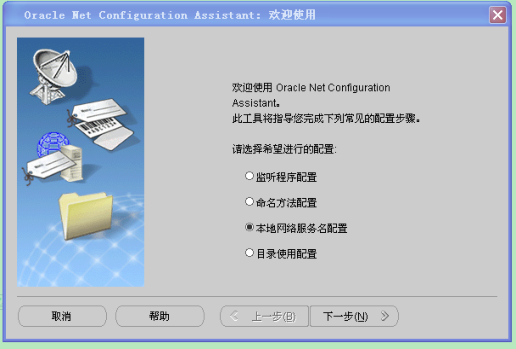
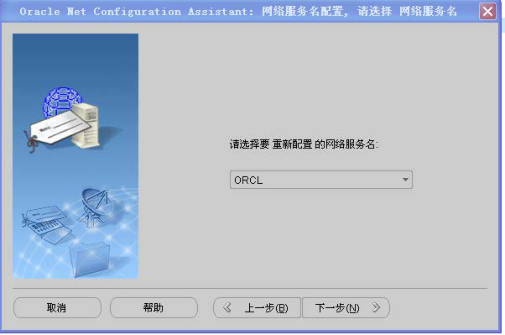
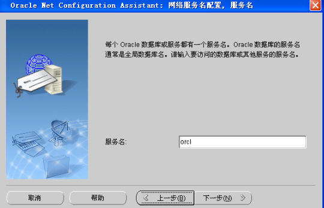
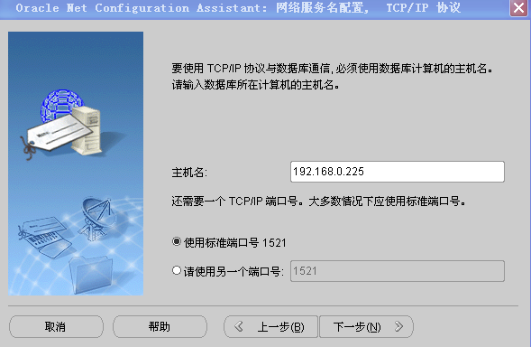

外部链接对象（`LINK`）是`DM`中的一种特殊的数据库实体对象，它记录了远程数据库的连接和路径信息，用于建立与远程数据的联系。通过多台数据库主库间的相互通讯，用户可以透明地操作远程数据库的数据，使应用程序看起来只有一个大型数据库。用户远程数据库中的数据请求，都被自动转换为网络请求，并在相应结点上实现相应的操作。用户可以建立一个数据库链接，以说明一个对象在远程数据库中的访问路径。这个链接可以是公用的（数据库中所有用户使用），也可以是私有的（只能被某个用户使用）。

用户可以通过外部链接对远程数据库的表进行查询和增删改操作，以及本地调用远程的存储过程。

## 17.1 创建外部链接

创建一个外部链接。

语法格式

```
CREATE [PUBLIC] LINK <外部链接名> CONNECT ['<连接库类型>'] WITH <登录名>
IDENTIFIED BY
```

<登录口令`> USING '<`连接串`> ';`<连接串`> ::=<`外部链接串><外部链接串`>::=< DAMENG`外部链接串`>| < ORACLE`外部链接串>

```
< DAMENG 外部链接串>::=<IP 地址>/<端口号> | <instance_name>
< ORACLE 外部链接串>::= <tsn_name> |<description>|<IP 地址>/<服务名>
<description>::=(DESCRIPTION=(ADDRESS_LIST=(ADDRESS=(PROTOCOL=TCP)(HOST=
<IP 地址>)(PORT=<端口号>)))(CONNECT_DATA=(SERVICE_NAME=<服务名>)))
```

参数1． `PUBLIC`此链接对象是否能够被创建者之外的用户引用；

2．<外部链接名> 数据库链接的名称；

3．<连接库类型> 目前只支持`DAMENG`或`ORACLE`，默认为`DAMENG`；

4．<登录名> 登录用户名称；

5．<登录口令> 登录用户口令；

6．`<DAMENG`外部链接串> 既可以是`<IP`地址`>/<`端口号>，也可以是`dmmal.ini`中配置的实例名`instance_name`；

`7. <ORACLE`外部链接串>可以使用配置的网络服务名`tsn_name(`网络服务名需要配置)，或者连接描述符`description`（连接描述符是网络连接目标特殊格式的描述，它包括网络协议、主库IP 地址、端口号和服务名），或者`<IP`地址`>/<`服务名>。

图例

CREATE LINK linkname CONNECT WITH loginname PUBLIC DAMENG‘ ’ORACLE IDENTIFIED BY password USING connect_string ;

语句功能创建一个外部链接。

使用说明1．要创建到`DM`数据库的外部链接，必须首先配置`dmmal.ini`，才能使用`LINK`。`DM`的连接串有两种格式：

`INSTANCE_NAME:`直接使用远程库的实例名（该实例名必须配置到`dmmal.ini`中）；

`<IP`地址`>/<`端口号`>:`其中端口号为`DM`外部链接服务器的`dmmal.ini`配置中的`MAL_PORT`端口号。

2. 要创建到`ORACLE` 的外部链接，可以使用配置的网络服务名`<tsn_name>`；如果没

有配置`tsn_name`，可以使用连接描述符`<description>`或者`<IP`地址`>/<`服务名>作为连接串。

3．通过`LINK`对远程服务器所作的修改，由用户在本地服务器通过`commit`或`rollback`进行提交或回滚。

4．只支持普通用户，不支持`SSL`和`Kerberos`认证。

5．`DM7`不支持连接自身实例的`LINK`。

```
6．支持在CREATE SCHEMA 中CREATE LINK，但是不支持CREATE PUBLIC LINK。
```

7．只有`DBA`和具有`CREATE LINK`权限的用户可以创建外部链接。

举例说明例1 使用`DM`数据库，创建一个连接到`IP`地址为`192.168.0.31`，`MAL_PORT`端口号为5369 的`MAL`站点的外部链接，登录到此站点使用的用户名为`USER1`，密码为`AAA123456`，实例名为：`DMSERVER`。

```
CREATE PUBLIC LINK LINK1 CONNECT 'DAMENG'  WITH USER01 IDENTIFIED BY AAA123456
USING '192.168.0.31/5369';
```

或

```
CREATE PUBLIC LINK LINK1 CONNECT WITH USER01 IDENTIFIED BY AAA123456 using
' DMSERVER ';    --DMSERVER 为实例名
```

例2 使用`DM`数据库，创建一个连接到`IP`地址为`192.168.0.225`机器上的`oracle`数据库的外部链接。可以通过三种方式创建：一网络服务名`tsn_name`；二连接描述符`description`；三`<IP`地址`>/<`服务名>。

（一） 通过网络服务名创建首先介绍`Oracle`网络服务名的配置方法。网络服务名配置成功才能创建`DBLINK`配置本地的`Oracle`网络服务名`ORCL`，连接225 机器上的`orcl`实例。详细步骤如下：



步骤一



步骤二



步骤三



步骤四其次，创建`dblink`。

网络服务名配置成功后，就可以使用网络服务名`ORCL`或网络连接描述符创建`DBLINK.`

```
create link link1 connect 'ORACLE' with USER01 IDENTIFIED BY USER01 USING
'ORCL';
```

（二） 通过连接描述符创建

```
create or replace link link1 connect 'ORACLE' with USER01 identified by USER01
using '(DESCRIPTION =
(ADDRESS_LIST =  (ADDRESS = (PROTOCOL = TCP)(HOST = 192.168.0.225)(PORT =
1521)))
(CONNECT_DATA = (SERVICE_NAME = orcl) )
)';
```

（三） 通过`<IP`地址`>/<`服务名>创建

```
create link link1 connect 'ORACLE' with USER01 IDENTIFIED BY USER01 USING
'192.168.0.225/orcl';
```

## 17.2 删除外部链接

删除一个外部链接。

语法格式

```
DROP  [PUBLIC] LINK  [<模式名>.]<外部链接名>;
```

参数1．<模式名> 指明被操作的外部链接属于哪个模式，缺省为当前模式；

2．<外部链接名> 指明被操作的外部链接的名称。

图例DROP LINK linkname ;

schemana PUBLIC .

me语句功能删除一个外部链接。

使用说明只有链接对象的创建者和`DBA`拥有该对象的删除权限。

举例说明删除外部链接`LINK1`。

```
DROP LINK LINK1;
```

## 17.3 使用外部链接

通过外部链接，可以对远程服务器的对象进行查询或进行增删改操作，可以调用远程的过程。

使用外部链接进行查询或增删改的语法格式与普通格式基本一致，唯一的区别在于指定外部链接表时需要使用如下格式作为表或视图的引用：

```
[TABLENAME | VIEWNAME] [LINK | @] 链接名
```

举例说明使用外部链接查询`LINK1`上的远程表进行查询

```
SELECT * FROM SYSOBJECTS LINK LINK1;
```

或对远程表进行插入数据：

```
INSERT INTO T1@LINK1 VALUES(1,2,3);
```

也可以查询本地表或其他链接的表对远程表进行操作，如

```
UPDATE T1@LINK1 SET C1 = C1+1 WHERE C2 NOT IN (SELECT ID FROM LOCAL_TABLE);
DELETE FROM T1@LINK1 WHERE C1 IN (SELECT ID FROM T2@LINK2);
```

使用外部链接，可以调用远程的存储过程，但是不支持调用远程的函数，使用中有以下约束：

（1）参数数据类型为`SQL`类型，不允许为`pl/sql`类型；

（2）参数数据类型不允许为复合类型。

其使用方式为：

`[CALL] [<`模式名`>.][<`包名`>.]<`过程名`> [@] <`外部链接名`>(<`参数列`>);`

使用限制外部链接的使用有以下限制：

1. `DM-DM` 的同构外部链接不支持`MPP` 环境，`DM` 与异构数据库的外部链接支持`MPP`

环境；

2. 增删改不支持`INTO` 语句；
3. 不支持使用游标进行增删改操作；
4. `DBLINK` 理论上不支持`LOB` 类型列的操作，但支持简单的增删改语句中使用常量

来对`LOB`类型列进行操作。

另外，`DM`连接异构数据库的外部链接还有如下使用限制：

1. 数据类型以`DM` 为基础，不支持`DM` 没有的数据类型；
2. 语法以`DM` 的语法为标准，不支持`DM` 不兼容的语法；
3. 主键更新，如果是涉及到多个服务器的语句，不能保证更新操作一定成功。
