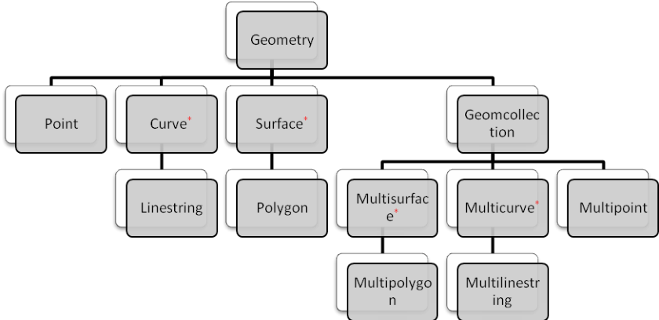

达梦数据库还提供了达梦特有的`DBMS_DBG`、`DMGEO`系统包和兼容`ORACLE`数据库的

```
DBMS_ALERT、DBMS_OUTPUT、UTL_FILE 和UTL_MAIL 等系统包功能。
```

用户可以通过调用相关系统过程来创建自己需要的系统包：

```
- SP_INIT_DBG_SYS(createflag)创建DBMS_DBG 包；
- SP_INIT_GEO_SYS(create_flag)创建DMGEO 包；
- SP_INIT_JOB_SYS(create_flag)创建DBMS_JOB 包；
- SP_UPDATE_DBMS_SQL_PACKAGES()创建DBMS_SQL 包；
```

- `SP_CREATE_SYSTEM_PACKAGES(create_flag)`一次性创建除了上述四个包之外

的所有包；

```
- SP_CREATE_SYSTEM_PACKAGES(create_flag, pkgname)创建指定的包。
```

系统过程的具体介绍参考附录3。以下详细介绍这各种包的相关内容。

## 19.1 DMGEO 包

```
DMGEO 系统包实现了SFA 标准（《OpenGIS® Implementation Standard for
Geographic information - Simple feature access - Part 2: SQL option》）
```

中规定的`SQL`预定义`schema`，基于`SQL UDT`（自定义数据类型）的空间数据类型和空间数据类型的初始化，以及针对空间数据类型的几何体计算函数。

### 19.1.1 数据类型

达梦的空间数据类型是以类的方式进行体现的，具体有：

`ST_Geometry`：最基本的几何体，是其他几何类型的基类。

`ST_Point`：点几何体。

```
ST_Curve，ST_LineString：线几何体。ST_Curve 是抽象类，ST_LineString
```

是`ST_Curve`可实例化的子类。

```
ST_Surface，ST_Polygon：面几何体。ST_Surface 是抽象类，ST_Polygon 是
```

`ST_Surface`可实例化的子类。

`ST_GeomCollection`：几何体集合。

`ST_Multipoint`：点集合。

```
ST_Multicurve，ST_Multilinestring：线集合。ST_Multicurve 是抽象类，
ST_Multilinestring 是ST_Multicurve 可实例化的子类。
ST_Multisurface，ST_Multipolygon：多边形集合。ST_Multisurface 是抽
```

象类，`ST_Multipolygon`是`ST_Multisurface`可实例化的子类。

相关类型的继承关系如下图所示（带*号的表示抽象父类）：



如下详细介绍各数据类型：

```
1. ST_Geometry
```

基础几何体类定义：

```
CREATE OR REPLACE TYPE SYSGEO.ST_GEOMETRY AS OBJECT(
SRID                INT,
GEO_WKB             BLOB,
GEO_TYPEID          INT,
CONSTRUCTOR FUNCTION ST_GEOMETRY() RETURN SELF AS RESULT,
CONSTRUCTOR FUNCTION ST_GEOMETRY(SRID INT, WKB BLOB, TYPEID INT) RETURN
SELF AS RESULT,
FUNCTION ST_WKT()        RETURN CLOB,
FUNCTION ST_DIM()        RETURN INT,
FUNCTION ST_TYPE()       RETURN VARCHAR(20),
FUNCTION ST_ISEMPTY()    RETURN INT,
FUNCTION ST_ISSIMPLE()   RETURN INT,
FUNCTION ST_ISVALID()    RETURN INT,
FUNCTION ST_COORDIM()    RETURN INT,
FUNCTION ST_NUMGEOS()    RETURN INT,
FUNCTION ST_NUMPOINTS() RETURN INT,
FUNCTION ST_LENGTH()     RETURN DOUBLE,
FUNCTION ST_POINT_X()  RETURN DOUBLE,
FUNCTION ST_POINT_Y()  RETURN DOUBLE,
FUNCTION ST_START_POINT()  RETURN SYSGEO.ST_GEOMETRY,
FUNCTION ST_END_POINT()  RETURN SYSGEO.ST_GEOMETRY,
FUNCTION ST_IS_RING()  RETURN INT,
FUNCTION ST_IS_CLOSED()  RETURN INT,
FUNCTION ST_CENTROID()  RETURN SYSGEO.ST_GEOMETRY,
FUNCTION ST_POINT_ON()  RETURN SYSGEO.ST_GEOMETRY,
FUNCTION ST_AREA()  RETURN DOUBLE,
FUNCTION ST_EXT_RING()  RETURN SYSGEO.ST_GEOMETRY,
FUNCTION ST_NUM_INTER_RING()  RETURN INT)
NOT FINAL;
```

类成员说明：

`SRID`：空间参考坐标系`ID`；

`GEO_WKB`：二进制格式的几何体信息；

`GEO_TYPEID`：几何体类型`ID`。

类方法说明：

```
ST_GEOMETRY()：ST_GEOMETRY 类的构造函数；
```

`ST_WKT()`：返回文本格式表示的几何体；

`ST_DIM()`：几何体的几何维度；

`ST_TYPE()`：几何体的类型名；

`ST_ISEMPTY()`：几何体是否为空；

`ST_ISSIMPLE()`：是否为简单几何体；

`ST_ISVALID()`：几何体信息是否有效；

`ST_COORDIM()`：几何体的坐标维度；

`ST_NUMGEOS()`：几何体对象个数；

`ST_NUMPOINTS()`：几何体点的个数；

`ST_LENGTH()`：几何体长度；

`ST_POINT_X()`：点几何体的X坐标；

`ST_POINT_Y()`：点几何体的Y坐标；

`ST_START_POINT()`：线几何体的起点；

`ST_END_POINT()`：线几何体的终点；

`ST_IS_RING()`：线几何体是否是环；

`ST_IS_CLOSED()`：几何体是否是封闭的；

`ST_CENTROID()`：几何体质心；

`ST_POINT_ON()`：几何体表面上的点；

`ST_AREA()`：几何体面积；

`ST_EXT_RING()`：几何体外环；

`ST_NUM_INTER_RING()`：几何体内环数。

```
2. ST_POINT
```

点类定义：

```
CREATE OR REPLACE TYPE SYSGEO.ST_POINT UNDER SYSGEO.ST_GEOMETRY(
CONSTRUCTOR FUNCTION  ST_POINT() RETURN SELF AS RESULT,
CONSTRUCTOR FUNCTION  ST_POINT(SRID INT, WKB BLOB, TYPEID INT) RETURN
SELF AS RESULT) NOT FINAL;
```

类说明：

`st_point()`：点类构造方法。

```
3. ST_Curve
```

抽象线类定义：

```
CREATE OR REPLACE TYPE SYSGEO.ST_CURVE UNDER SYSGEO.ST_GEOMETRY(
CONSTRUCTOR FUNCTION ST_CURVE() RETURN SELF AS RESULT,
CONSTRUCTOR FUNCTION ST_CURVE(SRID INT, WKB BLOB, TYPEID INT) RETURN
SELF AS RESULT) NOT FINAL;
```

类说明：

`st_ curve()`：几何线基类构造方法。

```
4. ST_Linestring
```

线类定义：

```
CREATE OR REPLACE TYPE SYSGEO.ST_LINESTRING UNDER SYSGEO.ST_CURVE(
CONSTRUCTOR FUNCTION ST_LINESTRING() RETURN SELF AS RESULT,
CONSTRUCTOR FUNCTION ST_LINESTRING(SRID INT, WKB BLOB, TYPEID INT)
RETURN SELF AS RESULT,
FUNCTION CURVE() RETURN SYSGEO.ST_CURVE) NOT FINAL;
```

类说明：

`st_ linestring()`：几何线类构造方法。

```
5. ST_Surface
```

基础面类定义：

```
CREATE OR REPLACE TYPE SYSGEO.ST_SURFACE UNDER SYSGEO.ST_GEOMETRY(
CONSTRUCTOR FUNCTION ST_SURFACE() RETURN SELF AS RESULT,
CONSTRUCTOR FUNCTION ST_SURFACE(SRID INT, WKB BLOB, TYPEID INT) RETURN
SELF AS RESULT) NOT FINAL;
```

类说明：

`st_ surface()`：几何面基类构造方法。

```
6. ST_Polygon
```

面类定义：

```
CREATE OR REPLACE TYPE SYSGEO.ST_POLYGON UNDER SYSGEO.ST_SURFACE(
CONSTRUCTOR FUNCTION ST_POLYGON() RETURN SELF AS RESULT,
CONSTRUCTOR FUNCTION ST_POLYGON(SRID INT, WKB BLOB, TYPEID INT) RETURN
SELF AS RESULT,
FUNCTION SURFACE() RETURN SYSGEO.ST_SURFACE) NOT FINAL;
```

类说明：

`st_ polygon()`：几何面类构造方法。

```
7. ST_GeomCollection
```

基础几何体集合类定义：

```
CREATE OR REPLACE TYPE SYSGEO.ST_GEOMCOLLECTION UNDER SYSGEO.ST_GEOMETRY(
CONSTRUCTOR FUNCTION ST_GEOMCOLLECTION() RETURN SELF AS RESULT,
CONSTRUCTOR FUNCTION ST_GEOMCOLLECTION(SRID INT, WKB BLOB, TYPEID INT)
RETURN SELF AS RESULT)NOT FINAL;
```

类说明：

`st_ geomcollection()`：几何体集合类构造方法。

```
8. ST_Multipoint
```

多点类定义：

```
CREATE OR REPLACE TYPE SYSGEO.ST_MULTIPOINT UNDER SYSGEO.ST_GEOMETRY(
CONSTRUCTOR FUNCTION ST_MULTIPOINT() RETURN SELF AS RESULT,
CONSTRUCTOR FUNCTION ST_MULTIPOINT(SRID INT, WKB BLOB, TYPEID INT)
RETURN SELF AS RESULT) NOT FINAL;
```

类说明：

`st_ multipoint()`：多点类构造方法。

```
9. ST_MultiCurve
```

抽象多线类定义：

```
CREATE OR REPLACE TYPE SYSGEO.ST_MULTICURVE UNDER SYSGEO.ST_GEOMETRY(
CONSTRUCTOR FUNCTION ST_MULTICURVE() RETURN SELF AS RESULT,
CONSTRUCTOR FUNCTION ST_MULTICURVE(SRID INT, WKB BLOB, TYPEID INT)
RETURN SELF AS RESULT) NOT FINAL;
```

类说明：

`st_ multicurve()`：多线基类构造方法。

```
10. ST_Multilinestring
```

多线类定义：

```
CREATE OR REPLACE TYPE SYSGEO.ST_MULTILINESTRING UNDER SYSGEO.ST_MULTICURVE(
CONSTRUCTOR FUNCTION ST_MULTILINESTRING() RETURN SELF AS RESULT,
CONSTRUCTOR FUNCTION ST_MULTILINESTRING(SRID INT, WKB BLOB, TYPEID
INT) RETURN SELF AS RESULT,
FUNCTION ST_MCURVE() RETURN SYSGEO.ST_MULTICURVE) NOT FINAL;
```

类成员说明：

`st_ multilinestring()`：多线类构造方法；

`st_mcurve()`：返回`ST_MultiCurve`几何类对象。

```
11. ST_MultiSurface
```

抽象多面类定义：

```
CREATE OR REPLACE TYPE SYSGEO.ST_MULTISURFACE UNDER SYSGEO.ST_GEOMETRY(
CONSTRUCTOR FUNCTION ST_MULTISURFACE() RETURN SELF AS RESULT,
CONSTRUCTOR FUNCTION ST_MULTISURFACE(SRID INT, WKB BLOB, TYPEID INT)
RETURN SELF AS RESULT) NOT FINAL;
```

类说明：

`st_ multisurface()`：多面基类构造方法。

```
12. ST_Multipolygon
```

多面类定义：

```
CREATE OR REPLACE TYPE SYSGEO.ST_MULTIPOLYGON UNDER SYSGEO.ST_MULTISURFACE(
CONSTRUCTOR FUNCTION ST_MULTIPOLYGON() RETURN SELF AS RESULT,
CONSTRUCTOR FUNCTION ST_MULTIPOLYGON(SRID INT, WKB BLOB, TYPEID INT)
RETURN SELF AS RESULT,
FUNCTION ST_MSURFACE() RETURN SYSGEO.ST_MULTISURFACE) NOT FINAL;
```

类说明：

`st_ multipolygon()`：多面类构造方法；

`st_msurface()`：返回`st_msurface`几何类对象。

### 19.1.2 相关方法

用户在使用`DMGEO`包之前，需要提前调用系统过程`SP_INIT_GEO_SYS(1)`创建`DMGEO`包，包创建成功后就可以使用空间数据类型以及包提供的方法。

```
SP_INIT_GEO_SYS(1);
```

如果`dmgeo`包已存在，调用`SP_INIT_GEO_SYS(2)`，系统将只重建`dmgeo`包方法，而不影响现有的空间数据类型以及数据。

```
SP_INIT_GEO_SYS(2);
```

调用系统过程`SP_INIT_GEO_SYS(0)`可以删除`DMGEO`包，任何与空间数据类型相关的表、函数、过程、触发器等对象均会被级联删除。

```
SP_INIT_GEO_SYS(0);
```

创建`DMGEO`包后，系统会创建表`GEOMETRY_COLUMNS`和`SPATIAL_REF_SYS`，这两张表分别记录空间数据类型列创建情况和空间参考坐标系信息。`GEOMETRY_COLUMNS`内容不需要用户干预，`SPATIAL_REF_SYS`内容可以通过`DMGEO`包提供的存储过程

```
ST_ADD_SPATIAL_REF 和ST_DEL_SPATIAL_REF 增加或删除。
```

#### 19.1.2.1 几何体构造函数

达梦实现的几何体函数以包中方法的形式提供给用户，包名为`dmgeo`。使用如下函数时，必须加上包名`dmgeo`。

```
1. ST_GeoFromText
```

定义：

```
FUNCTION ST_GEOFROMTEXT(
WKT  CLOB,
SRID INT
)RETURN ST_GEOMETRY;
```

功能说明：

根据`wkt`信息和`srid`信息构造空间数据基础类。

参数说明：

`wkt`：几何对象文本描述信息；

`srid`：空间参考坐标系`ID`。

```
2. ST_PointFromText
```

定义：

```
FUNCTION ST_POINTFROMTEXT (
WKT  CLOB,
SRID INT
)RETURN ST_POINT;
```

功能说明：

根据`wkt`信息和`srid`信息构造点类。

参数说明：

`wkt`：几何对象文本描述信息；

`srid`：空间参考坐标系`ID`。

```
3. ST_LineFromText
```

定义：

```
FUNCTION ST_LINEFROMTEXT (
WKT  CLOB,
SRID INT
)RETURN ST_LINESTRING;
```

功能说明：

根据`wkt`信息和`srid`信息构造线类。

参数说明：

`wkt`：几何对象文本描述信息；

`srid`：空间参考坐标系`ID`。

```
4. ST_PolyFromText
```

定义：

```
FUNCTION ST_POLYFROMTEXT (
WKT  CLOB,
SRID INT
)RETURN ST_POLYGON;
```

功能说明：

根据`wkt`信息和`srid`信息构造面类。

参数说明：

`wkt`：几何对象文本描述信息；

`srid`：空间参考坐标系`ID`。

```
5. ST_MPointFromText
```

定义：

```
FUNCTION ST_MPOINTFROMTEXT (
WKT  CLOB,
SRID INT
)RETURN ST_MULTIPOINT;
```

功能说明：

根据`wkt`信息和`srid`信息构造多点类。

参数说明：

`wkt`：几何对象文本描述信息；

`srid`：空间参考坐标系`ID`。

```
6. ST_MLineFromText
```

定义：

```
FUNCTION ST_MLINEFROMTEXT (
WKT  CLOB,
SRID INT
)RETURN ST_MULTILINESTRING;
```

功能说明：

根据`wkt`信息和`srid`信息构造多线类。

参数说明：

`wkt`：几何对象文本描述信息；

`srid`：空间参考坐标系`ID`。

```
7. ST_MPolyFromText
```

定义：

```
FUNCTION ST_MPOLYFROMTEXT (
WKT  CLOB,
SRID INT
)RETURN ST_MULTIPOLYGON;
```

功能说明：

根据`wkt`信息和`srid`信息构造多面类。

参数说明：

`wkt`：几何对象文本描述信息；

`srid`：空间参考坐标系`ID`。

```
8. ST_GeomFromWKB
FUNCTION ST_ GEOMFROMWKB (
WKB  CLOB,
SRID INT
)RETURN ST_GEOMETRY;
```

功能说明：

根据`wkb`信息和`srid`信息构造空间数据基础类对象。

参数说明：

`wkb`：几何对象序列化描述信息；

`srid`：空间参考坐标系`ID`。

```
9. ST_PointFromWKB
```

定义：

```
FUNCTION ST_POINTFROMWKB (
WKB  CLOB,
SRID INT
)RETURN ST_POINT;
```

功能说明：

根据`wkb`信息和`srid`信息构造点类。

参数说明：

`wkb`：几何对象序列化描述信息；

`srid`：空间参考坐标系`ID`。

```
10. ST_LineFromWKB
```

定义：

```
FUNCTION ST_LINEFROMWKB (
WKB  CLOB,
SRID INT
)RETURN ST_LINESTRING;
```

功能说明：

根据`wkb`信息和`srid`信息构造线类。

参数说明：

`wkb`：几何对象序列化描述信息；

`srid`：空间参考坐标系`ID`。

```
11. ST_PolyFromWKB
```

定义：

```
FUNCTION ST_POLYFROMWKB (
WKB  CLOB,
SRID INT
)RETURN ST_POLYGON;
```

功能说明：

根据`wkb`信息和`srid`信息构造面类。

参数说明：

`wkb`：几何对象序列化描述信息；

`srid`：空间参考坐标系`ID`。

```
12. ST_MPointFromWKB
```

定义：

```
FUNCTION ST_MPOINTFROMWKB (
WKB  CLOB,
SRID INT
)RETURN ST_MULTIPOINT;
```

功能说明：

根据`wkb`信息和`srid`信息构造多点类。

参数说明：

`wkb`：几何对象序列化描述信息；

`srid`：空间参考坐标系`ID`。

```
13. ST_MLineFromWKB
```

定义：

```
FUNCTION ST_MLINEFROMWKB (
WKB  CLOB,
SRID INT
)RETURN ST_MULTILINESTRING;
```

功能说明：

根据`wkb`信息和`srid`信息构造多线类。

参数说明：

`wkb`：几何对象序列化描述信息；

`srid`：空间参考坐标系`ID`。

```
14. ST_MPolyFromWKB
```

定义：

```
FUNCTION ST_MPOLYFROMWKB (
WKB  CLOB,
SRID INT
)RETURN ST_MULTIPOLYGON;
```

功能说明：

根据`wkb`信息和`srid`信息构造多面类。

参数说明：

`wkb`：几何对象序列化描述信息。；

`srid`：空间参考坐标系`ID`

#### 19.1.2.2 几何信息获取函数

```
1. ST_Dimension
```

定义：

```
FUNCTION ST_DIMENSION (
GEO ST_GEOMETRY
)RETURN INT;
```

功能说明：

获取几何体对象的几何维度。

参数说明：

`geo`：几何体对象。

返回值：

几何体对象的几何维度

```
2. ST_CoordDim
```

定义：

```
FUNCTION ST_COORDDIM (
GEO ST_GEOMETRY
)RETURN INT;
```

功能说明：

获取几何体对象的坐标维度。

参数说明：

`geo`：几何体对象。

返回值：

几何体对象的坐标维度

```
3. ST_GeometryType
```

定义：

```
FUNCTION ST_GEOMETRYTYPE (
GEO ST_GEOMETRY
)RETURN VARCHAR(20);
```

功能说明：

获取几何体对象的类型。

参数说明：

`geo`：几何体对象；

返回值：

几何体对象的类型。

```
4. ST_AsText
```

定义：

```
FUNCTION ST_ASTEXT (
GEO ST_GEOMETRY
)RETURN CLOB;
```

功能说明：

获取几何体对象的`wkt`格式文本描述信息。

参数说明：

`geo`：几何体对象；

返回值：

几何体对象的文本表示形式。

```
5. ST_AsText
```

定义：

```
FUNCTION ST_ASTEXT (
GEO  ST_GEOMETRY,
V_PRECISION  INT
)RETURN CLOB;
```

功能说明：

获取指定精度的几何体对象`wkt`格式文本描述信息。

参数说明：

`geo`：几何体对象；

返回值：

指定精度的几何体对象文本表示形式。

```
6. ST_AsBinary
```

定义：

```
FUNCTION ST_ASBINARY (
GEO ST_GEOMETRY
)RETURN CLOB;
```

功能说明：

获取几何体对象的`wkb`格式序列化描述信息。

参数说明：

`geo`：几何体对象。

返回值：

几何体对象的序列化表示形式。

```
7. ST_SRID
```

定义：

```
FUNCTION ST_SRID (
GEO ST_GEOMETRY
)RETURN INT;
```

功能说明：

获取几何体对象的空间参考坐标系`ID`。

参数说明：

`geo`：几何体对象。

返回值：

几何体对象的空间参考坐标系。

```
8. ST_ISValid
```

定义：

```
FUNCTION ST_ISVALID(
GEO SYSGEO.ST_GEOMETRY
)RETURN INT;
```

功能说明：

几何体对象是否是合法对象。

参数说明：

`geo`：几何体对象。

返回值：

`0:`非法；1：合法。

```
9. ST_ISEmpty
```

定义：

```
FUNCTION ST_ISEMPTY (
GEO ST_GEOMETRY
)RETURN INT;
```

功能说明：

获取几何体对象是否为空。

参数说明：

`geo`：几何体对象。

返回值：

0：非空；1：空。

```
10. ST_ISSimple
```

定义：

```
FUNCTION ST_ISSIMPLE (
GEO ST_GEOMETRY
)RETURN INT;
```

功能说明：

判断几何体对象是否为简单几何体。

参数说明：

`geo`：几何体对象。

返回值：

0：复杂几何体； 1：简单几何体。

```
11. ST_X
```

定义：

```
FUNCTION ST_X (
GEO ST_GEOMETRY
)RETURN INT;
```

功能说明：

获取几何体对象的X坐标。

参数说明：

`geo`：几何体对象，必须是`POINT`几何类型。

返回值：

几何体对象的X坐标值。

```
12. ST_Y
```

定义：

```
FUNCTION ST_Y (
GEO ST_GEOMETRY
)RETURN INT;
```

功能说明：

获取几何体对象的Y坐标。

参数说明：

`geo`：几何体对象，必须是`POINT`几何类型。

返回值：

几何体对象的Y坐标值。

```
13. ST_MinX
```

定义：

```
FUNCTION ST_MINX (
GEO ST_GEOMETRY
)RETURN INT;
```

功能说明：

获取几何对象X坐标的最小值。

参数说明：

`geo`：几何体对象。

返回值：

几何体对象X坐标的最小值。

```
14. ST_MAXX
```

定义：

```
FUNCTION ST_MAXX (
GEO ST_GEOMETRY
)RETURN INT;
```

功能说明：

获取几何体对象的X坐标的最大值。

参数说明：

`geo`：几何体对象。

返回值：

几何体对象X坐标的最大值。

```
15. ST_MINY
```

定义：

```
FUNCTION ST_MINY (
GEO ST_GEOMETRY
)RETURN INT;
```

功能说明：

获取几何体对象Y坐标的最小值。

参数说明：

`geo`：几何体对象。

返回值：

几何体对象Y坐标的最小值。

```
16. ST_MAXY
```

定义：

```
FUNCTION ST_MAXY (
GEO ST_GEOMETRY
)RETURN INT;
```

功能说明：

获取几何体对象Y坐标的最大值。

参数说明：

`geo`：几何体对象。

返回值：

几何体对象Y坐标的最大值。

```
17. ST_StartPoint
```

定义：

```
FUNCTION ST_STARTPOINT (
GEO ST_GEOMETRY
)RETURN ST_POINT;
```

功能说明：

获取几何体对象的起始点。

参数说明：

`geo`：几何体对象，必须为`LINESTRING`几何类型。

返回值：

几何体对象的起始点。

```
18. ST_EndPoint
```

定义：

```
FUNCTION ST_ENDPOINT (
GEO ST_GEOMETRY
)RETURN ST_POINT;
```

功能说明：

获取几何体对象的终点。

参数说明：

`geo`：几何体对象，必须为`LINESTRING`几何类型。

返回值：

几何体对象的终点。

```
19. ST_ISRing
```

定义：

```
FUNCTION ST_ISRING (
GEO ST_GEOMETRY
)RETURN INT;
```

功能说明：

获取几何体对象是否是环。

参数说明：

`geo`：几何体对象，必须为`LINESTRING`几何类型。

返回值：

0：不是环；1：是环。

```
20. ST_ISClosed
```

定义：

```
FUNCTION ST_ISCLOSED (
GEO ST_GEOMETRY
)RETURN INT;
```

功能说明：

获取几何体对象是否闭合。

参数说明：

`geo`：几何体对象，必须为`LINESTRING`或`MULTILINESTRING`几何类型。

返回值：

0：不闭合；1：闭合。

```
21. ST_Length
```

定义：

```
FUNCTION ST_LENGTH (
GEO ST_GEOMETRY
)RETURN INT;
```

功能说明：

获取几何体对象的长度。

参数说明：

`geo`：几何体对象，必须为`LINESTRING`或`MULTILINESTRING`几何类型。

返回值：

几何体对象长度

```
22. ST_Length
```

定义：

```
FUNCTION ST_PERIMETER (
GEO ST_GEOMETRY
)RETURN INT;
```

功能说明：

获取几何体对象的周长。

参数说明：

`geo`：几何体对象。

返回值：

几何体对象周长。

```
23. ST_NumPoints
```

定义：

```
FUNCTION ST_NUMPOINTS (
GEO ST_GEOMETRY
)RETURN INT;
```

功能说明：

获取几何体对象的节点数。

参数说明：

`geo`：几何体对象。

返回值：

几何体对象节点数。

```
24. ST_PointN
```

定义：

```
FUNCTION ST_POINTN (
GEO  ST_GEOMETRY,
N  INT
)RETURN ST_POINT;
```

功能说明：

获取几何体对象的第n个节点。

参数说明：

`geo`：几何体对象。

返回值：

几何体对象的第n个节点。

```
25. ST_Centroid
```

定义：

```
FUNCTION ST_CENTROID (
GEO ST_GEOMETRY
)RETURN ST_POINT;
```

功能说明：

获取几何体对象的中心点。

参数说明：

`geo`：几何体对象，必须是`POLYGON`或`MULTIPOLYGON`几何类型。

返回值：

几何体对象的中心点。

```
26. ST_PointOnSurface
```

定义：

```
FUNCTION ST_POINTONSURFACE (
GEO ST_GEOMETRY
)RETURN ST_POINT;
```

功能说明：

获取几何体对象表面上的一点。

参数说明：

`geo`：几何体对象，必须是`POLYGON`或`MULTIPOLYGON`几何类型。

返回值：

几何体对象表面上的一点。

```
27. ST_Area
```

定义：

```
FUNCTION ST_AREA (
GEO ST_GEOMETRY
)RETURN DOUBLE;
```

功能说明：

获取几何体对象的面积。

参数说明：

`geo`：几何体对象，必须是`POLYGON`或`MULTIPOLYGON`几何类型。

返回值：

几何体对象的面积。

```
28. ST_ExteriorRing
```

定义：

```
FUNCTION ST_EXTERIORRING (
GEO ST_GEOMETRY
)RETURN ST_LINESTRING;
```

功能说明：

获取几何体对象的外环。

参数说明：

`geo`：几何体对象，必须是`POLYGON`几何类型。

返回值：

几何体对象的外环。

```
29. ST_NumInteriorRing
```

定义：

```
FUNCTION ST_NUMINTERIORRING (
GEO ST_GEOMETRY
)RETURN INT;
```

功能说明：

获取几何体对象的内环数。

参数说明：

`geo`：几何体对象，必须是`POLYGON`几何类型。

返回值：

几何体对象的内环数。

```
30. ST_Boundary
```

定义：

```
FUNCTION ST_BOUNDARY (
GEO ST_GEOMETRY
)RETURN ST_GEOMETRY;
```

功能说明：

获取几何体对象的边界。

参数说明：

`geo`：几何体对象。

返回值：

几何体对象的边界。

```
31. ST_Envelope
```

定义：

```
FUNCTION ST_ENVELOPE (
GEO ST_GEOMETRY
)RETURN ST_POLYGON;
```

功能说明：

获取几何体对象的矩形范围。

参数说明：

`geo`：几何体对象。

返回值：

几何体对象的矩形范围。

```
32. ST_InteriorRingN
```

定义：

```
FUNCTION ST_INTERIORRINGN (
GEO  ST_GEOMETRY,
N  INT
)RETURN ST_LINESTRING;
```

功能说明：

获取几何体对象的第n个内环。

参数说明：

`geo`：几何体对象，必须是`POLYGON`几何类型。

n：第几个内环。

返回值：

几何体对象的第n个内环。

```
33. ST_NumGeometries
```

定义：

```
FUNCTION ST_NUMGEOMETRIES (
GEO ST_GEOMETRY
)RETURN INT
```

功能说明：

获取几何对象个数。

参数说明：

`geo`：几何体对象。

返回值：

几何体对象个数，非`MULTI`类几何体返回1。

```
34. ST_GeometryN
```

定义：

```
FUNCTION ST_GEOMETRYN (
GEO  ST_GEOMETRY,
N  INT
)RETURN ST_GEOMETRY
```

功能说明：

获取第n个几何对象。

参数说明：

`geo`：几何体对象。

n：第几个几何对象。

返回值：

第n个几何对象。

#### 19.1.2.3 空间关系判断函数

```
1. ST_Equals
```

定义：

```
FUNCTION ST_EQUALS (
G1 ST_GEOMETRY,
G2 ST_GEOMETRY
) RETURN INT;
```

功能说明：

判断两个几何对象是否相同。

参数说明：

`g1`：几何对象；

`g2`：几何对象。

返回值：

0：两个几何对象不相同；1：两个几何对象相同。

```
2. ST_DISJOINT
```

定义：

```
FUNCTION ST_DISJOINT (
G1 ST_GEOMETRY,
G2 ST_GEOMETRY
) RETURN INT;
```

功能说明：

判断两个几何对象是否不相交。

参数说明：

`g1`：几何对象；

`g2`：几何对象。

返回值：

0：两个几何对象相交；1：两个几何对象不相交。

```
3. ST_INTERSECTS
```

定义：

```
FUNCTION ST_INTERSECTS (
G1 ST_GEOMETRY,
G2 ST_GEOMETRY
) RETURN INT;
```

功能说明：

判断两个几何对象是否相交。

参数说明：

`g1`：几何对象；

`g2`：几何对象。

返回值：

0：两个几何对象不相交；1：两个几何对象相交。

```
4. ST_TOUCHES
```

定义：

```
FUNCTION ST_TOUCHES (
G1 ST_GEOMETRY,
G2 ST_GEOMETRY
) RETURN INT;
```

功能说明：

判断两个几何对象是否接触，即存在边界点相同，内节点不相交。

参数说明：

`g1`：几何对象；

`g2`：几何对象；

返回值：

0：两个几何对象不接触；1：两个几何对象接触。

```
5. ST_CROSSES
```

定义：

```
FUNCTION ST_CROSSES (
G1 ST_GEOMETRY,
G2 ST_GEOMETRY
) RETURN INT;
```

功能说明：

判断两个几何对象是否交叉，存在相同的点，但不是完全一致。

参数说明：

`g1`：几何对象；

`g2`：几何对象。

返回值：

0：两个几何对象不交叉；1：两个几何对象交叉。

```
ST_WITHIN
```

定义：

```
FUNCTION ST_WITHIN (
G1 ST_GEOMETRY,
G2 ST_GEOMETRY
) RETURN INT;
```

功能说明：

判断对象是否完全包含，对象`g1`是否完全在`g2`的内部参数说明：

`g1`：几何对象；

`g2`：几何对象。

返回值：

0：`g1`不完全在`g2`内部；1：`g1`完全在`g2`内部。

```
6. ST_CONTAINS
```

定义：

```
FUNCTION ST_CONTAINS (
G1 ST_GEOMETRY,
G2 ST_GEOMETRY
) RETURN INT;
```

功能说明：

判断对象是否包含，`g2`不存在点在`g1`的外边界，且至少存在一个`g2`的内节点在`g1`内部。

参数说明：

`g1`：几何对象；

`g2`：几何对象。

返回值：

0：`g1`不包含`g2`；1：`g1`包含`g2`。

```
7. ST_OVERLAPS
```

定义：

```
FUNCTION ST_OVERLAPS (
G1 ST_GEOMETRY,
G2 ST_GEOMETRY
) RETURN INT;
```

功能说明：

判断两个几何对象是存在重叠，但并不被对方完全包含。

参数说明：

`g1`：几何对象；

`g2`：几何对象。

返回值：

0：两个几何对象不存在重叠；1：两个几何对象存在重叠。

```
8. ST_RELATE
```

定义：

```
FUNCTION ST_RELATE (
G1 ST_GEOMETRY,
G2 ST_GEOMETRY,
PATTERN CHAR(9)
) RETURN INT;
```

功能说明：

判断两个几何对象是否满足`DE-9IM`字符串关系。

参数说明：

`g1`：几何对象；

`g2`：几何对象；

`pattern`：`DE-9IM`字符串。

返回值：

0：`g1,g2`不满足`pattern`指定的关系；1：`g1,g2`满足`pattern`指定的关系。

#### 19.1.2.4 几何运算函数

```
1. ST_Distance
```

定义：

```
FUNCTION ST_DISTANCE (
G1 ST_GEOMETRY,
G2 ST_GEOMETRY
) RETURN DOUBLE;
```

功能说明：

获取几何对象间的最短距离。

参数说明：

`g1`：几何对象；

`g2`：几何对象。

返回值：

几何对象间最短距离。

```
2. ST_Intersection
```

定义：

```
FUNCTION ST_INTERSECTION (
G1 ST_GEOMETRY,
G2 ST_GEOMETRY
) RETURN ST_GEOMETRY;
```

功能说明：

获取几何对象的交集。

参数说明：

`g1`：几何对象；

`g2`：几何对象。

返回值：

几何对象的交集；

```
3. ST_Difference
```

定义：

```
FUNCTION ST_DIFFERENCE (
G1 ST_GEOMETRY,
G2 ST_GEOMETRY
) RETURN ST_GEOMETRY;
```

功能说明：

获取几何对象的差集。

参数说明：

`g1`：几何对象；

`g2`：几何对象。

返回值：

`g1`与`g2`的差集。

```
4. ST_Union
```

定义：

```
FUNCTION ST_UNION (
G1 ST_GEOMETRY,
G2 ST_GEOMETRY
) RETURN ST_GEOMETRY;
```

功能说明：

获取几何对象的并集。

参数说明：

`g1`：几何对象；

`g2`：几何对象。

返回值：

`g1`与`g2`的并集。

```
5. ST_SymDifference
```

定义：

```
FUNCTION ST_SYMDIFFERENCE (
G1 ST_GEOMETRY,
G2 ST_GEOMETRY
) RETURN ST_GEOMETRY;
```

功能说明：

获取几何对象的差异集。

参数说明：

`g1`：几何对象；

`g2`：几何对象。

返回值：

`g1`与`g2`的差异集。

```
6. ST_Buffer
```

定义：

```
FUNCTION ST_BUFFER (
G1  ST_GEOMETRY,
D DOUBLE
) RETURN ST_GEOMETRY;
```

功能说明：

获取代替几何对象`g1`的几何对象，其到`g1`的距离小于等于d。

参数说明：

`g1`：几何对象；

d：距离。

返回值：

几何对象`g1`以d为半径的外包几何对象。

```
7. ST_ConvexHull
```

定义：

```
FUNCTION ST_CONVEXHULL (
G1  ST_GEOMETRY,
D DOUBLE
) RETURN ST_GEOMETRY;
```

功能说明：

获取几何对象凸壳。

参数说明：

`g1`：几何对象。

返回值：

几何对象`g1`以d为半径的外包几何对象。

#### 19.1.2.5 其他过程函数

```
1. ST_ADD_SPATIAL_REF
```

定义：

```
PROCEDURE ST_ADD_SPATIAL_REF(
V_SRID  INTEGER,
V_AUTH_NAME VARCHAR,
V_AUTH_SRID INTEGER,
V_SRTEXT VARCHAR);
```

功能说明：

向`SPATIAL_REF_SYS`表中插入一条空间参考系信息。

参数说明：

`V_SRID`：空间参考系`ID`；

`V_AUTH_NAME`：空间参考系名称；

`V_AUTH_SRID`：空间参考系代码；

`V_SRTEXT`：空间参考系的文本格式描述。

```
2. ST_DEL_SPATIAL_REF
```

定义：

```
PROCEDURE ST_DEL_SPATIAL_REF(
V_SRID  INTEGER
);
```

功能说明：

向`SPATIAL_REF_SYS`表中删除一条空间参考系信息。

参数说明：

`V_SR ID`：空间参考系`ID`。

```
3. ST_geo_valid_check
```

定义：

```
FUNCTION ST_GEO_VALID_CHECK(GEO SYSGEO.ST_GEOMETRY)  RETURN INT
```

功能说明：

检验空间类型对象数据是否是有效。

参数说明：

`geo`：空间类型对象。

```
4. ST_UPDATE_SRID
```

定义：

```
PROCEDURE ST_UPDATE_SRID(
V_SCH  VARCHAR,
V_TAB  VARCHAR,
V_COL  VARCHAR,
NEW_SRID INTEGER
);
```

功能说明：

更新列的参考系`SRID`，可在`GEOMETRY_COLUMNS`表中查询到更新后列的`SRID`。

参数说明：

`V_SCH`：待修改列所在表的模式名；

`V_TAB:`待修改列所在表表名；

`V_COL:`待修改列列名；

`NEW_SRID:`用以更新的新值`SRID`。

## 19.2 DBMS_JOB 包

为了兼容`ORACLE`定时任务的创建，按指定的时间或间隔执行用户定义的作业。达梦提供了`DBMS_JOB`包以及`DBA_JOBS`、`USER_JOBS`视图来实现跟`ORACLE`类似的功能。

### 19.2.1 相关方法

```
1. BROKEN 过程
```

定义：

```
PROCEDURE Broken(
job in integer，
broken in boolean,
next_date in datetime :=SYSDATE
)
```

语句功能：

过程更新一个已提交的工作的状态，典型地是用来把一个已过期工作标记为未过期工作；或者把一个未过期的工作设置为何时过期。

参数说明：

`job`：工作号，唯一标识一个特定工作；

`broken`：指示此工作是否将标记为过期，`TRUE`或`FALSE`。`TRUE`表明过期，而`FALSE`表明未过期；

`next_date`：指示在什么时候此工作将再次运行。此参数缺省值为当前日期和时间。

```
2. CHANGE 过程
```

定义：

```
PROCEDURE Change (
job in integer,
what  in varchar2,
next_date in datetime,
interval  in varchar2
)
```

语句功能：

用来改变指定工作的设置。

参数说明：

`job`：工作号，唯一标识一个特定工作；

`what`：是由此工作运行的一块`PL/SQL`代码块；

`next_date`：指示何时此工作将被执行；

`interval`：指示一个工作重执行的频度。

注意：

由于`CHANGE`是保留字，调用该过程时需要在过程名上加双引号。

```
3. INTERVAL 过程
```

定义：

```
PROCEDURE Interval (
job in  integer,
interval  in varchar2
)
```

语句功能：

用来显式地设置重执行一个工作之间的时间间隔数。

参数说明：

`job`：工作号，唯一标识一个特定工作；

`interval`：指示一个工作重执行的频度，该频度是一个日期表达式字符串，以当天0点0 分为起点和该日期表达式字符串计算出来的日期时间之差，以分钟为最小间隔单位。

例如`’sysdate + 1/1440’`，则表示间隔1 分钟，`’sysdate + 1/24’`则表示间隔1 小时，`’sysdate + 1’`则表示间隔1 天，最多允许间隔100 天。达梦的`INTERVAL`参数不支持以周，月，季等单位方式指定间隔。

注意：

由于`INTERVAL`是保留字，调用该过程时需要在过程名上加双引号。

```
4. ISUBMIT 过程
```

定义：

```
PROCEDURE ISubmit (
job in integer,
what  in varchar2,
next_date in datetime,
interval  in varchar2,
no_parse  in boolean:=FALSE
)
```

语句功能：

用来用特定的工作号提交一个工作。这个过程与`Submit()`过程的唯一区别在于此`job`参数作为`IN`型参数传递且包括一个由开发者提供的工作号。如果提供的工作号已被使用，将产生一个错误。

```
5. NEXT_DATE 过程
```

定义：

```
PROCEDURE  Next_Date(
job in integer,
next_date in datetime
)
```

语句功能：

用来显式地设定一个工作的执行时间。

参数说明：

`job`：标识一个已存在的工作；

`next_date`：指示了此工作应被执行的日期与时间。

```
6. REMOVE 过程
```

定义：

```
PROCEDURE Remove(
job in integer
)
```

语句功能：

用来删除一个已计划运行的工作。

参数说明：

`job`：唯一地标识一个工作。这个参数的值是由为此工作调用`Submit()`过程返回的`job`参数的值。

已正在运行的工作不能由调用过程序删除。

7. `RUN` 过程

定义：

```
PROCEDURE Run(
job in integer
)
```

语句功能：

用来立即执行一个指定的工作。

参数说明：

`job`：标识将被立即执行的工作。

```
8. SUBMIT 过程
```

定义：

```
PROCEDURE Submit (
job out integer,
what  in varchar2,
next_date in date,
interval  in varchar2,
no_parse  in boolean:=FALSE
)
```

语句功能：

使用`Submit()`过程，工作被正常地计划好。

参数说明：

`job`：是由`Submit()`过程返回的工作编号。这个值用来唯一标识一个工作；

`what`：是将被执行的`PL/SQL`代码块；

`next_date`：指识何时将运行这个工作；

`interval`：何时这个工作将被重执行；

`no_parse`：指示此工作在提交时或执行时是否应进行语法分析,指示此`PL/SQL`代码在它第一次执行时应进行语法分析，而`FALSE`指示本`PL/SQL`代码应立即进行语法分析。

```
9. WHAT 过程
```

定义：

```
PROCEDURE What (
job in integer,
what in out varchar2
)
```

语句功能：

允许在工作执行时重新设置此正在运行的命令。

参数说明：

`job`：标识一个存在的工作。

`what`：指示将被执行的新的`PL/SQL`代码，如果传入的`what`参数值为空串，那将返回该任务原来的`PL/SQL`代码。

```
10. DBA_JOBS 视图
```

描述数据库中所有的`job`。

序号列数据类型说明1 `JOB` `INTEGER`工作的唯一标识号

```
2  LOG_USER  VARCHAR(8188) 提交工作的用户
```

3 `PRIV_USER` `VARCHAR(8188)`赋予工作权限的用户4 `SCHEMA_USER VARCHAR(8188)`对工作做语法分析的用户模式5 `LAST_DATE` `DATE`最后一次成功运行工作的时间

```
6  LAST_SEC  TIME(0)  HH:MM:SS 格式的LAST_DATE 的时间
```

7 `THIS_DATE` `DATE`正在运行工作的开始时间

```
8  THIS_SEC  TIME(0)  HH:MM:SS 格式的THIS_DATE 的时间
```

9 `NEXT_DATE` `DATE`下一次定时任务运行的时间

```
10  NEXT_SEC  TIME(0)  HH:MM:SS 格式的NEXT_DATE 的时间
```

11 `TOTAL_TIME` `FLOAT`该`job`运行所需的总时间12 `BROKEN` `VARCHAR(1)`是否工作中断标识参数，Y是，N否13 `INTERVAL` `INTEGER`用于计算下一运行时间的表达式14 `FAILURES` `BIGINT`工作运行连续没有成功的次数

```
15  WHAT  VARCHAR(1800) 执行工作的PL/SQL 块
```

16 `NLS_ENV` `VARCHAR(1)`工作运行的`NLS`会话设置17 `MISC_ENV` `VARCHAR(1)`工作运行的其他一些会话参数18 `INSTANCE` `INTEGER`能够运行或正在运行工作的实例的`id`号，默认为0

```
11. USER_JOBS 视图
```

描述当前用户所拥有的`job`。视图结构与`DBA_JOBS`相同。

### 19.2.2 举例说明

用户在使用`DBMS_JOB`包之前，需要提前调用系统过程`SP_INIT_JOB_SYS(1)`，创建好调试所需要的包，就可以使用`DBMS_JOB`来调用`PL/SQL`中的过程或函数了。

```
SP_INIT_JOB_SYS(1);
```

创建测试表

```
create   table   a(a   datetime);
```

创建一个自定义过程

```
create   or   replace   procedure   test   as
begin
insert   into   a   values(sysdate);
end;
/
```

创建`JOB`

```
begin
dbms_job.isubmit(1,'test;',sysdate,'sysdate+1/1440');--每天1440 分钟，即一分
```

钟运行`test`过程一次

```
commit;
end;
/
```

查看`JOB`运行结果

```
select   to_char(a,'yyyy/mm/dd   hh24:mi:ss')   时间   from   a;
```

结果如下：

时间

```
-----------------------------
2013/09/04   13:22:44
2013/09/04   13:23:44
2013/09/04   13:24:44
2013/09/04   13:25:44
```

删除`JOB`

```
begin
dbms_job.remove(1);
end;
/
```

`PL/SQL`过程已成功完成。

## 19.3 DBMS_ALERT 包

`DBMS_ALERT`系统包是为了在`DM`上兼容`oracle`的`DBMS_ALERT`系统包。用于生成并传递数据库预警信息，当发生特定数据库事件时能够将预警信息传递给应用程序。

达梦还提供了`DBMS_ALERT_INFO`视图来实现跟`ORACLE`类似的功能，查看注册过的预警事件。

`DM MPP`环境下不支持`DBMS_ALERT`包。

### 19.3.1 相关方法

```
1．DBMS_ALERT.REGISTER
```

定义：

```
DBMS_ALERT.REGISTER (
NAME  IN  VARCHAR(30)
)
```

功能说明：

为当前会话注册一个预警事件，本操作会提交当前事务。

参数说明：

`NAME`：输入参数，预警事件名。

```
2．DBMS_ALERT.REMOVE
```

定义：

```
DBMS_ALERT. REMOVE (
NAME  IN  VARCHAR(30)
)
```

功能说明：

删除当前会话的一个预警事件，如果该预警事件正在`DBMS_ALERT.WAITONE`或者

```
DBMS_ALERT.WAITANY 等待，则被阻塞，直到 DBMS_ALERT.WAITONE 或者
```

`DBMS_ALERT.WAITANY`结束。本操作会提交当前事务。

参数说明：

`NAME`：输入参数，预警事件名。

```
3．DBMS_ALERT.REMOVEALL
```

定义：

```
DBMS_ALERT. REMOVEALL ()
```

功能说明：

删除当前会话下所有的预警事件，如果该预警事件正在`DBMS_ALERT.WAITONE`或者

```
DBMS_ALERT.WAITANY 等待，则被阻塞，直到 DBMS_ALERT.WAITONE 或者
```

`DBMS_ALERT.WAITANY`结束。本操作会提交当前事务。

```
4．DBMS_ALERT. SIGNAL
```

定义：

```
DBMS_ALERT. SIGNAL (
NAME IN  VARCHAR(30),
MESSAGE  IN  VARCHAR(1800)
)
```

功能说明：

给所有名为`name`的预警事件发送消息，当前事务提交时生效。

参数说明：

`NAME`：输入参数，预警事件名；

`MESSAGE`：输入参数，待发送的消息。

```
5．DBMS_ALERT. SET_DEFAULTS
```

定义：

```
DBMS_ALERT. SET_DEFAULTS (
SENSITIVITY  IN  INT
)
```

功能说明：

设置轮询时间，在`DM`中无用，只为兼容`oracle`。

参数说明：

`SENSITIVITY`：输入参数，轮询时间间隔，单位秒。参数为`NULL`，则使用默认值`5s`。

```
6．DBMS_ALERT. WAITONE
```

定义：

```
DBMS_ALERT. WAITONE (
NAME IN  VARCHAR(30),
MESSAGE  OUT VARCHAR(1800),
STATUS OUT INT,
TIMEOUT  IN INT DEFAULT 86400000
)
```

功能说明：

预警事件上等待预警信号，获得`DBMS_ALERT. SIGNAL`发送的消息内容。本操作会提交当前事务。

参数说明：

`NAME`：输入参数，预警事件名；

`MESSAGE`：输出参数，获得`DBMS_ALERT. SIGNAL`发送的消息；

`STATUS`：输出参数，表示`WAITONE`是否成功。如果`BMS_ALERT. WAITONE`传入的`NAME`是已经注册过的预警，则0 表示预警发生；1 表示预警等待超时；

`TIMEOUT`：输入参数，`WAITONE`的等待超时时间，单位为秒，默认值为86400000 秒。

如果`TIMEOUT`设置为空串、`null`和负值时，`DM`处理成默认值。

```
7．DBMS_ALERT. WAITANY
```

定义：

```
DBMS_ALERT. WAITANY (
NAME OUT  VARCHAR(30),
MESSAGE  OUT VARCHAR(1800),
STATUS OUT INT,
TIMEOUT  IN INT DEFAULT 86400000
)
```

参数说明：

```
同DBMS_ALERT. WAITONE。
```

功能说明：

等待当前会话任意一个预警信号，获得`DBMS_ALERT. SIGNAL`发送的消息内容。本操作会提交当前事务。会话上没有预警事件时，报错没有注册预警事件。

### 19.3.2 举例说明

使用包内的过程和函数之前，如果还未创建过系统包。请先调用系统过程

```
SP_CREATE_SYSTEM_PACKAGES (1)创建系统包。
SP_CREATE_SYSTEM_PACKAGES(1);
```

例 1 为当前会话注册一个名为`A1`的预警事件，给预警事件上等待预警信号，获得`DBMS_ALERT. SIGNAL`发送的消息内容，最后删除当前会话的一个预警事件。同时，会话1 存活期间，可以通过`DBMS_ALERT_INFO`视图查看到`A1`预警事件。

会话1：

```
CREATE OR REPLACE PROCEDURE WAIT1 IS
msg  VARCHAR(1800);
statu INTEGER;
BEGIN
dbms_alert.register('A1');
dbms_alert.waitone('A1', msg, statu, 39);
print 'Msg: ' || msg || ' Statu: ' || statu;
dbms_alert.remove('A1');
END WAIT1;
/
EXEC WAIT1;
```

同时会话2 执行：

```
CREATE OR REPLACE PROCEDURE SET_ALERT1
is
BEGIN
dbms_alert.signal('A1', 'this is a sig');
COMMIT;
END SET_ALERT1;
/
EXEC SET_ALERT1;
```

通过`DBMS_ALERT_INFO`视图查看`A1`。

```
select * from DBMS_ALERT_INFO;
```

结果为：

```
NAME  SID CHANGED     MESSAGE
A1     83034240 Y this is a sig
```

## 19.4 DBMS_OUTPUT 包

`DBMS_OUTPUT`系统包是为了在`DM`上兼容`oracle`的`DBMS_OUTPUT`系统包。提供将文本行写入内存、供以后提取和显示的功能。为用户从`oracle`移植应用提供方便，功能上与`oracle`基本一致。

### 19.4.1 相关方法

```
1．DBMS_OUTPUT. DISABLE
```

定义：

```
DBMS_OUTPUT. DISABLE
```

功能说明：

禁用`DBMS_OUTPUT`包。

举例说明：

```
DBMS_OUTPUT. DISABLE(); --禁用DBMS_OUTPUT 包
2．DBMS_OUTPUT. ENABLE
```

定义：

```
DBMS_OUTPUT. ENABLE (
buffer_size IN INT DEFAULT 20000
)
```

功能说明：

启用`DBMS_OUTPUT`包。

参数说明：

`buffer_size`：参数被忽略，只为兼容`oracle`语法。

举例说明：

```
DBMS_OUTPUT. ENABLE(); --启用DBMS_OUTPUT 包
3．DBMS_OUTPUT . PUT_LINE
```

定义：

```
DBMS_OUTPUT . PUT_LINE(
STR IN  VARCHAR
)
```

功能说明：

输出字符串到缓冲区。如果设置（`SET SERVEROUTPUT ON;`）语句，可以打印出消息到客户端。

参数说明：

```
STR：VARCHAR。
4．DBMS_OUTPUT . GET_LINE
```

定义：

```
DBMS_OUTPUT . GET_LINE(
LINE OUT VARCHAR,
STATUS OUT INT
)
```

功能说明：

从缓冲区中读取一行信息。

参数说明：

`LINE`：缓冲区中的内容；

`STATUS`：0 或1。读取成功返回0，反之为1。

### 19.4.2 举例说明

使用包内的过程和函数之前，如果还未创建过系统包。请先调用系统过程

```
SP_CREATE_SYSTEM_PACKAGES (1)创建系统包。
SP_CREATE_SYSTEM_PACKAGES(1);
SET SERVEROUTPUT ON;  --dbms_output.put_line 需要设置这条语句，才能打印
```

出消息例放入内容到缓冲区，并从缓冲区中读出

```
--启用DBMS_OUTPUT 包
DBMS_OUTPUT.ENABLE();
--使用put_line 和get_line
declare
buffer varchar;
status int;
begin
```

`dbms_output.put_line('`达梦数据库有限公司`');`

```
dbms_output.get_line(buffer,status);
dbms_output.put_line('BUFFER:'||buffer||' status:'||status);
commit;
end;
```

`--`打印结果： `BUFFER:`达梦数据库有限公司`status:0`

## 19.5 DBMS_LOGMNR 包

用户可以使用`DBMS_LOGMNR`包对归档日志进行挖掘，重构出`DDL`和`DML`等操作，并通过获取的信息进行更深入的分析。

目前`DBMS_LOGMNR`只支持对归档日志进行分析，配置归档后，还需要将`dm.ini`中的`RLOG_APPEND_LOGIC`选项置为1 或2。

`DM MPP`环境下不支持`DBMS_LOGMNR`包。

### 19.5.1 相关方法

```
1. PROCEDURE ADD_LOGFILE
```

定义：

```
PROCEDURE ADD_LOGFILE (
LogFileName    IN VARCHAR,
Options         IN INT DEFAULT ADDFILE
);
```

功能说明：

增加日志文件。

参数说明：

`LogFileName`：增加的文件的全路径。

`Options`：可选配置参数，具体的可选配置包括：

`NEW`：结束当前`LOGMNR`（调用`LOGMNR_END`），并增加指定文件`ADDFILE`：在当前`LOGMNR`中增加日志文件`REMOVE`：从当前`LOGMNR`中去除一个日志文件（如果已经`START`，则不可移除）

```
2. COLUMN_PRESENT
```

定义：

```
FUNCTION COLUMN_PRESENT (
sql_redo_undo      IN  BIGINT,
column_name      IN  VARCHAR DEFAULT '') RETURN INT;
```

功能说明：

判断某列是否被包含在指定的一行逻辑记录中。

参数说明：

`sql_redo_undo`：`REDO`或`UNDO`记录的唯一标识，对应`V$LOGMNR_CONTENTS`中

```
的REDO_VALUE 或UNDO_VALUE 字段
```

`column_name`：由模式名.表名.列名组成的字符串返回值：

0或1，0表示该值不可以挖掘，1表示可以挖掘

```
3. END_LOGMNR
```

定义：

```
PROCEDURE END_LOGMNR();
```

功能说明：

结束`LOGMNR`。

```
4. MINE_VALUE
```

定义：

```
FUNCTION  MINE_VALUE(
sql_redo_undo      IN  BIGINT,
column_name      IN  VARCHAR DEFAULT '') RETURN VARCHAR;
);
```

功能说明：

以字符串的格式来获取某一条日志中包含的指定列的值。

参数说明：

`sql_redo_undo`：`REDO`或`UNDO`记录的唯一标识，对应`V$LOGMNR_CONTENTS`中

```
的REDO_VALUE 或UNDO_VALUE 字段
```

`column_name`：由模式名.表名.列名组成的字符串返回值：

以字符串的格式返回某一条日志中包含的指定列的值

```
5. REMOVE_LOGFILE
```

定义：

```
PROCEDURE REMOVE_LOGFILE (
LogFileName     IN VARCHAR
);
```

功能说明：

从日志列表中移除某个日志文件。

参数说明：

`LogFileName`：待移除的日志文件名

```
6. START_LOGMNR
```

定义：

```
PROCEDURE  START_LOGMNR (
startScn  IN BIGINT DEFAULT 0,
endScn  IN BIGINT DEFAULT 0,
startTime  IN DATETIME DEFAULT '1988/1/1',
endTime  IN DATETIME DEFAULT '2110/12/31',
DictFileName IN VARCHAR DEFAULT '',
Options  IN INTDEFAULT 0
);
```

功能说明：

根据指定的模式和条件来开始某个会话上的`LOGMNR`，一个会话上仅能`START`一个

```
LOGMNR。
```

参数说明：

`startScn`：分析时或者加载时的过滤条件，日志起始序列号，默认0，表示无限制；

`endScn`：分析时或者加载时的过滤条件，日志结束序列号，默认0，表示无限制；

`startTime`：分析时或者加载时的过滤条件，日志起始时间，默认`1988/1/1`；

`endTime`：分析时或者加载时的过滤条件，日志结束时间，默认`2110/12/31`；

`DictFileName`：离线字典的全路径名，默认为空。如果选用离线字典模式，则需要指定该选项，根据此项提供的全路径来加载离线字典文件。如果已经配置了其他模式（在线字典或者`REDO`日志抽取字典信息），此项不会生效；

`Options`：提供如下表所列的可选模式，各模式可以通过 + 或者按位或来进行组合。

其它位的值如1、4、8 等目前不支持，配置后不会报错，但是没有效果。

`Options`对应值说明`COMMITTED_DATA_ONLY` 2 仅从已交的事务的日志中挖掘信息

```
DICT_FROM_ONLINE_CATALOG  16  使用在线字典
```

`NO_SQL_DELIMITER` 64 拼写的`SQL`语句最后不添加分隔符`NO_ROWID_IN_STMT` 2048 拼写的`SQL`语句中不包含`ROWID`

### 19.5.2 举例说明

使用包内的过程和函数之前，如果还未创建过系统包。请先调用系统过程

```
SP_CREATE_SYSTEM_PACKAGES (1)创建系统包。
SP_CREATE_SYSTEM_PACKAGES(1);
```

例展示日志分析工具使用流程。

第1步配置环境`(1)`修改`dm.ini`中的参数，如下：

```
ARCH_INI  = 1
RLOG_APPEND_LOGIC = 1
```

`(2)dmarch.ini`需要配置本地归档，举例如下：

```
[ARCHIVE_LOCAL1]
ARCH_TYPE  = LOCAL
ARCH_DEST  = d:\dm7data\arch
ARCH_FILE_SIZE = 128      #单位Mb
```

`ARCH_SPACE_LIMIT = 0 #`单位`Mb`，0 表示无限制，范围

```
1024~4294967294M
```

第2步添加归档日志文件`(1)`查询有哪些归档日志

```
SELECT  NAME , FIRST_TIME , NEXT_TIME , FIRST_CHANGE# , NEXT_CHANGE#
FROM V$ARCHIVED_LOG;
```

设查询结果如下：

```
D:\DM7DATA\ARCH\ARCHIVE_LOCAL1_20140505155106577.LOG
2014-05-05 15:51:06.000000  2014-05-05 15:51:07.000000
1                    23303
```

`(2)`添加一个或多个需要分析的归档日志文件

```
DBMS_LOGMNR.ADD_LOGFILE('D:\DM7DATA\ARCH\ARCHIVE_LOCAL1_2014050515510657
7.LOG')
```

如要查看通过`ADD_LOGFILE`添加的归档日志文件，可以通过动态视图`V$LOGMNR_LOGS`进行查询，如下：

```
SELECT LOW_SCN, NEXT_SCN, LOW_TIME, HIGH_TIME, LOG_ID, FILENAME FROM
V$LOGMNR_LOGS;
```

查询结果如下：

```
1                    23303
2014-05-05 15:51:06.000000  2014-05-05 15:51:07.000000  0
D:\DM7DATA\ARCH\ARCHIVE_LOCAL1_20140505155106577.LOG
```

第3步启动归档日志文件分析

```
DBMS_LOGMNR.START_LOGMNR(OPTIONS=>2128 , STARTTIME=>TO_DATE('2014-03-04
17:36:00','YYYY-MM-DD HH24:MI:SS') , ENDTIME=>TO_DATE('2014-06-04
17:36:02','YYYY-MM-DD HH24:MI:SS'));
```

如要查看归档日志文件的分析结果，可以通过动态视图`V$LOGMNR_CONTENTS`进行查询，如下：

```
SELECT  OPERATION_CODE , SCN, SQL_REDO , TIMESTAMP ,
SEG_OWNER, TABLE_NAME  FROM V$LOGMNR_CONTENTS WHERE
SEG_OWNER = 'SYSDBA' AND OPERATION_CODE IN (3,1,2);
```

第4步终止归档日志文件分析

```
DBMS_LOGMNR.END_LOGMNR();
```

## 19.6 DBMS_ADVANCED_REWRITE 包

在不改变应用程序的前提下，在服务器端将查询语句替换成其他的查询语句执行，此时就需要查询重写（`QUERY REWRITE`）。`DM7`使用`DBMS_ADVANCED_REWRITE`包实现该功能，不支持安全策略。`DM7`支持对原始语句中的某些特定词的替换，以及整个语句的替换，不支持递归和变换替换。

### 19.6.1 相关方法

```
1. DECLARE_REWRITE_EQUIVALENCE
```

定义：

```
PROCEDURE DECLARE_REWRITE_EQUIVALENCE (
NAME             VARCHAR(128),
SOURCE_STMT        VARCHAR(8188),
DESTINATION_STMT    VARCHAR(8188),
VALIDATE           BOOLEAN,
REWRITE_MODE      VARCHAR(16)
);
```

功能说明：

声明一个等价重写规则。

参数说明：

`NAME`：重写规则的唯一标识，在会话级唯一；

`SOURCE_STMT`：原始查询语句；

`DESTINATION_STMT`：目标语句；

`VALIDATE`：是否校验原始语句和目标语句等价；

`REWRITE_MODE`：包含4 种：`DISABLED`，不允许重写；`TEXT_MATCH`，文本匹配重写；`GENERAL`，变换重写；`RECURSIVE`，递归重写。后面两种暂不支持，可以声明成功，但是不起作用。

使用说明：

`(1)`如果一个`SOURCE_STMT`对应多个`DESTINATION_STMT`，即用户创建很多相同的重写规则，只是名字不同，在重写时只有第一个才有效。也就是说只执行第一个重写规则，后面的所有重写规则无效。

```
(2) VALIDATE 置为“TRUE”时，要求SOURCE_STMT 和DESTINATION_STMT 等价，
例如：“SELECT C1 FROM X1 WHERE C1 != 1;”与“SELECT C1 FROM X1 WHERE C1 >
```

`1 OR C1 < 1;”,`否则报错。暂不支持为`“TRUE”`的情况。

`(3)`不允许`SOURCE_STMT`和`DESTINATION_STMT`完全相同，否则报错：“源语句与目标语句相同”。

`(4)` `SOURCE_STMT`和`DESTINATION_STMT`语句必须为查询语句，否则报错：“源语句与目标语句不兼容”。

`(5)` `SOURCE_STMT`和`DESTINATION_STMT`语句必须经过语法和语义正确解析，否则报错。如果两个语句中都出错，则报`SOURCE_STMT`的错，即首先解析`SOURCE_STMT`，如果出错直接报错，不再解析后面的`DESTINATION_STMT`。

`(6)` `REWRITE_MODE`为`“TEXT_MATCH”`时，只允许替换`SOURCE_STMT`中完全相同的语句，不区分大小写。

```
(7) SOURCE_STMT 和DESTINATION_STMT 语句不允许包含“{}”字符。
```

`(8)`扩展功能说明：如果`SOURCE_STMT`为空，`DESTINATION_STMT`格式为`“TABLE/[TABLE]”`，则可以将当前会话语句中的`“TABLE”`换成`“[TABLE]”`，`“TABLE”`为正则表达式。`DM7`支持符合`POSIX`标准的正则表达式。如下表所示：

表正则表达式语法

语法说明示例. 匹配任何除换行符之外的单个字符`DA.`匹配`“DAMENG”`* 匹配前面的字符 0 次或多次`A*B`匹配`“BAT”`中的`“B”`和`“ABOUT”`中的

```
“AB”
```

+ 匹配前面的字符一次或多次`AC+`匹配包含字母`“A”`和至少一个字母`“C”`的单词，如`“RACE”`和`“ACE”`^ 匹配行首`^CAR`仅当单词`“CAR”`显示为行中的第一组字符时匹配该单词$ 匹配行尾`END$`仅当单词`“END”`显示为可能位于行尾的最后一组字符时匹配该单词`[]`字符集，匹配任何括号间的字符`BE[N-T]`匹配`“BETWEEN”`中的`“BET”`、

```
“BENEATH” 中的“BEN” 和“BESIDE” 中的
```

`“BES”`，但不匹配`“BELOW”`中的`“BEL”``[^]`排除字符集。匹配任何不在括号间`BE[^N-T]`匹配`“BEFORE”`中的`“BEF”`、的字符`“BEHIND”`中的`“BEH”`和`“BELOW”`中的`“BEL”`，但是不匹配`“BENEATH”`中的`“BEN”`(表达式) 在表达式加上括号或标签在替换命`(ABC)+`匹配`“ABCABCABC”`令中使用| 匹配`OR`符号`(|)`之前或之后的`(SPONGE|MUD) BATH`匹配`“SPONGE BATH”`表达式。最常用在分组中和`“MUD BATH”`\ 按原义匹配反斜杠`(\)`之后的字`\^`搜索 ^ 字符符。这使您可以查找正则表达式表示法中使用的字符，如 { 和 ^`{}`匹配以带括号的表达式标记的文本`ZO{1}`匹配`“ALONZO1”`和`“GONZO1”`中的`“ZO1”`，但不匹配`“ZONE”`中的`“ZO”`

```
[[:alph 表示任意字母\w ([a-z]+) |
a:]]  ([A-Z]+)
[[:digi 表示任意数字\d ([0-9]+)
t:]]
```

`[[:lowe`表示任意小写字母`([a-z]+)`

```
r:]]
[[:alnu
```

表示任意字母和数字

```
m:]]  ([a-z0-9]+)
```

`[[:spac`表示任意空格

```
e:]]
```

`[[:uppe`表示任意大写字母`([A-Z]+)`

```
r:]]
```

`[[:punc`表示任意标点符号

```
t:]]
```

`[[:xdig`表示任意 16 进制数

```
it:]]  ([0-9a-fA-F]+)
2. ALTER_REWRITE_EQUIVALENCE
```

定义：

```
PROCEDURE ALTER_REWRITE_EQUIVALENCE (
NAME            CHAR(128),
REWRITE_MODE     VARCHAR(16)
);
```

功能说明：

修改重写模式。

参数说明：

`NAME:`重写规则的唯一标识；

`REWRITE_MODE:`包含4 种，同上。

```
3. VALIDATE_REWRITE_EQUIVALENCE
```

定义：

```
VALIDATE_REWRITE_EQUIVALENCE (NAME  CHAR(128));
```

功能说明：

校验重写规则是否等效，暂不支持。提供该函数，但是不进行校验。

参数说明：

`NAME:`重写规则的唯一标识；

```
4. DROP_REWRITE_EQUIVALENCE。
```

定义：

```
PROCEDURE DROP_REWRITE_EQUIVALENCE (NAME    CHAR(128));
```

功能说明：

删除重写规则。

参数说明：

`NAME:`重写规则的唯一标识。

### 19.6.2 字典信息

所有的重写规则信息都保存到系统表`SYS_REWRITE_EQUIVALENCES`中，该系统表的结构如下表所示。所有的用户创建的语句重写信息都保存到该表中。

```
表 系统表SYS_REWRITE_EQUIVALENCES 结构
```

序号列名类型是否允许为空说明1 `OWNER` `VARCHAR(128)` N重写规则的拥有者

```
2  NAME  VARCHAR(128) N  重写规则名
3  SOURCE_STMT  VARCHAR(3200) Y  原始语句
4  DESTINATION_STMT VARCHAR(3200) Y  目标语句
5  REWRITE_MODE  VARCHAR(16)  Y  重写模式
6  RESV1  INTEGER  Y  保留字段
7  RESV2  VARCHAR(128) Y  保留字段
```

主键（`OWNER`，`NAME`）。

通过查询语句可以获得重写规则的信息：

```
SELECT * FROM SYS_REWRITE_EQUIVALENCES;
```

### 19.6.3 使用说明

1. 设置会话标记

每个会话对应一个`QUERY_REWRITE_INTEGRITY`标记，该标记只在会话期间起作用，不保存到字典信息中，如果会话结束，则该标记也无效。会话重建后，该标记也需要重新赋值才有效。

`QUERY_REWRITE_INTEGRITY`标记用于表示该会话是否可以执行查询语句重写，默认值为`“ENFORCED”`，另外两个值为：`“TRUSTED”`和`“STALE_TOLERATED”`。默认不允许语句重写；`DM7`未对后两个参数进行严格区分，一般设置后两个参数都允许查询重写。

语法格式：

```
ALTER SESSION SET QUERY_REWRITE_INTEGRITY = TRUSTED;
```

参数说明：

`TRUSTED`：表示在保证物化视图数据是正确时才使用该视图替换；

`STALE_TOLERATED`：表示能容忍错误的数据，即可以使用不正确的物化视图执行重写。

2. 重写规则的作用域

重写规则只允许在当前会话中执行，禁止跨模式使用其他用户指定的重写规则。

`SYSDBA`也不可以使用其他用户的重写规则替换。

3. 回滚

执行方法`DECLARE_REWRITE_EQUIVALENCE`后，将自动提交，不能执行回滚。在该方法之前的所有操作也自动提交。

4. 自动重写

自动重写，指的是用户在执行任何查询语句时，可以自动调用重写规则执行重写，而不需要设置会话标记来控制是否执行查询重写。`SYSDBA`可以设置某些用户自动重写标记，设置函数为：`SP_USER_SET_AUTO_REWRITE_FLAG`。该标记和会话标记中有一个有效，则允许查询重写。

语法格式：

```
SP_USER_SET_AUTO_REWRITE_FLAG ('USER_NAME', VALUE) ;
```

参数说明：

`USER_NAME`：用户名；

`VALUE`：0 表示不允许自动重写，1 表示允许自动重写。

5. 查询重写时机

查询重写的时机主要发生在如下几个地方：

`(1)`一般的用户查询，例如`SELECT COUNT(*) FROM T1;``(2)`非动态的查询执行时，例如存储过程中重写：`SELECT COUNT(*) FROM T1 WHERE`

```
C1 > 1;但是以下语句不可以重写：I INT := 1; SELECT COUNT(*) FROM T1 WHERE
C1 > I;
```

`(3)`视图中的查询重写，不支持递归替换。例如：`CREATE VIEW V1 AS SELECT``COUNT(*) FROM T1;`如果`“SELECT COUNT(*) FROM T1;”`存在重写规则，也可以重写。

6. 关闭重用执行计划功能

使用时，可以在`DM.INI`中将重用执行计划标记（`USE_PLN_POOL`）置为0。否则，先执行过查询语句后，再设置查询规则，然后对比两次的查询结果会相同，即未被重写。如果不关闭，只能等到设置过查询规则之后，才能执行查询。

### 19.6.4 举例说明

使用包内的过程和函数之前，如果还未创建过系统包。请先调用系统过程

```
SP_CREATE_SYSTEM_PACKAGES (1)创建系统包。
SP_CREATE_SYSTEM_PACKAGES(1);
```

例`REWRITE`包的应用，注意`INI`参数`USE_PLN_POOL`应置为0。

```
DROP TABLE X1;
CREATE TABLE X1(C1 INT, C2 CHAR(20));
INSERT INTO X1 VALUES(12, 'TEST12');
INSERT INTO X1 VALUES(13, 'TEST13');
INSERT INTO X1 VALUES(14, 'TEST14');
INSERT INTO X1 VALUES(15, 'TEST15');
CREATE TABLE X2(D1 INT, D2 CHAR(30));
COMMIT;
BEGIN
DBMS_ADVANCED_REWRITE.DECLARE_REWRITE_EQUIVALENCE(
'TEST_REWRITE',
'SELECT COUNT(*) FROM X1',                           --原始查询语句
'SELECT COUNT(*) FROM X2',                           --目标语句
FALSE,
'TEXT_MATCH'
);
END;
/
SELECT COUNT(*) FROM X1;                             --执行结果4
ALTER SESSION SET QUERY_REWRITE_INTEGRITY = TRUSTED;   --默认为'ENFORCED'
SELECT COUNT(*) FROM X1;                             --执行结果0
DBMS_ADVANCED_REWRITE.DROP_REWRITE_EQUIVALENCE ('TEST_REWRITE');
--DROP REWRITE
BEGIN
DBMS_ADVANCED_REWRITE.DECLARE_REWRITE_EQUIVALENCE(
'TEST_REWRITE',
NULL,                                              --为空
'FRO./FROM',                                        --使用正则表达式
FALSE,
'TEXT_MATCH'
);
END;
/
SELECT COUNT(*) FROK X1;                             --执行结果4
```

## 19.7 DBMS_BINARY 包

`DBMS_BINARY`系统包用于读写二进制流，实现从一个二进制流指定位置开始对基本数据类型的读写，包括`CHAR`、`VARCHAR`、`TINYINT`、`SMALLINT`、`INT`、`BIGINT`、`FLOAT`、`DOUBLE`数据类型。

### 19.7.1 相关方法

`DBMS_BINARY`包所支持的8 个过程和8 个函数，分别用来在二进制流中存取数据。这些过程和函数通过调用相应系统内部函数来实现存取数据的过程。如下详细介绍各过程和函数：

```
1. BINARY_GET_CHAR
```

定义：

```
FUNCTION BINARY_GET_CHAR(VB VARBINARY, OFFSET INT)
```

功能说明：

返回从二进制流`VB`中偏移`OFFSET`开始的一个`CHAR`类型数据。

返回值:`CHAR`类型数据。

```
2. BINARY_GET_VARCHAR
```

定义：

```
FUNCTION BINARY_GET_VARCHAR(VB VARBINARY, OFFSET INT, LENGTH INT)
```

功能说明：

返回从二进制流`VB`中偏移`OFFSET`开始的一个长度为`LENGTH`的`VARCHAR`类型数据。

返回值:`VARCHAR`类型数据

```
3. BINARY_GET_TINYINT
```

定义：

```
FUNCTION BINARY_GET_TINYINT(VB VARBINARY, OFFSET INT)
```

功能说明：

返回从二进制流`VB`中偏移`OFFSET`开始的一个`TINYINT`型数据。

返回值:`TINYINT`类型数据。

```
4. BINARY_GET_SMALLINT
```

定义：

```
FUNCTION BINARY_GET_SMALLINT(VB VARBINARY, OFFSET INT)
```

功能说明：

返回从二进制流`VB`中偏移`OFFSET`开始的一个`SMALLINT`型数据。

返回值:`SMALLINT`类型数据。

```
5. BINARY_GET_INT
```

定义：

```
FUNCTION BINARY_GET_INT(VB VARBINARY, OFFSET INT)
```

功能说明：

返回从二进制流`VB`中偏移`OFFSET`开始的一个`INT`型数据。

返回值:`INT`类型数据。

```
6. BINARY_GET_BIGINT
```

定义：

```
FUNCTION BINARY_GET_BIGINT(VB VARBINARY, OFFSET INT)
```

功能说明：

返回从二进制流`VB`中偏移`OFFSET`开始的一个`BIGINT`型数据。

返回值:`BIGINT`类型数据。

```
7. BINARY_GET_FLOAT
```

定义：

```
FUNCTION BINARY_GET_FLOAT(VB VARBINARY, OFFSET INT)
```

功能说明：

返回从二进制流`VB`中偏移`OFFSET`开始的一个`FLOAT`型数据。

返回值:`FLOAT`类型数据。

```
8. BINARY_GET_DOUBLE
```

定义：

```
FUNCTION BINARY_GET_DOUBLE(VB VARBINARY, OFFSET INT)
```

功能说明：

返回从二进制流`VB`中偏移`OFFSET`开始的一个`DOUBLE`型数据。

返回值:`DOUBLE`类型数据。

```
9. BINARY_SET_CHAR
```

定义：

```
PROCEDURE BINARY_SET_CHAR(VB IN OUT VARBINARY, OFFSET INT, VALUE CHAR)
```

功能说明：

从二进制流`VB`中偏移`OFFSET`开始的位置写入一个`CHAR`型数据。

```
10. BINARY_SET_VARCHAR
```

定义：

```
PROCEDURE BINARY_SET_VARCHAR(VB IN OUT VARBINARY, OFFSET INT, VALUE VARCHAR)
```

功能说明：

从二进制流`VB`中偏移`OFFSET`开始的位置写入`VARCHAR`型数据。

```
11. BINARY_SET_TINYINT
```

定义：

```
PROCEDURE BINARY_SET_TINYINT(VB IN OUT VARBINARY, OFFSET INT, VALUE TINYINT)
```

功能说明：

从二进制流`VB`中偏移`OFFSET`开始的位置写入一个`TINYINT`型数据。

```
12. BINARY_SET_SMALLINT
```

定义：

```
PROCEDURE BINARY_SET_SMALLINT(VB IN OUT VARBINARY, OFFSET INT, VALUE
SMALLINT)
```

功能说明：

从二进制流`VB`中偏移`OFFSET`开始的位置写入一个`SMALLINT`型数据。

```
13. BINARY_SET_INT
```

定义：

```
PROCEDURE BINARY_SET_INT(VB IN OUT VARBINARY, OFFSET INT, VALUE INT)
```

功能说明：

从二进制流`VB`中偏移`OFFSET`开始的位置写入一个`INT`型数据。

```
14. BINARY_SET_BIGINT
```

定义：

```
PROCEDURE BINARY_SET_BIGINT(VB IN OUT VARBINARY, OFFSET INT, VALUE BIGINT)
```

功能说明：

从二进制流`VB`中偏移`OFFSET`开始的位置写入一个`BIGINT`型数据。

```
15. BINARY_SET_FLOAT
```

定义：

```
PROCEDURE BINARY_SET_FLOAT(VB IN OUT VARBINARY, OFFSET INT, VALUE FLOAT)
```

功能说明：

从二进制流`VB`中偏移`OFFSET`开始的位置写入一个`FLOAT`型数据。

```
16. BINARY_SET_DOUBLE
```

定义：

```
PROCEDURE BINARY_SET_DOUBLE(VB IN OUT VARBINARY, OFFSET INT, VALUE DOUBLE)
```

功能说明：

从二进制流`VB`中偏移`OFFSET`开始的位置写入一个`DOUBLE`型数据。

参数说明：

因为`DBMS_BINARY`包所支持的8 个过程和8 个函数参数意义相同，如下统一说明：

`VB`：用户输入的二进制流；

`OFFSET`：向二进制流中写入数据或者从二进制流取出数据时的偏移量；

`LENGTH`：表示从二进制流指定偏移位置开始取多少个字符；

`VALUE`：待写入的数据。

### 19.7.2 错误处理

1. 空值处理

如果输入参数中存在空值，则结果返回空值。

例如：

```
BINARY_GET_CHAR (VB VARBINARY, OFFSET INT)
SELECT DBMS_BINARY.BINARY_GET_CHAR ('ABCDEF ', NULL);
```

结果：`NULL`说明：偏移`OFFSET`输入空值，在函数内部处理的时候返回`NULL`。

2. 非法参数

如果偏移量为负数或者偏移量加上所取数据类型的长度大于二进制流的长度，报非法参

```
数错误EC_RN_INVALID_ARG_DATA，错误码：-6803。
BINARY_GET_CHAR (VB VARBINARY, OFFSET INT)
SELECT DBMS_BINARY.BINARY_GET_CHAR ('ABCDEF', -11);
```

结果：输入参数非法。

说明：输入的二进制流的长度为`-11`，偏移量为负数不合法，提示非法参数错误。

### 19.7.3 举例说明

使用包内的过程和函数之前，如果还未创建过系统包。请先调用系统过程

```
SP_CREATE_SYSTEM_PACKAGES (1)创建系统包。
SP_CREATE_SYSTEM_PACKAGES(1);
```

例1 使用`BINARY_SET_TINYINT`过程写入一个`TINYINT`类型数据，并使用`BINARY_GET_TINYINT`函数输出该`TINYINT`类型数据。

```
DECLARE
BIN VARBINARY(50);
VAL TINYINT;
BEGIN
BIN = 'ABCDEF87';
VAL = 127;
DBMS_BINARY.BINARY_SET_TINYINT(BIN,0,VAL);
VAL = DBMS_BINARY.BINARY_GET_TINYINT(BIN,0);
PRINT VAL;
END;
/
```

结果：

```
127
```

例2 使用`BINARY_SET_VARCHAR`过程写入一个`VARCHAR`类型数据，并使用`BINARY_GET_VARCHAR`函数输出该`VARCHAR`类型数据。

```
DECLARE
BIN VARBINARY(50);
VAL VARCHAR;
BEGIN
BIN = 'ABCDEF87';
DBMS_BINARY.BINARY_SET_VARCHAR(BIN,0,'AAAA');
VAL = DBMS_BINARY.BINARY_GET_VARCHAR(BIN,0,4);
PRINT VAL;
END;
/
```

结果：

```
AAAA
```

## 19.8 DBMS_PAGE 包

### 19.8.1 索引页

`DBMS_PAGE`系统包的索引页信息。

#### 19.8.1.1 数据类型

`DBMS_PAGE`包的索引页部分所用到的变量和记录类型，如下统一说明：

包内变量和记录类型解释用于承载页类型及数据页头的所有信息包括：记录数、用户记录数、堆栈底`DPH_T`类型部偏移、堆栈顶部偏移、分支号、碎片空间起始偏移、最小记录偏移、最大记录偏移、外部记录信息、已用空间用于承载索引数据头的所有信息，包括：在B树中的层次、索引号、B树中叶节点所在的段的组号、B树中叶节点所在的段文件号、B树中叶节点所在`DPIH_T`类型的段的页号、B树中叶节点所在的段的偏移、B树中内节点所在段的组号、B树中内节点所在段的文件号、B树中内节点所在段的页号、B树中内节点所在段的偏移用于承载索引控制头的所有信息，包括：下一个`ROWID`、索引的已用空间、

```
DPICH_T 类型
```

B树中所有记录数、目前`IDENTITY`值

用于承载页空间使用状况的信息，包括：堆底偏移、堆顶偏移、已用字节数、`DPS_T`类型空闲字节数、使用率、堆顶剩余空间、碎片空间大小、碎片空间占总剩余比率、最大可插入记录长度用于承载记录相关信息，包括：记录序号、记录偏移、记录长度、是否被删`REC_T`类型除、`ROWID`或聚簇索引`ID`、回滚地址-文件号、回滚地址-页号、回滚地址-偏移`FREE_LIST_T`类型用于承载单个碎片空间的相关信息，包括：碎片偏移、碎片长度`CTL_BIT_ARR_T`类型用于承载控制位的`TINYINT`类型的数组`DPH_ARR_T`类型`DPH_T`类型的数组`DPIH_ARR_T`类型`DPIH_T`类型的数组`DPICH_ARR_T`类型`DPICH_T`类型的数组`DPS_ARR_T`类型`DPS_T`类型的数组`REC_ARR_T`类型`REC_T`类型的数组

```
FREE_LIST_ARR_T 类型 FREE_LIST_T 类型的数组
```

#### 19.8.1.2 相关方法

`DBMS_PAGE`包中的索引页部分所包含的过程和函数详细介绍如下：

```
1. DATA_PAGE_HEAD_LOAD/ DATA_PAGE_HEAD_GET
```

定义：

```
PROCEDURE DATA_PAGE_HEAD_LOAD(
TS_ID IN SMALLINT,
FILE_ID IN SMALLINT,
PAGE_NO IN INT,
INFO OUT DPH_T
);
```

定义：

```
FUNCTION DATA_PAGE_HEAD_GET(
TS_ID IN SMALLINT,
FILE_ID IN SMALLINT,
PAGE_NO IN INT)
RETURN DPH_T;
```

功能说明：

获取数据页头信息。过程和函数功能相同。

参数说明：

`TS_ID`：表空间`ID`；

`FILE_ID`：文件号；

`PAGE_NO`：页号。

```
2. DATA_PAGE_IND_HEAD_LOAD/ DATA_PAGE_IND_HEAD_GET
```

定义：

```
PROCEDURE DATA_PAGE_IND_HEAD_LOAD(
TS_ID IN SMALLINT,
FILE_ID IN SMALLINT,
PAGE_NO IN INT,
INFO OUT DPIH_T
);
```

定义：

```
FUNCTION DATA_PAGE_IND_HEAD_GET(
TS_ID IN SMALLINT,
FILE_ID IN SMALLINT,
PAGE_NO IN INT)
RETURN DPIH_T;
```

功能说明：

获取索引数据页头信息。过程和函数功能相同。

参数说明：

`TS_ID`：表空间`ID`；

`FILE_ID`：文件号；

`PAGE_NO`：页号。

```
3. DATA_PAGE_IND_CTL_HEAD_LOAD/ DATA_PAGE_IND_CTL_HEAD_GET
```

定义：

```
PROCEDURE DATA_PAGE_IND_CTL_HEAD_LOAD(
TS_ID IN SMALLINT,
FILE_ID IN SMALLINT,
PAGE_NO IN INT,
INFO OUT DPICH_T
);
```

定义：

```
FUNCTION DATA_PAGE_IND_CTL_HEAD_GET(
TS_ID IN SMALLINT,
FILE_ID IN SMALLINT,
PAGE_NO IN INT)
RETURN DPICH_T;
```

功能说明：

获取索引控制页头信息。过程和函数功能相同。

参数说明：

`TS_ID`：表空间`ID`；

`FILE_ID`：文件号；

`PAGE_NO`：页号。

```
4. DATA_PAGE_SPACE_INFO_LOAD/ DATA_PAGE_SPACE_INFO_GET
```

定义：

```
PROCEDURE DATA_PAGE_SPACE_INFO_LOAD(
TS_ID IN SMALLINT,
FILE_ID IN SMALLINT,
PAGE_NO IN INT,
INFO OUT DPS_T
);
```

定义：

```
FUNCTION DATA_PAGE_SPACE_INFO_GET(
TS_ID IN SMALLINT,
FILE_ID IN SMALLINT,
PAGE_NO IN INT)
RETURN DPS_T;
```

功能说明：

获取页空间使用状况信息。过程和函数功能相同。

参数说明：

`TS_ID`：表空间`ID`；

`FILE_ID`：文件号；

`PAGE_NO`：页号。

```
5. DATA_PAGE_REC_BY_SLOT_NO_LOAD/ DATA_PAGE_REC_BY_SLOT_NO_GET
```

定义：

```
PROCEDURE DATA_PAGE_REC_BY_SLOT_NO_LOAD(
TS_ID IN SMALLINT,
FILE_ID IN SMALLINT,
PAGE_NO IN INT,
SLOT_NO IN SMALLINT,
REC OUT REC_T
);
```

定义：

```
FUNCTION DATA_PAGE_REC_BY_SLOT_NO_GET(
TS_ID IN SMALLINT,
FILE_ID IN SMALLINT,
PAGE_NO IN INT,
SLOT_NO IN SMALLINT)
RETURN REC_T;
```

功能说明：

获取指定序号的记录。过程和函数功能相同。

参数说明：

`TS_ID`：表空间`ID`；

`FILE_ID`：文件号；

`PAGE_NO`：页号；

`SLOT_NO`：记录序号。

```
6. DATA_PAGE_CTL_BIT_BY_SLOT_NO_LOAD/
DATA_PAGE_CTL_BIT_BY_SLOT_NO_GET
```

定义：

```
PROCEDURE DATA_PAGE_CTL_BIT_BY_SLOT_NO_LOAD(
TS_ID IN SMALLINT,
FILE_ID IN SMALLINT,
PAGE_NO IN INT,
SLOT_NO IN SMALLINT,
COL_NUM IN SMALLINT,
CTL_BIT OUT CTL_BIT_ARR_T
);
```

定义：

```
FUNCTION DATA_PAGE_CTL_BIT_BY_SLOT_NO_GET(
TS_ID IN SMALLINT,
FILE_ID IN SMALLINT,
PAGE_NO IN INT,
SLOT_NO IN SMALLINT,
COL_NUM IN SMALLINT)
RETURN CTL_BIT_ARR_T;
```

功能说明：

获取指定序号的记录的控制位。过程和函数功能相同。

参数说明：

`TS_ID`：表空间`ID`；

`FILE_ID`：文件号；

`PAGE_NO`：页号；

`SLOT_NO`：记录序号；

`COL_NUM`：要取得控制位的个数。

```
7. DATA_PAGE_LOAD_FREE_LIST/ DATA_PAGE_GET_FREE_LIST
```

定义：

```
PROCEDURE DATA_PAGE_LOAD_FREE_LIST(
TS_ID IN SMALLINT,
FILE_ID IN SMALLINT,
PAGE_NO IN INT,
NO IN SMALLINT,
FREE_LIST OUT FREE_LIST_ARR_T
);
```

定义：

```
FUNCTION DATA_PAGE_GET_FREE_LIST(
TS_ID IN SMALLINT,
FILE_ID IN SMALLINT,
PAGE_NO IN INT,
NO IN SMALLINT)
RETURN FREE_LIST_ARR_T;
```

功能说明：

获取所有碎片空间大小及偏移。过程和函数功能相同。

参数说明：

`TS_ID`：表空间`ID`；

`FILE_ID`：文件号；

`PAGE_NO`：页号；

`NO`：要取到第几个空闲页。

```
8. DATA_PAGE_TID_LOAD/ DATA_PAGE_TID_GET
```

定义：

```
PROCEDURE DATA_PAGE_TID_LOAD(
TS_ID IN SMALLINT，
FILE_ID IN SMALLINT，
PAGE_NO IN INT，
TID OUT BIGINT);
```

定义：

```
FUNCTION DATA_PAGE_TID_GET(
TS_ID IN SMALLINT,
FILE_ID IN SMALLINT,
PAGE_NO IN INT)
RETURN INT;
```

功能说明：

输入表空间号、文件号及页号，获得表`ID`。过程和函数功能相同。

参数说明：

`TS_ID`：表空间`ID`；

`FILE_ID`：文件号；

`PAGE_NO`：页号。

```
9. DATA_PAGE_TNAME_LOAD/ DATA_PAGE_TNAME_GET
```

定义：

```
PROCEDURE DATA_PAGE_TNAME_LOAD(
TS_ID IN SMALLINT,
FILE_ID IN SMALLINT,
PAGE_NO IN INT,
TNAME OUT VARCHAR(35)
);
```

定义：

```
FUNCTION DATA_PAGE_TNAME_GET(
TS_ID IN SMALLINT,
FILE_ID IN SMALLINT,
PAGE_NO IN INT)
RETURN VARCHAR;
```

功能说明：

输入表空间号、文件号及页号，输出表名。过程和函数功能相同。

参数说明：

`TS_ID`：表空间`ID`；

`FILE_ID`：文件号；

`PAGE_NO`：页号。

#### 19.8.1.3 举例说明

使用包内的过程和函数之前，如果还未创建过系统包。请先调用系统过程

```
SP_CREATE_SYSTEM_PACKAGES (1)创建系统包。
SP_CREATE_SYSTEM_PACKAGES(1);
```

例1 获取数据页头信息的，利用包内类型`DPH_ARR_T`以及过程`DATA_PAGE_HEAD_LOAD`，这里假设0 号表空间的0 号文件32 号页是一个数据页：

```
DECLARE
INFO DBMS_PAGE.DPH_ARR_T;
BEGIN
INFO = NEW DBMS_PAGE.DPH_T[1];
DBMS_PAGE.DATA_PAGE_HEAD_LOAD(0,0,32,INFO[1]);
SELECT * FROM ARRAY INFO;
END;
/
```

输出结果(具体数值取决于实际状况)：

```
N_SLOT N_REC HEAP_LOW HEAP_HIGH BRANCH_NO FREE_LIST_OFF REC_MIN_OFF
REC_MAX_OFF  EXTERNAL USED_BYTE
4 2 155 0 0 98 82 90 <NULL> 152
```

例2 获取页内所有用户记录的信息,利用包内类型`DPH_T`、`REC_T`、`REC_ARR_T`以及

```
过程DATA_PAGE_HEAD_LOAD、DATA_PAGE_REC_BY_SLOT_NO_LOAD,这里假设4 号表
```

空间的0 号文件32 号页是一个数据页，并存储了两行记录：

```
DECLARE
HEAD DBMS_PAGE.DPH_T;
INFO DBMS_PAGE.REC_ARR_T;
BEGIN
DBMS_PAGE.DATA_PAGE_HEAD_LOAD(4,0,32,HEAD);
INFO = NEW DBMS_PAGE.REC_T[HEAD.N_REC];
FOR I IN 1..HEAD.N_REC LOOP
DBMS_PAGE.DATA_PAGE_REC_BY_SLOT_NO_LOAD(4,0,32,I,INFO[I]);
END LOOP;
SELECT * FROM ARRAY INFO;
END;
/
```

输出结果(具体数值取决于实际状况)：

```
SLOT_NO OFFSET LEN IS_DEL TRX_ID CLU_ROWID ROLL_ADDR_FILE ROLL_ADDR_PAGE
ROLL_ADDR_OFF
1 117     19 0 2705  33559296 0 2         0
2 136     19 0 2706 50336512  0 3         0
```

### 19.8.2INODE 页

`INODE`页用于存储`INODE`控制块信息，`INODE`控制块用于存储段的属性信息，每个`INODE`控制块对应一个段。`INODE`页结构包括通用页头、`INODE`页链接、以及`INODE`控制块信息。`INODE`控制块结构包括段号、半满簇中使用页的个数、空闲簇链表、半满簇链表、满簇链表。

#### 19.8.2.1 数据类型

`DBMS_PAGE`包的`INODE`页部分所用到的变量和记录类型，如下统一说明：

包内变量和记录类型解释用于承载`INODE`页头的所有信息，包括：所属表空间`ID`、当前页文件`ID`、`INODE_PH_T`类型当前页页号、前一个页的文件`ID`、前一个页页号、后一个页文件`ID`、后一个页页号、页类型、校验和、`LSN`用于承载`INODE`页的链接信息，包括：前一个`INODE`页的文件`ID`、页号

```
INODE_PAGE_LINK_T 类型
```

与偏移量，后一个`INODE`页的文件`ID`、页号与偏移量用于承载`INODE`项的所有信息，包括：段`ID`、半满簇中使用页数、空闲簇个数、第一个空闲簇描述项的文件`ID`、第一个空闲簇描述项的页号、到下一个空闲簇描述项的偏移量、最后一个空闲簇描述项的文件`ID`、最后一个空闲簇描述项的页号、到下一个空闲簇描述项的偏移量、半满簇个数、`INODE_T`类型第一个半满簇描述项的文件`ID`、第一个半满簇描述项的页号、到下一个半满簇描述项的偏移量、最后一个半满簇描述项的文件`ID`、最后一个半满簇描述项的页号、到下一个半满簇描述项的偏移量、满簇个数、第一个满簇描述项的文件`ID`、第一个满簇描述项的页号、到下一个满簇描述项的偏移量、最后一个满簇描述项的文件`ID`、最后一个满簇描述项的页号、到下一个满簇描述项的偏移量

```
INODE_PH_ARR_T 类型  INODE_PH_T 类型的数组
```

`INODE_ARR_T`类型`INODE_T`类型的数组

#### 19.8.2.2 相关方法

`DBMS_PAGE`包中的`INODE`页部分所包含的过程和函数详细介绍如下：

```
1. DBMS_PAGE. IPAGE_HEAD_LOAD/ IPAGE_HEAD_GET
```

定义：

```
PROCEDURE IPAGE_HEAD_LOAD(
PAGE IN VARBINARY,
INFO OUT INODE_PH_T
);
```

定义：

```
FUNCTION IPAGE_HEAD_GET(
PAGE IN VARBINARY
)RETURN INODE_PH_T;
```

功能说明：

获得`INODE`页中页头信息。过程和函数功能相同。

参数说明：

`PAGE`：页内容。

```
2. DBMS_PAGE. IPAGE_NTH_INODE_LOAD/ IPAGE_NTH_INODE _GET
```

定义：

```
PROCEDURE IPAGE_NTH_INODE_LOAD(
PAGE IN VARBINARY,
N IN SMALLINT,
INFO OUT INODE_T
);
```

定义：

```
FUNCTION IPAGE_NTH_INODE_GET(
PAGE IN VARBINARY,
N IN SMALLINT
)RETURN INODE_T;
```

功能说明：

获得`INODE`页中第N个`INODE`项的信息。过程和函数功能相同。

参数说明：

`PAGE`：页内容；

N：第几个`INODE`项。

```
3. DBMS_PAGE. IPAGE_ALL_INODES_LOAD/ IPAGE_ALL_INODES _GET
```

定义：

```
PROCEDURE IPAGE_ALL_INODES_LOAD(
PAGE IN VARBINARY,
INFO OUT INODE_ARR_T
);
```

定义：

```
FUNCTION IPAGE_ALL_INODES_GET(
PAGE IN VARBINARY
)RETURN INODE_ARR_T;
```

功能说明：

获得`INODE`页中所有`INODE`项的信息。过程和函数功能相同。

参数说明：

`PAGE`：页内容。

#### 19.8.2.3 举例说明

使用包内的过程和函数之前，如果还未创建过系统包。请先调用系统过程

```
SP_CREATE_SYSTEM_PACKAGES (1)创建系统包。
SP_CREATE_SYSTEM_PACKAGES(1);
```

例1 获取某`INODE`页的页头信息

```
DECLARE
PAGE8 VARBINARY;
INFO DBMS_PAGE.INODE_PH_ARR_T;
BEGIN
INFO = NEW DBMS_PAGE.INODE_PH_T[1];
DBMS_PAGE.PAGE_LOAD(0,0,8,PAGE8);
DBMS_PAGE.IPAGE_HEAD_LOAD(PAGE8,INFO[1]);
SELECT * FROM ARRAY INFO;
END;
/
```

结果如下 (具体数值取决于实际状况)：

```
TSID  SELF_FILE_ID  SELF_PAGE_NO  PREV_FILE_ID  PREV_PAGE_NO
NEXT_FILE_ID  NEXT_PAGE_NO  PAGE_TYPE CHECKSUM  LSN
0 0 8 -1 -1 0 9 17 0 15270
```

例2 获取某`INODE`项的信息

```
DECLARE
PAGE8 VARBINARY;
INFO DBMS_PAGE.INODE_ARR_T;
BEGIN
INFO = NEW DBMS_PAGE.INODE_T[10];
DBMS_PAGE.PAGE_LOAD(0,0,8,PAGE8);
DBMS_PAGE.IPAGE_NTH_INODE_LOAD(PAGE8,1,INFO[1]);
SELECT * FROM ARRAY INFO;
END;
/
```

执行结果，显示`INFO`中的内容是一个`INODE _T`记录类型的查询结果， `INODE_T`中的信息是获取的某`INODE`页中的某个`INODE`项的信息(具体数值取决于实际状况)例3 获取某`INODE`页中所有`INODE`项信息

```
DECLARE
PAGE8 VARBINARY;
INFO DBMS_PAGE.INODE_ARR_T;
BEGIN
INFO = NEW DBMS_PAGE.INODE_T[150];
DBMS_PAGE.PAGE_LOAD(0,0,8,PAGE8);
DBMS_PAGE.IPAGE_ALL_INODES_LOAD(PAGE8,INFO);
SELECT * FROM ARRAY INFO;
END;
/
```

执行结果，显示`INFO`中的内容也就是一个`INODE_ARR_T`数组的查询结果，`INODE_ARR_T`数组中的信息是获取的某`INODE`页中所有`INODE`项的信息(具体数值取决于实际状况)

### 19.8.3 描述页

描述页是用来显示簇信息的页。主要包括簇的上一个链接簇描述项的文件`ID`、上一个链接簇描述项的页号、上一个链接簇描述项的偏移、下一个链接簇描述项的文件`ID`、下一个链接簇描述项的页号、下一个簇链接描述项的偏移、簇使用情况、本簇所属段`ID`和页使用情况等信息。

#### 19.8.3.1 数据类型

`DBMS_PAGE`包的描述页部分所用到的变量和记录类型，如下统一说明：

包内变量和记录类型解释用于记录描述项信息。包括：

上一个链接簇描述项的文件`ID`、上一个链接簇描述项的页号、上一个链接簇描述项的偏移、下一个链接簇描述项的文件`ID`、

```
DESC_ITEM_T 类型
```

下一个链接簇描述项的页号、下一个簇链接描述项的偏移、簇使用情况、本簇所属段`ID`、页使用情况

```
DESC_ITEM_ARR_T 类型  DESC_ITEM_T 类型数组
```

#### 19.8.3.2 相关方法

`DBMS_PAGE`包中的描述页部分所包含的过程和函数详细介绍如下：

```
1. SPAGE_NTH_DESC_LOAD/SPAGE_NTH_DESC_GET
```

定义：

```
PROCEDURE SPAGE_NTH_DESC_LOAD(
PAGE IN VARBINARY,
NTH IN SMALLINT,
DESC_ITEM OUT DESC_ITEM_T
);
```

定义：

```
FUNCTION SPAGE_NTH_DESC_GET(
PAGE  VARBINARY,
NTH  SMALLINT
)
RETURN DESC_ITEM_T;
```

功能说明：

获得描述页的第`NTH`个描述项信息。

参数说明：

`PAGE`：调用接口获取，要判定是否是描述页；

`NTH`：用户输入的第`NTH`个描述项。

```
2. SPAGE_ALL_DESC_LOAD/SPAGE_ALL_DESC_GET
```

定义：

```
PROCEDURE SPAGE_ALL_DESC_LOAD(
PAGE IN VARBINARY,
DESC_ITEM OUT DESC_ITEM_ARR_T
);
```

获取描述页的所有描述项信息。

定义：

```
FUNCTION  XDESC_ALL_DESC_GET(
PAGE  VARBINARY
)
RETURN DESC_ITEM_ARR_T;
```

功能说明：

获得描述页的所有描述项信息，一次最多可以查看256 个描述页信息。

参数说明：

`PAGE`：调用接口获取，要判定是否是描述页；

#### 19.8.3.3 举例说明

使用包内的过程和函数之前，如果还未创建过系统包。请先调用系统过程

```
SP_CREATE_SYSTEM_PACKAGES (1)创建系统包。
SP_CREATE_SYSTEM_PACKAGES(1);
```

例1 获取0 号描述页的第0 个描述项信息

```
DECLARE
PAGE   VARBINARY;
DESC_ITEM DBMS_PAGE.DESC_ITEM_T;
DESC_ITEM_ARR DBMS_PAGE.DESC_ITEM_ARR_T;
BEGIN
```

`DBMS_PAGE.PAGE_LOAD(0, 0, 0, PAGE); --0,0,0`分别表示表空间号、文件号、页号

```
DESC_ITEM_ARR = NEW DBMS_PAGE.DESC_ITEM_T[1];
DBMS_PAGE.SPAGE_NTH_DESC_LOAD(PAGE,0,DESC_ITEM_ARR[1]);
SELECT * FROM ARRAY DESC_ITEM_ARR;
END;
/
```

/将打印如下信息(具体数值取决于实际状况)：

```
PREV_FILE_ID PREV_PAGE_NO PREV_OFFSET NEXT_FILE_ID NEXT_PAGE_NO NEXT_OFFSET
STATE SEGID DES_BITMAP
-1  -1  -1  0  2048  148  1202  0  0000000000000111
```

例2 获取0 号描述页的第0 到第5 个描述项

```
DECLARE
PAGE        VARBINARY;
I           SMALLINT;
DESC_ITEM_ARR   DBMS_PAGE.DESC_ITEM_ARR_T;
BEGIN
DBMS_PAGE.PAGE_LOAD(0, 0, 0, PAGE);
DESC_ITEM_ARR = NEW DBMS_PAGE.DESC_ITEM_T[6];
FOR I IN 1..6 LOOP
DBMS_PAGE.SPAGE_NTH_DESC_LOAD(PAGE,I-1,DESC_ITEM_ARR[I]);
END LOOP;
SELECT * FROM ARRAY DESC_ITEM_ARR;
END;
/
```

将打印如下信息(具体数值取决于实际状况)：

```
PREV_FILE_ID PREV_PAGE_NO PREV_OFFSET NEXT_FILE_ID NEXT_PAGE_NO NEXT_OFFSET
STATE SEGID DES_BITMAP
-1  -1  -1  0  2048  148  1202  0  0000000000000111
-1  -1  -1  -1  -1  -1  1202  1  0011111111111111
-1  -1  -1  -1  -1  -1  1202  3  0111111111111111
0  2048  340  -1  -1  -1  1202  4  0010100000000001
-1  -1  -1  -1  -1  -1  1202  5  0011111111111111
-1  -1  -1  -1  -1  -1  1202  7  0011111111111111
```

例3 获取0 号页所有的描述项

```
DECLARE
PAGE        VARBINARY;
DESC_ITEM_ARR   DBMS_PAGE.DESC_ITEM_ARR_T;
BEGIN
DBMS_PAGE.PAGE_LOAD(0, 0, 0, PAGE);
DBMS_PAGE.SPAGE_ALL_DESC_LOAD(PAGE, DESC_ITEM_ARR);
SELECT * FROM  ARRAY DESC_ITEM_ARR;
END;
/
```

将打印0 号页所有的描述项的信息，记录格式同上图。

### 19.8.4 控制页

让用户更直观的查看数据库表空间的控制页的信息。

#### 19.8.4.1 数据类型

`DBMS_PAGE`包的控制页部分所用到的变量和记录类型，如下统一说明：

包内变量和记录类型解释页头记录类型，包括：表空间`ID`、本文件`ID`、本文件的`PAGE``NO`、前一个文件的`FILE ID`、前一个文件的`PAGE NO`、下一个文件的`FILE ID`、下一个文件的`PAGE NO`、文件类型、`CHECKSUM`检查点、`LSN`该页实际刷盘的位置信息。当表空间`ID`，文件`ID`均为0，那`PAGE NO`从`0-6`均是控制页，分别`PH_T`类型为0 号控制页，1 号`ID`页，2 号`SEQ`页，3 号提交事务的`LAST_LCN`页，4 号系统信息页，5 号复制关系已处理的`LCN`页，6 号保留页。`PAGE NO`是从0 开始，若`PAGE NO`为`-1`代表该页为空。若`FILE ID`为`-1`则代表该项所代表的`FILE`为空0 号控制页的表空间头记录类型，包括：`LSN`、空闲的`INODE`页的数量、`INODE FREE`链表中第一个文件号、`INODE FREE`链表中第一个页号、`INODE FREE`链表中第一个页偏移、`INODE``FREE`链表中最后一个文件号、`INODE FREE`链表中最后一个页号、`INODE FREE`链表中最后一个页偏移、全满的`INODE`页的数量、`INODE FULL`链表中第一个文件号、`INODE FULL`链表中第一个页号、`INODE FULL`链表中第一个页偏移、`INODE``FULL`链表中最后一个文件号、`INODE FULL`链表中最后一个`P0_TSH_T`类型页号、`INODE FULL`链表中最后一个页偏移、空闲簇的数量、空闲簇链表中第一个文件号、空闲簇链表中第一个页号、空闲簇链表中第一个页偏移、空闲簇链表中最后一个文件号、空闲簇链表中最后一个页号、空闲簇链表中最后一个页偏移、半满簇的数量、半满簇链表中第一个页`ID`、半满簇链表中第一个`PAGE NO`、半满簇链表中第一个页的偏移、半满簇链表中最后一个页`ID`、半满簇链表中最后一个`PAGE NO`、半满簇链表中最后一个页的偏移、`SYSINDEX`的根页的位置、`SYSOBJ`的根页、页大小、一个簇里含有页个数、`LOG`日志文件大小0 号控制页的文件头记录类型，包括：一个文件中页的数量、空

```
P0_FH_T 类型
```

闲页的页号1 号控制页的描述项记录类型，包括：下一个段`ID`、下一个表`ID`、下一个视图`ID`、下一个用户`ID`、下一个索引`ID`、下一个存储过程`ID`、下一个函数`ID`、下一个角色`ID`、下一个文件`ID`、下一个触发器`ID`、下一个约束`ID`、下一个模式`ID`、下一个序列`ID`、下一个`POLICY ID`、下一个`DBLINK ID`、下一个事务`ID`、下一个跟踪`ID`、下一个事件`ID`、下一个`OPERATOR ID`、

```
P1_INFO_T 类型
```

下一个警告`ID`、下一个作业`ID`、下一个作业步骤`ID`、下一个作业调度`ID`、下一个异步复制`ID`、下一个包`ID`、下一个作业步骤`ID`、下一个密码引擎`ID`、下一个`OBJECTTYPE ID`、下一个`SYNONY ID`、下一个`BLOB ID`、下一个`MAL ID`、下一个`TAG ID`、下一个`GROUP ID`、下一个`INST ID`、下一个`REP``ID`、下一个未被使用的组`ID`、下一个`NEW TRX ID`2 号控制页的`SEQ`记录类型，包括：该页的使用情况、`SEQ`的

```
SEQ_ITEM_T 类型
```

值2 号控制页的页头信息类型，包括：申请下一页所在的表空间`CPAGE_SEQ_HEAD_T`类型`ID`、申请下一页所在的文件`ID`、申请下一页的`PAGENO`、页中已使用的`SEQ`项的数量每个页中使用多少个`SEQ`项的数量类型，包括：该页所在的表`CPAGE_SEQ_INFO_T`类型空间`ID`、该页所在的文件`ID`、该页的页号、该页中已使用的`SEQ`项的数量3 号控制页页头记录类型，包括：`LAST_LCN`页的表空间`ID`、`P3_HEAD_T`类型`LAST_LCN`页的文件`ID`、`LAST_LCN`页的文件号、`LAST LCN`的数量3 号控制页的描述项记录类型，包括：该页的使用情况、前一个

```
P3_ITEM_T 类型
```

`LCN`的`ID`、前一个`TRX`的`ID`、前一个`LCN`4 号控制页的描述项记录类型，包括：版本号、大小写敏感、编码方式、空串是否等同于`NULL`、`SITE MAGIC`站点魔数、`PRIKEY`解密服务主密钥的`RSA`私钥文件路径、`SVR KEY`服务

```
P4_DES_T 类型
```

器主密钥、`SYSTEM DB KEY`系统数据库的`KEY`、数据库模式、`LOG REP TYPE`复制实例类型日志、`COORDINATOR ADDR`协调器地址、`COORDINATOR PORT`协调器端口、时区5 号控制页页头记录类型，包括：`LOG FILE1`的长度以`KB`为单位、`LOG FILE2`的长度以`KB`为单位、`LOG WRITE FILE`的

```
P5_HEAD_T 类型
SEQ、LOG READ FILE 的SEQ、LOG READ FILE 的OFFSET、
```

复制关系已处理的`LAST LCN`的数量5 号控制页的描述项记录类型，包括：该项是否已被使用、`REP`

```
P5_ITEM_T 类型
```

`ID2`、上一个`LCN`项`PH_ARR_T`类型`PH_T`类型的数组`P0_FH_ARR_T`类型`P0_FH_T`类型的数组

```
P1_INFO_ARR_T 类型  P1_INFO_T 类型的数组
CPAGE_SEQ_HEAD_ARR_T 类型  CPAGE_SEQ_HEAD_T 类型的数组
CPAGE_SEQ_INFO_ARR_T 类型  CPAGE_SEQ_INFO_T 类型的数组
SEQ_ITEM_ARR_T 类型  SEQ_ITEM_T 类型的数组
P3_HEAD_ARR_T 类型  P3_HEAD_T 类型的数组
LAST_LCN_PAGE_HEAD_ARR_T 类型 P3_HEAD_T 类型的数组
P3_ITEM_ARR_T 类型  P3_ITEM_T 类型的数组
```

`P4_DES_ARR_T`类型`P4_DES_T`类型的数组

```
P5_HEAD_ARR_T 类型  P5_HEAD_T 类型的数组
P5_ITEM_ARR_T 类型  P5_ITEM_T 类型的数组
```

#### 19.8.4.2 相关方法

`DBMS_PAGE`包中的控制页部分所包含的过程和函数详细介绍如下：

```
1. PAGE_LOAD
PROCEDURE PAGE_LOAD(
TS_ID   IN INT,
FI_ID   IN INT,
PAGE_NO IN INT,
PAGE  OUT VARBINARY
)
```

功能说明：

加载数据页。

参数说明：

`TS_ID`：表空间`ID`；

`FILE_ID`：文件号；

`PAGE_NO`：页号；

`PAGE`：页内容。

```
2. PAGE_HEAD_INFO
```

定义：

```
PROCEDURE PAGE_HEAD_LOAD (
PAGE IN VARBINARY,
PH_INFO OUT PH_T
);
```

定义：

```
FUCNTION PAGE_HEAD_GET (
PAGE IN VARBINARY
) RETURN PH_T;
```

功能说明：

获得通用页头信息。过程和函数功能相同。

参数说明：

`PAGE`：页内容。

```
3. CTL_PAGE0_TS_HEAD_LOAD/ CTL_PAGE0_TS_HEAD_GET
```

定义：

```
PROCEDURE CTL_PAGE0_TS_HEAD_LOAD (
GHEAD OUT P0_TSH_T
);
```

定义：

```
FUNCTION   CTL_PAGE0_TS_HEAD_GET
RETURN P0_TSH_T;
```

功能说明：

获得0 号页表空间头的信息。

```
4. CTL_PAGE0_FH_LOAD/ CTL_PAGE0_FH_GET
```

定义：

```
PROCEDURE CTL_PAGE0_FH_LOAD (
FHEAD OUT P0_FH_T
);
```

定义：

```
FUNCTION   CTL_PAGE0_FH_GET
RETURN P0_FH_T;
```

功能说明：

获得0 号页文件头的信息。

```
5. CTL_PAGE1_DES_LOAD/ CTL_PAGE1_DES_GET
```

定义：

```
PROCEDURE CTL_PAGE1_DES_LOAD (
P1DES OUT P1_INFO_T
);
```

定义：

```
FUNCTION   CTL_PAGE1_DES_GET
RETURN P1_INFO_T;
```

功能说明：

获得1 号控制页的描述信息。

```
6. CPAGE_SEQ_HEAD_LOAD/ CPAGE_SEQ_HEAD_GET
```

定义：

```
PROCEDURE CPAGE_SEQ_HEAD_LOAD (
PAGE2 IN  VARBINARY,
P2DES OUT CPAGE_SEQ_HEAD_T
);
```

定义：

```
FUNCTION CPAGE_SEQ_HEAD_GET (
PAGE2 IN VARBINARY
) RETURN CPAGE_SEQ_HEAD_T;
```

功能说明：

获得`SEQ`页的`SEQ`页头信息。

参数说明：

`PAGE2`：`SEQ`页内容。

```
7. SEQ_ITEM_ALL_LOAD/ SEQ_ITEM_ALL_GET
```

定义：

```
PROCEDURE SEQ_ITEM_ALL_LOAD (
PAGE2 IN  VARBINARY,
P2DES OUT SEQ_ITEM_ARR_T
);
```

定义：

```
FUNCTION SEQ_ITEM_ALL_GET (
PAGE2 IN VARBINARY
) RETURN SEQ_ITEM_ARR_T;
```

功能说明：

获得该页的所有`SEQ`项的信息。

参数说明：

`PAGE2`：`SEQ`页内容。

```
8. CTL_PAGE_SEQ_COUNT_N_LOAD/ CTL_PAGE_SEQ_COUNT_N_GET
```

定义：

```
PROCEDURE CTL_PAGE_SEQ_COUNT_N_LOAD (
OFFSET_N   IN   SMALLINT DEFAULT 0,
N            IN   SMALLINT DEFAULT 100,
SEQCOUNT    OUT CPAGE_SEQ_INFO_ARR_T
);
```

定义：

```
FUNCTION CTL_PAGE_SEQ_COUNT_N_GET (
OFFSET_N    IN SMALLINT DEFAULT 0,
N            IN SMALLINT DEFAULT 100
) RETURN CPAGE_SEQ_INFO_ARR_T;
```

功能说明：

获得系统中从`OFFSET_N`开始往后N页的`SEQ`页信息并返回（最多100 页）。

参数说明：

`OFFSET_N`：页偏移量；

N：从`OFFSET_N`开始往后N页。

```
9. CPAGE3_HEAD_GET/ CPAGE3_HEAD_LOAD
```

定义：

```
PROCEDURE CPAGE3_HEAD_LOAD(
P3_HEAD OUT P3_HEAD_T
);
```

定义：

```
FUNCTION  CPAGE3_HEAD_GET
RETURN P3_HEAD_T;
```

功能说明：

获得3 号控制页的页头格式信息并返回

```
10. LAST_LCN_PAGE_HEAD_LOAD /LAST_LCN_PAGE_HEAD_GET
```

定义：

```
FUNCTION LAST_LCN_PAGE_HEAD_GET (
OFFSET INT DEFAULT 0,
NUM     SMALLINT DEFAULT 100
) RETURN LAST_LCN_PAGE_HEAD_ARR_T;
```

定义：

```
PROCEDURE LAST_LCN_PAGE_HEAD_LOAD (
OFFSET           INT DEFAULT 0,
NUM              INT DEFAULT 100,
P_HEAD_ARR OUT LAST_LCN_PAGE_HEAD_ARR_T
);
```

功能说明：

获得系统中从`OFFSET_N`开始往后N页的`SEQ`页信息（最多100 页）。

参数说明：

`OFFSET`：页偏移量；

`NUM`：从`OFFSET_N`开始往后N页。

```
11. LAST_LCN_PAGE_ITEM_LOAD /LAST_LCN_PAGE_ITEM_GET
```

定义：

```
FUNCTION LAST_LCN_PAGE_ITEM_GET (
TS_ID SMALLINT,
FILE_ID SMALLINT,
PAGE_NO INT
) RETURN P3_ITEM_ARR_T;
```

定义：

```
PROCEDURE LAST_LCN_PAGE_ITEM_LOAD (
TS_ID SMALLINT,
FILE_ID SMALLINT,
PAGE_NO INT,
P3_ITEM_ARR OUT P3_ITEM_ARR_T
);
```

功能说明：

获得相应页的`ITEM`信息。

参数说明：

`TS_ID`：表空间号；

`FILE_ID`：文件号；

`PAGE_NO`：页号。

```
12. CPAGE3_LCN_MAX_CNT_GET
```

定义：

```
FUNCTION CPAGE3_LCN_MAX_CNT_GET
RETURN INT;
```

功能说明：

返回一个`LAST LCN`页能存的最大`LAST LCN ITEM`项的个数

```
13. CPAGE4_DES_LOAD/ CPAGE4_DES_GET
```

定义：

```
PROCEDURE CPAGE4_DES_LOAD(
P4_INFO OUT P4_DES_T
);
```

定义：

```
FUNCTION  CPAGE4_DES_GET
RETURN P4_DES_T;
```

功能说明：

获得4 号控制页的描述信息。

```
14. CPAGE5_HEAD_LOAD/ CPAGE5_HEAD_GET
```

定义：

```
PROCEDURE CPAGE5_HEAD_LOAD(
P5_HEAD OUT P5_HEAD_T
);
```

定义：

```
FUNCTION  CPAGE5_HEAD_GET
RETURN P5_HEAD_T;
```

功能说明：

获得5 号控制页的页头格式信息。

```
15. CPAGE5_ITEM_LOAD/ CPAGE5_ITEM_GET
```

定义：

```
PROCEDURE CPAGE5_ITEM_LOAD (
P5DES OUT P5_ITEM_ARR_T
);
```

定义：

```
FUNCTION  CPAGE5_ITEM_GET
RETURN P5_ITEM_ARR_T;
```

功能说明：

获得5 号控制页的描述信息。

#### 19.8.4.3 举例说明

使用包内的过程和函数之前，如果还未创建过系统包。请先调用系统过程

```
SP_CREATE_SYSTEM_PACKAGES (1)创建系统包。
SP_CREATE_SYSTEM_PACKAGES(1);
```

例取得通用页头信息`0-3`

```
DECLARE
PAGE0       VARBINARY;
PAGE1       VARBINARY;
PHINFO     DBMS_PAGE.PH_T;
PHINFO_ARR DBMS_PAGE.PH_ARR_T;
BEGIN
PHINFO_ARR = NEW DBMS_PAGE.PH_T[4];
FOR I IN 1..4 LOOP
DBMS_PAGE.PAGE_LOAD(0,0,I-1,PAGE0);
--DBMS_PAGE.PAGE_HEAD_LOAD(PAGE0,PHINFO);
PHINFO_ARR[I] = DBMS_PAGE.PAGE_HEAD_GET(PAGE0);
END LOOP;
SELECT * FROM ARRAY PHINFO_ARR;
END;
/
```

结果如下：

```
TS_ID SELF_FILE_ID SELF_PAGE_NO PREV_FILE_ID PREV_PAGE_NO NEXT_FILE_ID
NEXT_PAGE_NO PAGE_TYPE CHECKSUM LSN
0 0 0 -1 -1 -1 -1 19 0 13971
0 0 1 -1 -1 -1 -1 -1 0 14681
0 0 2 -1 -1 -1 -1 -1 0 1
0 0 3 -1 -1 -1 -1 99 0 1
```

## 19.9 DBMS_METADATA 包

`GET_DDL`函数用于获取数据库对表、视图、索引、全文索引、存储过程、函数、包、序列、同义词、约束、触发器等的`DDL`语句。

`MPP`环境下不支持使用`DBMS_METADATA`包。

### 19.9.1 数据类型

`DBMS_METADATA`包中涉及到类型。如下统一说明。

```
1. KU$_PARSED_ITEM 记录类型
TYPE KU$_PARSED_ITEM IS RECORD (
ITEM            VARCHAR(30),
VALUE           VARCHAR(4000),
OBJECT_ROW      SMALLINT);
```

参数说明：

`ITEM`：被解析对象属性的名称；

`VALUE`：对象属性值，如果没有就是`NULL`；

`OBJECT_ROW`：对象所在的行数。

```
KU$_PARSED_ITEMS 为KU$_PARSED_ITEM 类型的索引表：
TYPE KU$_PARSED_ITEMS IS TABLE OF KU$_PARSED_ITEM INDEX BY INT;
```

2. `KU$_DDL` 记录类型

```
TYPE KU$_DDL IS RECORD(
DDLTEXT        CLOB,
PARSEDITEM        KU$_PARSED_ITEMS );
```

参数说明：

`DDLTEXT`：`DDL`语句；

`PARSEDITEM`：对象属性。

`KU$_DDLS`为`KU$_DDL`类型的索引表：

```
TYPE KU$_DDLS IS TABLE OF KU$_DDL INDEX BY INT;
3. KU$_MULTI_DDL 记录类型
TYPE KU$_MULTI_DDL IS RECORD(
OBJECT_ ROW NUMBER,
DDLS  KU$_DDLS);
```

参数说明：

`OBJECT_ROW`：对象所在的行数；

```
DDLS：KU$_DDLS 类型。
KU$_MULTI_DDLS 为KU$_MULTI_DDL 类型的索引表：
TYPE KU$_MULTI_DDLS IS TABLE OF KU$_MULTI_DDL INDEX BY INT;
```

### 19.9.2 相关方法

```
1. GET_DDL
```

定义：

```
FUNCTION GET_DDL(
OBJECT_TYPE IN VARCHAR(30),
NAME  IN VARCHAR(128),
SCHNAME     IN VARCHAR(128) DEFAULT NULL
) RETURN CLOB
```

功能说明：

获取指定对象元数据中的`DDL`语句。

参数说明：

`OBJECT_TYPE`：对象类型。包括表、视图、物化视图、索引、全文索引、存储过程、函数、包、目录等，详情请见`OPEN`参数说明。其中，`OBJECT_TYPE`只能为大写；

`NAME`：对象名称，区分大小写；

`SCHEMA`：模式，默认是当前用户模式；

返回值：以`DDL`返回对象元数据中的`DDL`语句。

错误处理：

`INVALID_ARGVAL`：如果输入参数中存在空值或非法值。

`OBJECT_NOT_FOUND`：如果指定的对象在数据库中不存在。

```
2. ”OPEN”
```

定义：

```
FUNCTION OPEN (
OBJECT_TYPE  IN VARCHAR2
) RETURN NUMBER;
```

功能说明：

打开对象类型的句柄参数说明：

`OBJECT_TYPE`：可返回的对象类型名称，合法的类型名称见下表。

表`OPEN`函数可返回的对象类型名称类型名称含义属性说明`CLASS`类类型`SN`默认返回类头类体

```
CLASS_HEAD  类型名  SN  无
CLASS_BODY  类型体  SN  无
COL_STATISTICS  列统计  D
COMMENT  注释  D
```

`CONSTRAINT`约束`SND`不包括聚集主键和非空约束`CONTEXT_INDEX`全文索引 N无`DATABASE_EXPORT`数据库下的所有对象 H库级导出`DB_LINK`数据库链接`SN`因此类对象具有所有者,因此将其视为模式级对象。

对于公有连接，它们的所有者是`PUBLIC`；对于私有链接，它们的创建者就是它们的所有者`FUNCTION`存储函数`SN`无`INDEX`索引`SND`不包括系统内部定义的索引`INDEX`索引统计 D

```
_STATISTICS
```

`JOB`任务 N无`OBJECT_GRANT`对象权限`DG`无`PACKAGE`包`SN`默认返回包头包体

```
PKG_SPEC  包头  SN  无
PKG_BODY  包体  SN  无
```

`POLICY`策略 D无`PROCEDURE`存储过程`SN`无`ROLE`角色 N无`ROLE_GRANT`角色权限 G无`SCHEMA_EXPORT`模式下的所有对象 H模式级导出

```
SEQUENCE  序列  SN  无
```

`SYNONYM`同义词见说明私有同义词为模式对象，公有同义词为命名对象`SYSTEM_GRANT`系统权限 G无

```
TABLE  表  SN  无
```

`TABLE_STATISTICS`表统计信息 D无`TABLE_EXPORT`表及与其相关的元数 H表级导出据`TABLESPACE`表空间 N无`TRIGGER`触发器`SND`无`USER`用户 N无`VIEW`视图`SN`无`TYPE`用户自定义类型`SN`无

```
MATERIALIZED_VIEW  物化视图  SN  无
MATERIALIZED_VIEW_L  物化视图日志  SN  无
OG
```

注：属性列中，S表示模式对象，N表示命名的对象，D表示依赖对象，G表示被授权的对象，H表示包含不同类型的对象。

返回值：

```
不透明的句柄。该句柄将用于SET_FILTER, SET_PARSE_ITEM, FETCH_XXX, AND
CLOSE。
```

错误处理：

`INVALID_ARGVAL`：参数为`NULL`，或者参数值非法。

```
3. ”CLOSE”
```

定义：

```
PROCEDURE CLOSE (
HANDLE  IN NUMBER
);
```

功能说明：关闭`OPEN`打开的句柄，并清理相关环境。

参数说明：

`HANDLE`：`OPEN`函数返回的句柄。

错误处理：

`INVALID_ARGVAL`：参数为`NULL`，或者参数值非法。

```
4. FETCH_DDL()
```

定义：

```
FUNCTION FETCH_DDL (
HANDLE  IN NUMBER
)RETURN KU$_DDLS;
```

功能说明：

该函数返回符合`OPEN`，`SET_FILTER`，`SET_PARSE_ITEM`设定条件的对象元数据。

参数说明：

`HANDLE`：`OPEN`函数返回的句柄。

返回值：

对象的元数据或者当所有对象都已返回后返回`NULL`。

使用说明：

从表`KU$_DDLS`中返回`DDL`语句，表`KU$_DDLS`的每一行在`DDLTEXT`列包含一条`DDL`语句；如果使用解析的话，解析出的对象属性将从`PARSEDITEM`列返回。

错误处理：

`INVALID_ARGVAL`：参数为`NULL,`或者参数值非法。

```
5. FETCH_CLOB()
FUNCTION  FETCH_CLOB(
HANDLE IN INT
)RETURN CLOB;
```

函数功能：

该函数返回符合`OPEN`，`SET_FILTER`设定条件的对象元数据。

使用说明：

`HANDLE`：`OPEN`函数返回的句柄。

返回值：

对象的元数据或者当所有对象都已返回后返回`NULL`。

使用说明：

将对象以`CLOB`返回。

异常：

`INVALID_ARGVAL`：参数为`NULL`，或者参数值非法。

```
6. GET_GRANTED_DDL()
```

定义：

```
FUNCTION GET_GRANTED_DDL (
OBJECT_TYPE     IN VARCHAR2,
GRANTEE         IN VARCHAR2,
OBJECT_COUNT    IN NUMBER   DEFAULT 10000
)RETURN CLOB;
```

功能说明：

该函数用于返回对象的授权语句。

参数说明：

`OBJECT_TYPE`：对象类型。参数要与`OPEN`的对象类型参数相同, 不能为`HETEROGENEOUS`对象类型。

`GRANTEE`：被赋予权限的对象。

`OBJECT_COUNT`：返回对象个数的最大值。

返回值：

以`DDL`返回对象的元数据异常:`INVALID_ARGVAL`：参数值为`NULL`，或者参数值非法。

`OBJECT_NOT_FOUND`： 指定的对象数据库中不存在。

```
7. GET_DEPENDENT_DDL()
```

定义：

```
FUNCTION GET_DEPENDENT_DDL (
OBJECT_TYPE          IN VARCHAR2,
BASE_OBJECT_NAME    IN VARCHAR2,
BASE_OBJECT_SCHEMA  IN VARCHAR2 DEFAULT NULL,
OBJECT_COUNT         IN NUMBER   DEFAULT 10000
)RETURN CLOB;
```

功能说明：

该函数用于返回依赖对象的`DDL`语句。

参数说明：

`OBJECT_TYPE:`对象类型。参数要与`OPEN`的对象类型参数相同, 不能为`HETEROGENEOUS`对象类型。

`BASE_OBJECT_NAME`：基对象名称。内部使用`BASE_OBJECT_NAME`过滤器过滤。

`BASE_OBJECT_SCHEMA`：基对象模式。内部使用`BASE_OBJECT_SCHEMA`过滤器过滤。

`OBJECT_COUNT`：返回对象个数的最大值。

返回值：

以`DDL`返回对象的元数据。

异常:`INVALID_ARGVAL`：参数值为`NULL`，或者参数值非法。

`OBJECT_NOT_FOUND`： 指定的对象数据库中不存在。

```
8. SET_FILTER()
```

定义：

```
PROCEDURE SET_FILTER (
HANDLE  IN NUMBER,
NAME  IN VARCHAR2,
VALUE  IN VARCHAR2
);
```

功能说明：该过程用于过滤待返回的对象。

参数说明：

```
HANDLE：句柄，由DBMS_METADATA.OPEN 输出。
```

`NAME`：过滤器的名称，详见下表。

`VALUE`：过滤器的值，与`NAME`相对应，详见下表。

表`SET_FILTER`过程中的过滤器名称

对象类型名称数据类型含义可命名对象`NAME`文本通过对象名过滤可命名对象`NAME_EXPR`文本表达式通过对象名的`where`表达式过滤，满足条件的返回可命名对象`EXCLUDE_NAME_EXPR`文本表达式通过对象名的`where`表达式过滤，不满足条件的返回模式对象`SCHEMA`文本通过模式名过滤，如果是公有同义词则指定其模式为`PUBLIC`模式对象`SCHEMA_EXPR`文本表达式通过对象名的`where`表达式过滤，默认为当前模式表、索引、表级导出`TS`文本通过表空间名过滤表、索引、表级导出`TABLESPACE_EXPR`文本表达式通过表空间名的`where`表达式过滤依赖对象`BASE_OBJECT_NAME`文本通过基对象名过滤。

依赖对象`BASE_OBJECT_SCHEMA`文本通过基对象模式过滤。

如果使用

```
BASE_OBJECT_NAME
```

过滤，默认是当前模式。

依赖对象`BASE_OBJECT_NAME_EXPR`文本表达式通过基对象名的`where`表达式过滤，满足条件的返回。不适用于模式和库级触发器。

依赖对象`EXCLUDE_BASE_OBJECT_NAME_EX`文本表达式通过基对象名的`where`

```
PR
```

表达式过滤，不满足条件的返回。不适用于模式和库级触发器。

依赖对象`BASE_OBJECT_SCHEMA_EXPR`文本表达式通过基对象模式的`where`表达式过滤。

依赖对象`BASE_OBJECT_TYPE`文本通过基对象的对象类型过滤。

依赖对象`BASE_OBJECT_TYPE_EXPR`文本表达式通过基对象的对象类型表达式过滤。

依赖对象`BASE_OBJECT_TS`文本通过基对象的表空间过滤。

依赖对象`BASE_OBJECT_TS_EXPR`文本表达式通过基对象的表空间`where`表达式过滤。

被授权对象`GRANTEE`文本被授权的用户或角色。

`AUDIT_obj`只能过滤跟`grantee`有关的其他`grant`过滤器不适用。

被授权对象`ROLE_NAME`文本通过权限或角色的名称过滤被授权对象`ROLE_NAME_EXPR`文本表达式通过权限或角色的`where`表达式名称过滤被授权对象`GRANTEE_EXPR`文本表达式通过被授权者名称的`where`表达式过滤，符合条件的返回被授权对象`EXCLUDE_GRANTEE_EXPR`文本表达式通过被授权者名称的`where`表达式过滤，不符合条件的返回对象权限`GRANTOR`文本通过授权者过滤，对于

```
(OBJECT_GRANT  系统用户（sysdba
)  sysauditor
```

`syssso`）赋予的权限在权限表里面`ID`记录的都是`-1`，所以设定了一个`grantor`叫

```
"$SUPER",当filter
```

中设定`grantor`为`$SUPER`时，系统用户赋予的权限将全部返回而不区分具体是哪个系统用户所有对象`CUSTOM_FILTER`文本用户自定义过滤，要求填写完整的`where`子

```
句，如“NAME = ‘T1’”
```

模式级导出`SCHEMA`文本通过模式名过滤模式级导出`SCHEMA_EXPR`文本表达式通过模式名`where`表达式过滤，有以下两种情况：1.获取模式对象；

2.获取依赖于此模式的对象。默认情况下，将选中当前用户的对象。

表级导出`SCHEMA`文本通过模式名过滤表级导出`SCHEMA_EXPR`文本表达式通过模式名`where`表达式过滤，有以下两种情况：1.获取模式下的表；2.获取依赖于表的对象。默认情况下，将选中当前用户的对象。

表级导出`NAME`文本通过表名过滤出表及依赖表的对象表级导出`NAME_EXPR`文本表达式通过表名的`where`表达式过滤出表及依赖表的对象

```
注：约束的BASE_OBJECT_TYPE 是UTAB，注释的BASE_OBJECT_TYPE 为TABLE 或者VIEW。索
引、OBJECT_GRANT 的BASE_OBJECT_TYPE 为UTAB，TABLE_STATISTICS，INDEX_STATISTICS，
COL_STATISTICS 的BASE_OBJECT_TYPE 分别对应为T、I、C。
```

错误处理：

`INVALID_ARGVAL`： 参数为`NULL`，或者参数值非法。

`INVALID_OPERATION`：非法操作。在调用`FETCH_XXX`之后，不允许再调用

```
SET_FILTER 。
```

`INCONSISTENT_ARGS`：参数不一致，包括如下状况：

- 过滤器名字与`DBMS_METADATA.OPEN` 中指定的类型不匹配。
- 过滤器的名字与`OBJECT_TYPE_PATH` 不匹配。
- `OBJECT_TYPE_PATH` 与`DBMS_METADATA.OPEN` 中指定的类型不匹配。
- 输入的过滤器的`VALUE` 与期待的数据类型不匹配。

```
9. SET_PARSE_ITEM()
```

定义：

```
PROCEDURE SET_PARSE_ITEM (
HANDLE       IN  NUMBER,
NAME         IN  VARCHAR2,
OBJECT_TYPE  IN  VARCHAR2 DEFAULT NULL
);
```

功能说明：

该过程用于解析对象的属性。

参数说明：

`HANDLE`：`OPEN`函数返回的句柄。

`NAME`：被解析对象属性的名称，具体的可被解析的对象属性名称见下表。

`OBJECT_TYPE`：应用于不同对象的集合，不设置时解析所有的对象。

表`SET_PARSE_ITEM`可解析的对象属性对象类型属性名称含义所有对象`VERB`如果调用`FETCH_DDL`， 表`ku$_ddls`每一行`ddltext`列中的动词将被返回. 如果`ddlText`是`SQL DDL`语句`, SQL`中的动词 ( 如`CREATE,``GRANT, AUDIT)`被返回。 如果`ddlText`是过程(如

```
DBMS_METADATA.FETCH_DDL())  那  么
package.procedure-name 被返回
```

所有对象`OBJECT_TYPE`如果调用`FETCH_DDL`， `ddlText`是`SQL DDL`语句且包含动词`CREATE`或者`ALTER`，`DDL`语句中的对象类型将被返回 (如`TABLE`，`PKG_BODY`等等)。 否则“表`OPEN`函数可返回的对象类型名称”中的对象类型被返回模式对象`SCHEMA`返回对象的模式，如果不是模式对象则没有返回值命名的对象`NAME`返回对象的名称，如果不是命名的对象则没有返回值表、表数据、索引`TABLESPACE`返回对象表空间名称，如果是分区表则返回默认的表空间。 对于`TABLE_DATA`对象, 总是返回行所在的表空间触发器`ENABLE`返回触发器是禁用还是启用状态依赖对象`BASE_OBJECT_NAME`返回基对象名称，如果不是依赖对象则没有返回值依赖对象`BASE_OBJECT_SCHE`返回基对象所属的模式，如果不是依赖对象则没有返回

```
MA
```

值依赖对象`BASE_OBJECT_TYPE`返回基对象所属类型，如果不是依赖对象则没有返回值注：对象类型是可解析的对象属性所适用的范围；`BASE_OBJECT_NAME`，`BASE_OBJECT_SCHEMA`，`BASE_OBJECT_TYPE`这三个属性只解析约束、索引、全文索引、表级/视图级触发器。

使用说明：

`FETCH_XXX`函数可以返回对象的`DDL`语句，使用`SET_PARSE_ITEM`则可以返回对象的各个属性，可以多次调用`SET_PARSE_ITEM`来解析和返回多个解析项，返回的解析项存

```
于表KU$_PARSED_ITEMS 中。
```

错误处理：

`INVALID_ARGVAL`：参数为`NULL,`或者参数值非法。

```
INVALID_OPERATION： 非法操作。SET_PARSE_ITEM 只能用于FETCH_XXX 函数
```

之前。第一次调用`FETCH_XXX`后，不允许再调用`SET_PARSE_ITEM`。

```
10. GET_QUERY()
```

定义：

```
FUNCTION GET_QUERY (
HANDLE  IN NUMBER)
RETURN VARCHAR2;
```

功能说明：该函数用于获取查询文本。

参数说明：

`HANDLE: OPEN`函数返回的句柄。

返回值：

将被用于`FENTH_XXX`函数的查询文本。

错误处理：

`INVALID_ARGVAL`：参数值为`NULL`，或非法。

```
11. SET_COUNT()
```

定义：

```
PROCEDURE SET_COUNT (
HANDLE           IN NUMBER,
VALUE            IN NUMBER);
```

功能说明：

该过程用于指定一次`FETCH_XXX`函数调用所返回对象个数的最大值。

参数说明：

`HANDLE: OPEN`函数返回的句柄；

`VALUE`：设定的最大值。

错误处理：

`INVALID_ARGVAL`：参数值为`NULL`或非法；

`INVALID_OPERATION`：非法操作。`SET_COUNT`只能用于第一次调用`FETCH_XXX`函数之前，第一次调用`FETCH_XXX`后，不允许再调用`SET_COUNT`。

### 19.9.2 错误处理

错误、异常情况释义：

`INVALID_ARGVAL`：非法的参数数据；

`OBJECT_NOT_FOUND`：未找到对象；

`INVALID_OPERATION`：无效的过程/函数调用顺序；

`INCONSISTENT_ARGS`：对象类型与过滤器不匹配。

### 19.9.3 举例说明

使用包内的过程和函数之前，如果还未创建过系统包。请先调用系统过程

```
SP_CREATE_SYSTEM_PACKAGES (1)创建系统包。
SP_CREATE_SYSTEM_PACKAGES(1);
```

例1 获取表和存储过程的`DDL`语句。

`--`建表

```
CREATE TABLE "SYSDBA"."T1"
(
"C1" CHAR(10) NOT NULL,
"C2" CHAR(10),
CONSTRAINT "PK" PRIMARY KEY("C1")) STORAGE(ON "MAIN", CLUSTERBTR);
```

`--`获取对象的`DDL`语句

```
SELECT DBMS_METADATA.GET_DDL('TABLE','T1','SYSDBA');
```

执行结果：

```
CREATE TABLE "SYSDBA"."T1"
(
"C1" CHAR(10) NOT NULL,
"C2" CHAR(10),
CONSTRAINT "PK" PRIMARY KEY("C1")) STORAGE(ON "MAIN", CLUSTERBTR);
```

例2 使用`DBMS_METADATA`程序化接口获取元数据

`--`建表

```
CREATE TABLE "RESOURCES"."TIMECARDS"
(    "EMPLOYEE_ID" NUMBER(6,0),
"WEEK" NUMBER(2,0),
"JOB_ID" VARCHAR2(10),
"HOURS_WORKED" NUMBER(4,2),
FOREIGN KEY ("EMPLOYEE_ID")
REFERENCES "RESOURCES"."EMPLOYEE" ("EMPLOYEEID")
) STORAGE(ON "MAIN", CLUSTERBTR) ;
```

`--`建函数

```
CREATE OR REPLACE FUNCTION GET_TABLE_MD RETURN CLOB IS
```

`--`定义局部变量

```
H NUMBER; --HANDLE RETURNED BY OPEN
TH NUMBER; -- HANDLE RETURNED BY ADD_TRANSFORM
DOC CLOB;
BEGIN
```

`--`指定对象类型

```
H := DBMS_METADATA."OPEN" ('TABLE');
```

`--`使用过滤器返回特定的对象

```
DBMS_METADATA.SET_FILTER(H,'SCHEMA','RESOURCES');
DBMS_METADATA.SET_FILTER(H,'NAME','TIMECARDS');
```

`--`获取对象

```
DOC := DBMS_METADATA.FETCH_CLOB(H);
```

`--`释放资源

```
DBMS_METADATA."CLOSE" (H);
RETURN DOC;
END;
/
SELECT GET_TABLE_MD;
```

查询结果如下：

```
CREATE TABLE "RESOURCES"."TIMECARDS"
(
"EMPLOYEE_ID" NUMBER(6,0),
"WEEK" NUMBER(2,0),
"JOB_ID" VARCHAR2(10),
"HOURS_WORKED" NUMBER(4,2),
FOREIGN KEY("EMPLOYEE_ID")
REFERENCES "RESOURCES"."EMPLOYEE"("EMPLOYEEID")
) STORAGE(ON "MAIN", CLUSTERBTR) ;
```

例3 使用`DBMS_METADATA`浏览接口获取元数据

```
SELECT DBMS_METADATA.GET_DDL('TABLE','TIMECARDS',' RESOURCES ');
```

查询结果同例2。

例4 获取多个对象

```
DROP TABLE MY_METADATA;
CREATE TABLE MY_METADATA (MD CLOB);
CREATE OR REPLACE PROCEDURE GET_TABLES_MD IS
```

`--`定义局部变量

```
H       NUMBER;         -- HANDLE RETURNED BY 'OPEN'
TH      NUMBER;         -- HANDLE RETURNED BY 'ADD_TRANSFORM'
DOC     CLOB;           -- METADATA IS RETURNED IN A CLOB
BEGIN
```

`--`指定对象类型

```
H := DBMS_METADATA."OPEN" ('TABLE');
```

`--`使用过滤器指定模式

```
DBMS_METADATA.SET_FILTER(H,'SCHEMA','SYSDBA') ;
```

`--`获取对象

```
LOOP
DOC := DBMS_METADATA.FETCH_CLOB(H);
```

`--`当没有对象可获取时`, FETCH_CLOB`返回`NULL`

```
EXIT WHEN DOC IS NULL;
```

`--`将元数据存入表中

```
INSERT INTO MY_METADATA(MD) VALUES (DOC);
COMMIT;
END LOOP;
```

`--`释放资源

```
DBMS_METADATA."CLOSE" (H);
END;
/
CALL GET_TABLES_MD;
SELECT * FROM MY_METADATA;
```

例5 使用`PARSE ITEMS`解析特定的元数据属性

```
DROP TABLE MY_METADATA;
CREATE TABLE MY_METADATA (
OBJECT_TYPE   VARCHAR2(30),
NAME          VARCHAR2(30),
MD            CLOB);
CREATE OR REPLACE PROCEDURE GET_TABLES_AND_INDEXES IS
```

`--`定义局部变量

```
H1      NUMBER;         -- 打开表返回的句柄
DOC     DBMS_METADATA.KU$_DDLS;      -- KU$_DDLS，返回的元数据
DDL     CLOB;           -- 对象的DDL 语句
PI      DBMS_METADATA.KU$_PARSED_ITEMS;   --包含在KU$_DDL 中的对象返回的解析项
OBJNAME VARCHAR2(30);   -- 解析对象的名称
BEGIN
```

`--`指定对象类型`: TABLE.`

```
H1 := DBMS_METADATA."OPEN" ('TABLE');
```

`--`将表名作为解析项返回

```
DBMS_METADATA.SET_PARSE_ITEM(H1,'NAME');
```

`--`设置循环: 获取`TABLE`对象

```
LOOP
DOC := DBMS_METADATA.FETCH_DDL(H1);
```

`--`当没有对象可获取时，`FETCH_CLOB`返回`NULL`

```
EXIT WHEN DOC IS NULL;
```

`--`循环`KU$_DDLS`表中的行

```
FOR I IN DOC.FIRST..DOC.LAST LOOP
DDL := DOC(I).DDLTEXT;
PI := DOC(I).PARSEDITEM;
```

`--`循环返回的解析项

```
IF PI IS NOT NULL AND PI.COUNT > 0 THEN
FOR J IN PI.FIRST..PI.LAST LOOP
IF PI(J).ITEM='NAME' THEN
OBJNAME := PI(J).VALUE;
END IF;
END LOOP;
END IF;
```

`--`将该对象的信息插入表`MY_METADATA`中

```
INSERT INTO MY_METADATA(OBJECT_TYPE, NAME, MD)
VALUES ('TABLE',OBJNAME,DDL);
COMMIT;
END LOOP;
END LOOP;
DBMS_METADATA."CLOSE" (H1);
END;
/
CALL GET_TABLES_AND_INDEXES;
SELECT * FROM MY_METADATA;
```

## 19.10 DBMS_SPACE 包

为了展示所有物理对象（文件、页）和逻辑对象（表空间、簇、段）的存储空间信息。

通过`DBMS_SPACE`包来获取表空间（不包含`HUGE`表空间）、文件、页、簇、段的内容。

### 19.10.1 数据类型

`DBMS_SPACE`包中涉及到的变量和记录类型。如下统一说明：

包内变量和记录类型解释表空间记录类型，用于记录表空间的信息，包括：表空间`ID`、表空间名、表空间类型：`1 DB`类型，2 临时文

```
TS_T
```

件组、表空间状态、表空间的最大空间、表空间的总大小（页）、包含文件的个数`TS_ARR_T`表空间记录类型数组

`TS_ALL_ARR_T`表空间`ID`数组

文件记录类型，用于记录文件的信息，包括：文件路径、文件创建时间、文件读写状态 1 读，2 写文件修改的时间、修改的事务`ID`、文件的总大小（M）、文件的`FILE_T`空闲大小（M）、数据文件中连续空白页的起始页号、读页个数、写页个数、页大小（K）、读请求个数、写请求个数、文件可扩展标记、文件最大大小（M）、文件每次扩展大小（M）、文件包含的总描述页的数目`FILE_ARR_T`文件记录类型数组

`FILE_ALL_ARR_T`文件的`ID`数组

段记录类型，用于记录段的信息，包括：表空间`ID`、段`INODE`项的文件`ID`、段`INODE`项的页号、段`INODE`项

```
SEG_T
```

的页偏移、全满簇的个数、半满簇的个数、空闲簇的个数`SEG_ARR_T`段记录类型数组

```
SEG_ID_ARR_T  段ID 数组
```

簇记录类型，用于记录簇的信息，包括：表空间号、段`ID`、簇状态、簇的页标记位图、簇描述项的文件`ID`、簇`EXTENT_T`描述项所在页号、簇描述项的页偏移、簇的起始页号、簇的终止页号、下一个簇描述项的文件号`ID`、下一个簇描述项的页号、下一个簇描述项的页偏移`EXTENT_ARR_T`簇记录类型数组`EXTENT_SIZE`簇的大小（页为单位）页地址记录类型，用于记录页地址的信息，包括：表空

```
PAGE_ADDR_T
```

间`ID`，文件`ID`，页号`PAGE_ADDR_ARR_T`页地址记录类型数组`PAGE_N`描述页能描述的页数

### 19.10.2 相关方法

`DBMS_SPACE`包中包含的过程和函数如下详细介绍：

```
1. TS_LOAD/ TS_GET
```

定义：

```
PROCEDURE TS_LOAD(
TSID       IN   SMALLINT,
TS_ARR OUT TS_ARR_T
)
```

定义：

```
FUNCTION  TS_GET (
TSID   IN   SMALLINT
)RETURN TS_ARR_T;
```

功能说明：

根据输入的表空间`ID`，获得表空间信息。过程和函数功能相同。

参数说明：

`TSID`：表空间`ID`；

`TS_ARR_T`：表空间记录类型数组。

```
2. TS_N_LOAD / TS_N_GET
```

定义：

```
PROCEDURE TS_N_LOAD(
NUMBER OUT INT
);
```

定义：

```
FUNCTION TS_N_GET RETURN INT;
```

功能说明：

获得数据库中表空间的个数。过程和函数功能相同。

参数说明：

`NUMBER`：表空间的个数。

```
3. TS_ALL_LOAD / TS_ALL_GET
```

定义：

```
PROCEDURE TS_ALL_LOAD(
TS_ALL_ARR OUT TS_ALL_ARR_T,
OFFSET  IN INT DEFAULT 1,
NUM IN INT DEFAULT 100
);
```

定义：

```
FUNCTION TS_ALL_GET(
OFFSET  IN  INT DEFAULT 0,
NUM      IN   INT DEFAULT 100
) RETURN TS_ALL_ARR_T;
```

功能说明：

获得所有表空间的`ID`。过程和函数功能相同。

参数说明：

`OFFSET`：数组起始位置。

`NUM`：数组长度

```
TS_ALL_ARR：表空间ID
4. FILE_LOAD/ FILE_GET
```

定义：

```
PROCEDURE FILE_LOAD(
TS_ID  IN SMALLINT,
FILE_ID IN SMALLINT,
FILE_ARR OUT FILE_ARR_T
);
```

定义：

```
FUNCTION FILE_GET(
TS_ID  IN SMALLINT,
FILE_ID IN SMALLINT
) RETURN FILE_ARR_T;
```

功能说明：

根据输入的表空间`ID`、文件`ID`，获得文件信息。过程和函数功能相同。

参数说明：

`TSID`： 表空间`ID`；

`FILE_ID`：文件号；

`FILL_ARR_T`：文件记录类型数组。

```
5.  FILE_ALL_LOAD/ FILE_ALL_GET
```

定义：

```
PROCEDURE FILE_ALL_LOAD(
TS_ID IN SMALLINT,
FILE_ALL_ARR OUT FILE_ALL_ARR_T,
OFFSET  IN INT DEFAULT 1,
NUM IN INT DEFAULT 100
);
```

定义：

```
FUNCTION FILE_ALL_GET(
TS_ID IN SMALLINT,
OFFSET  IN INT DEFAULT 1,
NUM IN INT DEFAULT 100
)RETURN FILE_ALL_ARR_T;
```

功能说明：获得所有文件的`ID`。过程和函数功能相同。

参数说明：

`TSID`：表空间`ID`；

`FILE_ALL_ARR`：文件的`ID`；

`OFFSET`：数组起始位置；

`NUM`：数组的长度。

```
6.  SEG_LOAD_BY_ID/SEG_GET_BY_ID
```

定义：

```
PROCEDURE SEG_LOAD_BY_ID(
TS_ID IN SMALLINT,
SEGID IN INT,
SEG_INFO OUT SEG_T
);
```

定义：

```
FUNCTION SEG_GET_BY_ID(
TS_ID IN SMALLINT,
SEGID IN INT
)RETURN SEG_T;
```

功能说明：

根据输入的表空间`ID`、段号获得段信息。过程和函数功能相同。

参数说明：

`TSID`：表空间`ID`；

`SEGID`：段号；

`SEG_INFO`：段的信息；

`SEG_T`：段记录类型。

```
7. SEG_LOAD_BY_HEADER/ SEG_GET_BY_HEADER
```

定义：

```
PROCEDURE SEG_LOAD_BY_HEADER(
TS_ID IN SMALLINT,
HEADER_FILE_ID IN SMALLINT,
HEADER_PAGE_NO IN INT,
HEADER_OFFSET IN SMALLINT,
SEG_INFO  OUT SEG_T
);
```

定义：

```
FUNCTION SEG_GET_BY_HEADER(
TS_ID IN SMALLINT,
HEADER_FILE_ID IN SMALLINT,
HEADER_PAGE_NO IN INT,
HEADER_OFFSET IN SMALLINT
)RETURN SEG_T;
```

功能说明：

根据输入的表空间`ID`、段头的文件号、页号、页内偏移，获得段信息，其中页内偏移取值只能为62 或72。过程和函数功能相同。

参数说明：

`TSID`：表空间`ID`；

`FILE_ID`：文件号；

`HEADER_FILE_ID`：段头文件号；

`HEADER_PAGE_NO`：段头页号；

`HEADER_OFFSET`：段头偏移量；

`SEG_INFO`：段的信息。

```
8. SEG_ALL_LOAD/ SEG_ALL_GET
```

定义：

```
PROCEDURE SEG_ALL_LOAD(
TS_ID IN  SMALLINT,
SEG_ID_ARR OUT SEG_ID_ARR_T,
OFFSET IN INT DEFAULT 1,
NUM IN INT DEFAULT 100);
```

定义：

```
FUNCTION SEG_ALL_GET(
TS_ID      IN  SMALLINT,
OFFSET     IN  INT DEFAULT 1,
NUM        IN  INT DEFAULT 100
)RETURN SEG_ID_ARR_T；
```

功能说明：

根据表空间`ID`、数组相对起始位置、数组长度，获得数据库中表空间中所有段的`ID`信息。过程和函数功能相同。

参数说明：

`TSID`：表空间`ID`；

`OFFSET`：数组起始位置；

`NUM`：数组长度；

`SEG_ID_ARR_T`：段`ID`信息。

```
9. SEG_EXTENT_LST_ LOAD/ SEG_EXTENT_LST_GET
```

定义：

```
PROCEDURE SEG_EXTENT_LST_LOAD(
TS_ID  IN  SMALLINT,
SEGID IN INT,
EXTENT_ARR OUT EXTENT_ARR_T,
LINKTYPE IN  VARCHAR(5) DEFAULT 'FULL',
DIRECT IN  VARCHAR(10) DEFAULT 'FORWARD',
OFFSET IN  INT DEFAULT 1,
NUM IN  INT DEFAULT 100);
```

定义：

```
FUNCTION SEG_EXTENT_LST_GET(
TSID  IN  SMALLINT,
SEGID  IN  SMALLINT,
LINKTYPE   IN   VARCHAR(5) DEFAULT 'FULL',
DIRECT     IN  VARCHAR(10) DEFAULT 'FORWARD',
OFFSET      IN   INT DEFAULT 1,
NUM      IN   INT DEFAULT 100,
) RETURN EXTENT_ARR_T;
```

功能说明：

根据输入的表空间`ID`、段号、链表类型、链表方向、链表相对起始位置、指定链表长度，获得`FULL`或`FREE`链表的信息。过程和函数功能相同。

参数说明：

`TSID`： 表空间`ID`；

`SEGID`：段`ID`；

`LINKTYPE`：链表类型`DIRECT`：链表方向`OFFSET`：链表相对起始位置；

`NUM`：指定链表长度。

`EXTENT_ARR_T`：簇信息结构体链表

```
10. EXTENT_SIZE_LOAD/ EXTENT_SIZE_GET
```

定义：

```
PROCEDURE EXTENT_SIZE_LOAD(
EXTENT_SIZE OUT INT
);
```

定义：

```
FUNCTION  EXTENT_SIZE_GET  RETURN INT;
```

功能说明：

获得簇的大小（页为单位）。过程和函数功能相同。

```
11. EXTENT_XDESC_PAGE_NO_LOAD/ EXTENT_XDESC_PAGE_NO_GET
```

定义：

```
PROCEDURE EXTENT_XDESC_PAGE_NO_LOAD(
TS_ID SMALLINT,
FILE_ID SMALLINT,
XPAGE_ADDR_ARR OUT PAGE_ADDR_ARR_T,
OFFSET INT DEFAULT 1,
NUM  INT DEFAULT 100  );
```

定义：

```
FUNCTION EXTENT_XDESC_PAGE_NO_GET(
TSID   IN   SMALLINT,
FILE_ID                    IN   SMALLINT,
OFFSET      IN   INT DEFAULT 0,
NUM  IN   INT DEFAULT 100,
)RETURN PAGE_ADDR_ARR_T;
```

功能说明：

根据输入的表空间`ID`、文件`ID`，获得所有簇描述页的信息。过程和函数功能相同。

参数说明：

`TSID`：表空间`ID`；

`FILE_ID`：文件`ID`；

`OFFSET`：数组的起始位置；

`NUM`：指定输出的长度；

`PAGE_ ADDR _ARR_T`：页地址记录类型数组。

```
12. PAGE_N_LOAD/ PAGE_N_GET
```

定义：

```
PROCEDURE PAGE_N_LOAD(
PAGE_N OUT INT
);
```

定义：

```
FUNCTION PAGE_N_GET RETURN INT;
```

功能说明：

获得一个描述页能描述的页数。过程和函数功能相同。

参数说明：

`PAGE_N`：描述页能描述的页数。

```
13. IPAGE_NO_ALL_LOAD/ IPAGE_NO_ALL_GET
```

定义：

```
PROCEDURE IPAGE_NO_ALL_LOAD(
TS_ID  IN  SMALLINT,
PAGE_ADDR_ARR OUT PAGE_ADDR_ARR_T ,
LINKTYPE  IN VARCHAR(5) DEFAULT 'FULL',
DIRECT IN VARCHAR(10) DEFAULT 'FORWARD',
OFFSET IN INT DEFAULT 1,
NUM IN INT DEFAULT 100 );
```

定义：

```
FUNCTION IPAGE_NO_ALL_GET(
TS_ID  IN  SMALLINT,
LINKTYPE  IN  VARCHAR(5) DEFAULT 'FULL',
DIRECT IN VARCHAR(10) DEFAULT 'FORWARD',
OFFSET IN INT DEFAULT 1,
NUM IN INT DEFAULT 100
)RETURN PAGE_ADDR_ARR_T;
```

功能说明：

输入表空间`ID`、`INODE`页链表类型`FULL`或`FREE`链表方向、链表相对起始位置、指定链表长度，输出所有`INODE`页的页号。过程和函数功能相同。

参数说明：

`TSID`：表空间`ID`；

`PAGE_ADDR_ARR_T`：页地址记录类型数组；

`LINKTYPE`：`INODE`页链表类型：`FULL`或`FREE`；

`DIRECT`：链表的方向；

`OFFSET`：链表的相对起始位置；

`NUM`：指定链表长度。

### 19.10.3 举例说明

使用包内的过程和函数之前，如果还未创建过系统包。请先调用系统过程

```
SP_CREATE_SYSTEM_PACKAGES (1)创建系统包。
SP_CREATE_SYSTEM_PACKAGES(1);
```

例1 获取表空间信息（表空间`ID`、表空间名、表空间类型：`1 DB`类型，2 临时文件组、表空间状态、表空间的最大空间、表空间的总大小（页）、包含文件的个数）。

```
DECLARE
TS_INFO   DBMS_SPACE.TS_ARR_T;
BEGIN
TS_INFO = DBMS_SPACE.TS_GET(4);
IF TS_INFO IS NOT NULL
THEN
SELECT * FROM ARRAY TS_INFO;
ELSE PRINT 'TABLESPACE IS NULL';
END IF;
END;
/
```

结果：

```
行号   ID   NAME   CACHE TYPE   STATUS   MAX_SIZE  TOTAL_SIZE       FILE_NUM
---------- ---------- ---- ----- ---------- ---------- -------------------
------------------- -------------------------------------
1     4     MAIN       1            0          0          16384               1
```

例2 获得数据库中表空间的个数

```
DECLARE
TS_NUM INT;
BEGIN
TS_NUM = DBMS_SPACE.TS_N_GET;
PRINT 'TS_NUM:';
PRINT TS_NUM;
END;
/
```

结果：

```
TS_NUM:
```

`5 --`个数根据实际表空间个数不同而不同，不包括`HUGE`表空间。

例3 获得文件信息（文件路径、文件创建时间、文件读写状态 1 读，2 写文件修改的时间、修改的事务`ID`、文件的总大小（M）、文件的空闲大小（M）、数据文件中连续空白页的起始页号、读页个数、写页个数、页大小（K）、读请求个数、写请求个数、文件可扩展标记、文件最大大小（M）、文件每次扩展大小（M）、文件包含的总描述页的数目）

```
DECLARE
FILE_INFO     DBMS_SPACE.FILE_ARR_T;
BEGIN
FILE_INFO = DBMS_SPACE.FILE_GET(4,0);
IF FILE_INFO IS NOT NULL
THEN
SELECT * FROM ARRAY FILE_INFO;
ELSE PRINT 'FILE IS NULL';
END IF;
END;
/
```

结果：

```
行号  PATH  CREATE_TIME  MODIFY_TIME  TOTAL_SIZE  FREE_SIZE  FREE_PAGE_NO
PAGE_SIZE  AUTOEXTEND MAX_SIZE   NEXT_SIZE
---------  -------------------------------  --------------------------
-------------------------- ------------------- -------------------
1  D:\DATABASE0718\DAMENG\MAIN.DBF  2012-07-19 09:47:55.000000  2012-08-07
09:43:33.000000  16384  16348  368   8192       1          0          0
```

## 19.11 DBMS_SQL 包

支持在`PL/SQL`中使用动态`SQL`语句。

### 19.11.1 相关方法

`DBMS_SQL`包中所用到的结构定义如下：

```
TYPE BINARY_FLOAT_TABLE IS TABLE OF  FLOAT INDEX BY INTEGER;
TYPE BLOB_TABLE IS TABLE OF BLOB INDEX BY INTEGER;
TYPE CLOB_TABLE IS TABLE OF CLOB INDEX BY INTEGER;
TYPE DATE_TABLE IS TABLE OF DATETIME INDEX BY INTEGER;
TYPE DESC_TAB IS TABLE OF DESC_REC INDEX BY INTEGER;
TYPE DESC_TAB2 IS TABLE OF DESC_REC2 INDEX BY INTEGER;
TYPE DESC_TAB3 IS TABLE OF DESC_REC3 INDEX BY INTEGER;
TYPE INTERVAL_DAY_TO_SECOND_TABLE IS TABLE OF  INTERVAL DAY TO SECOND INDEX
BY INTEGER;
TYPE INTERVAL_YEAR_TO_MONTH_TABLE IS TABLE OF  INTERVAL YEAR TO MONTH INDEX
BY INTEGER;
TYPE INT_TABLE IS TABLE OF INT INDEX BY INTEGER;
TYPE NUMBER_TABLE IS TABLE OF NUMBER INDEX BY INTEGER;
TYPE TIME_TABLE IS TABLE OF TIME INDEX BY INTEGER;
TYPE TIME_WITH_TIME_ZONE_TABLE IS TABLE OF  TIME WITH TIME ZONE  INDEX BY
INTEGER;
TYPE TIMESTAMP_TABLE IS TABLE OF DATETIME INDEX BY INTEGER;
TYPE TIMESTAMP_WITH_LTZ_TABLE IS TABLE OF  TIMESTAMP WITH LOCAL TIME ZONE
INDEX BY INTEGER;
TYPE TIMESTAMP_WITH_TIME_ZONE_TABLE IS TABLE OF  TIMESTAMP WITH TIME ZONE
INDEX BY INTEGER;
TYPE VARCHAR2_TABLE IS TABLE OF VARCHAR2(2000) INDEX BY INTEGER;
TYPE VARCHAR2A IS TABLE OF VARCHAR2(32767) INDEX BY INTEGER;
```

`DBMS_SQL`包中包含的过程和函数如下详细介绍：

```
1. BIND_ARRAY
```

定义：

```
PROCEDURE BIND_ARRAY (
CURID                  IN INTEGER,
NAME                IN VARCHAR2,
<TABLE_VARIABLE>    IN <DATATYPE>
[,INDEX1              IN INTEGER,
INDEX2              IN INTEGER)] );
```

功能说明：

按照`SQL`语句中变量名将变量值绑定到游标的索引表上。`<DATATYPE>`是`DBMS_SQL`包中索引表类型：

```
BINARY_FLOAT_TABLE
BLOB_TABLE
CLOB_TABLE
DATE_TABLE
INTERVAL_DAY_TO_SECOND_TABLE
INTERVAL_YEAR_TO_MONTH_TABLE
INT_TABLE
NUMBER_TABLE
TIME_TABLE
TIME_WITH_TIME_ZONE_TABLE
TIMESTAMP_TABLE
TIMESTAMP_WITH_LTZ_TABLE
TIMESTAMP_WITH_TIME_ZONE_TABLE
VARCHAR2_TABLE
VARCHAR2A
2. BIND_VARIABLE
```

定义：

```
PROCEDURE BIND_VARIABLE (
C              IN INTEGER,
NAME           IN VARCHAR2,
VALUE          IN <DATATYPE>);
```

功能说明：

按照`SQL`语句中变量名将变量值绑定到游标的基本数据类型变量上。`<DATATYPE>`是`DBMS_SQL`包中基本数据类型：

```
FLOAT
CLOB
DATETIME
INTERVAL DAY TO SECOND
NUMBER
TIME
TIME WITH TIME ZONE
TIMESTAMP WITH TIME ZONE
VARCHAR
INTERVAL YEAR TO MONTH
INT
SMALLINT
TINYINT
BIGINT
VARBINARY
BLOB
3. BIND_VARIABLE_RAW
```

定义：

```
BIND_VARIABLE_RAW (
C            IN INTEGER,
NAME         IN VARCHAR2,
VALUE        IN BINARY[,OUT_VALUE_SIZE IN INTEGER]);
```

功能说明：

绑定二进制数据类型变量，可通过`OUT_VALUE_SIZE`指定`BINARY`长度。

```
4. BIND_VARIABLE_CHAR
```

定义：

```
BIND_VARIABLE_CHAR (
C            IN INTEGER,
NAME         IN VARCHAR2,
VALUE        IN CHAR[,OUT_VALUE_SIZE IN INTEGER]);
```

功能说明：

绑定`CHAR`数据类型变量，可通过`OUT_VALUE_SIZE`指定`CHAR`长度。

```
5. BIND_VARIABLE_ROWID
```

定义：

```
BIND_VARIABLE_ROWID (
C            IN INTEGER,
NAME         IN VARCHAR2,
VALUE        IN BIGINT);
```

功能说明：

绑定`ROWID`到游标的`BIGINT`数据类型变量上。

```
6. CLOSE_CURSOR
```

定义：

```
DBMS_SQL.CLOSE_CURSOR (
C    IN OUT INTEGER);
```

功能说明：

关闭所给定的游标。

```
7. COLUMN_VALUE
```

定义：

```
DBMS_SQL.COLUMN_VALUE (
C                 IN  INTEGER,
POSITION          IN  INTEGER,
VALUE             OUT <DATATYPE>
[,COLUMN_ERROR      OUT NUMBER]
[,ACTUAL_LENGTH     OUT INTEGER]);
```

功能说明：

根据列的位置，返回游标中的列值，通常在`FETCH_ROWS`后被调用。`<DATATYPE>`可以是`DBMS_SQL`中的基本数据类型和索引表类型。

```
8. COLUMN_VALUE_CHAR
```

定义：

```
COLUMN_VALUE_CHAR (
C               IN  INTEGER,
POSITION        IN  INTEGER,
VALUE           OUT CHAR,
[,COLUMN_ERROR    OUT NUMBER]
[,ACTUAL_LENGTH   OUT INTEGER]);;
```

功能说明：

根据列的位置，返回数据类型为`CHAR`的列值。

```
9. COLUMN_VALUE_RAW
```

定义：

```
COLUMN_VALUE_RAW (
C               IN  INTEGER,
POSITION        IN  INTEGER,
VALUE           OUT BINARY,
[,COLUMN_ERROR    OUT NUMBER]
[,ACTUAL_LENGTH   OUT INTEGER]);;
```

功能说明：

根据列的位置，返回数据类型为`BINARY`的列值。

```
10. COLUMN_VALUE_ROWID
```

定义：

```
COLUMN_VALUE_ROWID (
C               IN  INTEGER,
POSITION        IN  INTEGER,
VALUE           OUT ROWID,
[,COLUMN_ERROR    OUT NUMBER]
[,ACTUAL_LENGTH   OUT INTEGER]);;
```

功能说明：

根据列的位置，返回数据类型为`BIGINT`的列值。

```
11. DEFINE_ARRAY
```

定义：

```
DBMS_SQL.DEFINE_ARRAY (
C           IN INTEGER,
POSITION    IN INTEGER,
<TABLE_VARIABLE>    IN <DATATYPE>
CNT         IN INTEGER,
LOWER_BND   IN INTEGER);
```

功能说明：

定义索引表类型的接收列，用于接收`FETCH`结果集，一次可获取多行数据。

```
12. DEFINE_COLUMN
```

定义：

```
DBMS_SQL.DEFINE_COLUMN (
C              IN INTEGER,
POSITION       IN INTEGER,
COLUMN         IN <DATATYPE>);
```

功能说明：

定义基本数据类型接收列，用于接收`FETCH`结果集，一次获取一行数据。

```
13. EXECUTE
```

定义：

```
DBMS_SQL.EXECUTE (
C   IN INTEGER)
RETURN INTEGER;
```

功能说明：

执行给定游标内的`SQL`语句。

```
14. EXECUTE_AND_FETCH FUNCTION
```

定义：

```
DBMS_SQL.EXECUTE_AND_FETCH (
C              IN INTEGER,
EXACT          IN BOOLEAN DEFAULT FALSE)
RETURN INTEGER;
```

功能说明：

执行给定游标内的`SQL`语句，同时将`FETCH`数据。

```
15. FETCH_ROWS
```

定义：

```
DBMS_SQL.FETCH_ROWS (
C              IN INTEGER)
RETURN INTEGER;
```

功能说明：

`FETCH`指定游标中的数据，同时返回`FETCH`的行数。

```
16. IS_OPEN
```

定义：

```
DBMS_SQL.IS_OPEN (
C              IN INTEGER)
RETURN BOOLEAN;
```

功能说明：

判断游标是否打开，若打开则返回`TRUE`，否则返回`FALSE`。

```
17. OPEN_CURSOR
```

定义：

```
DBMS_SQL.OPEN_CURSOR
RETURN INTEGER;
```

功能说明：

打开一个游标，返回游标号。

```
18. PARSE
```

定义：

```
DBMS_SQL.PARSE (
C                  IN   INTEGER,
STATEMENT          IN   VARCHAR2,
LANGUAGE_FLAG      IN   INTEGER);
```

功能说明：

解析`SQL`语句。

```
19. TO_CURSOR_NUMBER
```

定义：

```
DBMS_SQL.TO_CURSOR_NUMBER(
RC IN OUT SYS_REFCURSOR)
RETURN INTEGER;
```

功能说明：

将一个外部游标转化为`DBMS_SQL`包内部的游标，返回游标号。

```
20. TO_REFCURSOR
```

定义：

```
DBMS_SQL.TO_REFCURSOR(
CURSOR_NUMBER IN OUT  INTEGER)
RETURN SYS_REFCURSOR;
```

功能说明：

将`DBMS_SQL`包内的游标转换为`PL/SQL`游标。

```
21. VARIABLE_VALUE
```

定义：

```
DBMS_SQL.VARIABLE_VALUE (
C               IN  INTEGER,
NAME            IN  VARCHAR2,
VALUE           OUT NOCOPY <DATATYPE>);
```

功能说明：

获取变量的值，通常需要先执行`BIND_VARIABLE`。

```
22. VARIABLE_VALUE_CHAR
```

定义：

```
VARIABLE_VALUE_CHAR (
C               IN  INTEGER,
NAME            IN  VARCHAR2,
VALUE           OUT CHAR);
```

功能说明：

根据返回数据类型为`CHAR`的变量值。

```
23. VARIABLE_VALUE_RAW
```

定义：

```
VARIABLE_VALUE_RAW (
C               IN  INTEGER,
NAME            IN  VARCHAR2,
VALUE           OUT BINARY);
```

功能说明：

根据返回数据类型为`RAW`的变量值。

```
24. VARIABLE_VALUE_ROWID
```

定义：

```
VARIABLE_VALUE_ROWID (
C               IN  INTEGER,
NAME            IN  VARCHAR2,
VALUE           OUT BIGINT);
```

功能说明：

根据返回数据类型为`BIGINT`的变量值。

### 19.11.2 举例说明

使用包内的过程和函数之前，如果还未创建过系统包，请先调用系统过程

```
SP_CREATE_SYSTEM_PACKAGES()创建系统包。
```

例下面是利用`DBMS_SQL`动态执行语句的例子。

例 1.

`--`一次获取一行数据

```
CREATE TABLE T1(N1 NUMBER);
INSERT INTO T1 VALUES(1.1),(2.1),(3.2),(4.3);
--非COLLECTION 类型
DECLARE
C       NUMBER;
D1      NUMBER;
BEGIN
C := DBMS_SQL.OPEN_CURSOR;--打开游标
DBMS_SQL.PARSE(C, 'SELECT N1 FROM SYSDBA.T1', '1');--解析SQL 语句
DBMS_SQL.DEFINE_COLUMN(C, 1, D1);--定义列，将来可用COLUMN_VALUE 获取列值
DBMS_SQL.EXECUTE(C);--执行语句
DBMS_SQL.FETCH_ROWS(C);--获取结果集
DBMS_SQL.COLUMN_VALUE(C, 1, D1);--获取列值
DBMS_SQL.CLOSE_CURSOR(C);--关闭游标
DBMS_OUTPUT.PUT_LINE(D1);
END;
```

输出`1.1`例 2.

`--`一次获取多行数据

```
DECLARE
C       NUMBER;
D1      DBMS_SQL.NUMBER_TABLE;
BEGIN
C := DBMS_SQL.OPEN_CURSOR;--打开游标
DBMS_SQL.PARSE(C, 'SELECT N1 FROM SYSDBA.T1', '1');--解析SQL 语句
DBMS_SQL.DEFINE_ARRAY(C, 1, D1,3,1);--定义列，将来可用COLUMN_VALUE 获取列值
DBMS_SQL.EXECUTE(C);--执行语句
DBMS_SQL.FETCH_ROWS(C);--获取结果集
DBMS_SQL.COLUMN_VALUE(C, 1, D1);--获取列值
DBMS_SQL.CLOSE_CURSOR(C);--关闭游标
DBMS_OUTPUT.PUT_LINE(D1(2));--输出D1 中第二条列值
END;
```

输出`2.1`例 3.

`--`绑定参数

```
DECLARE
C       NUMBER;
D1      NUMBER;
BEGIN
D1 :=9.12;
C := DBMS_SQL.OPEN_CURSOR;--打开游标
DBMS_SQL.PARSE(C, 'INSERT INTO SYSDBA.T1 VALUES(:C1)','1');--解析SQL 语句
DBMS_SQL.BIND_VARIABLE(C,'C1',D1);
DBMS_SQL.EXECUTE(C);--执行语句
DBMS_SQL.CLOSE_CURSOR(C);--关闭游标
END;
SELECT * FROM T1;
```

输出：

行号`N1`

```
---------- -----------------------
1          1.100000000000000E+000
2          2.100000000000000E+000
3          3.200000000000000E+000
4          4.300000000000000E+000
5          9.119999999999999E+000
```

例 4.

`--`批量绑定

```
DECLARE
C       NUMBER;
D1      DBMS_SQL.NUMBER_TABLE;
BEGIN
D1(1) :=12.3;
D1(2) :=6.12;
D1(3) :=8.12;
D1(4) :=342.12;
C := DBMS_SQL.OPEN_CURSOR;--打开游标
DBMS_SQL.PARSE(C, 'INSERT INTO SYSDBA.T1 VALUES(:C1)', '1');--解析SQL 语
```

句

```
DBMS_SQL.BIND_ARRAY(C,'C1',D1);
DBMS_SQL.EXECUTE(C);--执行语句
DBMS_SQL.CLOSE_CURSOR(C);--关闭游标
END;
SELECT * FROM T1;
```

输出：

行号`N1`

```
---------- -------------------------
1          1.100000000000000E+000
2          2.100000000000000E+000
3          3.200000000000000E+000
4          4.300000000000000E+000
5          9.119999999999999E+000
6          1.230000000000000E+001
7          6.120000000000000E+000
8          8.119999999999999E+000
9          3.421200000000000E+002
9 ROWS GOT
```

## 19.12 DBMS_TRANSACTION 包

`DBMS_TRANSACTION`包提供获得当前活动事务号的功能。

### 19.12.1 相关方法

定义：

```
FUNCTION LOCAL_TRANSACTION_ID (
CREATE_TRANSACTION BOOLEAN := FALSE
) RETURN VARCHAR2;
```

功能说明：

返回当前活动事务号。

参数说明：

`CREATE_TRANSACTION`：表示如果当前没有活动事务，是否创建一个新的事务。`TRUE`创建；`FALSE`不创建，返回空。默认为`FALSE`。

### 19.12.2 举例说明

使用包内的过程和函数之前，如果还未创建过系统包。请先调用系统过程

```
SP_CREATE_SYSTEM_PACKAGES (1)创建系统包。
SP_CREATE_SYSTEM_PACKAGES(1);
```

例返回当前事务号，若当前没有活动事务，则返回一个新的事务的事务号

```
SELECT DBMS_TRANSACTION.LOCAL_TRANSACTION_ID(TRUE);
```

结果如下：

```
1871
```

## 19.13 DBMS_RANDOM 包

为提高`ORACLE`向`DM`移植的兼容性。实现随机产生`INT`类型、`NUMBER`类型数，随机字符串，以及符合正态分布的随机数。支持`ORACLE`的`DBMS_RANDOM`系统包。

### 19.13.1 相关方法

```
1. INITIALIZE
```

定义：

```
PROCEDURE INITIALIZE(
VAL IN INT
);
```

功能说明：

初始化随机种子。接收`INT`类型参数，将`RAND()`种子设为输入的参数。

```
2. SEED
```

定义：

```
PROCEDURE SEED(
VAL IN INT
);
```

功能说明：

重置随机种子。接收`INT`类型参数，将`RAND()`种子设为输入的参数。

定义：

```
PROCEDURE SEED(
VAL IN VARCHAR2
);
```

功能说明：

接收`VARCHAR`类型参数，通过转换成`INT`类型再将`RAND()`种子设为输入的参数转换好的值。

```
3. TERMINATE
```

定义：

```
PROCEDURE TERMINATE;
```

功能说明：

`ORACLE`中不开放的功能，在此只做语法支持，无意义。

```
4. RANDOM_NORMAL/ RANDOM/ RANDOM_STRING 或STRING
```

定义：

```
FUNCTION RANDOM_NORMAL RETURN NUMBER;
```

功能说明：

产生符合正态分布的随机数。

定义：

```
FUNCTION  RANDOM  RETURN INTEGER;
```

功能说明：

产生`INT`类型随机数。

定义：

```
FUNCTION RANDOM_STRING (
OPT IN CHAR,
LEN IN NUMBER
)RETURN VARCHAR2;
FUNCTION STRING (
OPT IN CHAR,
LEN IN NUMBER
)RETURN VARCHAR2;
```

功能说明：

生成随机字符串。

参数说明：

`OPT`：`CHAR`类型，表示字符串模式，模式解释如下：

`'u', 'U'`：只产生随机的大写字母字符串；

`'l', 'L'`：只产生随机的小写字母字符串；

`'a', 'A'`：产生大小写混合的字母字符串；

`'x', 'X'`：返回大写字母和数字随机字符串；

`'p', 'P'`：返回随机可打印字符字符串。

当模式字符不是上述给定的字符时，系统会为按`'U'`的方式处理。

`LEN`：表示生成字符串的长度，最大为32767。

```
5. VALUE
```

定义：

```
FUNCTION VALUE (
LOW IN NUMBER DEFAULT 0,
HIGH IN NUMBER DEFAULT 1
)RETURN NUMBER;
```

功能说明：

生成大于`LOW`，小于`HIGH`的`NUMBER`行随机数。

参数说明：

`LOW`、`HIGH`都为`NUMBER`类型，`LOW`小于`HIGH`时，产生大于等于`LOW`小于等于`HIGH`的随机数；当`LOW`大于`HIGH`时，大于`HIGH`小于等于`LOW`的随机数。

### 19.13.2 举例说明

使用包内的过程和函数之前，如果还未创建过系统包。请先调用系统过程

```
SP_CREATE_SYSTEM_PACKAGES (1)创建系统包。
SP_CREATE_SYSTEM_PACKAGES(1);
```

例1 初始化随机种子。

```
CALL DBMS_RANDOM.INITIALIZE(15);
```

例2 返回大于等于10 小于100 的`NUMBER`类型随机数。

```
SELECT  DBMS_RANDOM.VALUE(10,100);
```

结果如下：

```
10.112613
```

## 19.14 DBMS_STATS 包

优化统计信息描述了数据库中的对象细节。查询优化使用这些信息选择最合适的执行计划。使用`DBMS_STATS`包来收集统计、删除信息，将收集的统计信息记录在数据字典中。

### 19.14.1 数据类型

`DBMS_STATS`包中涉及到类型。如下统一说明。

`OBJECTELEM`类型是`DBMS_STATS`专有类型。用户不能引用和改变该记录的内容。

`OBJECTELEM`记录类型定义如下：

```
TYPE OBJECTELEM IS RECORD (
OWNNAME     VARCHAR(128) ,
OBJTYPE     VARCHAR(6) ,
OBJNAME     VARCHAR(128) ,
PARTNAME    VARCHAR(128) ,
SUBPARTNAME VARCHAR(128)
) ;
```

参数说明：

`OWNNAME`：模式名；

`OBJTYPE`：对象类型，`TABLE`或`INDEX`；

`OBJNAME`：对象（表或索引）名称，区分大小写；

`PARTNAME`：分区名称，区分大小写；

`SUBPARTNAME`：子分区名称，区分大小写；

`OBJECTTAB`为`OBJECTELEM`类型的索引表：

```
TYPE OBJECTTAB IS TABLE OF OBJECTELEM INDEX BY INT;
```

### 19.14.2 相关方法

`DBMS_STATS`包中包含的过程和函数如下详细介绍：

```
1. COLUMN_STATS_SHOW
```

定义：

```
PROCEDURE COLUMN_STATS_SHOW (
OWNNAME    IN  VARCHAR(128),
TABNAME    IN  VARCHAR(128),
COLNAME    IN  VARCHAR(128)
);
```

功能说明：

根据模式名，表名和列名获得该列的统计信息。返回两个结果集：一个是列的统计信息；

另一个是直方图的统计信息。

表列统计信息

名称解释`NUM_DISTINCT`不同列值的个数`LOW_VALUE`列最小值`HIGH_VALUE`列最大值`NUM_NULLS`空值的个数`NUM_BUCKETS`直方图桶的个数`SAMPLE_SIZE`样本容量`HISTOGRAM`直方图的类型

表直方图的统计信息

名称解释`OWNER`模式名

```
TABLE_NAME  表名
COLUMN_NAME  列名
```

`HISTOGRAM`直方图类型

```
ENDPOINT_VALUE  样本值
```

对于频率直方图，样本值的个数；对于等高直方图，

```
ENDPOINT_HEIGHT
```

小于样本值大于前一个样本值的个数。

对于频率直方图无效；对于等高直方图，样本值的

```
ENDPOINT_KEYGHT
```

个数。

对于频率直方图无效；对于等高直方图，小于样本

```
ENDPOINT_DISTINCT
```

值大于前一个样本值之间不同样本的个数。

参数说明：

`OWNNAME`：模式名，区分大小写；

`TABNAME`：表名，区分大小写；

`COLNAME`：列名，区分大小写。

```
2. TABLE_STATS_SHOW
```

定义：

```
PROCEDURE TABLE_STATS_SHOW (
OWNNAME    IN  VARCHAR(128),
TABNAME     IN  VARCHAR(128)
);
```

功能说明：

根据模式名，表名获得该表的统计信息。

表列统计信息

名称解释`NUM_ROWS`表的总行数`LEAF_BLOCKS`总的页数`LEAF_USED_BLOCKS`已经使用的页数

参数说明：

`OWNNAME`：模式名，区分大小写；

`TABNAME`：表名，区分大小写。

```
3. INDEX_STATS_SHOW
```

定义：

```
PROCEDURE INDEX_STATS_SHOW (
OWNNAME    IN  VARCHAR(128),
INDEXNAME   IN   VARCHAR(128)
);
```

功能说明：

根据模式名，索引名获得该索引的统计信息。返回两个结果集：一个是列的统计信息；

另一个是直方图的统计信息。

表列统计信息

名称解释

```
BLEVEL  B_Tree 的层次
LEAF_BLOCKS  页数
```

`DISTINCT_KEYS`不同样本的个数聚集因子，表示索引的数据分布与物

```
CLUSTERING_FACTOR
```

理分布之间的关系

```
NUM_ROWS  行数
```

`SAMPLE_SIZE`样本容量

表直方图的统计信息

名称解释`OWNER`模式名`NAME`索引名

```
COLUMN_NAME  列名
```

`HISTOGRAM`直方图类型

```
ENDPOINT_VALUE  样本值
```

对于频率直方图，样本值的个数；

```
ENDPOINT_HEIGHT
```

对于等高直方图，小于样本值大于前一个样本值的个数。

对于频率直方图无效；对于等高直

```
ENDPOINT_KEYGHT
```

方图，样本值的个数。

对于频率直方图无效；对于等高直

```
ENDPOINT_DISTINCT
```

方图，小于样本值大于前一个样本值之间不同样本的个数。

参数说明：

`OWNNAME`：模式名，区分大小写；

`INDEXNAME`：索引名，区分大小写。

```
4. GATHER_TABLE_STATS
```

定义：

```
PROCEDURE GATHER_TABLE_STATS (
OWNNAME         VARCHAR(128),
TABNAME          VARCHAR(128),
PARTNAME         VARCHAR(128)  DEFAULT NULL,
ESTIMATE_PERCENT  DOUBLE  DEFAULT
TO_ESTIMATE_PERCENT_TYPE(GET_PREFS('ESTIMATE_PERCENT')),
BLOCK_SAMPLE    BOOLEAN  DEFAULT FALSE,
METHOD_OPT      VARCHAR  DEFAULT GET_PREFS('METHOD_OPT'),
DEGREE           INT         DEFAULT TO_DEGREE_TYPE(GET_PREFS('DEGREE')),
GRANULARITY     VARCHAR  DEFAULT GET_PREFS('GRANULARITY'),
CASCADE          BOOLEAN  DEFAULT TO_CASCADE_TYPE(GET_PREFS('CASCADE')),
STATTAB           VARCHAR  DEFAULT NULL,
STATID             VARCHAR  DEFAULT NULL,
STATOWN          VARCHAR  DEFAULT NULL,
NO_INVALIDATE  BOOLEAN  DEFAULT  TO_NO_INVALIDATE_TYPE
(GET_PREFS('NO_INVALIDATE')),
FORCE            BOOLEAN  DEFAULT FALSE
);
```

功能说明：

根据设定的参数，收集表、表中的列和表上的索引的统计信息。其中，对于表，只搜集表的总行数、总的页数、已经使用的页数等基本信息。

参数说明：

`OWNNAME`：模式名，区分大小写；

`TABNAME`：表名，区分大小写；

`PARTNAME`：分区表名，默认为`NULL`，区分大小写；

`ESTIMATE_PERCENT`：收集的百分比，范围为`0.000001~100`，默认系统自定；

`BLOCK_SAMPLE`：保留参数，是否使用随机块代替随机行，默认为`TRUE`；

`METHOD_OPT`：控制列的统计信息集合和直方图的创建的格式，默认为`FOR ALL`

```
COULMNS SIZE AUTO 。其中BLOB 、IMAGE 、LONGVARBINARY 、CLOB 、TEXT 、
```

`LONGVARCHAR`、`BOOLEAN`类型不能被收集。格式选项如下：

```
1)  FOR ALL [INDEXED | HIDDEN] COLUMNS [<size_clause>]
<size_clause> := SIZE {INTEGER | REPEAT | AUTO | SKEWONLY}
2)  FOR COLUMNS [<size clause>] <column_name>|
[<size_clause>] >{,<column_name | [<size_clause>]>}
```

各参数解释如下：

- `INDEXED | HIDDEN`  表示只统计索引或者隐藏的列，不加表示都统计
- `INTEGER`  直方图的桶数，范围 `1~254`
- `REPEAT`  只统计已经有直方图的列
- `AUTO`  根据数据分布和工作量自动决定统计直方图的列
- `SKEWONLY`  根据数据分布决定统计直方图的列

`DEGREE`： 保留参数，收集的并行度，默认为1；

`GRANULARITY`： 保留参数，收集的粒度，默认为`ALL`；`GRANULARITY`可选参数如下：

```
AUTO | DEFAULT | ALL | PARTITION | SUBPARTITION | GLOBAL | GLOBAL AND
```

`PARTITION`。各参数解释如下：

- `ALL`  收集全部的统计信息（`SUBPARTITION`，`PARTITION` 和`GLOBAL`）
- `AUTO`  默认值，根据分区的类型来决定如何收集
- `DEFAULT`  和`AUTO` 功能相同
- `GLOBAL`  收集`GLOBAL` 表的统计信息

```
- GLOBAL AND PARTITION  收集GLOBAL 和 PARTITION 表的统计信息
```

- `PARTITION`  收集`PARTITION` 表的统计信息
- `SUBPARTITION`  收集`SUBPARTITION` 表的统计信息

`CASCADE`：是否收集索引信息，`TRUE`或`FALSE`。默认为`TRUE`；

`STATTAB`：保留参数，统计信息存放的表，默认为`NULL`；

`STATID`：保留参数，统计信息的`ID`，默认为`NULL`；

`STATOWN`：保留参数，统计信息的模式，默认为`NULL`；

`NO_INVALIDATE`：保留参数，是否让依赖游标失效，默认为`TRUE`；

`FORCE`：保留参数，是否强制收集统计信息，默认为`FALSE`。

```
5.  GATHER_INDEX_STATS
```

定义：

```
PROCEDURE GATHER_INDEX_STATS (
OWNNAME          VARCHAR(128),
INDNAME          VARCHAR(128),
PARTNAME         VARCHAR(128) DEFAULT NULL,
ESTIMATE_PERCENT  DOUBLE  DEFAULT
TO_ESTIMATE_PERCENT_TYPE(GET_PREFS('ESTIMATE_PERCENT')),
STATTAB          VARCHAR DEFAULT NULL,
STATID           VARCHAR DEFAULT NULL,
STATOWN          VARCHAR DEFAULT NULL,
DEGREE           INT  DEFAULT
TO_DEGREE_TYPE(GET_PREFS('DEGREE')),
GRANULARITY      VARCHAR DEFAULT GET_PREFS('GRANULARITY'),
NO_INVALIDATE  BOOLEAN  DEFAULT
TO_NO_INVALIDATE_TYPE(GET_PREFS('NO_INVALIDATE')),
FORCE            BOOLEAN DEFAULT FALSE
);
```

功能说明：

根据设定的参数，收集索引的统计信息。

参数说明：

`OWNNAME`：模式名，区分大小写；

`INDNAME`：索引名，区分大小写；

`PARTNAME`：分区索引名，默认为`NULL`，区分大小写；

`ESTIMATE_PERCENT`：收集的百分比，范围为`0.000001~100`，默认系统自定；

`STATTAB`：保留参数，统计信息存放的表，默认为`NULL`；

`STATID`：保留参数，统计信息的`ID`，默认为`NULL`；

`STATOWN`：保留参数，统计信息的模式，默认为`NULL`；

`DEGREE`：保留参数，收集的并行度，默认为1；

`GRANULARITY`：保留参数，收集的粒度，默认为`ALL`；

`NO_INVALIDATE`：保留参数，是否让依赖游标失效，默认为`TRUE`；

`FORCE`：保留参数，是否强制收集统计信息，默认为`FALSE`。

```
6.  GATHER_SCHEMA_STATS
```

定义：

```
PROCEDURE GATHER_SCHEMA_STATS (
OWNNAME          VARCHAR(128),
ESTIMATE_PERCENT  DOUBLE  DEFAULT
TO_ESTIMATE_PERCENT_TYPE(GET_PREFS('ESTIMATE_PERCENT')),
BLOCK_SAMPLE     BOOLEAN  DEFAULT FALSE,
METHOD_OPT       VARCHAR DEFAULT GET_PREFS('METHOD_OPT'),
DEGREE             INT   DEFAULT TO_DEGREE_TYPE(GET_PREFS('DEGREE')),
GRANULARITY      VARCHAR DEFAULT GET_PREFS('GRANULARITY'),
CASCADE          BOOLEAN  DEFAULT TO_CASCADE_TYPE(GET_PREFS('CASCADE')),
STATTAB          VARCHAR DEFAULT NULL,
STATID           VARCHAR DEFAULT NULL,
OPTIONS          VARCHAR DEFAULT 'GATHER',
OBJLIST    OUT  OBJECTTAB DEFAULT NULL,
STATOWN          VARCHAR DEFAULT NULL,
NO_INVALIDATE  BOOLEAN  DEFAULT  TO_NO_INVALIDATE_TYPE
(GET_PREFS('NO_INVALIDATE')),
FORCE            BOOLEAN DEFAULT FALSE,
OBJ_FILTER_LIST  OBJECTTAB DEFAULT NULL
);
```

功能说明：

收集模式下对象的统计信息。

参数说明：

`OWNNAME`：模式名，区分大小写；

`ESTIMATE_PERCENT`：收集的百分比，范围为`0.000001~100`，默认系统自定；

`BLOCK_SAMPLE`：保留参数，是否使用随机块代替随机行，默认为`TRUE`；

`METHOD_OPT`：控制列的统计信息集合和直方图的创建；默认为`FOR ALL COULMNS``SIZE AUTO`；只支持其中一种格式：

```
FOR ALL [INDEXED | HIDDEN] COLUMNS [<size_clause>]
<size_clause> := SIZE {INTEGER | REPEAT | AUTO | SKEWONLY}
```

`DEGREE`：保留参数，收集的并行度，默认为1；

`GRANULARITY`：保留参数，收集的粒度，默认为`ALL`；

`CASCADE`：是否收集索引信息，`TRUE`或`FALSE`。默认为`TRUE`；

`STATTAB`：保留参数，统计信息存放的表，默认为`NULL`；

`STATID`：保留参数，统计信息的`ID`，默认为`NULL`；

`OPTIONS`：控制收集的列，默认为`NULL`；选项如下：`GATHER| GATHER AUTO| GATHER`

```
STALE| GATHER EMPTY| LIST AUTO| LIST STALE| LIST EMPTY。各选项解释如
```

下：

- `GATHER`：收集模式下所有对象的统计信息。
- `GATHER AUTO`：自动收集需要的统计信息。系统隐含的决定哪些对象需要新的

统计信息，以及怎样收集这些统计信息。此时，只有`OWNNAME`，`STATTAB`，`STATID`，`OBJLIST AND STATOWN`有效，返回收集统计信息的对象。

- `GATHER STALE`：对旧的对象收集统计信息。 返回找到的旧的对象。
- `GATHER EMPTY`：收集没有统计信息对象的统计信息。返回这些对象。
- `LIST AUTO`：返回`GATHER AUTO`方式处理的对象。
- `LIST STALE`：返回旧的对象信息。
- `LIST EMPTY`：返回没有统计信息的对象。

`OBJLIST`：返回`OPTION`选项对应的链表，默认为`NULL`；

`STATOWN`：保留参数，统计信息的模式，默认为`NULL`；

`NO_INVALIDATE`：保留参数，是否让依赖游标失效，默认为`TRUE`；

`FORCE`：保留参数，是否强制收集统计信息，默认为`FALSE`；

`OBJ_FILTER_LIST`：存放过滤条件的模式名、表名和子表名，默认为`NULL`。

```
7. DELETE_TABLE_STATS
```

定义：

```
PROCEDURE DELETE_TABLE_STATS (
OWNNAME          VARCHAR(128),
TABNAME          VARCHAR(128),
PARTNAME         VARCHAR(128) DEFAULT NULL,
STATTAB          VARCHAR DEFAULT NULL,
STATID           VARCHAR DEFAULT NULL,
CASCADE_PARTS    BOOLEAN  DEFAULT TRUE,
CASCADE_COLUMNS  BOOLEAN  DEFAULT TRUE,
CASCADE_INDEXES  BOOLEAN  DEFAULT TRUE,
STATOWN          VARCHAR DEFAULT NULL,
NO_INVALIDATE  BOOLEAN  DEFAULT  TO_NO_INVALIDATE_TYPE
(GET_PREFS('NO_INVALIDATE')),
FORCE            BOOLEAN DEFAULT FALSE
);
```

功能说明：

根据设定参数，删除与表相关对象的统计信息。

参数说明：

`OWNNAME`：模式名，区分大小写；

`TABNAME`：表名，区分大小写；

`PARTNAME`：分区表名，默认为`NULL`，区分大小写；

`STATTAB`：保留参数，统计信息存放的表，默认为`NULL`；

`STATID`：保留参数，统计信息的`ID`，默认为`NULL`；

`CASCADE_PARTS`：是否级联删除分区表信息，默认为`TRUE`；

`CASCADE_COLUMNS`：是否级联删除表中列的信息，`TRUE`或`FALSE`。默认为`TRUE`；

`CASCADE_INDEXES`：是否级联删除表的索引信息，`TRUE`或`FALSE`。默认为`TRUE`；

`STATOWN`：保留参数，统计信息的模式，默认为`NULL`；

`NO_INVALIDATE`：保留参数，是否让依赖游标失效，默认为`TRUE`；

`FORCE`：保留参数，是否强制收集统计信息，默认为`FALSE`。

```
8. DELETE_SCHEMA_STATS
```

定义：

```
PROCEDURE DELETE_SCHEMA_STATS (
OWNNAME          VARCHAR(128),
STATTAB          VARCHAR DEFAULT NULL,
STATID           VARCHAR DEFAULT NULL,
STATOWN          VARCHAR DEFAULT NULL,
NO_INVALIDATE  BOOLEAN  DEFAULT  TO_NO_INVALIDATE_TYPE
(GET_PREFS('NO_INVALIDATE')),
FORCE            BOOLEAN DEFAULT FALSE
);
```

功能说明：

根据设定参数，删除模式下对象的统计信息。

参数说明：

`OWNNAME`：模式名，区分大小写；

`STATTAB`：保留参数，统计信息存放的表，默认为`NULL`；

`STATID`：保留参数，统计信息的`ID`，默认为`NULL`；

`STATOWN`：保留参数，统计信息的模式，默认为`NULL`；

`NO_INVALIDATE`：保留参数，是否让依赖游标失效，默认为`TRUE`；

`FORCE`：保留参数，是否强制收集统计信息，默认为`FALSE`。

```
9. DELETE_INDEX_STATS
```

定义：

```
PROCEDURE DELETE_INDEX_STATS (
OWNNAME          VARCHAR(128),
INDNAME          VARCHAR(128),
PARTNAME         VARCHAR(128) DEFAULT NULL,
STATTAB          VARCHAR DEFAULT NULL,
STATID           VARCHAR DEFAULT NULL,
CASCADE_PARTS    BOOLEAN  DEFAULT TRUE,
STATOWN          VARCHAR DEFAULT NULL,
NO_INVALIDATE  BOOLEAN  DEFAULT  TO_NO_INVALIDATE_TYPE
(GET_PREFS('NO_INVALIDATE')),
FORCE            BOOLEAN  DEFAULT FALSE
);
```

功能说明：

根据设定参数，删除索引的统计信息。

参数说明：

`OWNNAME`：模式名，区分大小写；

`INDNAME`：索引名，区分大小写；

`PARTNAME`：分区表名，默认为`NULL`，区分大小写；

`STATTAB`：保留参数，统计信息存放的表，默认为`NULL`；

`STATID`：保留参数，统计信息的`ID`，默认为`NULL`；

`CASCADE_PARTS`：是否级联删除分区表信息，`TRUE`或`FALSE`。默认为`TRUE`；

`STATOWN`：保留参数，统计信息的模式，默认为`NULL`；

`NO_INVALIDATE`：保留参数，是否让依赖游标失效，默认为`TRUE`；

`FORCE`：保留参数，是否强制收集统计信息，默认为`FALSE`。

```
10. DELETE_COLUMN_STATS
```

定义：

```
PROCEDURE DELETE_COLUMN_STATS (
OWNNAME        VARCHAR(128),
TABNAME        VARCHAR(128),
COLNAME        VARCHAR(128),
PARTNAME       VARCHAR(128) DEFAULT NULL,
STATTAB        VARCHAR DEFAULT NULL,
STATID         VARCHAR DEFAULT NULL,
CASCADE_PARTS  BOOLEAN  DEFAULT TRUE,
STATOWN        VARCHAR DEFAULT NULL,
NO_INVALIDATE  BOOLEAN  DEFAULT
TO_NO_INVALIDATE_TYPE(GET_PREFS('NO_INVALIDATE')),
FORCE          BOOLEAN  DEFAULT FALSE,
COL_STAT_TYPE  VARCHAR DEFAULT 'ALL'
);
```

功能说明：

根据设定参数，删除列的统计信息。

参数说明：

`OWNNAME`：模式名，区分大小写；

`TABNAME`：表名，区分大小写；

`COLNAME`：列名，区分大小写；

`PARTNAME`：分区表名，默认为`NULL`，区分大小写；

`STATTAB`：保留参数，统计信息存放的表，默认为`NULL`；

`STATID`：保留参数，统计信息的`ID`，默认为`NULL`；

`CASCADE_PARTS`：是否级联删除分区表信息，`TRUE`或`FALSE`。默认为`TRUE`；

`STATOWN`： 保留参数，统计信息的模式，默认为`NULL`；

`NO_INVALIDATE`：保留参数，是否让依赖游标失效，默认为`TRUE`；

`FORCE`：保留参数，是否强制收集统计信息，默认为`FALSE`；

`COL_STAT_TYPE`：保留参数，是否只删除直方图信息，默认为`ALL`。

```
11. UPDATE_ALL_STATS
```

定义：

```
PROCEDURE UPDATE_ALL_STATS ();
```

功能说明：

更新已有的统计信息。

### 19.14.3 约束

以下对象不支持统计信息：

1. 外部表、`REMOTE` 表、动态视图表、记录类型数组所用的临时表；
2. 所在表空间为`OFFLINE` 的对象；
3. 位图索引，位图连接索引、虚索引、无效的索引、全文索引；

```
4. BLOB、IMAGE、LONGVARBINARY、CLOB、TEXT、LONGVARCHAR 等列类型。
```

### 19.14.4 举例说明

使用包内的过程和函数之前，如果还未创建过系统包。请先调用系统过程

```
SP_CREATE_SYSTEM_PACKAGES (1)创建系统包。
SP_CREATE_SYSTEM_PACKAGES(1);
```

例1 收集模式`PERSON`下表`ADDRESS`的统计信息，并打印收集的表信息。

```
BEGIN
DECLARE
OBJTAB DBMS_STATS.OBJECTTAB;
OBJ_FILTER_LIST DBMS_STATS.OBJECTTAB;
BEGIN
OBJ_FILTER_LIST(0).OWNNAME = 'PERSON';
OBJ_FILTER_LIST(0).OBJTYPE = 'TABLE';
OBJ_FILTER_LIST(0).OBJNAME = 'ADDRESS';
DBMS_STATS.GATHER_SCHEMA_STATS(
'PERSON',
1.0,
FALSE,
'FOR ALL COLUMNS SIZE AUTO',
1,
'AUTO',
TRUE,
NULL,
NULL,
'GATHER',
OBJTAB,
NULL,
TRUE,
TRUE,
OBJ_FILTER_LIST
);
PRINT OBJTAB.COUNT;
FOR I IN 0..OBJTAB.COUNT-1 LOOP
PRINT OBJTAB(I).OWNNAME;
PRINT OBJTAB(I).OBJTYPE;
PRINT OBJTAB(I).OBJNAME;
PRINT OBJTAB(I).PARTNAME;
PRINT OBJTAB(I).SUBPARTNAME;
PRINT '-------- ';
END LOOP;
END;
END;
/
```

打印结果

```
1
PERSON
TABLE
ADDRESS
NULL
NULL
```

例2 获得`PERSON`模式下表`ADDRESS`中列`ADDRESSID`的统计信息。

```
DBMS_STATS.COLUMN_STATS_SHOW('PERSON','ADDRESS','ADDRESSID');
```

返回结果集1：

```
NUM_DISTINCT LOW_VALUE HIGH_VALUE NUM_NULLS NUM_BUCKETS SAMPLE_SIZE
HISTOGRAM
16  1  16  0  16  16  FREQUENCY
```

结果集2

```
OWNER TABLE_NAME COLUMN_NAME HISTOGRAM ENDPOINT_VALUE ENDPOINT_HEIGHT
ENDPOINT_KEYHEIGHT ENDPOINT_DISTINCT
PERSON ADDRESS ADDRESSID FREQUENCY 1 1 NULL NULL
PERSON ADDRESS ADDRESSID FREQUENCY 2 1 NULL NULL
PERSON ADDRESS ADDRESSID FREQUENCY 3 1 NULL NULL
PERSON ADDRESS ADDRESSID FREQUENCY 4 1 NULL NULL
PERSON ADDRESS ADDRESSID FREQUENCY 5 1 NULL NULL
PERSON ADDRESS ADDRESSID FREQUENCY 6 1 NULL NULL
PERSON ADDRESS ADDRESSID FREQUENCY 7 1 NULL NULL
PERSON ADDRESS ADDRESSID FREQUENCY 8 1 NULL NULL
PERSON ADDRESS ADDRESSID FREQUENCY 9 1 NULL NULL
PERSON ADDRESS ADDRESSID FREQUENCY 10 1 NULL NULL
PERSON ADDRESS ADDRESSID FREQUENCY 11 1 NULL NULL
PERSON ADDRESS ADDRESSID FREQUENCY 12 1 NULL NULL
PERSON ADDRESS ADDRESSID FREQUENCY 13 1 NULL NULL
PERSON ADDRESS ADDRESSID FREQUENCY 14 1 NULL NULL
PERSON ADDRESS ADDRESSID FREQUENCY 15 1 NULL NULL
PERSON ADDRESS ADDRESSID FREQUENCY 16 1 NULL NULL
```

例3 删除`PERSON`模式下表`ADDRESS`的统计信息。

```
BEGIN
DBMS_STATS.DELETE_TABLE_STATS ('PERSON', 'ADDRESS');
END;
/
```

## 19.15 UTL_FILE 包

`UTL_FILE`包为`PL/SQL`程序提供读和写操作系统数据文件的功能。它提供一套严格的使用标准操作系统文件`I/O`方式：`OPEN`、 `PUT`、 `GET`和`CLOSE`操作。

当用户想读取或写一个数据文件的时候，可以使用`FOPEN`来返回的文件句柄。这个文件句柄将用于随后在文件上的所有操作。例如，过程`PUT_LINE`写`TEXT`字符串和行终止符到一个已打开的文件句柄，以及使用`GET_LINE`来读取指定文件句柄的一行到提供的缓存。

### 19.15.1 数据类型

`UTL_FILE`定义了一种`FILE_TYPE`记录类型。`FILE_TYPE`类型是`UTL_FILE`专有类型。用户不能引用和改变该记录的内容。`FILE_TYPE`记录类型定义如下：

定义：

```
TYPE FILE_TYPE IS RECORD (
ID          INTEGER,
DATATYPE     INTEGER,
BYTE_MODE   BOOLEAN);
```

参数说明：

`ID`：需要处理的外部文件句柄；

`DATATYPE`：文件的类型：1 表示`CHAR`、2 表示`NCHAR`、3 表示`BINARY`；

`BYTE_MODE`：文件打开后的类型：`TRUE`表示二进制模式；`FALSE`表示文本模式。

### 19.15.2 相关方法

`UTL_FILE`包中的18 个过程和函数详细介绍如下：

如下详细介绍各过程和函数：

```
1. FCLOSE
```

定义：

```
PROCEDURE FCLOSE(
FILE     IN OUT FILE_TYPE
);
```

功能说明：

关闭一个已打开文件。

参数说明：

`FILE`：通过`FOPEN`或`FOPEN_NCHAR`调用，返回的活动文件句柄。

```
2. FCLOSE_ALL
```

定义：

```
PROCEDURE FCLOSE_ALL;
```

功能说明：

关闭在这个会话里打开的所有文件。用作紧急情况下清理程序，比如，当`PL/SQL`存在异常时。`FCLOSE_ALL`不会改变用户打开的文件句柄的状态。即，在调用`FCLOSE_ALL`后用`IS_OPEN`去测试一个文件句柄，返回值仍为`TRUE`，即使该文件已经关闭了。在`FCLOSE_ALL`之前打开的所有文件都无法进一步读或写。

```
3. FCOPY
```

定义：

```
PROCEDURE FCOPY(
SRC_LOCATION  IN VARCHAR(128),
SRC_FILENAME  IN VARCHAR(128),
DEST_LOCATION IN VARCHAR(128),
DEST_FILENAME IN VARCHAR(128),
START_LINE    IN INTEGER DEFAULT 1,
END_LINE      IN INTEGER DEFAULT NULL
);
```

功能说明：

把一个文本文件中指定的连续的行数据拷贝到另外一个文件中。源文件需要以可读模式打开。

参数说明：

`SRC_LOCATION`：源文件目录。

`SRC_FILENAME`：被拷贝的源文件名称。

`DEST_LOCATION`：新创建的目标文件的目录。

`DEST_FILENAME`：源文件的新名称。

`START_LINE`：拷贝的起始行，默认为文件的第1 行。

`END_LINE`：拷贝的终止行，默认为`NULL`，即为文件的最后一行。

```
4. FFLUSH
```

定义：

```
PROCEDURE FFLUSH(
FILE  IN FILE_TYPE
) ;
```

功能说明：

以物理写入的方式将待定的数据写入到文件句柄所指定的文件中。通常地，待写入文件的数据是存放在缓冲区中的。`FFLUSH`程序强制将缓冲区中的数据写入到文件中。数据必须以换行符结束。

参数说明：

`FILE`：由`FOPEN`或`FOPEN_NCHAR`调用，返回的文件句柄

```
5. FGETATTR
```

定义：

```
PROCEDURE FGETATTR(
LOCATION    IN  VARCHAR(128),
FILENAME    IN  VARCHAR(128),
FEXISTS     OUT BOOLEAN,
FILE_LENGTH OUT NUMBER,
BLOCKSIZE   OUT NUMBER) ;
```

功能说明：

读取并返回磁盘文件的属性。

参数说明：

`LOCATION`：源文件路径；

`FILENAME`：被检查的文件；

`FEXISTS`：文件是否存在，存在为`TRUE`，不存在为`FALSE`；

`FILE_LENGTH`：文件的长度（字节），若文件不存在，则长度为`NULL`；

`BLOCKSIZE`：文件系统中数据块的大小（字节），若文件不存在，则长度为`NULL`。

```
6. FGETPOS
```

定义：

```
FUNCTION  FGETPOS(
FILE     IN FILE_TYPE
)RETURN INTEGER;
```

功能说明：

指定文件中当前相对位置偏移量（字节）。

参数说明：

`FILE`：通过`FOPEN`或`FOPEN_NCHAR`调用，返回的活动文件句柄。

返回值：`FGETPOS`以字节的方式返回一个打开文件相对位置偏移量。如果文件未打开则发生异常。如果当前位置在文件的最开始，则返回0。

注意事项：

如果文件以`BYTE`的模式打开，那么会发生`INVALID OPERATION`。

```
7. FOPEN
```

定义：

```
FUNCTION FOPEN(
LOCATION     IN VARCHAR(128),
FILENAME     IN VARCHAR(128),
OPEN_MODE    IN VARCHAR(128),
MAX_LINESIZE IN INTEGER DEFAULT 1024
)RETURN FILE_TYPE;
```

功能说明：

打开指定文件并返回一个文件句柄。用户指定文件每行最大的字符数，并且同时可以打开文件最多50 个。

参数说明：

`LOCATION`：源文件路径。

`FILENAME`：文件名称，包括文件类型，但不包含文件路径。如果文件名称中包含路径，则`FOPEN`忽略此处的路径。在`UNIX`系统中，文件名不能包含转义符：`“/”`。

`OPEN_MODE`：文件打开模式。包括：R只读模式；W写模式；A附加模式；`RB`只读打开一个二进制文件，只允许读；`WB`只写打开或建立一个二进制文件，只允许写数据；`AB`追加打开一个二进制文件，并在文件末尾写数据。当以`“A”`或`“AB”`的方式打开文件时，若该文件不存在，则以“写”的方式创建该文件。

`FILE`：通过`FOPEN`或`FOPEN_NCHAR`调用，返回的活动文件句柄。

`MAX_LINESIZE`：文件每行最大的字符数，包括换行符。最小为1，最大为32767。

注意事项：

文件的路径和文件名必须加上引号，以便于和相近的路径名区分开来。

异常：

`INVALID_PATH`：文件路径无效；

`INVALID_MODE`：参数`OPEN_MODE`字符串无效；

`INVALID_OPERATION`：文件无法按照请求打开；

`INVALID_MAXLINESIZE`：指定的最大行字符数值太大或太小。

```
8. FREMOVE
```

定义：

```
PROCEDURE FREMOVE(
LOCATION IN VARCHAR(128),
FILENAME IN VARCHAR(128));
```

功能说明：

在有足够权限的情况下，从系统中删除一个文件。

参数说明：

`LOCATION`：文件路径；

`FILENAME`：被删除文件名称。

注意事项：

`FREMOVE`存储过程不会在删除文件之前验证权限，但是操作系统会验证文件和路径的正确性。没有权限，或者文件和路径不正确，则返回删除失败信息。

```
9. FRENAME
```

定义：

```
PROCEDURE FRENAME(
SRC_LOCATION  IN VARCHAR(128),
SRC_FILENAME  IN VARCHAR(128),
DEST_LOCATION IN VARCHAR(128),
DEST_FILENAME IN VARCHAR(128),
OVERWRITE     IN BOOLEAN DEFAULT FALSE
);
```

功能说明：

修改一个文件的名称。

参数说明：

`SRC_LOCATION`：要改名文件的存放目录；

`SRC_FILENAME`：要改名的源文件名称；

`DEST_LOCATION`：改名后文件存放的路径；

`DEST_FILENAME`：修改后的新名称；

`OVERWRITE`：设置是否能够重写。如果设置为`“TRUE”`，则在`SRC_LOCATION`目录中覆盖任何名为`DEST_FILENAME`的文件。若设置为`“FALSE”`，就会产生异常。缺省为`FLASE`。

```
10. FSEEK
```

定义：

```
PROCEDURE FSEEK(
FILE  IN FILE_TYPE,
ABSOLUTE_OFFSET IN INTEGER DEFAULT NULL,
RELATIVE_OFFSET IN INTEGER DEFAULT NULL
);
```

功能说明：

根据指定的字节数，调整文件指针前进或后退。

参数说明：

`FILE`：通过`FOPEN`或`FOPEN_NCHAR`调用，返回的活动文件句柄。

`ABSOLUTE_OFFSET`：要寻找的字节的绝对路径，默认为`NULL`。

`RELATIVE_OFFSET`：指针前进或后退的字节数。用正整数表示向前查找，负整数表示向后查找。

注意事项：

使用`FSEEK`，可以读取先前的行而不用关闭文件再重新找开。但是你必须知道要跳过的字符数。

该存储过程根据`RELATIVE_OFFSET`参数指定的字节数进行查找。

如果在指定字节数之前就已经到达了文件的开头，那么文件指针指定在文件开头。如果在指定字节数之前就已经到达了文件的尾部，那么`INVALID_OFFSET`错误就会发生。

如果文件是以`BYTE`的模式打开的，那么`INVALID OPERATION`异常就会发生。

```
11. GET_ LINE
```

定义：

```
PROCEDURE  GET_LINE(
FILE        IN  FILE_TYPE,
BUFFER      OUT VARCHAR,
LEN         IN  INTEGER DEFAULT NULL
) ;
```

功能说明：

读取指定文件的一行到提供的缓存。读取的文本不包括该行的终结符，或者直到文件的末尾，或者到指定的长度。并且不能超过`FOPEN`时指定的`MAX_LINESIZE`。

参数说明：

`FILE`：通过`FOPEN`调用，返回的活动文件句柄。

`BUFFER`：接收数据文件中行读的数据缓冲区。

`LEN`：从文件中读取的字节数。默认情况为`NULL`，`NULL`表示读取的字节数为

```
MAX_LINESIZE。
```

注意事项：

如果该行不匹配缓冲区，则发生`READ_ERROR`异常。如果到文件结束了仍没有文本读取，发生`NO_DATA_FOUND`异常。如果`FILE`是以`BYTE`模式打开的，则产生

```
INVALID_OPERATION 异常。
```

由于行的结束符不被读取，读取空行则返回空字符串。

缓冲区最大大小为32767 字节，除非`FOPEN`指定了更小的值。如果未指定，默认值为

```
1024。
12. GET_ RAW
```

定义：

```
FUNCTION GET_RAW(
FILE      IN  FILE_TYPE,
BUFFER    OUT BLOB,
LEN       IN  INTEGER DEFAULT NULL
)RETURN INTEGER;
```

功能说明：

从文件中读取原始字符串值，并通过读取的字节数调整文件指针的头部。`GET_RAW`函数忽略掉行结束符，并返回通过`GET_RAW`的`LEN`参数请求的实际字节数。

参数说明：

`FILE`： 通过`FOPEN`或`FOPEN_NCHAR`调用，返回的活动文件句柄。

`BUFFER`： 接收从文件中读取的数据行的缓冲区。

`LEN`： 从文件中读取的字节数。默认情况为`NULL`，`NULL`表示读取的字节数为

```
MAX_LINESIZE。
```

注意事项：

如果子程序读取起过文件末尾，那么将产生`DATA_NO_FOUND`的异常。程序在执行循环时应该允许捕获这个异常。

```
13. IS_ OPEN
```

定义：

```
FUNCTION  IS_OPEN(
FILE     IN FILE_TYPE
)RETURN BOOLEAN;
```

功能说明：

判断文件句柄指定的文件是否已打开，如果已打开则返回`TRUE`，否则`FALSE`。不保证用户在尝试使用该文件句柄时没有操作系统的权限。

参数说明：

`FILE`：通过`FOPEN`或`FOPEN_NCHAR`调用，返回的活动文件句柄。

```
14. NEW_ LINE
```

定义：

```
PROCEDURE NEW_LINE(
FILE      IN FILE_TYPE,
LINES     IN INTEGER DEFAULT 1
);
```

功能说明：

在当前位置输出一个或多个行终止符。

参数说明：

`FILE`：通过`FOPEN`或`FOPEN_NCHAR`调用，返回的活动文件句柄。

`LINES`：写入文件的行终结符数量。

异常：

```
INVALID_FILEHANDLE
INVALID_OPERATION
WRITE_ERROR
15. PUT
```

定义：

```
PROCEDURE PUT(
FILE      IN FILE_TYPE,
BUFFER    IN VARCHAR
);
```

功能说明：

把缓冲区中的文本字符写入到数据文件。文件必须是以写模式打开的。`UTL_FILE.PUT`输出数据时不会附加行终止符。使用`NEW_LINE`来添加行结束符或者使用`PUT_LINE`来写一行带有结束符的数据。

参数说明：

`FILE`：由`FOPEN_NCHAR`返回的文件句柄。

`BUFFER`：包含要写入文件的数据缓存。

注意事项：

如果`FOPEN`没有指定一个更小的值，`BUFFER`参数的最大值将是32767。如果未指定，`FOPEN`默认的行最大值为1024。连续调用`PUT`的总和在没有缓冲区刷页的情况下不能超过32767。

异常：

```
INVALID_FILEHANDLE
INVALID_OPERATION
WRITE_ERROR
16. PUT_ LINE
```

定义：

```
PROCEDURE PUT_LINE(
FILE      IN FILE_TYPE,
BUFFER    IN VARCHAR,
AUTOFLUSH IN BOOLEAN DEFAULT FALSE
);
```

功能说明：

把缓冲区中的文本字符串写入数据文件，同时输出一个与系统有关的行终止符。

参数说明：

`FILE`：由`FOPEN`返回的文件句柄。

`BUFFER`：包含要写入文件的数据缓存。

`AUTOFLUSH`：数据写完后，自动清理缓冲区注意事项：

缓区大小最大为32767。

如果文件有`BYTE`模式打开，则产生`INVALID_OPERATION`异常。

异常：

```
INVALID_FILEHANDLE
INVALID_OPERATION
WRITE_ERROR
17. PUT_ RAW
```

定义：

```
PROCEDURE PUT_RAW(
FILE      IN FILE_TYPE,
BUFFER    IN BLOB,
AUTOFLUSH IN BOOLEAN DEFAULT FALSE
);
```

功能说明：

接收输入的原始数据并将其写入缓存。

参数说明：

`FILE`：由`FOPEN`返回的文件句柄；

`BUFFER`：包含要写入文件的数据缓存；

`AUTOFLUSH`：数据写完后，自动清理缓冲区。

注意事项：

通过设置第三个参数可以使缓冲区自动冲刷。

`BUFFER`最大值为32767。

```
18. PUTF
```

定义：

```
PROCEDURE PUTF(
FILE     IN FILE_TYPE,
FORMAT   IN VARCHAR,
ARG1     IN VARCHAR DEFAULT NULL,
ARG2     IN VARCHAR DEFAULT NULL,
ARG3     IN VARCHAR DEFAULT NULL,
ARG4     IN VARCHAR DEFAULT NULL,
ARG5     IN VARCHAR DEFAULT NULL
);
```

功能说明：

以一个模版样式输出至多5 个字符串，类似C中的`PRINTF`（）。

参数说明：

`FILE`：由`FOPEN`返回的文件句柄。

`FORMAT`：决定格式的格式串。格式串可使用以下样式：1）`%s`在格式串中可以使用最多5 个`%s`，与后面的5 个参数一一对应。`%s`会被后面的参数依次填充，如果没有足够的参数，`%s`会被忽视，不被写入文件；2）`\N`换行符。在格式串中没有个数限制。

`ARGN`：可选的5 个参数，最多5 个。

注意事项：

如果文件以`BYTE`模式打开，返回`INVALID_OPERATION`错误。

`%s`，`\N`与C语言中的类似。

### 19.15.3 错误处理

错误、异常情况释义：

1、`EC_OPEN_FILE_FAILED`：打开文件失败

2、`EC_RN_INVALID_MODE_NAME`：无效的文件模式名

3、`EC_WRITE_FILE_FAILED`：写入文件失败

4、`EC_FILE_CLOSE_FAILED`：文件关闭失败

5、`EC_FILE_REMOVE_FAILED`：文件删除失败

```
6、EC_FILE_NAME_TOO_LONG：文件名过长
```

7、`EC_FILE_PATH_TOO_LONG`：文件路径名过长

8、`EC_CANNOT_FIND_DATA`：无法获取数据

```
9、EC_INVALID_OPERATION：无效的操作
```

10、`EC_INVALID_OFFSET`：无效的偏移

11、`EC_RN_INVALID_STRINGFORMAT`：无效的字符串格式

12、`EC_RN_TOO_MANY_FILES`：打开文件数目过多

13、`EC_FILE_EXIST`：文件已存在

### 19.15.4 举例说明

使用包内的过程和函数之前，如果还未创建过系统包。请先调用系统过程

```
SP_CREATE_SYSTEM_PACKAGES (1)创建系统包。
SP_CREATE_SYSTEM_PACKAGES(1);
```

在成功调用下面3 个例子中的过程和函数之前，先要建好文件`C:\UTL_FILE_TEMP\``U12345.TMP`。文件的内容为：

```
THIS IS LINE 1.
THIS IS LINE 2.
THIS IS LINE 3.
THIS IS LINE 4.
THIS IS LINE 5.
```

例1 使用`GET_LINE`过程读文件

```
DECLARE
V1 VARCHAR2(8186);
F1 UTL_FILE.FILE_TYPE;
BEGIN
```

`--`本例子中`MAX_LINESIZE`小于`GET_LINE`的长度要求，所以返回的字节数小于等于256。

```
F1 := UTL_FILE.FOPEN('C:\UTL_FILE_TEMP','U12345.TMP','R',256);
UTL_FILE.GET_LINE(F1,V1,32767);
PRINT 'GET_LINE:'||V1;
UTL_FILE.FCLOSE(F1);
```

`-- FOPEN`的`MAX_LINESIZE`是`NULL`，`NULL`即为默认的1024， 所以返回的字节数小于等于

```
1024。
F1 := UTL_FILE.FOPEN('C:\UTL_FILE_TEMP','U12345.TMP','R');
UTL_FILE.GET_LINE(F1,V1,32767);
PRINT 'GET_LINE:'||V1;
UTL_FILE.FCLOSE(F1);
```

`-- GET_LINE`未指定字节数, 所以默认为`NULL1024`，`NULL`即为1024。

```
F1 := UTL_FILE.FOPEN('C:\UTL_FILE_TEMP','U12345.TMP','R');
UTL_FILE.GET_LINE(F1,V1);
PRINT 'GET_LINE:'||V1;
UTL_FILE.FCLOSE(F1);
END;
/
```

每个过程都是输出第一行，这个例子的结果如下所示:

```
GET LINE: THIS IS LINE 1.
GET LINE: THIS IS LINE 1.
GET LINE: THIS IS LINE 1.
```

例2 使用`PUTF`过程向文件尾部添加内容。

```
DECLARE
HANDLE UTL_FILE.FILE_TYPE;
MY_WORLD  VARCHAR2(4) := 'ZORK';
BEGIN
HANDLE := UTL_FILE.FOPEN('C:\UTL_FILE_TEMP', 'U12345.TMP', 'A');
UTL_FILE.PUTF(HANDLE, '\nHELLO, WORLD!\nI COME FROM %s WITH %s.\n',
MY_WORLD,'GREETINGS FOR ALL EARTHLINGS');
UTL_FILE.FFLUSH(HANDLE);
UTL_FILE.FCLOSE(HANDLE);
END;
/
```

该例子在`U12345.TMP`文件的末尾添加了如下内容：

```
HELLO, WORLD!
I COME FROM ZORK WITH GREETINGS FOR ALL EARTHLINGS.
```

例3 使用`GET_RAW`过程从`UTL_FILE_TEMP`路径下的`U12345.TMP`文件中读取原始信息。

首先，将`U12345.TMP`文件中的内容写为：`HELLO WORLD!`

```
CREATE OR REPLACE PROCEDURE GETRAW(N IN VARCHAR2) IS
H     UTL_FILE.FILE_TYPE;
BUF   BLOB;
AMNT  CONSTANT BINARY_INTEGER := 32767;
BEGIN
H := UTL_FILE.FOPEN('C:\UTL_FILE_TEMP', N, 'R', 32767);
UTL_FILE.GET_RAW(H, BUF, AMNT);
PRINT 'THIS IS THE RAW DATA:';
SELECT BUF;
UTL_FILE.FCLOSE (H);
END;
/
```

过程建好后，运行如下语句：

```
BEGIN
GETRAW('U12345.TMP');
END;
/
```

输出结果为：

```
THIS IS THE RAW DATA:
```

行号`BUF`

```
-----   -------
1 54686973206973206C696E6520312E0A
```

## 19.16 UTL_INADDR 包

为了在`PL/SQL`中，提供网络地址转换的支持，开发`UTL_INADDR`包，提供一组`API`，实现主库的`IP`地址和主库名之间的转换。

### 19.16.1 相关方法

```
1. GET_HOST_ADDRESS
```

定义：

```
FUNCTION GET_HOST_ADDRESS (
HOST IN VARCHAR2 DEFAULT NULL
) RETURN VARCHAR2;
```

功能说明：

依据给定的主库名返回其`IP`地址。返回给定`HOST`主库的`IP`地址（以`CHAR`的形式展现）。

参数说明：

`HOST`：主库名，`VARCHAR2`类型。默认值为`NULL`，用本机的主库名代替，表示获取本机的`IP`地址；

```
2. GET_HOST_NAME
```

定义：

```
FUNCTION GET_HOST_NAME(
IP IN VARCHAR2 DEFAULT NULL
) RETURN VARCHAR2;
```

功能说明：

依据给定的`IP`地址返回主库名；

参数说明：

`IP`： `IP`地址，`VARCHAR2`类型。默认值为`NULL`，用本机的`IP`地址代替，表示获取本机的主库名。

### 19.16.2 举例说明

使用包内的过程和函数之前，如果还未创建过系统包。请先调用系统过程

```
SP_CREATE_SYSTEM_PACKAGES (1)创建系统包。
SP_CREATE_SYSTEM_PACKAGES(1);
```

例获得`192.168.0.30`机器的名称，以及名称为`TEST`机器的`IP`地址。

```
SELECT UTL_INADDR.GET_HOST_NAME('192.168.0.30');
SELECT UTL_INADDR.GET_HOST_ADDRESS('TEST');
```

## 19.17 UTL_TCP 包

许多的应用程序都是基于`TCP/IP`协议的，`UTL_TCP`包的功能是提供一个可以与外部的`TCP/IP`服务器通讯，并能够进行基本的收发数据的功能。

### 19.17.1 相关方法

```
1. AVAILABLE
```

定义：

```
FUNCTION AVAILABLE(
C IN OUT CONNECTION,
TIMEOUT IN INT DEFAULT 0
)RETURN INT;
```

功能说明：

当前能够读取的连接字符数(最大不超过96 字节)。

参数说明：

C：一个`OPEN_CONNECTION`打开的、有效的`CONNECTION`；

`TIMEOUT`：如果没有数据，则在制定的`TIMEOUT`时间返回。

返回值：

当前获取的一个`TCP/IP`连接字节数。

```
2. CLOSE_ALL_CONNECTIONS
```

定义：

```
UTL_TCP.CLOSE_ALL_CONNECTIONS;
```

功能说明：

关闭所有的连接。

```
3. CLOSE_CONNECTION
```

定义：

```
UTL_TCP.CLOSE_CONNECTION (
C IN OUT  CONNECTION
);
```

功能说明：

关闭指定的连接。

```
4. GET_RAW
```

定义：

```
FUNCTION GET_RAW  (C IN OUT CONNECTION, LEN IN INT DEFAULT 1, PEEK IN BOOLEAN
DEFAULT FALSE) RETURN VARBINARY;
```

功能说明：

读取指定长度（二进制的数据）的数据。

参数说明：

C：一个`OPEN_CONNECTION`打开的、有效的`CONNECTION`；

`LEN`：要收到的数据的长度，默认值1；

`PEEK`：该选项为`TRUE`，则指只是查看队列的数据，不会从队列中删除，下次还能够读到；为`FALSE`，则会删除队列中的数据。默认参数，`FALSE`。

返回值：

读取到的二进制数据。

```
5. OPEN_CONNECTION
```

定义：

```
FUNCTION OPEN_CONNECTION(REMOTE_HOST IN VARCHAR2, REMOTE_PORT IN INT,
LOCAL_HOST IN VARCHAR2 DEFAULT NULL, LOCAL_PORT IN INT DEFAULT NULL, TX_TIMEOUT
IN INT DEFAULT NULL) RETURN CONNECTION;
```

功能说明：

打开一个连接到外部服务器的连接。

参数说明：

`REMOTE_HOST`：远程主库的名字，或者`IP`地址；

`REMOTE_PORT`：远程主库的端口；

`LOCAL_HOST`：本地主库的名字（一般不用设置）；

`LOCAL_PORT`：本地主库的端口（一般不用设置）；

`TX_TIMEOUT`：尝试链接到远程主库的等待时间。

返回值：

一个连接到指定外部服务器的链接。

```
6. READ_RAW
```

定义：

```
FUNCTION READ_RAW (
C IN OUT CONNECTION,
DATA OUT VARBINARY,
LEN IN INT DEFAULT 1,
PEEK IN BOOLEAN DEFAULT FALSE
) RETURN INT;
```

功能说明：

以二进制形式读取一行数据。

参数说明：

C：一个`OPEN_CONNECTION`打开的、有效的`CONNECTION`；

`DATA`：用于存放读到的数据；

`LEN`：要收到的数据的长度，默认值1；

`PEEK`：该选项为`TRUE`，则指只是查看队列的数据，不会从队列中删除，下次还能够读到；为`FALSE`，则会删除队列中的数据。默认参数，`FALSE`。

返回值：

收到的数据的字节长度。

```
7. WRITE_RAW
```

定义：

```
FUNCTION WRITE_RAW(
C IN OUT CONNECTION,
DATA IN VARBINARY,
LEN IN INT DEFAULT NULL
) RETURN INT;
```

功能说明：

发送一行二进制数据。

参数说明：

C：一个`OPEN_CONNECTION`打开的、有效的`CONNECTION`；

`DATA`：存放要发送的数据；

`LEN`：要发送数据的长度。

返回值：

发送的二进制数据的字节长度。只有成功发送才会有返回值。

### 19.17.2 举例说明

使用包内的过程和函数之前，如果还未创建过系统包。请先调用系统过程

```
SP_CREATE_SYSTEM_PACKAGES (1)创建系统包。
SP_CREATE_SYSTEM_PACKAGES(1);
```

例`UTL_TCP`包示例。

```
DECLARE
HOST VARCHAR(128);
PORT INT;
RET  INT;
LEN  INT;
DATA VARBINARY(512);
SHOW  VARBINARY(128);
C UTL_TCP.CONNECTION;
BEGIN
HOST := '192.168.0.212';
PORT := 25;
C := UTL_TCP.OPEN_CONNECTION(HOST,PORT);
RET := UTL_TCP.WRITE_RAW(C, RAWTOHEX('EHLO WXH@DAMENG.SHANGHAI'),50);
PRINT RET;
LEN := 48;
RET := UTL_TCP.AVAILABLE(C,0);
PRINT RET;
SHOW := UTL_TCP.GET_RAW(C,LEN);
PRINT SHOW;    -- ' 220 192.168.0.212 ESMTP '的二进制流
RET := UTL_TCP.READ_RAW(C,DATA,LEN);
UTL_TCP.CLOSE_CONNECTION(C);
END;
/
```

结果如下：

```
24
25
323230203139322E3136382E302E3231322045534D54500D0A
```

## 19.18 UTL_MAIL 包

为了在`PL/SQL`中，提供`EMAIL`发送的支持，开发`UTL_MAIL`包，提供一组`API`，实现发送简单的邮件和包含附件的邮件。

### 19.18.1 相关方法

```
1. INIT
```

定义：

```
PROCEDURE INIT(
SMTP_SERVER VARCHAR2(128),
SMTP_PORT INT DEFAULT 25,
SENDER  VARCHAR2(128),
PASSWORD  VARCHAR2(128)
) ;
```

功能说明：

包需要的配置信息。

参数说明：

`SMTP_SERVER`： `SMTP`服务器的地址，如`SMTP.163.COM`；

`SMTP_PORT`：`SMTP`的端口号，一般都是25；

`SENDER`：设置发送的邮箱，也就是要认证的邮箱；

`PASSWORD`：设置发送邮箱的密码。

```
2. SEND
```

定义：

```
PROCEDURE SEND (
SENDER IN VARCHAR2,
RECIPIENTS IN VARCHAR2,
CC IN VARCHAR2 DEFAULT NULL,
BCC IN VARCHAR2 DEFAULT NULL,
SUBJECT IN VARCHAR2 DEFAULT NULL,
MESSAGE IN VARCHAR2 ,
MIME_TYPE IN VARCHAR2 DEFAULT 'TEXT/PLAIN; CHARSET=US-ASCII',
PRIORITY IN INT DEFAULT NULL
);
```

功能说明：

发送`MESSAGE`的信息。

参数说明：

`SENDER`：发送的邮箱地址；

`RECIPIENTS`：接收邮件的地址；

`CC`：抄送的邮件的地址；

`BCC`：秘密抄送的邮件的地址；

`SUBJECT`：邮件的主题；

`MESSAGE`：邮件的内容，正文部分；

```
MIME_TYPE：邮件的内容格式，DEFAULT IS 'TEXT/PLAIN; CHARSET=US-ASCII'；
```

`PRIORITY`：优先级（不用设置）。

```
3. SEND_ATTACH_RAW
```

定义：

```
PROCEDURE SEND_ATTACH_RAW (
SENDER IN VARCHAR2,
RECIPIENTS IN VARCHAR2,
CC IN VARCHAR2 DEFAULT NULL,
BCC IN VARCHAR2 DEFAULT NULL,
SUBJECT IN VARCHAR2 DEFAULT NULL,
MESSAGE IN VARCHAR2 DEFAULT NULL,
MIME_TYPE IN VARCHAR2 DEFAULT 'TEXT/PLAIN; CHARSET=US-ASCII',
PRIORITY IN INT DEFAULT NULL,
ATTACHMENT IN BLOB,
ATT_INLINE IN BOOLEAN DEFAULT TRUE,
ATT_MIME_TYPE IN VARCHAR2 DEFAULT 'APPLICATION/OCTET-STREAM',
ATT_FILENAME IN VARCHAR2 DEFAULT NULL
);
```

功能说明：

发送带附件的邮件。

参数说明：

`SENDER`：发送的邮箱地址；

`RECIPIENTS`：接收邮件的地址；

`CC`：抄送的邮件的地址；

`BCC`：秘密抄送的邮件的地址；

`SUBJECT`：邮件的主题；

`MESSAGE`：邮件的内容，正文部分；

`MIME_TYPE`：邮件的内容格式：文本、`HTML`等。默认为`'TEXT/PLAIN;CHARSET=`

```
US-ASCII'；
```

`PRIORITY`：优先级（不用设置）；

`ATTACHMENT`：附件；

`ATT_INLINE`：附件在文件中显示是否使用下划线；

`ATT_MIME_TYPE`：邮件附件的类型，如文本；

`ATT_FILENAME`：附件的文件名。

### 19.18.2 举例说明

使用包内的过程和函数之前，如果还未创建过系统包。请先调用系统过程

```
SP_CREATE_SYSTEM_PACKAGES (1)创建系统包。
SP_CREATE_SYSTEM_PACKAGES(1);
```

例在使用该包前，需要先初始化该包，调用`INIT`函数，设置使用`SMTP`服务器，端口（一般默认25，设置用于认证的邮箱，认证的密码。设置完后，就可以使用包的函数：

```
SEND 和SEND_ATTACH_RAW。
```

`/*`初始化包的函数`*/`

```
UTL_MAIL.INIT(
'SMTP.163.COM',  //SMTP 服务器
```

`25,` `//`端口

```
'UTL_MAIL@163.COM', //认证的邮箱
```

`'DM_UTL_MAIL'` `//`认证邮箱的密码

```
);
```

`/*`发送不带附件的邮件`*/`

```
UTL_MAIL.SEND(
'UTL_MAIL@163.COM',  //发送的邮箱地址
'RECIPIENT@DAMENG.COM',  //接受的邮箱地址
'',
'',
'TEST',  //主题
'THIS IS A MAIL FOR TEST .',  //正文
'TEXT/PLAIN; CHARSET=US-ASCII',//类型
3
);
```

`/*`发送带附件的邮件`*/`

```
UTL_MAIL.SEND_ATTACH_RAW(
'UTL_MAIL@163.COM',
'RECIPIENT@DAMENG.COM',
'',
'',
'TEST',
'THIS IS A MAIL FOR TEST .',
'TEXT/PLAIN; CHARSET=US-ASCII',
3,
HEXTORAW('12345678905645318131694341964316513983208431264654654654654
```

`61564'), //`附件二进制的内容

```
FALSE,
'APPLICATION/OCTET-STREAM',  //附件的类型
```

`'ATTACH.ZIP'` `//`附件的名字

```
);
```

## 19.19 UTL_RAW 包

为了在`DM`上兼容`oracle`的`utl_raw`包，提供功能上与`oracle`基本一致的`utl_raw`包。利用这个包提供将十六进制类型转化为其它数据类型的函数和一系列十六进制类型相关函数。

### 19.19.1 相关方法

`utl_raw`包所支持的20 个函数，分别实现十六进制的相关转化函数。这些函数通过调用相应系统内部函数来实现存取数据的过程。如下详细介绍各函数：

```
1. XRANGE
```

定义：

```
FUNCTION XRANGE(
START_BYTE IN VARBINARY DEFAULT NULL,
END_BYTE   IN VARBINARY DEFAULT NULL
) RETURN VARBINARY;
```

功能说明：

输出包含`start~end`在内的，十六进制单字节区间内的全部字节。

参数说明：

`start`：输入参数，单字节`varbinary`数据；

`end`：输入参数，单字节`varbinary`数据。

注意：1）要求`start`和`end`都是单字节。若超过了一个字节，则只从左取第一个高位字节；2）如果`start`值`>end`值，则返回以`start`十六进制字节开始的，通过`FF`至00，再到`end`的全部十六进制字节；3）如果`start`为`null`默认为00，`end`为`null`默认为`FF`，二者均为`null`则`start`默认为00，`end`默认为`FF`。

```
2. BIT_AND
```

定义：

```
FUNCTION BIT_AND(
R1 IN VARBINARY,
R2 IN VARBINARY
) RETURN VARBINARY;
```

功能说明：

输出`r1`与`r2`的按位运算的逻辑与。

参数说明：

`r1`：输入参数，`varbinary`数据；

`r2`：输入参数，`varbinary`数据。

注意：如果`r1`、`r2`长度不等，则对长度较小的参数低位补`0XFF`字节至与另一个参数对齐后再做按位运算。

```
3. BIT_COMPLEMENT
```

定义：

```
FUNCTION BIT_COMPLEMENT(
R IN VARBINARY
) RETURN VARBINARY;
```

功能说明：

输出r的按位运算的反码。

参数说明：

R：输入参数，`varbinary`数据。

```
4. BIT_OR
```

定义：

```
FUNCTION BIT_OR(
R1 IN VARBINARY,
R2 IN VARBINARY
) RETURN VARBINARY;
```

功能说明：

输出`r1`与`r2`的按位运算的逻辑或。

参数说明：

`r1`：输入参数，`varbinary`数据；

`r2`：输入参数，`varbinary`数据。

注意：如果`r1`、`r2`长度不等，则对长度较小的参数低位补`0X00`字节至与另一个参数对齐后再做按位运算。

```
5. BIT_XOR
```

定义：

```
FUNCTION BIT_XOR(
R1 IN VARBINARY,
R2 IN VARBINARY
) RETURN VARBINARY;
```

功能说明：

输出`r1`与`r2`的按位运算的逻辑异或。

参数说明：

`r1`：输入参数，`varbinary`数据；

`r2`：输入参数，`varbinary`数据。

注意：如果`r1`、`r2`长度不等，则对长度较小的参数低位补`0X00`字节至与另一个参数对齐后再做按位运算。

```
6. COMPARE
```

定义：

```
FUNCTION COMPARE(
R1  IN VARBINARY,
R2  IN VARBINARY,
PAD  IN VARBINARY,
LSCHEMA_NAME VARCHAR,
LTABLE_NAME  VARCHAR,
LCOL_NAME    VARCHAR,
RSCHEMA_NAME VARCHAR,
RTABLE_NAME  VARCHAR,
RCOL_NAME    VARCHAR
) RETURN NUMBER;
```

功能说明：

比较十六进制串数据`r1`和`r2`。如果`r1`串长度`< r2`串长度，`r1`串用`pad`填充至二者长度相等后再作比较。返回结果：数字，表示从几个数字开始不相等。0 表示相等。

参数说明：

`r1`：输入参数，`varbinary`数据；

`r2`：输入参数，`varbinary`数据；

`PAD`：输入参数，`varbinary`数据；

`lschema_name`：左数据源串所在模式名；

`ltable_name`：左数据源串所在表名；

`lcol_name`：左数据源串所在列名；

`rschema_name`：右数据源串所在模式名；

`rtable_name`：右数据源串所在表名；

`rcol_name`：右数据源串所在列名。

```
7. CONCAT
```

定义：

```
FUNCTION CONCAT(
R1  IN VARBINARY DEFAULT NULL,
R2  IN VARBINARY DEFAULT NULL,
R3  IN VARBINARY DEFAULT NULL,
R4  IN VARBINARY DEFAULT NULL,
R5  IN VARBINARY DEFAULT NULL,
R6  IN VARBINARY DEFAULT NULL,
R7  IN VARBINARY DEFAULT NULL,
R8  IN VARBINARY DEFAULT NULL,
R9  IN VARBINARY DEFAULT NULL,
R10  IN VARBINARY DEFAULT NULL,
R11  IN VARBINARY DEFAULT NULL,
R12  IN VARBINARY DEFAULT NULL
) RETURN VARBINARY;
```

功能说明：

按参数顺序分别连接各个十六进制串数。最多可连接12 个。返回连接后的十六进制串数值。

```
8. CONVERT_RAW
```

定义：

```
FUNCTION CONVERT_RAW (
R        IN VARBINARY,
TO_CHARSET   IN VARCHAR2,
FROM_CHARSET IN VARCHAR2
) RETURN VARBINARY;
```

功能说明：

将十六进制串数值从后指定的字符集到前指定的字符集转换。

参数说明：

支持`utf8`与其它字符集`(GBK`、`BIG5`、`ISO_8859_9`、`EUC_JP`、`EUC_KR`、`KOI8R`、

```
GB18030、SQL_ASCII、ISO_8859_1)的相互转换。
9. COPIES
```

定义：

```
FUNCTION COPIES(
R IN VARBINARY,
N IN NUMBER
) RETURN VARBINARY;
```

功能说明：

将十六进制串数值拷贝n次，依次排在前一个数的后面。返回新的十六进制数值。

```
10. LENGTH
```

定义：

```
FUNCTION LENGTH(
R IN VARBINARY
) RETURN NUMBER;
```

功能说明：

返回十六进制串的字节长度。

```
11. overlay_raw
```

定义：

```
FUNCTION OVERLAY_RAW(
OVERLAY_STR IN VARBINARY,
TARGET  IN VARBINARY,
POS   IN INTEGER DEFAULT 1,
LEN   IN INTEGER DEFAULT NULL,
PAD   IN VARBINARY    DEFAULT NULL
) RETURN VARBINARY;
```

功能说明：

用十六进制串`overlay_str`覆盖源十六进制串`target`中指定的十六进制子串。

参数说明：

`overlay_str`：十六进制串；

`target`：源十六进制串；

`pos`：子串在源串`target`中的起始位置；

`len`：子串的长度。

`pad`：`overlay_str`串长度若小于`len`或`pos`超过了`target`的长度，用`pad`值代替。

```
12. REVERSE_RAW
```

定义：

```
FUNCTION REVERSE_RAW (
R IN VARBINARY
) RETURN VARBINARY;
```

功能说明：

将输入十六进制串的字符顺序反转后返回。

```
13. SUBSTR
```

定义：

```
FUNCTION SUBSTR(
R   IN VARBINARY,
POS IN INTEGER,
LEN IN INTEGER DEFAULT NULL
) RETURN VARBINARY;
```

功能说明：

返回十六进制串中从字节位置`POS`开始的`LEN`个字节。

```
14. TRANSLATE
```

定义：

```
FUNCTION TRANSLATE(
R        IN VARBINARY,
FROM_SET  IN VARBINARY,
TO_SET   IN VARBINARY
) RETURN VARBINARY;
```

功能说明：

十六进制替换函数。将R字符串中的`from_set`串，全部替换成`to_set`串。

参数说明：

r：源字符串；

`from_set`：被替换的字符串；

`to_set`：替换后的字符串。

```
15. TRANSLITERATE
```

定义：

```
FUNCTION TRANSLITERATE(
R        IN VARBINARY,
TO_SET   IN VARBINARY  DEFAULT NULL,
FROM_SET IN VARBINARY  DEFAULT NULL,
PAD      IN VARBINARY  DEFAULT NULL
) RETURN VARBINARY;
```

功能说明：

```
同TRANSLATE。
```

参数说明：

`pad`：如果`to_set`小于`from_set`，少的部分用`pad`值代替。如果`pad`为`null`，则转换后的结果为`null`。

```
16. CAST_TO_RAW
```

定义：

```
FUNCTION CAST_TO_RAW(
C IN VARCHAR2
) RETURN VARBINARY;
```

功能说明：

`ASCII`字符转化成十六进制数字。

```
17. CAST_TO_VARCHAR2
```

定义：

```
FUNCTION CAST_TO_VARCHAR2(
R IN VARBINARY
) RETURN VARCHAR2;
```

功能说明：

十六进制数字转化成对应的`ASCII`字符。

```
18. CAST_TO_INT
```

定义：

```
FUNCTION CAST_TO_INT(
R IN VARBINARY,
ENDIANESS IN INTEGER  DEFAULT 1
)RETURN  INTEGER;
```

功能说明：

十六进制数字转化成整型十进制。

参数说明：

`ENDIANESS`：读取R数据的顺序，取值范围：1、2、3， 默认为1。1 表示依次从高位向低位读取。2 和3 表示依次从低位向高位读取。

```
19. CAST_FROM_INT
```

定义：

```
FUNCTION CAST_FROM_INT(
N  IN  INTEGER,
ENDIANESS  IN INTEGER  DEFAULT 1
) RETURN VARBINARY;
```

功能说明：

整型十进制转化成十六进制数字。

```
20. CAST_TO_BINARY_INTEGER
```

定义：

```
FUNCTION CAST_TO_BINARY_INTEGER (
R IN VARBINARY,
ENDIANESS IN INTEGER  DEFAULT 1
)RETURN  INTEGER;
```

功能说明：

十六进制数字转化成整型十进制。

参数说明：

`ENDIANESS`：读取R数据的顺序，取值范围：1、2、3， 默认为1。1 表示使用大端方式。2 表示使用小端方式，3 表示使用机器的大小端方式。

```
21. CAST_FROM_BINARY_INTEGER
```

定义：

```
FUNCTION CAST_FROM_BINARY_INTEGER (
N  IN  INTEGER,
ENDIANESS  IN INTEGER  DEFAULT 1
) RETURN VARBINARY;
```

功能说明：

整型十进制转化成十六进制数字。

参数说明：

`Endianess`：读取R数据的顺序，取值范围：1、2、3， 默认为1。1 表示使用大端方式。2 表示使用小端方式，3 表示使用机器的大小端方式。

```
22.  CAST_TO_BINARY_DOUBLE
```

定义：

```
FUNCTION CAST_TO_BINARY_DOUBLE (
R IN VARBINARY,
ENDIANESS IN INTEGER  DEFAULT 1
)RETURN  DOUBLE;
```

功能说明：

十六进制数字转化成`DOUBLE`。

参数说明：

`ENDIANESS`：读取R数据的顺序，取值范围：1、2、3， 默认为1。1 表示使用大端方式。2 表示使用小端方式，3 表示使用机器的大小端方式。

```
23. CAST_FROM_BINARY_DOUBLE
```

定义：

```
FUNCTION CAST_BINARY_DOUBLE (
N  IN  DOUBLE,
ENDIANESS  IN INTEGER  DEFAULT 1
) RETURN VARBINARY;
```

功能说明：

`DOUBLE`转化成十六进制数字。

参数说明：

`ENDIANESS`：读取R数据的顺序，取值范围：1、2、3， 默认为1。1 表示使用大端方式。2 表示使用小端方式，3 表示使用机器的大小端方式。

```
24. CAST_TO_BINARY_FLOAT
```

定义：

```
FUNCTION CAST_TO_FLOAT(
R IN VARBINARY,
ENDIANESS IN INTEGER  DEFAULT 1
)RETURN  FLOAT;
```

功能说明：

十六进制数字转化成`FLOAT`。

参数说明：

`ENDIANESS`：读取R数据的顺序，取值范围：1、2、3， 默认为1。1 表示使用大端方式。2 表示使用小端方式，3 表示使用机器的大小端方式。

```
25. CAST_FROM_BINARY_FLOAT
```

定义：

```
FUNCTION CAST_FROM_BINARY_FLOAT(
N  IN  DOUBLE,
ENDIANESS  IN INTEGER  DEFAULT 1
) RETURN VARBINARY;
```

功能说明：

`FLOAT`转化成十六进制数字。

参数说明：

`ENDIANESS`：读取R数据的顺序，取值范围：1、2、3， 默认为1。1 表示使用大端方式。2 表示使用小端方式，3 表示使用机器的大小端方式。

```
26. CAST_TO_NUMBER
```

定义：

```
FUNCTION CAST_TO_NUMBER(
R IN VARBINARY,
ENDIANESS IN INTEGER  DEFAULT 1
)RETURN  NUMBER;
```

功能说明：

十六进制数字转化成`NUMBER`。

参数说明：

`ENDIANESS`：读取R数据的顺序，取值范围：1、2、3， 默认为1。1 表示使用大端方式。2 表示使用小端方式，3 表示使用机器的大小端方式。

```
27. CAST_FROM_NUMBER
```

定义：

```
FUNCTION CAST_FROM_NUMBER(
N IN NUMBER
) RETURN VARBINARY;
```

功能说明：

将`number`类型（`dec`、`decimal`）转化成十六进制数据。

### 19.19.2 举例说明

使用包内的过程和函数之前，如果还未创建过系统包。请先调用系统过程

```
SP_CREATE_SYSTEM_PACKAGES (1)创建系统包。
SP_CREATE_SYSTEM_PACKAGES(1);
```

例`UTL_FILE`包的应用。

```
例1 xrange
select utl_raw.xrange(utl_raw.cast_to_raw('A'),utl_raw.cast_to_raw('Z'))
from dual;
```

查询结果：

```
0x4142434445464748494A4B4C4D4E4F505152535455565758595A
例2 bit_and
select utl_raw.bit_and('0102F3','F30201') from dual;
```

查询结果：

```
0x010201
例3 bit_complement
select utl_raw.bit_complement('0102F3') from dual;
```

查询结果：

```
0xFEFD0C
例4 bit_or
select utl_raw.bit_or('0102F3','F30201') from dual;
```

查询结果：

```
0xF302F3
例5 bit_xor
select utl_raw.bit_xor('0102F3','F30201') from dual;
```

查询结果：

```
0xF200F2
例6 compare
select
utl_raw.compare(utl_raw.cast_to_raw('ABC'),utl_raw.cast_to_raw('ABCD')) from
dual;
```

查询结果：

```
4
例7 concat
select utl_raw.concat('A','41','B','42') from dual;
```

查询结果：

```
0x0A410B42
例8 convert_raw
select UTL_RAW.CONVERT_raw('E4B8ADE69687', 'GBK', 'UTF8') from dual;
```

查询结果：

```
0xD6D0CEC4
select UTL_RAW.CONVERT_raw('D6D0CEC4','UTF8', 'GBK') from dual;
```

查询结果：

```
0xE4B8ADE69687
例9 copies
select utl_raw.copies('A',6) from dual;
```

查询结果：

```
0x0A0A0A0A0A0A
例10 length
select utl_raw.LEngth(UTL_RAW.CAST_TO_RAW('ABCD')) from dual;
```

查询结果：

```
4
例11 overlay_raw
select  utl_raw.overlay_raw
(utl_raw.cast_to_raw('D'),utl_raw.cast_to_raw('AAAC'),1,1) from dual;
```

查询结果：

```
0x44414143
select
utl_raw.overlay_raw(utl_raw.cast_to_raw('D'),utl_raw.cast_to_raw('AAAC'),1,2
,utl_raw.cast_to_raw(' ')) from dual;
```

查询结果：

```
0x44204143
例12 reverse_raw
select utl_raw.reverse_raw(utl_raw.cast_to_raw('123')) from dual;
```

查询结果：

```
0x333231
例13 substr
select utl_raw.substr(0x414243444541424344454142434445,6,2) from dual;
```

查询结果：

```
0x4142
例14 translate
select
UTL_RAW.translate(utl_raw.cast_to_raw('aDe'),utl_raw.cast_to_raw('AD'),utl_r
aw.cast_to_raw('ad')) from dual;
```

查询结果：

```
616465  --即ade
例15 translITERATE
select
UTL_RAW.translITERATE(utl_raw.cast_to_raw('FaDe'),utl_raw.cast_to_raw('adef'
),utl_raw.cast_to_raw('ADEF'),utl_raw.cast_to_raw(' ')) from dual;
```

查询结果：

```
66616465     --即fade
例16 CAST_TO_RAW
select UTL_RAW.CAST_TO_RAW(10)  from dual;
```

查询结果：

```
0x3130
例17 cast_to_varchar2
select utl_raw.cast_to_varchar2('40') from dual;
```

查询结果：

```
@
例18 cast_to_INT
select utl_raw.cast_to_int('00000064',1) from dual;
```

查询结果：

```
100
select utl_raw.cast_to_int('00000064',2) from dual;
```

查询结果：

```
1677721600
例19 cast_from_INT
select utl_raw.cast_from_int(10) from dual;
```

查询结果：

```
0x0000000A
select utl_raw.cast_FROM_int(94311,2) from dual;
```

查询结果：

```
0x67700100
例20 cast_from_number
select UTL_RAW.cast_FROM_number(10) from dual;
```

查询结果：

```
0xC10B
```

## 19.20 UTL_MATCH 包

为了在`DM`上兼容`oracle`的`utl_match`包，提供功能上与`oracle`基本一致的`utl_match`包。利用这个包提供计算两个字符串差异字符个数和相似度的函数。

### 19.20.1 相关方法

`utl_match`包所支持的2 个函数，分别计算源字符串和目标字符串的差异字符个数和相似度。

```
1. edit_distance
```

定义：

```
FUNCTION edit_distance(
s1 IN VARCHAR,
s2 IN VARCHAR)
RETURN INTEGER;
```

功能说明：

输出字符串`s1`转化为`s2`所需要被插入、删除或替换字符的个数。

参数说明：

`s1`：输入参数，`VARCHAR`数据；

`s2`：输入参数，`VARCHAR`数据。

```
2. edit_distance_similarity
```

定义：

```
FUNCTION edit_distance_similarity (
s1 IN VARCHAR,
s2 IN VARCHAR)
RETURN INTEGER;
```

功能说明：

输出两个字符串的相似度。通过字符串`s1`转化为`s2`所需要被插入、删除或替换字符的个数，计算出字符串`s1`和`s2`的相似度。返回1～100 之间的整数，0 代表完全不匹配，100 代表完全匹配。

参数说明：

`s1`：输入参数，`VARCHAR`数据；

`s2`：输入参数，`VARCHAR`数据。

### 19.20.2 举例说明

使用包内的过程和函数之前，如果还未创建过系统包。请先调用系统过程

```
SP_CREATE_SYSTEM_PACKAGES (1)创建系统包。
SP_CREATE_SYSTEM_PACKAGES(1);
```

例`UTL_MATCH`包的应用。

```
例1 EDIT_DISTANCE
SELECT UTL_MATCH.EDIT_DISTANCE('dameng','meng') FROM DUAL;
```

查询结果：

```
2
例2 EDIT_DISTANCE_SIMILARITY
SELECT UTL_MATCH.EDIT_DISTANCE_SIMILARITY('china','chin') FROM DUAL;
```

查询结果：

```
80
```

## 19.21 UTL_ENCODE 包

`UTL_ENCODE`包提供了将`varbinary`类型数据进行编码和解码的功能。

### 19.21.1 相关方法

```
1. BASE64_ENCODE
```

定义：

```
FUNCTION UTL_ENCODE.BASE64_ENCODE (
R IN VARBINARY)
RETURN VARBINARY;
```

功能说明：

将`VARBINARY`格式的数据R编码成`base64`字符集格式，再以`varbinary`类型返回。

```
2. BASE64_DECODE
```

定义：

```
FUNCTION UTL_ENCODE.BASE64_DECODE (
R IN VARBINARY)
RETURN VARBINARY;
```

功能说明：

将`base64`字符集的编码R，解码成原始的`varbinary`类型数据。

### 19.21.2 举例说明

使用包内的过程和函数之前，如果还未创建过系统包。请先调用系统过程

```
SP_CREATE_SYSTEM_PACKAGES (1)创建系统包。
SP_CREATE_SYSTEM_PACKAGES (1);
```

例使用`BASE64_ENCODE`和`BASE64_deCODE`对数据进行编码和解码。

`--`数据准备：

```
DROP TABLE T;
CREATE TABLE T (I VARBINARY (10));
INSERT INTO T VALUES ('420921197908051523');
--使用BASE64_ENCODE 和BASE64_DECODE：
SELECT UTL_ENCODE.BASE64_ENCODE (I) FROM T;
查询结果：0X51676B6847586B494252556A
SELECT UTL_ENCODE.BASE64_DECODE (UTL_ENCODE.BASE64_ENCODE (I)) FROM T;
查询结果：0X420921197908051523
```

## 19.22 DBMS_OBFUSCATION_TOOLKIT 包

为了保护敏感数据，`DM7`提供一个数据加密包`DBMS_OBFUSCATION_TOOLKIT`。利用这个包，用户可以对数据进行`DES`、`DES3`加密，或者对数据进行`MD5`散列。

### 19.22.1 相关方法

`DBMS_OBFUSCATION_TOOLKIT`包中包含的过程和函数如下详细介绍：

```
1. DES3DECRYPT
```

定义：

```
PROCEDURE DES3DECRYPT(
INPUT                IN    VARBINARY,
KEY                  IN    VARBINARY,
DECRYPTED_DATA    OUT  VARBINARY,
WHICH               IN     INT            DEFAULT  0,
IV                    IN    VARBINARY     DEFAULT NULL);
```

功能说明：

对`VARBINARY`数据进行`DES3`解密。

返回值：

解密后的`VARBINARY`数据。

定义：

```
PROCEDURE DES3DECRYPT(
INPUT_STRING          IN     VARCHAR2,
KEY_STRING            IN     VARCHAR2,
DECRYPTED_STRING    OUT   VARCHAR2,
WHICH                 IN     INT          DEFAULT  0,
IV_STRING              IN    VARCHAR2   DEFAULT NULL);
```

功能说明：

对`VARCHAR2`数据进行`DES3`解密。

返回值：

解密后的`VARCHAR2`类型数据。

定义：

```
FUNCTION DES3DECRYPT(
INPUT         IN  VARBINARY,
KEY           IN  VARBINARY,
WHICH         IN  INT DEFAULT 0,
IV             IN  VARBINARY DEFAULT NULL)
RETURN VARBINARY;
```

功能说明：

对`VARBINARY`数据进行`DES3`解密。

返回值：

解密后的`VARBINARY`数据。

定义：

```
FUNCTION DES3DECRYPT(
INPUT_STRING  IN  VARCHAR2,
KEY_STRING    IN  VARCHAR2,
WHICH         IN   INT         DEFAULT 0,
IV_STRING     IN  VARCHAR2   DEFAULT NULL)
RETURN VARCHAR2;
```

功能说明：

对`VARCHAR2`数据进行`DES3`解密。

返回值：

解密后的`VARCHAR2`数据。

参数说明：

`INPUT_STRING`：输入参数，需要解密的数据；

`KEY_STRING`：输入参数，解密数据使用的密钥；

`WHICH`：输入参数，解密模式，可选值0、1。0 表示双密钥`DES3`解密，1 表示三密钥`DES3`解密；

`IV_STRING`：输入参数，解密数据使用的初始化向量。

```
2. DES3ENCRYPT
```

定义：

```
PROCEDURE DES3ENCRYPT(
INPUT               IN     VARBINARY,
KEY                 IN     VARBINARY,
ENCRYPTED_DATA   OUT    VARBINARY,
WHICH              IN      INT           DEFAULT 0,
IV                   IN     VARBINARY   DEFAULT NULL);
```

功能说明：

对`VARBINARY`数据进行`DES3`加密。

参数说明：

`INPUT`：输入参数，需要加密的数据；

`KEY`：输入参数，加密数据使用的密钥；

`ENCRYPTED_DATA`：输出参数，被加密后的数据；

`WHICH`：输入参数，加密模式，可选值0、1。0 表示双密钥`DES3`加密，1 表示三密钥`DES3`加密。

`IV`：输入参数，加密数据使用的初始化向量。

定义：

```
PROCEDURE DES3ENCRYPT(
INPUT_STRING        IN      VARCHAR2,
KEY_STRING          IN      VARCHAR2,
ENCRYPTED_STRING  OUT    VARCHAR2,
WHICH               IN       INT         DEFAULT   0,
IV_STRING            IN       VARCHAR2   DEFAULT  NULL);
```

功能说明：

对`VARCHAR2`数据进行`DES3`加密。

参数说明：

`INPUT_STRING`：输入参数，需要加密的数据；

`KEY_STRING`：输入参数，加密数据使用的密钥；

`ENCRYPTED_STRING`：输出参数，被加密后的数据；

`WHICH`：输入参数，加密模式，可选值0、1。0 表示双密钥`DES3`加密，1 表示三密钥`DES3`加密。

`IV_STRING`：输入参数，加密数据使用的初始化向量。

定义：

```
FUNCTION DES3ENCRYPT(
INPUT        IN  VARBINARY,
KEY          IN  VARBINARY,
WHICH       IN  INT          DEFAULT 0,
IV            IN  VARBINARY  DEFAULT NULL)
RETURN VARBINARY;
```

功能说明：

对`VARBINARY`数据进行`DES3`加密。

参数说明：

`INPUT`：输入参数，需要加密的数据；

`KEY`：输入参数，加密数据使用的密钥；

`WHICH`：输入参数，加密模式，可选值0、1。0 表示双密钥`DES3`加密，1 表示三密钥`DES3`加密；

`IV`：输入参数，加密数据使用的初始化向量。

返回值：加密后的`VARBINARY`数据。

定义：

```
FUNCTION DES3ENCRYPT(
INPUT_STRING  IN  VARCHAR2,
KEY_STRING    IN  VARCHAR2,
WHICH         IN   INT          DEFAULT  0,
IV_STRING      IN  VARCHAR2   DEFAULT  NULL)
RETURN VARCHAR2;
```

功能说明：

对`VARCHAR2`数据进行`DES3`加密。

参数说明：

`INPUT_STRING`：输入参数，需要加密的数据；

`KEY_STRING`：输入参数，加密数据使用的密钥；

`WHICH`：输入参数，加密模式，可选值0、1。0 表示双密钥`DES3`加密，1 表示三密钥`DES3`加密；

`IV_STRING`：输入参数，加密数据使用的初始化向量。

返回值：加密后的`VARCHAR2`数据。

```
3. DES3GETKEY
```

定义：

```
PROCEDURE DES3GETKEY(
WHICH        IN   INT          DEFAULT  0,
SEED         IN    VARBINARY,
KEY          OUT  VARBINARY);
```

功能说明：

生成`VARBINARY`类型数据的`DES3`加密密钥。

参数说明：

`WHICH`：输入参数，`DES3`工作模式，可选值0、1。0 表示双密钥`DES3`，1 表示三密钥`DES3`；

`SEED`：输入参数，获取`DES3`密钥使用的种子；

`KEY`：输出参数，`VARBINARY`类型的`DES3`加密密钥。

定义：

```
PROCEDURE DES3GETKEY(
WHICH         IN   INT        DEFAULT 0,
SEED_STRING  IN   VARCHAR2,
KEY           OUT  VARCHAR2);
```

功能说明：

生成`VARCHAR2`类型的`DES3`加密密钥。

参数说明：

`WHICH`：输入参数，`DES3`工作模式，可选值0、1。0 表示双密钥`DES3`，1 表示三密钥`DES3`；

`SEED_STRING`：输入参数，获取`DES3`密钥使用的种子；

`KEY`：输出参数，`VARCHAR2`类型的`DES3`加密密钥。

定义：

```
FUNCTION DES3GETKEY(
WHICH  IN   INT      DEFAULT  0,
SEED    IN   VARBINARY)
RETURN VARBINARY;
```

功能说明：

生成`VARBINARY`类型的`DES3`加密密钥。

参数说明：

`WHICH`：输入参数，`DES3`工作模式，可选值0、1。0 表示双密钥`DES3`，1 表示三密钥`DES3`；

`SEED`：输入参数，获取`DES3`密钥使用的种子。

返回值：`VARBINARY`类型的`DES3`加密密钥。

定义：

```
FUNCTION DES3GETKEY(
WHICH         IN  INT       DEFAULT 0,
SEED_STRING  IN  VARCHAR2)
RETURN VARCHAR2;
```

功能说明：

生成`VARCHAR2`类型的`DES3`加密密钥。

参数说明：

`WHICH`：输入参数，`DES3`工作模式，可选值0、1。0 表示双密钥`DES3`，1 表示三密钥`DES3`；

`SEED_STRING`：输入参数，获取`DES3`密钥使用的种子。

返回值：`VARCHAR2`类型的`DES3`加密密钥。

```
4. DESDECRYPT
```

定义：

```
PROCEDURE DESDECRYPT(
INPUT                IN    VARBINARY,
KEY                  IN    VARBINARY,
DECRYPTED_DATA    OUT  VARBINARY);
```

功能说明：

对`VARBINARY`数据进行`DES`解密。

参数说明：

`INPUT`：输入参数，需要解密的数据；

`KEY`：输入参数，解密数据使用的密钥；

`DECRYPTED_DATA`：输出参数，被解密后的数据。

定义：

```
PROCEDURE DESDECRYPT(
INPUT_STRING          IN     VARCHAR2,
KEY_STRING            IN     VARCHAR2,
DECRYPTED_STRING    OUT   VARCHAR2);
```

功能说明：

对`VARCHAR2`数据进行`DES`解密。

参数说明：

`INPUT_STRING`：输入参数，需要解密的数据；

`KEY_STRING`：输入参数，解密数据使用的密钥；

`DECRYPTED_STRING`：输出参数，被解密后的数据。

定义：

```
FUNCTION DESDECRYPT(
INPUT         IN  VARBINARY,
KEY           IN  VARBINARY)
RETURN VARBINARY;
```

功能说明：

对`VARBINARY`数据进行`DES`解密。

参数说明：

`INPUT`：输入参数，需要解密的数据；

`KEY`：输入参数，解密数据使用的密钥。

返回值：解密后的`VARBINARY`数据。

定义：

```
FUNCTION DESDECRYPT(
INPUT_STRING  IN  VARCHAR2,
KEY_STRING    IN  VARCHAR2)
RETURN VARCHAR2;
```

功能说明：

对`VARCHAR2`数据进行`DES`解密。

参数说明：

`INPUT_STRING`：输入参数，需要解密的数据；

`KEY_STRING`：输入参数，解密数据使用的密钥。

返回值：解密后的`VARCHAR2`数据。

```
5. DESENCRYPT
```

定义：

```
PROCEDURE DESENCRYPT(
INPUT               IN     VARBINARY,
KEY                 IN     VARBINARY,
ENCRYPTED_DATA   OUT    VARBINARY);
```

功能说明：

对`VARBINARY`数据进行`DES`加密。

参数说明：

`INPUT`：输入参数，需要加密的数据；

`KEY`：输入参数，加密数据使用的密钥；

`ENCRYPTED_DATA`：输出参数，被加密后的数据。

定义：

```
PROCEDURE DESENCRYPT(
INPUT_STRING      IN      VARCHAR2,
KEY_STRING        IN      VARCHAR2,
ENCRYPTED_STRING  OUT   VARCHAR2);
```

功能说明：

对`VARCHAR2`数据进行`DES`加密。

参数说明：

`INPUT_STRING`：输入参数，需要加密的数据；

`KEY_STRING`：输入参数，加密数据使用的密钥；

`ENCRYPTED_STRING`：输出参数，被加密后的数据。

定义：

```
FUNCTION DESENCRYPT(
INPUT        IN VARBINARY,
KEY          IN VARBINARY)
RETURN VARBINARY;
```

功能说明：

对`VARBINARY`数据进行`DES`加密。

参数说明：

`INPUT`：输入参数，需要加密的数据；

`KEY`：输入参数，加密数据使用的密钥。

返回值：加密后的`VARBINARY`数据。

定义：

```
FUNCTION DESENCRYPT(
INPUT_STRING  IN  VARCHAR2,
KEY_STRING    IN  VARCHAR2)
RETURN VARCHAR2;
```

功能说明：

对`VARCHAR2`数据进行`DES`加密。

参数说明：

`INPUT_STRING`：输入参数，需要加密的数据；

`KEY_STRING`：输入参数，加密数据使用的密钥。

返回值：加密后的`VARCHAR2`数据。

```
6. DESGETKEY
```

定义：

```
PROCEDURE DESGETKEY(
SEED         IN    VARBINARY,
KEY          OUT  VARBINARY);
```

功能说明：

生成`VARBINARY`类型的`DES`加密密钥。

参数说明：

`SEED`：输入参数，获取`DES`密钥使用的种子；

`KEY`：输出参数，`VARBINARY`类型的`DES`加密密钥。

定义：

```
PROCEDURE DESGETKEY(
SEED_STRING  IN    VARCHAR2,
KEY           OUT  VARCHAR2);
```

功能说明：

生成`VARCHAR2`类型的`DES`加密密钥。

参数说明：

`SEED_STRING`：输入参数，获取`DES`密钥使用的种子；

`KEY`：输出参数，`VARCHAR2`类型的`DES`加密密钥。

定义：

```
FUNCTION DESGETKEY(
SEED    IN   VARBINARY)
RETURN VARBINARY;
```

功能说明：

生成`VARBINARY`类型的`DES`加密密钥。

参数说明：

`SEED`：输入参数，获取`DES`密钥使用的种子；

返回值：`VARBINARY`类型的`DES`加密密钥。

定义：

```
FUNCTION DESGETKEY(
SEED_STRING  IN  VARCHAR2)
RETURN VARCHAR2;
```

功能说明：

生成`VARCHAR2`类型的`DES`加密密钥。

参数说明：

`SEED_STRING`：输入参数，获取`DES`密钥使用的种子；

返回值：`VARCHAR2`类型的`DES`加密密钥。

```
7. MD5
```

定义：

```
PROCEDURE MD5(
INPUT               IN    VARBINARY,
CHECKSUM         OUT  VARBINARY);
```

功能说明：

生成`VARBINARY`类型数据的`MD5`散列值。同一台机器配置，每次运行的结果一致。

参数说明：

`INPUT`：输入参数，需要进行散列的数据；

`CHECKSUM`：输出参数，经`MD5`散列后的数据。

定义：

```
PROCEDURE MD5(
INPUT_STRING       IN   VARCHAR2,
CHECKSUM_STRING  OUT  VARCHAR2);
```

功能说明：

生成`VARCHAR2`类型数据的`MD5`散列值。同一台机器配置，每次运行的结果一致。

参数说明：

`INPUT_STRING`：输入参数，需要进行散列的数据；

`CHECKSUM_STRING`：输出参数，经`MD5`散列后的数据。

定义：

```
FUNCTION MD5(
INPUT               IN    VARBINARY)
RETURN VARBINARY;
```

功能说明：

生成`VARBINARY`类型数据的`MD5`散列值。同一台机器配置，每次运行的结果一致。

参数说明：

`INPUT`：输入参数，需要进行散列的数据；

返回值：`MD5`散列后的`VARBINARY`数据。

定义：

```
FUNCTION MD5(
INPUT_STRING       IN   VARCHAR2)
RETURN VARCHAR2;
```

功能说明：

生成`VARCHAR2`类型数据的`MD5`散列值。同一台机器配置，每次运行的结果一致。

参数说明：

`INPUT_STRING`：输入参数，需要进行散列的数据；

返回值：`MD5`散列后的`VARCHAR2`数据。

### 19.22.2 使用说明

1. 被加解密的数据不能为空。
2. `DM7` 的`DES3` 加解密目前只支持双密钥，即`WHICH` 默认为0 的情况。
3. `IV` 加解密数据使用的初始化向量目前不使用，默认为`NULL`，此时采用系统默认

的初始化向量。

4. `DES3GETKEY` 和`DESGETKEY` 生成加密密钥的种子`SEED` 目前不使用，因为`DM7`

用于生成密钥的环境已经配置好，只需要根据密钥的大小生成指定长度的密钥即可。

5. `DES` 和`DES3` 加解密的块大小为`8BYTES`，因此用于加解密的数据必须是8 的整数

倍。

6. `DES` 加解密使用的密钥长度为8，多余8 后的字符被忽略。
7. 双密钥`DES3` 加解密使用的密钥长度为16，多余16 后的字符被忽略。
8. 三密钥`DES3` 加解密使用的密钥长度为24，多余24 后的字符被忽略。
9. 十六进制在`DM7` 对应的是`VARBINARY` 数据类型，在`ORACLE` 中对应的是`RAW` 类

型。

10. `MD5` 主要用途是对数据进行散列，用于校验。不同的机器生成的散列值不同。

### 19.22.3 举例说明

使用包内的过程和函数之前，如果还未创建过系统包。请先调用系统过程

```
SP_CREATE_SYSTEM_PACKAGES (1)创建系统包。
SP_CREATE_SYSTEM_PACKAGES(1);
SET SERVEROUTPUT ON;  --dbms_output.put_line 需要设置这条语句，才能打印
```

出消息例1 分别使用`DES3ENCRYPT`加密算法、`DES3DECRYPT`解密算法对`VARBINARY`类型数据进行加密解密。

```
DECLARE
RAW_INPUT      VARBINARY(128) := '74696765727469676572746967657274';
--'TIGERTIGERTIGERT'
RAW_KEY        VARBINARY(128) := '73636F747473636F747473636F747473';
--'SCOTTSCOTTSCOTTS'
ENCRYPTED_RAW               VARBINARY(2048);
DECRYPTED_RAW               VARBINARY(2048);
BEGIN
DBMS_OUTPUT.PUT_LINE('> ========= BEGIN TEST RAW DATA =========');
DBMS_OUTPUT.PUT_LINE('> RAW INPUT                        : ' ||
RAW_INPUT);
DBMS_OBFUSCATION_TOOLKIT.DES3ENCRYPT(RAW_INPUT,
RAW_KEY, ENCRYPTED_RAW );
DBMS_OUTPUT.PUT_LINE('> ENCRYPTED HEX VALUE              : ' ||
ENCRYPTED_RAW);
DBMS_OBFUSCATION_TOOLKIT.DES3DECRYPT(ENCRYPTED_RAW,
RAW_KEY, DECRYPTED_RAW);
DBMS_OUTPUT.PUT_LINE('> DECRYPTED RAW OUTPUT             : ' ||
DECRYPTED_RAW);
DBMS_OUTPUT.PUT_LINE('>  ');
IF RAW_INPUT =
DECRYPTED_RAW THEN
DBMS_OUTPUT.PUT_LINE('> RAW DES ENCYPTION AND DECRYPTION
SUCCESSFUL');
END IF;
END;
/
```

结果：

```
> ========= BEGIN TEST RAW DATA =========
> RAW INPUT                        : 74696765727469676572746967657274
> ENCRYPTED HEX VALUE            : F77BB98AF8E7F59E329C31027CAF6C98
> DECRYPTED RAW OUTPUT          : 74696765727469676572746967657274
>
> RAW DES ENCYPTION AND DECRYPTION SUCCESSFUL
```

例2 分别使用`DESENCRYPT`加密算法、`DESDECRYPT`解密算法对`VARCHAR2`类型的数据进行加密、解密。本示例建库时，未指定`unicode`参数（`unicode=0`）。

```
DECLARE
INPUT_STRING        VARCHAR2(8)  := 'DM123456';
KEY_STRING          VARCHAR2(8)  := 'PASSWORD';
ENCRYPTED_STRING    VARCHAR2(2048);
DECRYPTED_STRING    VARCHAR2(2048);
BEGIN
DBMS_OBFUSCATION_TOOLKIT.DESENCRYPT(
INPUT_STRING, KEY_STRING, ENCRYPTED_STRING );
DBMS_OUTPUT.PUT_LINE('> ENCRYPTED STRING             : ' ||
ENCRYPTED_STRING);
DBMS_OBFUSCATION_TOOLKIT.DESDECRYPT(
ENCRYPTED_STRING,
KEY_STRING,
DECRYPTED_STRING);
DBMS_OUTPUT.PUT_LINE('> DECRYPTED OUTPUT             : ' ||
DECRYPTED_STRING);
DBMS_OUTPUT.PUT_LINE('>  ');
IF INPUT_STRING =
DECRYPTED_STRING THEN
DBMS_OUTPUT.PUT_LINE('> DES ENCRYPTION AND DECRYPTION SUCCESSFUL');
END IF;
END;
/
```

结果：

```
> ENCRYPTED STRING             : 盿0 娒苳
> DECRYPTED OUTPUT             : DM123456
>
> DES ENCRYPTION AND DECRYPTION SUCCESSFUL
```

例3 使用`MD5`算法对`VARBINARY`类型数据散列，查看其散列值。

```
DECLARE
RETVAL VARBINARY(100);
INPUT_STRING VARBINARY(100) := '74696765727469676572746967657274';
BEGIN
DBMS_OUTPUT.PUT_LINE('> ========= BEGIN TEST VARBINARY DATA =========');
DBMS_OUTPUT.PUT_LINE('> INPUT STRING                     : '
|| INPUT_STRING);
RETVAL := DBMS_OBFUSCATION_TOOLKIT.MD5(INPUT_STRING);
DBMS_OUTPUT.PUT_LINE( '> MD5 STRING OUTPUT                : ' ||
RETVAL);
END;
/
```

结果：

```
> ========= BEGIN TEST VARBINARY DATA =========
> INPUT STRING                     : 74696765727469676572746967657274
> MD5 STRING OUTPUT              : 831F2AA79221A0F8F330E43A76B53323
```

例4 使用`DES3GETKEY`，生成`VARCHAR2`类型的`DES3`加密密钥，输出加密密钥。

```
DECLARE
RETVAL VARCHAR2(100);
INPUT_STRING  VARCHAR2(100)  :=
'012345678901234567890123456789012345678901234567890123456789012345678901234
567890123456789';
BEGIN
DBMS_OUTPUT.PUT_LINE('> ========= BEGIN TEST STRING DATA
=========');
DBMS_OUTPUT.PUT_LINE('> INPUT STRING                     : '
|| INPUT_STRING);
DBMS_OBFUSCATION_TOOLKIT.DES3GETKEY(SEED_STRING => INPUT_STRING, KEY
=> RETVAL);
DBMS_OUTPUT.PUT_LINE('> DECRYPTED STRING OUTPUT          : ' ||
RETVAL);
END;
/
```

结果：

```
> ========= BEGIN TEST STRING DATA =========
> INPUT STRING  :
0123456789012345678901234567890123456789012
34567890123456789012345678901234567890123456789
> DECRYPTED STRING OUTPUT          : 4OXDW4FKLE8386JQ  --每次生成密码均不一样
```

## 19.23 DBMS_SESSION 包

`DBMS_SESSION`包用来访问或者设置会话信息。其包含的成员如下表所示：

```
表DBMS_SESSION 包成员
```

成员描述`CLEAR_ALL_CONTEXT`过程清理当前会话的所有上下文`CLEAR_CONTEXT`过程清理当前会话的某个上下文`IS_SESSION_ALIVE`函数会话是否为活动状态`LIST_CONTEXT`过程返回当前会话所有的上下文`RESET_PACKAGE`过程重置当前会话的所有包对象`SET_CONTEXT`过程设置上下文的属性和值`UNIQUE_SESSION_ID`函数返回当前会话的唯一`ID`

### 19.23.1 相关方法

```
1. CLEAR_ALL_CONTEXT 过程
```

定义：

```
DBMS_SESSION.CLEAR_ALL_CONTEXT(
namespace   VARCHAR(30));
```

语句功能：

清理当前会话的所有上下文。该过程需通过`namespace`关联的`package`调用。

参数说明：

`namespace`不区分大小写。

```
2. CLEAR_CONTEXT 过程
```

定义：

```
DBMS_SESSION.CLEAR_CONTEXT
namespace            VARCHAR(30),
client_identifier        VARCHAR(30)
attribute              VARCHAR(30));
```

功能说明：

清理`namespace`中的`attribute`值。该过程需通过上下文`namespace`关联的`package`调用。

参数说明：

`namespace`和`attribute`不区分大小写。`client_identifier`用于全局访问的`client`标识，不起作用，如果指定，则忽略。

```
3. IS_SESSION_ALIVE 函数
```

定义：

```
DBMS_SESSION.IS_SESSION_ALIVE (
uniqueid  BIGINT)
RETURN VARCHAR;
```

功能说明：

会话是否为活动会话，如果是，则返回`TRUE`，否则返回`FALSE`。

参数说明：

`uniqueid`为会话的唯一标识。

```
4. LIST_CONTEXT 过程
```

定义：

```
TYPE AppCtxRecTyp IS RECORD (
namespace VARCHAR2(30),
attribute   VARCHAR2(30),
value     VARCHAR2(256));
TYPE AppCtxTabTyp IS TABLE OF AppCtxRecTyp INDEX BY BINARY_INTEGER;
DBMS_SESSION.LIST_CONTEXT (
list OUT AppCtxTabTyp,
size OUT NUMBER);
```

功能说明：

返回当前会话所有上下文属性和值。

参数说明：

`list`为输出参数，类型为索引表；

`size`为输出参数，该索引表中元素的总数。

```
5. RESET_PACKAGE 过程
```

定义：

```
DBMS_SESSION.RESET_PACKAGE;
```

功能说明：

清除当前会话上的所有`package`对象，即可以释放所有`package`对象占用的内存空间。

参数说明：

无。

```
6. SET_CONTEXT 过程
```

定义：

```
DBMS_SESSION.SET_CONTEXT (
namespace  VARCHAR(30),
attribute    VARCHAR(30),
value      VARCHAR(4000),
username   VARCHAR(128),
client_id    VARCHAR(64));
```

功能说明：

设置上下文`namespace`的属性和值。

参数说明：

`namespace`和`attribute`不区分大小写。`username`和`client_id`参数不起作用，如果指定，则忽略。

```
7. UNIQUE_SESSION_ID 函数
```

定义：

```
DBMS_SESSION.UNIQUE_SESSION_ID
RETURN VARCHAR;
```

功能说明：

返回唯一会话`id`。

参数说明：

无。

### 19.23.2 举例说明

使用包内的过程和函数之前，如果还未创建过系统包。请先调用系统过程

```
SP_CREATE_SYSTEM_PACKAGES (1)创建系统包。
SP_CREATE_SYSTEM_PACKAGES(1);
```

初始化环境：

`--`创建上下文关联的包

```
create or replace package test_pk as
procedure set_context(ts_name varchar, key varchar, value varchar);
procedure clear_context(ts_name varchar, clientid varchar, key varchar);
procedure clear_all_context(ts_name varchar);
end test_pk;
/
create or replace package body test_pk as
procedure set_context(ts_name varchar, key varchar, value varchar) as
begin
dbms_session.set_context(ts_name, key, value);
end;
procedure clear_context(ts_name varchar, clientid varchar, key varchar)
as
begin
dbms_session.clear_context(ts_name, clientid, key);
end;
procedure clear_all_context(ts_name varchar) as
begin
dbms_session.clear_all_context(ts_name);
end;
end test_pk;
/
```

`--`创建上下文`C_TEST`

```
create or replace context C_TEST using test_pk;
```

例1 设置上下文`C_TEST`的属性和值。

```
CALL TEST_PK.SET_CONTEXT('C_TEST', 'K1', 'V1');
CALL TEST_PK.SET_CONTEXT('C_TEST', 'K2', 'V2');
```

例2 查询上下文`C_TEST`的属性`K1`的值。

```
SELECT SYS_CONTEXT('C_TEST', 'K1') FROM DUAL;
```

结果如下：

```
V1
```

例3 清除上下文`C_TEST`属性`K1`的值。

```
CALL TEST_PK.CLEAR_CONTEXT('C_TEST', NULL, 'K1');
```

再次查询名字空间`C_TEST`的属性`K1`的值。

```
SELECT SYS_CONTEXT('C_TEST', 'K1') FROM DUAL;
```

结果如下：

```
NULL
```

例4 当前会话是否为活动会话

```
SELECT DBMS_SESSION.IS_SESSION_ALIVE(DBMS_SESSION.UNIQUE_SESSION_ID) FROM
DUAL;
```

结果如下：

```
TRUE
```

例5 打印当前会话所有的上下文属性和值

```
DECLARE
TYPE APPCTXRECTYP IS RECORD (
NAMESPACE VARCHAR2(30),
ATTRIBUTE VARCHAR2(30),
VALUE     VARCHAR2(256));
TYPE APPCTXTABTYP IS TABLE OF APPCTXRECTYP INDEX BY BINARY_INTEGER;
RES  APPCTXTABTYP;
NUM INT;
BEGIN
DBMS_SESSION.LIST_CONTEXT (RES, NUM);
FOR I IN 0..NUM-1 LOOP
PRINT RES(I).NAMESPACE;
PRINT RES(I).ATTRIBUTE;
PRINT RES(I).VALUE;
END LOOP;
END;
/
```

结果如下：

```
C_TEST
K1
NULL
C_TEST
K2
V2
```

例6 删除上下文`C_TEST`

```
DROP CONTEXT C_TEST;
```

例7 清理当前会话的`package`对象

```
CREATE OR REPLACE PACKAGE TEST_P IS
CNT NUMBER := 0;
PROCEDURE PRINT_STATUS;
END TEST_P;
/
CREATE OR REPLACE PACKAGE BODY TEST_P IS
PROCEDURE PRINT_STATUS IS
BEGIN
PRINT 'TEST_P.CNT = ' || CNT;
END;
END;
/
```

初始化并打印值：

```
BEGIN
TEST_P.CNT := 5236;
TEST_P.PRINT_STATUS;
END;
/
```

输出结果：

```
TEST_P.CNT = 5236
```

打印`CNT`值：

```
BEGIN
TEST_P.PRINT_STATUS;
END;
/
```

输出结果：

```
TEST_P.CNT = 5236
```

清理包对象：

```
CALL DBMS_SESSION.RESET_PACKAGE;
```

再打印`CNT`值：

```
BEGIN
TEST_P.PRINT_STATUS;
END;
/
```

输出结果：

```
TEST_P.CNT = 0
```

## 19.24 DBMS_LOB 包

兼容`ORACLE`的`DBMS_LOB`包，用于对大对象（`BLOB`、`CLOB`）进行操作所提供的一系列方法的集合。

当配置了物理日志逻辑扩展（`RLOG_APPEND_LOGIC=2`）的情况下，对于垂直分区表上的大对象（`BLOB`、`CLOB`）字段，不支持调用`DBMS_LOB`包的方法进行修改。

### 19.24.1 相关方法

```
1. APPEND
```

定义：

```
PROCEDURE APPEND(
DEST_LOB IN OUT BLOB,
SRC_LOB IN BLOB
);
PROCEDURE APPEND(
DEST_LOB IN OUT CLOB,
SRC_LOB IN CLOB
);
```

功能说明：

追加一个源`LOB`数据到一个目标的`LOB`数据后面参数：

`dset_lob`：目标临时大对象`src_lob`：源临时大对象

```
2. CLOSE
```

定义：

```
PROCEDURE CLOSE(
LOB_LOC IN OUT BLOB
);
PROCEDURE CLOSE(
LOB_LOC IN OUT CLOB,
);
PROCEDURE CLOSE(
FILE_LOC IN OUT BFILE
);
```

功能说明：

关闭一个之前打开的`LOB`或`BFILE`对象。

参数：

`lob_loc`：`BLOB`或`CLOB`类型的大对象`file_loc`：`BFILE`类型对象

```
3. COMPARE
```

定义：

```
FUNCTION COMPARE(
LOB_1 IN BLOB,
LOB_2 IN BLOB,
AMOUNT IN BIGINT:= DBMS_LOB.LOBMAXSIZE,
OFFSET_1 IN INTEGER := 1,
OFFSET_2 IN INTEGER := 1
) RETURN INTEGER;
FUNCTION COMPARE(
LOB_1 IN CLOB,
LOB_2 IN CLOB,
AMOUNT IN BIGINT:= DBMS_LOB.LOBMAXSIZE,
OFFSET_1 IN INTEGER := 1,
OFFSET_2 IN INTEGER := 1
) RETURN INTEGER;
FUNCTION COMPARE(
LOB_1 IN BFILE,
LOB_2 IN BFILE,
AMOUNT IN BIGINT,
OFFSET_1 IN BIGINT:= 1,
OFFSET_2 IN BIGINT:= 1
) RETURN INTEGER;
```

功能说明：

比较2 个`LOB`的数据，返回一个结果值。

参数：

`lob_1`：第一个临时大对象`lob_2`：第二个临时大对象`amount`：需要比较的总的长度，`BLOB`为字节长度，`CLOB`为字符长度，默认为2147483647。 `LOBMAXSIZE`是包内变量，为`BIGINT`类型，默认值

```
9223372036854775807
```

`offset_1`：第一个临时大对象的起始偏移`offset_2`：第二个临时大对象的起始偏移返回值：

0：表示相等；

```
-1： 表示lob_1<lob_2；
1： 表示lob_1>lob_2
NULL： 表示amount<1，amount>LOBMAXSIZE，offset_1<1，offset_2<1，
offset_1>LOBMAXSIZE，offset_2>LOBMAXSIZE。
4. COPY
```

定义：

```
PROCEDURE COPY(
DEST_LOB IN OUT BLOB,
SRC_LOB IN BLOB,
AMOUNT IN INTEGER,
DEST_OFFSET IN INTEGER := 1,
SRC_OFFSET IN INTEGER := 1
);
PROCEDURE COPY(
DEST_LOB IN OUT CLOB,
SRC_LOB IN CLOB,
AMOUNT IN INTEGER,
DEST_OFFSET IN INTEGER := 1,
SRC_OFFSET IN INTEGER := 1
);
```

功能说明：

拷贝指定长度的源`LOB`数据插入到目标`LOB`参数：

`dest_lob`：目标临时大对象`src_lob`：源临时大对象`amount`：需要拷贝的字节或字符总数，`BLOB`为字节，`CLOB`为字符`dest_offset`：写入的起始偏移，`BLOB`为字节，`CLOB`为字符，如果写入偏移大于原字段的长度，将自动填充原长度到指定偏移间的数据，`BLOB`填充0，`CLOB`填充空格`src_offset`：读取的起始偏移，`BLOB`为字节，`CLOB`为字符

```
5. CREATETEMPORARY
```

定义：

```
PROCEDURE CREATETEMPORARY(
LOB_LOC IN OUT BLOB,
CACHE IN BOOLEAN,
DUR IN PLS_INTEGER := DBMS_LOB.SESSION
);
PROCEDURE CREATETEMPORARY(
LOB_LOC IN OUT CLOB,
CACHE IN BOOLEAN,
DUR IN PLS_INTEGER := 10
);
```

功能说明：

创建一个临时的`LOB`对象，并存储在临时的表空间里参数：

`lob_loc`：目标临时大对象`cache`：只支持`TRUE``dur`：存活周期，只支持`DBMS_LOB.SESSION`

```
6. ERASE
```

定义：

```
PROCEDURE ERASE(
LOB_LOC IN OUT BLOB,
AMOUNT IN OUT INTEGER,
OFFSET IN INTEGER := 1
);
PROCEDURE ERASE(
LOB_LOC IN OUT CLOB,
AMOUNT IN OUT INTEGER,
OFFSET IN INTEGER := 1
);
```

功能说明：

擦除指定偏移开始的指定长度`LOB`数据。`BLOB`用0，`CLOB`用空格代替原有数据参数：

`lob_loc`：临时大对象`amount`：输入需要擦除数据的总数，`BLOB`为字节，`CLOB`为字符，输出实际擦除的总数，`amount<=0`将报错，`amount`大于原字段长度，将擦写所有数据`offset`：起始偏移

```
7. FILECLOSE
```

定义：

```
PROCEDURE FILECLOSE(
FILE_LOC IN OUT BFILE
);
```

功能说明：

关闭一个之前打开的`BFILE`对象。

参数：

`file_loc`：`BFILE`类型对象

```
8. FILECLOSEALL
```

定义：

```
PROCEDURE FILECLOSEALL();
```

功能说明：

关闭所有之前打开的`BFILE`对象。

```
9. FILEEXISTS
```

定义：

```
FUNCTION FILEEXISTS(
FILE_LOC IN BFILE
) RETURN INTEGER;;
```

功能说明：

判断指定的`BFILE`是否存在。

参数：

`file_loc`：`BFILE`类型对象返回值：

0：不存在1：存在

```
10. FILEGETNAME
```

定义：

```
PROCEDURE FILEGETNAME(
FILE_LOC IN BFILE,
DIR_ALIAS OUT  VARHCAR,
FILEANME OUT  VARCHAR
);
```

功能说明：

获取`BFILE`对象的目录名和文件名。

参数：

`file_loc`：`BFILE`类型对象`dir_alias`：目录对象名`filename`：文件名

```
11. FILEISOPEN
```

定义：

```
FUNCITON FILEISOPEN(
FILE_LOC IN BFILE
) RETURN INTEGER;
```

功能说明：

判断指定的`BFILE`是否已经打开。

参数：

`file_loc`：`BFILE`类型对象返回值：

0：未打开1：打开

```
12. FILEOPEN
```

定义：

```
PROCEDURE FILEOPEN(
FILE_LOC IN OUT BFILE,
OPEN_MODE IN INTEGER:=FILE_READONLY
);
```

功能说明：

打开一个`BFILE`文件。

参数：

`file_loc`：`BFILE`类型对象`open_mode`：打开方式，仅支持`FILE_READONLY`

```
13. FRAGMENT_DELETE
```

定义：

```
PROCEDURE FRAGMENT_DELETE(
LOB_LOC IN OUT BLOB,
AMOUNT IN INTEGER,
OFFSET IN INTEGER
);
PROCEDURE FRAGMENT_DELETE(
LOB_LOC IN OUT CLOB,
AMOUNT IN INTEGER,
OFFSET IN INTEGER
);
```

功能说明：

删除指定偏移开始的指定长度的数据，不重写参数：

`lob_loc`：临时大对象`amount`：需要删除数据的总数，`BLOB`为字节，`CLOB`为字符`offset`：起始偏移。`BLOB`为字节，`CLOB`为字符错误说明：

`offset<1, offset`超过原字段长， `amout`大于原字段长， `amount + offset`大于原字段长，返回错误。

```
14. FRAGMENT_INSERT
```

定义：

```
PROCEDURE FRAGMENT_INSERT(
LOB_LOC IN OUT BLOB,
AMOUNT IN INTEGER,
OFFSET IN INTEGER,
BUFFER IN VARBINARY
);
PROCEDURE FRAGMENT_INSERT(
LOB_LOC IN OUT CLOB,
AMOUNT IN INTEGER,
OFFSET IN INTEGER,
BUFFER IN VARCHAR
);
```

功能说明：

插入指定长度的数据到`LOB`的指定偏移处，最大为`32K`参数：

`lob_loc`：临时大对象`amount`：需要插入数据的总数，`BLOB`为字节，`CLOB`为字符，最大`32K``offset`：写入起始的偏移，`BLOB`为字节，`CLOB`为字符。

`buffer`：待写入数据。

错误说明：

```
amount 大于buffer 内数据长度， amount  <=  0,  offset  <=  0，返回错
```

误。

```
15. FRAGMENT_MOVE
```

定义：

```
PROCEDURE FRAGMENT_MOVE(
LOB_LOC IN OUT BLOB,
AMOUNT IN INTEGER,
SRC_OFFSET IN INTEGER,
DEST_OFFSET IN INTEGER
);
PROCEDURE FRAGMENT_MOVE(
LOB_LOC IN OUT CLOB,
AMOUNT IN INTEGER,
SRC_OFFSET IN INTEGER,
DEST_OFFSET IN INTEGER
);
```

功能说明：

移动指定长度的数据从原始偏移到新偏移处参数：

`lob_loc`：临时大对象`amount`：需要移动的数据总数，`BLOB`为字节，`CLOB`为字符`src_offset`：待移动数据的起始偏移。`dest_offset`不能在`(start_offset,`

```
start_offset + amount)上取值
```

`dest_offset`：目标偏移。`BLOB`为字节，`CLOB`为字符错误说明：

```
src_offset 或dest_offset 小于1，src_offset 或dest_offset  大于等于
```

原字段长，`amount`小于0， `amount + srcoffset`大于等于原字段长度，返回错误。

```
16. FRAGMENT_REPLACE
```

定义：

```
PROCEDURE FRAGMENT_REPLACE(
LOB_LOC IN OUT BLOB,
OLD_AMOUNT IN INTEGER,
NEW_AMOUNT IN INTEGER,
OFFSET IN INTEGER,
BUFFER IN VARBINARY
);
PROCEDURE FRAGMENT_REPLACE(
LOB_LOC IN OUT CLOB,
OLD_AMOUNT IN INTEGER,
NEW_AMOUNT IN INTEGER,
OFFSET IN INTEGER,
BUFFER IN VARCHAR2
);
```

功能说明：

替换从指定偏移位置的指定长度的数据为新数据，长度不超过`32K`参数：

`lob_loc`：临时大对象`old_amount`：需要被替换数据的总数，`BLOB`为字节，`CLOB`为字符`new_amount`：替换数据的总数，`BLOB`为字节，`CLOB`为字符，最大`32K``offset`：被替换数据的起始偏移。

`buffer`：需要替换的数据。

```
offset 小于 1， old_amount 或new_amount 小于0，old_amount 或者
```

`new_amount`大于`32K`，`new_amount`大于`buffer`内数据长度，将返回错误。

```
17. FREETEMPORARY
```

定义：

```
PROCEDURE FREETEMPORARY(LOB_LOC IN OUT BLOB);
PROCEDURE FREETEMPORARY(lob_loc IN OUT CLOB);
```

功能说明：

释放临时的`LOB`操作符参数：

`lob_loc`：需要被释放的临时大对象

```
18. GETLENGTH
```

定义：

```
FUNCTION GETLENGTH(LOB_LOC IN BLOB) RETURN INTEGER;
FUNCTION GETLENGTH(LOB_LOC IN CLOB) RETURN INTEGER;
FUNCTION GETLENGTH(FILE_LOC IN BFILE) RETURN INTEGER;
```

功能说明：

返回`LOB`数据的字符长度参数：

`lob_loc`：临时大对象`file_loc`：`BFILE`类型对象返回值：

临时大对象的数据长度。`BLOB`为字节，`CLOB`为字符

```
19. GET_STORAGE_LIMIT
```

定义：

```
FUNCTION GET_STORAGE_LIMIT(
LOB_LOC IN BLOB
) RETURN INTEGER;
FUNCTION GET_STORAGE_LIMIT(
LOB_LOC IN CLOB
) RETURN INTEGER;
```

功能说明：

返回指定`LOB`的存储长度上限参数：

`lob_loc`：大字段对象返回值：

大字段存储限制大小。`DM7`等同于最大长度

```
20. INSTR
```

定义：

```
FUNCTION INSTR(
LOB_LOC IN BLOB,
PATTERN IN VARBINARY,
OFFSET IN INTEGER := 1,
NTH IN INTEGER := 1
) RETURN INTEGER;
FUNCTION INSTR(
LOB_LOC IN CLOB,
PATTERN IN VARCHAR2,
OFFSET IN INTEGER := 1,
NTH IN INTEGER := 1
) RETURN INTEGER;
```

功能说明：

返回从指定偏移开始的第`nth`个匹配对象的位置参数：

`lob_loc`：临时大对象`pattern`：匹配符`offset`：查找起始偏移，`BLOB`为字节，`CLOB`为字符`nth`：查找的第几个匹配符返回值：

找到的匹配符出现的偏移。`BLOB`为字节，`CLOB`为字符，找不到匹配串返回0错误说明：

如果任何一个输入参数：为`NULL`或者非法则返回0，`offset<1`，

```
offset>LOBMAXSIZE，nth<1，nth>LOBMAXSIZE 时报错
21. ISOPEN
```

定义：

```
FUNCTION ISOPEN(
LOB_LOC IN  BLOB
) RETURN INTEGER;
FUNCTION ISOPEN(
LOB_LOC IN  CLOB
) RETURN INTEGER;
FUNCTION ISOPEN(
FILE_LOC IN BFILE
) RETURN INTEGER;
```

功能说明：

判断指定的`LOB`对象是否已经打开。

参数：

`lob_lob`：`LOB`类型对象`file_loc`：`BFILE`类型对象返回值：

0：未打开1：打开

```
22. ISTEMPORARY
```

定义：

```
FUNCTION ISTEMPORARY(LOB_LOC IN BLOB) RETURN INTEGER;
FUNCTION ISTEMPORARY(LOB_LOC IN CLOB) RETURN INTEGER;
```

功能说明：

返回是否指定的`LOB`是临时操作符参数：

`lob_loc`：大对象返回值：

1：是临时大对象；

0：不是临时大对象；

`NULL`：输入参数为`NULL`或没有与表的大字段列进行关联的大字段对象

```
23. LOADBLOBFROMFILE
```

定义：

```
PROCEDURE LOADBLOBFROMFILE(
DEST_LOB IN OUT  BLOB,
SRC_BFILE IN  BFILE,
AMOUNT  IN  INTEGER,
DEST_OFFSET IN OUT INTEGER,
SRC_OFFSET  IN OUT BIGINT
);
```

功能说明：

从`BFILE`对象加载数据到`BLOB`对象。

参数：

`dest_lob`：目标`BLOB`对象

```
src_bfile：源BFILE 对象
```

`amount`：要从`BFILE`对象加载到`BLOB`对象的字节数`dest_offset`：开始写入`BLOB`对象的偏移`src_offset`：从`BFILE`对象开始读取的偏移

```
24. LOADFROMFILE
```

定义：

```
PROCEDURE LOADFROMFILE(
DEST_LOB IN OUT  BLOB,
SRC_FILE IN  BFILE,
AMOUNT  IN  INTEGER,
DEST_OFFSET IN OUT INTEGER:=1,
SRC_OFFSET  IN OUT BIGINT:=1
);
```

功能说明：

从`BFILE`对象加载数据到`BLOB`对象。

参数：

`dest_lob`：目标`BLOB`对象

```
src_file：源BFILE 对象
```

`amount`：要从`BFILE`对象加载到`BLOB`对象的字节数`dest_offset`：开始写入`BLOB`对象的偏移`src_offset`：从`BFILE`对象开始读取的偏移

```
25. OPEN
```

定义：

```
PROCEDURE OPEN(
LOB_LOC IN OUT BLOB,
OPEN_MODE IN INTEGER
);
PROCEDURE OPEN(
LOB_LOC IN OUT CLOB,
OPEN_MODE IN INTEGER
);
PROCEDURE OPEN(
FILE_LOC IN OUT BFILE,
OPEN_MODE IN INTEGER:=FILE_READONLY
);
```

功能说明：

打开一个`LOB`对象。

参数：

```
lob_loc：LOB 对象
```

`file_loc`：`BFILE`类型对象`open_mode`：打开方式，`BFILE`对象仅支持`FILE_READONLY`

```
26. READ
```

定义：

```
PROCEDURE READ(
LOB_LOC IN BLOB,
AMOUNT IN OUT INTEGER,
OFFSET IN INTEGER,
BUFFER OUT VARBINARY
);
PROCEDURE READ(
LOB_LOC IN CLOB,
AMOUNT IN OUT INTEGER,
OFFSET IN INTEGER,
BUFFER OUT VARCHAR2
);
PROCEDURE READ(
FILE_LOC IN BFILE,
AMOUNT IN OUT INTEGER,
OFFSET IN BIGINT,
BUFFER OUT VARBINARY
);
```

功能说明：

读取指定偏移开始的指定长度数据到`buffer`中参数：

`lob_loc`：临时大对象。

```
file_loc：BFILE 对象
```

`amount`：输入需要读取的数据总数，`BLOB`为字节，`CLOB`为字符，输出为实际读取的总数。

`offset`：读取数据的偏移，`BLOB`为字节，`CLOB`为字符。

`buffer`：存储数据的缓冲区错误说明：

如果对象为`CLOB`类型，`offset + amount`大于原字段长度，将会自动截断，返回比要求长度少的数据。如果是`BLOB`类型，返回错误`amount`小于等于0，返回错误`offset`为`null`，小于等于0，超过原字段长度，返回错误

```
27. SUBSTR
```

定义：

```
FUNCTION SUBSTR(
LOB_LOC IN BLOB,
AMOUNT IN INTEGER := 32767,
OFFSET IN INTEGER := 1
) RETURN VARBINARY;
FUNCTION SUBSTR(
LOB_LOC IN CLOB,
AMOUNT IN INTEGER := 32767,
OFFSET IN INTEGER := 1
) RETURN VARCHAR2;
FUNCTION SUBSTR(
FILE_LOC IN BFILE,
AMOUNT IN INTEGER := 32767,
OFFSET IN BIGINT := 1
) RETURN VARBINARY;
```

功能说明：

获取指定偏移开始的指定长度的子串参数：

`lob_loc`：临时大对象

```
file_loc：BFILE 对象
```

`amount`：读取的数据长度，`BLOB`为字节，`CLOB`为字符，上限为32767，实际获取为大对象长度与`amount`的小值`offset`：读取数据的起始偏移返回值：

返回指定偏移开始的指定长度的子串。若输入的`amount`或`offset`参数非法，返回

```
NULL。
28. TRIM/TRIM_LOB
```

定义：

```
PROCEDURE TRIM(
LOB_LOC IN OUT BLOB,
NEW_LEN IN INTEGER
);
PROCEDURE TRIM(
LOB_LOC IN OUT CLOB,
NEW_LEN IN INTEGER
);
PROCEDURE TRIM_LOB(
LOB_LOC IN OUT BLOB,
NEW_LEN IN INTEGER
);
PROCEDURE TRIM_LOB(
LOB_LOC IN OUT CLOB,
NEW_LEN IN INTEGER
);
```

功能说明：

截断`LOB`数据到指定的长度参数：

`lob_loc`：临时大对象`new_len`：截断到的新长度，`BLOB`为字节，`CLOB`为字符

```
29. WRITEAPPEND
```

定义：

```
PROCEDURE WRITEAPPEND(
LOB_LOC IN OUT BLOB,
AMOUNT IN INTEGER,
BUFFER IN VARBINARY
);
PROCEDURE WRITEAPPEND(
LOB_LOC IN OUT CLOB,
AMOUNT IN INTEGER,
BUFFER IN VARCHAR2
);
```

功能说明：

追加指定长度字符的数据到`LOB`对象的末尾参数：

`lob_loc`：临时大对象`amount`：追加数据的总数，`BLOB`为字节，`CLOB`为字符`buffer`：待追加的数据错误说明：

`amount`小于等于0 或`null`或者超过`buffer`内数据长度，返回错误。

```
30. WRITE
```

定义：

```
PROCEDURE WRITE (
LOB_LOC IN OUT BLOB,
AMOUNT IN INTEGER,
OFFSET IN INTEGER,
BUFFER IN VARCHAR2
);
PROCEDURE WRITE (
LOB_LOC IN OUT CLOB,
AMOUNT IN INTEGER,
OFFSET IN INTEGER,
BUFFER IN VARCHAR2
);
```

功能说明：

写入指定长度字符的数据到`LOB`对象，从`LOB`对象的指定绝对偏移开始。如果指定的位置有数据，则新写入的会覆盖原来的数据。

参数：

`lob_loc`：临时大对象`amount`：写入数据的总数，`BLOB`为字节，`CLOB`为字符`offset`：偏移量，起始为1。`BLOB`为字节，`CLOB`为字符`buffer`：待写入的数据错误说明：

`amount`小于等于0 或`null`或者超过`buffer`内数据长度，返回错误。

```
31. CONVERTTOBLOB
```

定义：

```
PROCEDURE CONVERTTOBLOB(
DEST_LOB       IN OUT  BLOB,
SRC_CLOB       IN      CLOB,
AMOUNT  IN      INTEGER,
DEST_OFFSET    IN OUT  INTEGER,
SRC_OFFSET  IN OUT  INTEGER,
BLOB_CSID       IN      NUMBER,
LANG_CONTEXT  IN OUT INTEGER,
WARNING       OUT  INTEGER
);
PROCEDURE CONVERTTOCLOB(
DEST_LOB       IN OUT CLOB,
SRC_BLOB       IN      BLOB,
AMOUNT  IN  INTEGER,
DEST_OFFSET    IN OUT INTEGER,
SRC_OFFSET     IN OUT INTEGER,
BLOB_CSID      IN      NUMBER,
LANG_CONTEXT IN OUT  INTEGER,
WARNING       OUT   INTEGER
);
```

功能说明：

将指定的`lob`的指定部分按一定的编码格式完成`blob`和`clob`的互相转换参数：

`DEST_LOB`：输入输出参数，转换的结果将存入到这个大字段中，如果这个大字段原来已经有数据，新转换出的数据会根据指定的目标偏移覆盖原数据`SRC_LOB`：待转换的数据`AMOUNT`：转换的数据总数，`BLOB`为字节，`CLOB`为字符`DEST_OFFSET:`完成转换的数据向目的大字段存放时的偏移`SRC_OFFSET`：源数据开始转换的偏移`BLOB_CSID,LANG_CONTEXT,WARNING`：这三个参数暂时不支持，调用时指定任意值即可，`CLOB`转`BLOB`时，最后`BLOB`编码格式和`CLOB`的存入格式相同错误说明：

```
如果AMOUNT 大于SRC_LOB 的长度、AMOUNT 小于0、 DEST_OFFSET +AMOUNT 大
```

于大字段限制最大长度（`DBMS_LOB.LOBMAXSIZE`）,返回错误。

### 19.24.2 举例说明

使用包内的过程和函数之前，如果还未创建过系统包。请先调用系统过程

```
SP_CREATE_SYSTEM_PACKAGES (1)创建系统包。
SP_CREATE_SYSTEM_PACKAGES(1);
```

例将输入的`BLOB`类型数据转化为`CLOB`类型。

```
CREATE OR REPLACE FUNCTION BLOBTOCLOB  ( BLOB_IN IN BLOB)
RETURN CLOB
AS
V_CLOB CLOB;
V_VARCHAR VARCHAR2(32767);
V_START PLS_INTEGER  := 1;
V_BUFFER PLS_INTEGER := 32767;
BEGIN
DBMS_LOB.CREATETEMPORARY(V_CLOB, TRUE);
FOR I IN 1 .. CEIL(DBMS_LOB.GETLENGTH(BLOB_IN) / V_BUFFER) +
1
LOOP
V_VARCHAR :=
UTL_RAW.CAST_TO_VARCHAR2(DBMS_LOB.SUBSTR(BLOB_IN, V_BUFFER,
V_START));
DBMS_LOB.WRITEAPPEND(V_CLOB, LENGTH(V_VARCHAR),
V_VARCHAR);
PRINT V_CLOB;
V_START := V_START + V_BUFFER;
END LOOP;
RETURN V_CLOB;
END BLOBTOCLOB;
/
```

调用函数：

```
CALL BLOBTOCLOB('B4EFC3CECAFDBEDDBFE2D3D0CFDEB9ABCBBE');
```

查看结果：

达梦数据库有限公司

## 19.25 DBMS_RLS 包

在某些系统中，权限控制必须定义到数据行访问权限的控制，此需求一般出现在同一系统中，不同的相对独立机构使用的情况。(如：集团下属多个子公司，所有子公司使用同一套数据表，但不同子公司的数据相对隔离)，绝大多数人会选择在表或视图加上`WHERE`子句来进行数据隔离。此方法编码工作量大、系统适应用户管理体系的弹性空间较小，一旦权限逻辑发生变动，就可能需要修改权限体系，导致所有的表或视图都必须修改。

为了解决上述问题，达梦数据库管理系统提供了`DBMS_RLS`包，`DBMS_RLS`包通过策略`(POLICY)`管理方法来实现数据行的隔离。

用户只要提前调用系统过程`SP_CREATE_SYSTEM_PACKAGES(1)`，创建策略管理所需要的系统包`DBMS_RLS`，就可以使用`DBMS_RLS`包中的函数或过程来实现数据访问控制。

`DM MPP`环境下不支持`DBMS_RLS`包。

### 19.25.1 策略函数

策略函数的模板如下所示：

```
FUNCTION policy_function (
```

`object_schema IN VARCHAR2, --`模式名。如果为空则表示当前模式。

`object_name VARCHAR2 --`对象名。仅支持表、视图和同义词

```
)  RETURN VARCHAR2
```

注：如果不是策略函数模板形式的函数，执行时会报错“无法执行策略函数”。

策略函数中两个输入参数，一个是用户输入参数，一个是对象输入参数。两个输入参数不能不写，尽管可以在函数中没有用到，否则报错返回。

### 19.25.2 策略组

#### 19.25.2.1 创建策略组

定义：

```
PROCEDURE CREATE_POLICY_GROUP(
OBJECT_SCHEMA IN VARCHAR := NULL,
OBJECT_NAME   IN VARCHAR,
POLICY_GROUP  IN VARCHAR);
```

功能说明：

创建一个新的策略组。

参数：

1．`OBJECT_SCHEMA`包含由策略保护的表、视图或同义词的模式。

2．`OBJECT_NAME`由策略保护的表、视图或同义词的名称。

3．`POLICY_GROUP`添加到该对象的策略组名称。

使用说明：

1．如果`OBJECT_SCHEMA`为`NULL`，则使用调用过程的用户的当前模式。

2．对于受保护的每个对象（表、视图和同义词），策略组必须唯一。

#### 19.25.2.2 删除策略组

定义：

```
PROCEDURE DELETE_POLICY_GROUP(
OBJECT_SCHEMA IN VARCHAR := NULL,
OBJECT_NAME   IN VARCHAR,
POLICY_GROUP  IN VARCHAR);
```

功能说明：

删除一个策略组。

参数：

1．`OBJECT_SCHEMA`包含由策略保护的表、视图或同义词的模式。

2．`OBJECT_NAME`由策略保护的表、视图或同义词的名称。

3．`POLICY_GROUP`要删除该对象的策略组名称。

使用说明：

1．如果`OBJECT_SCHEMA`为`NULL`，则使用调用过程的用户的当前模式。

### 19.25.3 策略

#### 19.25.3.1 创建策略

定义：

```
PROCEDURE ADD_POLICY(
OBJECT_SCHEMA   IN VARCHAR := NULL,
OBJECT_NAME     IN VARCHAR,
POLICY_NAME     IN VARCHAR,
FUNCTION_SCHEMA IN VARCHAR := NULL,
POLICY_FUNCTION IN VARCHAR,
STATEMENT_TYPES IN VARCHAR := NULL,
UPDATE_CHECK    IN INT  := 0,
ENABLE          IN INT  := 1,
STATIC_POLICY   IN INT  := 0,
POLICY_TYPE     IN INT := NULL,
LONG_PREDICATE INT  := 0,
SEC_RELEVANT_COLS IN VARCHAR  := NULL,
SEC_RELEVANT_COLS_OPT IN INT := NULL);
```

功能说明：

创建一个新的策略。

参数：

1．`OBJECT_SCHEMA`包含由策略保护的表、视图或同义词的模式。

2．`OBJECT_NAME`由策略保护的表、视图或同义词的名称。

3．`POLICY_NAME`添加到该对象的策略名称。

4．`FUNCTION_SCHEMA`拥有策略函数的模式。

5．`POLICY_FUNCTION`策略函数名称。

6．`STATEMENT_TYPES`应用策略的`DML`语句类型。

7．`UPDATE_CHECK`该参数对于`INSERT`或`UPDATE`类型是可选项，默认值为0。

8．`ENABLE`表示添加该策略时是否启用它，默认值为1。

9．`STATIC_POLICY`表策略是静态的，即对任何访问该对象的人产生相同的谓词字符串，该参数的默认值为0。

10．`POLICY_TYPE`表示策略静态或动态类型，默认为`NULL`。如果`POLICY_TYPE`不是`NULL`，则覆盖`STATIC_POLICY`。可允许的值是`STATIC`、`SHARED_STATIC`、

```
CONTEXT_SENSITIVE、SHARED_CONTEXT_SENSITIVE 和DYNAMIC。
```

11．`LONG_PREDICATE`表示谓词字符串是否是长谓词，该参数默认为0。

12．`SEC_RELEVANT_COLS`只应用于表和视图，在列表中指定受保护的列，使用逗号或空格作为分隔符。

13．`SEC_RELEVANT_COLS_OPT`该参数的默认值为`NULL`；如果不是默认值，则必须指定`DBMS_RLS.ALL_ROWS`，用于显示敏感列为`NULL`的所有列。

使用说明：

1．如果`OBJECT_SCHEMA`和`FUNCTION_SCHEMA`为`NULL`，则使用调用过程的用户的当前模式。

2．对于受保护的每个对象（表、视图和同义词），策略名必须唯一。

3．`POLICY_FUNCTION`为针对`OBJECT_NAME`的策略生成谓词。如果函数是程序包的一部分，则`POLICY_FUNCTION`必须指定程序包名，用于限定策略函数名。

4．`STATEMENT_TYPES`允许的值以逗号或空格分隔，可以是`SELECT`、`INSERT`、`UPDATE`、`DELETE`和`INDEX`的任意组合。默认情况下，除了`INDEX`之外的所有类型都适用。

5. 如果`UPDATE_CHECK` 参数为1，则会检查`INSERT` 或`UPDATE` 对应的数据是否满

足策略函数。不满足，则报错“策略违反检验选项”。

6. 不管`LONG_PREDICATE` 是0，还是1，谓词字符串最多可为4000 字节。

`7. STATIC_POLICY`和`POLICY_TYPE`暂不支持，所有谓词都是动态的。

```
8. SEC_RELEVANT_COLS 和SEC_RELEVANT_COLS_OPT 暂不支持。
```

`9. ADD_POLICY`没有指定策略组，则使用系统默认的策略组`SYS_DEFAULT`。

定义：

```
PROCEDURE ADD_GROUPED_POLICY(
OBJECT_SCHEMA   IN VARCHAR := NULL,
OBJECT_NAME     IN VARCHAR,
POLICY_GROUP    IN VARCHAR := 'SYS_DEFAULT',
POLICY_NAME     IN VARCHAR,
FUNCTION_SCHEMA IN VARCHAR := NULL,
POLICY_FUNCTION IN VARCHAR,
STATEMENT_TYPES IN VARCHAR := NULL,
UPDATE_CHECK    IN INT  := 0,
ENABLE          IN INT  := 1,
STATIC_POLICY   IN INT  := 0,
POLICY_TYPE     IN INT := NULL,
LONG_PREDICATE INT  := 0,
SEC_RELEVANT_COLS IN VARCHAR  := NULL,
SEC_RELEVANT_COLS_OPT IN INT := NULL);'
```

功能说明：

创建一个新的策略。用法与`ADD_POLICY`基本相同，只是指定了策略所属的策略组

```
POLICY_GROUP， POLICY_GROUP 默认值为系统策略组SYS_DEFAULT。
```

#### 19.25.3.2 启用策略

定义：

```
PROCEDURE ENABLE_POLICY(
OBJECT_SCHEMA IN VARCHAR := NULL,
OBJECT_NAME   IN VARCHAR,
POLICY_NAME   IN VARCHAR,
ENABLE        IN INT := 1 );
```

功能说明：

启用一个策略。

参数：

1．`OBJECT_SCHEMA`包含由策略保护的表、视图或同义词的模式。

2．`OBJECT_NAME`由策略保护的表、视图或同义词的名称。

3．`POLICY_NAME`启用该对象的策略名称。

4．`ENABLE`表示是否启用该策略，默认值为1。0 表示禁用，1 表示启用。

使用说明：

1．如果`OBJECT_SCHEMA`为`NULL`，则使用调用过程的用户的当前模式。

2．`ENABLE_POLICY`没有指定策略组，则使用系统默认的策略组`SYS_DEFAULT`。

定义：

```
PROCEDURE ENABLE_GROUPED_POLICY(
OBJECT_SCHEMA IN VARCHAR := NULL,
OBJECT_NAME   IN VARCHAR,
GROUP_NAME    IN VARCHAR,
POLICY_NAME   IN VARCHAR,
ENABLE        IN INT := 1);
```

功能说明：

启用一个策略。用法与`ENABLE_POLICY`基本相同，只是指定了策略所属的策略组

```
GROUP_NAME。
```

#### 19.25.3.3 禁用策略

定义：

```
PROCEDURE DISABLE_GROUPED_POLICY(
OBJECT_SCHEMA IN VARCHAR := NULL,
OBJECT_NAME   IN VARCHAR,
GROUP_NAME    IN VARCHAR,
POLICY_NAME   IN VARCHAR);
```

功能说明：

禁用一个策略。

参数1．`OBJECT_SCHEMA`包含由策略保护的表、视图或同义词的模式。

2．`OBJECT_NAME`由策略保护的表、视图或同义词的名称。

3．`POLICY_NAME`禁用该对象的策略名称。

使用说明：

1．如果`OBJECT_SCHEMA`为`NULL`，则使用调用过程的用户的当前模式。

#### 19.25.3.4 删除策略

定义：

```
PROCEDURE DROP_POLICY(
OBJECT_SCHEMA IN VARCHAR := NULL,
OBJECT_NAME   IN VARCHAR,
POLICY_NAME   IN VARCHAR);
```

功能说明：

删除一个策略。

参数：

1．`OBJECT_SCHEMA`包含由策略保护的表、视图或同义词的模式。

2．`OBJECT_NAME`由策略保护的表、视图或同义词的名称。

3．`POLICY_NAME`要删除该对象的策略名称。

使用说明：

1．如果`OBJECT_SCHEMA`为`NULL`，则使用调用过程的用户的当前模式。

2．`DROP_POLICY`没有指定策略组，则使用系统默认的策略组`SYS_DEFAULT`。

定义：

```
PROCEDURE DROP_GROUPED_POLICY(
OBJECT_SCHEMA IN VARCHAR := NULL,
OBJECT_NAME   IN VARCHAR,
POLICY_GROUP  IN VARCHAR := 'SYS_DEFAULT',
POLICY_NAME   IN VARCHAR);
```

功能说明：

删除一个策略。用法与`DROP_POLICY`基本相同，只是指定了策略所属的策略组

```
POLICY_GROUP， POLICY_GROUP 默认值为系统策略组SYS_DEFAULT。
```

### 19.25.4 上下文

#### 19.25.4.1 创建上下文策略

定义：

```
PROCEDURE ADD_POLICY_CONTEXT(
OBJECT_SCHEMA   IN VARCHAR := NULL,
OBJECT_NAME     IN VARCHAR,
NAMESPACE       IN VARCHAR,
ATTRIBUTE       IN VARCHAR);
```

功能说明：

创建一个上下文策略。

参数：

1．`OBJECT_SCHEMA`包含由策略保护的表、视图或同义词的模式。

2．`OBJECT_NAME`由策略保护的表、视图或同义词的名称。

3．`NAMESPACE`添加到该对象的上下文名称。

4．`ATTRIBUTE`策略对应上下文的属性名称。

使用说明：

1．如果`OBJECT_SCHEMA`为`NULL`，则使用调用过程的用户的当前模式。

2．对于受保护的每个对象（表、视图和同义词），同一上下文的属性名必须唯一。

#### 19.25.4.2 删除上下文策略

定义：

```
PROCEDURE DROP_POLICY_CONTEXT(
OBJECT_SCHEMA   IN VARCHAR := NULL,
OBJECT_NAME     IN VARCHAR,
NAMESPACE       IN VARCHAR,
ATTRIBUTE       IN VARCHAR);
```

功能说明：

删除一个上下文策略。

参数：

1．`OBJECT_SCHEMA`包含由策略保护的表、视图或同义词的模式。

2．`OBJECT_NAME`由策略保护的表、视图或同义词的名称。

3．`NAMESPACE`添加到该对象的上下文名称。

4．`ATTRIBUTE`策略对应上下文的属性名称。

使用说明：

1．如果`OBJECT_SCHEMA`为`NULL`，则使用调用过程的用户的当前模式。

### 19.25.5 举例说明

例1 通过策略过滤用户对表数据的访问控制

数据准备：

```
CONN SYSDBA/SYSDBA
SP_CREATE_SYSTEM_PACKAGES(1);
CREATE USER USER01 IDENTIFIED BY USER012345;
GRANT DBA TO USER01;
CONN USER01/ USER012345
```

第一步：建立测试数据表`(T_POLICY):`

```
CREATE TABLE T_POLICY( T1  VARCHAR2(10), T2  NUMBER(10));
INSERT INTO T_POLICY VALUES('A',10);
INSERT INTO T_POLICY VALUES('B',20);
INSERT INTO T_POLICY VALUES('C',30);
COMMIT;
```

第二步：建立测试`POLICY`的函数:

```
CREATE OR REPLACE FUNCTION FN_GETPOLICY(
P_SCHEMA IN VARCHAR2,
P_OBJECT IN VARCHAR2
)   RETURN VARCHAR2 IS
RESULT VARCHAR2(1000);
BEGIN
RESULT:='T2 NOT IN (10)';
RETURN(RESULT);
END;
/
```

第三步：加入`POLICY:`

```
DBMS_RLS.ADD_POLICY(
OBJECT_SCHEMA =>'USER01',  --数据表(或视图)所在的SCHEMA 名称
OBJECT_NAME =>'T_POLICY', --数据表(或视图)的名称
POLICY_NAME =>'T_TESTPOLICY', --POLICY 的名称，主要用于将来对POLICY 的管理
FUNCTION_SCHEMA =>'USER01',  --返回WHERE 子句的函数所在SCHEMA 名称
POLICY_FUNCTION =>'FN_GETPOLICY', --返回WHERE 子句的函数名称
STATEMENT_TYPES =>'SELECT,INSERT,UPDATE,DELETE', --要使用该POLICY 的DML 类型
UPDATE_CHECK =>1, --仅适用于STATEMENT_TYPE 为'INSERT,UPDATE'，值为1 或0
```

`ENABLE =>1 --`是否启用，值为1 或0

```
);
```

第四步：查询数据表`(T_POLICY):`

```
SELECT * FROM T_POLICY;
```

查询结果：

行号`T1 T2`

```
1          B  20
2          C  30
```

从查询结果中可以看出少了`T2=10`这行数据。

第五步：检查更新数据

```
UPDATE T_POLICY SET T2 = 10;
```

运行结果：

`[-26000]:`策略违反检验选项.

注：如果`UPDATE_CHECK`设为1，则用户插入的值不符合`POLICY_FUNCTION`返回条件时，该`DML`执行返回错误信息。

第六步：禁用`POLICY`

```
DBMS_RLS.ENABLE_POLICY('USER01','T_POLICY','T_TESTPOLICY',0);
SELECT * FROM T_POLICY;
```

查询结果：

行号`T1 T2`

```
1          A  10
2          B  20
3          C  30
```

从查询结果中可以看到`T2=10`这行数据。

第七步：删除`POLICY`

```
DBMS_RLS.DROP_POLICY('USER01','T_POLICY','T_TESTPOLICY');
```

例2 上下文在数据访问控制中的使用

数据准备：

```
CONN SYSDBA/SYSDBA
CREATE USER MYKGIS IDENTIFIED BY MYKGIS123;
GRANT DBA TO MYKGIS;
CONN MYKGIS/ MYKGIS123
DROP TABLE EMPLOYEE;
CREATE TABLE EMPLOYEE (
EMPID INT, FIRSTNAME VARCHAR(20),
LASTNAME VARCHAR(20),
LOCATION VARCHAR(20) ,
DEPARTMENT VARCHAR(20)
);
INSERT INTO EMPLOYEE VALUES(1, 'STEVE', 'MILLER', 'GA', 'IT');
INSERT INTO EMPLOYEE VALUES(2, 'SCOTT', 'TIGER', 'GA', 'HR');
INSERT INTO EMPLOYEE VALUES(3, 'TOM', 'LUTZ', 'FL', 'HR');
INSERT INTO EMPLOYEE VALUES(4, 'HARRY', 'MYKGIS', 'FL', 'IT');
COMMIT;
DROP TABLE ORDERS;
CREATE TABLE ORDERS(
ORDER_ID INT, AMOUNT  FLOAT,
LOCATION VARCHAR(20),
DEPARTMENT VARCHAR(20)
);
INSERT INTO ORDERS VALUES(1, 3454.45, 'GA', 'IT');
INSERT INTO ORDERS VALUES(2, 324893.34, 'FL', 'IT');
INSERT INTO ORDERS VALUES(3, 34545.11,  'FL', 'HR');
INSERT INTO ORDERS VALUES(4, 234.99, 'GA', 'HR');
COMMIT;
```

第一步：创建上下文

```
CREATE CONTEXT DRIVECTX USING MYKGIS.APPSEC;
```

`--`创建上下文所使用的包

```
CREATE OR REPLACE PACKAGE MYKGIS.APPSEC AS
V_DEPARTMENT VARCHAR2(2);
V_LOCATION VARCHAR2(2);
PROCEDURE SETCONT(POLICY_GROUP VARCHAR2);
END;
/
```

`--`创建上下文所使用的包体

```
CREATE OR REPLACE PACKAGE BODY MYKGIS.APPSEC AS
PROCEDURE SETCONT(POLICY_GROUP VARCHAR2) AS
V_DEPARTMENT VARCHAR2(2);
V_LOCATION VARCHAR2(2);
BEGIN
DBMS_SESSION.SET_CONTEXT('DRIVECTX','ACTIVE_APP',POLICY_GROUP);
SELECT DEPARTMENT INTO V_DEPARTMENT
FROM  MYKGIS.EMPLOYEE  WHERE  LASTNAME  =
SYS_CONTEXT('USERENV','SESSION_USER');
DBMS_SESSION.SET_CONTEXT('DRIVECTX','DEPARTMENT',V_DEPARTMENT);
SELECT LOCATION INTO V_LOCATION
FROM  MYKGIS.EMPLOYEE  WHERE  LASTNAME  =
SYS_CONTEXT('USERENV','SESSION_USER');
DBMS_SESSION.SET_CONTEXT('DRIVECTX','LOCATION',V_LOCATION);
END;
END;
/
```

第二步：为表`ORDERS`定义上下文

```
DBMS_RLS.ADD_POLICY_CONTEXT('MYKGIS','ORDERS','DRIVECTX','ACTIVE_APP');
```

第三步：创建策略函数

```
CREATE OR REPLACE FUNCTION MYKGIS.DEP_POLICY(D1 VARCHAR2, D2 VARCHAR2)
RETURN VARCHAR2 AS
BEGIN
RETURN 'SYS_CONTEXT(''DRIVECTX'', ''DEPARTMENT'') = DEPARTMENT';
END;
/
CREATE OR REPLACE FUNCTION MYKGIS.LOC_POLICY(D1 VARCHAR2, D2 VARCHAR2)
RETURN VARCHAR2 AS
BEGIN
RETURN 'SYS_CONTEXT(''DRIVECTX'', ''LOCATION'') = LOCATION';
END;
/
```

第四步：创建策略组

```
DBMS_RLS.CREATE_POLICY_GROUP('MYKGIS','ORDERS','DEPARTMENT');
DBMS_RLS.CREATE_POLICY_GROUP('MYKGIS','ORDERS','LOCATION');
```

第五步：创建策略

```
DBMS_RLS.ADD_GROUPED_POLICY('MYKGIS','ORDERS','DEPARTMENT','DEP_SECURITY'
,'MYKGIS','DEP_POLICY');
DBMS_RLS.ADD_GROUPED_POLICY('MYKGIS','ORDERS','LOCATION','LOC_SECURITY','
MYKGIS','LOC_POLICY');
```

第六步：设置上下文中的策略组

```
MYKGIS.APPSEC.SETCONT('DEPARTMENT');
```

`--`查询策略函数返回结果：

```
SELECT MYKGIS.DEP_POLICY('MYKGIS', 'EMPLOYEE') FROM DUAL;
```

`--`查询结果：

```
SYS_CONTEXT('DRIVECTX', 'DEPARTMENT') = DEPARTMENT
```

`--`查询上下文的属性值

```
SELECT * FROM V$CONTEXT WHERE NAMESPACE = 'DRIVECTX';
NAMESPACE      ATTRIBUTE    VALUE
DRIVECTX       DEPARTMENT   IT
DRIVECTX       ACTIVE_APP    DEPARTMENT
DRIVECTX       LOCATION      FL
```

第七步：查询表

```
SELECT * FROM ORDERS;
ORDER_ID     AMOUNT  LOCATION             DEPARTMENT
1        3454.45    GA                      IT
2       324893.34   FL                      IT
```

从查询结果中可以看出过滤掉了`DEPARTMENT`不是`IT`的数据。

第八步：重新设置上下文中的策略组

```
MYKGIS.APPSEC.SETCONT('LOCATION');
```

`--`查询策略函数返回结果：

```
SELECT MYKGIS.LOC_POLICY('MYKGIS', 'EMPLOYEE') FROM DUAL;
```

`--`查询结果：

```
SYS_CONTEXT('DRIVECTX ', 'LOCATION') = LOCATION
SELECT * FROM ORDERS;
```

查询结果如下：

```
ORDER_ID  AMOUNT   LOCATION             DEPARTMENT
2  324893.34      FL                   IT
3   34545.11      FL                   HR
```

从查询结果中可以看出过滤掉了`LOCATION`不是`FL`的数据。

## 19.26 DBMS_WORKLOAD_REPOSITORY 包

数据库快照是一个只读的静态的数据库。`DM`快照功能是基于数据库实现的，每个快照是基于数据库的只读镜像。通过检索快照，可以获取源数据库在快照创建时间点的相关数据信息。

为了方便管理自动工作集负载信息库`AWR`（`Automatic Workload Repository`）的信息，系统为其所有重要统计信息和负载信息执行一次快照，并将这些快照存储在`AWR`中。`AWR`功能默认是关闭的，如果需要开启，则调用

```
DBMS_WORKLOAD_REPOSITORY.AWR_SET_INTERVAL 过程设置快照的间隔时间。
```

`DBMS_WORKLOAD_REPOSITORY`包还负责`snapshot`（快照）的管理。

`DM`数据库在创建该包时，默认创建一个名为`SYSAUX`的表空间，对应的数据文件为`SYSAWR.DBF`，该表空间用于存储该包生成快照的数据。如果该包被删除，那么`SYSAUX`表空间也对应地被删除。

```
DM MPP 环境下不支持DBMS_WORKLOAD_REPOSITORY 包。
```

### 19.26.1 相关方法

```
1. AWR_CLEAR_HISTORY();
```

定义：

```
PROCEDURE  AWR_CLEAR_HISTORY();
```

语句功能：

清理之前的所有`snapshot`记录。

```
2. AWR_SET_INTERVAL();
```

定义：

```
PROCEDURE  AWR_SET_INTERVAL(
AWR_INTERVAL  IN INT DEFAULT 60
);
```

语句功能：

设置生成`snapshot`的时间间隔。

参数说明：

`AWR_INTERVAL`：时间间隔，单位秒。有效范围为`[10, 525600]`，默认值60 秒。

参数为0 时，采用默认值。

```
3. AWR_REPORT_HTML
```

定义1：

```
FUNCTION AWR_REPORT_HTML(
START_SNAP_ID  IN INT,
END_SNAP_ID  IN INT
) RETURN AWRRPT_ROW_TYPE PIPELINED;
```

语句功能：

生成`html`格式的报告参数说明：

```
START_SNAP_ID：为起始snapshot_id
END_SNAP_ID：为终止snapshot_id。
```

返回包含报告的全部`html`脚本信息的嵌套表类型`AWRRPT_ROW_TYPE`。

定义2：

```
PROCEDURE  SYS.AWR_REPORT_HTML(
START_ID IN INT,
END_ID IN INT,
DEST_DIR IN VARCHAR(128),
DEST_FILE IN VARCHAR(128))
```

语句功能：

把`awr`数据报表生成到指定路径的`html`文件。

参数说明：

```
START_ID：为起始snapshot_id。
END_ ID：为终止snapshot_id。
```

`DEST_DIR`：为指定生成报告的目标路径。

`DEST_FILE`：为指定生成报告的目标文件名，文件名需要以`.html`结尾。

```
4. AWR_REPORT_TEXT
```

定义1：

```
FUNCTION AWR_REPORT_TEXT(
START_SNAP_ID  IN INT,
END_SNAP_ID  IN INT
) RETURN AWRRPT_ROW_TYPE PIPELINED;
```

语句功能：

生成`text`格式的报告参数说明：

```
START_SNAP_ID：为起始snapshot_id
END_SNAP_ID：为终止snapshot_id。
```

返回包含报告的全部`text`脚本信息的嵌套表类型`AWRRPT_ROW_TYPE`。

定义2：

```
PROCEDURE  SYS.AWR_REPORT_TEXT(
START_ID IN INT,
END_ID IN INT,
DEST_DIR IN VARCHAR(128),
DEST_FILE IN VARCHAR(128))
```

语句功能：

把`awr`数据报表生成到指定路径的`text`文件。

参数说明：

```
START_ID：为起始snapshot_id。
END_ ID：为终止snapshot_id。
```

`DEST_DIR`：为指定生成报告的目标路径。

`DEST_FILE`：为指定生成报告的目标文件名，文件名需要以`.txt`结尾。

```
5. CREATE_SNAPSHOT
```

定义1：

```
PROCEDURE CREATE_SNAPSHOT(
FLUSH_LEVEL IN VARCHAR2 DEFAULT 'TYPICAL'
);
```

定义2：

```
FUNCTION CREATE_SNAPSHOT(
FLUSH_LEVEL IN VARCHAR2 DEFAULT 'TYPICAL'
) RETURN INT;
```

语句功能：

创建一次快照`snapshot`参数说明：

`FLUSH_LEVEL`：`'TYPICAL' or 'ALL'`；如果为空，则默认为`'TYPICAL',`该值会影响快照生成数据的大小，如果是`'ALL'`，则将全部历史数据保存，如果是`'TYPICAL'`则会刷部分数据，具体在后续会涉及到。

```
6. DROP_SNAPSHOT_RANGE
```

定义：

```
PROCEDURE DROP_SNAPSHOT_RANGE(
LOW_SNAP_ID    IN  INT,
HIGH_SNAP_ID   IN  INT,
DBID           IN  INT DEFAULT NULL
);
```

语句功能：

删除`snapshot`。

参数说明：

`LOW_SNAP_ID`：`SNAP_ID`范围的起始值；

`HIGH_SNAP_ID`：`SNAP_ID`范围的结束值；

`DBID`：表示`SNAPSHOT`所在的`DB`唯一标识，默认为`NULL`，表示当前`db`，目前该参数不起作用。

```
7. MODIFY_SNAPSHOT_SETTINGS
```

定义1：

```
PROCEDURE MODIFY_SNAPSHOT_SETTINGS(
RETENTION    IN  INT    DEFAULT NULL,
AWR_INTERVAL IN  INT    DEFAULT NULL,
TOPNSQL      IN  INT    DEFAULT NULL,
DBID         IN  INT    DEFAULT NULL
);
```

定义2：

```
PROCEDURE MODIFY_SNAPSHOT_SETTINGS(
RETENTION    IN  INT    DEFAULT NULL,
AWR_INTERVAL IN  INT    DEFAULT NULL,
TOPNSQL      IN  VARCHAR2,
DBID         IN  INT    DEFAULT NULL
);
```

语句功能：

设置`snapshot`的属性值。

参数说明：

`RETENTION`：表示`snapshot`在数据库中保留的时间，以分钟为单位，最小值为1 天，最大值为100 年；如果值为0，则表示永久保留；如果值为`NULL`，则表示本次设置的该值无效，保留以前的旧值。

`AWR_INTERVAL`：表示每次生成`snapshot`的间隔时间，以分钟为单位，最小值为10分钟，最大值为1 年；如果值为0，则`snapshot`会失效。如果值为`NULL`，则表示本次设置的该值无效，保留以前的旧值。

`TOPNSQL`：如果为`NULL`，则保留当前设置的值；如果为`INT`类型，则表示按照`sql`的衡量标准（执行时间，`cpu`时间，消耗内存等）获取保存的`sql`个数，最小值为30，最大值为50000。如果为`varchar2`类型，则可以设置如下3 个值：`DEFAULT`、`MAXIMUM`和N。值为N，和`INT`类型相同；如果值为`DEFAULT`，则`topnsql`值为30，如果为`‘ALL’`，则为100；如果设置成`MAXINUM`，则为50000。目前该参数不起作用。

`DBID`：表示`snapshot`所在的`db`唯一标识，默认为`NULL`，表示当前`db`。目前该参数不起作用。

### 19.26.2 举例说明

用户在使用`DBMS_WORKLOAD_REPOSITORY`包之前，需要提前调用系统过程

```
SP_CREATE_SYSTEM_PACKAGES(1)并设置间隔时间：
SP_CREATE_SYSTEM_PACKAGES(1);
```

下面语句设置间隔为10 分钟，也可以是其他值：

```
CALL DBMS_WORKLOAD_REPOSITORY.AWR_SET_INTERVAL(10);
```

设置成功后，可以使用`CREATE_SNAPSHOT`手动创建快照，也可以等待设置的间隔时间后系统自动创建快照，快照`id`从1 开始递增：

手动创建快照：

```
DBMS_WORKLOAD_REPOSITORY.CREATE_SNAPSHOT();
```

查看创建的快照信息，包括快照`id`：

```
SELECT * FROM SYS.WRM$_SNAPSHOT;
```

查看`snapshot`的`id`在`1~2`范围内的`AWR`分析报告的带`html`格式的内容。然后复制到文本文件中，保存成`html`格式即可查看。

```
SELECT * FROM TABLE (DBMS_WORKLOAD_REPOSITORY.AWR_REPORT_HTML(1,2));
```

把`snapshot`的`id`在`1~2`范围内的`AWR`分析报告生成到c盘`awr1.html`文件。

```
SYS.AWR_REPORT_HTML(1,2,'C:\','AWR1.HTML');
```

通过`DMBS_WORKLOAD_REPOSITORY`包还可以对快照本身做增删改操作。

例1 删除`id`在`22~32`之间的`snapshot`。

```
CALL DBMS_WORKLOAD_REPOSITORY.DROP_SNAPSHOT_RANGE(22,32);
```

例2 修改`snapshot`的间隔时间为30 分钟、保留时间为1 天。

```
CALL DBMS_WORKLOAD_REPOSITORY.MODIFY_SNAPSHOT_SETTINGS(1440,30);
```

查询设置后快照参数。

```
SELECT * FROM SYS.WRM$_WR_CONTROL;
```

例3 创建一次`snapshot`。

```
CALL DBMS_WORKLOAD_REPOSITORY.CREATE_SNAPSHOT();
```

例4 清理全部`snapshot`。

```
CALL DBMS_WORKLOAD_REPOSITORY.AWR_CLEAR_HISTORY();
```

例5 设置`snapshot`的间隔为10 分钟。

```
CALL DBMS_WORKLOAD_REPOSITORY.AWR_SET_INTERVAL(10);
```

## 19.27 DBMS_LOCK 包

兼容`ORACLE`的`DBMS_LOCK`包，提供锁管理服务器的接口。该包可以完成下列功能：

1. 提供对设备的独占访问；
2. 提供程序级的读锁；
3. 判断程序之后何时释放锁；
4. 同步程序以及强制顺序执行。

`DM MPP`环境下不支持`DBMS_LOCK`包。

### 19.27.1 封锁规则

1、封锁类型`DBMS_LOCK`包过程函数对于封锁的类型定义如下表所示，其数据类型为`INTEGER`。

名称意义值描述

```
NL_MODE  NULL  1
```

可以使用在聚合对象以指定在该对象的

```
SS_MODE  Sub Shared  2
```

子部分上获取的共享锁`Sub` `eXclusive` `Row`可以使用在聚合对象以指定在该对象的

```
SX_MODE  3
```

`Exclusive Mode`子部分上获取的独占锁

```
Shared Row Exclusive
S_MODE  Mode  Intended 4  共享锁
Exclusive
```

`Shared Sub eXclusive`该模式表名整个聚合对象占有共享锁，`SSX_MODE` `Share Row Exclusive` 5 但其某些组成部分会上独占锁

```
Mode  （S_MODE+SX_MODE）
X_MODE  eXclusive  6  独占锁
```

2、兼容规则若当前锁对象已被其他程序封锁，新封锁的类型兼容规则如下：

当前持有新加

```
NL  SS  SX  S  SSX  X
NL  Success  Success  Success  Success  Success  Success
SS  Success  Success  Success  Success  Success  Fail
SX  Success  Success  Success  Fail  Fail  Fail
S  Success  Success  Fail  Success  Fail  Fail
SSX  Success  Success  Fail  Fail  Fail  Fail
X  Success  Fail  Fail  Fail  Fail  Fail
```

### 19.27.2 相关方法

```
1. ALLOCATE_UNIQUE
```

定义：

```
PROCEDURE  ALLOCATE_UNIQUE (
LOCK_NAME         IN  VARCHAR2,
LOCK_HANDLE       OUT VARCHAR2,
EXPIRATION_SECS  IN  INTEGER   DEFAULT 864000);
```

功能说明：

申请一个锁对象。已经申请的锁对象可在`SYS.DBMS_LOCK_ALLOCATED`表查询。

参数说明：

`LOCK_NAME`：输入参数，锁对象名称；

`LOCK_HANDLE`：输出参数，锁对象句柄，根据锁名生成的唯一标识；后续过程可以使用该标识对锁对象进行操作。会话对一个新的锁名调用该过程时，会在系统中新生成一个锁对象，在`DBMS_LOCK_ALLOCATED`表中插入一行数据记录锁的相关信息；

`EXPIRATION_SECS`：输入参数，锁对象的过期时间。最后一次调用`ALLOCATE_UNIQUE`后允许从`DBMS_LOCK_ALLOCATED`表中删除数据的等待时间，单位为秒。

```
2. REQUEST
```

定义：

```
FUNCTION  REQUEST(
LOCK_ID             IN  INTEGER,
LOCK_MODE          IN  INTEGER DEFAULT X_MODE,
TIMEOUT             IN  INTEGER DEFAULT MAXWAIT,
RELEASE_ON_COMMIT  IN  BOOLEAN DEFAULT FALSE)
RETURN INTEGER;
FUNCTION  REQUEST(
LOCK_HANDLE        IN  VARCHAR2,
LOCK_MODE          IN  INTEGER DEFAULT X_MODE,
TIMEOUT             IN  INTEGER DEFAULT MAXWAIT,
RELEASE_ON_COMMIT  IN  BOOLEAN DEFAULT FALSE)
RETURN INTEGER;
```

功能说明：

根据指定类型进行封锁。

参数说明：

`LOCK_ID`或`LOCK_HANDLE`：输入参数，申请进行封锁动作的锁对象`id`或句柄；

`LOCK_MODE`：输入参数，上锁的模式；

`TIMEOUT`：输入参数，尝试上锁的等待时间，单位为秒；

`RELEASE_ON_COMMIT`：输入参数，指明在事务结束时是否释放锁。

返回值说明：

```
Return Value Description
```

0 成功1 超时2 死锁3 参数错误4 没有拥有锁5 无效的锁`id`或句柄

使用说明：

若使用`LOCK_ID`进行封锁，锁对象的`ID`取值范围为`0~1073741823`。否则返回3（参数错误）。

使用名称`ALLOCATE_UNIQUE`的锁对象的`ID`范围为`1073741824~1999999999`。

也就是说，使用`ALLOCATE_UNIQUE`方式创建的表对象不能通过`LOCK_ID`的方式进行封锁转化和释放。同时可以使用`LOCK_ID`不进行`ALLOCATE_UNIQUE`而直接`REQUEST`，但通过`LOCK_ID`方式使用的锁对象不会插入到`DBMS_LOCK_ALLOCATED`表中。

```
3. CONVERT&CONVERT2
```

定义：

```
FUNCTION  CONVERT(
LOCK_ID         IN INTEGER,
LOCK_MODE   IN INTEGER,
TIMEOUT    IN NUMBER DEFAULT MAXWAIT)
RETURN INTEGER;
FUNCTION  CONVERT(
LOCK_HANDLE IN VARCHAR2,
LOCK_MODE   IN INTEGER,
TIMEOUT    IN NUMBER DEFAULT MAXWAIT)
RETURN INTEGER;
FUNCTION  CONVERT2(
LOCK_ID         IN INTEGER,
LOCK_MODE   IN INTEGER,
TIMEOUT    IN NUMBER DEFAULT MAXWAIT)
RETURN INTEGER;
FUNCTION  CONVERT2(
LOCK_HANDLE IN VARCHAR2,
LOCK_MODE   IN INTEGER,
TIMEOUT    IN NUMBER DEFAULT MAXWAIT)
RETURN INTEGER;
```

功能说明：

对封锁类型进行修改。

参数说明：

`LOCK_ID`或`LOCK_HANDLE`：输入参数，要修改的锁对象`ID`或根据过程`ALLCOATE_UNIQUE`得到的锁对象句柄；`LOCK_ID`的说明同`REQUEST`；

`LOCK_MODE`：对锁对象新的封锁模式；

`TIMEOUT`：尝试修改的等待时间，如果在该阶段内没有成功，返回1（超时）。

返回值说明：

```
Return Value Description
```

0 成功1 超时2 死锁3 参数错误4 没有拥有锁5 无效的锁的`id`或句柄

使用说明：

如果只有当前程序对该锁对象进行了封锁，可以成功转化到其他任意封锁模式；

如果与其他程序并发封锁，新的上锁模式是否能够成功要取决于其他程序所持锁的模式与新的封锁模式是否兼容，如果不兼容，则上锁失败；

由于`CONVERT`是`DM`数据库的保留字，调用`CONVERT`函数时需要使用`“”`对其进行引用，或者使用同样功能的`CONVERT2`。

```
4. RELEASE 函数
```

定义：

```
FUNCTION  RELEASE (
LOCK_ID       IN INTEGER)
RETURN INTEGER;
FUNCTION  RELEASE (
LOCK_HANDLE IN VARCHAR2)
RETURN INTEGER;
```

功能：

`DBMS_LOCK`包默认在会话结束时释放对锁对象的封锁，该函数用于显式地释放当前会话持有的一个锁对象的封锁。

参数说明：

`LOCK_ID`或`LOCK_HANDLE`：输入参数，要释放封锁的锁对象`ID`或根据过程`ALLCOATE_UNIQUE`返回的句柄；`LOCK_ID`的说明同`REQUEST`。

返回值说明：

```
Return Value Description
```

0 成功3 参数错误4 没有拥有锁5 无效的锁的`id`或句柄

```
5. SLEEP 过程
```

定义：

```
PROCEDURE SLEEP (
SECONDS  IN NUMBER);
```

功能说明：

使会话休眠一段时间。

参数说明：

`SECONDS`：输入参数，休眠时间，单位为秒。

### 19.27.3 举例说明

如果要通过名称来进行封锁，首先要通过`ALLOCATE_UNIQUE`过程申请封锁句柄，之后通过该句柄进行封锁和释放操作。如下例以`‘my_lock’`申请句柄并上X锁。

```
DECLARE
HDL VARCHAR(128);
RET INT;
BEGIN
DBMS_LOCK.ALLOCATE_UNIQUE('MY_LOCK', HDL);
SELECT DBMS_LOCK.REQUEST(HDL, 6) INTO RET;
PRINT RET;
END;
/
```

执行成功后，其他会话同上例执行封锁，会因封锁不兼容而进行等待。

若已经进行了封锁，需要对封锁的类型进行修改，比如，上述例子中进行X封锁的级别太高，导致其他会话无法对`’my_lock’`进行封锁，可将其转换为S锁。

```
DECLARE
HDL VARCHAR(128);
RET INT;
BEGIN
DBMS_LOCK.ALLOCATE_UNIQUE('MY_LOCK', HDL);
SELECT DBMS_LOCK."CONVERT"(HDL, 4) INTO RET;
PRINT RET;
END;
/
```

转换成功后，其他会话以与S锁兼容的模式（比如`NL`，`SS`，S模式）进行封锁均可成功。

若已经完成了封锁内需要的操作，可以以如下方式释放该封锁。

```
DECLARE
HDL VARCHAR(128);
BEGIN
DBMS_LOCK.ALLOCATE_UNIQUE('MY_LOCK', HDL);
DBMS_LOCK.RELEASE(HDL);
END;
/
```

上述各例中，均通过句柄进行封锁操作，用户也可直接通过`id`进行封锁。封锁和转换时省略超时时间表示一直等待直至成功，用户可根据需要设置超时时间，也可将超时时间设置为0 使其立刻返回。

通过名称申请句柄的锁对象，会添加在系统表`SYS.DBMS_LOCK_ALLOCATED`中查询得到。该系统表中的数据在锁对象过期后根据情况进行淘汰。

如上操作后，查询可以得到`‘MY_LOCK’`的相关信息，包括名称、`id`及过期时间。

```
SQL>select * from SYS.DBMS_LOCK_ALLOCATED;
行号       NAME    LOCKID      EXPIRATION
---------- ------- ----------- ---------------------------
1          my_lock 1073741824  2014-07-20 16:19:59.708000
```

`DM`也提供动态性能试图`V$DBMS_LOCKS`供用户查看当前系统中`DBMS_LOCK`封锁的情况。如两个会话并发申请`‘MY_LOCK’`，其中S锁封锁成功，X锁封锁等待的情况，查询可得如下结果：

```
SQL>SELECT * FROM V$DBMS_LOCKS;
行号       HANDLE                  ID          MODE OWN_SESS
---------- ----------------------- ----------- ---- --------------------
WAIT_SESS
--------------------
1          10737418241073741824176 1073741824  S    515604448
NULL
2          10737418241073741824176 1073741824  X    516931992
515604448
```

通过记录可以看出X封锁在等待S封锁。

## 19.28 DBMS_UTILITY 包

部分兼容`ORACLE`的`DBMS_UTILITY`包，提供一些实用的方法。

### 19.28.1 相关方法

```
1) FORMAT_ERROR_STACK
```

定义：

```
FUNCTION  FORMAT_ERROR_STACK (
) RETURN VARCHAR2;
```

语句功能：

获取`PL/SQL`异常的堆栈信息。

```
2) GET_HASH_VALUE
```

定义：

```
FUNCTION  GET_HASH_VALUE(
NAME  VARCHAR,
BASE  INT,
HASH_SIZE INT
) RETURN INT;
```

语句功能：

对于指定的字符串，返回范围在`[base, base+hase_size-1]`的散列值。

参数说明：

`NAME`：指定的要被`HASH`的字符串`BASE`：返回的`HASH`值的基准值，即返回值的最小值`HASH_SIZE`：指定的`HASH`表的大小

## 19.29 DBMS_XMLGEN 包

兼容`Oracle`的`DBMS_XMLGEN`系统包，将`SQL`查询结果转换成`XML`文档。

### 19.29.1 相关方法

```
1. NEWCONTEXT()
```

定义：

```
FUNCTION NEWCONTEXT (
queryString     IN VARCHAR(32767))
RETURN ctxHandle;
```

或

```
FUNCTION NEWCONTEXT (
query     IN CURSOR)
RETURN ctxHandle;
```

功能：

申请上下文句柄。

参数说明：

`queryString`：查询语句，字符串类型`query`：查询语句的引用游标返回值：

`ctxHandle`：上下文句柄

```
2. GETXML()
```

`GETXML()`方法用来获取`XML`数据，有以下三种调用方式。

```
1)
```

定义：

```
FUNCTION GETXML(
ctx  IN INTEGER,
tmpclob  INOUT CLOB,
dtdOrSchema IN INTEGER
)
RETURN INTEGER;
```

功能：

根据指定的最大获取行数，将获取的数据添加在传入的`clob`的内容之后。使用该函数可以重用`clob`，避免额外的`clob`复制。

参数说明：

`cxt`：之前根据查询语句获取的上下文句柄`tmpclob`：写入`XML`数据的`clob``dtdOrSchema`：仅支持0，默认为0，可以不指定返回值：

总是为0。

```
2)
```

定义：

```
FUNCTION GETXML(
ctx  IN INTEGER,
dtdOrSchema IN INTEGER
)
RETURN CLOB;
```

功能：

此方法会将获取的`XML`数据放在一个临时生成的`clob`中，并返回这个临时`clob`，该临时`clob`必须通过`DBMS_LOB.FREETEMPORARY`进行释放。

参数说明：

`cxt`：之前根据查询语句获取的上下文句柄`dtdOrSchema`：仅支持0，默认为0，可以不指定返回值：

包含获取的`XML`数据的`clob`。

```
3)
```

定义：

```
FUNCTION GETXML(
sqlquery  IN VARCHAR(32767),
dtdOrSchema IN INTEGER
)
RETURN CLOB;
```

功能：

此方法根据指定的`SQL`语句，生成内部临时上下文句柄，获取`XML`数据并返回，并释放临时上下文句柄。

参数说明：

`sqlquery`：查询语句`dtdOrSchema`：仅支持0，默认为0，可以不指定返回值：

包含获取的`XML`数据的`clob`。

```
3. GETNUMROWSPROCESSED()
```

定义：

```
FUNCTION GETNUMROWSPROCESSED(
ctx  IN INTEGER
)
RETURN BIGINT
```

功能：

调用`GETXML`函数之后，使用该函数获取实际获取的数据行数，该函数的返回值不包含跳过的数据。

参数说明：

`ctx`：操作的上下文句柄返回值：

`GETXML`实际获取的行数。

```
4. CLOSECONTEXT()
```

定义：

```
PROCEDURE CLOSECONTEXT(
ctx  IN INTEGER
)
RETURN BIGINT
```

功能：

关闭上下文句柄并释放相关资源。

参数说明：

`ctx`：待关闭的上下文句柄

```
5. CONVERT()
```

定义：

```
FUNCTION CONVERT(
xmlData  IN VARCHAR(32767),
flag  IN INTEGER
)
RETURN VARCHAR(32767)
```

或

```
FUNCTION CONVERT(
xmlData  IN CLOB),
flag  IN INTEGER
)
RETURN CLOB
```

功能：

将`XML`数据在是否需要保留特殊字符之间进行转换。

参数说明：

`xmlData`：需要转换的`XML`数据`flag`：转换标记，取值`ENTITY_ENCODE`和`ENTITY_DECODE`，默认为

```
ENTITY_ENCODE
```

返回值：

转换之后的数据。

```
6. RESTARTQUERY()
```

定义：

```
PROCEDURE RESTARTQUERY(
ctx  IN INTEGER
)
```

功能：

重新查询。

参数说明：

`ctx`：操作的上下文句柄

```
7. SETCONVERTSPECIALCHARS()
```

定义：

```
PROCEDURE SETCONVERTSPECIALCHARS(
ctx  IN INTEGER,
conv  IN BOOLEAN
)
```

功能：

设置获取结果集`XML`时特殊字符是否转化。

参数说明：

`ctx`：操作的上下文句柄`conv`：是否要转化特殊字符

```
8. SETMAXROWS()
```

定义：

```
PROCEDURE SETMAXROWS(
ctx  IN INTEGER,
maxRows IN BIGINT
)
```

功能：

设置每次调用`GETXML`时的最大获取行数。

参数说明：

`ctx`：操作的上下文句柄`maxRows`：设置的最大获取行数

```
9. SETNULLHANDLING()
```

定义：

```
PROCEDURE SETNULLHANDLING(
ctx  IN INTEGER,
flag  IN INTEGER
)
```

功能：

设置`XML`中对`NULL`值的表示方法。

参数说明：

`ctx`：操作的上下文句柄`flag`：`NULL`值的表示方法，可有如下三种取值

- `DROP_NULLS`：0，也是默认值，直接跳过值为`NULL` 的列
- `NULL_ATTR`：1，在值为`NULL` 的列的列名标签中显示`xsi:nil="true"`
- `EMPTY_TAG`：2，值为`NULL` 的列仅显示列名标签

```
10. SETROWSETTAG()
```

定义：

```
PROCEDURE SETROWSETTAG(
ctx  IN INTEGER,
rowSetTagName IN VARCHAR(32767)
)
```

功能：

设置`XML`文档中`ROWSET`标签的名称，默认的标签名为`ROWSET`。

参数说明：

`ctx`：操作的上下文句柄`rowSetTagName`：设置的标签名

```
11. SETROWTAG()
```

定义：

```
PROCEDURE SETROWTAG(
ctx  IN INTEGER,
rowTagName IN VARCHAR(32767)
)
```

功能：

设置`XML`文档中`ROW`标签的名称，默认的标签名为`ROW`。

参数说明：

`ctx`：操作的上下文句柄`rowTagName`：设置的标签名

```
12. SETSKIPROWS()
```

定义：

```
PROCEDURE SETSKIPROWS(
ctx  IN INTEGER,
skipRows  IN BIGINT
)
```

功能：

设置每次调用`GETXML`函数时跳过的行数，可以用在`XML`或`HTML`数据获取时各页数据的生成，第一页时，设置为0，后面各页时，设置为前面已经获取的数据行数。

参数说明：

`ctx`：操作的上下文句柄`skipRows`：跳过的行数

```
13. USEITEMTAGSFORCOLL()
```

定义：

```
PROCEDURE USEITEMTAGSFORCOLL(
ctx  IN INTEGER
)
```

功能：

设置生成的`XML`中，集合类型元素的标签名。`DM`目前仅仅语法支持，调用后无实际效果。

参数说明：

`ctx`：操作的上下文句柄

```
14. USENULLATTRIBUTEINDICATOR()
```

定义：

```
PROCEDURE USENULLATTRIBUTEINDICATOR(
ctx  IN INTEGER,
atrrind IN BOOLEAN
)
```

功能：

另一种设置`NULL`值表现方式的过程，设置是否用一个`XML`属性来表示`NULL`，或者忽略`NULL`。

参数说明：

`ctx`：操作的上下文句柄

```
attrind：TRUE 对应SETNULLHANDLING 的NULL_ATTR，为默认值；FALSE 对应
SETNULLHANDLING 的DROP_NULLS
```

### 19.29.2 举例说明

1. 数据准备

```
CREATE TABLE TEST_XML(A INT, B VARCHAR(30));
INSERT INTO TEST_XML VALUES(0, NULL);
DECLARE i INT; BEGIN FOR i IN 1..100 LOOP INSERT INTO TEST_XML VALUES(i,
'<XML>$'); END LOOP; END;
/
COMMIT;
```

2. 最简单的获取`XML` 数据的例子

```
DECLARE
dta  CLOB;
BEGIN
dta := DBMS_XMLGEN.GETXML('SELECT * FROM TEST_XML WHERE ROWNUM < 4');
DBMS_OUTPUT.PUT_LINE(dta);
DBMS_LOB.FREETEMPORARY(dta);
END;
/
```

在这个例子中，直接指定查询语句调用`GETXML`方法，在`GETXML`中会生成临时的上下文句柄，这个句柄的所有属性都会使用缺省值。`GETXML`返回一个临时生成的`CLOB`，之后由程序员负责调用`DBMS_LOB.FREETEMPORARY`来释放它。

上述`PL/SQL`执行后将打印出以下的`XML`数据。

```
<?xml version="1.0"?>
<ROWSET>
<ROW>
<A>0</A>
</ROW>
<ROW>
<A>1</A>
<B>&lt;XML&gt;$</B>
</ROW>
<ROW>
<A>2</A>
<B>&lt;XML&gt;$</B>
</ROW>
</ROWSET>
```

3. 典型的的获取`XML` 数据的例子

```
DECLARE
ctx  DBMS_XMLGEN.ctxHandle;
dta  CLOB;
BEGIN
ctx := DBMS_XMLGEN.NEWCONTEXT('SELECT * FROM TEST_XML');
DBMS_XMLGEN.SETMAXROWS(ctx, 2);
dta := DBMS_XMLGEN.GETXML(ctx);
DBMS_OUTPUT.PUT_LINE(dta);
DBMS_LOB.FREETEMPORARY(dta);
DBMS_XMLGEN.SETSKIPROWS(ctx, 5);
DTA := DBMS_XMLGEN.GETXML(ctx);
DBMS_OUTPUT.PUT_LINE(dta);
DBMS_LOB.FREETEMPORARY(dta);
DBMS_XMLGEN.CLOSECONTEXT(ctx);
END;
/
```

这是一个较为典型的获取`XML`数据的例子，首先申请一个上下文句柄，然后使用这个上下文句柄进行一些属性设置，再调用`GETXML`获取`XML`数据，最后关闭上下文句柄。

上述`PL/SQL`执行后将打印出以下的`XML`数据。

```
<?xml version="1.0"?>
<ROWSET>
<ROW>
<A>0</A>
</ROW>
<ROW>
<A>1</A>
<B>&lt;XML&gt;$</B>
</ROW>
</ROWSET>
<?xml version="1.0"?>
<ROWSET>
<ROW>
<A>7</A>
<B>&lt;XML&gt;$</B>
</ROW>
<ROW>
<A>8</A>
<B>&lt;XML&gt;$</B>
</ROW>
</ROWSET>
```

## 19.20 DBMS_PIPE 包

`DBMS_PIPE`包用于同一实例的不同会话之间通过管道进行通信。这里的管道`(PIPE)`类似于`UNIX`系统的管道，但它不是采用操作系统机制实现的。管道信息被存储在本地消息缓冲区中，当关闭实例时会丢失管道信息。

管道的发送端和接收端都有相应的本地消息缓冲区进行接收和发送消息。`DBMS_PIPE`包中函数的使用流程大致为：首先，发送端创建（`CREATE_PIPE`）管道、打包（`PACK_MESSAGE`）管道消息、发送（`SEND_MESSAGE`）消息；其次，接收端接收（`RECEIVE_MESSAGE`）消息、取出（`UNPACK_MESSAGE`）消息。

### 19.20.1 相关方法

```
1. CREATE_PIPE
```

定义：

```
DBMS_PIPE.CREATE_PIPE(
pipename IN VARCHAR2,
maxpipesize IN INTEGER DEFAULT 8192,
private IN BOOLEAN DEFAULT TRUE
)RETURN INTEGER;
```

功能说明：

显式创建一个公用或者私有管道。

参数说明：

`pipename`：指定管道的名称。

`maxpipesize`：指定管道消息的最大尺寸。取值范围：`8K~2G`。

`private`：指定管道类型。`TRUE`表示建立私有管道，`FALSE`建立公有管道。公用管道是指所有数据库用户都可以访问的管道，而私有管道只有建立管道的数据库用户才能访问。

返回值：

如果该函数返回0，则表示建立管道成功，否则表示建立管道失败。

使用说明：

通过`CREATE_PIPE`创建的管道的方法为显式创建；在向指定的管道发送消息的过程中，如果指定的管道不存在，则系统会隐式创建管道，这种方法称为隐式创建。

```
2. NEXT_ITEM_TYPE
```

定义：

```
DBMS_PIPE. NEXT_ITEM_TYPE  RETURN INTEGER;
```

功能说明：

获取本地消息缓冲区中下一条消息的数据类型，在调用了`RECEIVE_MESSAGE`之后调用该函数。

返回值：

返回0，则表示管道没有任何消息。

返回6，则表示下一项的数据类型为`NUMBER`。

返回9，则表示下一项的数据类型为`VARCHAR2`。

返回12，则表示下一项的数据类型为`DATE`。

返回23，则表示下一项的数据类型为`BINARY`。

```
3. REMOVE_PIPE
```

定义：

```
DBMS_PIPE.REMOVE_PIPE (
pipename  IN  VARCHAR2
)RETURN INTEGER;
```

功能说明：

删除指定的管道。

参数说明：

`pipename`：管道名称。

使用说明:`1)`对于隐式创建的管道来说，管道为空时自动被删除，不需要调用该函数。

`2)`对于显式创建的管道来说，只能通过调用`REMOVE_PIPE`或者关闭数据库实例来删除管道。

返回值：

0：删除成功其他错误码：删除失败

```
4. RESET_BUFFER
```

定义：

```
DBMS_PIPE.RESET_BUFFER;
```

功能说明：

清空本地发送消息缓冲区。

因为一个会话中所有的管道都共享一个本地管道缓冲区，所以为防止将本地缓存中原有的数据发送到管道中，在发送消息之前应该复位管道缓冲区。

```
5. PURGE
```

定义：

```
DBMS_PIPE.PURGE (
pipename  IN  VARCHAR2
);
```

功能说明：

清空指定管道中的消息。

参数说明：

`pipename`：管道名称。

```
6. PACK_MESSAGE
```

定义：

```
DBMS_PIPE.PACK_MESSAGE (item  IN  VARCHAR);
DBMS_PIPE.PACK_MESSAGE (item  IN  INT);
DBMS_PIPE.PACK_MESSAGE (item  IN  BIGINT);
DBMS_PIPE.PACK_MESSAGE (item  IN  DOUBLE);
DBMS_PIPE.PACK_MESSAGE (item  IN  NUMBER);
DBMS_PIPE.PACK_MESSAGE (item  IN  DATE);
DBMS_PIPE.PACK_MESSAGE_ROWID (item  IN  BIGINT);
```

功能说明：

在本地消息缓冲区中指定消息打包。

为了给管道发送信息，首先需要使用过程`PACK_MESSAGE`将本地消息缓冲区中的指定消息打包好，然后使用过程`SEND_MESSAGE`将打包好的消息发送到管道。

参数说明：

`item`：指定管道消息。其输入值可以是字符，数字，日期等多种数据类型。

```
7. RECEIVE_MESSAGE
```

定义：

```
DBMS_PIPE.RECEIVE_MESSAGE (
pipename     IN VARCHAR2,
timeout      IN INTEGER      DEFAULT maxwait
)RETURN INTEGER;
```

功能说明：

接收指定管道中的消息到本地消息缓冲区。

参数说明：

`pipename`：管道名称。

`timeout`：最大等待时间。取值范围：`0~86400000`单位：秒。

返回值：

返回0，表示接收消息成功。

返回1，则表示出现超时。

返回2，则表示本地缓冲区不能容纳管道消息。

返回3，则表示发生中断。

使用说明：

`1)`接收之后，消息从管道删除。

`2)`一条消息只能被接收一次。

`3)`对于隐式创建的管道来说，管道中最后一条消息被删除后，该管道被自动删除。

```
8. SEND_MESSAGE
```

定义：

```
DBMS_PIPE.SEND_MESSAGE (
pipename     IN VARCHAR2,
timeout      IN INTEGER DEFAULT MAXWAIT,
maxpipesize  IN INTEGER DEFAULT 8192
) RETURN INTEGER;
```

功能说明：

向指定管道上发送一条消息。

参数说明：

`pipename`：管道名称。

`timeout`：最大等待时间。取值范围：`0~86400000`单位：秒。

`maxpipesize`：指定管道消息的最大尺寸。取值范围：`8K~2G`。

使用说明：

`1)`消息是通过调用`PACK_MESSAGE`生成并存储在本地缓冲区内。

`2)`如果指定的管道不存在，则自动隐式创建。

返回值：

返回0，表示接收消息成功。

返回1，表示出现超时。

返回2，则表示本地缓冲区不能容纳管道消息。

返回3，则表示发生中断。

```
9. UNIQUE_SESSION_NAME
```

定义：

```
DBMS_PIPE.UNIQUE_SESSION_NAME
RETURN VARCHAR2;
```

功能说明：

返回一个会话的唯一标示名称。对于同一会话来说，其值不会改变。

```
10. UNPACK_MESSAGE
```

定义：

```
DBMS_PIPE.UNPACK_MESSAGE (item  OUT VARCHAR2);
DBMS_PIPE.UNPACK_MESSAGE (item  OUT INT);
DBMS_PIPE.UNPACK_MESSAGE (item  OUT BIGINT);
DBMS_PIPE.UNPACK_MESSAGE (item  OUT DOUBLE);
DBMS_PIPE.UNPACK_MESSAGE (item  OUT NUMBER);
DBMS_PIPE.UNPACK_MESSAGE (item  OUT DATE);
DBMS_PIPE.UNPACK_MESSAGE_ROWID (item  OUT BIGINT);
```

功能说明：

用于取出消息缓冲区中的内容。在使用函数`RECEIVE_MESSAGE`将管道消息接收到本地消息缓冲区中之后，应该使用过程`UNPACK_MESSAGE`取得本地消息缓冲区的消息。

当使用过程`UNPACK_MESSAGE`取出消息缓冲区的消息时，每次只能取出一条消息。如果要取出多条消息，则需要多次调用过程`UNPACK_MESSAGE`。

参数说明：

`item`：指定管道消息，其输入值可以是字符，数字，日期等多种数据类型。

### 19.20.2 动态视图

```
V$DB_PIPES
```

记录管道的相关信息。

列名类型说明

```
NAME  VARCHAR(30)  NOT NULL 管道的名字
OWNERID  BIGINT  NOT NULL  管道拥有者ID
TYPE  VARCHAR(7)  管道类型:PUBLIC/PRIVATE
PIPE_SIZE  BIGINT  管道的长度
```

### 19.20.3 举例说明

举一个两个会话之间通信的实例。

第一步，第一个会话发送消息。该会话连接的用户名和密码为`SYSDBA/SYSDBA`。

```
declare
v_pipename varchar2(30):='pipe2';
v_status integer;
begin
DBMS_PIPE.PURGE(v_pipename);
DBMS_PIPE.RESET_BUFFER;
v_status:=DBMS_PIPE.create_pipe(v_pipename,8192,FALSE);
if v_status !=0 then
raise_application_error(-20099, 'create_pipe error status = '|| v_status);
end if;
dbms_pipe.pack_message(' hello,this is sending process!');
v_status:=dbms_pipe.send_message(v_pipename);
if v_status !=0 then
dbms_output.put_line('error!');
end if;
end;
/
```

第二步，第二个会话接收消息。该会话连接的用户名和密码为

```
USER01/USER012345。
declare
v_pipename varchar2(30):='pipe2';
v_status integer;
v_msg varchar2(20);
begin
v_status:=dbms_pipe.receive_message(v_pipename);
if v_status !=0 then
dbms_output.put_line('error');
end if;
dbms_pipe.unpack_message(v_msg);
print v_msg;
end;
/
结果打印出：hello,this is sending process!
```
