DM 数据库可以在安装 DM 软件时创建，也可以在安装 DM 软件之后，通过数据库配置工具或 dminit 来手工创建数据库，创建数据库时要使用初始化参数。

建库完成后，在 DM 服务器运行期间，可以通过查询动态视图或使用系统函数的方式获取建库参数的具体信息，具体的获取方式可以查看《DM8\_dminit 使用手册》。

## 6.1 创建 DM 数据库

用户创建数据库之前，需要规划数据库，如数据库名、实例名、端口、文件路径、簇大小、页大小、日志文件大小、SYSDBA 和 SYSAUDITOR 等系统用户的密码等，然后可以使用图形化界面或者 dminit 创建数据库。用户可以在安装 DM 数据库软件时创建数据库，也可以在安装之后创建数据库。

在创建数据库之前需要做如下准备工作：

1. 规划数据库表和索引，并估算它们所需的空间大小；
2. 确定字符集。所有字符集数据，包括数据字典中的数据，都被存储在数据库字符集中，用户在创建数据库时可以指定数据库字符集，如不指定则使用默认字符集 GB18030；
3. 规划数据库文件的存储路径，可以指定数据库存储路径、控制文件存放路径、日志文件存放路径等，应注意在指定的路径或文件名中尽量不要包含中文字符，否则可能由于数据库与操作系统编码方式不一致导致不可预期的问题；
4. 配置数据库时区，如中国是 +8:00 时区；
5. 设置数据库簇大小、页大小、日志文件大小，在数据库创建时由 EXTENT\_SIZE、PAGE\_SIZE、LOG\_SIZE 初始化参数来指定，并且在数据库创建完成之后不能修改此参数。
6. 为系统用户指定新的口令。为安全起见，应当为数据库中的 SYSDBA 和 SYSAUDITOR 系统用户指定新的口令密码，在数据库创建时由 SYSDBA\_PWD 和 SYSAUDITOR\_PWD 初始化参数来指定，创建后可修改。

如果没有对数据库进行合理规划，可能造成各种不可预知的后果，影响数据库的正常使用。例如，当磁盘空间有限时，如果不适当通过设置 LOG\_SIZE 取值缩小日志文件大小，可能因系统创建的两个默认日志文件过大，而无法成功创建数据库。

创建数据库之前，必须满足以下必要条件：

1. 安装必需的 DM 软件，包括为操作系统设置各种环境变量，并为软件和数据库文件建立目录结构；
2. 必须有足够的内存来启动 DM 数据库实例；
3. 在执行 DM 的计算机上要有足够的磁盘存储空间来容纳规划的数据库。

## 6.2 使用数据库配置工具创建数据库

数据库配置工具提供了一个图形化界面来引导用户创建和配置数据库。使用数据库配置工具来创建数据库是用户的首选，因为数据库配置工具更趋于自动化，当使用数据库配置工具安装完成时，数据库也做好了使用准备工作。数据库配置工具可以通过 DM 数据库安装之后作为一个独立的工具来启动。

### 6.2.1 启动数据库配置助手

数据库配置工具可以通过 DM 支持的模板或用户自定义的模板来创建数据库。

通过下列步骤来启动数据库配置助手（以 Windows 操作系统为例）：

1. 使用通过验证的具有管理权限组的成员登录到计算机上，安装 DM 数据库软件，并创建和运行数据库；
2. 在 Windows 操作系统中启动数据库配置助手。选择“开始”→“程序”→“达梦数据库”→“客户端”→“DM 数据库配置助手”，双击启动数据库配置助手。

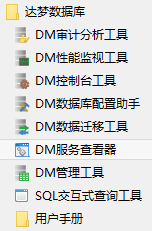

图6.1 启动数据库配置工具

### 6.2.2 使用数据库配置工具创建数据库

在数据库配置工具操作窗口中，选择“创建数据库”选项启动能够创建和配置一个数据库的向导，如图 6.2 所示。这个向导引导用户完成以下操作：

1. 数据库模板；
2. 数据库目录；
3. 数据库标识；
4. 数据库文件；
5. 初始化参数；
6. 口令管理；
7. 创建示例库；
8. 创建摘要；
9. 创建数据库。

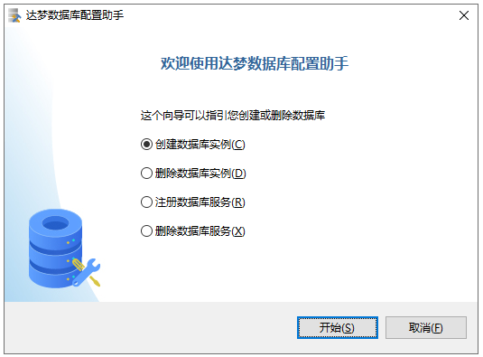

图6.2 数据库配置工具操作界面

#### 6.2.2.1 数据库模板

系统提供三套数据库模板供用户选择：一般用途、联机分析处理和联机事务处理。用户可根据自身的用途选择相应的模板。

系统提供了两种自动调整数据库性能的参数：高性能和平衡。当机器软硬件资源充裕的情况下可选择高性能参数，系统会从追求性能最优的角度对相关 INI 参数进行配置；当机器资源匮乏时请选择平衡参数，系统会从节约软硬件资源、相应地降低性能追求和保证所有功能正常运行的角度来配置相关 INI 参数。对于精通数据库性能调优的专业人士，可忽略该性能参数选项，根据实际情况自行调整相关 INI 参数。

如图 6.3 所示。

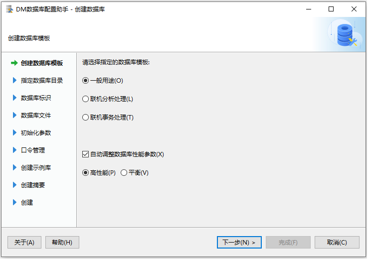

图6.3 数据库模板选择

#### 6.2.2.2 数据库目录

指定数据库目录。如图 6.4 所示。

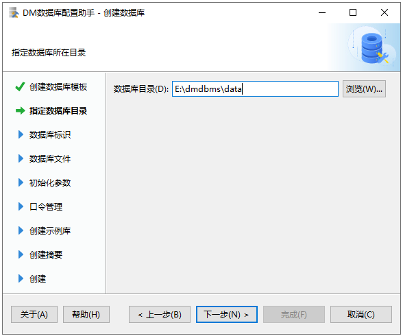

图6.4 指定数据库目录

#### 6.2.2.3 数据库标识

在“数据库名（D）”文本框中，输入数据库名；在“实例名（I）”文本框中输入数据库实例名；在“端口号（P）”文本框中，输入端口号。如图 6.5 所示。

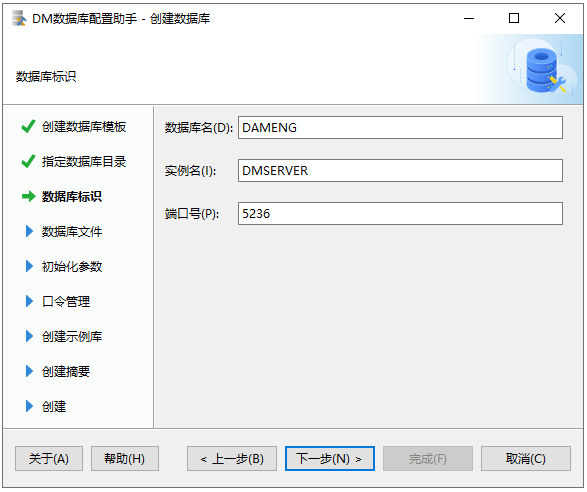

图6.5 设置数据库标识

#### 6.2.2.4 数据库文件

如图 6.6 所示，此界面包含四个选项卡：“控制文件”、“数据文件”、“日志文件”和“初始化日志”，可以通过双击路径来更改文件路径。

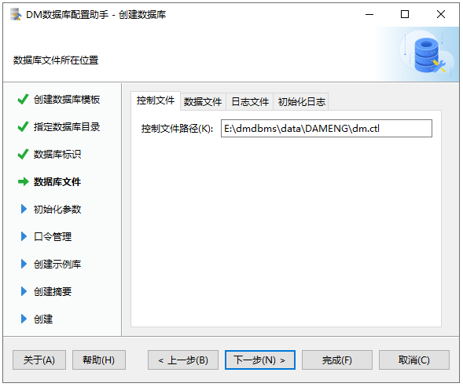

6.6 设置数据库文件路径

**控制文件**

与配置文件类似，控制文件对系统的运行及性能有很大的影响，但不同的是，配置文件中的配置项可以随意更改，而控制文件中的控制信息一般在系统第一次创建完毕后就不能随意更改，所以控制文件不是文本文件，而是二进制文件。

**数据文件**

“数据文件”选项卡用来指定 SYSTEM 表空间路径、MAIN 表空间路径、ROLL 表空间路径和 TEMP 表空间路径。同时还可以指定 SYSTEM 表空间镜像、MAIN 表空间镜像、ROLL 表空间镜像路径。三个镜像文件是分别和 SYSTEM 表空间、MAIN 表空间、ROLL 表空间一模一样的文件，当 SYSTEM 表空间、MAIN 表空间、ROLL 表空间文件损坏时，就可以使用相应的镜像文件来替换。

数据文件是数据库中最重要的文件类型之一，这是数据最终要存储的地方，每个数据库至少有一个与之相关的数据文件，通常情况下，将会有多个。为了理解 DMServer 如何组织这些文件，以及数据在它们内部是如何组织的，必须理解数据页和簇的概念，它们都是 DMServer 用于保存数据库对象的分配单元。

数据页是系统进行磁盘 IO 和缓冲区调度的单元，其大小在数据库创建时就固定下来了，而且一旦固定就不可更改，它们的容量也都是相同的。所有数据页的格式大致相同。

簇是数据文件中一个连续的分配空间，簇由多个数量固定的数据页组成。数据文件对空间的标识都以簇为单位，每个数据文件都维护着两条链，一条为半空簇的链，另一条为自由簇的链，其中半空链用于标识文件中所有被用过一部分的簇，自由链则标识文件中所有未被用过的簇。通常情况下，系统在分配空间时，以簇为单位分配会更有效。

**日志文件**

重做日志文件对于 DMServer 是至关重要的。它们用于存储数据库的事务日志，以便系统在出现系统故障和介质故障时能够进行故障恢复。在 DMServer 中，任何修改数据库的操作都会产生重做日志，这样，当系统出现故障时，通过分析日志可以知道在故障发生前系统做了哪些动作，并可以重做这些动作使系统恢复到故障之前的状态。

**初始化日志**

初始化日志用来指定初始化过程中生成的日志文件所在路径。

#### 6.2.2.5 初始化参数

数据文件使用的簇大小，即每次分配新的段空间时连续的页数，只能是 16 页或 32 页或 64 页，缺省使用 16 页。

数据文件使用的页大小，可以为 4KB、8KB、16KB 或 32KB，选择的页大小越大，则 DM 支持的元组长度也越大，但同时空间利用率可能下降，缺省使用 8K。

日志文件使用的大小，32 位版本时，取值为 256 和 2048 之间的整数，单位为 MB，缺省值为 2048MB；64 位版本时，取值为 256 和 8192 之间的整数，单位为 MB，缺省值为 4096MB。

时区设置，缺省使用 +08:00，范围为-12:59 和 +14:00 之间。

页校验，缺省为默认，选项包括不启用、CRC 算法、HASH 算法、快速 CRC 算法、默认，其中选择默认时采用快速 CRC 算法。

页校验 HASH 算法，当页校验中选择 HASH 算法时，可以对使用的 HASH 算法进行选择。系统内置的 HASH 算法包括 MD5、SHA1、SHA224、SHA256、SHA384、SHA512，缺省使用 MD5。此外，用户也可选择 DM 提供的第三方散列算法，具体可参考《DM8 安全管理》。

字符集，缺省使用 GB18030，选项包括 GB18030（支持 GB18030-2022 版本）、UTF\_8（支持 UNICODE 12.0 版本）、EUC-KR。

页加密分片大小，缺省使用 4096B，选项包括 0B、512B、4096B。

勾选启用全库加密时，可以选择使用的全库加密算法。

勾选库默认加密设置时，可以选择配置使用的加密算法、HASH 算法和加密引擎。

以上可在数据库配置助手的初始化栏进行设置，如图 6.7 所示。

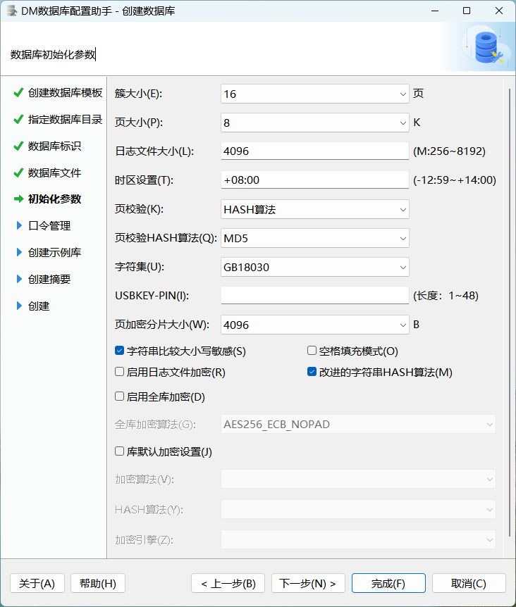

图6.7 数据库初始化参数

#### 6.2.2.6 口令管理

为了数据库管理安全，提供了为数据库的 SYSDBA 和 SYSAUDITOR 系统用户指定口令的功能，如果安装版本为安全版，将会增加为 SYSSSO 和 SYSDBO 系统用户指定口令的功能。用户可以选择为每个系统用户设置不同口令，也可以为所有系统用户设置同一口令。如图 6.8 所示。

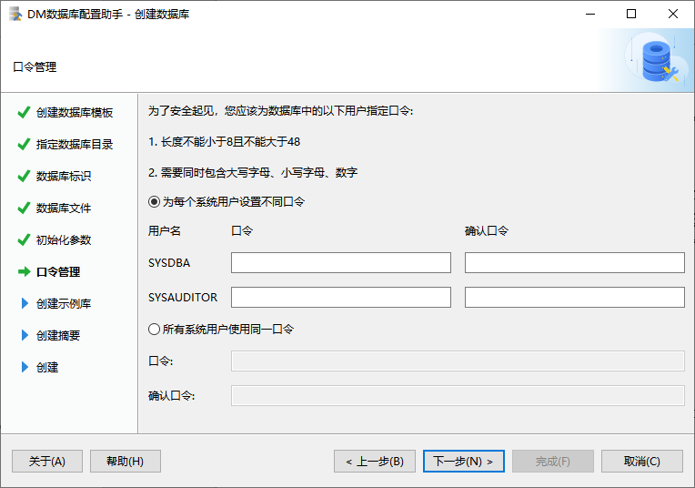

图6.8 口令管理

#### 6.2.2.7 创建示例库

示例库 BOOKSHOP 模拟武汉代理图书的某销售公司，该公司欲建立在线购物平台来拓展其代理产品的销售渠道。该示例在 DM 各演示程序中使用。安装该示例后，将在数据库中创建 BOOKSHOP 表空间，同时创建 RESOURCES、PERSON、PRODUCTION、PURCHASING、SALES、OTHER 这 6 个模式和相关的表。

示例库 DMHR 模拟武汉达梦数据库股份有限公司人力资源管理系统。安装完该示例库，将创建一个模式 DMHR 和一个表空间 DMHR，在 DMHR 模式下创建 REGION、CITY、LOCATION、DEPARTMENT、JOB、EMPLOYEE、JOB\_HISTORY 等 7 张表，并插入数据。

如图 6.9 所示。

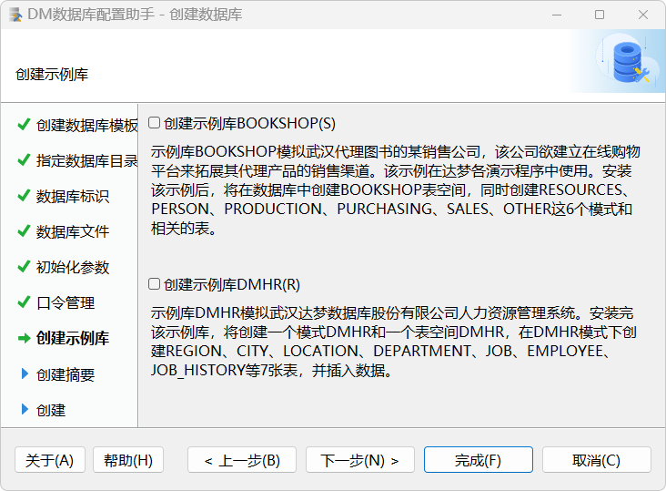

图6.9 创建示例库

#### 6.2.2.8 创建摘要

列举创建数据库纲要，会列举创建时指定的数据库名、示例名、数据库目录、端口、控制文件路径、数据文件路径、日志文件路径、簇大小、页大小、日志文件大小、大小写是否敏感、是否使用 unicode 等信息，方便用户确认创建信息是否符合自己的需求，及时返回修改。如图 6.10 所示。

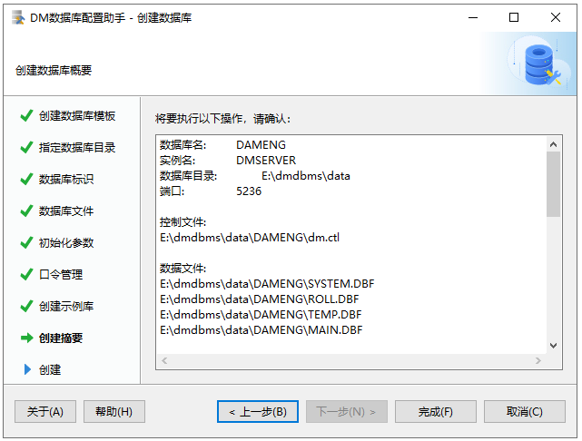

图6.10 创建摘要

#### 6.2.2.9 创建数据库

核对完创建信息后，开始创建数据库、创建并启动实例、创建示例库。如图 6.11 所示。

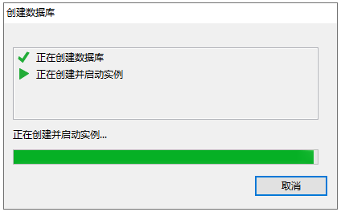

图6.11 创建数据库

安装完成之后将显示对话框，提示安装完成或错误反馈信息，如图 6.12 所示。

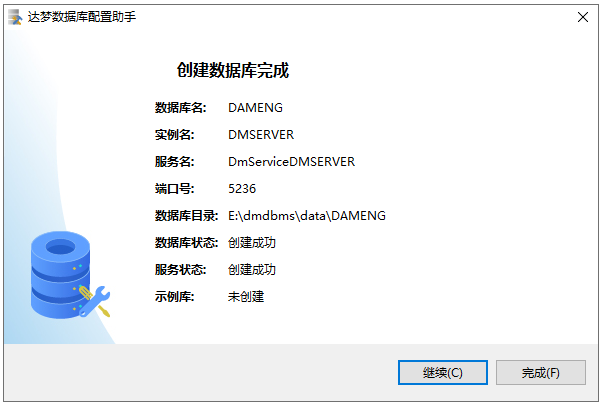

图6.12 创建数据库完成

如果数据库配置工具运行在 Linux、Solaris、AIX 和 HP-UNIX 系统中，使用非 root 系统用户在创建数据库完成时，将弹出提示框，提示应以 root 系统用户执行以下命令，用来创建数据库的随机启动服务，如图 6.13 所示。

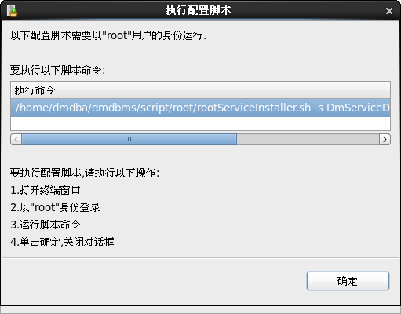

图6.13 执行命令提示

## 6.3 使用 dminit 创建数据库

在安装 DM 的过程中，用户可以选择是否创建初始数据库，如果当时没有创建，也可以在完成安装后，利用初始化库工具 dminit 来创建。系统管理员可以利用该工具提供的各种参数，设置数据库存放路径、段页大小、是否对大小写敏感以及是否使用 unicode，创建出满足用户需要的初始数据库。该工具位于安装目录的 bin\\目录下。更多详细的功能请参考《DM8\_dminit 使用手册》。

在 Windows“命令提示符”窗口中输入带参数的 dminit 命令启动 dminit 工具，命令格式为 dminit \[para=value\]\[para=value\]……。para 为参数，value 为参数取值。dminit 工具的部分参数说明见表 6.1。

表6.1 dminit工具的部分参数说明

| **参数** | **含义** | **取值** | **建库后是否可修改** |
| --- | --- | --- | --- |
| INI\_FILE | 已有 INI 文件的路径，此 INI 文件用于将其所有参数值作为当前新生成 INI 文件的参数值 | 合法的路径。文件路径长度最大为 257(含结束符)，不包括文件名 | / |
| PATH | 初始数据库存放的路径 | 合法的路径。文件路径长度最大为 257(含结束符)，不包括文件名，缺省路径为 dminit.exe 当前所在的工作目录 | / |
| CTL\_PATH | 初始数据库控制文件的路径 | 合法的路径。文件路径长度最大为 257(含结束符)，不包括文件名，缺省值 windows 下是 **PATH\\DB\_NAME** \\dm.ctl，linux 下是 **/PATH/DB\_NAME** /dm.ctl（粗体表示前面设置的参数） | / |
| LOG\_PATH | 初始数据库日志文件的路径 | 合法的路径。文件路径长度最大为 257(含结束符)，不包括文件名。日志文件路径个数不超过 10 个，缺省值 windows 下是 **PATH\\DB\_NAME** \\DB\_NAME01.log 和 **PATH\\DB\_NAME** \\DB\_NAME02.log，linux 下是 **PATH/DB\_NAME** /DB\_NAME01.log 和 **PATH/DB\_NAME** /DB\_NAME02.log（粗体表示前面设置的参数） | 可修改 |
| EXTENT\_SIZE | 数据文件使用的簇大小，即每次分配新的段空间时连续的页数 | 只能是 16 或 32 或 64 之一，单位为页，缺省值为 16 | 不可修改 |
| PAGE\_SIZE | 数据文件使用的页大小，可以为 4KB、8KB、16KB 或 32KB 之一，选择的页大小越大，则 DM 支持的元组长度也越大，但同时空间利用率可能下降 | 只能是 4、8、16 或 32 之一，单位为 KB，缺省值为 8 | 不可修改 |
| LOG\_SIZE | 单个日志文件使用的大小，以 MB 为单位 | 32 位版本时，取值为 256 和 2048 之间的整数，单位为 MB，缺省值为 2048MB；   64 位版本时，取值为 256 和 8192 之间的整数，单位为 MB，缺省值为 4096MB | 可修改 |
| CASE\_SENSITIVE | 大小写是否敏感。Y、y、1 表示敏感，N、n、0 表示不敏感。当大小写敏感时，小写的标识符应用双引号括起，否则被转换为大写；当大小写不敏感时，系统不自动转换字符的大小写，系统比较函数会将大写字母全部转为小写字母再进行比较 | 只能是 Y, y, N, n,1,0 之一，缺省值为 Y | 不可修改 |
| CHARSET/UNICODE\_FLAG | 字符集选项。0 代表 GB18030（支持 GB18030-2022 版本）；1 代表 UTF-8（支持 UNICODE 12.0 版本）；2 代表韩文字符集 EUC-KR | 取值 0、1 或 2 之一。缺省值为 0 | 不可修改 |
| SEC\_PRIV\_MODE | 权限管理模式。0：表示传统模式；1：表示专用机模式；2：表示 EVAL 测评模式；3：表示 ZB 模式；4：表示 ZBMM 模式。   此参数设置仅安全版有效 | 取值 0、1、2、3、4 之一。缺省值为 0 | 可修改 |
| SYSDBA\_PWD | 初始化时设置 SYSDBA 的密码 | 符合口令策略的字符串，详情请参考 INI 参数 PWD\_POLICY | 可修改 |
| SYSAUDITOR\_PWD | 初始化时设置 SYSAUDITOR 的密码 | 符合口令策略的字符串，详情请参考 INI 参数 PWD\_POLICY | 可修改 |
| DB\_NAME | 初始化数据库名字。只能由\_、$、大写字母 A 至 Z、小写字母 a 至 z、数字 0 至 9 组成，且第一个字符不能是数字 | 有效的字符串，不超过 128 个字符，缺省是 DAMENG | 不可修改 |
| INSTANCE\_NAME | 初始化数据库实例名字。只能由\_、$、大写字母 A 至 Z、小写字母 a 至 z、数字 0 至 9 组成，且第一个字符不能是数字 | 有效的字符串，不超过 16 个字符，缺省是 DMSERVER | 可修改 |
| PORT\_NUM | 初始化时设置 dm.ini 中的 PORT\_NUM | 取值范围：1024~65534，缺省为 5236 | 可修改 |
| BUFFER | 初始化时设置 NORMAL 缓冲区大小，单位为 MB | 取值范围：8~ 16777216。在 PAGE\_SIZE 为 4K 的库中，BUFFER 最大值为 15728640。64 位系统的缺省值为 8000，32 位系统的缺省值为 64 | 可修改 |
| TIME\_ZONE | 初始化时区 | 格式为\[正负号\]小时\[：分钟\]（正负号和分钟为可选）。时区设置范围为：-12:59~+14:00，缺省为东八区 | 不可修改 |
| PAGE\_CHECK | 页检查模式。0：禁用页校验；1：开启页校验并使用 CRC 校验（crc32 标准）；2：开启页校验并使用指定的 HASH 算法进行校验，和 PAGE\_HASH\_NAME 配合使用；3：开启页校验并使用快速 CRC 校验（crc32c 标准） | 取值范围：0~3。缺省值为 3 | 不可修改 |
| PAGE\_HASH\_NAME | 设置页检查 HASH 算法。当且仅当 PAGE\_CHECK=2 时，使用 PAGE\_HASH\_NAME 来指定用于页检查的 HASH 算法 | 有效的字符串，不超过 128 个字符 | 不可修改 |
| EXTERNAL\_CIPHER\_NAME | 设置默认加密算法 | 有效的字符串，不超过 128 个字符 | 不可修改 |
| EXTERNAL\_HASH\_NAME | 设置默认 HASH 算法 | 有效的字符串，不超过 128 个字符 | 不可修改 |
| EXTERNAL\_CRYPTO\_NAME | 设置根密钥加密引擎 | 有效的字符串，不超过 128 个字符 | 不可修改 |
| RLOG\_ENCRYPT\_NAME | 设置联机日志文件和归档日志文件加密算法 | 有效的字符串，不超过 128 个字符 | 不可修改 |
| RLOG\_POSTFIX\_NAME | 设置联机日志文件扩展名，长度不超过 10 | 有效字符串，不超过 10 个字符，缺省为 log，例如 DAMENG01.log | 不可修改 |
| USBKEY\_PIN | USBKEY PIN，用于加密服务器根密钥 | 合法的字符串，最长为 48 个字节 | 不可修改 |
| PAGE\_ENC\_SLICE\_SIZE | 数据页加密分片大小 | 可配置大小为 0、512 或 4096，单位为 BYTE。缺省值为 4096。其中，0 表示不按分片进行加解密，即按照页大小进行加解密, 后续查询参数时, 将显示为页大小。 | 不可修改 |
| ENCRYPT\_NAME | 全库加密使用的算法。算法可以是 DM 内部支持的加密算法，或者是第三方的加密算法。不指定时，不进行全库加密 | 合法的字符串，最长为 128 个字节 | 不可修改 |
| BLANK\_PAD\_MODE | 设置字符串比较时，结尾空格填充模式是否兼容 ORACLE。兼容后在变量赋值、列插入、列向变量赋值的情况下会进行填充，填充规则为：   如果目标类型为 CHAR，则按定义长度填充空格。   如果目标类型为 VARCHAR2，则既不填充空格也不截断结尾空格。 | 取值 0 或 1。0 不兼容，1 兼容。缺省为 0 | 不可修改 |
| SYSTEM\_MIRROR\_PATH | 指定 system.dbf 文件的镜像路径 | 绝对路径，缺省为空 | 不可修改 |
| MAIN\_MIRROR\_PATH | 指定 main.dbf 文件的镜像路径 | 绝对路径，缺省为空 | 不可修改 |
| ROLL\_MIRROR\_PATH | 指定 roll.dbf 文件的镜像路径 | 绝对路径，缺省为空 | 不可修改 |
| MAL\_FLAG | 初始化时设置 dm.ini 中的 MAL\_INI | 取值 0 或 1，缺省 0 | 可修改 |
| ARCH\_FLAG | 初始化时设置 dm.ini 中的 ARCH\_INI | 取值 0 或 1，缺省 0 | 可修改 |
| MPP\_FLAG | Mpp 系统内的库初始化时设置 dm.ini 中的 MPP\_INI | 取值 0 或 1，缺省 0 | 可修改 |
| CONTROL | 指定初始化配置文件路径。初始化配置文件是一个保存了各数据文件路径设置等信息的文本。使用 control 初始化时，若文件已存在，系统会屏幕打印提示，然后直接覆盖 | 主要用于将数据文件放在裸设备或 DSC 环境下 | / |
| AUTO\_OVERWRITE | 0 不覆盖，表示建库目录下如果没有同名文件，直接创建。如果遇到同名文件时，屏幕提示是否需要覆盖，由用户手动输入是与否（y/n，1/0），若选择不进行覆盖则初始化失败；   1 部分覆盖，表示覆盖建库目录下所有同名文件；   2 完全覆盖，表示先清理掉建库目录下所有文件再重新创建。 | 只能是 0,1,2 之一，缺省值为 0 | / |
| USE\_NEW\_HASH | 字符类型在计算 HASH 值时所采用的 HASH 算法类别。0：原始 HASH 算法；1：改进的 HASH 算法。 | 取值 0 或 1，缺省值为 1 | 不可修改 |
| ELOG\_PATH | 指定初始化过程中生成的事件日志文件所在路径 | 合法的路径。文件路径长度最大为 257(含结束符)，不包括文件名 | / |
| AP\_PORT\_NUM | 分布式环境下协同工作的监听端口 | 手动配置的取值范围为 1024~65534。缺省值为 0，表示未配置 | 可修改 |
| HUGE\_WITH\_DELTA | 是否仅支持创建事务型 HUGE 表 | 取值：1 是；0 否。缺省值为 1 | 不可修改 |
| RLOG\_GEN\_FOR\_HUGE | 是否生成 HUGE 表 REDO 日志 | 取值：1 是；0 否。缺省值为 1 | 不可修改 |
| PSEG\_MGR\_FLAG | 是否仅使用管理段记录事务信息 | 取值：1 是；0 否。缺省值为 0 | 不可修改 |
| CHAR\_FIX\_STORAGE | 定长字符（CHAR）是否按定长存储 | 取值：   Y/1：表示定长字符（CHAR）按定长存储，即不允许 CHAR 变化为 VARCHAR2 进行存储；   N/0：表示定长字符（CHAR）按变长存储，即允许 CHAR 变化为 VARCHAR2 进行存储。   缺省值为 N | 不可修改 |
| SQL\_LOG\_FORBID | 是否禁止打开 SQL 日志 | 取值：Y/1：是；N/0：否。缺省值为 N | 不可修改 |
| DPC\_MODE | DMDPC 专用参数。指定 DMDPC 集群中的实例角色 | 取值：   0：无；   1/MP：MP；   2/BP：BP；   3/SP：SP。   缺省值为 0 | 不可修改 |
| SYSSSO\_PWD | 初始化时设置 SYSSSO 的密码，仅在安全版本下可见和可设置 | 符合口令策略的字符串，详情请参考 INI 参数 PWD\_POLICY | 可修改 |
| SYSDBO\_PWD | 初始化时设置 SYSDBO 的密码，仅在安全版本且 PRIV\_FLAG=1 时可见和可设置。 | 符合口令策略的字符串，详情请参考 INI 参数 PWD\_POLICY | 可修改 |
| PRIV\_FLAG | 是否是四权分立。四权分立的具体权限见《DM8 安全管理》。默认情况下，使用三权分立。仅在安全版本下可见和可设置 | 取值：1 是，0 否。缺省值为 0 | 不可修改 |
| ENABLE\_MAC | 是否打开强制访问控制功能，仅对安全版有效 | 取值：1 启用，0 不启用。缺省值为 0。取值为 1 时，参数 ENABLE\_MAC 在系统中被赋值为 1；取值为 0 时，参数 ENABLE\_MAC 在系统中被赋值为 2 | 不可修改 |
| MAIN\_DBF\_PATH | MAIN 数据文件存放路径 | 合法的路径。文件路径长度最大为 257(含结束符)，包括文件名。 路径不允许是 HUGE\_PATH 路径及其子目录。缺省值 Windows 下是 **PATH\\DB\_NAME** \\MAIN.DBF，linux 下是 **/PATH/DB\_NAME** /MAIN.DBF（粗体表示前面设置的参数） | 不可修改 |
| SYSTEM\_DBF\_PATH | SYSTEM 数据文件存放路径 | 合法的路径。文件路径长度最大为 257(含结束符)，包括文件名。 路径不允许是 HUGE\_PATH 路径及其子目录。缺省值 Windows 下是 **PATH\\DB\_NAME** \\SYSTEM.DBF，linux 下是 **/PATH/DB\_NAME** /SYSTEM.DBF（粗体表示前面设置的参数） | 不可修改 |
| ROLL\_DBF\_PATH | ROLL 数据文件存放路径 | 合法的路径。文件路径长度最大为 257(含结束符)，包括文件名。 路径不允许是 HUGE\_PATH 路径及其子目录。缺省值 Windows 下是 **PATH\\DB\_NAME** \\ROLL.DBF，linux 下是 **/PATH/DB\_NAME** /ROLL.DBF（粗体表示前面设置的参数） | 不可修改 |
| TEMP\_DBF\_PATH | TEMP 数据文件存放路径 | 合法的路径。文件路径长度最大为 257(含结束符)，包括文件名。 路径不允许是 HUGE\_PATH 路径及其子目录。缺省值 Windows 下是 **PATH\\DB\_NAME** \\TEMP.DBF，linux 下是 **/PATH/DB\_NAME** /TEMP.DBF（粗体表示前面设置的参数） | 可修改 |
| USE\_DB\_NAME | 初始化数据库的路径是否拼接 DB\_NAME | 取值：Y、y、1：是，N、n、0：否。缺省值为 1 | 不可修改 |
| RANDOM\_CRYPTO | 指定数据库中使用的随机数算法所在的加密引擎名。未指定或指定的加密引擎不存在，又或者指定的加密引擎中不存在随机数算法，则使用 OPENSSL 提供的软件随机数算法 | 支持的加密引擎名可以通过查询视图 V$EXTERNAL\_CIPHER\_LIBS 的 NAME 列获取 | 可修改 |
| AUTO\_ADJ\_PARA | 是否对 CPU 和内存相关 INI 参数进行自动调优。为 1 时 AUTO\_ADJ\_CPUS、AUTO\_ADJ\_MEM 才生效。 | 取值：1：是；0：否，缺省值为 1 | 不可修改 |
| AUTO\_ADJ\_CPUS | 指定数据库可用 CPU 核数进行 INI 参数自动调优，AUTO\_ADJ\_PARA 打开才生效。默认根据当前所有 CPU 对于相关 INI 进行调优。具体请参考《DM8\_dminit 使用手册》。 | 取值范围 0~64，缺省值为 0 | 不可修改 |
| AUTO\_ADJ\_MEM | 指定数据库可用内存大小进行 INI 参数自动调优，AUTO\_ADJ\_PARA 打开才生效，默认使用当前机器 80% 的内存对于相关 INI 进行调优。具体请参考《DM8\_dminit 使用手册》。 | 最小为 0，最大可设置为最大八位整数，单位：MB，缺省值为 0 | 不可修改 |
| HELP | 显示帮助信息 |  |  |

说明：dminit 一般是要有参数的，如果没有带参数，系统就会引导用户设置。另外，参数、等号和值之间不能有空格。Help 参数的后面不用添加’=’号。

例如：

```
dminit PATH=c:\dmdata PAGE_SIZE=16 SYSDBA_PWD=DMdba_123 SYSAUDITOR_PWD=DMauditor_123
```

如果创建成功，则屏幕显示如图 6.14 所示。此时在 c 盘根目录下出现 dmData 文件夹，内容包含初始数据库 DAMENG 的相关文件和初始化文件 dm.ini。将 dm.ini 文件拷贝到 DM 安装目录的 bin 下，DM 服务器就可以启动该初始数据库了。

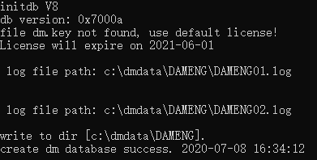

图6.14 创建成功后的屏幕显示

## 6.4 注册数据库服务

注册数据库服务，该功能用于将使用命令行工具生成的数据库，重新注册成系统服务，方便用户管理与控制。

用户注册数据库服务可以通过图形化界面和 shell 脚本两种方式，本节讲述的是通过数据库配置工具注册数据库服务，通过 shell 脚本注册数据库服务详细操作请参见《DM8\_Linux 服务脚本手册》。如图 6.16 所示。

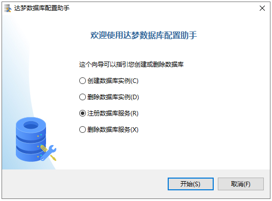

图6.16 选择操作方式

用户选择 dm.ini 文件来注册相应的数据库，并可修改相应的端口号和实例名，也可以选择是否以配置状态启动数据库，如图 6.17 所示。

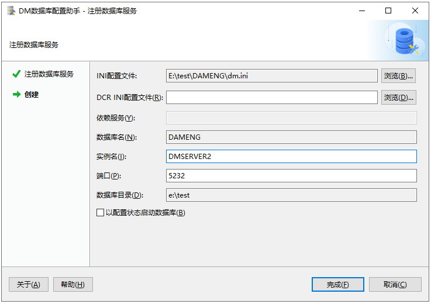

图6.17注册数据库服务

正在注册数据库服务，如图 6.18 所示。

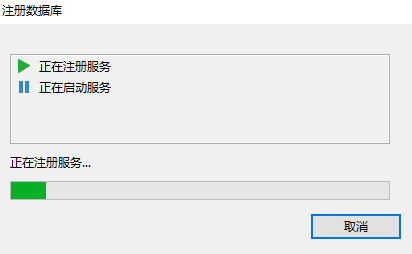

图6.18注册数据库服务

注册完成之后将显示对话框，提示完成或错误反馈信息，如图 6.19 所示。

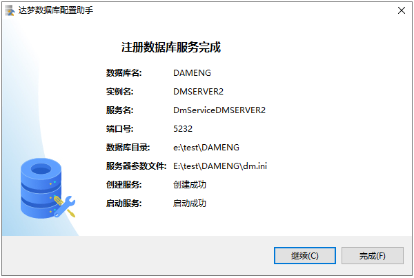

图6.19 注册数据库完成

## 6.5 查看数据库信息

登录 DM 管理工具，通过表空间属性，可以查看数据文件路径、总空间大小、空闲空间大小、使用率。如图 6.20 所示。

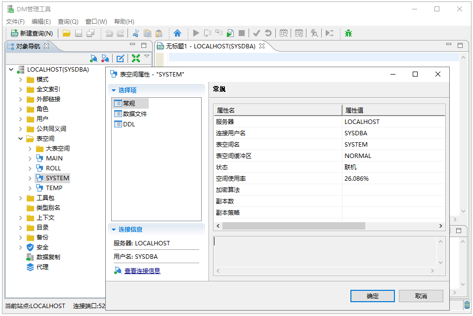

图6.20 使用DM管理工具查看数据库信息

通过 DM 控制台工具，查看实例配置属性，如图 6.21 所示，可以查看到如下信息：控制文件、实例名、内存、线程、查询、数据库、检查点、IO、REDO 日志、事务、安全、兼容性、监控、数据守护、全文索引、配置文件和 DSC 等相关参数。

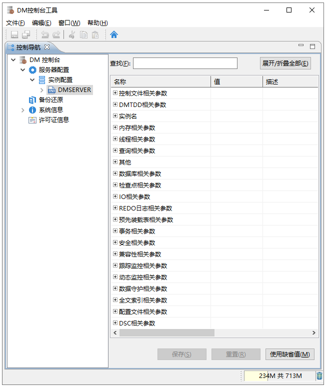

图6.21 使用DM控制台工具查看数据库信息

## 6.6 删除数据库

删除数据库，包括删除数据库的数据文件、日志文件、控制文件和初始化参数文件。为了保证删除数据库成功，必须保证 DMServer 已关闭。

可以使用数据库配置工具来删除数据库。如图 6.22 所示。

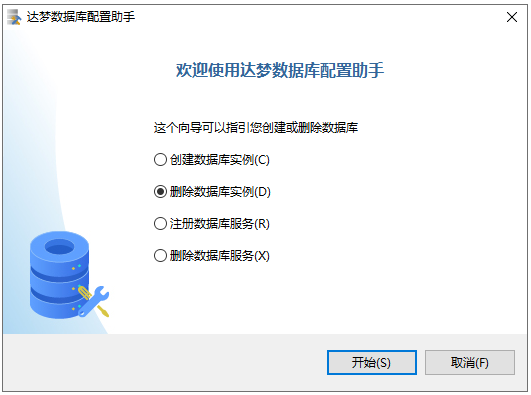

图6.22 选择操作方式

根据数据库实例名称，选择要删除的数据库，如图 6.23 所示，也可以通过指定数据库配置文件删除数据库。

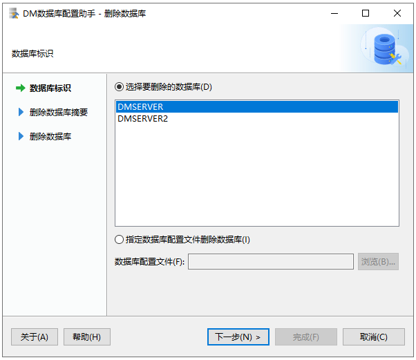

图6.23 要删除的数据库

确认将删除的数据库名、实例名、数据库目录，如图 6.24 所示。

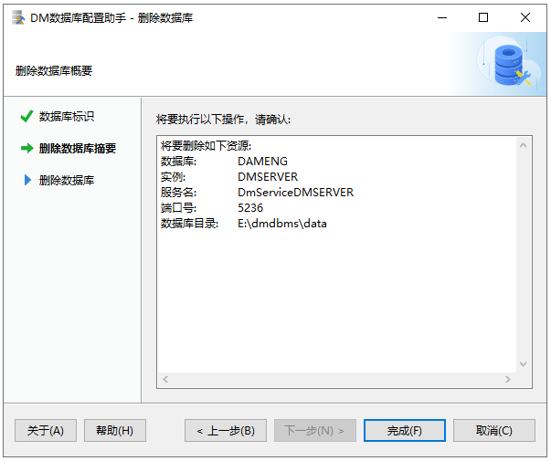

图6.24 删除数据库摘要

首先停止实例，然后删除实例，最后删除数据库，如图 6.25 所示。


图6.25 删除数据库实例

删除完成之后将显示对话框，提示完成或错误反馈信息，如图 6.26 所示。

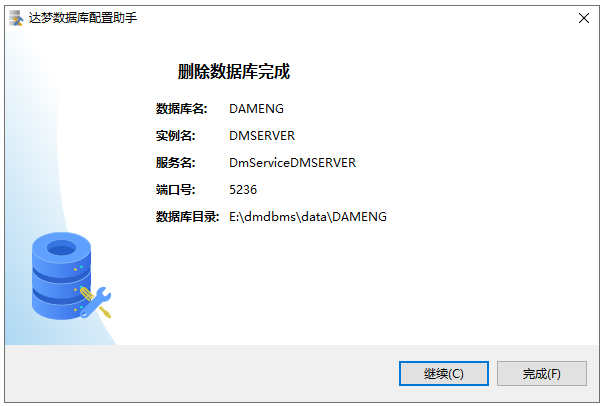

图6.26 删除数据库完成

如果数据库配置工具运行在 Linux、Solaris、AIX 和 HP-UNIX 系统中，使用非 root 系统用户在删除数据库完成时，将弹出提示框，提示应以 root 系统用户执行以下命令，用来删除数据库的随机启动服务，如图 6.27 所示。


图6.27 执行命令提示

## 6.7 删除数据库服务

删除数据库服务，只删除用于启动和停止数据库的服务文件，不会删除数据库的数据文件、日志文件、控制文件和初始化参数文件。

用户删除数据库服务可以通过图形化界面和 shell 脚本两种方式，本节讲述的是通过数据库配置工具删除数据库服务，通过 shell 脚本删除数据库服务详细操作请参考《DM8\_Linux 服务脚本使用手册》。如图 6.28 所示。


图6.28 选择操作方式

根据数据库服务名称，选择要删除的数据库服务，如图 6.29 所示，也可以通过指定数据库配置文件删除数据库服务。

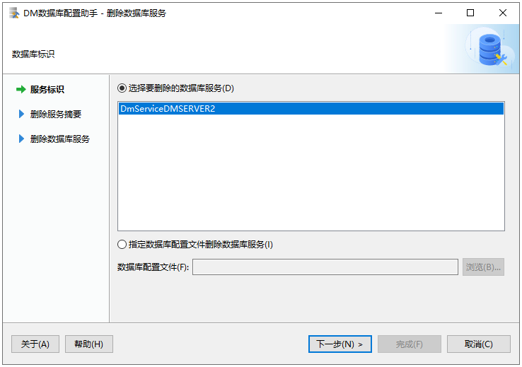

图6.29 要删除的数据库服务

确认将删除的数据库名、实例名、数据库服务名、数据库目录，如图 6.30 所示。

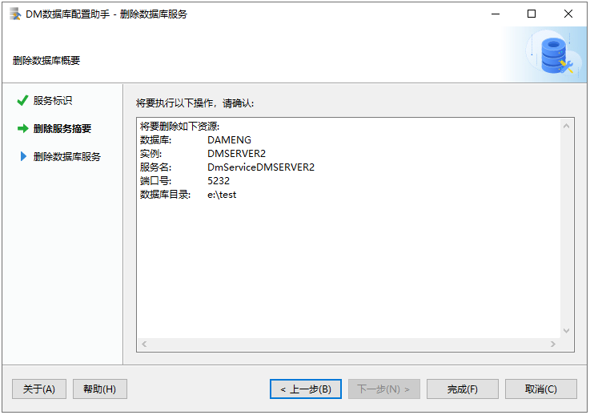

图6.30 删除服务摘要

首先检查数据库服务，然后删除数据库服务，如图 6.31 所示。


图6.31 删除数据库服务

删除完成之后将显示对话框，提示完成或错误反馈信息，如图 6.32 所示。

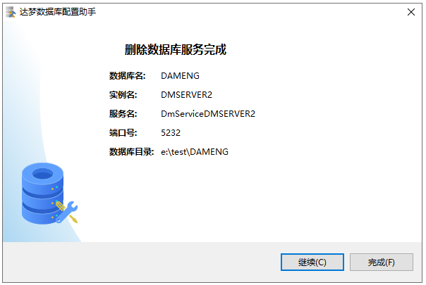

图6.32 删除数据库服务完成

如果数据库配置工具运行在 Linux、Solaris、AIX 和 HP-UNIX 系统中，使用非 root 系统用户在删除数据库服务完成时，将弹出提示框，提示应以 root 系统用户执行以下命令，用来删除数据库的随机启动服务，如图 6.33 所示。

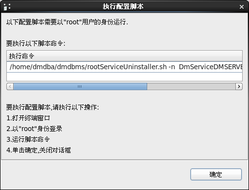

图6.33 执行命令提示