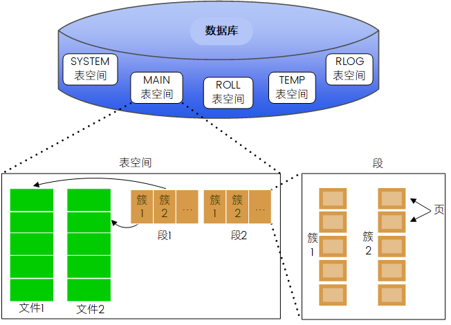
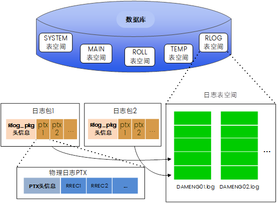

## 1.1 数据库和实例

在 DM7 之前版本的 DM 数据库中，“数据库”和“实例”这两个术语经常可以互相替换，意义也很相近。在 DM7 以及之后版本的数据库中，“数据库”和“实例”这两个概念之间有着很大的差别，甚至可以说它们是两个完全不同的实体。

### 1.1.1 数据库

在有些情况下，数据库的概念包含的内容会很广泛。如在单独提到 DM 数据库时，可能指的是 DM 数据库产品，也有可能是正在运行的 DM 数据库实例，还可能是 DM 数据库运行中所需的一系列物理文件的集合等。但是，当同时出现 DM 数据库和实例时，DM 数据库指的是磁盘上存放在 DM 数据库中的数据的集合，一般包括：数据文件、日志文件、控制文件以及临时数据文件等。

### 1.1.2 实例

实例一般是由一组正在运行的 DM 后台进程/线程以及一个大型的共享内存组成。简单来说，实例就是操作 DM 数据库的一种手段，是用来访问数据库的内存结构以及后台进程的集合。

DM 数据库存储在服务器的磁盘上，而 DM 实例则存储于服务器的内存中。通过运行 DM 实例，可以操作 DM 数据库中的内容。在任何时候，一个实例只能与一个数据库进行关联（装载、打开或者挂起数据库）。在大多数情况下，一个数据库也只有一个实例对其进行操作。但是在 DM 数据共享集群（DMDSC）中，多个实例可以同时装载并打开一个数据库（位于一组由多台服务器共享的物理磁盘上）。此时，我们可以同时从多台不同的计算机访问这个数据库。

## 1.2 DM 逻辑存储结构

逻辑存储结构是数据库向用户展现出的一种抽象的数据存储的结构，用于描述数据的逻辑关系。由于数据在物理磁盘上的实际物理存储是极其复杂的，用户不可能知悉存储的全部位置、大小或结构。为了用户能专注于业务逻辑和数据关系而不必囿于复杂的存储情况，数据库对物理存储结构进行逻辑上的抽象化管理。基于该管理，数据库可以向外界提供一个清晰、简易的数据组织方式和数据关系，也就是逻辑存储结构。它隐藏了数据物理存储结构的复杂性，提供了一个清晰、易于理解和操作的逻辑数据结构，实现了数据独立性，极大地简化了应用程序的开发和管理工作。理解逻辑存储结构是理解数据库如何组织和管理的基石。

DM 数据库的主要存储内容为用户数据、系统数据和对其操作产生的日志信息等，DM 将这些内容存放在磁盘上的物理结构中，即数据库文件（数据文件、日志文件等）。然而，用户并不能直接对数据库文件进行读取操作，而是通过实例对逻辑结构进行操作，进而实现对数据库文件的读写操作。因此引入表空间这一逻辑存储管理单元，作为逻辑与物理的桥梁。用户可以在表空间层面进行各类操作，并最终映射到对应文件中。

图1.1 DM表空间种类

不同表空间存储的内容各不相同，根据其中存储内容种类的不同，表空间划分为不同的种类：

存储用户数据、系统数据的表空间为数据表空间。数据表空间又根据其是否能存储 HUGE 表，将其分为了普通表空间和混合表空间：普通表空间不能存储 HUGE 表，而混合表空间可以同时存储普通（非 HUGE）表和 HUGE 表，其中 HUGE 数据文件存储在混合表空间定义中指定的 HUGE 数据文件路径下。可以通过为普通表空间增加指定 HUGE 数据文件路径将普通表空间升级为混合表空间。

存储数据库内各类操作产生的日志信息的表空间为日志表空间。

在创建数据库时，系统会自动创建 5 个表空间：SYSTEM 表空间、ROLL 表空间、MAIN 表空间、TEMP 表空间和 RLOG 表空间。其中，SYSTEM 表空间、ROLL 表空间、MAIN 表空间和 TEMP 表空间为数据表空间；RLOG 表空间为日志表空间。以下是五个表空间的详细介绍：

1. SYSTEM 表空间存放 DM 数据库的字典信息，用户不能在 SYSTEM 表空间创建表和索引。SYSTEM 表空间又称为系统表空间。
2. ROLL 表空间完全由 DM 数据库自动维护，用户无需干预。该表空间用来存放事务运行过程中执行 DML(数据操作语言)操作之前的值，从而为访问该表的其他用户提供表数据的读一致性视图。
3. MAIN 表空间在初始化库的时候，就会自动创建一个大小为 128MB 的数据文件 MAIN.DBF，以及一个 HMAIN 目录作为 HUGE 数据文件路径，因此 MAIN 表空间为混合表空间。在创建用户时，如果没有指定默认表空间，则系统自动指定 MAIN 表空间为用户默认的表空间。
4. TEMP 表空间完全由 DM 数据库自动维护。当用户的 SQL 语句需要磁盘空间来完成某个操作时，DM 数据库会从 TEMP 表空间分配临时段。如创建索引、无法在内存中完成的排序操作、SQL 语句中间结果集以及用户创建的临时表等都会使用到 TEMP 表空间。
5. RLOG 表空间称为日志表空间，初始化库时会自动创建 2 个后缀名为 log 的日志文件，用于存放重做日志，用户可主动添加日志文件或者扩展日志文件。日志文件包括当前活动日志文件及非活动日志文件，当前日志文件写满后系统会自动切换到下一个日志文件，日志文件可循环使用。自动创建的日志文件大小受 LOG\_SIZE 控制，初始化时可通过调整 LOG\_SIZE 大小调整两个日志文件的大小。

每一个用户都有一个默认的表空间。对于 SYS、SYSSSO、SYSAUDITOR 系统用户，默认的用户表空间是 SYSTEM；SYSDBA 系统用户的默认表空间为 MAIN；新创建的用户如果没有指定默认表空间，则系统自动指定 MAIN 表空间为用户默认的表空间。如果用户在创建表的时候，指定了存储表空间 A，并且和当前用户的默认表空间 B 不一致时，表存储在用户指定的表空间 A 中，并且默认情况下，在这张表上面建立的索引也将存储在 A 中，但是用户的默认表空间是不变的，仍为 B。

请参考 [第 14 章 数据库布局和存储管理](database-management.md) 。

一般情况下，建议用户自己创建一个表空间来存放业务数据，或者将数据存放在默认的用户表空间 MAIN 中。

用户可以通过执行如下语句来查看 SYSTEM、ROLL、MAIN 以及 TEMP 的表空间相关信息。

```
SELECT * FROM V$TABLESPACE;
```

用户可以通过执行如下语句来查看 RLOG 表空间相关信息。

```
SELECT * FROM V$RLOG;           --查看日志空间信息
SELECT * FROM V$RLOGFILE;     --RLOG文件信息
SELECT * FROM V$LOG_HISTORY; --日志文件切换历史
```

结果集中各字段的含义请参考附录部分动态性能视图章节中对各系统视图的介绍，关于表空间该如何使用，请参考 [第 14 章 数据库布局和存储管理](database-management.md) 。

### 1.2.1 数据表空间

为了进行更加高效的存储管理，同时提高磁盘空间的利用率，数据表空间被进一步划分为段、簇和页（也称块）。数据库中的数据信息（记录）就存储在页中，多个页组合成为簇，多个簇组合成为段。图 1.2 显示了这些数据结构之间的关系：



图1.2 数据表空间、数据文件、段、簇、页的关系

可以看出，在 DM8 中存储的层次结构如下：

1. 数据库由一个或多个表空间组成；
2. 每个表空间对应一个或多个文件；
3. 每个数据文件由一个或多个簇组成；
4. 段是簇的上级逻辑单元，一个段可以跨多个数据文件；
5. 簇由磁盘上连续的页组成，一个簇总是在一个数据文件中；
6. 页是数据库中最小的分配单元，也是数据库中使用的最小的 IO 单元。

#### 1.2.1.1 记录

数据库表中的每一行是一条记录。在 DM 中，除了 HUGE 表，其他的表都是在数据页中按记录存储数据的。也就是说，记录是存储在数据页中的，记录并不是 DM 数据库的存储单位，页才是。由于记录不能跨页存储，这样记录的长度就受到数据页大小的限制。数据页中还包含了页头控制信息等空间，因此 DM 规定每条记录的总长度不能超过页面大小的一半。

#### 1.2.1.2 页

数据页（也称数据块）是 DM 数据库中最小的数据存储单元。页的大小对应物理存储空间上特定数量的存储字节，在 DM 数据库中，页大小可以为 4KB、8KB、16KB 或者 32KB，用户在创建数据库时可以指定，默认大小为 8KB，一旦创建好了数据库，则在该库的整个生命周期内，页大小都不能够改变。图 1.3 显示了 DM 数据库页的典型格式。


图1.3 DM数据页的组成

页头控制信息包含了关于页类型、页地址等信息。页的中部存放数据，为了更好地利用数据页，在数据页的尾部专门留出一部分空间用于存放行偏移数组，行偏移数组用于标识页上的空间占用情况以便管理数据页自身的空间。

在绝大多数情况下，用户都无需干预 DM 数据库对数据页的管理。但是 DM 数据库还是提供了选项供用户选择，使得在某些情况下能够为用户提供更佳的数据处理性能。

FILLFACTOR 是 DM 数据库提供的一个与性能有关的数据页级存储参数，它指定一个数据页初始化后插入数据时最大可以使用空间的百分比（100），该值在创建表/索引时可以指定。设置 FILLFACTOR 参数的值，是为了指定数据页中的可用空间百分比（FILLFACTOR）和可扩展空间百分比（100-FILLFACTOR）。可用空间用来执行更多的 INSERT 操作，可扩展空间用来为数据页保留一定的空间，以防止在今后的更新操作中增加列或者修改变长列的长度时，引起数据页的频繁分裂。当插入的数据占据的数据页空间百分比低于 FILLFACTOR 时，允许数据插入该页，否则将当前数据页中的数据分为两部分，一部分保留在当前数据页中，另一部分存入一个新页中。

对于 DBA 来说，使用 FILLFACTOR 时应该在空间和性能之间进行权衡。为了充分利用空间，用户可以设置一个很高的 FILLFACTOR 值，如 100，但是这可能会导致在后续更新数据时，频繁引起页分裂，而导致需要大量的 I/O 操作。为了提高更新数据的性能，可以设置一个相对较低（但不是过低）的 FILLFACTOR 值，使得后续执行更新操作时，可以尽量避免数据页的分裂，提升 I/O 性能，不过这是以牺牲空间利用率来换取性能的提高。

#### 1.2.1.3 簇

簇是数据页的上级逻辑单元，由同一个数据文件中 16 个或 32 个或 64 个连续的数据页组成。在 DM 数据库中，簇的大小由用户在创建数据库时指定，默认大小为 16。假定某个数据文件大小为 32MB，页大小为 8KB，则共有 32MB/8KB/16=256 个簇，每个簇的大小为 8KB\*16=128KB。和数据页的大小一样，一旦创建好数据库，此后该数据库的簇的大小就不能够改变。

**分配数据簇**

一般的，当创建一个表/索引的时候，DM 数据库会为表/索引的数据段分配至少一个簇，同时数据库会自动生成对应数量的空闲数据页，供后续操作使用。如果初始分配的簇中所有数据页都已经用完，或者新插入/更新数据需要更多的空间，DM 数据库将自动分配新的簇。在缺省情况下，DM 数据库在创建表/索引时，初始分配 1 个簇，当初始分配的空间用完时，DM 数据库会自动扩展。另外，DM 还提供了延迟段分配的功能，特点为不会在进行创建表/索引时马上为表/索引分配存储结构，具体介绍在\[1.2.1.4 段\](#1.2.1.4 段)中进行进一步说明。

当 DM 数据库的表空间为新的簇分配空闲空间时，首先在表空间按文件从小到大的顺序在各个数据文件中查找可用的空闲簇，找到后进行分配；如果各数据文件都没有空闲簇，则在各数据文件中查找空闲空间足够的，将需要的空间先进行格式化，然后进行分配；如果各文件的空闲空间也不够，则选一个数据文件进行扩充。

**释放数据簇**

对于用户数据表空间，在用户将一个数据段对应的表/索引对象 DROP 之前，该表对应的数据段会保留至少 1 个簇不被回收到表空间中。在删除表/索引对象中的记录的时候，DM 数据库通过修改数据文件中的位图来释放簇，释放后的簇被视为空闲簇，可以供其他对象使用。当用户删除了表中所有记录时，DM 数据库仍然会为该表保留 1-2 个簇供后续使用。若用户使用 DROP 语句来删除表/索引对象，则此表/索引对应的段以及段中包含的簇全部收回，并供存储于此表空间的其他模式对象使用。

对于临时表空间，DM 数据库会自动释放在执行 SQL 过程中产生的临时段，并将属于此临时段的簇空间还给临时表空间。

对于回滚表空间，DM 数据库将定期检查回滚段，并确定是否需要从回滚段中释放一个或多个簇。

#### 1.2.1.4 段

段是簇的上级逻辑分区单元，它由一组簇组成。在同一个表空间中，段可以包含来自不同文件的簇，即一个段可以跨越不同的文件。而一个簇以及该簇所包含的数据页则只能来自一个文件，是连续的 16 或 32 或 64 个数据页。由于簇的数量是按需分配的，数据段中的不同簇在磁盘上不一定连续。

**1.** **数据段**

段可以被定义成特定对象的数据结构，如表数据段或索引数据段。表中的数据以表数据段结构存储，索引中的数据以索引数据段结构存储。DM 以簇为单位给每个数据段分配空间，当数据段的簇空间用完时，DM 数据库就给该段重新分配簇，段的分配和释放完全由 DM 数据库自动完成，可以在创建表/索引时设置存储参数来决定数据段的簇如何分配。

当用户使用 CREATE 语句创建表/索引时，DM 创建相应的数据段。表/索引的存储参数用来决定对应数据段的簇如何被分配，这些参数将会影响与对象相关的数据段的存储与访问效率。对于分区表，每个分区使用单独的数据段来容纳所有数据，对于分区表上的非分区索引，使用一个索引数据段来容纳所有数据，而对于分区索引，每个分区使用一个单独索引数据段来容纳其数据。表的数据段和与其相关的索引段不一定要存储在同一表空间中，用户可以在创建表和索引时，指定不同的表空间存储参数。

**2.** **临时段**

在 DM 数据库中，所有的临时段都创建在临时表空间中，这样可以分流磁盘设备的 I/O，也可以减少由于在 SYSTEM 或其他表空间内频繁创建临时数据段而造成的碎片。

当处理一个查询时，经常需要为 SQL 语句的解析与执行的中间结果准备临时空间。DM 数据库会自动地分配临时段的磁盘空间。例如，DM 在进行排序操作时就可能需要使用临时段，当排序操作可以在内存中执行，或设法利用索引就可以执行时，就不必创建临时段。对于临时表及其索引，DM 数据库也会为它们分配临时段。

临时段的分配和释放完全由系统自动控制，用户不能手工进行干预。

**3.** **回滚段**

DM 数据库在回滚表空间的回滚段中保存了用于恢复数据库操作的信息。对于未提交事务，当执行回滚语句时，回滚记录被用来做回滚变更。在数据库恢复阶段，回滚记录被用来做所有未提交变更的回滚。在多个并发事务运行期间，回滚段还为用户提供读一致性，所有正在读取受影响行的用户将不会看到行中的任何变动，直到他们事务提交后发出新的查询。

DM 数据库提供了全自动回滚管理机制来管理回滚信息和回滚空间，自动回滚管理消除了管理回滚段的复杂性。此外，系统将尽可能保存回滚信息，来满足用户查询回滚信息的需要。事务被提交后，回滚数据不能再回滚或者恢复，但是从数据读一致性的角度出发，长时间运行查询可能需要这些早期的回滚信息来生成早期的数据页镜像，基于此，数据库需要尽可能长时间的保存回滚信息。DM 数据库会收集回滚信息的使用情况，并根据统计结果对回滚信息保存周期进行调整，数据库将回滚信息保存周期设为比系统中活动的最长的查询时间稍长。

DM 支持了延迟段分配的功能，在创建表或索引时先暂时不申请存储空间，当对表中插入数据时，才尝试申请存储空间。对于已延迟段分配的表创建二级索引时，新建的索引同样也会延迟段分配。（除了全局索引、online 方式创建索引，此时二级索引总是会申请段）。可以通过设置 ini 参数 DEFERRED\_SEGMENT\_CREATION=1 开启延迟段分配功能，也可以在建表语句中进行指定，具体的段分配情况可以通过查看 V$SEGMENT\_INFOS 获取。该功能可以有效改善创建分区表时，分区数较多导致初始为空的分区表分配过多空间的问题。

对表或索引进行延迟段分配，可能存在以下特殊场景：

1. 对已延迟段分配的表进行查询插入，即便查询空表不会插入任何数据，目标表也会申请段。 因此需要注意，在启用 DDL 相关优化如 ALTER\_TABLE\_OPT 参数时，DM 可能会选择使用查询插入的方式来加速 DDL 执行，此时即便目标表已延迟段分配，该 DDL 的执行会导致目标表申请段。
2. 表指定了自增列起始边界，即便建表时指定了延迟段分配也会被忽略。
3. 重建已延迟段分配的索引将导致该索引申请段。

### 1.2.2 日志表空间

与数据库中存储的数据不同的是，日志信息是不由用户进行维护的，而是由系统自动产生并进行自动管理，用户仅可查看并应用相关信息。因此，该表空间的存储管理方法略有不同：系统对每一个修改物理数据页的动作生成一个 REDO 记录（RREC）；多个有逻辑关联的 REDO 记录组合成一个物理事务（PTX），与数据库管理系统中事务（Transaction）概念相对应；一个或多个连续的物理事务组合成为一个 REDO 日志包（RLOG\_PKG），刷盘后系统将日志包存储到日志表空间中。图 1.4 显示了这些数据结构之间的关系。



图1.4 日志表空间、日志文件、日志包、物理事务的关系

#### 1.2.2.1 REDO 记录

REDO 记录（REDO RECORD，简称 RREC）是日志记录过程中的最小单元，每条 REDO 记录都对应一个修改物理数据页的动作，根据记录内容的不同，又分为物理 RREC 和逻辑 RREC。

物理 RREC 记录的是数据页的变化情况，内容包括：操作类型、修改数据页地址、页内偏移、数据页上的修改内容，如果是变长类型的 Redo 记录，在 RREC 记录头之后还会有一个两字节的长度信息。

逻辑 RREC 记录的是一些数据库逻辑操作步骤，主要包括：事务启动、事务提交、事务回滚、字典封锁、事务封锁、B 树封锁、字典淘汰等。逻辑 RREC 记录是专门为数据守护增加的记录类型，用来解决备库重演 Redo 日志与用户访问备库之间的并发冲突，以及主库执行 DDL 后导致的主备数据库字典缓存不一致问题。备库解析到逻辑 RREC 记录时，根据记录内容，生成相应的事务，封锁对应的数据库对象，并从字典缓存中淘汰过期的字典对象。

#### 1.2.2.2 物理事务

物理事务（Physical Transaction，简称 PTX）是数据库内部一系列修改物理数据页操作的集合，与数据库管理系统中事务（Transaction）概念相对应，具有原子性、有序性、无法撤销等特性。对于运行过程中产生的一系列物理事务，系统采用 LSN 进行维护。日志序列值 LSN（Log Sequence Number）是一个 BIGINT 类型数值，具有自动递增、全局唯一特性，每一个 LSN 值代表着 DM 系统内部产生的一个物理事务。

数据库完成一个事务但未提交时，该事务中所有修改物理数据页的操作对应的 RREC，组合成为一个物理事务。系统为这个新生成的 PTX 分配一个 LSN，并存储在 PTX 头信息中。此时由于 PTX 中记录的修改操作尚未刷盘，无法写入日志表空间的联机日志文件中，暂时存储在尚有空间的日志包中，等待合适时机发起日志刷盘请求，写入日志表空间。

#### 1.2.2.3 日志包

Redo 日志包（RLOG\_PKG）是 DM 数据库批量保存物理事务产生的 Redo 日志的数据单元，以物理事务 PTX 为单位保存日志，一个日志包内可连续保存一个或多个 PTX。每个日志包都有对应的序号属性，称之为包序号（PKG SEQNO）。单节点数据库中，包序号具有唯一、连续递增的特性，日志包生成时按照序号连续递增，相邻日志包的 LSN 顺序是总体递增的，该特性可用于校验归档日志的连续性。

日志包具有自描述的特性，日志包大小不固定，采用固定包头和可变包头结合的方式，包头记录日志的控制信息，包括类型、长度、包序号、LSN 信息等内容。DM 数据守护系统中，主库以 RLOG\_PKG 为最小单位发送 Redo 日志到备库。

日志包生成时，系统为该日志包产生一个包序号，PTX 生成后写入到日志包中，日志包据此修改包头信息。在数据库事务提交或日志包被写满时触发日志刷盘动作，日志刷盘线程负责将日志包写入联机日志文件，即加入日志表空间中。日志包加入后，日志表空间会根据包头信息修改一系列变量，相关信息可以通过 V$RLOG 查看。