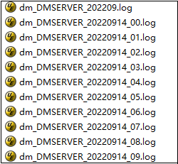

DM 数据库使用了磁盘上大量的物理存储结构来保存和管理用户数据。典型的物理存储结构包括：用于进行功能设置的配置文件；用于记录文件分布的控制文件；用于保存用户实际数据的数据文件、重做日志文件、归档日志文件、备份文件；用来进行问题跟踪的跟踪日志文件等，如图 2.1 所示。

图2.1 DM物理存储结构示意图

## 2.1 配置文件

配置文件是 DM 数据库用来设置功能选项的一些文本文件的集合，分为服务器配置文件和客户端配置文件两类。

服务器配置文件以 INI 为扩展名，它们具有固定的格式，用户可以通过修改其中的某些参数取值来启用/禁用服务器特定功能项，或者针对当前系统运行环境设置更优的参数值以提升系统性能。

客户端配置文件为 dm\_svc.conf，用户可以在该文件中为 JDBC 等接口以及 Disql 等工具配置连接参数，或者启用/禁用客户端特定功能项。

### 2.1.1 服务器配置文件

#### 2.1.1.1 dm.ini

每创建一个 DM 数据库，就会自动生成 dm.ini 参数文件。dm.ini 是 DM 数据库启动所必须的配置文件，通过配置该文件可以设置 DM 数据库服务器的各种功能和性能选项，主要的配置模块包括：控制文件相关、实例名、内存相关、线程相关等。

参数属性分为三种：手动、静态和动态。

手动，不能被动态修改，必须手动修改 dm.ini 参数文件，然后重启才能生效。

静态，可以被动态修改，修改后重启服务器才能生效。

动态，可以被动态修改，修改后即时生效。动态参数又分为会话级和系统级两种。会话级参数被修改后，新参数值只会影响当前会话和新创建的会话，之前创建的会话不受影响；系统级参数的修改则会影响所有的会话。

其中，动态修改是指 DBA 用户可以在数据库服务器运行期间，通过调用系统过程 SP\_SET\_PARA\_VALUE()、SP\_SET\_PARA\_DOUBLE\_VALUE()和 SP\_SET\_PARA\_STRING\_VALUE()对参数值进行修改。当动态修改 dm.ini 参数文件时，如果遇到磁盘空间不足导致系统崩溃的情况，需要手动使用 dm.ini 文件所在目录下的 dm.ini.dmbak 文件恢复 dm.ini，并重启服务器。

当手动修改 dm.ini 参数文件且将 dm.ini 中的某参数值设置为非法值时，若设置值与参数类型不兼容，则参数实际取值为默认值；若设置值小于参数取值范围的最小值，则实际取值为最小值；若设置值大于参数取值范围的最大值，则实际取值为最大值。

当动态修改 ini 参数且设置参数为非法值时，包括设置值与参数类型不兼容、设置值小于参数取值范围的最小值、设置值大于参数取值范围的最大值三种情况，均进行报错处理。

需要注意的是，ini 参数的修改不会自动清理之前已生成的计划缓存。当 ini 参数 USE\_PLN\_POOL 非 0 时，DMServer 会开启计划重用，此时修改 ini 参数，数据库仍优先重用旧计划，可能导致参数变更效果无法体现。建议管理员在修改 ini 参数后，手动清理计划缓存。

##### 2.1.1.1.1 文件路径相关

文件路径相关参数。

表 2.1 dm.ini 中控制文件相关参数

| **参数名** | **缺省值** | **属性** | **说明** |
| --- | --- | --- | --- |
| CTL\_PATH | SYSTEM\_PATH\\dm.ctl | 手动 | 控制文件路径 |
| CTL\_BAK\_PATH | SYSTEM\_PATH\\ctl\_bak | 手动 | 控制文件备份路径。在初始化库或没有配置该项时均指定为缺省路径。   备份文件在初始化库和每次修改控制文件后生成 |
| CTL\_BAK\_NUM | 10 | 动态，系统级 | 控制文件备份个数限制，取值范围1~100，在此限制之外，会再多保留一个备份文件，在生成新的备份文件时，   如果当前已存在的备份文件个数大于指定值，则自动删除创建时间最早的备份文件，小于或等于指定值的情况下，   不会有删除操作 |
| SYSTEM\_PATH | 数据库目录\\数据库名 | 手动 | 系统库目录。其中数据库目录由安装时指定，或者dminit工具PATH参数指定 |
| CONFIG\_PATH | SYSTEM\_PATH | 手动 | 指定DMServer所读取的配置文件（DMMAL.INI, DMARCH.INI, DMTIMER.INI等）的路径。   缺省使用SYSTEM\_PATH路径。不允许指定ASM目录 |
| TEMP\_PATH | SYSTEM\_PATH | 手动 | 临时库文件路径 |
| BAK\_PATH | SYSTEM\_PATH/BAK | 手动 | 备份路径 |
| XBOX\_DUMP\_PATH | 空串 | 手动 | DMDPC环境下专用，XBOX邮件保存到临时文件的目录。和XBOX\_DUMP\_THRESHOLD一起设置才生效 |
| PRIKEY\_BAK\_PATH | SYSTEM\_PATH\\PRIKEY\_BAK | 手动 | 数据库服务器密钥文件备份路径。在初始化库或没有配置该项时均指定为缺省路径。   备份文件在初始化库和每次修改密钥文件后生成 |

##### 2.1.1.1.2 实例名

表 2.2 dm.ini 中实例名相关参数

| **参数名** | **缺省值** | **属性** | **说明** |
| --- | --- | --- | --- |
| INSTANCE\_NAME | DMSERVER | 静态 | 实例名。只能由\_、$、大写字母A至Z、小写字母a至z、数字0至9组成，且第一个字符不能是数字。长度不超过16个字节 |

##### 2.1.1.1.3 内存相关

表 2.3 dm.ini 中内存相关参数

| **参数名** | **缺省值** | **属性** | **说明** |
| --- | --- | --- | --- |
| MEMORY\_POOL | 500 | 静态 | 共享内存池大小，单位MB。共享内存池是由DM管理的内存。取值范围：32位平台为64~2000，64位平台为64~67108864   当建库参数AUTO\_ADJ\_PARA为1时，本参数实际默认值由系统根据AUTO\_ADJ\_MEM自动调整，用户也可根据实际需要手动调整。具体可参考《DM8\_dminit使用手册》 |
| MEMORY\_N\_POOLS | 1 | 静态 | 共享内存池个数，取值范围0~2048，0与1等价，即共享池不分片。分片时，每池的初始容量为MEMORY\_POOL / MEMORY\_N\_POOLS, 但受最小初始容量为30M限制，因此实际分片数可能会小于MEMORY\_N\_POOLS，每个池的TARGET也按此方式由MEMORY\_TARGET导出   当建库参数AUTO\_ADJ\_PARA为1时，本参数实际默认值由系统根据AUTO\_ADJ\_MEM自动调整，用户也可根据实际需要手动调整。具体可参考《DM8\_dminit使用手册》 |
| MEMORY\_TARGET | 32位平台为1000；64位平台为15000 | 动态，系统级 | 共享内存池在扩充到此大小以上后，空闲时收缩回此指定大小，单位MB，取值范围：32位平台为0~2000，64位平台为0~67108864，0表示不限制   当建库参数AUTO\_ADJ\_PARA为1时，本参数实际默认值由系统根据AUTO\_ADJ\_MEM自动调整，用户也可根据实际需要手动调整。具体可参考《DM8\_dminit使用手册》 |
| MEMORY\_EXTENT\_SIZE | 32 | 静态 | 共享内存池每次扩充的大小，单位MB，取值范围1~10240 |
| MEMORY\_LEAK\_CHECK | 0 | 动态，系统级 | 是否开启内存泄漏检测。0：否；1：是，此时系统对每一次内存分配都登记到动态视图V$MEM\_REGINFO中， 并在释放时解除登记 |
| MEMORY\_MAGIC\_CHECK | 1 | 静态 | 是否开启对所有内存池的校验。0：不开启；1：开启校验，校验码基于分配出的块地址计算，在被分配空间的头部和尾部写入校验码；2：增强校验，在1的基础上，如果是内存池分配的，则对尾部未使用空间也计算校验码，写入未使用空间的头部 |
| HUGEPAGE\_THRESHOLD | 16 | 动态，系统级 | 如果从OS申请内存的尺寸大于等于 HUGEPAGE\_THRESHOLD \* 2MB， 则尝试先申请巨页内存，若失败再申请常规内存； 0表示不尝试使用巨页内存。取值范围0~1024。注：本参数仅对LINUX操作系统有效，使用巨页内存需要对OS进行相关配置 |
| MEMORY\_BAK\_POOL | 100 | 静态 | 系统备份内存池大小，单位MB。系统备份内存池是由DM管理的内存。取值范围40~2048，出现内存不足的异常时，异常处理接口中才会使用备份池分配内存确保异常处理逻辑能完整执行；其它情况下备份池目前不做使用。 |
| HUGE\_MEMORY\_PERCENTAGE | 50 | 静态 | 指示HUGE\_BUFFER中可以借用作常规内存分配的空间百分比，取值范围0~100 |
| HUGE\_BUFFER | 80 | 静态 | HUGE表使用的缓冲区大小，单位MB。取值范围8~1048576 |
| HUGE\_BUFFER\_POOLS | 4 | 静态 | HUGE BUFFER系统分区数，每个HUGE BUFFER分区的大小为HUGE\_BUFFER/HUGE\_BUFFER\_POOLS。取值范围1~512 |
| BUFFER | 8000 | 静态 | NORMAL缓冲区大小，单位MB。推荐值：NORMAL缓冲区大小为可用物理内存的60%～80%。取值范围8~16777216。在PAGE\_SIZE 为4K的库中，BUFFER最大值为15728640。64位系统的缺省值为8000，32位系统的缺省值为64。   当建库参数AUTO\_ADJ\_PARA为1时，本参数实际默认值由系统根据AUTO\_ADJ\_MEM自动调整，用户也可根据实际需要手动调整。具体可参考《DM8\_dminit使用手册》 |
| BUFFER\_POOLS | 19 | 静态 | NORMAL缓冲区分区数，每个分区的大小为BUFFER/BUFFER\_POOLS。取值范围1~10000   当建库参数AUTO\_ADJ\_PARA为1时，本参数实际默认值由系统根据AUTO\_ADJ\_MEM自动调整，用户也可根据实际需要手动调整。具体可参考《DM8\_dminit使用手册》 |
| BUFFER\_IN\_CORE | 1 | 静态 | 当数据库宕机时，是否将数据缓冲区BUFFER的内存转储到CORE文件中。0：FALSE；1：TRUE。   注：要求Linux内核为3.4及以上版本 |
| FAST\_POOL\_PAGES | 3000 | 静态 | 快速缓冲区页数。取值范围0~99999999。 FAST\_POOL\_PAGES的值最多不能超过BUFFER总页数的90%，如果超过，系统会自动调整为BUFFER总页数的90% |
| FAST\_ROLL\_PAGES | 1000 | 静态 | BUFFER中FAST POOL回滚页数量。取值范围0~9999999，最多不超过FAST\_POOL\_PAGES的75%，如果超过，系统会自动调整。填充规则：将回滚表空间0号文件的0~FAST\_ROLL\_PAGE-1号页填入FAST POOL中 |
| RECYCLE | 300 | 静态 | RECYCLE缓冲区大小，单位MB。取值范围8~16777216   当建库参数AUTO\_ADJ\_PARA为1时，本参数实际默认值由系统根据AUTO\_ADJ\_MEM自动调整，用户也可根据实际需要手动调整。具体可参考《DM8\_dminit使用手册》 |
| RECYCLE\_POOLS | 19 | 静态 | RECYCLE缓冲区分区数，每个RECYCLE分区的大小为RECYCLE/RECYCLE缓冲区分区数。取值范围1~512。一般情况下，每个RECYCLE分区的大小为RECYCLE/RECYCLE\_POOLS，但系统也会自动校正RECYCLE缓冲区分区数，以保证每个分区中数据页不少于3000页   当建库参数AUTO\_ADJ\_PARA为1时，本参数实际默认值由系统根据AUTO\_ADJ\_MEM自动调整，用户也可根据实际需要手动调整。具体可参考《DM8\_dminit使用手册》 |
| MULTI\_PAGE\_GET\_NUM | 1 | 静态 | 是否开启缓冲区多页读取接口。取值范围1~64。取值1表示关闭多页读接口，取值2~64的效果一致，表示启动多页读接口。多页读接口一定由预加载调用，其它情况不会调用。当ENABLE\_FREQROOTS值非0时，为开启动态FAST POOL填充模式，此时系统会强制调整MULTI\_PAGE\_GET\_NUM=1，并关闭预加载功能。   注：当数据库加密时不支持多页读取，此时dm.ini中此参数值无效 |
| PRELOAD\_SCAN\_NUM | 0 | 动态，系统级 | 数据页首次预加载时连续扫描的页数，取值范围0~64。取值为0时关闭数据页预加载功能。   注：PRELOAD\_SCAN\_NUM实际有效范围为0 ~ EXTENT\_SIZE – 2,当大于EXTENT\_SIZE - 2时将会间接失效预加载 |
| PRELOAD\_EXTENT\_NUM | 0 | 动态，系统级 | 数据页首次预加载的簇数量，取值范围0~64。取值为0时关闭数据页预加载功能 |
| SORT\_FLAG | 1 | 动态，会话级 | 排序机制。 0：原排序机制，普通排序方式，按照排序缓冲区SORT\_BUF\_SIZE大小获取数据，并进行排序； 1：新排序机制，大内存排序方式，将大内存排序缓冲区SORT\_BUF\_GLOBAL\_SIZE按照内存片大小SORT\_BLK\_SIZE进行分片，并对每个内存片进行排序，再对整个大内存排序缓冲区的数据进行排序； 2：采用SORT\_FLAG为0的排序方式的同时，增加递增列，当排序列存在相同值时按递增列进行排序； 3：采用SORT\_FLAG为1的排序方式的同时，增加递增列，当排序列存在相同值时按递增列进行排序   当建库参数AUTO\_ADJ\_PARA为1时，本参数实际默认值由系统根据AUTO\_ADJ\_MEM自动调整，用户也可根据实际需要手动调整。具体可参考《DM8\_dminit使用手册》 |
| SORT\_BUF\_SIZE | 20 | 动态，会话级 | 原排序机制下，排序缓存区最大值，单位MB。取值范围1~2048   当建库参数AUTO\_ADJ\_PARA为1时，本参数实际默认值由系统根据AUTO\_ADJ\_MEM自动调整，用户也可根据实际需要手动调整。具体可参考《DM8\_dminit使用手册》 |
| SORT\_BUF\_GLOBAL\_SIZE | 1000 | 动态，系统级 | 新排序机制下，排序全局内存使用上限，单位MB。取值范围10~4294967294。该值须大于SORT\_BUF\_SIZE的值，否则会在重启时被重置为SORT\_BUF\_SIZE两倍和100之间的最大值   当建库参数AUTO\_ADJ\_PARA为1时，本参数实际默认值由系统根据AUTO\_ADJ\_MEM自动调整，用户也可根据实际需要手动调整。具体可参考《DM8\_dminit使用手册》 |
| SORT\_BLK\_SIZE | 1 | 动态，会话级 | 新排序机制下对数据进行排序的排序缓冲区分片大小，单位MB。取值范围1~512。 SORT\_BLK\_SIZE一般不需要设置太大，该内存片大小能容纳1万至5万行待排序的数据即可。该值须小于等于SORT\_BUF\_SIZE，否则会在重启时被重置为SORT\_BUF\_SIZE。为了保证归并排序的效率，对于大内存排序缓冲区的总的分片个数系统上限为10000个，因此，当SORT\_BUF\_GLOBAL\_SIZE足够大的时候，为了保证大内存排序缓冲区能容纳足够多的数据，需要适当调大SORT\_BLK\_SIZE。例如，当SORT\_BLK\_SIZE为1时，SORT\_BUF\_GLOBAL\_SIZE的最大可用值为10000。如果SORT\_BUF\_GLOBAL\_SIZE需要20000M可用空间排序时，需要设置SORT\_BLK\_SIZE最小为2   当建库参数AUTO\_ADJ\_PARA为1时，本参数实际默认值由系统根据AUTO\_ADJ\_MEM自动调整，用户也可根据实际需要手动调整。具体可参考《DM8\_dminit使用手册》 |
| SORT\_BUF\_SINGLE\_SIZE | 10000 | 动态，会话级 | 控制单个排序操作符内存使用上限，大内存排序场景(参数SORT\_FLAG取值包含1时)有效。在允许的取值范围内，内部还将检查其取值是否合理，SORT\_BUF\_SINGLE\_SIZE的合理取值应该大于或等于SORT\_BLK\_SIZE且小于或等于SORT\_BUF\_GLOBAL\_SIZE。取值范围1~4294967294 ，单位MB。 |
| HAGR\_HASH\_SIZE | 100000 | 动态，会话级 | HAGR操作时，建立HASH表的桶个数。取值范围10000~100000000 |
| MAL\_LEAK\_CHECK | 0 | 动态，系统级 | 是否打开MAL内存泄露检查。0：关闭；1：打开 MAL\_LEAK\_CHECK为1时，可查询V\\$MAL\_USING\_LETTERS检查MAL内存泄露。 |
| HJ\_BUF\_GLOBAL\_SIZE | 5000 | 动态，系统级 | HASH 连接操作符的数据总缓存大小，单位MB。取值范围10~500000。该值须大于HJ\_BUF\_SIZE的值，否则会在尝试使用系统函数修改为非法值或在DM.INI中指定为非法值后，被重置为HJ\_BUF\_SIZE两倍和500之间的最大值   当建库参数AUTO\_ADJ\_PARA为1时，本参数实际默认值由系统根据AUTO\_ADJ\_MEM自动调整，用户也可根据实际需要手动调整。具体可参考《DM8\_dminit使用手册》 |
| HJ\_BUF\_SIZE | 500 | 动态，会话级 | 单个HASH连接操作符的数据总缓存大小，单位MB。取值范围2~100000。该值须小于HJ\_BUF\_GLOBAL\_SIZE的值，否则会在尝试使用系统函数修改为非法值时，被重置为HJ\_BUF\_GLOBAL\_SIZE/2与100000之间的最小值   当建库参数AUTO\_ADJ\_PARA为1时，本参数实际默认值由系统根据AUTO\_ADJ\_MEM自动调整，用户也可根据实际需要手动调整。具体可参考《DM8\_dminit使用手册》 |
| HJ\_BLK\_SIZE | 2 | 动态，会话级 | HASH连接操作符每次分配缓存（BLK）大小，单位MB。取值范围1~50。该值须小于等于HJ\_BUF\_SIZE的值，否则会在尝试使用系统函数修改为非法值或在DM.INI中指定为非法值后，被重置为HJ\_BUF\_SIZE与50之间的最小值 |
| HAGR\_BUF\_GLOBAL\_SIZE | 5000 | 动态，系统级 | 分组、嵌套连接、集合运算、分析函数运算、统计信息、DISTINCT、临时表、TOP、ESEND操作符的数据总缓存大小，单位MB。取值范围10~1000000。该值须大于等于HAGR\_BUF\_SIZE，否则会在尝试使用系统函数修改为非法值或在DM.INI中指定为非法值后，被重置为两倍HAGR\_BUF\_SIZE和500之间的最大值   当建库参数AUTO\_ADJ\_PARA为1时，本参数实际默认值由系统根据AUTO\_ADJ\_MEM自动调整，用户也可根据实际需要手动调整。具体可参考《DM8\_dminit使用手册》 |
| HAGR\_BUF\_SIZE | 500 | 动态，会话级 | 单个分组、嵌套连接、集合运算、分析函数运算、统计信息、DISTINCT、临时表、TOP、ESEND操作符的数据总缓存大小，单位MB。取值范围2~500000。该值须小于HAGR\_BUF\_GLOBAL\_SIZE的值，否则会在尝试使用系统函数修改为非法值时，被重置为HAGR\_BUF\_GLOBAL\_SIZE/2与500000之间的最小值   当建库参数AUTO\_ADJ\_PARA为1时，本参数实际默认值由系统根据AUTO\_ADJ\_MEM自动调整，用户也可根据实际需要手动调整。具体可参考《DM8\_dminit使用手册》 |
| HAGR\_BLK\_SIZE | 2 | 动态，会话级 | 分组、嵌套连接、集合运算、分析函数运算、统计信息、DISTINCT、临时表、TOP、ESEND操作符每次分配缓存（BLK）大小，单位MB。取值范围1~50。该值须小于等于HAGR\_BUF\_SIZE的值，否则会在尝试使用系统函数修改为非法值或在DM.INI中指定为非法值后，被重置为HAGR\_BUF\_SIZE与50之间的最小值 |
| MTAB\_MEM\_SIZE | 8 | 动态，系统级 | MTAB缓存BDTA占用内存空间的大小，单位KB，取值范围1~1048576 |
| FTAB\_MEM\_SIZE | 0 | 静态 | 指定使用MTAB机制或FTAB机制。取值范围为0~64 \* 1024，单位KB。0表示使用MTAB；大于0表示使用FTAB，此时参数值表示FTAB缓存BDTA占用内存空间的大小。当取值小于32时，按照32处理 |
| MMT\_SIZE | 0 | 动态，会话级 | 是否使用MMT。0：不启用；其他有效值：启用，并确定单个映射文件大小，必须小于MMT\_GLOBAL\_SIZE。取值范围0~64，单位MB |
| MMT\_GLOBAL\_SIZE | 4000 | 动态，系统级 | 系统总共使用MMT的文件总大小，单位MB，取值范围10~1000000，仅在MMT\_SIZE大于0时有效 |
| MMT\_FLAG | 1 | 动态，会话级 | MMT存储数据方式。1：按页存储；2：BDTA存储。仅在MMT\_SIZE大于0时有效 |
| DICT\_BUF\_SIZE | 50 | 静态 | 字典缓冲区大小，单位MB，取值范围1~67108864   当建库参数AUTO\_ADJ\_PARA为1时，本参数实际默认值由系统根据AUTO\_ADJ\_MEM自动调整，用户也可根据实际需要手动调整。具体可参考《DM8\_dminit使用手册》 |
| HFS\_CACHE\_SIZE | 160 | 动态，系统级 | HUGE表 I/U/D 时HDTA\_BUFFER缓存池大小，单位为MB。取值范围160~2000 |
| VM\_POOL\_SIZE | 64 | 静态 | 系统执行时虚拟机内存池大小，单位KB，在执行过程中用到的内存大部分是从这里申请的，它的空间是从操作系统中直接申请的，取值范围32~1024\*1024 |
| VM\_POOL\_TARGET | 16384 | 静态 | 虚拟机内存池能扩充到的最大大小，单位KB，取值范围0~10\*1024\*1024，0表示不限制   当建库参数AUTO\_ADJ\_PARA为1时，本参数实际默认值由系统根据AUTO\_ADJ\_MEM自动调整，用户也可根据实际需要手动调整。具体可参考《DM8\_dminit使用手册》 |
| SESS\_POOL\_SIZE | 64 | 动态，系统级 | 会话缓冲区大小，单位KB，取值范围16~1024\*1024。若所申请的内存超过实际能申请的大小，则系统将按16KB大小重新申请 |
| SESS\_POOL\_TARGET | 16384 | 动态，系统级 | 会话缓冲区能扩充到的最大大小，单位KB，取值范围0~10\*1024\*1024，0表示不限制   当建库参数AUTO\_ADJ\_PARA为1时，本参数实际默认值由系统根据AUTO\_ADJ\_MEM自动调整，用户也可根据实际需要手动调整。具体可参考《DM8\_dminit使用手册》 |
| RT\_HEAP\_TARGET | 8192 | 动态，系统级 | 会话上用于动态对象存储的RT\_HEAP最大可扩展到的大小，单位KB，取值范围8192~10\*1024\*1024 |
| VM\_MEM\_HEAP | 0 | 动态，系统级 | VM是否使用HEAP分配内存。0：MEMORY POOL模式；1：HEAP模式；2：MEMORY POOL和HEAP混合模式 |
| RFIL\_RECV\_BUF\_SIZE | 16 | 静态 | 控制服务器启动时，进行REDO操作过程中，REDO日志文件恢复时BUFFER的大小，单位MB，取值范围16~4000 |
| HAGR\_DISTINCT\_HASH\_TABLE\_SIZE | 10000 | 动态，会话级 | 分组DISTINCT操作中HASH表的大小（桶数）。取值范围为10000~100000000 |
| CNNTB\_HASH\_TABLE\_SIZE | 100 | 动态，会话级 | 指定CNNTB操作符中创建HASH表的大小。取值范围100~100000000 |
| GLOBAL\_RTREE\_BUF\_SIZE | 100 | 动态，系统级 | R树全局缓冲区大小，取值范围0~100000，单位MB |
| SINGLE\_RTREE\_BUF\_SIZE | 10 | 动态，会话级 | 单个R树的缓冲区大小，单位MB，必须小于GLOBAL\_RTREE\_BUF\_SIZE |
| SORT\_OPT\_SIZE | 0 | 静态 | 整型/浮点型数据排序优化辅助空间大小，单位MB，取值范围0~1024。取值0M时不使用优化；取值1M时对应待排序数组中元素的最大最小差值为262144，超过则不能使用优化 |
| TSORT\_OPT | 1 | 动态，系统级 | 排序优化选项。0：排序操作一律使用估算的行数分配内存（至少2M）；1：打开优化，排序操作结果行数较少时，使用实际的记录行数分配内存 |
| BIND\_PLN\_PERCENT | 30 | 静态 | 固定计划占据计划缓存空间的最大比例，取值范围0~100 |
| FBACK\_HASH\_SIZE | 10000 | 动态，系统级 | 闪回系统中HASH表的桶个数。取值范围10000~1000000 |
| XBOX\_MEMORY\_TARGET | 1024 | 动态，系统级 | DMDPC环境下专用，当XBOX系统内存在扩充到此大小以上后，空闲时收缩回此指定大小，单位MB。取值范围1024~262144 |
| POOL\_CLEAR\_FLAG | 0 | 静态 | 内存池释放时是否全部清理，不全部清理时保留TARGET的内存。1：是；0：否 |
| REGEX\_MEM\_LIMIT | 20 | 静态 | 限制对于正则表达式第三方库单个池允许使用的内存上限，单位MB，取值范围0~8102。0表示不限制，当设置值小于10时无效，系统会强制设置为10 |
| REGEX\_MEM\_GROUP | 8 | 静态 | 正则表达式第三方库内存池的数量。取值范围1-256 |
| IDLE\_MEM\_THRESHOLD | 50 | 动态，系统级 | 可用物理内存的报警阈值，单位MB，取值范围10~6000 |
| CACHE\_POOL\_SIZE | 100 | 静态 | SQL缓冲池大小，单位MB。取值范围：32位平台下为1~2048；64位平台下为1~67108864 当建库参数AUTO\_ADJ\_PARA为1时，本参数实际默认值由系统根据AUTO\_ADJ\_MEM自动调整，用户也可根据实际需要手动调整。具体可参考《DM8\_dminit使用手册》。 |
| BUFFER\_MODE | 0 | 静态 | BUFFER管理方法。0：采用LRU算法管理BUFFER，1：使用时钟置换算法管理BUFFER。 |
| FAST\_HOTPAGES | 5000 | 动态，系统级 | 每次快池填充的最大页数。取值范围100~1000000 |
| FAST\_FILL\_INTERVAL | 15 | 动态，系统级 | 快池填充的时间间隔，单位秒。取值范围1~864000 |
| FAST\_ACCESS\_CNT | 100 | 动态，系统级 | 表示普通池中页至少被命中这么多次，才有资格进入快池。取值范围10~10000000 |
| ENABLE\_SQLVM\_CACHE | 0 | 动态，系统级 | 表示是否重用SQL执行节点树。0：不重用； 1：重用；限制： 仅对绑定参数的单条SQL有效， 适用于一次准备多次执行的场景。   参数开启后仅首次执行需要创建SQL执行树，后续绑定参数执行时重用SQL执行树，以降低执行代价 |
| ENABLE\_FREQROOTS | 0 | 静态 | 指定FAST\_POOL的管理方式。   0：经典模式，系统启动时装入常用的描述页、索引的根、索引的控制页、指定常驻内存的表以及索引第二层的节点，之后不再变化；   1：动态模式A，系统启动时装入常用的描述页、索引的根、指定常驻内存的表， 后续按负载情况动态装入频繁访问的页；   2：动态模式B， 预装入的页同经典模式，后续按负载情况动态装入频繁访问的页；   4：不做预装载，后续按负载情况动态装入频繁访问的页。   对于ROLL表空间，最多分配0号文件的前FAST\_ROLL\_PAGES。   注：DMDSC仅支持ENABLE\_FREQROOTS为0，系统会进行强制设置 |
| REGEXP\_COMPILE\_CACHE | 0 | 动态，会话级 | 正则表达式编译结果的缓存数量，取值范围0~64，0表示不缓存 |

##### 2.1.1.1.4 线程相关

表 2.4 dm.ini 中线程相关参数

| **参数名** | **缺省值** | **属性** | **说明** |
| --- | --- | --- | --- |
| WORKER\_THREADS | 16 | 静态 | 并发处理会话连接的线程数量；当打开SESS线程池（即STHD\_FLAG=2或3时）时，该值为初始化的SESS线程池的组数量。取值范围1~64   当建库参数AUTO\_ADJ\_PARA为1时，本参数实际默认值由系统根据AUTO\_ADJ\_CPUS自动调整，用户也可根据实际需要手动调整。具体可参考《DM8\_dminit使用手册》 |
| TASK\_THREADS | 16 | 静态 | 任务线程个数。非DMDSC环境取值范围1~1000；DMDSC环境取值范围16~1000   当建库参数AUTO\_ADJ\_PARA为1时，本参数实际默认值由系统根据AUTO\_ADJ\_CPUS自动调整，用户也可根据实际需要手动调整。具体可参考《DM8\_dminit使用手册》 |
| FAST\_RW\_LOCK | 1 | 静态 | 快速读写锁标记。0：不启用；1：表示只有FAST POOL启用，2：表示所有POOL都启用 |
| SPIN\_TIME | 4000 | 静态 | 线程在不能进入临界区时，自旋的次数。取值范围0~400000 |
| WORK\_THRD\_STACK\_SIZE | 8192 | 静态 | 工作线程堆栈大小，单位KB。取值范围1024~32768 |
| WORK\_THRD\_RESERVE\_SIZE | 512 | 静态 | 工作线程预留栈帧大小，单位KB。取值范围200~1024   WORK\_THRD\_RESERVE\_SIZE受WORK\_THRD\_STACK\_SIZE限制，最多预留工作线程堆栈大小一半 |
| WORKER\_CPU\_PERCENT | 0 | 静态 | 工作线程占CPU的比重，仅非WINDOWS下有效。取值范围0~100。0表示不限制，相当于100 |
| STHD\_FLAG | 0 | 静态 | 是否启用ESESS/SESS线程池。取值范围0~3。0：表示关闭；1：表示打开ESESS线程池；2：表示打开SESS线程池；3：表示同时打开ESESS和SESS线程池 |
| STHD\_THREAD\_NUM | 8 | 静态 | 每个SESS/ESESS线程池初始化的线程数量。取值范围1~10000 |
| STHD\_GRP\_NUM | 8 | 静态 | DMDPC环境下专用。初始化的ESESS线程池的组数量。取值范围1~64 |
| THRDS\_POOL\_INIT | 50 | 静态 | 底层线程池初始化的线程数量。取值范围1~65535 |
| THRDS\_POOL\_MAX | 0 | 静态 | 底层线程池最大的线程数量。取值范围0~65535。0表示不限制最大线程数量 |
| PTHD\_THRD\_POOLS | 16 | 静态 | PTHD线程池的组数量。取值范围1~1024 |
| MAX\_SEC\_ASYNC\_THREADS | 0 | 动态，系统级 | 当参数INDEX\_FINS\_FLAG取值包含1时，二级索引可能由异步线程维护，该参数用于限制异步处理二级索引使用的线程数量。取值范围0~65535，0表示不限制最大线程数量。   需要注意的是，执行中实际可使用的线程数量还受到线程池参数THRDS\_POOL\_MAX的限制 |
| ASYNC\_THRD\_MAX\_PERCENT | 80 | 动态，系统级 | 全局异步线程数占所有工作线程数的最大百分比，超过时则不再抛出异步任务，报错处理 |

##### 2.1.1.1.5 查询相关

表2.5 dm.ini中查询相关参数

| **参数名** | **缺省值** | **属性** | **说明** |
| --- | --- | --- | --- |
| USE\_PLN\_POOL | 1 | 静态 | 是否重用执行计划。0：禁止执行计划的重用；1：启用执行计划的重用功能 ；2：对不包含显式参数的语句进行常量参数化优化； |
| DYN\_SQL\_CAN\_CACHE | 1 | 动态，系统级 | 是否缓存动态语句的执行计划。0：不缓存；1：当 USE\_PLN\_POOL 不为 0 时，缓存动态语句的执行计划 |
| RS\_CAN\_CACHE | 0 | 静态 | 结果集缓存配置。0：禁止重用结果集；1：强制模式，此时默认缓存所有结果集，但可通过 RS\_CACHE\_TABLES 参数和语句 HINT 进行手动设置；2：手动模式，此时默认不缓存结果集，但可通过语句 HINT 对必要的结果集进行缓存 注：DPC 环境下不支持结果集缓存，故 RS\_CAN\_CACHE 等结果集缓存相关参数无法在 DPC 环境下开启 |
| RS\_CACHE\_TABLES | 空串 | 手动 | 指定可以缓存结果集的基表的清单，当 RS\_CAN\_CACHE=1 时，只有查询涉及的所有基表全部在此参数指定范围内，该查询才会缓存结果集。当参数值为空串时，此参数失效。 |
| RS\_CACHE\_MIN\_TIME | 0 | 动态，系统级 | 结果集缓存的语句执行时间下限，只有实际执行时间不少于指定时间值的查询，其结果集才会被缓存，仅在 RS\_CAN\_CACHE=1 时有效。缺省值 0，表示不限制；取值范围 0~4294967294，单位毫秒 |
| RS\_BDTA\_FLAG | 0 | 静态 | 是否以 BDTA 形式返回结果集。0：以行为单位返回结果集；2：以 BDTA 形式返回结果集 |
| RS\_BDTA\_BUF\_SIZE | 32 | 静态 | 配置消息长度，单位 KB；取值范围 8~32768。仅当 RS\_BDTA\_FLAG=2 时有效 |
| RS\_TUPLE\_NUM\_LIMIT | 2000 | 静态 | 控制结果集能在内存中缓存的最大行数，取值范围 1~65534。语句块执行时要先填充结果集，填充行数超过该值时会刷盘保存结果集 |
| RESULT\_SET\_LIMIT | 10000 | 动态，会话级 | 一次请求可以生成的结果集最大个数。取值范围 100~65000 |
| RESULT\_SET\_FOR\_QUERY | 0 | 动态，会话级 | 是否生成非查询结果集。0：生成；1：不生成 |
| SESSION\_RESULT\_SET\_LIMIT | 10000 | 动态，系统级 | 会话上结果集个数上限，取值范围 100~65000 |
| BUILD\_FORWARD\_RS | 0 | 静态 | 仅向前游标是否生成结果集。0：不生成；1：生成 |
| MAX\_OPT\_N\_TABLES | 6 | 动态，会话级 | 优化器在处理连接时，一次能优化的最大表连接个数。取值范围 3~8 |
| MAX\_N\_GRP\_PUSH\_DOWN | 5 | 动态，会话级 | 用来控制 group by 下放优化的最大叶子表节点个数。在 PLACE\_GROUP\_BY\_FLAG 为 2 时生效。取值范围 1~1024 |
| CNNTB\_MAX\_LEVEL | 20000 | 动态，会话级 | 层次查询的最大支持层次。取值范围 1~100000 |
| CTE\_MAXRECURSION | 100 | 动态，会话级 | 递归 WITH CTE 迭代层次。会话级参数。取值范围 1~4294967294 |
| CTE\_OPT\_FLAG | 1 | 动态，会话级 | 递归 WITH CTE 优化选项，表示相关子查询是否转换为 WITH FUCNTION 优化。 取值 0 或 1 |
| BATCH\_PARAM\_OPT | 0 | 静态 | 是否启用批量参数优化，默认为不启用。 0：不启用； 1：模式 1，优化幅度大但有诸多限制，如不返回操作影响的行数（批处理执行结果统一返回 0）、不支持批量容错等； 2：模式 2，优化幅度小但没有限制； 3：尽量使用模式 1，如果无法触发模式 1 的优化，则使用模式 2；4：插入使用模式 1 的优化，更新和删除使用模式 2 的优化，绝大多数情况下返回影响行数，部分特殊情况不返回，例如：使用 IGNORE\_ROW\_ON\_DUPKEY\_INDEX 进行插入 |
| CLT\_CONST\_TO\_PARAM | 0 | 静态 | 是否进行语句的常量参数化优化，0：不进行；1：进行 |
| LIKE\_OPT\_FLAG | 127 | 动态，会话级 | like 查询的优化开关。 0：不优化； 1：对于 LIKE 表达式首尾存在通配符的情况，优化为 POSITION()函数；对于 LIKE 表达式首部存在通配符，并且条件列存在 REVERSE()函数索引时，优化为 REVERSE()函数； 2：对于 col1 LIKE col2\|\| '%'的情况，如果 COL1 上没有索引，则优化为 POSITION()函数；如果 COL1 上有索引，则优化为 BETWEEN..AND 条件； 4：对于 col1 LIKE 'a'\|\|'b%'的情况，优化为 col1 LIKE 'ab%'； 8：对于可计算的 like 表达式，优化为常量； 16：对于控制函数索引列的 LIKE 表达式，优化为 BETWEEN..AND 条件； 32：将 like escape 表达式转换为 between..and 条件，尽可能使用索引； 64：在取值为 2 的基础上，对于 col1 LIKE col2 \|\| '%'的情况，如果 COL1 上有索引，则优化为 BETWEEN..AND 条件的同时保留 LIKE 表达式； 256：对于条件中 COL1 LIKE 'XXX'\|\|COL2 的情况（其中 COL1 和 COL2 为不同表的列），扩展为 COL1 LIKE 'XXX' \|\| COL2 AND COL1 LIKE 'XXX'\|\|'%' 支持使用上述有效值的组合值，如 31 表示同时进行 1、2、4、8 和 16 的优化 |
| FILTER\_PUSH\_DOWN | 2 | 动态，会话级 | 对单表条件是否下放的不同处理方式。 0：表示条件不下放； 1：表示在新优化器下，对单表过滤条件进行下放处理； 2：表示在新优化器下对外连接、半连接进行下放条件优化处理； 4：表示语义分析阶段考虑单表过滤条件的选择率，超过 0.5 则不下放，由后面进行代价计算选择是否下放，参数值 4 仅在参数取值包含 2 时有效，即将参数值设为 6 时有效； 8：表示尝试将包含非相关子查询的布尔表达式进行下放； 16：表示 WHERE 条件尽可能下放，即便 WHERE 之后还有 ROWNUM、ORDER 等操作； 32: 将耗时的过滤条件放在 JOIN 连接之后再计算。 支持使用上述有效值的组合值，如 6 表示同时进行 2 和 4 的优化 |
| USE\_MCLCT | 2 | 动态，会话级 | MPP/LPQ 下，是否替换 MGAT/LGAT 通讯操作符为 MCLCT/LCLCT。0：不替换；1：MPP 下将操作符 MGAT 替换为 MCLCT；2：MPP 下将操作符 MGAT 替换为 MCLCT，或 LPQ 下将操作符 LGAT 替换为 LCLCT |
| PHF\_NTTS\_OPT | 1 | 动态，会话级 | MPP/LPQ 下，是否进行 NTTS 计划的优化，打开时可能减少计划中的 NTTS 操作符。0：不支持；1：支持 |
| MPP\_MOTION\_SYNC | 200 | 动态，会话级 | 控制消息限流功能，设置通信操作符同步时进行消息检查的邮件堆积数阈值，当堆积超过该值则要进行消息堆积检查。取值范围 0~10000；0 表示不进行同步检查，当消息较多时可能触发消息刷盘，影响性能 |
| UPD\_DEL\_OPT | 2 | 动态，会话级 | 删除更新计划优化方式，取值范围 0、1、2 单节点计划，0：不优化 1，2:都可优化 NTTS MPP 计划，0：不优化； 1：优化删除更新计划，不优化 NTTS；2：优化删除更新计划，同时优化 NTTS |
| ENABLE\_DIST\_IN\_SUBQUERY\_OPT | 0 | 动态，会话级 | IN 子查询的优化方式，目前所有优化只支持单列 IN SUBQUERY。0：不优化；1：对 IN 子查询进行去掉子查询的优化；2：IN 子查询中的等值连接转换为多个 IN；4：IN 子查询中移除与外表相同的内表；8：in 相关子查询中，将 where 条件的 or 合并成一个整体（CASE WHEN 形式），期望后面能进行 semi 的规则优化 支持使用上述有效值的组合值，如 5 表示同时进行 1 和 4 的优化 |
| MAX\_OPT\_N\_OR\_BEXPS | 7 | 动态，会话级 | 能参与优化的最大 OR 分支个数，超过时布尔表达式仅用于过滤使用。取值范围 7~64 |
| USE\_HAGR\_FLAG | 0 | 动态，会话级 | 当带有 distinct 的集函数不能使用 sagr 操作符时，是否使用 hagr，0：不使用；1：使用 |
| DTABLE\_PULLUP\_FLAG | 1 | 动态，会话级 | 是否在语法分析阶段对派生表进行上拉优化处理，0：不优化；1：优化 |
| VIEW\_PULLUP\_FLAG | 34 | 动态，会话级 | 是否对视图进行上拉优化，把视图转换为其原始定义，消除视图。 0：不进行视图上拉优化； 1：对不包含别名和同名列的视图进行上拉优化； 2：对包含别名和同名列的视图也进行上拉优化； 4：强制允许带变量的查询语句进行视图上拉优化，有可能造成结果集错误； 8：不对 left join 的右孩子\\right join 的左孩子\\full join 左右孩子进行上拉； 16：不对 LEFT JOIN 的左孩子进行上拉； 32：视图上拉后，从视图符号表删除不被引用的列 支持使用上述有效值的组合值，如 3 表示同时进行 1 和 2 的优化 |
| GROUP\_OPT\_FLAG | 8252 | 动态，会话级 | 分组项优化参数开关。GROUP\_OPT\_FLAG=4 须和 INI 参数 PARALLEL\_POLICY（非 0）搭配使用。 0：不优化； 1：非 MYSQL 兼容模式下（即 COMPATIBLE\_MODE 不等于 4），支持查询项不是 GROUP BY 表达式； 2：外层分组项下放到内层派生表中提前分组优化； 4：表示对于多级分区，并行下允许尝试不生成多个 agr 操作符； 8：进行哈希分组时，依赖分组项列中的核心项分组列来分组； 16：位图索引覆盖简单分组查询中的所有列时，允许使用位图索引对查询进行优化； 32：进行哈希分组时，对 TOP 查询进行优化，提前返回指定数量的分组； 64：DMDPC 下，对无分组项且含有 DISTINCT 集函数的查询，允许对集函数参数先进行一次分发处理； 128：尽量使用 SAGR+SORT 计划实现 group； 256：使用新的计算方法计算数据 DISTINCT 值，新计算方法：(i \* j)/max(((i - j) \* j/i),1)，假设其中 i > j， i、j 为每列 DISTINCT 个数； 512：SAGR 中的 count(DISTINCT)尽量使用优化模式计算； 1024：使用 COST\_CPU\_CALC\_HAGR、COST\_CPU\_CALC\_AAGR 代替 COST\_CPU\_CALC\_ORDER 计算操作符#HAGR、#AAGR 的代价； 2048：list 分区只有一个值 hagr 变 aagr，只在 dpc 环境有效； 4096：在进行分组时根据 blank\_pad\_mode 和 space\_compare\_mode 判断是否忽略后缀空格； 8192：对一级 RANGE 分区的分区首列没有分组时求 MIN/MAX，优化分区裁剪，目前优化暂不支持并行； 16384：对分区表使用 FAGR2 求 count(\*)时，不加载字典对象，使用读取系统表直接加载所有叶子表需要的信息优化方式，提升性能； 32768：有分组项和集函数有非分区列的 distinct 也支持两层分组，只在 dpc 环境有效。 支持使用上述有效值的组合值，如 3 表示同时进行 1 和 2 的优化 |
| FROM\_OPT\_FLAG | 0 | 动态，会话级 | 控制一些涉及 FROM 项的优化 0：不优化；1：尝试将 FROM 项替换为单个 DUAL 表；2：允许 FROM 项存在同名对象；支持使用上述有效值的组合值，3 表示同时进行 1、2 的优化 |
| HAGR\_PARALLEL\_OPT\_FLAG | 4 | 动态，会话级 | mpp、并行下对 group by、分析函数等的优化开关。 0：不优化； 1：无 DISTINCT 时 HAGR 按照分组列分发； 2：有 DISTINCT 时，HAGR 按照分组列分发； 4：去除多余的通讯操作符； 8：同 4，仅限于外连接操作； 16：分析函数按照 PARTITION BY 列分发； 32：MPP+LPQ 下，AAGR 的优化处理； 64：始终进行 MPP DISTRIBUTE 分发（取值为 1 时仅在组数大于或等于 1000 时分发）； 128：有 UNION ALL 且存在 MPP DISTRIBUTE 和 MPP GATHER 时，各个站点/线程先处理部分数据后再汇总，此优化必须同时包含取值 1 才有效； 256：始终进行 HAGR->MPP DISTRIBUTE->HAGR 的分发操作； 512：当查询存在集函数时，则将数据汇总到主站点/主线程后再执行 HAGR 计算。其中，带 KEEP 子句的集函数或 FIRST\_VALUE 集函数两种情况，不论 HAGR\_PARALLEL\_OPT\_FLAG 的值是否为 512，执行计划都会采用 MPP COLLECT -> HAGR2 这种方式。 支持使用上述有效值的组合值，如 5 表示同时进行 1 和 4 的优化 |
| HAGR\_DISTINCT\_OPT\_FLAG | 2 | 动态，会话级 | 操作符 HAGR、DISTINCT 的优化开关。此参数仅在参数 USE\_HAGR\_FLAG = 1 时才有效。 0：不优化； 1：仅 DMMPP 环境下使用。如果分组列是分布列，则进行生成两个 HAGR，顶层 HAGR 去掉 DISTINCT 信息的优化； 2：如果分组列都是字符串类型且总长度小于等于 2，则 HAGR 仅依靠分组列的 HASH 值进行分组。 支持使用上述有效值的组合值，如 3 表示同时进行 1 和 2 的优化 |
| REFED\_EXISTS\_OPT\_FLAG | 1 | 动态，会话级 | 是否把相关 EXISTS 优化为非相关 IN 查询。0：否；1：是；2：特殊场景下，通过将相关表 +distinct 构造为派生表添加到子查询中，将相关 exists 转换为非相关 in；4：特殊场景下，将符合条件的相关 EXISTS 子句拉至上层进行处理，避免不必要笛卡尔积的产生 支持使用上述有效值的组合值，如 3 表示同时进行 1 和 2 的优化 |
| REFED\_OPS\_SUBQUERY\_OPT\_FLAG | 1 | 动态，会话级 | 是否将 op all/some/any 相关子查询进行转换处理。0：否；1：转换为 EXISTS 相关子查询；2：将包含 partition join 连接的相关子查询转换为 EXISTS 相关子查询（已废弃，不进行转换）；4：转换为包含分析函数的派生表；8：将连接条件中的相关查询表达式转化为派生表的输出列（存在限制：查询项中不能包含\*；相关子查询只能引用一张表；其他连接条件不能再包含含有引用表的连接条件等） 支持使用上述有效值的组合值，如 3 表示同时进行 1 和 2 的优化，当组合值中包含 1 且不包含 4 时，优先按照值为 1 进行转换处理，当组合值中包含 4 时优先按照值为 4 进行转换处理 |
| PARTIAL\_JOIN\_EVALUATION\_FLAG | 1 | 动态，会话级 | 是否对外连接中的冗余关联进行移除优化；存在去除重复值操作时，是否对下层的连接操作进行转换优化。0：不优化；1：优化 |
| USE\_FK\_REMOVE\_TABLES\_FLAG | 1 | 动态，会话级 | 是否利用外键约束消除冗余表，支持多列主键。0：不启用；1：启用 |
| USE\_FJ\_REMOVE\_TABLE\_FLAG | 1 | 动态，会话级 | 是否启用使用过滤表消除表及自连接消除优化。0：不启用；1：启用；2：等值条件的左右两边是不同的表时才进行优化 |
| SLCT\_ERR\_PROCESS\_FLAG | 0 | 动态，会话级 | 控制如何处理过滤时产生的错误。0：正常处理错误，返回错误码；1：忽略错误，视为数据不匹配 |
| MPP\_HASH\_LR\_RATE | 10 | 动态，会话级 | mpp 下，对 hash join 节点，可以根据左右儿子行数代价的比值，调整 hash\_join 的左右儿子的通讯操作符添加，从而影响计划。如果行数比值超过此值，则小数据量的一方全部收集到主 EP 来做。取值范围 1~4294967294 |
| LPQ\_HASH\_LR\_RATE | 30 | 动态，会话级 | lpq 下，对 hash join 节点，可以根据左右儿子行数代价的比值，调整 hash\_join 的左右儿子的通讯操作符添加，从而影响计划。 如果行数比值超过此值，则小数据量的一方全部收集到主 EP 来做。取值范围 1~4294967294 |
| USE\_HTAB | 1 | 动态，会话级 | 表示计划中是否能使用 htab。0：否；1：是 |
| SEL\_ITEM\_HTAB\_FLAG | 0 | 动态，会话级 | 当 USE\_HTAB=1 时才有效。 当查询项中有相关子查询时，控制是否做 HTAB 优化及优化的方式。 0：不生成 HTAB； 1：查询项之后生成 HTAB，需包含单表过滤条件；2：查询项之后生成 HTAB，无需单表过滤条件；4：WHERE 条件之前生成 HTAB（需同时设置参数为 8）；8：包括 GROUP 条件在内，整体生成 HTAB；16：CONNECT BY 之前生成 HTAB。支持使用上述有效值的组合值，如 3 表示同时进行 1、2 的优化 |
| OR\_CVT\_HTAB\_FLAG | 1 | 动态，会话级 | 当 USE\_HTAB=1 时才有效。 当查询条件 OR 中含有公共因子时，是否允许使用 HTAB 来进行优化。0：不使用；1：使用；2：增强 or 表达式转换为 htab 条件检查，当存在嵌套连接时，不生成 htab，以避免缓存过多数据影响性能 |
| CASE\_WHEN\_CVT\_IFUN | 9 | 动态，会话级 | 对 case when 查询表达式的优化处理。 0：不优化； 1：将 case when 查询表达式转换为 ifoperator 函数； 2：将 case when 查询表达式转换为 ifoperator 函数，且有限制地进行表达式重用； 4：case when 查询表达式在运算符中转换为 OR 进行处理； 8：对于 case WHEN 查询表达式不允许 then…else 表达式重用； 16：将参数个数少于 30 的 COALESCE 函数转为 CASE WHEN 表达式，提升执行性能； 32：CASE WHEN 的条件表达式中有恒真或恒假的条件时进行简化； 64：将 CASE VALUE1 WHEN VALUE2 转为 CASE WHEN VALUE1=VALUE2，可配合取值 1 时转为函数进行批量处理，提升性能； 128：允许多分支 CASE WHEN 转为嵌套 IFOPERATOR 函数，需要在 1 开启的基础上使用； 256：允许包含除法运算的 CASE WHEN 转为 IFOPERATOR 函数，但可能会导致报错(由于变函数后参数先计算)，需要在 1 开启的基础上使用。 支持使用上述有效值的组合值，如 5 表示同时进行 1 和 4 的优化 |
| OR\_NBEXP\_CVT\_CASE\_WHEN\_FLAG | 0 | 动态，会话级 | 是否将 or 转化为 case when then else end 语句。0：不转换；1：转换 |
| NONCONST\_OR\_CVT\_IN\_LST\_FLAG | 0 | 动态，会话级 | 是否开启 in list 优化：将不含有常量的 or 表达式转换成 in list。0 表示不开启，1 表示开启 |
| OUTER\_CVT\_INNER\_PULL\_UP\_COND\_FLAG | 11 | 动态，会话级 | 控制外连接转化内连接的优化，在任意取值下，包含层次查询时禁止外连接转内连接优化。   0：不优化;   1：当外连接转化为内连接时，打开连接条件；   2：转化时探测 or 布尔表达式是否能优化。即探测 OR 的每个分支中是否隐式包含 IS NOT NULL 的条件，若是则也转为内连接；   4：当过滤条件中包含函数时，禁止外连接转换为内连接；   8：当外连接包含层次查询时，禁止转换为内连接；（已废弃，此种场景下默认禁止转换为内连接，不再通过参数控制）   16：开启旋转功能。即指 LEFT 与 INNER JOIN（哈希内连接、归并内连接、嵌套内连接和索引内连接）操作符同时存在时，让 INNER JOIN 操作符先做的优化；   32：将形如 T1 A INNER JOIN (T2 LEFT JOIN T1 B ON T2.D1 = B.C1) ON A.C1 = T2.D1 中的 LEFT JOIN 优化为 INNER JOIN。   支持使用上述有效值的组合值，如 3 表示同时进行 1 和 2 的优化 |
| OPT\_OR\_FOR\_HUGE\_TABLE\_FLAG | 0 | 动态，会话级 | 是否使用 HFSEK 优化 HUGE 表中列的 OR 过滤条件。0：不使用；1：使用 |
| ORDER\_BY\_NULLS\_FLAG | 0 | 动态，会话级 | 控制排序时 NULL 值返回的位置，取值 0、1、2、3。0 表示 NULL 值始终在最前面返回；1 表示 ASC 升序排序时 NULL 值在最后返回，DESC 降序排序时 NULL 值在最前面返回，在参数等于 1 的情况下，NULL 值的返回与 ORACLE 保持一致；2 表示 ASC 升序排序时 NULL 值在最前面返回，DESC 降序排序时 NULL 值在最后返回，在参数等于 2 的情况下，NULL 值的返回与 MYSQL 保持一致；3 表示在取值为 1 的基础上，将空串置于 NULL 值和非空值之间 |
| SUBQ\_CVT\_SPL\_FLAG | 1 | 动态，会话级 | 控制相关子查询的实现方式，0：不优化； 1：使用 SPL2 方式实现相关子查询，由参数 ENABLE\_RQ\_TO\_SPL 取值决定； 2：DBLINK 相关子查询是否转换为函数，由参数 ENABLE\_DBLINK\_TO\_INV 取值决定； 4：将多列 IN 转换为 EXISTS，由参数 MULTI\_IN\_CVT\_EXISTS 取值决定； 8：将引用列转换为变量 VAR； 16：用临时函数替代查询项中的相关查询表达式，由参数 ENABLE\_RQ\_TO\_INV 取值决定； 32：存储过程、语句块中的多列表达式过滤条件含有非相关子查询时转换为连接 支持使用上述有效值的组合值，如 5 表示同时进行 1 和 4 的优化 |
| ENABLE\_RQ\_TO\_SPL | 1 | 动态，会话级 | 是否将相关子查询转换为 SPL2 方式，0：不优化；1：优化 |
| MULTI\_IN\_CVT\_EXISTS | 1 | 动态，会话级 | 多列 IN 是否转换为等价的 EXISTS 过滤。0：不转换；1：转换 |
| PRJT\_REPLACE\_NPAR | 1 | 动态，会话级 | 是否将引用列转换为变量 VAR，并替换查询表达式中的引用列，0：不优化；1：优化 |
| ENABLE\_RQ\_TO\_INV | 0 | 动态，会话级 | 相关查询表达式是否转换为函数方式实现。0：不转换；1：转换；2：系统根据实际情况决定是否转换 |
| SUBQ\_EXP\_CVT\_FLAG | 193 | 动态，会话级 | 是否将带有集函数且没有 GROUP BY 的相关查询表达式优化为非相关查询表达式。 0：使用普通的去相关性处理； 1：带有集函数且没有 GROUP BY 的相关查询表达式优化为非相关查询表达式； 2：将子查询列均来自上层查询且子查询中不包含层次查询、ROWNUM、TOP 的相关子查询的 FROM 项改写为(SELECT TOP 1 1 FROM...)派生表，减少中间结果集； 8：将 exists 子查询的查询项转换为常量 0，兼容 oracle 处理方式，同时优化子查询对查询项的处理过程。如果子查询为集合查询，则不进行转换； 16：通过原始语句判断查询表达式是否相同； 32：带有集函数且没有 GROUP BY 的相关查询表达式在 op\_nbexp 中(只有一层)，且集函数没有 count，那么相关拉平可以使用 cross JOIN 替换 left JOIN； 64：消除没被使用到的非相关查询表达式或者相关列已在同层 DISTINCT 子句中的相关查询表达式查询项； 128：对于 DISTINCT 查询表达式，在不影响 DISTINCT 结果情况下，将查询表达式放在 DISTINCT 之后做; 256：尝试将满足条件的 SELECT ITEM 中的子查询与 FROM 项进行左外连接，当遇到多个相似的 SELECT ITEM 时，可避免生成多个 SQL 语句。512：延迟计算派生表中的相关查询表达式的查询项；1024：开启并行时，尝试将查询项划分为不能并行的部分（如相关子查询等）和可以并行的部分，将不能并行的部分额外套一层派生表，以达到分离查询项的目的，使可以并行的部分使用多个线程执行。支持使用上述有效值的组合值，如 3 表示同时进行 1 和 2 的优化。SUBQ\_EXP\_CVT\_FLAG 同时包含 1 和 32 时，1 的优先级更高 |
| USE\_REFER\_TAB\_ONLY | 0 | 动态，会话级 | 处理相关子查询时是仅将相关的表下放，或者连同上方的 semi/hash join 一起下放。0：一起下放；1：仅下放相关表 |
| REFED\_SUBQ\_CROSS\_FLAG | 1 | 动态，会话级 | 是否将相关子查询与外层表优化为 CROSS JOIN，0：不优化；1：优化 注：DM 早期版本参数，不再推荐使用 |
| IN\_LIST\_AS\_JOIN\_KEY | 0 | 动态，会话级 | 搜索多表连接方式时，对于索引连接（index join）的探测，nexp\_in\_lst 表达式类型可以作为多表连接的 key。 取值： 0：表示搜索多表连接方式时，对于索引连接（index join）的探测，nexp\_in\_lst 不可以作为连接 key； 1：表示搜索多表连接方式时，对于索引连接（index join）的探测，把 nexp\_in\_lst 当做普通等值 key 的处理方式来生成 index join 的连接 key。 |
| OUTER\_JOIN\_FLATING\_FLAG | 1 | 动态，会话级 | 优化外连接。 0：不启用优化； 1：启用优化，例如，使得类似这样的连接 A LEFT (B CROSS C) on A.C1=B.C1 优化为 A LEFT (B JOIN (DISTINCT A) ON A.C1=B.C1 CROSS C) ON A.C1=B.C1 ，相当于把 A 和 B 的过滤器平坦化到了下层查询中，使得 B 获取的中间结果较小 |
| TOP\_ORDER\_OPT\_FLAG | 69 | 动态，会话级 | 优化带有 TOP 和 ORDER BY 子句的查询，使得 SORT 操作符可以省略。优化的效果是尽量使得 order by 的排序列所对应的基表可以使用包含排序列的索引，从而可以移除排序 SORT 操作符，减少排序操作。如果排序列不属于同一个基表，或者排序列不是基表列，则无法进行优化。取值： 0：不启用该优化； 1：对最优索引进行优化； 2：优先选择与排序列一致的可以消除排序的索引进行优化； 4：若查询项中包含 TOP 子句和集函数，且查询语句中不存在分组项，则移除 TOP 子句。仅当 TOP 值不为 0 时进行该优化； 8:当前就有计划是 CSCN 的 TOP\_ORDER 语句，根据估算需要 blkup 的行数判断是否依然使用 top\_order 优化； 16:当没有去重操作时，使用堆排序算法优化 TOP N 32:当 ORDER BY 操作符需要的 TOP 个数大于 SELECT 操作符估算出的函数时，直接使用目标索引的全表行数计算代价 64: 消除排序时，如果 ORDER 需要孩子的行数小于 top 行数，优先使用不消除排序的计划 支持使用上述有效值的组合值，如 3 表示同时进行 1 和 2 的优化 |
| TOP\_ORDER\_ESTIMATE\_CARD | 256 | 动态，会话级 | top\_order\_OPT\_flag=1/2 命中优化时，设置叶子节点的预估扫描行数。下层操作符不是简单的 BT 时，如果优化器预估行数不准，可帮助优化器调整，以便选择最优计划。取值范围（0~4294967294） |
| TOP\_DIS\_HASH\_FLAG | 1 | 动态，会话级 | 是否通过禁用 HASH JOIN 方式来优化 TOP 查询，取值： 0：不优化； 1：当 OPTIMIZER\_MODE 为 0 时，TOP 下方连接禁用 HASH JOIN；当 OPTIMIZER\_MODE 为 1 时，TOP 下方最近的连接倾向于不使用 HASH JOIN； 2：当 OPTIMIZER\_MODE 为 0 时，TOP 下方连接禁用 HASH JOIN；当 OPTIMIZER\_MODE 为 1 时，TOP 下方所有连接都倾向于不使用 HASH JOIN |
| ENABLE\_RQ\_TO\_NONREF\_SPL | 1 | 动态，会话级 | 相关查询表达式转化为非相关查询表达式，目的在于相关查询表达式的执行处理由之前的平坦化方式转化为一行一行处理。 0：不启用该优化；1：对查询项中出现的相关子查询表达式进行优化处理；2：对查询项和 WHERE 表达式中出现的相关子查询表达式进行优化处理；4：相关查询采用 spl 方式去相关性后，可以作为单表过滤条件 支持使用上述有效值的组合值，如 3 表示同时进行 1 和 2 的优化 |
| ENABLE\_CHOOSE\_BY\_ESTIMATE\_FLAG | 0 | 动态，会话级 | 通过估算引用表/表连接的结果集行数决定是否进行去相关性优化。 0：不进行行数估算；1：引用单表且 ENABLE\_RQ\_TO\_NONREF\_SPL 不为 0 时进行行数估算，若行数过大则不进行 ENABLE\_RQ\_TO\_NONREF\_SPL 为对应值时的优化；2：引用单表且 SUBQ\_EXP\_CVT\_FLAG=1 时进行行数估算，若行数过大则不进行 SUBQ\_EXP\_CVT\_FLAG=1 时的优化；4：引用表连接且 ENABLE\_RQ\_TO\_NONREF\_SPL 不为 0 时进行行数估算，若行数过大则不进行 ENABLE\_RQ\_TO\_NONREF\_SPL 为对应值时的优化。由于需要通过动态采样的方式估算表连接后的结果集行数，因此第一次执行时速度可能较慢 支持使用上述有效值的组合值，如 3 表示同时进行 1 和 2 的优化 |
| OPTIMIZER\_MODE | 1 | 动态，会话级 | DM 优化器的模式。   0：老优化器模式，该模式采用后序遍历算法对关系树计算最优计划； 1：新优化器模式，该模式采用先序遍历算法对关系树计算最优计划，同时扩展了 NEST LOOP JOIN 等功能。   总体来说，新优化器模式可以替代老优化器的功能，并具有更多的优点。因此建议用户使用新优化器模式 |
| NEW\_MOTION | 1 | 动态，会话级 | 是否使用代价计算来决定使用的通讯操作符，0：否；1：是。 DMDPC 环境下不支持动态修改该参数 |
| LDIS\_NEW\_FOLD\_FUN | 0 | 动态，会话级 | 是否开启 lOCAL disTRIBUTE 操作符使用与 mPP disTRIBUTE 操作符不同的函数来计算哈希值。0：否；1：是 |
| DYNAMIC\_CALC\_NODES | 0 | 动态，会话级 | 是否根据数据量设置 lOCAL disTRIBUTE\\ mPP disTRIBUTE 操作符不同的并行度\\节点数。0：否；1：是 |
| OPTIMIZER\_MAX\_PERM | 7200 | 动态，会话级 | 控制计划探测过程中的最大排列数，如果大于该阙值，则减少相应的排列，减少探测计划的时间，取值范围 1~4294967294 |
| ENABLE\_INDEX\_FILTER | 1 | 动态，会话级 | 索引过滤的优化设置，可取值为 0、1、2、4、8。   0：不进行优化；   1：使用索引过滤优化，如果过滤条件涉及的列包含在索引中，那么索引进行 SSEK2 后就可以使用此过滤条件，可以减少中间结果集；   2：在取值为 1 的基础上，将 IN 查询列表转换为 HASH RIGHT SEMI JOIN；   4：将会执行多次且元素较多的 IN\_LIST 不作为索引过滤条件；   8：不允许将函数作为索引过滤条件。支持使用上述有效值的组合值，如 5 表示同时进行 1 和 4 的优化。取值 2 和取值 3 效果一样 |
| OPTIMIZER\_DYNAMIC\_SAMPLING | 0 | 动态，会话级 | 当统计信息不可用时是否启用动态统计信息。取值范围：0~12。0：不启用；1~10：启用，采用率 10%~100%；11：启用，由优化器确定采样率（0.1%~99.9%）；12：同 11，但收集的结果会持久化保存 |
| AUTO\_STAT\_OBJ | 0 | 动态，系统级 | 是否监控增删改导致的修改行数和 truncate 表操作。0：不监控；1：对所有用户表进行监控；2：只对用户通过 DBMS\_STATS. SET\_TABLE\_PREFS 设置过 STALE\_PERCENT 属性的用户表进行监控。DMDSC 环境下仅允许控制节点动态修改该参数，主备不同步 |
| MONITOR\_MODIFICATIONS | 0 | 动态，系统级 | 是否监控用户表对象的数据变化情况，包括增删改导致的修改行数、TRUNCATE 表操作以及最新修改时间等。0：不监控；1：对所有表进行监控；2：只对用户执行过 set\_table\_prefs 的表进行监控。 DMDPC 环境下不支持动态修改该参数，DMDSC 环境下仅允许控制节点动态修改该参数，主备不同步 |
| MON\_CHECK\_INTERVAL | 3600 | 动态，系统级 | 将用户表对象的数据变化情况记录到系统表的时间间隔，单位为秒，即每过设置的秒数便将用户表对象的数据变化情况记录到系统表中。仅当 MONITOR\_MODIFICATIONS 非 0 时生效 |
| NONREFED\_SUBQUERY\_AS\_CONST | 1 | 动态，会话级 | 是否将非相关子查询转化为常量处理。0：不进行优化，对非相关子查询使用连接方式处理；1：将非相关子查询转换为常量，作为过滤条件使用 |
| HASH\_CMP\_OPT\_FLAG | 0 | 动态，会话级 | 是否启用静态哈希表的优化，控制哈希内连接、分组、DISTINCT、包含 DISTINCT 的分组四种操作符的数据比较方式。使用不同哈希算法计算原始数据哈希值，通过对哈希值比较判断数据是否相等。仅适用于对结果正确性不敏感的场景使用。0：不启用优化；1：分组中的 distinct 开启此优化；2：对 hash 连接启用该优化；4：对 HAGR 分组计算启用该优化；8：distinct 操作开启此优化。 支持使用上述有效值的组合值，如 5 表示同时进行 1 和 4 的优化 |
| OUTER\_OPT\_NLO\_FLAG | 0 | 动态，会话级 | 是否进行外连接和内连接的相关优化。0：不优化；1：满足条件时，将外连接转换为嵌套外连接进行优化；2：满足条件时，将内连接转换为嵌套连接 +VAR 方式进行优化；4：打开外连接操作符 HLO/HRO/MLO/MRO 只返回不满足条件值的优化。 取值 1、2 仅在 optimizer\_mode = 0 时生效。 支持使用上述有效值的组合值，如 5 表示同时进行 1 和 4 的优化 |
| DISTINCT\_USE\_INDEX\_SKIP | 2 | 动态，会话级 | DISTINCT 列是否使用索引跳跃扫描（单列索引或复合索引）。专门用于 SQL 语句中有 DISTINCT 的场景，distinct 列的查询的一种优化方式，在索引上跳跃着扫描。0：不使用；1：强制使用；2：根据代价选择是否使用；4：多级分区表也尝试使用(所有层次的分区列都需要在 DISTINCT 中)。支持使用上述有效值的组合值，如 7 表示同时进行 1、2、4。该参数只在 optimizer\_mode=1 时有效 |
| USE\_INDEX\_SKIP\_SCAN | 0 | 动态，会话级 | 是否使用复合索引跳跃扫描。专门用于 where 子句等值条件的查询列中包含了复合索引的列，但该列又不是复合索引的前导列，这种情况下，选择是否使用复合索引跳跃扫描。和 INDEX\_SKIP\_SCAN\_RATE 搭配使用。 0：不使用； 1：根据代价选择是否使用。通过代价计算选择，倾向于选择前导列 DISTINCT 值少，搜索列 DISTINCT 值较多的索引； 2：强制使用。只要能够找到索引可以使用跳跃扫描，就强制使用 |
| INDEX\_SKIP\_SCAN\_RATE | 0.002500 | 动态，会话级 | 复合索引跳跃扫描的代价调节开关。当列的 （distinct 数/总行数）比值大于该值时，就不再使用索引跳跃扫描的方式。取值范围 0~1。 和 USE\_INDEX\_SKIP\_SCAN 搭配使用 |
| SPEED\_SEMI\_JOIN\_PLAN | 137 | 动态，会话级 | 是否加速半连接的探测过程。 0：不加速； 1：加速计划探测； 2：加速计划探测和执行； 4：调整 distinct 代价估算，期望更接近实际情况，有利于计划选择。4 支持的场景如下： 1)控制半连接转换内连接，生成的 distinct 代价估算； 2)控制普通 distinct 代价计算； 8：SEMI 规则优化增加处理右孩子包含 SLCT 的情况； 16：SEMI 探测消除 SORT 优化时多探测一次 HRS 的情况； 32：仅使用预分析处理好的叶子节点计划进行 SEMI 最优计划探测，可以减少探测路径提升分析速度，但计划可能不是“最优”； 64：半连接执行时对右侧数据进行去重处理，以减少计算连接条件的次数；128：半连接转内连接严格去除冗余 DISTINCT。支持使用上述有效值的组合值，如 3 表示同时进行 1、2 的优化 |
| COMPLEX\_VIEW\_MERGING | 2 | 动态，会话级 | 对于复杂视图（一般含有 GROUP 或者集函数等）会执行合并操作，使得 GROUP 分组操作在连接之后才执行。0：不启用；1：对不包含别名和同名列的视图进行合并；2：视图定义包含别名或同名列时也进行合并 |
| ENHANCED\_SUBQ\_MERGING | 3 | 动态，会话级 | 是否对子查询进行合并优化，0：不优化；1：对 WHERE 子句和 JOIN ON 子句中存在包含关系的子查询进行合并优化；2：对 UNION 和 INTERSECT 等集合运算中相同的子查询进行合并优化；4：将相同相关列在 OR 集合运算中的多个 EXISTS 子句转换为 UNION ALL 子句 支持使用上述有效值的组合值，如 3 表示同时进行 1、2 的优化 |
| HLSM\_FLAG | 1 | 动态，会话级 | 控制多列非相关 NOT IN 的查询实现方式，1：当数据量较大，HASH BUF 放不下时，采用 MTAB 方式处理；2：当数据量较大，HASH BUF 放不下时，采用 B 树方式处理，使用细粒度扫描；3：当数据量较大，HASH BUF 放不下时，采用 B 树方式处理，使用粗粒度扫描 |
| DEL\_HP\_OPT\_FLAG | 0 | 动态，会话级 | 控制分区表的操作优化，0：不优化； 1：打开分区表 DELETE 优化； 2：控制范围分区表创建的优化处理，转换为数据流方式实现； 4：允许语句块中的间隔分区表自动扩展； 8：开启对 truncate 分区表的优化处理； 16：完全刷新时删除老数据使用 delete 方式；32：当分区表存在全局索引时，TRUNCATE 分区子表操作改为通过 DELETE 数据的方式进行，以避免重建全局索引；DROP 分区子表操作先将数据以 DELETE 的方式删除后再删除分区，以避免重建全局索引。 支持使用上述有效值的组合值，如 7 表示同时进行 1、2、4 的优化 |
| OPTIMIZER\_OR\_NBEXP | 29 | 动态 会话级 | OR 表达式的优化方式。0：不优化； 1：生成 UNION\_FOR\_OR 操作符时，优化为无 KEY 比较方式； 2：OR 表达式优先考虑整体处理方式； 4：结合 OR 表达式可用索引的情况决定是否使用整体处理方式； 8：OR 布尔表达式的范围合并优化； 16：同一列上同时存在常量范围过滤和 IS NULL 过滤时的优化，如 c1 > 5 or c1 is null。 32：or 表达式公因子包含子查询时，使用 UNION\_OR 方式。避免特定情况过滤条件无法下放。 64：or 表达式转为 UNION\_OR 方式分析时，现在取消了对整个 UNION\_OR 添加 AUTOID，使过滤条件尽可能下放，提高性能。该控制位开启时将屏蔽这一优化，仅作为保险措施，正常使用时建议关闭。 支持使用上述有效值的组合值，如 7 表示同时进行 1、2、4 的优化 |
| NPLN\_OR\_MAX\_NODE | 20 | 动态，会话级 | 查询优化时，是否展开 OR 表达式的开关。 系统自动将 OR 表达式的分支数和 NPLN\_OR\_MAX\_NODE 进行对比。如果分支数大，则 OR 表达式不予展开，而是当作整体处理，减少内存消耗；如果分支数小，则系统自动决定是否将 OR 表达式展开。 取值范围：0~20。0 表示 OR 表达式一律不展开。 此参数优化的 SQL 语句是指包含 OR 连接条件但整体不是 OR 的表达式。例如： 语句 SELECT \* FROM T01 LEFT JOIN T02 ON (C1 < C2 OR C1>C2+2 OR D1< D2 OR D1>D2+5) AND C1>5; 是一个包含了 OR 但整体是 AND 的语句，展开后 OR 分支数为 4，分别为 C1<C2、C1>C2+2、D1\<D2 和 D1>D2+5 |
| CNNTB\_OPT\_FLAG | 193 | 动态，会话级 | 是否使用优化的层次查询执行机制。 0：不使用； 1：强制使用； 2：优化器自动决定是否使用； 4：层次查询不支持并行； 8：检查层次查询的表达式是否包含 ROWNUM，若包含则报错； 16：层次查询的条件包含 OR 时仍尝试使用优化，且将 OR 连接的条件表达式当做整体处理； 32：根据 PRIOR 关联列的 DISTINCT 值与统计信息中总行数的比例自适应选择执行机制； 64：对于简单条件（如：DUAL.LEVEL<=10）准确估算层次查询行数； 128：对层次查询的执行计划节点分析时，如果右孩子包含参数无法生成临时表，依然向下分析右孩子的子节点能否生成临时表以提升性能； 256：单子树优化模式，仅基于左孩子数据做深搜找到满足条件的路径；旨在减少右孩子的频繁扫描和数据拷贝；仅当 CONNECT BY 条件为非等值条件时生效，发生刷盘时会转换成 CNNTB\_OPT\_FLAG(0)； 512：针对层次查询的 start\_with 条件尝试进行外连接转内连接的优化。 1024:DPC 下，CNNTB 支持右边广播的连接方式 支持使用上述有效值的组合值，如 31 表示同时进行 1、2、4、8、16 的优化 |
| ADAPTIVE\_NPLN\_FLAG | 3 | 动态，会话级 | 是否启用自适应计划机制。 0：不启用； 1：仅 OPTIMIZER\_MODE=1 时生效，对索引连接、嵌套含 VAR 连接等复杂连接启用自适应计划； 2：仅 OPTIMIZER\_MODE=1 时生效，ORDER BY 在 HASH 连接时启用自适应计划； 4：仅 DPC 或新并行时生效，对两层 group/distinct 中的下层 group/distinct 启用自适应，若聚合度/去重率不高则转为管道模式。 支持使用上述有效值的组合值，如 5 表示同时进行 1 和 4 的优化 |
| MULTI\_UPD\_OPT\_FLAG | 1 | 动态，会话级 | 0：对普通表进行多列更新时，按照语句改写方式实现；对派生表进行多列更新时，利用 SPL 功能实现；1：利用多列 SPL 功能实现多列更新；2：允许对多表连接视图进行更新；4：相关查询语句利用多列 SPL 功能实现多列更新。8：多表连接视图进行更新时不再检查视图的唯一性，而是在 UPDATE 下添加 UFLT，实际执行遇到冲突行时报错。 支持使用上述有效值的组合值，如 3 表示同时进行 1、2 的优化 |
| MULTI\_UPD\_MAX\_COL\_NUM | 128 | 动态，会话级 | 利用多列 SPL 功能以实现多列更新(MULTI\_UPD\_OPT\_FLAG 为 1)时可更新的最大列数，取值范围 2~10000 |
| ENHANCE\_BIND\_PEEKING | 0 | 动态，会话级 | 是否使用自适应的绑定变量窥探开关。0：不使用；1：使用 |
| NBEXP\_OPT\_FLAG | 7 | 动态，会话级 | 控制布尔表达式的一些优化。0：不优化；1：进行根据展开后的项数控制 not 是否下放展开的优化；2：进行 AND 分支的 or 布尔表达式的公因子上拉优化；4：探测移除和派生表/实体视图内层一样的外层过滤条件；8：打开 JSON\_VALUE 表达式转换成 JSON TABLE 的优化；16：关闭等值表达式常量替换优化；32：对 WHERE 和 JOIN 条件增强常量替换优化。 支持使用上述有效值的组合值，如 3 表示同时进行 1、2 的优化 |
| HAGR\_HASH\_ALGORITHM\_FLAG | 0 | 动态，会话级 | HAGR 中 HASH 算法选择标记。0：按照移位方式计算；1：按照异或方式计算 |
| DIST\_HASH\_ALGORITHM\_FLAG | 0 | 动态，会话级 | DISTINCT 中 HASH 算法选择标记。0：按照移位方式计算；1：按照异或方式计算 |
| VIEW\_FILTER\_MERGING | 138 | 动态，会话级 | 是否对视图条件进行优化以及如何优化。 0：不优化； 1：尽可能地进行视图条件合并； 2：自动判断是否进行视图条件合并； 4：视图包含分析函数时，如果分析函数的 partition by 具有唯一性，则外层过滤条件下推到视图内部； 8：如果派生表存在集函数，则不进行条件下推优化； 16：收集公用表达式相关的所有过滤条件，改写合并所有条件，并下放到公用表达式的内部；32：top 信息下放至派生表内部； 64：外层表达式扩展视图内部 IS NOT NULL 过滤条件； 128：外层 rownum 过滤条件转为内层 top 子句； 256：满足条件时，对相关派生表过滤条件进行下推优化； 512：视图已经有过滤条件的，不重复下放，为了后续能使用 htab； 1024：包含该取值时，取消下述限制：视图是集合运算时的分支数应小于 10；若视图是集合运算且超过 2 个分支时，过滤条件不能含有复杂函数/查询表达式。 支持使用上述有效值的组合值，如 138 表示同时进行 2、8、128 的优化 |
| OPT\_MEM\_CHECK | 0 | 动态，会话级 | 内存紧张时，优化器是否缩减计划探测空间，仅 OPTIMIZER\_MODE=0 时生效。0：不缩减计划探测空间；1：缩减计划探测空间 |
| ENABLE\_JOIN\_FACTORIZATION | 1 | 动态，会话级 | 是否启用连接分解，即 UNION ALL 分支间存在公共部分时是否进行公因子提取。0：不启用；1：启用 |
| ERROR\_COMPATIBLE\_FLAG | 0 | 动态、会话级 | 是否对子查询同名列进行报错。取值 0 或 1。 0 报错，1 不报错 |
| ENABLE\_PARTITION\_WISE\_OPT | 1 | 动态，会话级 | 是否利用水平分区表的分区信息进行排序、分组的计划优化，即在满足条件的情况下对每个子表单独排序、分组，或者进行子表间的归并排序。0：不启用；1：启用 |
| EXPLAIN\_SHOW\_FACTOR | 1 | 动态，会话级 | 显示执行计划的行数和嵌套层数的基数分别为 1000 和 100，实际显示的行数和嵌套层数为 基数\* EXPLAIN\_SHOW\_FACTOR。取值范围 1~100 |
| HASH\_PLL\_OPT\_FLAG | 107 | 动态，会话级 | 当进行 HASH 半连接/HASH 内连接且右表为分区表时，控制是否对分区表连接进行优化以及优化的方式。   0：不进行分区表连接优化；   1：允许 HASH 半连接/HASH 内连接进行分区裁剪优化；   2：单个分区列的一级分区等值查询优化；   4：若为 anti semi 连接，则不允许使用 index join；   8：索引连接支持非等值 KEY 作为 PARALLEL 操作符的 KEY；   16：分区表根据子表数目粗略调整代价；   32：分析阶段根据 KEY 和扫描方式获得准确数据行数，精准计算 PARALLEL 操作符代价；   64：分区表全局索引扫描支持分区裁剪；   128：DELETE 分区表时计划阶段收集子表信息，执行阶段直接拷贝使用即可，无需再次收集；   256:分区表 INSERT 执行计划不缓存分区子表信息；   512：执行计划不缓存分区信息。   支持使用上述有效值的组合值，如 107 表示同时进行 1、2、8、32 和 64 的优化 |
| PLACE\_GROUP\_BY\_FLAG | 0 | 动态，会话级 | 在含有集函数的查询中，是否允许先分组减少数据量后再进行连接。 0：不允许； 1：允许，要求是两个表的连接，且基函数的参数只能来自一张表； 2：允许，2 是 1 的加强，允许有多张表的连接，且基函数的参数可来自多张表，与 MAX\_N\_GRP\_PUSH\_DOWN 配合使用。 此参数仅在 OPTIMIZER\_MODE=1 时有效 |
| ENABLE\_NEST\_LOOP\_JOIN\_CACHE | 0 | 动态，会话级 | 是否对嵌套循环连接进行优化以及如何优化，0：不优化；1：允许缓存嵌套循环连接的中间结果以加速执行；2：嵌套循环连接执行时优先探测右孩子节点的数据 支持使用上述有效值的组合值；4：嵌套连接下方 SLCT 操作符优化模式：当满足过滤条件的数据行数达到 BDTA\_SIZE 后再进行传输。如 3 表示同时进行 1、2 的优化 |
| ENABLE\_TABLE\_EXP\_REF\_FLAG | 1 | 动态，会话级 | 是否支持嵌套表表达式或 XML 表表达式与源表的同层引用。0：不支持；1：支持 |
| BIND\_PARAM\_OPT\_FLAG | 3 | 静态 | 指定绑定参数优化策略。0：不同的绑定参数之间认为不相等；1：根据绑定值判断绑定参数是否相等。确认绑定值之前，认为不同的绑定参数之间相等；确认绑定值之后，根据绑定值判断是否相等；2：优化绑定参数和常量之间的比较表达式，例如：针对表达式?=1，若绑定参数的绑定值为 1，则将表达式转换为 TRUE，否则转换为 FALSE。 支持使用上述有效值的组合值，如 3 表示同时进行 1、2 的优化 |
| VIEW\_OPT\_FLAG | 33 | 动态，会话级 | 视图优化处理参数。0：关闭优化；1：允许不可更新视图输出 rowid；2：允许对物化视图日志表进行 insert、delete、update 以及 truncate 操作；4：允许对物化视图日志表的基表进行删列、修改列名、修改列类型等操作；8：语义分析阶段移除视图、派生表中未被外层使用的列，提高索引代价估算准确度，选择合适的索引；16：truncate 基表时，基于主键的日志表按照 purge 选项进行清空；32：ON COMMIT 刷新属性方式的物化视图同一时刻最多仅触发一次。支持使用上述有效值的组合值，如 3 表示同时进行 1、2 的优化 |
| ENABLE\_DBLINK\_TO\_INV | 0 | 动态，会话级 | DBLINK 相关子查询是否转换为函数。0：不转换；1：转换 |
| ENABLE\_BLOB\_CMP\_FLAG | 1 | 动态，会话级 | 是否支持大字段类型的比较。0：不支持；1：支持，此时 distinct、order by、 分析函数和集函数支持对大字段进行处理，且当大字段跟字符串比较时，让大字段转换成字符串类型；2：支持，此时 distinct、order by、 分析函数和集函数支持对大字段进行处理，且兼容 MYSQL 模式下，大字段跟字符串比较时，让字符串转换成大字段类型 |
| CVIEW\_STAR\_WITH\_PREFIX | 1 | 动态，会话级 | 创建视图获取视图定义语句，展开查询项中的 \*时，列名前是否添加表名作为前缀。0：不添加前缀；1：添加前缀 |
| ENABLE\_ADJUST\_NLI\_COST | 1 | 动态，会话级 | 是否允许系统自动对嵌套连接的代价进行增大调整。0：不允许；1：允许 |
| ENABLE\_SEQ\_REUSE | 0 | 动态，会话级 | 控制是否允许重用相同的序列表达式。0：不允许；1：允许。 例如 select seq1.nextval,seq1.nextval from dual; 当参数取 1：返回值两列相同 当参数取 0：返回值两列不同 |
| DPC\_SYNC\_STEP | 16 | 动态，会话级 | DMDPC 环境下专用，当打开 DMDPC 限流（MPP\_MOTION\_SYNC 非 0）时使用。 表示检查接收端数据堆积的步长，即每发送 DPC\_SYNC\_STEP 次 BDTA 后检查一次是否堆积。取值范围（1~5000） |
| DPC\_SYNC\_TOTAL | 0 | 动态，会话级 | DMDPC 环境下专用，当打开 DMDPC 限流（MPP\_MOTION\_SYNC 非 0）时使用。 XBOX 上所有来源路数（并行线程数）的总限流资源数。取值范围 0~10000 |
| XBOX\_DUMP\_THRESHOLD | 0 | 动态，系统级 | DMDPC 环境下专用，XBOX 邮件内存阈值，超过该值则保存到文件中。取值范围 0~409600。单位 MB。 和 XBOX\_DUMP\_PATH 一起设置才生效 |
| XBOX\_SPACE\_LIMIT | 0 | 动态，系统级 | DMDPC 环境下专用，表示单个 XBOX 的空间限制。取值范围 0~409600。单位 MB。缺省值为 0，表示不作限制。 需要配置了 XBOX\_DUMP\_THRESHOLD 和 XBOX\_DUMP\_PATH 后才生效。 可与 XBOXS\_SPACE\_LIMIT 分别设置，也可以同时设置；同时设置必须满足 XBOXS\_SPACE\_LIMIT > XBOX\_SPACE\_LIMIT |
| XBOXS\_SPACE\_LIMIT | 0 | 动态，系统级 | DMDPC 环境下专用，表示系统中所有 XBOX 的总空间限制。取值范围 0~1000000。单位 MB。缺省值为 0，表示不作限制。 需要配置了 XBOX\_DUMP\_THRESHOLD 和 XBOX\_DUMP\_PATH 后才生效。 可与 XBOX\_SPACE\_LIMIT 分别设置，也可以同时设置；同时设置必须满足 XBOXS\_SPACE\_LIMIT > XBOX\_SPACE\_LIMIT |
| XBOX\_SHORT\_MSG\_SIZE | 1024 | 动态，系统级 | DMDPC 环境下专用，在配置了 xbox\_dump\_threshold 后，即使在内存达到阈值的情况下，小于此长度的短消息也不会保存到文件，防止大量的文件读写。取值范围 0~32768。单位 BYTE |
| STMT\_XBOX\_REUSE | 1 | 动态，会话级 | DMDPC 环境下专用，设置 DMDPC 会话的语句是否重用 BOX\_ID。 0：否，每个语句都请求分配一个 BOX\_ID； 1：是 |
| MAX\_HEAP\_SIZE | 0 | 静态 | 控制分析阶段允许使用的堆空间大小上限，取值范围 0~4294967294，单位 MB。设置为 0 时，表示不进行限制 |
| ENABLE\_ADJUST\_DIST\_COST | 0 | 动态，会话级 | 是否对索引连接的 DISTINCT 值估算行数进行优化调整。0：不优化；1：若索引连接计划中左孩子为 DISTINCT 或 GROUP 类型，则使用左孩子的估算行数和右孩子的估算行数相乘作为连接后的 DISTINCT 行数值；2：索引连接计划中，使用左孩子的估算行数除以 3 和右孩子的估算行数相乘作为连接后的 DISTINCT 值。支持使用上述有效值的组合值，如 3 表示同时进行 1 和 2 的优化 |
| PLAN\_OP\_FLAG | 0 | 动态，会话级 | 控制执行计划中操作符的使用。0：默认使用所有操作符；1：禁用 SSCN 操作符；2：禁用 SSEK 操作符；4：仅对 BLKUP 操作符的执行进行优化，即在 B 树上搜索到一行记录后，继续尝试在当前页上搜索下一条记录；8：在 4 的基础上，生成计划时，在 BLKUP 操作符下方添加一个 sort 操作符，使传给 BLKUP 的数据更加紧凑，更能发挥 BLKUP 优化的优势，缺点是 sort 带来的额外开销；12：在 4 的基础上，对每一批传给 BLKUP 的数据进行 bdta 排序，不额外使用新的排序操作符；16：AAGR2 操作符计算 COUNT(Column)集函数时，如果下层操作符为聚集索引扫描（CSCN2），则使用优化方式计算结果；32：merge into 语句忽略重复键值错误；64：CSCN2、SSCN 使用依照物理存储结构的扫描方式，此操作会 X 锁被扫描的表；128：如果 distinct 中的某些前导列是有序的，那么可以对这些列不同的值进行分组去重。满足该优化条件的情况有 3 种：distinct 下面是 merge join、order 或 table 的索引扫描，这三种情况下 distinct 收到的数据是有序的，此时只要 distinct 中某些列是排序列的前缀，就可以按照此前缀进行分组；256：用于控制 union 实现方式，参数开启时 union 左右孩子增加 sort 操作并以 merge 方式归并数据以保证结果集有序，仅单机环境下有效；512：如果回表查询行数较多，取值 512 增大回表查询代价，倾向于不使用回表查询；1024：控制索引连接输出数据策略：填满 BDTA\_SIZE 行后再输出。预期减少索引连接及其父层操作符执行次数，从执行计划看不出差异，可通过 ET 监控 N\_ENTER 列观察实际效果；2048：开启外连接的连接条件批量计算优化；4096：开启半连接的连接条件批量计算优化；8192:以批量绑定参数方式执行 INSERT、UPDATE、DELETE、MERGE INTO 时禁用 HASH 连接；16384：CSEK 操作符尝试探测连续的记录定位，在部分计划如绑定主键连续定位的场景中减少搜索代价；32768：输出单值的没有非确定性函数的相关子查询产生的 SPL，相同的相关列值只运行一次。 支持使用上述有效值的组合值，如 13 表示同时进行 1 和 12 的操作 |
| DUAL\_ENABLE\_SELECT | 1 | 动态，系统级 | mount 状态下是否允许查询 dual/sysdual/sys.sysdual2 表。0：不允许，1：允许 |
| LOAD\_BINDED\_PLN | 0 | 动态，系统级 | 是否从系统表 SYSPLNINFO 加载已持久化的绑定计划。1：加载；0：不加载 |
| UNPIVOT\_OPT\_FLAG | 0 | 动态，会话级 | 控制 unpivot 子句转换处理。0：不进行特殊处理，正常转换；1：结果集按照非 unpivot 列排序；2：若 unpivot 子句排除 null 值，则在转换的 with 视图中添加 not null 过滤条件，减少中间结果集 支持使用上述有效值的组合值，如 3 表示同时进行 1、2 的优化 |
| USE\_DHASH\_FLAG | 0 | 动态，会话级 | 是否使用动态 HASH。0：不使用；1、2：使用 DHASH2；3：使用 DHASH3，使用动态 HASH 时推荐选择 3 |
| DPC\_OPT\_FLAG | 65407 | 动态，会话级 | DMDPC 环境下专用，执行计划优化策略。取值 0、1、2、4、8、16、32、64、128、256、512、1024、2048、4096、8192、16384、32768、65536、131072、262144、524288、1048576、2097152 或上述任意取值的组合值。 0：使用默认策略，不进行优化； 1：表示忽略 UNIONALL，将分支的内容直接发给 UNIONALL 之上的 ERECV； 2：表示根据 HSCN 的使用情况，对 HTAB 的分布信息调整，可以减少 HSCN 之后的数据分发量； 4：表示在通讯符之前将 afun 转换成两个，可以减少通讯量； 8：表示不存在分区列过滤条件时，分区遍历操作符提前收集所有子表信息并加以缓存； 16：根据利用统计信息最大、最小值计算相同表不同别名的选择率。例如：t1.c1 + 10 > t1.c1 ==> t1.c1 < max(t1.c1) +10； 32：同时开启 SP、MP 和 BP 节点的计划缓存的功能，减少事务密集型应用中计划发送带来的耗时。可通过 V$SQL\_PLAN 查询到 BP 端缓存的不完整计划，其 RET\_CMD 字段为 0。非 32 的情况下，只有 SP 具有计划缓存功能； 64：多列 primary key 用于连接时的行数估算调整优化； 128：根据估算的行数对连接、分组等使用到的哈希表大小进行缩放优化； 256：哈希连接时，如果连接左边数据来自广播，启用共享哈希表优化减少哈希表构造开销； 512：huge 表考虑 hfsek 与 hfscn+slct 的代价； 1024：计划只从几个子任务开始，而不是所有的叶子节点； 2048：DISTINCT 尝试下放至集合运算的左右侧的子任务先做； 4096：afun/sagr+sort+dis 的 sort 下放到 dis 下面，变成 afun/sagr+dis（归并信息）+sort。sort 放到 dis 下面后，每一路可先做排序，如果子任务并行度比 sagr/afun 的并行度大时能较快的完成排序； 8192：esend 发送时对 link\_id 进行优化。优化后，消息可以多条链路同时发生，而非一条链路串行； 16384：表示 DMDPC 环境下支持变量跨层引用； 32768：支持 L\_FULL 优化。具体为支持 LEFT JOIN 操作符左边使用全部数据，右边使用部分数据的情况； 65536：表示开启子任务为空连接提前终止的优化。若某个子任务的结果为空，上层有连接操作且可以推断出连接的结果也为空时，那直接终止此连接以及此连接的所有子任务。这个过程是可以向上传递的，直到某个子任务结果不为空或者无法推断为空为止； 131072：表示当某任务的子任务都在同一个站点上时，那么系统会优先让这个任务也在此站点做。因为数据在同站点不同线程内传输，相比不同站点会减小数据传输时间； 262144：表示将 GROUP BY 最大值下放到 HTAB； 524288：表示 SP、BS 节点考虑将接收到的简单 SQL（非分区表查询、包含分区列等值条件过滤的查询、行分区表的值插入等）转发给对应的 BP 节点处理以提升性能；此优化还需要设置 USE\_PLN\_POOL 非 0 开启计划重用，并与 DPC\_OPT\_FLAG 取值 32 一起使用； 1048576：当哈希连接的 key 包含有大量 NULL 值时，是否启用空值的分发优化。开启后，连接 key 包含 NULL 值的记录会根据语义选择自动丢弃或随机选择目标线程； 2097152：两层 group 且中间是 DIS 时，如果下层 hagr 有冲突，直接将冲突的输出 |
| LIKE\_PATTERN\_NUM | 300 | 动态，系统级 | like 模式匹配时模糊匹配的长度限制。取值范围 100~10000 |
| FORALL\_OPT | 1 | 动态，系统级 | FORALL 优化设置。   0：不优化；   1：优化；   2：仅对 INSERT 语句进行优化；   4：关闭 FOR 转化为 FORALL 的优化。   当 USE\_FORALL\_ATTR=1 时，系统强制放弃 FORALL 优化。   支持使用上述有效值的组合值，如 5 表示开启 FORALL 优化，但不允许 FOR 转化为 FORALL |
| HASH\_OPT\_FLAG | 1 | 动态，会话级 | 是否启用哈希表的普遍优化。0：禁用哈希相关的优化；1：允许进行哈希相同值挂链优化，仅当 HASH\_CMP\_OPT\_FLAG=0 且 USE\_DHASH\_FLAG=0 时生效；2：针对 DISTINCT、HASH 连接以及 HAGR 分组计算等操作使用优化的 HASH 算法进行计算，仅当 HASH\_CMP\_OPT\_FLAG=0 且 USE\_DHASH=0 时生效。支持使用上述有效值的组合值，如 3 表示同时进行 1、2 的优化。 |
| SFUN\_PUSH\_DOWN\_FLAG | 1 | 动态，会话级 | DMDPC 环境下专用，设置是否将集函数下放到 unionall 的各个分支。 0：否； 1：是。要求外层是简单查询。 |
| MAX\_SCAN\_PAGES | 32 | 动态，系统级 | 用于控制 cscn、sscn、csek、ssek 等操作符批量填充记录最大连续扫描数据页数量。取值范围 1~512。CSCN 等操作执行过程中，如果填充记录数达到 bdta\_size 或连续扫描数据页数量达到 max\_scan\_pages，则结束当前操作符执行。DMDSC 集群最大扫描数据页数量强制调整为 max\_scan\_pages/hpc\_node，hpc\_node 为集群节点个数 |
| ENABLE\_PLN\_PRESEARCH | 0 | 静态 | 是否开启预查找执行计划，取值为 0、1、2 或上述取值的组合值。   0: 不进行相关优化;   1: 在高并发场景下，相同计划仅进行一次硬解析，若有线程报错计划构造等待超时请放大 PLN\_BUILD\_WAIT\_TIME。若计划不可重用不建议开启此参数。该策略也可避免并发时相同 sql 的计划重复添加缓存，但 dpc 环境下将计划发送到远程节点时没有经过硬解析，远程节点仍有可能重复添加缓存;   2: 将计划添加到缓存前检查缓存中是否已存在，是则不再重复添加 |
| DDL\_OPT\_FLAG | 0 | 动态，会话级 | DDL 相关优化标记，取值为 0、1 或这些值的任意组合。 0：无优化； 1：移动表空间时，即使目标表空间与源表空间相同，也仍然进行实际移动 |
| DIGIT\_AS\_NUMBER | 0 | 静态 | 用于控制常量参数化时是否把数字常量作为 number 类型。0：否；1：是 |
| ENABLE\_INJECT\_HINT | 0 | 动态，会话级 | 是否启用 SQL 指定 HINT 的功能，0：不启用；1：启用 |
| STAT\_CACHE\_CAPACITY | 1000 | 动态，系统级 | DMDPC 环境下专用，SP 缓存表行数的缓存容量。当 STAT\_CACHE\_FLAG=1 时使用。取值范围 100~100000000，单位为缓存表的个数；取值为 0 时，表示不从缓存读写表行数 |
| QUERY\_INFO\_BITS | 0(非 DMDPC)或者 1(DMDPC) | 动态，会话级 | 对应部分系统内部优化器 HINT 的优化功能，部分取值仅用作标识信息，取值 0、1、2、4、8、16、32、64、128、256、512、1024、2048、4096、8192、16384 或上述取值的和，如 5 表示同时进行 1 和 4 的优化。 0：不对计划生成进行任何干预，是否采纳下列各优化点由代价模型决定； 1：SEMI/CROSS JOIN 优化时不生成变量，与 HINT 的 NO\_USE\_CVT\_VAR 效果相同； 2：SEMI/CROSS JOIN 优化时优先考虑生成变量，与 HINT 的 USE\_CVT\_VAR 效果相同； 4：SEMI JOIN 优化时不生成 CROSS，与 HINT 的 NO\_SEMI\_GEN\_CROSS 效果相同； 8：SEMI JOIN 优化时优先考虑 CROSS，与 HINT 的 SEMI\_GEN\_CROSS 效果相同； 16：分区表遍历操作符 PLL 提前收集所有叶子表信息，与 HINT 的 COLLECT\_ALL\_SUB\_TAB 效果相同； 32：分区表遍历操作符 PLL 不提前收集所有叶子表信息，与 HINT 的 NO\_COLLECT\_ALL\_SUB\_TAB 效果相同； 64：不生成 MPP 通讯操作符，指定查询以 MPP 本地登录（单节点）方式执行；该值不能设置，仅为展示，对应 HINT 的 MPP\_LOCAL； 128：通过插入排序操作符来实现归并连接，与 HINT 的 ENHANCED\_MERGE\_JOIN 效果相同； 256：查询涉及的表是否均为系统表，该值不可设置，仅为展示； 512：本次查询计划不添加到计划缓存，与 HINT 的 PLAN\_NO\_CACHE 效果相同； 1024：禁用按列加密明文可见性判断； 2048：DMDPC 下采用数据弱一致性级别，与 HINT 的 READ\_POLICY FOLLOWER 效果相同； 4096：DMDPC 下采用数据强一致性级别，与 HINT 的 READ\_POLICY LEADER 效果相同； 8192：本次查询在 V$SQL\_NODE\_HISTORY 中不进行替换，与 HINT 的 SQL\_NODE\_KEEP\_CACHE 效果相同； 16384：DMDPC 查询以本地登录（单节点）方式执行；该值不可设置，仅为展示，对应 HINT 的 DPC\_LOCAL 注：仅 DPC 环境下在 DM.INI 中设置该参数值可以达到与优化提示器 HINT 指定相同的效果，非 DPC 环境下文件中指定无效。当用户使用 HINT 方式指定相关优化后，会话中参数值会自动被 HINT 值覆盖；如果给定的取值包含了自相矛盾的功能点，优化器会按照取值大小顺序选择较小值确定的选项 |
| FETCH\_PACKAGE\_SIZE | 512 | 动态，系统级 | 指定 FETCH 操作时使用的消息包大小，单位 KB，取值范围 32~65536。该参数修改时仅影响新创建的会话 |
| TABLE\_STAT\_FLAG | 0 | 动态，会话级 | 控制表统计信息的使用方式。 0：以默认方式使用统计信息，不进行优化； 1：MPP 环境下，对于 range/list 水平分区表，估算行数时优先采用统计信息的收集值； 2：当开启对表的数据量监控时，对变化行数达到阈值的表，使其统计信息在分析阶段失效； 4：优先从表统计信息中获取表行数。 支持使用上述有效值的组合值，如 3 表示同时进行 1 和 2 的优化 |
| SORT\_ADAPTIVE\_FLAG | 0 | 动态，会话级 | 自适应排序区大小的方式。 0：不进行自适应； 1：SORT\_FLAG 为 0、2 时，计算待排序数据的实际排序所需要的内存大小，尽可能地分配所需要的内存，如果申请失败则减半申请，直到申请成功，并按照实际申请的内存大小代替 SORT\_BUF\_SIZE 大小进行使用。对进行过刷盘的数据进行排序时，计算排序所需要的内存，尽可能地放大排序内存，保证一次排序可以结束排序。SORT\_FLAG 为 1、3 时，根据 SORT\_BUF\_GLOBAL\_SIZE 和分片内存最大 10000 个的限制，计算 SORT\_BLK\_SIZE 的最小值，如果 SORT\_BLK\_SIZE 小于最小值，则实际按照最小值来分片。对整个大内存排序缓冲区的数据进行排序时，计算排序所需要的内存，尽可能地放大排序内存，保证一次排序可以结束排序； 2：SORT\_FLAG 为 0、2 时，按照行数估算待排序数据的实际排序所需要的内存大小，找到最适合排序算法的内存大小。当待排序的数据行数超过 50 万时，才开启此优化，数据量太小无需优化； 3：1 和 2 的组合。当 SORT\_FLAG 为 0、2 时，计算待排序数据的实际排序所需要的内存大小时，采用 SORT\_ADAPTIVE\_FLAG 为 2 的按照行数估算待排序所需要内存大小。除此之外的其他情况均保持 SORT\_ADAPTIVE\_FLAG 为 1 的方式 |
| SLCT\_OPT\_FLAG | 24959 | 动态，会话级 | 简介：对 SLCT 操作符进行优化，可取值为 0、1、2、4、8、16、32、64、128、256、512、1024、2048、4096、8192、16384、32768。支持使用上述有效值的组合值，如 6 表示同时进行 2 和 4 的优化。支持 HINT 指定，（取值 512 不支持 HINT 指定） SLCT\_OPT\_FLAG 有以下几种具体的优化方式： 1)查询项较多且有单列过滤条件可以过滤掉大部分数据时，通过下放 SLCT 并生成一个 BLKUP 的方式，减少列解析，提升查询效率； 2)查询包含 TOP 和 ORDER BY 时，通过语句改写方式推迟不必要的字段解析； 3)查询包含“ROWNUM < 常量”或“ROWNUM <= 常量”过滤条件时，通过将该过滤条件转换为 TOP 子句的方式，减少列解析，提升查询效率； 4)查询包含 ROWNUM 与常量或 NULL 构成的表达式过滤条件时，通过将该过滤条件转换为恒真（TRUE）或恒假（FALSE）过滤条件的方式，减少列解析，提升查询效率； 其中，优化方式 4)的具体转换规则如下： l 当过滤条件为 ROWNUM > 常量，且常量 >=1 时，将该过滤条件转换为 FALSE； l 当过滤条件为 ROWNUM > 常量，且常量 <=0 时，将该过滤条件转换为 TRUE； l 当过滤条件为 ROWNUM >= 常量，且常量 >1 时，将该过滤条件转换为 FALSE； l 当过滤条件为 ROWNUM >= 常量，且常量 <=0 时，将该过滤条件转换为 TRUE； l 当过滤条件为 ROWNUM < 常量，且常量 <=1 时，将该过滤条件转换为 FALSE； l 当过滤条件为 ROWNUM <= 常量，且常量 <1 时，将该过滤条件转换为 FALSE； l 当过滤条件为 ROWNUM = 常量，且常量 <>1 时，将该过滤条件转换为 FALSE； l 当过滤条件为 ROWNUM ops NULL 时，将该过滤条件转换为 FALSE，其中 ops 表示逻辑比较符，包括 >、>=、<、<=、=、<>，例如 ROWNUM > NULL。 5)查询包含形如 C1=(SELECT... FROM DUAL) 的过滤条件时，支持将派生表优化得到的表达式作为索引 KEY 使用，提升查询效率； 6)查询为 UNION ALL 连接查询时，忽略恒为 FALSE 的查询分支，提升查询效率； 7)过滤条件包含 rownum 时，不禁止批量执行，提升查询效率； 8)根据空间索引和当前最优索引的代价相似度决定是否使用空间索引，代价相差较小情况下，优先使用空间索引； 9)将过滤条件下放到 CSCN 或 HFSCN 操作符中执行； 10)禁止过滤条件字符类型常量等值替换； 11)禁止优化器在分析阶段自动调整过滤条件顺序； 12)在分析过滤条件时，将过滤条件进行优化或者 FROM 项进行裁剪来进行分区裁剪优化； 13)DMDPC 下的 contains 查询，扫描表时始终为 contains 生成伪列输出供上层判断，优点是 contains 计算与全文索引始终在同一站点，避免远程 contains 网络开销。缺点是需要为每一行都计算 contains 而不能先过滤。由于较少碰见远程 contains 的情况，默认关闭； 14)利用虚拟列或者 check 约束分区裁剪； 15)当二级索引与聚集索引代价差距较小，但 sio 要小很多时，优先选择二级索引；16)如果查询项是相关子查询，且只与嵌套循环连接的其中一张表有相关性，则尝试将相关子查询下放到嵌套循环连接之前进行； SLCT\_OPT\_FLAG 为 1 时开启优化方式 1)，为 2 时同时开启优化方式 1)和 2)，为 4 时开启优化方式 3)，为 8 时开启优化方式 4)，为 16 时开启优化方式 5)，为 32 时开启优化方式 6)，为 64 时开启优化方式 7) ，为 128 时开启优化方式 8)，为 256 时开启优化方式 9)，为 512 时开启优化方式 10)，为 1024 时开启优化方式 11），为 2048 时开启优化方式 12），为 4096 时开启优化方式 13），为 8192 时开启优化方式 14），为 16384 时开启优化方式 15），为 32768 时开启优化方式 16）。需要注意的是，SLCT\_OPT\_FLAG 参数的取值 1、2、4、8、16 在 MPP 环境下无效，取值 32、64、128、256、512、1024、2048、8192、16384、32768 在任何环境下都有效, 取值 4096 仅在 DMDPC 环境下有效。 具体的，只有满足以下条件，才会进行 1)的优化： l 没有可用的索引； l 需要查询的单表列在 10 个及以上； l 过滤条件为单列，且能过滤掉 99% 的数据。 只有满足以下条件，才会进行 3)的优化：查询不包含 GROUP BY、ORDER BY、TOP、HAVING、DISTINCT、分析函数以及集函数。 只有满足以下条件，才会进行 5)的优化： l SELECT... FROM DUAL 中不包含列、查询表达式； l 非 MPP/LPQ 环境。 |
| UNIONALL\_OPT\_FLAG | 1 | 动态，会话级 | UNION ALL 优化相关参数，支持 HINT 指定。   0：无优化；   1：当 UNION ALL 的左右孩子都不能消除排序也不能转 HPM 时，强制将 UNION ALL 之上的 ORDER 下推至 UNION ALL 的左右孩子;   2：当 UNION ALL 各分支的 from 项存在公因子时，尝试提取各分支 FROM 项公因子和过滤条件公因子，封装为 WITH VIEW 改写 SQL。   支持使用上述有效值的组合值，如 3 表示同时进行 1、2 的优化 |
| DML\_TTS\_OPT | 1 | 动态，会话级 | 是否在查询插入时对临时表进行优化。 0：不优化； 1：优化临时表，需同时满足以下条件：插入表不是堆表或 HUGE 表；插入表与查询表不是同一张表，或者是同一张表时，既不是闪回查询也不存在 SAMPLE 项；在 MPP 环境下，为本地登录或各个站点独自执行 INSERT 操作 |
| BATCH\_PARAM\_CAN\_CACHE | 1 | 动态，系统级 | 是否缓存批量绑定参数优化的执行计划。 0：不缓存； 1：当 USE\_PLN\_POOL 不为 0 时，缓存批量绑定参数优化的执行计划 |
| SMALL\_TABLE\_THRESHOLD | 数据库启动时指定 | 动态，系统级 | 在表扫描统计信息收集时，用以区分大表扫描和小表扫描的扫描页数的阈值。扫描页数大于该参数值时，认为进行的是大表扫描，否则认为进行的是小表扫描。取值范围 0~4194304，单位为数据页。指定为 0 时，实际取值为当前 BUFFER 数据页数的 2%。 默认值在数据库启动指定为当前 BUFFER 数据页数的 2%。 动态视图 V$SYSSTAT 的 table scans (short tables)和 table scans (long tables)属性在 INI 参数 ENABLE\_MONITOR=1 时分别统计小表扫描次数和大表扫描次数 |

以下是一些和代价计算相关的参数，除非得到达梦公司技术服务人员建议，否则不建议用户自行调整，保持默认值即可。

表 2.6 中查询相关参数（代价计算相关）

| **参数名** | **缺省值** | **属性** | **说明** |
| --- | --- | --- | --- |
| LPQ\_MOTION\_FACTOR | 58(非DMDPC)或者2（DMDPC） | 动态，会话级 | 并行及DMDPC环境中，计算各分发操作代价的因子。取值范围1~1073741824 |
| COST\_PARALLEL\_FACTOR | 1 | 动态，会话级 | 并行及DMDPC环境中，计算一元操作符各分发操作代价的因子。取值范围0~1073741824 |
| BEXP\_CALC\_ST\_FLAG | 128 | 动态，会话级 | 针对哪些过滤条件的选择率基于动态采样调整。取值范围0、1、2、4、8、16、32、64、128或者上述任意取 值的和   0：使用默认策略，不进行调整；   1：同一表不同列之间比较时进行调整；   2：包含函数过滤条件时进行调整；   4：同一表中AND/OR过滤条件进行调整；   8：对CONTAINS过滤条件进行调整；   16：单表过滤条件时进行调整；   32：对LIKE过滤条件进行调整；   64：列与参数类型值比较的过滤条件根据动态采样调整；   128：列与参数类型值比较的过滤条件根据统计信息调整；   256：对多列AND过滤条件的选择率计算进行修正，将各列选择率直接相乘的方式，改为先计算AND分支相乘后选择率对应的CARD，再与最小AND分支选择率对应的CARD取差值，并据此进行动态调整 |
| COST\_RANK\_FACTOR | 1000 | 动态，会话级 | 并行及DMDPC环境中，计算各候选分发KEY评分的因子。取值范围1~1073741824 |
| INVOCATION\_OPT\_FLAG | 119 | 动态，会话级 | 是否进行函数调用相关优化。   0：不进行优化；   1：对SUBSTR/SUBSTRING函数进行优化。在满足条件时，将形如SUBSTR(COL, 1, N)='ABC'的表达式优化为COL>='ABC' AND COL<'ABD'。   INVOCATION\_OPT\_FLAG=1时的优化存在以下两点限制：   1) 表达式必须为等值表达式；   2) SUBSTR/SUBSTRING函数的第二个参数必须为1，第三个参数必须等于字符串的长度。   2：对NVL(E1, E2)函数进行优化。若E1为NULL，则直接使用E2代替NVL表达式，若E1不为NULL且可计算，则直接使用E1代替NVL表达式；   4：对未使用REVERSE函数且包含反向索引列的过滤条件表达式进行优化。对于反向索引列COL，将形如COL=EXP的过滤条件表达式优化为REVERSE(COL)=REVERSE(EXP)，以匹配反向索引；   8：判断查询语句是否可以使用函数索引时，探测子查询，也尝试探测连接/视图的函数索引覆盖；   16：支持CAST(MULTISET(SQL\_CLAUSE) AS TYPE)函数，将其转换为WITH FUNCTION方式实现；   32：在满足条件时，去除集函数参数的DISTINCT属性。当集函数中DISTINCT对应的参数列具有唯一性约束时，直接去除DISTINCT对结果没有影响；   64：当被调用函数存在多个匹配的同名函数时，如果所有同名函数的返回类型一致，则将该被调用函数作为确定函数处理；   128：不确定性自定义函数作为过滤条件时，例如：（COL=FUNC(ARG)）其中参数为常量，在非并行、非MPP和DPC环境下，放开其作为索引KEY限制（即可以使用索引）；   256：计算含DISTINCT的LISTAGG或LISTAGG2集函数时，对只有一行或者两行数据的分组使用优化方式（不需要创建HASH表去重。如果是两行则直接比较两行数据是否相同并拼接结果集；如果是一行则直接作为结果输出）快速计算集函数结果；   512：对有NVL函数的布尔表达式做优化，可将形如NVL(C1,CONST1) OPS CONST2的表达式优化为C1 OPS CONST2 (OR C1 IS NULL)，亦可将形如NVL(?, C1) ops D1的表达式优化为? ops D1 or (? is NULL and C1 ops D1)；   1024：将COL OPS CASE WHEN转换为OR，如COL OPS CASE WHEN B1 THEN E1 WHEN B2 THEN E2 ELSE E3转化为(B1 AND COL OPS E1) OR (!B1 AND B2 AND COL OPS E2) OR (!B1 AND!B2 AND COL OPS E3)。   支持使用上述有效值的组合值，如3表示同时进行1和2的优化 |
| NBEXP\_OR\_CVT\_IN\_MAX\_NUM | 10000 | 动态，会话级 | 控制or表达式转in list时，单个列表最大表达式个数。取值范围10~1000000 |

##### 2.1.1.1.6 检查点相关

表 2.7 dm.ini 中检查点相关参数

| **参数名** | **缺省值** | **属性** | **说明** |
| --- | --- | --- | --- |
| CKPT\_RLOG\_SIZE | 1024 | 动态，系统级 | 产生多大日志文件后做检查点，单位MB。取值范围0~4294967294，为0时表示参数不起作用 |
| CKPT\_DIRTY\_PAGES | 0 | 动态，系统级 | 产生多少脏页后做检查点，单位为页。取值范围0~4294967294，为0时表示参数不起作用。CKPT\_DIRTY\_PAGES仅当参数FORCE\_FLUSH\_PAGES不为0时才有效，此时调度线程启动刷脏页流程时，每个BUFFER POOL向磁盘写入FORCE\_FLUSH\_PAGES页数的脏页，同时检测CKPT\_DIRTY\_PAGES是否满足触发条件 |
| CKPT\_INTERVAL | 180 | 动态，系统级 | 指定检查点的时间间隔。单位秒。取值范围0~2147483647，为0时表示不自动定时做检查点 |
| CKPT\_FLUSH\_RATE | 5.00 | 动态，系统级 | 检查点刷盘比例。取值范围0~100.00，为0时表示参数不起作用 |
| CKPT\_FLUSH\_PAGES | 1000 | 动态，系统级 | 检查点刷盘的最小页数。取值范围1000~100000 |
| CKPT\_WAIT\_PAGES | 1024 | 动态，系统级 | 用于控制检查点动态调整间隔。检查点执行过程中，每发起CKPT\_WAIT\_PAGES个数据页的刷盘请求，会等待这些数据页写入磁盘完成，并触发一次检查点调整，释放日志空间。取值范围1~4294967294 |
| FORCE\_FLUSH\_PAGES | 8 | 动态，系统级 | 调度线程启动刷脏页流程时，每个BUFFER POOL写入磁盘的脏页数。取值范围0~1000，为0时表示参数不起作用 |
| ENABLE\_CKPT\_EVENT\_TRIG | 0 | 动态，系统级 | 是否启用检查点事件触发器。0否，1是 |
| CKPT\_FORCE\_WAIT\_PAGES | 1024 | 动态，系统级 | 在日志空间不足时，根据CKPT\_FORCE\_WAIT\_PAGES参数控制检查点动态调整间隔。只要满足CKPT\_WAIT\_PAGES或CKPT\_FORCE\_WAIT\_PAGES条件，都会触发检查点调整。取值范围0~65534，0表示不会根据CKPT\_FORCE\_WAIT\_PAGES参数触发检查点调整 |

##### 2.1.1.1.7 IO 相关

表 2.8 dm.ini 中 IO 相关参数

| **参数名** | **缺省值** | **属性** | **说明** |
| --- | --- | --- | --- |
| DIRECT\_IO | 0 | 静态 | 非WINDOWS下有效，0：使用OS文件系统缓存；1：不使用OS文件系统缓存，采用系统模拟的异步IO，异步IO的线程数由IO\_THR\_GROUP控制；2：不使用OS文件系统缓存，采用系统提供的NATIVE AIO机制， 要求LINUX内核2.6以上,仅特定编译版本支持 注：此参数应根据应用特征谨慎设置，一般保留默认为0即可 |
| IO\_THR\_GROUPS | 8 | 静态 | 非WINDOWS下有效，表示IO线程组个数。取值范围1~512。每个IO线程组包含一个读线程和一个写线程，即系统会创建IO\_THR\_GROUPS个读线程和IO\_THR\_GROUPS个写线程，IO线程总数量为IO\_THR\_GROUPS\*2。   当建库参数AUTO\_ADJ\_PARA为1时，本参数实际默认值由系统根据AUTO\_ADJ\_CPUS自动调整，用户也可根据实际需要手动调整。具体可参考《DM8\_dminit使用手册》 |
| HIO\_THR\_GROUPS | 2 | 静态 | HUGE缓冲区IO线程组数目。 取值范围 1~512 |
| FAST\_EXTEND\_WITH\_DS | LINUX/AIX/BSD缺省为1，其他缺省0 | 动态，系统级 | 是否按实际磁盘占用大小扩展文件，非WINDOWS有效。 0：扩展文件为空洞文件；1：按DISK SPACE扩展文件，文件的逻辑大小与实际磁盘占用大小一致 |
| FIL\_CHECK\_INTERVAL | 0 | 动态，系统级 | 指定检查数据文件是否存在的时间间隔，单位秒。取值范围0~4294967294。0表示不检查。仅LINUX有效 |
| FIL\_CHECK\_MODE | 0 | 动态，系统级 | 当系统检测到 system、roll、temp表空间或联机日志文件缺失时，是否让服务器崩掉。0：否；1：是。非windows有效 |
| IO\_TIMEOUT\_NO\_HALT | 1 | 动态，系统级 | 当IO超时时间超过IO\_TIMEOUT时，是否开启主动halt机制。   0：开启；1：关闭 |

##### 2.1.1.1.8 数据库相关

表2.9 dm.ini中数据库相关参数

| **参数名** | **缺省值** | **属性** | **说明** |
| --- | --- | --- | --- |
| MAX\_SESSIONS | 10000 | 静态 | 系统允许同时连接的最大会话数。取值范围 1~150000。   该参数还受到 LICENSE 的限制，取二者中较小者。   当会话数达到 MAX\_SESSIONS 值后，为了保证管理员可继续管理数据库，允许 SYSDBA 额外开启 10 个会话连接   当建库参数 AUTO\_ADJ\_PARA 为 1 时，本参数实际默认值由系统根据 AUTO\_ADJ\_MEM 自动调整，用户也可根据实际需要手动调整。具体可参考《DM8\_dminit 使用手册》 |
| MAX\_CONCURRENT\_TRX | 0 | 动态，系统级 | 表示系统支持同时运行事务数的最大值。取值范围 0~1500，0 表示不控制 注：这个参数仅在需要超大数量连接时才需要设置 |
| CONCURRENT\_DELAY | 16 | 动态，系统级 | 表示新创建的连接，延迟多少秒之后参与事务限流机制。仅当 MAX\_CONCURRENT\_TRX 非 0 时生效。取值范围 0~1000， 单位秒。0 表示立即参与 |
| TRX\_VIEW\_SIZE | 512 | 静态 | 事务视图中本地事务 ID 的缓存初始化个数。取值范围 16~150000。如果配置了 MAX\_CONCURRENT\_TRX 参数（MAX\_CONCURRENT\_TRX>0），那么 TRX\_VIEW\_SIZE 的取值为 TRX\_VIEW\_SIZE、MAX\_CONCURRENT\_TRX 和 MAX\_SESSIONS 三者中最小的值 |
| TRX\_VIEW\_MODE | 1 | 静态 | 控制 MVCC 事务可见性判断的方式。0：事务启动前收集当前时刻的活动事务 ID 构造可见性视图，以确定某一特定事务是否对当前事务可见；1：系统维护事务提交历史，以此判断事务可见性 |
| TRX\_CMTARR\_SIZE | 10 | 静态 | 提交状态事务数组的大小，仅当 TRX\_VIEW\_MODE 为 1 时有效。单位为百万，取值范围 3~1000。此参数设置越大，内存消耗越多，当应用为高并发，单位时间内事务完成数量大时，可将此参数值设大 |
| MAX\_SESSION\_STATEMENT | 10000 | 动态，系统级 | 单个会话上允许同时打开的语句句柄最大数，取值范围 64~20480 |
| MAX\_SESSION\_MEMORY | 0 | 动态，系统级 | 单个会话的运行内存上限，单位 MB，取值范围 0~262144，0 表示不限制 |
| MAX\_CONCURRENT\_OLAP\_QUERY | 0 | 静态 | OLAP 模式下能同时执行的复杂查询个数，超过限制后，复杂查询将在执行阶段进入等待。0 表示不做限制。取值范围 0~100 注：此处的复杂查询是指计划中存在行数超过参数 BIG\_TABLE\_THRESHHOLD\*10000 的节点，含有哈希连接、哈希分组等耗内存操作符，且不涉及到系统表 |
| BIG\_TABLE\_THRESHHOLD | 1000 | 动态，会话级 | OLAP 环境下对复杂查询最大并发数（参数 MAX\_CONCURRENT\_OLAP\_QUERY）进行限制时，认定是否为复杂查询中表的行数下限，单位为万。取值范围 0~4294967294 |
| MAX\_EP\_SITES | 64 | 静态 | MPP 环境下 EP 站点的最大数量，取值范围 2~1024 |
| PORT\_NUM | 5236 | 静态 | 服务器监听通讯端口号，服务器配置此参数，取值范围 1024~65534，发起连接端的端口在 1024-65535 之间随机分配 |
| LISTEN\_IP | 空串 | 静态 | 与 PORT\_NUM 配合使用，监听 IP 地址。若指定，则连接时必须指定与该值一样的 IP，否则创建连接失败 |
| FAST\_LOGIN | 2 | 静态 | 是否在登录时记录登录失败历史信息。0 是，同步记录；1 否，不记录；2 是，异步记录，当同一个用户的登录失败记录数超过 100，则清理前面过早的登录失败记录，避免登录相关系统表 SYSACCHISTORIES 膨胀。在 DMDPC 环境中，FAST\_LOGIN 取值固定为 2，其他值无效 |
| DDL\_AUTO\_COMMIT | 1 | 静态 | 指定 DDL 语句是否自动提交，1：自动；0：手动 |
| COMPRESS\_MODE | 0 | 动态，会话级 | 建表时是否缺省压缩。0：不进行；1：进行 |
| PK\_WITH\_CLUSTER | 0 | 动态，会话级 | 在建表语句或增加约束语句中指定主关键字时，是否缺省指定为 CLUSTER，0：不指定；1：指定 注：该参数对水平分区表、列存储表和堆表无效 |
| EXPR\_N\_LEVEL | 200 | 动态，会话级 | 表达式最大嵌套层数。取值范围 30~1000 |
| N\_PARSE\_LEVEL | 100 | 动态，会话级 | 表示对象 proc、view、pkg、class 的最大解析层次，如果层次过深则报错返回。取值范围 30~1000 |
| MAX\_SQL\_LEVEL | 500 | 动态，系统级 | 指定 DM 虚拟机允许的最大栈帧数。取值范围 100~1000。此参数值设置过大可能会导致内存暴涨，管理员需斟酌设置 |
| BDTA\_SIZE | 256 | 静态 | BDTA 缓存的记录数。取值范围 1~10000 |
| OLAP\_FLAG | 2 | 动态，会话级 | 启用联机分析处理，0：不启用；1：启用；2：不启用，同时倾向于使用索引范围扫描 |
| JOIN\_HASH\_SIZE | 500000 | 动态，会话级 | hash join 操作时，hash 表大小，以 cell 个数为单位。取值范围 1~250000000 |
| HFILES\_OPENED | 256 | 静态 | 设置可以同时打开的列存储表数据文件个数。取值范围 60~10000 |
| ISO\_IGNORE | 0 | 动态，会话级 | 是否忽略显示设置的事务隔离级别，1 表示忽略，0 不忽略 |
| TEMP\_SIZE | 4096\*PAGE\_SIZE/1024 | 静态 | 默认创建的临时表空间大小，单位 MB。取值范围 4096 个页大小~2147483647 个页大小，例如：页大小 PAGE\_SIZE 为 8KB，则 TEMP\_SIZE 的最小值为 4096\*8/1024=32MB |
| TEMP\_SPACE\_LIMIT | 0 | 动态，系统级 | 临时表空间大小上限，单位 MB。0 表示不限制临时表空间大小。 取值范围 0~4294967294。 注：TEMP\_SPACE\_LIMIT 一定要大于等于 TEMP\_SIZE |
| FILE\_TRACE | 0 | 静态 | 日志中是否记录文件操作，0：不记录；1：记录 |
| COMM\_TRACE | 0 | 动态，系统级 | 服务器日志是否记录通信中产生的警告信息。0：不记录；1：记录 |
| ERROR\_TRACE | 0 | 动态，系统级 | 服务器日志中是否记录语法分析出错的语句。1：是，0：否 |
| PLN\_DICT\_HASH\_THRESHOLD | 20 | 静态 | 仅当 CACHE\_POOL\_SIZE 参数值大于等于此参数值时，才开启缓存计划的字典关联登记。取值范围：32 位平台下为 1~2048；64 位平台下为 1~67108864。单位 MB |
| STAT\_COLLECT\_SIZE | 10000 | 动态，会话级 | 统计信息收集时，样本的最小行数。取值范围 0~10000000 |
| STAT\_ALL | 0 | 动态，会话级 | 在估算分区表行数时，控制一些优化。0：不采样所有分区子表；1：采样所有分区子表；2：优先采用统计信息中的行数；4：水平分区表不使用主表统计信息而使用叶子表统计信息。 支持使用上述有效值的组合值，如 3 表示优先采用统计信息中的行数，如果没有找到对应统计信息，则去采样所有分区子表。 |
| PHC\_MODE\_ENFORCE | 0 | 动态，会话级 | 控制连接的实现方式。 0：优化器根据代价情况自由选择连接方式； 1：允许使用 nest loop inner join； 2：允许使用索引连接； 4：允许使用哈希连接； 8：允许使用归并连接 支持使用上述有效值的组合值，如 6 表示优化器根据代价情况在索引连接和哈希连接间进行选择。 当参数值不为 0 或 15 且包含 2/4/8 其中之一或者它们的组合值时，会将包含的值对应的连接模式参数置为 1，没有包含的值对应的连接模式参数置为 0（2 对应 ENABLE\_INDEX\_JOIN，4 对应 ENABLE\_HASH\_JOIN，8 对应 ENABLE\_MERGE\_JOIN）。例如，取值为 6 时没有包含 8，则会将 ENABLE\_INDEX\_JOIN 和 ENABLE\_HASH\_JOIN 置为 1，将 ENABLE\_MERGE\_JOIN 置为 0（仅强制设置内存中的值，不改变 dm.ini 文件中的值） |
| ENABLE\_HASH\_JOIN | 1 | 动态，会话级 | 是否允许使用哈希连接，0：不允许；1：允许。 |
| ENABLE\_INDEX\_JOIN | 1 | 动态，会话级 | 是否允许使用索引连接，0：不允许；1：允许。 |
| ENABLE\_MERGE\_JOIN | 1 | 动态，会话级 | 是否允许使用归并连接，0：不允许；1：允许 |
| MPP\_INDEX\_JOIN\_OPT\_FLAG | 1 | 动态，会话级 | MPP 下，是否可以使用索引左外连接，0：不使用；1：使用 |
| MPP\_NLI\_OPT\_FLAG | 1 | 动态，会话级 | MPP 下嵌套连接的优化方式。   0：嵌套连接操作的左右孩子添加 MPP GATHER，汇总到主 EP 执行， 父节点添加 MPP SCATTER；   1：根据左右孩子的实际情况添加通讯操作符，若当前情况为左孩上的数据为 PART（分布在每个站点上的数据都是部分的），右孩子上的数据为 FULL（数据在每个站点上分布都是完全的），则不添加；若两个孩子均为 PART，则在数据量少的那个孩子上添加 MPP GATHER 和 MPP SCATTER；   2：根据左右孩子的实际情况添加通讯操作符，若当前情况为右孩子为 PART，左孩子为 FULL 则不添加；若两个孩子均为 PART，则在数据量少的那个孩子上添加 MPP GATHER 和 MPP SCATTER；   3：嵌套连接操作的左右孩子都添加 MPP GATHER 和 MPP SCATTER |
| MAX\_PARALLEL\_DEGREE | 1 | 动态，会话级 | 用于设置并行度（即最大并行线程数）。取值范围：1~128，同时要小于等于 PARALLEL\_THRD\_NUM。1 表示不并行 |
| PARALLEL\_POLICY | 0 | 动态，会话级 | 用来设置并行策略。取值范围：0、1 和 2。   0：关闭并行；   1：开启自动并行模式，使用 INI 参数 MAX\_PARALLEL\_DEGREE 作为并行度。如果同时使用了 HINT 参数 PARALLEL 指定并行度，则 HINT 优先；   2：开启手动并行模式，使用 HINT 参数 PARALLEL 指定并行度，不指定表示不并行。在 DMDPC 环境下，取值 2 等同于取值 1。   不支持 HINT 方式指定该参数 |
| PARALLEL\_THRD\_NUM | 10 | 静态 | 用来设置并行工作线程个数。取值范围 1~65535 |
| PARALLEL\_THRD\_TARGET | 0 | 动态，系统级 | 用于设置并行线程池中保留的线程数上限。取值范围 0~10240，0 表示不设限，系统将根据压力自动控制空闲线程数 |
| PARALLEL\_MODE\_COMMON\_DEGREE | 1 | 动态，会话级 | 并发模式程度。此值越大，扫描代价将越大，越倾向于使用索引连接而不是哈希连接，需酌情使用。取值范围 1~1024 |
| PUSH\_SUBQ | 0 | 动态，会话级 | 是否下放子查询使先做。0：始终不下放；1：相关子查询且不存在单表过滤条件时下放；2：相关子查询始终下放；4：非相关子查询下放。支持使用上述有效值的组合值，如 3 表示同时进行 1、2 |
| OPTIMIZER\_AGGR\_GROUPBY\_ELIM | 1 | 动态，会话级 | 当对派生视图进行分组查询，且分组项是派生视图分组项的子集时，是否允许将两层分组进行合并。0：不优化；1：将两层分组进行合并 |
| UPD\_TAB\_INFO | 0 | 静态 | 系统启动时是否更新表信息（如行数），1：启用更新；0：不更新 |
| ENABLE\_IN\_VALUE\_LIST\_OPT | 518 | 动态，会话级 | 是否允许 IN LIST 表达式优化。   0：不优化；   1：将 IN LIST 表达式在语义分析阶段优化为 CONST VALUE LIST；   2：将 IN LIST 表达式在代价优化阶段优化为 CONST VALUE LIST；   4：生成传递闭包优化；   16：OR 表达式优化为 LIST IN LIST 表达式时，允许 LIST 中的列来源于不同的表；   32：允许 IN list 表达式中的列为分区列时转化为 SEMI JOIN；   64：当 IN LIST 表达式左侧包含多列，并且包含非列类型表达式时，允许将其优化为 CONST VALUE LIST；   128：分析阶段将 in value list 表达式转换为 or 表达式   256：使用索引连接时，当连接条件中有多个 IN 表达式时，多个 IN 表达式会先做连接。取该值时，不允许分析阶段 IN 连接后的行数超过一万行；   512：语义分析阶段将多列 NOT IN 转换为多个类型相同值的比较，出现 NULL 时认为相同，预期走批量计算，提升执行效率；目前仅支持 NOT IN 为常量值链表时进行转换；   1024：在取值 1 关闭情况下，将表连接(JOIN)的 IN LIST 表达式在语义分析阶段优化为 CONST VALUE LIST；   2048：扩大 IN LIST 作为 JOIN CONDITION 的代价，缩减其转换为 CONST VALUE LIST 的代价；   4096：增强 OR 表达式转换为 IN 表达式（或者 AND 表达式转换为 NOT IN 表达式）的优化，将转换后的 IN 表达式（IN LIST 或 LIST IN LIST）按数据类型（仅限数值和字符类型）进行拆分，避免转换后的不等价引发的报错或结果错误；该增强优化仅在 OR 表达式转换为 IN 表达式（或者 AND 表达式转换为 NOT IN 表达式）的优化生效后有效；   8192：禁止在 PHA 和 PHB 阶段 OR 转换为 IN LST；   支持使用上述有效值的组合值，如 3 表示同时进行 1 和 2 的优化 |
| ENHANCED\_BEXP\_TRANS\_GEN | 3 | 动态，会话级 | 0：不允许非等值布尔表达式和外连接 ON 条件中的传递闭包；1：允许非等值布尔表达式和外连接 ON 条件中的传递闭包；2：分析阶段针对表达式通过传递闭包产生的表达式进行去重处理；4：允许将 IN LIST 过滤条件传递到非相关子查询内部 支持使用上述有效值的组合值，如 3 表示同时进行 1 和 2 的优化 |
| ENABLE\_DIST\_VIEW\_UPDATE | 0 | 动态，系统级 | 是否支持更新含有 distinct 的视图，1：允许；0：不允许，当 COMPATIBLE\_MODE=1 时，ENABLE\_DIST\_VIEW\_UPDATE 的实际值均为 1 |
| STAR\_TRANSFORMATION\_ENABLED | 0 | 动态，会话级 | 是否允许对星形模型查询改写以使用位图连接索引。0：不启用；1：启用 此参数仅在 OLAP\_FLAG 为 1 时才有效 |
| MONITOR\_INDEX\_FLAG | 0 | 动态，会话级 | 是否对索引进行监控，0：关闭自动监控，可使用 ALTER INDEX 语句启用索引监控；1：打开自动监控，对用户定义的二级索引进行监控；2：禁止索引监控 |
| AUTO\_COMPILE\_FLAG | 1 | 动态，系统级 | 用于加载失效对象时是否自动编译，0：否；1：是 |
| RAISE\_CASE\_NOT\_FOUND | 0 | 动态，系统级 | CASE 语句 NOT FOUND 是否抛出异常。0：不抛出；1：抛出 |
| FIRST\_ROWS | 100 | 动态，系统级 | 结果集一个消息中返回的最大行数，取值范围 1~1000000 |
| LIST\_TABLE | 0 | 动态，会话级 | 默认情况下，创建的表是否为堆表，0：否；1：是 |
| ENABLE\_SPACELIMIT\_CHECK | 1 | 静态 | 是否启用创建表时定义的空间限制 DISKSPACE LIMIT 功能。1：启用；0：不启用 |
| BUILD\_VERTICAL\_PK\_BTREE | 0 | 静态 | HUGE 表上创建的主键是否需要创建物理 B 树。0：不创建；1：创建 |
| BDTA\_PACKAGE\_COMPRESS | 0 | 动态，会话级 | 是否启动 bdta 压缩传递功能， 0：不压缩；1：压缩；2：根据数据特征自适应选择是否压缩，取值 2 仅限在 DMDPC 环境下使用 |
| HFINS\_PARALLEL\_FLAG | 0 | 动态，系统级 | 是否启动 HUGE 表查询插入优化。0：否；1：对非 HUGE 分区表进行优化；2：对 HUGE 分区表也进行优化 |
| HFINS\_MAX\_THRD\_NUM | 100 | 动态，系统级 | HUGE 表查询插入优化时并行的最大线程数，取值范围 4~200 |
| LINK\_CONN\_KEEP\_TIME | 15 | 静态 | DBLINK 空闲连接缓存存在时间，单位分钟，为 0 时表示不缓存 DBLINK 连接，取值范围 0~2147483647。建议在频繁使用有限的几个 DBLINK 的时候开启该参数并设置较长时间，以便重用连接；在使用的大部分是不同的 DBLINK 时，单个 DBLINK 被重用的几率很小，此时可以考虑不设置该参数 |
| MAX\_LINK\_SESSIONS | 10000 | 静态 | 用于设置 DBLINK 连接会话数的上限值，取值范围 1~150000。当 DBLINK 连接会话数达到该上限值时，服务器将释放空闲的 DBLINK 连接，再新建连接会话；若无空闲连接，则拒绝建立新连接 |
| DETERMIN\_CACHE\_SIZE | 5 | 动态，系统级 | 确定性函数值缓冲区大小，单位 MB，取值范围 1~1000 |
| NEXP\_OPT\_FLAG | 0 | 动态，会话级 | nexp 相关优化选项。   0：不进行优化；   1：对于 project 操作符，将可批量与不可批量的表达式分开计算 |
| NTYPE\_MAX\_OBJ\_NUM | 1000000 | 动态，系统级 | 复合数据类型中包含的对象或者字符串的总个数，以及查询中包含的变量的总个数，取值范围为 2000~100000000 |
| CTAB\_SEL\_WITH\_CONS | 0 | 动态，会话级 | 查询建表时，是否对原始表上的相关信息进行拷贝。0：否（若源列是显式指定了 NOT NULL 约束的非主键列，或者源列是自增列，则拷贝源列的非空信息）；1：对原始表上的约束进行拷贝；2：对原始表上的表结构、分区信息、存储信息以及部分表约束进行拷贝。其中，CTAB\_SEL\_WITH\_CONS=1 时，不支持 huge 表 |
| HLDR\_BUF\_SIZE | 8 | 动态，系统级 | 进行 HUGE 表导入时，缓冲区的大小，单位 MB，取值范围 4~1024 |
| HLDR\_BUF\_TOTAL\_SIZE | 4294967294 | 动态，系统级 | HLDR 资源控制，系统所有 HLDR 使用的 HLDR\_BUF 空间的总量，单位 MB。取值范围 100~ 4294967294 |
| HLDR\_REPAIR\_FLAG | 0 | 动态，系统级 | 使用 dmfldr 装载数据时如发生错误，对错误的处理方式。0：完全回滚方式，数据将回到装载前的状态；1：修复方式，系统将数据修复到最后一个完整装载的数据区。此外，若此参数为 1，dmfldr 装载数据时不支持对事务型 HUGE 表二级索引进行维护 |
| HLDR\_FORCE\_COLUMN\_STORAGE | 1 | 动态，系统级 | 装载最后一个数据区是否强制列存。1：是；0：否 |
| HLDR\_FORCE\_COLUMN\_STORAGE\_PERCENT | 80 | 动态，系统级 | 装载 HUGE 表时最后一个数据区强制列存的最低数据百分比。取值范围 50~100 |
| HLDR\_HOLD\_RATE | 1.5 | 动态，系统级 | HLDR 最多保持重用 HLDR\_BUF 的个数与目标表列数的比例。取值范围 1~65535 |
| HLDR\_MAX\_RATE | 2 | 动态，系统级 | HLDR 同时使用的 HLDR\_BUF 的最大个数与目标表列数的比例。取值范围 2~65535 |
| HUGE\_ACID | 0 | 动态，系统级 | 是否支持 HUGE 表增删改与查询的并发，取值范围：0、1、2。 0：不支持 HUGE 表增删改与查询的并发； 1：支持 HUGE 表增删改与查询的并发，操作符 hflkup 检查数据区是否上锁时使用二分查找； 2：支持 HUGE 表增删改与查询的并发，操作符 hflkup 检查数据区是否上锁时使用遍历查找 |
| HUGE\_STAT\_MODE | 2 | 动态，会话级 | 设置默认情况下是否计算 with delta 的 HUGE 表各列的统计信息，取值范围：0、1、2。 0：不计算统计信息； 1：实时计算统计信息； 2：异步计算统计信息 |
| HFS\_CHECK\_SUM | 1 | 静态 | 是否为 HUGE 表数据区进行和校验：0：否；1：是 |
| HBUF\_DATA\_MODE | 0 | 静态 | huge 表数据缓冲区中缓存数据的格式，取值范围：0、1，缺省值为 0 0：格式与数据文件中的数据块格式一致 1：当数据块是压缩加密时，缓存解密解压后的数据 |
| DBLINK\_OPT\_FLAG | 509 | 动态，会话级 | 控制对 DBLINK 的优化。 0：不进行优化； 1：允许 dblink 整体优化，采用原始方式； 2：dblink 局部优化，采用老方式； 4：dblink 局部优化，采用新方式； 8：异构数据库情况下进行兼容性检查，根据表达式类型检查是否可以在异构数据库执行，如果不支持，则不对此表达式进行进行收集； 16：采用新方式局部优化时，考虑视图、派生表、子查询、查询表达式是否可以整体优化； 32：采用新方式局部优化时，支持外连接 WHERE 过滤条件的优化； 64：支持 member\_access 转换为变量的优化方式； 128：增删改支持新方式优化； 256：计划生成阶段增加 dblink 优化，支持连接条件转换为变量的优化方式，并对 dblink 存在过滤条件的场景进行优化； 512：支持物化视图明细表是基于 DM 到异构数据库 DBLINK 的远程表； 1024：若查询包含 DBLINK，则将 LIKE 表达式的数据类型强制转为 VARCHAR(4000)，防止查询发给 ORACLE 后字符串超长报错； 2048：DBLINK 根据远端的统计信息进行代价计算;4096: 在多次执行的 Remote scan 操作符前插入 nTTS2 操作符，使用临时表接收远程数据，减少 Remote scan 执行次数； 8192: 如果语句的查询表和过滤条件都来自同一远程连接，将其优化为一张派生表；16384:内连接中属于同一个远程连接的多张远程表可以优化为一张派生表，发送到远端执行。 支持使用上述有效值的组合值，如 61 表示同时进行 1、4、8、16、32 的优化。取值 16、32 和 16384 只有和取值 4 组合才有意义 |
| DBLINK\_LOB\_LEN | 8 | 动态，系统级 | 使用 DBLINK 访问大字段类型时，大字段的长度限制。单位 KB，取值范围 4~1024 |
| FILL\_COL\_DESC\_FLAG | 0 | 动态，系统级 | 服务器返回给客户端的结果集是否含有列描述信息，0：否；1：是 |
| BTR\_SPLIT\_MODE | 1 | 动态，系统级 | B 树叶子节点分裂方式，取值范围：0~15，按位标识：   0：按对半分裂，B 树插入满一页后从当前页的中间行分裂成两个页，然后重新定位插入；   1：在插入点进行分裂，插满一页后重新分配一个新页插入新数据；   2：二级索引开启 B 树插入封锁优化，B 树分裂时先尝试 X 封锁叶子页的父亲页，而不是直接 X 封锁整棵 B 树；   4：包含索引键值的聚集索引开启 B 树插入封锁优化，B 树分裂时先尝试 X 封锁叶子页的父亲页，而不是直接 X 封锁整棵 B 树；   8：不包含索引键值的聚集索引开启 B 树插入封锁优化，B 树分裂时先尝试 X 封锁叶子页的父亲页，而不是直接 X 封锁整棵 B 树。支持使用上述有效值的组合值，如 3 表示同时进行 1、2 |
| TS\_RESERVED\_EXTENTS | 64 | 静态 | 系统为每个表空间提前预留的簇个数，减少系统在执行过程中申请不到空间的情况。取值范围 2~ 1024。 注：DMDSC 环境下，该参数所有站点需要保持一致 |
| TS\_SAFE\_FREE\_EXTE | 512 | 静态 | 系统认为安全的 free extents 空间，取值范围 128~65534。 注：DMDSC 环境下，该参数所有站点需要保持一致 |
| TS\_MAX\_ID | 8192 | 静态 | 限制系统所支持的最大表空间 ID，取值范围 512~65517， 与系统实际最大 id 比较，取大。 如果设置为 590，但是系统最大 id 已经为 1000 了，最后结果是 1000。 注：DMDSC 环境下，该参数所有站点需要保持一致 |
| TS\_FIL\_MAX\_ID | 2048 | 静态 | 限制每个表空间所支持的最大文件个数，取值范围 64~8191 注：DMDSC 环境下，该参数所有站点需要保持一致 |
| DECIMAL\_FIX\_STORAGE | 0 | 动态，会话级 | 是否将长度为 1~18 的 DECIMAL/DEC 类型转换为定长方式存储。0：否；1：是。 若转换为定长存储，则 DECIMAL(P,S)的转换规则为：当 0<P<10 时，存储为 4 字节整型值；当 10<=P<19 时，存储为 8 字节整型值 |
| SAVEPOINT\_LIMIT | 512 | 动态，系统级 | 单个事务中最大可创建的保存点个数。取值范围 0~10000 |
| SQL\_SAFE\_UPDATE\_ROWS | 0 | 动态，系统级 | SQL 安全更新控制参数。取值范围：0：关闭 SQL 安全更新；1~2147483647：启用 SQL 安全更新，SQL 语句每次允许影响行数的最大值为指定的参数值 |
| ENABLE\_HUGE\_SECIND | 1 | 动态，系统级 | 是否支持事务型 HUGE 表二级索引的维护，0：不支持；1：支持 |
| LOB\_MAX\_INROW\_LEN | 900 | 动态，系统级 | 指定数据库 LOB 字段的行内数据存放的上限大小，单位为 BYTE，取值范围 900~10240 |
| RS\_PRE\_FETCH | 0 | 动态，系统级 | 查询操作结果集返回时是否进行预填充，仅适用于 FORWORD\_ONLY 游标的结果集。0：不预填充；1：预填充，即在一批数据返回客户端后会自动进行预取下一批数据；2：在开启消息压缩时，提前压缩结果集，提升消息响应速度 |
| TIMER\_TRIG\_CHECK\_INTERVAL | 60 | 动态，系统级 | 服务器端检查触发器是否触发的时间间隔，单位为秒，即每过设置的秒数检查触发器是否需要触发，取值范围 1~60 |
| INNER\_INDEX\_DDL\_SHOW | 1 | 动态，会话级 | 用于控制 DBMS\_METADATA 包查询索引的结果。   0：只显示用户显式创建的索引，不显示系统创建的内部索引；   1：显示系统创建的内部索引 |
| HP\_STAT\_SAMPLE\_COUNT | 50 | 动态，系统级 | 水平分区表采集统计信息时，子表的最大采样数，取值范围 1~65535 |
| MAX\_SEC\_INDEX\_SIZE | 16384 | 静态 | 控制二级索引记录的最大长度。取值范围 512~32768，单位 BYTE |
| PWR\_FLUSH\_PAGES | 10000 | 动态，系统级 | 控制生成特殊 PWR 记录的频率，每写入 PWR\_FLUSH\_PAGES 页到磁盘，即生成一条特殊的 PWR 记录，标记之前的 PWR 记录是有效的。取值范围 0~4294967294 |
| REDO\_UNTIL\_LSN | 空串 | 静态 | 系统故障重启时，重做 REDO 日志的最大 LSN 值。 使用这个参数要十分慎重，一般只在数据库文件系统损坏，系统无法正常启动情况下使用，通过指定这个参数，将数据库恢复到稍早时间点，让数据库可以正常启动，以便抢救部分数据。 注：使用这个参数后，会截断指定 LSN 之后的所有日志。另外，系统启动后，一定不要忘记将参数值重新修改为缺省值 |
| IGNORE\_FILE\_SYS\_CHECK | 1 | 静态 | 系统重启时，是否检查 SYSTEM/ROLL/MAIN 表空间文件系统。0：检查文件系统；1：不检查文件系统，在实际使用空间比较大情况下，可以考虑关闭文件系统检查，提高系统启动速度；2：检查文件系统，同时检查表空间全局空闲链表是否正常，若异常则截断该空闲链表 |
| FILE\_SCAN\_PERCENT | 100.0 | 动态，系统级 | V$DATAFILE 查询时控制抽样比例，最多抽样 10000 页； 在 50 页以下的不抽样。取值范围 0~100.0，0 相当于 100 |
| STARTUP\_CHECKPOINT | 0 | 静态 | 系统启动时 REDO 后是否强制做完全检查点。 0：不强制；1：强制 |
| CHECK\_SVR\_VERSION | 1 | 静态 | 数据库记录的执行码版本比当前 DMServer 版本高时，是否报错。0：不报错；1：报错，服务器不能启动成功 |
| ID\_RECYCLE\_FLAG | 0 | 静态 | 是否开启 ID 资源回收功能。   0：不开启。   1：仅回收删除对象的 id。   2：在 1 的基础上，额外回收分析执行阶段已申请但未被使用且符合内部回收条件的 id |
| TRXID\_UNCOVERED | 0 | 动态，会话级 | 是否禁止二级索引覆盖。0：否，使用二级索引覆盖，当更新不涉及二级索引时，查询最大 TRXID 可能比聚集索引的最大 TRXID 小；1：是 |
| GEN\_SQL\_MEM\_RECLAIM | 1 | 动态，系统级 | 语句块执行是否提前回收空间。0：否；1：是，语句块生成各个 sql 计划后，都需尝试回收部分 pha 内存空间 |
| ENABLE\_PMEM | 0 | 静态 | Linux 系统中，是否使用 Intel 提供的动态库（libpmem.so）读写存储在持久性内存上的联机日志文件。libpmem.so 由 INTEL 公司提供，可通过安装 INTEL 硬件持久性内存获取。 0：否，使用系统 IO 接口读写； 1：是，安装了非易失性存储介质并且文件存储于持久性内存才使用 Intel 动态库读写，否则仍然使用系统 IO 接口读写。此种情况不支持 RESIZE LOGFILE 语句和 RENAME LOGFILE 语句 |
| HP\_TAB\_COUNT\_PER\_BP | 1 | 动态，会话级 | DMDPC 环境下专用，创建一级、二级哈希分区时，如果分区数指定为 DEFAULT 而不是具体数值，系统会根据本参数值决定每个 BP RAFT 上创建的哈希子表个数。 取值范围 1~1024 |
| SQC\_GI\_NUM\_PER\_TAB | 1 | 动态，会话级 | 每个表拆分的扫描单元个数。取值范围 1~1024。 扫描表对象时，每个表可以被拆分成多个单元以提升并行性能。参数值表示拆分的单元个数，每个单元可以独立用于工作线程的扫描任务。例如：需要扫描一个子表且子表数据量较大，为充分利用工作线程资源，可以调大此参数以使用分区内并行   在非 DMDPC 环境下，若该参数值在 DM.INI 文件中设置为 1（包括缺省情况），系统将会在数据库启动时自动调整为 2，可以在数据库启动后重新手动调整回 1 |
| DBLINK\_USER\_AS\_SCHEMA | 1 | 动态，会话级 | 使用 DPI，ODBC、ORACLE 类型的外部链接专用。是否将当前用户名作为远程对象的缺省模式名（或库名）。0：否，匹配第一个满足条件的远程对象；1：是，匹配缺省模式下的远程对象。该参数配置在创建外部链接的服务器上，而非远程对象所在服务器 |
| CTAB\_MUST\_PART | 0 | 动态，系统级 | 用户表是否只能创建为分区表。0：否；1：是 |
| CTAB\_WITH\_LONG\_ROW | 0 | 动态，系统级 | 是否尝试在建表时隐式指定 USING LONG ROW 来开启超长记录存储功能。0：否；1：是。 当该参数为 1 时，只有满足附加条件的情况下才会成功开启超长记录存储功能，未满足条件的不能开启。 附加条件： 1. 非 HUGE 表、临时表和外部表 2. 建表不包含聚集主键约束 3. 如果是分区表，则不包含 ENABLE ROW MOVEMENT 子句 4. 整行记录总长度超长。长度上限可参考《DM8\_SQL 语言使用手册》中表 1.4.1。当 CTAB\_WITH\_LONG\_ROW=1 时，可通过 DISABLE USING LONG ROW 关闭隐式开启的超长记录存储功能 |
| TMP\_DEL\_OPT | 1 | 动态，系统级 | 是否对临时表删除进行优化。0：不优化；1：如果不要求临时表可回滚，则对于无过滤条件的临时表删除语句，在执行删除时直接清除其临时段数据 |
| LOGIN\_FAIL\_TRIGGER | 0 | 动态，系统级 | 登录失败时是否触发 LOGIN/LOGON 触发器。0：不触发；1：触发 |
| INDEX\_PARALLEL\_FILL | 0 | 动态，系统级 | 控制查询插入时二级索引是否启用并行填充。如果表上存在多个二级索引并且没有全文索引，在插入操作符执行时，一旦检测到本次填充的记录行数大于等于此参数指定值，则为每一个二级索引生成一个异步索引填充任务，由任务线程并行执行，以提升查询插入的执行效率。取值范围 0~10000，0 表示关闭并行填充 |
| CIND\_CHECK\_DUP | 0 | 动态，系统级 | 指定创建索引时检查索引冗余的方式，以及建表时是否检查重复的 UNIQUE 约束。 0：创建索引时已存在同类型且相同索引列的索引则报错，建表时不检查重复的 UNIQUE 约束 1：创建索引时已存在相同索引列的索引则报错，建表时检查重复的 UNIQUE 约束 |
| TSMV\_RAFIL\_SIZE | 64 | 静态 | DMDPC 环境下专用。指定表空间迁移的临时归档文件的最大空间。取值范围 2~1024。单位 Mb |
| TSMV\_FILE\_COPY\_PLL | 1 | 动态，系统级 | DMDPC 环境下专用。表空间迁移时物理文件拷贝并行度。取值范围 1~128 |
| TSMV\_WAIT\_TIMEOUT | 120 | 动态，会话级 | DMDPC 环境下专用。表空间中表对象封锁超时的时间。取值范围 0~12000，单位秒 |
| TSMV\_SEND\_BUF\_SIZE | 4 | 动态，系统级 | DMDPC 环境下专用。表空间迁移发送文件缓冲区大小。单位 MB，取值范围 1~64。值越小，迁移越慢，但迁移中对并发业务影响越小；值越大迁移速度越快，但迁移中对并发业务影响越大，可结合实际情况设置 |
| HUGE\_ENABLE\_DEL\_UPD | 1 | 动态，系统级 | 是否允许对 HUGE 表数据进行更新或删除。0：不允许更新或删除；1：允许更新或删除；2：不允许更新；3：不允许删除 |
| HUGE\_DEFAULT\_FILE\_SIZE | 64 | 动态，系统级 | 创建 HUGE 表时，storage 子句中 filesize 的默认值，取值范围 16~1048576 |
| HUGE\_DEFAULT\_SECTION\_SIZE | 65536 | 动态，系统级 | 创建 HUGE 表时，storage 子句中 section 的默认值，取值范围 1024~1048576 |
| STAT\_OPT\_FLAG | 0 | 动态，会话级 | 生成统计信息的优化。0：不优化；1：生成统计信息时不存储左孩子的数据，以在某些场景表实现性能的提升 |
| ALLOWED\_CLIENT\_VERSIONS | 空串 | 静态 | 控制可连接服务器的客户端版本，最多可配置 10 个支持的版本号，用逗号分隔(不带空格)。默认值空串表示支持所有版本的连接，但参数 IFUN\_DATETIME\_MODE=1 时可能存在版本连接限制 |
| DPC\_TABLESPACE\_BALANCE | 1 | 动态，系统级 | DMDPC 环境下专用，当在 DMDPC 下创建分区表，子表个数少于所选择的表空间个数时，是否启用随机选择起始表空间以使得表空间负载均衡。0：不启用；1：启用，从已有子表所使用的表空间中挑选；2：启用，在一级水平分区表新增子表时考虑从所有表空间中挑选 |
| DPC\_DCT\_REFRESH\_POLICY | 1 | 动态，系统级 | DMDPC 环境下专用。MP 广播实例字典信息优化开关。 0：表示关闭，MP 会定时广播实例字典信息； 1：表示打开，MP 只会在每次修改实例字典信息时进行广播 |
| HANDLE\_WARN\_RATE | 75 | 动态，系统级 | dmserver 进程使用句柄数报警百分比，超过设定值则写日志警告信息，取值范围 0~100 |
| ENET\_SESS\_CHECK\_INTERVAL | 10 | 动态，系统级 | DMDPC 环境下专用，当 BP/SP 处于 MP 无效服务状态时，BP/SP 断开会话连接的时间间隔阈值。如果 BP/SP 处于 MP 无效服务状态的时间超过该阈值，则会主动断开所有会话连接。取值范围 0~4294967294，单位秒。0 表示关闭 |
| CYT\_CHECK\_FLAG | 0 | 静态 | 是否检查校验加解密过程。0：不检查；1：检查 |
| HUGE\_DEFAULT\_FILE\_INIT\_SIZE | 1 | 动态，会话级 | 指定 huge 表数据文件的初始化时的默认大小，单位 MB，取值范围 0~1048576。0 表示关闭，即 huge 表数据文件创建时就使用其文件大小创建；非 0 时有效值是 2 的 n 次幂，会自动进行对齐 |
| MAX\_UNCOMPRESS\_RATIO | 100 | 动态，系统级 | UTL\_COMPRESS 包中解压相关方法支持的最大解压比例，取值范围 10~1000 |
| MAX\_UNCOMPRESS\_LENGTH | 1024 | 动态，系统级 | UTL\_COMPRESS 包中解压相关方法支持的解压后数据的最大长度，单位 MB，取值范围 32~102400 |
| TS\_FIL\_USE\_ABSOLUTE\_PATH | 0 | 静态 | 表空间添加、重命名数据文件是否必须使用绝对路径。0：不强制使用绝对路径；1：必须使用绝对路径 |
| LIST\_TABLE\_BRANCH | 0 | 动态，系统级 | 创建堆表的并发分支数，取值范围 0~64。当 LIST\_TABLE 开启时参数配置生效 |
| LIST\_TABLE\_NON\_BRANCH | 0 | 动态，系统级 | 创建堆表的非并发分支数，取值范围 0~64。当 LIST\_TABLE 开启时参数配置生效。为 0 时采用系统默认值 1 |
| DHASH3\_MAX\_CONFLICT | 4 | 动态，会话级 | 动态哈希扩展中允许每个槽上的最大冲突数，取值范围 1~100 |
| DHASH3\_SIZE\_EXTEND\_FACTOR | 5 | 动态，会话级 | 动态哈希扩展中指定的扩展因子，取值范围 1~100 |
| DB\_FILE\_NAME\_CONVERT | 空串 | 静态 | 指定还原数据库或备库重演日志时表空间数据文件路径的转换规则。参数值必须为偶数个字符串，以逗号为分隔符。每两个字符串分别表示源库数据文件路径中的待替换字符串和替换后的字符串(pattern/replace)。替换后的路径长度不能超过 256 个字节，否则认为当前 pattern/replace 无效，匹配下一对 pattern/replace。进行字符串替换时，只替换匹配成功的第一对 pattern/replace，后续 pattern/replace 不再进行替换。未找到匹配项则不进行字符串替换，可能导致重演或还原失败。参数为空串时不进行路径转换，按照 REDOS\_FILE\_PATH\_POLICY 参数规则或者默认规则进行重演或还原 |
| DPC\_GUP\_SESS\_TIMEOUT | 180 | 动态，会话级 | DMDPC 环境下专用，表示 sP 升级时事务、会话超时断开时间。取值范围 60~600。单位秒 |
| TS\_AUTO\_EXTEND\_SIZE | 64 | 静态 | 表空间自动扩展大小，取值范围 1~1024，单位 MB |
| INI\_SYNC | 1 | 动态，系统级 | 用于控制备库是否定期从主库同步 INI 参数及每次同步的时间间隔；取值范围 0~1440，单位分钟；0 表示不开启同步。该参数也用于控制进行主备切换时，新主库是否向备库强制同步 INI 参数，0 表示不强制进行同步 |
| TRUNC\_CHECK\_MODE | 0 | 动态，系统级 | 语句检查并发 TRUNCATE 的方式。 0：分区表根据对应根表的数据版本检查； 1：分区子表各自检查； 2：索引局部进行检查。 注：DM MPP 环境不支持该参数 |
| PAGE\_CHECK\_POLICY | 1 | 动态，系统级 | 建库参数 PAGE\_CHECK 非 0 时，若数据页校验失败，对于 INI 参数 PTX\_ROLLBACK 为 0 或 PTX\_ROLLBACK 为 1 但无法报错处理的情况的处理策略。0：忽略失败；1：系统主动 HALT |
| FAST\_START\_MTTR\_TARGET | 0 | 动态，系统级 | 数据库故障恢复时间，单位秒，取值范围 0~3600，缺省为 0，表示不启用。设置该参数后，系统内部会根据未刷盘日志大小及脏页数量，动态调整 RLOG\_RESERVE\_THRESHOLD 值 可通过 SP\_SET\_PARA\_VALUE 系统过程设置（最终会转换为 RLOG\_RESERVE\_THRESHOLD 值） |
| CSEK2\_CHECK\_LOCK | 0 | 动态，系统级 | 对于简单计划（对主键查询的更新与删除），是否需要在检索时锁行。 0：表示关闭； 1：表示尝试在查询期间提前封锁； 2：表示尝试在查询期间提前修改 |
| CSCN2\_CHECK\_LOCK | 0 | 动态，系统级 | 该参数按位取值，有两层含义 0：表示关闭 1：DSC 集群简单计划（全表更新/删除）在扫描时使用 NBTR\_MODIFY\_LEAF 模式，借助 PRELOAD 机制提前获取数据页 X 封锁，提升 LBS 封锁效率 2：对于简单计划（全表更新/删除）在扫描时提前修改记录 TID 3：同时启用 1 和 2 功能 |
| STAT\_CACHE\_FLAG | 1 | 静态 | DMDPC 环境下专用，SP 是否缓存表行数。 0：不缓存； 1：SP 缓存表行数，而不是每次都向 MP 请求表行数，从本地缓存中获取表行数以降低 MP 的性能瓶颈。和 STAT\_CACHE\_CAPACITY 搭配使用 |
| DEFAULT\_FILLFACTOR | 0 | 动态，系统级 | 设置填充比例的默认值，包括所有可以设置 storage 参数的模块如表、索引、物化视图等。指定插入数据时数据页的充满程度，取值范围 0~100。取缺省值 0 时，等价于 100，表示全满填充，未充满的空间可供页内的数据更新时使用 |
| SHADOW\_CHECK\_INTERVAL | 60 | 动态，系统级 | 用于设置清理影子库的本地归档文件的时间间隔，取值范围 0~3600，单位秒。如果设为 0，则关闭自动清理功能。此参数仅对影子库有用 |
| WM\_CONCAT\_LOB | 1 | 静态 | 指定 wm\_concat 函数的返回值类型。0：varchar 类型；1：CLOB 类型 |
| CHECK\_CONS\_NAME | 1 | 动态，系统级 | 在创建或重命名约束时，是否对约束名合法性进行检查。0：不检查；1：检查 |
| IFUN\_LEN\_OPT | 1 | 动态，系统级 | 设置如何调整函数返回字符串结果的长度。0：不调整；1：优化部分函数返回字符串结果的最大长度；2：溢出时不报错，截断后返回，取值 2 仅在 COMPATIBLE\_MODE 为 2 时生效。   取值为 1 时可以进行优化的函数有： TO\_CHAR()、CONCAT()、INITCAP()、REVERSE()、LPAD()、RPAD()、SUBSTRB()、SOUNDEX()、TRANSLATE()、ASCIISTR()、RAWTOHEX()、UNISTR()、NLSSORT()、TO\_SINGLE\_BYTE()、TO\_MULTI\_BYTE()、COMPOSE()   支持使用上述有效值的组合值，如 3 表示同时进行 1 和 2 的操作 |
| PKG\_BUILD\_WAIT\_TIME | 5 | 动态，系统级 | 等待包对象构建的最长等待时间，取值范围 1~604800，单位秒 |
| PKG\_BUILD\_WAIT\_POLICY | 1 | 动态，系统级 | 包编译等待策略   0：总是超时等待   1：对于可能死锁的并发编译串行处理 |
| PTX\_ROLLBACK | 0 | 静态 | 针对磁盘 IO 读请求超时、DMDSC 环境下 LBS 请求 GBS 授权超时场景的处理策略。0：故障退出；1：正常报错。   针对访问数据页损坏的场景（建库参数 PAGE\_CHECK 非零可以校验数据页损坏）的处理策略。0：此时处理策略取决于 INI 参数 PAGE\_CHECK\_POLICY；1：绝大部分情况可以正常报错，当损坏的数据页是文件 0 号页、系统表空间数据页、文件系统 INODE 页或者描述页等时，无法正常报错，此时的处理策略取决于 INI 参数 PAGE\_CHECK\_POLICY |
| VM\_PINST\_COUNT | 10 | 动态，系统级 | 可以动态配置栈帧中缓存实例上限，取值范围为 0~20，设置为 0 为不打开。参数打开后，可以缓存最近访问的部分包的实例地址，用于提升后续访问速度 |
| INSTRUCT\_COMBINE | 0 | 动态，系统级 | 是否尝试进行特定形式表达式的合并指令的生成（例如：将 a.b/a(i).b/a(i)形式的本地变量的读写，改为单独的 dop\_load\_spa/dop\_store\_spa 指令执行）；0：否，1：是 |
| MAX\_ESESSIONS | 100000 | 动态，系统级 | DMDPC 环境下专用。指定分支 ESESSION 个数上限，取值范围 0~650000，0 表示无限制。   ESESSION 为 SP 和其他节点之间的内部会话，SP 上的 ESESSION 为主 ESESSION，其他节点上的 ESESSION 为分支 ESESSION |
| DEFAULT\_HASHPARTMAP | 1 | 动态，系统级 | 创建哈希分区表未指定 HASHPARTMAP 选项时的默认值。取值范围 0~3，0 表示 DM 原有的数据定位方式，此时数据分布最均衡，但不能增删分区；1 表示采用新数据定位方式，此时可以增删哈希分区；2 为兼顾数据分布均衡和允许添加分区的数据定位方式；3 采用新的 hash 算法计算分区列哈希值,分区定位方式与 HASHPARTMAP(1) 保持一致 |
| PL\_SQL\_STRIP | 0 | 动态，会话级 | 指定是否开启语句块/过程/函数/包等脚本中的语句剥离功能，即将其中的 DML 语句改为动态执行。   0：不开启语句剥离功能   1：开启语句块中语句剥离功能   2：开启过程和函数中语句剥离功能   4：开启包和 CLASS 类中语句剥离功能   8：开启触发器中语句剥离功能   16：表示语句剥离后若不包含 USING 和 INTO，则动态执行直接使用原始 SQL 语句   32：开启 MERGE INTO 语句剥离功能   64：允许 CURSOR 定义或 OPEN 游标指定的查询表达式进行 SQL 剥离。但禁止将静态游标赋值给动态游标；且 OPEN 动态游标时，必须指定 SQL，否则将报错   128：在 ELOG 日志中记录 SQL 剥离转换前后的语句   支持使用上述有效值的组合值，如 6 表示同时进行 2 和 4 的处理 |
| IPV6\_LSNR | 1 | 静态 | 是否监听 IPV6 端口的请求。0：不监听；1：监听 |
| DBLINK\_HEALTH\_CHECK | 1 | 动态，会话级 | 指定重用缓存中的 DBLINK 连接时是否检查连接有效性。0：不检查；1：通过接口进行简单检查；2：通过执行查询语句进行严格检查 |
| BTR\_FREE\_PAGE\_STACK | 0 | 静态 | 指定是否开启 B 树空闲页堆栈。开启 B 树空闲页堆栈后，B 树控制页增加内节点和叶子节点页堆栈，用以缓存空闲的数据页。B 树申请数据页从 B 树空闲页堆栈分配，在 B 树空闲页堆栈分配页前，需检查空闲页堆栈空闲页是否足够，必要时分配数据页填充空闲页堆栈，确保空闲页堆栈一定有足够的空闲页，释放数据页时，优先归还数据页到 B 树空闲页堆栈。0：不开启；1：开启 |
| RANDOM\_CRYPTO | 空串 | 静态 | 指定数据库中使用的随机数算法所在的加密引擎名。未指定或指定的加密引擎不存在，又或者指定的加密引擎中不存在随机数算法，则使用 OPENSSL 提供的软件随机数算法 |
| PTX\_BI\_PERCENTAGE | 50 | 动态，系统级 | RECYCLE POOL 中可用来分配给 PTX 前镜像页的缓冲区 BUFFER 比例。取值范围 1~100 |
| ENABLE\_FAST\_REFCURSOR | 1 | 动态，系统级 | 是否支持打开游标时指定 FAST 属性，同时支持 fast 游标作为输出参数返回上层调用。0：不支持；1：支持，即可使用 OPEN WITH FAST……语法打开游标 |
| HUGE\_UNIQUE\_CHECK | 0 | 动态，会话级 | 设置 HUGE 表的 UNIQUE 约束或 PRIMARY KEY 约束和 UNIQUE 索引是否检查数据唯一性。0：不检查；1：检查 |
| DEFERRED\_SEGMENT\_CREATION | 0 | 动态，系统级 | 建表时是否启用延迟段分配功能。0：不启用；1：启用。HUGE 表、临时表、物化视图日志表不支持延迟段分配功能 |
| PLN\_INDEPENDENT | 1 | 静态 | 指定构造计划时是否不再级联构造其引用过程/函数/包的计划并添加引用。0：级联构造计划并添加引用；1：不再级联构造计划并添加引用 |
| USE\_FORALL\_ATTR | 0 | 动态，会话级 | 是否使用 FORALL 语句的游标属性，0：不使用；1：使用 |
| ALTER\_TABLE\_OPT | 0 | 动态，会话级 | 是否对加列、修改列、删除列操作进行优化，0：全部不优化；1：全部优化；2：打开快速加列，对于删除列和修改列与 1 等效；3：打开快速加列，允许指定快速列默认值，其他功能与 2 时相同   对于 HUGE 表的修改，该设置为 0 或 1 时效果一样，均为采用查询插入实现 |
| MAX\_CLTN\_MEM\_SIZE | 4 \* 1024 | 动态，系统级 | 设置单个收集类型对象的最大内存空间，单位为 MB，取值范围为 128~4294967294 |
| TMP\_OPT\_POLICY | 1 | 静态 | 临时表是否开启簇空间管理优化策略。0：不开启；1：开启 |
| TMP\_MAX\_RESERVE\_EXTENT | 50 | 静态 | 临时表开启簇空间管理优化策略后，临时表最大的簇预留大小。临时表释放簇时，若全局缓存中预留的簇大小超过该值，后续释放的簇将直接释放回文件系统，而不再预留在缓存中。单位为 MB，取值范围为 0~4096。取值为 0 时表示临时表不设置预留上限，可以预留所有被临时表释放的簇在缓存中。 |
| DPC\_CHECK\_MP\_INI | 1 | 静态 | DMDPC 环境下专用，是否检查并修改 MP.INI。 0：不检查；1：检查并修改。对于数据库迁移场景，将 MP 库物理拷贝或备份还原到另一台机器后，IP 信息会发生改变，MP 启动前需要将此参数配置为 0，避免 MP 使用字典信息中的旧 IP 信息去刷新 MP.INI。正常启动后，用户可以通过 SP\_MODIFY\_DPC\_INSTANCE 来更新 IP 等信息, 修改完成后再将该参数改回 1 |
| PLN\_BUILD\_WAIT\_TIME | 5 | 动态，系统级 | 等待计划构建的最长等待时间，仅在 ENABLE\_PLN\_PRESEARCH=1 时有效，取值范围 1~604800，单位秒 |
| HP\_DEF\_LOCK\_MODE | 0 | 动态，系统级 | 新建分区表时默认的封锁模式。0：只封锁根表；1：细粒度的封锁模式 |
| INFO5\_DEGRADE | 0 | 静态 | 是否允许集群 INFO5 字段降级和作业系统降级，0：不允许降级；1：允许降级。缺省为 0 |
| PAGE\_CHECK\_INDEXID | 1 | 动态，系统级 | 是否校验数据页的 indexid 是否有效，非系统表数据页校验失败时会报错，系统表数据页校验失败时会 halt。0：不检验；1：校验数据页的 indexid 是否有效 |
| CLOB\_MAX\_CALC\_LEN | 20480 | 动态，系统级 | CLOB 类型数据计算过程中的最大长度，单位 KB，取值范围 8~102400，作用于如下场景：   1\. LIKE 语句中 CLOB 类型的最大长度;   2\. 字符串连接运算符   3.dbg 工具打印 CLOB 数据时，若 TEXT 长度小于 32K，可打印，若 TEXT 长度大于等于 32K，此参数控制最大打印长度   4\. 系统函数中支持的最大 CLOB 长度，目前受影响的函数有: INSTR, TRIM, LPAD, RPAD, UPPER, LOWER, CONCAT, SUBSTR, LOCATE, LEFT, RIGHT, CONCAT\_WS, OVERLAY, POSITION, REPEAT, FIND\_IN\_SET,INITCAP, REPLACE, REVERSE, \|\|连接符，REGEXP\_LIKE, REGEXP\_COUNT, REGEXP\_INSTR, REGEXP\_SUBSTR, REGEXP\_REPLACE, CFALGORITHMSENCRYPT, INSTRC, LCASE, LEFTSTR, LTRIM, NLS\_LOWER, NLS\_UPPER, REPEATSTR, RIGHTSTR, RTRIM, STRING\_TO\_ARRAY, SUBSTRING\_INDEX, SUBSTRING, MID, UCASE,FORMAT |
| ENABLE\_CREATE\_BM\_INDEX\_FLAG | 1 | 静态 | 是否允许创建位图索引。0：不允许创建位图索引；1：允许创建位图索引；2：位图索引作为普通 B 树索引进行创建，不支持位图连接索引 |
| ID\_RECYCLE\_THRESHOLD | 60 | 静态 | ID 重用的开启比例。取值范围 0~100。id 使用量超过此比例时，即当（可重用对象已分配的 ID 数目/非扩展的 ID 数目）\*100>=ID\_RECYCLE\_THRESHOLD 时，开启 ID 重用；小于 ID\_RECYCLE\_THRESHOLD 时，关闭 ID 重用 |
| IDLE\_DISK\_THRESHOLD | 1000 | 动态，系统级 | 磁盘可用空间的报警阈值，单位 MB，取值范围 50~50000 |
| IDLE\_SESS\_THRESHOLD | 5 | 动态，系统级 | 有限的会话数阈值，取值范围 1~10 |
| ENABLE\_PRISVC | 0 | 静态 | 是否启用服务优先级的功能，0：不启用；1：启用 |
| CODE\_CONVERSE\_MODE | 1 | 动态，系统级 | dblink 对不完整字符的处理。0：丢弃；1：报错 |
| ENABLE\_CS\_CVT | 0 | 静态 | 是否直接使用系统函数 convert()。0：否，CONVERT()转换为 CAST()执行；1：是，直接使用系统函数 CONVERT()执行 |
| ENHANCE\_RECLAIM | 1 | 动态，系统级 | 是否采用增强的垃圾回收策略。0：否；1：是 |
| SQLTUNE\_CATEGORY | ’DEFAULT‘ | 动态，会话级 | 限制本会话中被允许使用的 SQL 配置（包括为 SQL 注入的 hint 规则）的生效类别。 当 SQL 配置存在生效类别限制且和本会话的 SQLTUNE\_CATEGORY 不一致时，该 SQL 配置在本会话不生效 |
| HFI\_HP\_MODE | 1 | 静态 | 事务型分区 HUGE 表插入时的并发策略。0：封锁子表策略，各子表之间可以并发插入，但可能出现死锁；1：封锁根表策略，各子表之间不能并发，但不会出现死锁 |
| TSMV\_FCOPY\_STEP | 4096 | 动态，系统级 | 文件拷贝消息同步步长，用于表空间文件拷贝时流量控制，防止消息堆积耗尽内存，DPC 下自动同步到所有节点，取值范围\[100，40000\] |
| HNSW\_SHARD\_SEARCH\_PARALLEL\_DEGREE | 1 | 动态，会话级 | 表示 HNSW 索引分片图并行查询时的分片图数量。取值范围 1~128，1 表示不开启并行。实际并行度同时受 INI 参数 DBTA\_SIZE 的影响，例如查询 100 条结果，DBTA\_SIZE 设置为 300，指定并行度为 5，实际并行度可能只有 3 |
| PARALLEL\_DML | 0 | 动态，会话级 | 是否使用并行 DML 以提升性能。0：不启用；1：启用并行插入 |
| SQLERRM\_PREFIX | 0 | 动态，系统级 | 是否在错误码前添加前缀'DM'。0：不添加；1：添加 |
| SQL\_INVOKE\_BATCH | 0 | 动态，系统级 | 是否开启 SQL 函数批量，取值范围 0-1，默认值 0。设置之后生效。   0 表示不开启 sql 函数批量，1 表示开启；开启后仅影响当前生成的 sql 函数计划，已缓存的 sql 函数计划不受影响 |
| VECTOR\_INDEX\_BUILD\_PARALLEL\_DEGREE | 4 | 动态，会话级 | 指定向量索引创建和重建时的并行度，取值范围 1~128 |
| REC\_INIT\_FLAG | 0 | 动态，会话级 | 是否开启递归填充 RECORD 记录类型默认值。 0：关闭；1：打开 |
| MSG\_COMPRESS\_TYPE | 2 | 静态 | 与客户端的通信消息是否进行消息压缩，0：不压缩；1：压缩；2：系统自动决定每条消息是否压缩 |
| MSG\_COMPRESS\_THRESHOLD | 8 | 动态，系统级 | 指定消息压缩的阈值，取值范围为 1~524288，单位 KB。该参数仅在 MSG\_COMPRESS\_TYPE 为 2 时生效 |
| FAULT\_TOLERANT\_READING | 0 | 动态，系统级 | 指定是否启用容错读取数据功能。 0：不启用容错读取；1：启用容错读取 |
| DBLINK\_SELF\_CONNECT | 0 | 动态，系统级 | 是否允许 DBLINK 发起到自身实例的链接。   0：不允许；1：允许 |

##### 2.1.1.1.9 预先装载表相关

表 2.10 dm.ini 中预先装载表相关参数

| **参数名** | **缺省值** | **属性** | **说明** |
| --- | --- | --- | --- |
| LOAD\_TABLE | 空串 | 静态 | 在服务器启动时预先装载的普通表的完整表名，即"模式名"."表名"，多个表之间用逗号分隔，最多可指定10个表 |
| LOAD\_HTABLE | 空串 | 手动 | 在服务器启动时预先装载的HUGE表的表名。可设置多行，每行指定一个表。格式为 LOAD\_HTABLE=<表名> 或 LOAD\_HTABLE=<表名><列名>{,<列名>}）。   例如：   LOAD\_HTABLE=SYSDBA.T1   LOAD\_HTABLE=T2   LOAD\_HTABLE=T3（C1,C2） |
| CLT\_CACHE\_TABLES | 空串 | 手动 | 指定可以在客户端缓存的表。表名必须带模式名前缀，如果表名或模式名中包含特殊字符，需要使用双引号包含。如果指定多个缓存表，须以逗号间隔。服务器最多支持指定100个可缓存表。为避免参数值太长导致INI文件分析困难，允许在INI文件中设置多行CLT\_CACHE\_TABLES参数 |

##### 2.1.1.1.10 REDO 日志生成相关

表 2.11 dm.ini 中 REDO 日志生成相关参数

| **参数名** | **缺省值** | **属性** | **说明** |
| --- | --- | --- | --- |
| RLOG\_BUF\_SIZE | 1024 | 静态 | 单个日志缓冲区大小，以日志页个数为单位。取值范围1~32768 |
| RLOG\_POOL\_SIZE | 256 | 静态 | 最大日志缓冲区大小，单位MB。取值范围1~4096   当建库参数AUTO\_ADJ\_PARA为1时，本参数实际默认值由系统根据AUTO\_ADJ\_MEM自动调整，用户也可根据实际需要手动调整。具体可参考《DM8\_dminit使用手册》 |
| RLOG\_PARALLEL\_ENABLE | 1 | 静态 | 是否启动并行日志。0：不启用，但是日志刷盘时可能合并为并行日志包刷盘；1：启用；2：一律不生成并行日志包 |
| RLOG\_IGNORE\_TABLE\_SET | 1 | 动态，系统级 | 是否开启记录物理逻辑日志功能。1是，0否 |
| RLOG\_APPEND\_LOGIC | 0 | 动态，系统级 | 是否启用在日志中记录逻辑操作的功能，取值范围0、1、2、3、4   0：不启用；1、2、3、4启用。   1：如果有主键列，记录UPDATE和DELETE操作时只包含主键列信息，若没有主键列则包含所有列信息；   2：不论是否有主键列，记录UPDATE和DELETE操作时都包含所有列的信息；   3：记录UPDATE时包含更新列的信息以及ROWID，记录DELETE时只有ROWID；   4：只生成事务以及DDL相关的逻辑日志   注：DELETE和UDPATE操作日志中描述的“所有列的信息”不包含大字段列（如BLOB和CLOB类型的列） |
| RLOG\_APPEND\_SYSTAB\_LOGIC | 0 | 动态，系统级 | 是否启用在日志中记录系统表逻辑操作的功能。取值范围0、1、2。   0：不启用；   1：启用。如果有主键列，记录UPDATE和DELETE操作时只包含主键列信息，若没有主键列则包含所有列信息；   2：启用。不论是否有主键列，记录UPDATE和DELETE操作时都包含所有列的信息 |
| RLOG\_SAFE\_SPACE | 256 | 静态 | 安全的可用日志空间大小，单位MB。取值范围0~1024。当系统的可用日志空间小于这个值时，自动触发检查点释放日志空间 |
| RLOG\_RESERVE\_THRESHOLD | 0 | 动态，系统级 | 控制是否启动日志空间安全性检查。0：不启动；1~131072：如果系统有效日志量达到设定的值，则启动日志空间预留机制，以提升故障重启和DSC集群节点故障处理速度，单位MB   当配置值大于等于1且小于32时，dmserver进程内部会直接使用32MB作为日志预留空间门槛进行判断 |
| RLOG\_RESERVE\_SIZE | 8192 | 静态 | 控制每次物理事务PTX操作需要预留的REDO空间大小，单位为日志页个数。取值范围0~102400，0表示不再检查剩余REDO可用空间是否安全，假定总是有富余。如果初始化库时开启了HUGE表日志（RLOG\_GEN\_FOR\_HUGE=1），允许自行修改RLOG\_RESERVE\_SIZE大小，避免生成HUGE表日志时REDO可用空间不足 |
| RLOG\_SEND\_APPLY\_MON | 64 | 静态 | 数据守护中，对于主库，用于指定统计最近N次主库到每个备库的归档发送时间；对于备库，用于指定统计最近N次备库重演日志的时间，N为此参数设置的值。取值范围1~1024 |
| RLOG\_COMPRESS\_LEVEL | 0 | 静态 | 日志压缩级别，取值范围0~10。0表示不压缩；1~9表示ZIP压缩算法，值越大压缩比越高，压缩速度越慢；10表示SNAPPY压缩算法 |
| RLOG\_ENC\_CMPR\_THREAD | 4 | 静态 | 加密、压缩任务线程数，取值范围1~64 |
| RLOG\_PKG\_SEND\_ECPR\_ONLY | 0 | 静态 | 用于主备环境下控制加密压缩环境。0：同时发送原始日志数据和加密压缩后的日志到备库；1：只发送加密压缩后的日志到备库 |
| RLOG\_HASH\_NAME | 空串 | 静态 | 日志包完整性校验使用的HASH算法名称，默认为空，使用CRC算法进行校验 |
| DPC\_LOG\_INTERVAL | 0 | 动态，系统级 | DMDPC环境下专用，MP定时通知各节点生成相同时间点日志的时间间隔。取值范围0~86400（24小时）。以秒为单位。0表示关闭定时通知功能。   此参数打开后，可支持使用归档恢复到指定时间点功能，在对系统性能有要求的情况下，可以调大或关闭此参数值 |
| RLOG\_RAFT\_NEED\_WAIT | 3 | 动态，系统级 | 主库是否进行日志包发送等待控制，仅RAFT主库生效。   0：主库不进行日志包发送控制；   1：任意备库存在日志堆积时，根据RLOG\_RAFT\_WAIT\_TIME暂缓日志包发送；   2：存在日志堆积的备库个数超过备库总数的半数时，根据RLOG\_RAFT\_WAIT\_TIME暂缓日志包发送；   3：任意归档状态有效的备库存在日志堆积，根据RLOG\_RAFT\_WAIT\_TIME暂缓日志包发送；   4：存在日志堆积的归档状态有效的备库个数超过备库总数的半数时，根据RLOG\_RAFT\_WAIT\_TIME暂缓日志包发送 |
| RLOG\_RAFT\_WAIT\_TIME | 1000 | 动态，系统级 | 备库出现堆积后，RAFT主库延迟发送等待时间，取值范围0~3600000，单位毫秒。仅RAFT主库生效 |
| LOG\_FILE\_POSTFIX\_NAME | log | 动态，系统级 | 归档日志文扩展名，长度不超过10个字符。默认与数据库初始化参数RLOG\_POSTFIX\_NAME一致，RLOG\_POSTFIX\_NAME默认为log |
| RLOG\_PKG\_PAGE\_CRC | 0 | 静态 | 是否为REDO日志包每4K数据生成额外的CRC校验码。0：否；1：是 |
| RLOG\_LLOG\_UPD\_TO\_DEL\_INS | 0 | 动态，系统级 | 设置当分区表允许行迁移且UPDATE操作发生了行迁移时，是否将UPDATE逻辑日志更改为DELETE+INSERT日志   0：否，保持UPDATE逻辑日志不变；   1：是，当分区表发生了行迁移时，将UPDATE逻辑日志更改为DELETE+INSERT日志 |
| RLOG\_LLOG\_COMPRESS | 0 | 动态，系统级 | 是否开启对INSERT逻辑日志的压缩功能。建议插入操作较多导致日志文件过大的情况下使用。0：不开启；1：开启 |
| LOGMNR\_DELAY\_ANALYZE | 0 | 动态，系统级 | LOGMNR包是否推迟解析日志的时机。   0：START\_LOGMNR时解析日志；1：查询V\\$LOGMNR\_CONTENTS时解析日志 |
| LOGMNR\_PARSE\_LOB | 0 | 动态，系统级 | LOGMNR包是否支持挖掘行外大字段逻辑日志。0：不支持；1：支持 |
| LOGMNR\_GEN\_UNDO | 0 | 动态，系统级 | 是否构造SQL\_UNDO语句。0：否；1：是   当参数LOGMNR\_GEN\_UNDO=1时，目前仅支持INSERT/DELETE/UPDATE/FAST INSERT构造SQL\_UNDO语句，规则如下：   （1）INSERT/FAST INSERT语句，SQL\_UNDO为DELETE语句，DELETE语句中包含所有INSERT日志中的插入列；   （2）DELETE语句，SQL\_UNDO为INSERT语句，INSERT语句中包含所有DELETE日志中的列，若DELETE日志中不包含列，则SQL\_UNDO语句为NULL；   （3）UPDATE语句，SQL\_UNDO为UPDATE语句，且SET语句中包含所有UPDATE日志中的更新列的老值，若UPDATE日志中不包含更新列的老值则用“?”问题替代 |
| RLOG\_PARALLEL\_NUM | 16 | 静态 | 用于控制日志并行度，此参数仅在RLOG\_PARALLEL\_ENABLE为1时才会生效。取值范围2~8192。 |
| RLOG\_FLUSH\_WAIT\_TIME | 0 | 动态，系统级 | 日志刷盘负反馈机制，待刷盘日志堆积超过512M时，触发日志空间预留等待，用于平滑系统压力。0：不启用；其他值：最长等待时间。取值范围：0~100，单位：毫秒 |
| RAFT\_HP\_TIMEOUT | 60 | 动态，系统级 | DMDPC的多副本系统的日志包堆积超时时间，单位秒。取值范围1~36000。   当DMDPC的多副本系统主库日志包超过此超时时间没有提交日志包，则会将服务器设置为日志堆积状态，断开所有连接会话，并会将服务器设置为只读模式，后续连接的会话为只读会话。当服务器恢复提交日志包后，服务器会恢复到可写状态，后续连接会话将恢复可写 |

##### 2.1.1.1.11 REDO 重做/重演相关

本节的 INI 参数为重做或重演所需参数。

其中，以 REDOS\_开头的 INI 参数为备库上日志重演专用参数。只需要在备库上设置，主库不需要。

表 2.12 dm.ini 中 REDO 重做/重演相关参数

| **参数名** | **缺省值** | **属性** | **说明** |
| --- | --- | --- | --- |
| REDO\_PWR\_OPT | 1 | 静态 | 指定对于重做REDO日志的PWR优化方式，PWR日志优化指跳过已经写入磁盘数据页的REDO日志重演。0：不启用PWR日志优化；1：生成PWR日志，重做日志时启用PWR优化；2：生成PWR日志，但重做日志时不启用PWR优化 |
| REDO\_IGNORE\_DB\_VERSION | 0 | 静态 | 启动重做REDO日志时，是否检查版本信息。0：忽略版本检查，直接使用新版本重做REDO日志；1：正常检查版本，不兼容的库会报错，需要使用对应版本启动并正常关闭后，再用新版本执行码启动 |
| REDO\_BUF\_SIZE | 64 | 静态 | 日志加载缓存大小，系统故障重启时根据此参数分配内存，并将REDO日志从文件读取到此缓存。取值范围0~512，单位MB。0表示无限制 |
| REDOS\_BUF\_SIZE | 1024 | 动态，系统级 | 待重演日志堆积的内存限制，堆积的日志缓冲区占用内存超过此限制，则新的日志将会被延迟加入重演队列，等待重演释放部分内存后再加入。单位MB，取值范围0~65536。0表示无内存限制。 REDOS\_BUF\_SIZE和REDOS\_BUF\_NUM同时起作用，只要达到一个条件即会触发延迟处理。 |
| REDOS\_BUF\_NUM | 4096 | 动态，系统级 | 待重演日志缓冲区允许堆积的数目限制，超过限制则新的日志将会被延迟加入重演队列，等待堆积数减少后再加入。以个数为单位，有效值范围0~9999。0表示无限制。   REDOS\_BUF\_SIZE和REDOS\_BUF\_NUM同时起作用，只要达到一个条件即会触发延迟处理。 |
| REDOS\_MAX\_DELAY | 1800 | 静态 | 备库重演日志缓冲区的时间限制，超过此限制则认为重演异常，服务器自动宕机，防止日志堆积、主库不能及时响应用户请求。单位秒，取值范围0~7200。0表示无重做时间限制 |
| REDOS\_PARALLEL\_NUM | 1 | 静态 | 指定故障重启、还原恢复、备库重演场景下，并行日志重演的线程数。取值范围1~256。1表示不进行并行日志重演。建议该参数值取BUFFER\_POOLS / N（N为整数，且BUFFER\_POOLS / N的余数为0，建议结合机器资源情况合理选择N值）。当BUFFER\_POOLS是根据BUFFER的配置情况进行自动调整（确保每个BUFFER POOL中至少存放3000个数据页）时，建议以BUFFER\_POOLS内存值为准来配置REDOS\_PARALLEL\_NUM |
| REDOS\_RPKG\_PARSE\_NUM | 16 | 静态 | 表示并行解析日志包的线程数。取值范围 1~256 |
| REDOS\_RPKG\_FILL\_NUM | 64 | 静态 | 表示重演任务数组中最多允许填充的日志包个数。取值范围 1~320 |
| REDOS\_ENABLE\_SELECT | 1 | 静态 | 指定是否允许备库执行查询操作。   0：DMDPC环境下仅允许备库查询V\\$动态视图；其他环境下允许备库查询V$动态视图、系统表和系统视图，其他的查询操作均不支持。如果开启了并行重演，则不需要考虑重演和查询的并发问题，备库会采用完全并行重演方式。   1：允许备库执行所有查询操作，如果开启了并行重演，为了确保查询结果正确，备库在重演到特定日志（X封锁B树根页）时会切换为局部串行重演，特定日志重演结束后再恢复并行重演。   2：允许备库执行所有查询操作，同时会检测实际是否有查询动作在执行，如果开启了并行重演，而实际没有执行查询操作，则仍然采用完全并行重演方式，仅在有查询操作正在执行并且重演到特定日志（X封锁B树根页）时才会切换为局部串行重演。注意：这里的查询检测不包括V\\$动态视图、系统表和系统视图的查询。   设置该参数为0或2时，会在一定程度上提升备库的重演性能 |
| REDOS\_FILE\_PATH\_POLICY | 0 | 静态 | 备库重演日志时表空间数据文件路径策略。0：数据文件创建到SYSTEM\_PATH路径下；1：数据文件截掉根路径后，在SYSTEM\_PATH下生成相同的路径结构 |
| REDOS\_PAGE\_CRC\_CHECK | 0 | 动态，系统级 | 是否开启主备页校验功能。0：否；1：是 |
| REDO\_PARALLEL\_NUM | 1 | 静态 | 指定服务器故障重启时，重演日志的并行度。取值范围1~256。当服务器故障重启时，将MAX(REDOS\_PARALLEL\_NUM+REDOS\_ROLL\_PARALL\_NUM，REDO\_PARALLEL\_NUM)作为重演并行度来进行重演日志 |

##### 2.1.1.1.12 事务相关

表 2.13 dm.ini 中事务相关参数

| **参数名** | **缺省值** | **属性** | **说明** |
| --- | --- | --- | --- |
| ISOLATION\_LEVEL | 1 | 静态 | 系统默认隔离级别。1：读提交；3：可串行化 |
| DDL\_WAIT\_TIME | 10 | 动态，会话级 | DDL操作的锁超时时间，单位秒。取值范围0~604800 |
| TID\_WAIT\_TIME | 0 | 动态，系统级 | DML操作锁等待超时时间，若超过该值则报错返回。取值范围0~4294967294，默认值为0，表示返回报错时间为无限制，单位：秒。 |
| BLDR\_WAIT\_TIME | 10 | 动态，系统级 | 批量装载时锁超时时间，单位秒。取值范围0~604800 |
| MPP\_WAIT\_TIME | 10 | 动态，系统级 | 设置MPP下默认的封锁等待超时，单位秒，取值范围0~600 |
| FAST\_RELEASE\_SLOCK | 1 | 动态，系统级 | 是否启用快速释放S锁，0：不启用；1：启用，语句块中所有的SQL语句执行完成后快速释放；2：语句块中每条SQL都尝试快速释放 |
| SESS\_CHECK\_INTERVAL | 3 | 动态，会话级 | 循环检测会话状态的时间间隔，单位秒。取值范围1~60 |
| LOCK\_TID\_MODE | 1 | 动态，系统级 | SELECT FOR UPDATE封锁方式。0：结果集记录小于100行，直接封锁TID，否则升级为表锁； 1：不升级表锁,一律使用TID锁 |
| LOCK\_TID\_UPGRADE | 0 | 动态，系统级 | 0：事务启动时，用自己的事务号生成的TID锁，以X封锁；DELETE/UPDATE记录触发的TID锁，优先使用S封锁，只有在多个事务同时更新同一行记录场景下，升级为X锁。1：所有TID锁以X方式封锁 |
| NOWAIT\_WHEN\_UNIQUE\_CONFLICT | 0 | 静态 | 插入数据时，如果和未提交数据有UNIQUE约束的冲突，是否等待未提交事务结束，0：等待，直至未提交事务结束；1：不等待，立即返回错误 |
| UNDO\_EXTENT\_NUM | 4 | 静态 | 指定每个工作线程回滚页的使用上限，超过时启动回收机制，单位为簇的个数。取值范围1~8192 |
| MAX\_DE\_TIMEOUT | 10 | 动态，会话级 | C、JAVA外部函数的执行超时时间，单位秒。取值范围1~3600 |
| TRX\_RLOG\_WAIT\_MODE | 0 | 静态 | 事务提交时的日志刷盘等待模式。0：保持现有模式；1：主库模式先等待日志刷盘完成，再释放事务上的资源 |
| TRANSACTIONS | 75 | 静态 | 指定一个会话中可以并发的自治事务数量。取值范围1~1000 |
| MVCC\_RETRY\_TIMES | 5 | 静态 | 指定发生MVCC冲突时的最大重试次数。取值范围0~4294967294   注：MPP下此参数无效，发生MVCC冲突时将直接报错 |
| MVCC\_PAGE\_OPT | 1 | 动态，系统级 | 控制是否启动数据页可见性优化处理。0：关闭数据页可见性优化；1：启用数据页可见性优化 |
| ENABLE\_FLASHBACK | 0 | 动态，系统级 | 是否启用闪回查询，0：不启用；1：启用 |
| UNDO\_RETENTION | 90 | 动态，系统级 | 事务提交后回滚页保持时间，单位秒。取值范围0~86400   注：类型为DOUBLE，可支持毫秒 |
| PARALLEL\_PURGE\_FLAG | 0 | 静态 | 是否启用并行事务清理，0：不启用；1：启用 |
| PSEG\_RECV | 2 | 手动 | 系统故障重启时，对活动事务和已提交事务的处理方式。   0：跳过回滚活动事务和PURGE已经提交事务的步骤。在回滚表空间出现异常、损坏、系统无法正常启动时，可将PSEG\_RECV设置为0，让系统启动；但存在一定风险，未提交事务的修改将无法回滚，破坏事务的原子性；另外，已提交未PURGE的事务，将导致部分存储空间无法回收；   1：回滚活动事务并PURGE已经提交事务；   2：延迟PURGE已提交事务，延迟回滚活动事务；   3：回滚活动事务，延迟PURGE已提交事务 |
| ENABLE\_IGNORE\_PURGE\_REC | 2 | 动态，会话级 | 当返回EC\_RN\_NREC\_PURGED（-7120）错误（回滚记录版本太旧，无法获取用户记录）时的处理策略；0：报错；1：忽略这一条记录，继续执行；2：报错并生成日志；3：忽略这一条记录，继续执行，并生成日志   注意：配置为1或3时，忽略了EC\_RN\_NREC\_PURGED（-7120）错误信息，原本报错的语句会继续执行。为了避免破坏数据一致性，只有只读事务允许忽略EC\_RN\_NREC\_PURGED错误。如果当前事务已经修改过数据，直接忽略ENABLE\_IGNORE\_PURGE\_REC参数设置，仍然返回EC\_RN\_NREC\_PURGED错误；如果当前事务没有修改数据，则忽略EC\_RN\_NREC\_PURGED错误，但是会进行延迟检查，一旦后续操作修改数就会触发EC\_RN\_NREC\_PURGED错误。   引发数据一致性问题说明：比如执行update语句时，预期更新2条记录，但实际只更新了1条记录，另外1条记录由于忽略了EC\_RN\_NREC\_PURGED错误，既没有报错，也没有更新。 |
| ROLL\_ON\_ERR | 0 | 动态，系统级 | 服务器执行出错时的回滚策略选择，0：回滚当前语句；1：回滚整个事务 |
| XA\_TRX\_IDLE\_TIME | 60 | 动态，系统级 | 允许未PRE-COMMITTED的XA事务活动的时间，单位秒。取值范围30~36000。实际表现可能存在1-2秒的误差，属于合理范围 |
| XA\_TRX\_IDLE\_POLICY | 0 | 静态 | 达到XA\_TRX\_IDLE\_TIME超时时间后，是否将PRE-COMMIT事务回滚。0：否；1：是 |
| XA\_TRX\_LIMIT | 1024 | 静态 | XA事务数量上限。取值范围1024~65535 |
| ENABLE\_TMP\_TAB\_ROLLBACK | 1 | 动态，系统级 | 临时表操作是否生成回滚记录，0：不生成；1：生成。置为0时，有三项限制：一是临时表的DML操作无法回滚；二是不允许对包含唯一索引或函数索引的临时表进行增删改操作；三是不允许对临时表创建唯一索引、函数索引、主键约束和唯一约束 |
| LOCK\_DICT\_OPT | 2 | 静态 | DICT封锁优化，事务提交或回滚时，不真正释放表上IS锁和IX锁对象。0:不优化；1:单机环境优化，DSC集群环境不优化；2:单机、集群环境都优化 |
| LOCK\_DICT\_HASH\_SIZE | 10000 | 静态 | 设置封锁系统HASH表大小，取值范围1024~65534 |
| TRX\_DICT\_LOCK\_NUM | 64 | 动态，系统级 | 开启LOCK\_DICT\_OPT优化场景下最多可缓存的IX/IS类型字典锁对象数量。取值范围1~100000 |
| DEADLOCK\_CHECK\_INTERVAL | 1000 | 动态，系统级 | 控制死锁检测间隔时间，单位毫秒，取值范围100~60000 |
| LOB\_MVCC | 1 | 动态，系统级 | 是否支持LOB数据的多版本并发控制访问。0：更新/删除语句会对涉及的大字段进行封锁；1：更新/删除语句不对涉及的大字段进行封锁 |
| COMMIT\_WRITE | IMMEDIATE,WAIT | 动态，系统级 | 格式为IMMEDIATE\|BATCH,WAIT\|NOWAIT\|NOTIFY，第一个参数可以取IMMEDIATE/BATCH，目前仅支持语法解析，无实际作用；第二个参数可以取WAIT/NOWAIT/NOTIFY，WAIT表示事务提交通知日志刷盘并等待日志刷盘成功；NOWAIT表示事务提交不通知日志刷盘、且不等待日志刷盘成功；NOTIFY表示事务提交仅通知日志刷盘、不等待日志刷盘成功。当配置为NOWAIT或NOTIFY时，实例异常退出，可能会导致数据页内容逻辑错误，导致事务不一致的情况，需谨慎配置 |
| COMMIT\_BATCH | 1 | 动态，系统级 | 用于控制是否开启事务组提交（GROUP COMMIT）以及开启后触发事务组提交的事务数。 参数取值范围1~1024，取值为1时表示关闭事务组提交功能，取值大于1时表示开启事务组提交功能，此时该参数取值还表示触发事务组提交的事务数。 该参数在COMMIT\_WRITE = IMMEDIATE,WAIT时生效，COMMIT\_WRITE = IMMEDIATE,NOWAIT 时无效 |
| COMMIT\_BATCH\_TIMEOUT | 1000 | 动态，系统级 | 事务批量提交超时时间，单位微秒，取值范围0~1000000。COMMIT\_BATCH大于1时生效。事务发起提交请求以后，在COMMIT\_BATCH\_TIMEOUT时间内没有触发合并写入，则强制启动REDO日志刷盘。   该参数在COMMIT\_WRITE=IMMEDIATE,WAIT时生效，COMMIT\_WRITE=IMMEDIATE,NOWAIT时无效。   WINDOWS环境不支持微秒级超时时间，DMServer内部会将此参数除以1000作为实际等待的毫秒数，若参数值小于1000则实际等待时间为0，即事务提交不作等待、直接强制启动REDO日志刷盘 |
| DPC\_2PC | 1 | 静态 | DMDPC环境下专用，DMDPC系统是否采用两阶段提交策略及是否使用优化方案。该参数在非DMDPC系统中强制设置为0。   0：关闭两阶段提交，没有故障的情况下直接提交效率更高，但是出现故障就无法保证事务一致性了；   1：启用两阶段提交；   2或3：启用两阶段提交，启用trxid缓存，启用snap\_seq缓存方案优化；   4或5：启用两阶段提交，启用trxid缓存，启用snap\_seq本地优化；   6或7：启用两阶段提交，启用trxid缓存，启用snap\_seq缓存，启用snap\_seq本地优化 |
| SWITCH\_CONN | 0 | 动态，系统级 | DMDPC环境下专用，JDBC客户端是否进行连接切换，执行过程中发现计划只和一个BP相关时，客户端是否切换到该BP执行。   0：否；1：是。   此参数需要和JDBC驱动/dm\_svc.conf配合使用，只用于BS模式 |
| UNDO\_BATCH\_FAST | 0 | 动态，系统级 | 是否启用批量插入快速回滚功能，0: 不启用； 1: 启用 |
| FLDR\_LOCK\_RETRY\_TIMES | 0 | 动态，系统级 | 指定快速装载产生死锁后自动重试的次数，取值范围0~4294967294，默认值为0表示不自动重试 |
| DPC\_TRX\_TIMEOUT | 10 | 动态，会话级 | DMDPC环境下专用，表示事务等待超时时间，单位秒。取值范围0~604800 |
| SESSION\_READONLY | 0 | 动态，系统级 | 用于设置系统中用户会话SESSION对数据库的读写操作。1：只读；0：可读可写。 对于当前会话，用户还可通过执行SP\_SET\_SESSION\_READONLY (1/0)来重新设置当前会话的读写操作，1：只读；0：可读可写 |
| SELECT\_LOCK\_MODE | 0 | 动态，系统级 | 语句执行时相关表的上锁方式。0：集中上锁；1：查询在操作符中上锁，相比集中上锁的方式，封锁范围较小、频率较高，适用于期望查询语句不阻塞DDL，且能够接受查询语句被打断的场景   注：   1\. 不支持MPP环境；   2\. 若不是DPC环境，那么设置PARALLEL\_POLICY参数为1或2时本参数将失效；   3\. 当本参数设置为1时，若TRUNC\_CHECK\_MODE参数设置为0，则会被调整为TRUNC\_CHECK\_MODE=1；   4\. 如果表上有大字段则禁止SELECT\_LOCK\_MODE的优化 |
| ENABLE\_SEC\_RPTR | 0 | 静态 | 二级索引是否附加回滚记录地址以优化可见性判断。0：不启用；1：启用该优化，缺省值为0。需要注意，启用该参数后新创建的二级索引（视图SYSOBJECTS INFO1字段第八位设置为1）在执行版本降级前需要手动删除 |
| FINS\_UNDO\_OPT | 1 | 静态 | 是否支持批量插入回滚的优化处理。0：不支持；1：支持 |
| TRX\_VIEW\_POLICY | 0 | 动态，系统级 | 设置事务可见性视图策略。0：脚本中的SQL语句不更新事务可见性视图；1：脚本中的SQL语句更新事务可见性视图 |
| HP\_DDL\_LOCK\_MODE | 0 | 静态 | 控制分区表DDL封锁策略，是否开启优化，允许部分DDL与DML并发执行。0：不开启优化，与现有策略保持一致；1：开启优化。   支持的DDL：新增分区、删除分区、合并分区、拆分分区。   限制说明：(1)若DDL与DML操作的子表不存在交集，则允许并发执行；(2)不支持MPP、并行（DPC除外）；(3)若调整PARALLEL\_POLICY值会引发HP\_DDL\_LOCK\_MODE处理模式改变，则禁止调整PARALLEL\_POLICY值（例如，当HP\_DDL\_LOCK\_MODE=1时，将PARALLEL\_POLICY由0调整为非0值是不被允许的） |
| UNDO\_SPACE | 0 | 动态，系统级 | 用于限制已提交（COMMIT）未清理（PURGE）事务所占用的回滚表空间的总空间大小，单位GB，取值范围0~4294967294。0表示不限制；非0值表示在回滚表空间使用量达到该值时，即使已提交事务的生存期不足UNDO\_RETENTION，系统也会按提交时间先后，强制启动清理（PURGE），直到回滚表空间的使用量小于设定值。   注：回滚页使用量的精确统计代价较高，系统使用统计近似值，开启本参数后实际的回滚表空间的占用量和本参数设定值存在一定的误差，这是正常现象 |
| DDL\_PURGE\_POLICY | 0 | 静态 | 包含DDL相关事务在执行COMMIT操作以后是否立即启动PURGE选项。   0：不立即启动；1：立即启动。   注：当参数ENABLE\_OBJ\_REUSE为1时，强制调整本参数值也为1 |
| LONG\_TRX\_VISIBLE | 0 | 动态，会话级 | 使用TRX\_VIEW\_MODE=1判断事务可见性时遇到CMTARR被覆盖而无法确定可见性的处理策略，取值为0、1、2、4、8、16或这些值的任意组合。   0：报错“记录可见性无法确定”；   1：当前事务不是长事务时忽略报错；   2：取值包含1时是否认为记录不可见，不指定则认为可见；   4：当前事务是长事务时忽略报错；   8：取值包含4时是否认为记录不可见，不指定则认为可见。   16:发生表、分区、分区组、表空间迁移导致无法确定可见性时是否禁用强制可见 |
| MAL\_WAIT\_TIMEOUT | 0 | 动态，系统级 | MPP下删除更新等待的超时报错时间，单位秒。取值范围为0~864000，取缺省值0时表示关闭超时检测 |
| USER\_READ\_ONLY\_MODE | 0 | 动态，系统级 | 是否禁止只读用户设置会话为非只读。   0：否；1：是 |
| ROLL\_DEL\_OPT | 0 | 动态，系统级 | 是否启用全表删除的回滚优化，启用后可以加快全表删除的回滚速度，并且如果执行全表删除的会话已经关闭，则在回滚结束前允许先对同一张表执行truncate，truncate结束后再继续回滚。   0：不启用，1：启用 |
| DPC\_PROXY\_TIMEOUT | 600 | 动态，系统级 | DMDPC环境下专用，允许MP代理处理故障SP事务的最小故障时间，取值范围0~4294967294，单位秒。因为存在任务调度时间和节点故障判定时间，SP故障后至少需要5-10秒才会被MP代理。 |
| TRX\_CR\_PAGE\_NUM参/TD> | 0 | 动态，系统级 | 当前事务缓存的回滚页数量，MVCC访问回滚页构造可见版本数据时，在当前事务缓存回滚页信息，消除回滚页访问引发的Buffer冲突等代价，提升并发效率。取值范围0~10000。0表示不启用回滚页缓存。 |
| LOB\_PURGE\_IMMED | 0 | 动态，系统级 | 表示是否在事务提交时立即对大字段删除进行purge。用于快速回收LOB数据场景，并发场景谨慎使用，可能引起可见性查询失败。   0：事务提交时不立即对大字段删除进行purge；   1：事务提交时立即对大字段删除进行purge |
| EGTS\_SNAP\_COUNT | 0 | 动态，系统级 | DPC\_2PC配置开启snap\_seq缓存方案时，设置启动通信任务的频率。   0: 引用缓存snap\_seq后立即启动通信任务以尽快取回有效snap\_seq;   非0: 指定缓存snap\_seq被引用多少次才需要启动一次通信任务 |
| EGTS\_TID\_COUNT | 0 | 动态，系统级 | DPC\_2PC配置开启trxid缓存方案时，可以设置服务器的单次通信任务向MP申请trxid的数目，多余的trxid会缓存下来供后续事务直接使用。   0: 一次性申请8次通信任务周期内所需的trxid数;   小于等于60: 一次性申请指定秒数内所需的trxid数;   大于60: 指定一次性申请的具体trxid数 |
| TRIG\_DML\_LOCK | 0 | 动态，系统级 | ALTER TRIGGER期间，是否允许对触发器基表进行DML操作。 0：不允许；1：允许 |
| COMMIT\_BATCH\_INTERVAL | 100 | 动态，系统级 | 事务批量提交循环检测时间间隔，单位微秒，取值范围1~1000。在COMMIT\_BATCH大于1时生效，且COMMIT\_BATCH\_INTERVAL必须小于COMMIT\_BATCH\_TIMEOUT。系统每隔该参数指定的时间检测一次系统压力，当压力较小时立即发起提交请求，无需等待COMMIT\_BATCH\_TIMEOUT超时时间。 |

##### 2.1.1.1.13 安全相关

表 2.14 dm.ini 中安全相关参数

| **参数名** | **缺省值** | **属性** | **说明** |
| --- | --- | --- | --- |
| ENABLE\_ENCRYPT | 0 | 静态 | 用于通信加密。基于传输层的SSL协议通信加密所采用的方式。取值0、1、2、4、5和6。   0：不开启SSL认证和SSL通信加密；   1：开启SSL认证和SSL通信加密；   2：开启SSL认证但不开启SSL通信加密；   4：开启SSL加密不开启SSL认证；   5：开启SSL加密和对服务端的SSL单向认证。   6：开启TLCP认证和通信加密。   取值1、2、4、5或6时，如果服务器SSL环境没有配置则服务器无法正常启动，如果客户端SSL环境没有配置则无法连接服务器 |
| MIN\_SSL\_VERSION | 771 | 静态 | 允许SSL连接的最低版本。0：支持所有版本；0X0301：TLSV1；0X0302：TLSV1.1；0X0303：TLSV1.2；0X0304：TLSV1.3。   仅当ENABLE\_ENCRYPT非0时有效 |
| CLIENT\_UKEY | 0 | 静态 | 是否采用UKEY身份验证。0：支持所有登录方式，是否采用UKEY验证由客户端驱动。当客户端输入UKEY名称和UKEY则采用UKEY验证，否则不使用UKEY验证；1：客户端强制使用UKEY验证 |
| ENABLE\_UDP | 0 | 静态 | 是否支持UDP协议。0：否；1：单发单收；2：多发多收 |
| UDP\_MAX\_IDLE | 15 | 静态 | UDP最大等待时间，单位秒，超过则认为连接断开。取值范围5~60 |
| UDP\_BTU\_COUNT | 8 | 静态 | UDP最大不等待连续发送消息块数，当不连续差值大于它时则等待发送。取值范围4~32 |
| ENABLE\_IPC | 0 | 静态 | 是否支持IPC协议。0：否；1：是 |
| AUDIT\_FILE\_FULL\_MODE | 3 | 静态 | 审计文件存储剩余空间不足时的处理方式：   1：审计文件创建失败，卡住   2：审计文件创建失败，不再审计   3：结合1和2，先尝试删老审计文件，再创建审计文件，失败则不再审计 |
| AUDIT\_FLUSH\_LEVEL | 1 | 动态，系统级 | 审计记录刷盘方式，仅当打开审计开关时有效。打开审计开关的方法请参考《DM8安全管理》。 0：语句级刷盘，一条语句执行结束进行一次审计记录刷盘操作；1：事务级刷盘，一个事务执行结束执行一次审计日志刷盘操作；2：延迟刷盘，审计记录缓存满时（缓存大小固定为8MB）自动刷盘 |
| AUDIT\_KEEP\_DAYS | 0 | 静态 | 审计文件最小保留天数。取值范围0~3660，单位天。即使达到审计文件总存储空间大小限制（即AUDIT\_SPACE\_LIMIT设置的值）也不会删除在指定保留天数内的审计文件。只有最老审计日志文件的保留天数超过AUDIT\_KEEP\_DAYS才会根据AUDIT\_FILE\_FULL\_MODE设定值来处理老的审计文件 |
| AUDIT\_SPACE\_LIMIT | 0 | 静态 | 审计文件总存储空间大小限制，单位MB。取值范围204800~1024\*1024，0表示不限制 |
| AUDIT\_MAX\_FILE\_SIZE | 100 | 动态，系统级 | 单个审计文件的最大大小，单位MB。取值范围8~4096 |
| AUDIT\_IP\_STYLE | 0 | 动态，系统级 | 审计记录IP字段显示格式。 0：仅显示IP 1：显示IP和主机名 |
| LDAP\_HOST | 空串 | 静态 | LDAP服务器IP |
| COMM\_ENCRYPT\_NAME | 空串 | 静态 | 用于通信加密。基于应用层的消息包加密的开关。   空串：不加密；   算法名：按照指定的算法名进行加密。如果给的加密算法名错误，则使用加密算法AES256\_CFB。DM支持的加密算法名可以通过查询动态视图V\\$CIPHERS获取 |
| COMM\_VALIDATE | 1 | 动态，系统级 | 是否对消息进行校验。0：不检验；1：检验, 不记录错误内容；2: 检验, 记录错误消息内容 |
| MESSAGE\_CHECK | 0 | 动态，系统级 | 是否对通信消息启用消息体校验（只有当消息的发送端和接收端都配置为1才启用通信体校验）。0：不启用；1：启用 |
| ENABLE\_EXTERNAL\_CALL | 0 | 静态 | 是否允许创建或执行外部函数。0：不允许；1：允许 |
| EXTERNAL\_JFUN\_PORT | 6363 | 动态，系统级 | 服务器执行JAVA外部函数时连接DMAGENT使用的端口号，DMAGENT的监听端口，监听方配置此参数，取值范围128~65534，发起连接端的端口在1024~65535之间随机分配 |
| EXTERNAL\_AP\_PORT | 4236 | 动态，系统级 | 执行C外部函数或AP备份还原使用的AP的端口号，DMAP的监听端口，监听方配置此参数，取值范围1024~65534，发起连接端的端口在1024~65535之间随机分配 |
| EFC\_USE\_AP | 1 | 动态，系统级 | 是否允许结构化的C外部函数在DMServer内部执行。1表示使用常规DMAP方式通信；0表示不使用DMAP，直接在DMServer内部调用执行 |
| ENABLE\_PL\_SYNONYM | 0 | 动态，系统级 | 是否可以通过同义词执行非系统用户创建的包或者存储过程。1是，0否。若设置为0，在解析过程/包名时，如果借助了同义词，则这些对象要么是系统内部创建的，或者其创建者必须为系统用户，否则一律报错 |
| FORCE\_CERTIFICATE\_ENCRYPTION | 0 | 静态 | 非加密通讯的情况下是否开启用户名密码强制证书解密。1是，0否。 私钥证书DM\_LOGIN.PRIKEY需要提前拷贝到INI参数SYSTEM\_PATH指定的目录下 |
| REGEXP\_MATCH\_PATTERN | 0 | 动态，会话级 | 指定正则表达式的匹配模式。0:支持非贪婪匹配；1:仅支持贪婪匹配 |
| UNIX\_SOCKET\_PATHNAME | 空串 | 静态 | LINUX系统中，当服务器与客户端之间使用UNIXSOCKET通信协议时，用于指定客户端连接的socket文件路径 |
| RESOURCE\_FLAG | 0 | 静态 | 设置用户资源限制项CONNECT\_TIME和CONNECT\_IDLE\_TIME的时间单位。1：秒；0：分钟。   修改该时间单位并不会同步调整限制值，用户需要手动调整已设置的CONNECT\_TIME和CONNECT\_IDLE\_TIME限制项配置值来保持含义不变，因此建议谨慎调整该INI参数 |
| IPV6\_ZID\_FLAG | WINDOWS下为0，LINUX下为1 | 动态，系统级 | 是否自动获取本地网卡标识，当使用的IP地址为不带有网卡标识（ZONE ID）的IPV6 LINK-LOCAL地址时，会进行网卡接口自动适配。0：关闭；1：打开。 |
| IPV6\_ZID | 空串 | 动态，系统级 | 允许用户配置使用的网卡标识（ZONE ID），最多可以配置20个，最大长度为128.各网卡接口之间用”,”分隔，读取时会忽略每个网卡标识的前导空格和尾随空格。 |
| GRANT\_SCHEMA | 1 | 静态 | 是否支持授予和回收模式权限功能。   0：不支持；   1：支持，且授予/回收模式权限语句中，指定权限为ALL或ALL PRIVILEGES时，表示将指定模式的所有对象权限都授予被授予者/从被授予者回收；   2：支持，且授予/回收模式权限语句中，指定权限为ALL或ALL PRIVILEGES时，表示将指定模式的所有ANY特权都授予被授予者/从被授予者回收。   更详细介绍可参考《DM8-安全管理》 |
| AUTH\_ENCRYPT\_NAME | 空串 | 静态 | 创建用户时，处理用户口令加密的HASH算法名 |
| SSL\_SECURITY\_LEVEL | 2 | 静态 | 用于控制数据库OPENSSL的安全等级。   0：不做限制；   1：安全级别80bits；   2：安全级别112bits；   3：安全级别128bits；   4：安全级别192bits；   5：安全级别256bits |
| ENABLE\_RLS | 0 | 静态 | 是否开启DBMS\_RLS系统包中的策略管理行级安全访问控制功能。0：不开启；1：开启   注：MPP环境下，禁用ENABLE\_RLS参数 |
| RLS\_CACHE\_SIZE | 100000 | 动态，系统级 | ENABLE\_RLS=1时使用，用于指定策略缓存空间能够存放对象结点数量的最大值。取值范围1000~1000000。策略缓存中的策略可通过V\\$POLICY\_CACHE和V\\$POLICY\_CACHE\_ITEM进行查看 |
| INVITED\_IP | 空串 | 动态，系统级 | 数据库级IP白名单，仅允许指定的IP/IP网段(仅支持CIDR格式)发起的连接请求，对该IP/IP网段上的所有用户生效；支持设置多个IP/IP网段，使用逗号分隔 |
| EXCLUDED\_IP | 空串 | 动态，系统级 | 数据库级IP黑名单，禁止指定的IP/IP网段(仅支持CIDR格式)发起的连接请求，对该IP/IP网段上的所有用户生效；支持设置多个IP/IP网段，使用逗号分隔 |
| ENABLE\_LOCAL\_OSAUTH | 0 | 静态 | 是否支持基于操作系统的本机身份验证，0：不支持；1：支持 |
| CIPHER\_CHECK\_INTERVAL | 0 | 动态，系统级 | 加密卡自动检测时间间隔，单位秒。取值范围0~864000，0表示不进行定期检测。   开启后，若检测失败，会主动HALT |
| FILE\_ACCESS\_DIRECTORY | 空串 | 手动 | 指定创建和使用DIRECTORY对象时可访问的路径。创建DIRECTORY的路径，只能在此参数指定的路径下。使用DIRECTORY对象时，也会检查其路径，只能在此参数指定的路径下，如果修改了此参数值，则库中已存在的DIRECTORY对象的路径可能不符合要求，这些检查不通过的目录路径无法访问。若参数值为空串，即未指定路径，则无访问限制。参数可指定多个路径，用英文逗号进行分隔，其中不合法的路径和不支持的路径将被忽略，若所有路径都被忽略，则创建和使用DIRECTORY时不能访问任何路径。   不支持带有英文逗号的路径；检查路径时，会直接检查分隔出的字符串，不除去首尾的空格和\\T等； 不支持指定相对路径，只能写绝对路径；不支持使用LINK路径 |

##### 2.1.1.1.14 兼容性相关

表 2.15 dm.ini 中兼容性相关参数

| **参数名** | **缺省值** | **属性** | **说明** |
| --- | --- | --- | --- |
| BACKSLASH\_ESCAPE | 0 | 静态 | 是否需要对字符串中的反斜杠使用词法分析的反斜杠转义处理。0：否；1：是 |
| STR\_LIKE\_IGNORE\_MATCH\_END\_SPACE | 1 | 动态，会话级 | LIKE运算中是否忽略匹配串的结尾0。0：不忽略；1：忽略 |
| EXCLUDE\_DB\_NAME | 空串 | 静态 | 服务器可以忽略的数据库名列表，各数据库名以逗号“,”隔开，数据库名不需要加引号 |
| MS\_PARSE\_PERMIT | 0 | 静态 | 是否支持MS SQLSERVER的语法。   0：不支持；1：支持；   2：在MS\_PARSE\_PERMIT =1的基础上，兼容MS SQLSERVER的查询项中支持“标识符=列名”或“@变量名=列名”用法。   注：当COMPATIBLE\_MODE=3时，若MS\_PARSE\_PERMIT置为0，系统自动将其实际值改为2 |
| COMPATIBLE\_MODE | 0 | 静态 | 是否兼容其他数据库模式。0：不兼容，1：兼容SQL92标准，2：部分兼容ORACLE（需要与FLOAT\_MODE=1同时开启）,3：部分兼容MS SQL SERVER，4：部分兼容MYSQL，5：兼容DM6，6：部分兼容TERADATA，7：部分兼容POSTGRES，8:部分兼容DB2   注：对COMPATIBLE\_MODE的修改会影响数据存储和操作结果，修改须慎重；具体可咨询达梦技术服务人员 |
| ORA\_DATE\_FMT | 0 | 静态 | 指定DATE类型格式。   0：DATE类型使用NLS\_TIMESTAMP\_FORMAT格式，此时动态修改NLS\_DATE\_FORMAT时，实际修改的是NLS\_TIMESTAMP\_FORMAT；   1：DATE类型使用NLS\_DATE\_FORMAT格式。   注：仅当COMPATIBLE\_MODE为2时有效，建议COMPATIBLE\_MODE为2将ORA\_DATE\_FMT置为1 |
| ORA\_REVERSE\_MODE | 1 | 静态 | 指定ORACLE兼容模式下REVERSE()函数的反转规则。0：按字节反转，与ORACLE相同，与旧版本兼容ORACLE模式下的规则保持一致；1：按字符反转，与DM默认的REVERSE()规则一致。   注：仅当COMPATIBLE\_MODE为2时有效 |
| JSON\_MODE | 0 | 静态 | JSON语法解析兼容模式。0：兼容ORACLE；1：兼容PostgreSQL；2：兼容MYSQL |
| JSONB\_CHECK\_MODE | 1 | 动态，系统级 | 所生成的JSONB数据的校验模式。0：不校验；1：CRC32校验 |
| JSON\_OPTION | 0 | 静态 | 调整JSON相关规则，按位赋值。   0：不做调整；   1：JSON\_OBJECT函数不受JSON\_MODE参数取值的影响，只支持JSON\_MODE=2时的规则；   2：JSON转字符串时不使用\\uXXXX转义序列。   注：此参数的目的是强行修改常规的JSON相关规则，用于一些特殊场景，例如需要兼容V8.1.4.107之前的版本的JSON\_OBJECT函数用法。在V8.1.4.107之前的版本中，JSON\_OBJECT函数只有一套规则，即当前JSON\_MODE=2时的规则 |
| ARGUMENT\_MATCHING\_MODE | 1 | 动态，系统级 | 过程/函数参数匹配规则。   0：顺序匹配,但需要保留足够的值能分配给不含默认值的参数;   1：顺序匹配 |
| USE\_JSON\_DATATYPE | 1 | 静态 | 控制内建数据类型JSON是否启用。0: 不启用; 1: 启用 |
| DATETIME\_FMT\_MODE | 0 | 动态，系统级 | 是否兼容ORACLE的五种日期时间类型的默认日期时间格式。0：不兼容；1：兼容。   注：此参数被动态修改后仅影响新生成的会话，仅在NLS\_XXX相关参数为默认值时才有效。五种日期时间类型的日期时间格式包括NLS\_DATE\_FORMAT、NLS\_TIME\_FORMAT、NLS\_TIME\_TZ\_FORMAT、NLS\_TIMESTAMP\_FORMAT和NLS\_TIMESTAMP\_TZ\_FORMAT。不兼容时，采用DM的默认日期时间格式；兼容时，采用ORACLE的默认日期时间格式，可通过V\\$NLS\_PARAMETERS查看对应的默认日期时间格式 |
| DOUBLE\_MODE | 0 | 静态 | 计算DOUBLE类型的散列值时，是否只使用6个字节。0：否；1：是 |
| CASE\_COMPATIBLE\_MODE | 1 | 动态，系统级 | 涉及不同数据类型的CASE运算，是否需要兼容ORACLE的处理策略。   0：不兼容；   1：兼容，本模式下，当函数DECODE()中的多个CASE类型不一致时，DECODE会从其中选择一个类型进行匹配；   2：兼容，本模式下，当函数DECODE()中的多个CASE类型不一致时，DECODE根据第一个CASE的类型来决定匹配类型；   4：兼容，本模式下，当CASE WHEN分支中的CASE类型不一致时，进行报错；   8：在参数取值包含2时生效，WHEN表达式的最终数据类型为CASE表达式与首个WHEN表达式数据类型之间的强者。   16：兼容ORACLE，COALESCE应当包含两个及以上的参数。   支持使用上述有效值的组合值，如5表示同时进行1和4的优化。   注：取值1和2是互斥的，取值为组合值3时，会根据系统内部逻辑判断处理为1或者2 |
| XA\_COMPATIBLE\_MODE | 0 | 动态，系统级 | XA事务处理兼容策略。0：不兼容，返回达梦的错误码；1：兼容ORACLE的处理方式，返回和ORACLE一样的报错码；2：兼容MYSQL的XA事务处理策略，取值2时不支持使用DBMS\_XA系统包 |
| EXCLUDE\_RESERVED\_WORDS | 空串 | 静态 | 语法解析时，需要去除保留字身份的保留字列表，保留字之间用逗号分隔。去除身份的保留字将变成普通字符串。   如果去除了保留字身份，可能导致包含相关保留字的SQL语句执行失败 |
| COUNT\_64BIT | 1 | 动态，会话级 | COUNT和SUM集函数的值是否设置为BIGINT。0：否；1：是。   当COUNT\_64BIT取值为0时，返回结果超过INT范围时会报错 |
| CALC\_AS\_DECIMAL | 0 | 静态 | 0：表示整数类型的除法、整数与字符或BINARY串的所有四则运算，结果都处理成整数；   1：表示将整数类型的除法、整数与字符或BINARY串的除法转换为DECIMAL处理；   2：表示将整数类型的除法、整数与字符或BINARY串的所有四则运算都转换为DECIMAL处理；   3：所有涉及整型的四则运算全部转换为DECIMAL处理。 |
| CMP\_AS\_DECIMAL | 0 | 静态 | 0：默认值，表示不对字符串与整型的比较结果类型做任何修改 1：表示字符串与整型转换为BIGINT比较数据溢出时，则转换为DEC进行比较 2：表示字符串与整型的比较强制转换为DEC进行比较 |
| CAST\_VARCHAR\_MODE | 1 | 动态，系统级 | 当字符串与整型数据进行比较时，是否将字符串溢出值转为特殊伪值。0：否；1：是 |
| PL\_SQLCODE\_COMPATIBLE | 0 | 静态 | 默认值为0；如果设置为1，则PL的异常处理中，SQLCODE的错误码值需要尽量与ORACLE一致 |
| LEGACY\_SEQUENCE | 0 | 动态，系统级 | 序列兼容参数，0：与ORACLE兼容；1：与旧版本DM兼容，不推荐使用 |
| DM6\_TODATE\_FMT | 0 | 静态 | TO\_DATE中的HH格式小时制，0：12小时制； 1：24小时制（与DM6兼容） |
| MILLISECOND\_FMT | 1 | 动态，系统级 | TO\_CHAR的结果是否显示小数秒值。0：不显示；1：显示。仅在DATETIME\_FMT\_MODE和NLS\_XXX相关参数均为默认值时有效 |
| NLS\_DATE\_FORMAT | 无 | 静态 | 指定DATE类型的显示格式，包括DATE列INSERT/SELECT使用的格式、CAST 转换采用的格式。不设置时格式取决于DATETIME\_FMT\_MODE参数 |
| NLS\_TIME\_FORMAT | 无 | 静态 | 指定TIME类型的显示格式，包括TIME列INSERT/SELECT使用的格式、CAST 转换采用的格式。不设置时格式取决于DATETIME\_FMT\_MODE参数 |
| NLS\_TIMESTAMP\_FORMAT | 无 | 静态 | 指定TIMESTAMP类型的显示格式，包括TIMESTAMP列INSERT/SELECT使用的格式、CAST 转换采用的格式。不设置时格式取决于DATETIME\_FMT\_MODE参数 |
| NLS\_TIME\_TZ\_FORMAT | 无 | 静态 | 指定TIME\_TZ类型的显示格式，包括TIME\_TZ列INSERT/SELECT使用的格式、CAST 转换采用的格式。不设置时格式取决于DATETIME\_FMT\_MODE参数 |
| NLS\_TIMESTAMP\_TZ\_FORMAT | 无 | 静态 | 指定TIMESTAMP\_TZ类型的显示格式，包括TIMESTAMP\_TZ列INSERT/SELECT使用的格式、CAST 转换采用的格式。不设置时格式取决于DATETIME\_FMT\_MODE参数 |
| PK\_MAP\_TO\_DIS | 0 | 动态，系统级 | 专门用于MPP环境中，在建表语句中指定了PK列，没有指定分布方式时，是否自动将PK列作为HASH分布列，将整个表转为HASH分布。1是；0否 |
| MY\_STRICT\_TABLES | 1 | 静态 | 仅在COMPATIBLE\_MODE=4时有效。支持HINT指定。每bit控制一种如下情况执行失败时的处理策略：第一位控制数据超长；第二位控制字符类型转换数值类型（包括INT、SMALLINT、TINYINT、BIGINT、DEC、FLOAT、DOUBLE）；第三位控制除0。每bit为0代表兼容mysql容错，为1代表相应策略报错。   0：最大容错，数据超长时自动截断；字符类型转换数值类型失败时，转换为0；除0时返回NULL；   1：数据超长时报错；   2：字符类型转换数值类型失败时报错；   4：除0时报错；   8：使用CAST AS CHAR(不指定精度)时，变为CHAR(1),否则兼容MYSQL变为VARCHAR；   16：使用CAST AS CHAR(N)时，变为CHAR(N)，否则兼容MYSQL变为VARCHAR(N)；   支持上述有效值的组合值，如7表示数据超长时报错、字符类型转换数值类型失败时报错、除0时报错； |
| IN\_CONTAINER | 0 | 静态 | 当前数据库是否运行于容器中，0：否；1：是。若当前数据库运行于容器中，则将根据CGROUP的限制规则分配CPU和内存资源 |
| NUMBER\_MODE | 0 | 静态 | 控制对NUMBER、FLOAT、REAL、DOUBLE PRECISION类型在数据定义（包括表列定义、脚本参数定义等）时的处理方式；对于外部函数的返回值及其参数类型，忽略NUMBER\_MODE的配置。0：采用DM现有的处理方式；1：兼容ORACLE的处理方式 |
| NLS\_SORT\_TYPE | 0 | 动态，会话级 | 指定自然语言的排序方式。0/6：按默认字符集二进制编码排序；1：按中文拼音排序；2：按中文笔画排序；3：按中文部首排序；4：按泰文排序；5：按韩文排序   仅字符集为UTF-8的数据库支持自然语言按泰文排序 |
| PROXY\_PROTOCOL\_MODE | 0 | 动态，系统级 | 控制代理模式的开启，0：不开启；1：开启。 开启代理模式后, 服务器才可以解析代理向服务器发送的代理协议消息, 从而才可以获得真实客户端IP， 并且设置限制连接的IP后会检查真实客户端IP是否有效， 查询V\\$SESSIONS中的CLNT\_IP时也会显示真实客户端IP地址 |
| SPACE\_COMPARE\_MODE | 0 | 静态 | 是否在查询语句中比较字符串后缀空格。0：维持建库参数BLANK\_PAD\_MODE指定的策略；1：进行比较 |
| DATETIME\_FAST\_RESTRICT | 1 | 动态，系统级 | TO\_DATE(字符串，FAST格式)或ALTER SESSION设置了DATE的格式为FAST格式后，CAST 字符串 AS DATE时：0: 字符串可以带时间；1.字符串不允许带时间，带时间会报错。其中FAST格式（标准格式）为：YYYY-MM-DD、 YYYY/MM/DD、YYYY:MM:DD、YYYY.MM.DD |
| BASE64\_LINE\_FLAG | 1 | 动态，系统级 | BASE64编码时，是否每满64个字节加换行符ODOA\\N\\R两个字节。0：否；1：是 |
| NVARCHAR\_LENGTH\_IN\_CHAR | 1 | 静态 | 列定义中的NVARCHAR和NVARCHAR2数据类型是否自动转换为VARCHAR(N CHAR)数据类型，NCHAR类型是否自动转换为CHAR(N CHAR)类型。0：否；1：是   NVARCHAR\_LENGTH\_IN\_CHAR 与列类型大小有关, 建库后不建议修改, 错误的修改可能导致后续MODIFY列失败 |
| PARAM\_DOUBLE\_TO\_DEC | 0 | 动态，系统级 | 是否支持将绑定参数中数据类型为FLOAT/DOUBLE的输入参数转换为DEC精确数据类型，0：不支持转换；1：支持转换，并进行预检查，预检查成功则转换为DEC，否则保持原始数据类型；2：支持转换，不进行预检查，若转换失败则报错   目前仅支持单行绑定参数转换，多行暂不支持 |
| INSERT\_COLUMN\_MATCH | 0 | 动态，系统级 | 指定插入操作的列匹配规则，0：使用DM的列匹配规则；1：兼容ASTER的列匹配规则；2：兼容Postgres的列匹配规则。   值为1时，值插入支持列使用逗号占位符，查询插入暂不支持使用逗号占位符。   值为1或2时，支持尾部列不完全匹配插入。   若参数打开再关闭，如果语句已生成执行计划则需要手动清理，否则当列不匹配时，预期失败实际成功 |
| AUTO\_INCREMENT\_INCREMENT | 1 | 动态，会话级 | 用于AUTO\_INCREMENT自增列中。表示AUTO\_INCREMENT的步长。取值范围1~65535 |
| AUTO\_INCREMENT\_OFFSET | 1 | 动态，会话级 | 用于AUTO\_INCREMENT自增列中。表示AUTO\_INCREMENT的基准偏移。取值范围1~65535 |
| NO\_AUTO\_VALUE\_ON\_ZERO | 1 | 动态，会话级 | 用于AUTO\_INCREMENT自增列中。表示AUTO\_INCREMENT列插入0时，是否自动插入自增的下一个值。取值范围0、1。0否，插入0；1是，插入自增值 |
| IFUN\_DATETIME\_MODE | 0 | 静态 | 指定返回值或参数为TIMESTAMP/TIMESTAMP WITH TIME ZONE类型的系统函数的最大精度。0：老版本模式，最大精度为6；1：新版模式，最大精度为9   注：IFUN\_DATETIME\_MODE为0时，毫秒精度最大为6。为了向下兼容老版本，将字符串转换为时间类型时，当毫秒精度大于6且小于等于9时直接截断处理，仅保留前6位有效精度；若定义时间类型的精度大于6且小于等于9时，大于6的部分用0补齐；   IFUN\_DATETIME\_MODE为1时，老版本客户端连接新版本服务器可能会导致版本不匹配报错 |
| CAST\_DIGIT\_MODE | 0 | 动态，系统级 | 当弱数值类型的列与强数值类型的常量比较时，是否将常量的类型转为列的类型。0：否；1：是。该参数支持的数据类型，按由弱到强的顺序依次为TINYINT、SMALLINT、INT、BIGINT、DECIMAL、FLOAT、DOUBLE、DATE和TIMESTAMP |
| VIEW\_ACCESS\_MODE | 0 | 静态 | 指定视图的自主访问控制机制。0：兼容DM；1：兼容ORACLE |
| ENABLE\_FULL\_WIDTH | 1 | 动态，系统级 | 是否识别SQL语句中的全角中文字符。0：不识别；1：识别 |
| DECIMAL\_ENHANCED | 1 | 静态 | 指定DECIMAL、DEC、NUMERIC和NUMBER数据类型计算结果的有效精度。0：支持38位精度；1：支持40位精度 |
| DOUBLE\_TO\_DEC\_MASK | 1 | 静态 | 指定DOUBLE/FLOAT转换DECIMAL时使用的格式。   0：统一使用%g自动格式。%g自动格式具体分为方式一（%g = (%e +其他操作)）和方式二（%g = (%f + 其他操作)）；   1：将0选项中方式一替换成直接使用%e格式，其他不变；   2：使用浮点数矫正算法，还原成最短且最接近的DECIMAL |
| ARG\_VARCHAR\_ADJUST | 0 | 动态，系统级 | 用于控制是否调整过程/包方法的解析策略。   0：保持原有策略；   1：调整过程/包方法解析策略，放大变长和定长字符串参数长度，将变长和定长字符串参数/返回值的长度放大到32767；   2: 兼容ORACLE的过程/函数/包方法的CHAR、VARCHAR、RAW(VARBINARY)类型的定义处理，忽略指定长度，涉及到字符串比较时，需要与COMPATIBLE\_MODE=2配合使用 |
| CASE\_CONVERSION\_ENHANCED | 1 | 静态 | 是否支持多字节字符的大小写转换。0：不支持，表示只支持原有的单字节ASCII字符的大小写转换；1：支持，表示增加支持多字节字符的大小写转换 |
| TIME\_MODE | 1 | 静态 | 指定TIME解析兼容模式。0：兼容DM老版本对于TIME的默认解析方式，统一从年开始解析；1：根据参数COMPATIBLE\_MODE取值处理TIME的解析方式，从年或小时开始解析 |
| CAST\_CLOB\_MODE | 1 | 动态，会话级 | 对于目标数据类型为CLOB的超长字符串“\|\|”连接，是否下放数据类型转换。0：不下放；1：下放 |
| MD5\_TYPE | 0 | 静态 | 用于控制MD5函数的返回值类型（MD5函数用于计算并返回源串的MD5散列值，具体可查看《DM8\_SQL语言使用手册》）。0：返回值类型为VARBINARY；1：返回值类型为VARCHAR |
| VIEW\_AUTHID\_CHECK | 1 | 动态，系统级 | 用于控制当视图定义包含AUTHID CURRENT\_USER时是否报错。0：否；1：是 |
| ARG\_DECIMAL\_ADJUST | 0 | 动态，系统级 | 专门用于存储过程/存储函数/包中的函数。用于控制是否调整函数输入参数的解析策略。0：否；1：是，系统将NUMBER类型的输入参数自动调整为DEC(0, 0)类型，参数允许输入任何有效的NUMBER数据，此策略调整不包括返回值数据类型 |
| DEC\_BIN\_CVT\_MODE | 0 | 静态 | 用于控制NUMBER与BINARY类型的转换。0：表示原有的处理逻辑，即只支持从BINARY向NUMBER转换且BINARY数据按INT64处理；1：表示新的处理逻辑，支持互相转换，且BINARY数据记录的是NUMBER类型的内存值。0和1不同取值表示两种不兼容的转换格式，其BINARY存储的数据含义不同，使用时应确定某一种，不应该在已有数据的情况下调整配置值 |
| RECORD\_COMPARE\_MODE | 1 | 静态 | 是否严格比较记录数据类型的成员，0表示简单比较，1表示严格比较。严格比较时，同样的数据类型如字符串，如果定义长度不一致，视为不相同。 |
| BINARY\_AS\_HEX | 1 | 静态 | 控制UNHEX函数的返回值类型。0：VARCHAR；1：VARBINARY |
| DEFAULT\_WEEK\_FORMAT | 0 | 动态，会话级 | 指定WEEK(DATE)和EXTRACT(WEEK FROM DATE)的规则，规则与WEEK(DATE, MODE)一致，参数可取值以及含义如下：   0：周起始日为周日，返回值范围为0~53，具体规则为本年第一个周日开始为第1周，之前算本年第0周   1：周起始日为周一，返回值范围为0~53，具体规则为本年第一个周一之前如果超过3天则算第1周，否则算第0周   2：周起始日为周日，返回值范围为1~53，具体规则为本年第一个周日开始为第1周，之前算去年第5x周   3：周起始日为周一，返回值范围为1~53，具体规则为本年第一个周一之前如果超过3天则算第1周，否则算去年第5x周；年末不足4天算明年第1周   4：周起始日为周日，返回值范围为0~53，具体规则为本年第一个周日之前如果超过3天则算第1周，否则算第0周   5：周起始日为周一，返回值范围为0~53，具体规则为本年第一个周一开始为第1周，之前算本年第0周   6：周起始日为周日，返回值范围为1~53，具体规则为本年第一个周日之前如果超过3天则算第1周，否则算去年第5X周；年末不足4天算明年第1周   7：周起始日为周一，返回值范围为1~53，具体规则为本年第一个周一开始为第1周，之前算去年第5x周 |
| LITERAL\_PREFIX | 1 | 动态，会话级 | 用于设置在对文本串进行语法解析时，是否允许文本串前面出现无意义的前缀信息，0表示不允许，1表示允许 |
| OBJECT\_PRIV\_MODE | 0 | 静态 | 是否兼容ORACLE的对象权限授权回收规则。默认：0（否，用DM规则）。1:是 |
| CASE\_TYPE\_MODE | 0 | 静态 | 控制CASE语句中串类型的目标类型是VARCHAR还是TEXT。0：VARCHAR，1：TEXT。 |
| REGISTER\_TEXT\_IFUN | 1 | 静态 | 是否注册部分TEXT函数。0：不注册；1：注册。默认注册，受该参数控制的TEXT函数包括：INITCAP、LEFTSTR、LEFT、REPEATSTR、RIGHTSTR、RIGHT、NLS\_UPPER、NLS\_LOWER、OVERLAY、CONCAT\_WS、REVERSE、CONVERT。 |
| BLOCK\_ENCRYPTION\_MODE | AES-128-ECB | 动态，会话级 | 指定系统函数AES\_ENCRYPT、AES\_DECRYPT使用的加密算法。参数值书写格式为AES-keylen-mode，其中keylen可取值128、192、256，mode可取值ECB、CBC、CFB、OFB、CFB1、CFB8。参数取值示例AES-192-CBC |
| DM\_STRICT\_TABLES | 1 | 动态，系统级 | 是否使用严格的类型检查模式。   0：兼容DM老版本的类型检查表现；   1：OUT及IN OUT参数的结果将严格按照绑定变量的类型进行检查。   注：该参数的优先级高于兼容模式参数COMPATIBLE\_MODE。该参数用于兼容DM自身老版本的表现，若无特殊需求不建议修改；且该参数涉及到执行计划生成，虽然是系统级参数，但不会自动清理之前已生成的计划缓存，如果需修改该参数，修改完成后需要管理员手动清理计划缓存。 |
| RESERVED\_WORDS\_MODE | 1 | 静态 | 控制关键字是否作为保留字。   0：存在歧义时间日期的函数名作为保留字：SYSDATE、SYSTIMESTAMP、CURRENT\_DATE、 CURRENT\_TIMESTAMP、LOCALTIMESTAMP、DBTIMEZONE、SESSIONTIMEZONE。如果只需要部分存在歧义日期时间的函数名作为保留字，可配合EXCLUDE\_RESERVED\_WORDS剔除其余单词；   1：存在歧义的时间日期函数名作为非保留字；   2：WINDOW关键字作为非保留字；   4：MODEL、DIMENSION关键字作为非保留字。   支持使用上述有效值的组合值，如5表示同时控制1和4的关键字作为非保留字 |
| ROWCOUNT\_FLAG | 0 | 动态，会话级 | 控制所有返回消息的表现。   0：批量执行返回最后一行DML的影响行数；   1：返回所有DML的累计影响行数 |
| DATETIME\_STRICT\_FLAG | 1 | 静态 | 时间容错开关，优先于COMPATIBLE\_MODE。0：DM规则（宽松）；1：兼容其他数据库规则（严格）。   取值为0时支持以下场景的使用：   对于12小时制，源串中小时取值为00有效；   源串中时间数字之间可以不带分隔符；   对于HH:MI:SS，YYYY-MM-DD HH:MI:SS顺序的日期格式，若源串过长，则忽略源串中的小数秒；   COMPATIBLE\_MODE=2，TO\_DATE指定的日期格式不带FF时，允许源串中带小数秒；   COMPATIBLE\_MODE=7，日期格式中日和时之间有分隔符，但源串中对应部分可以没有分隔符；   COMPATIBLE\_MODE=7，日期格式中的分隔符（非限定、限定）的字节数只需大于等于源串中对应位置的字符数即可，不需要严格遵循分隔符匹配规则，后缀空白符不参与比较，前缀空白符参与比较。 |
| NESTED\_C\_STYLE\_COMMENT | 0 | 动态，系统级 | 是否支持C风格的嵌套注释。0：不支持；1：支持 |
| DEC\_CAST\_FORMAT | 1 | 静态 | 纯小数DEC/DECMAIL/NUMBER类型转为字符类型时，是否忽略前导0。   0：否；   1：当COMPATIBLE\_MODE=2，兼容ORACLE模式时，忽略前导0 |
| IDENTIFIER\_MODE | 0 | 静态 | 是否将SQL语句中带双引号的小写对象名强制解析为大写。取值0，1。0表示不强制解析，1表示强制解析，默认取值0。   该参数在建库参数CASE\_SENSITIVE=1时生效。   使用时需注意：   （1）若老库中原本由小写对象名，在新版本中解析处理成大写，会解析不了，可以临时修改参数配置值，手动将老库中小写对象名更名为大写后绕过；   （2）导入导出时，导入库和导出库该参数取值不一样时，会导致过程/函数/触发器等编译失败，需要重新手动编译绕过；   （3）表依赖视图而表需要进行大小写重命名时，依赖它的相关视图等都需要手动重建 |
| IDENTIFIER\_QUOTE\_OPTION | 1 | 动态，会话级 | 生成SQL语句时对标识符加双引号的策略。目前的影响范围只有FORMAT函数。   0: 恒加双引号;   1: 按DM的标识符规则判断是否加双引号。即除了以下场景，都会加双引号：字符串首字符为大写字母或下划线(大小写不敏感库中还允许小写字母)，后续字符为大写字母或数字或下划线(大小写不敏感库中还允许小写字母)，且该字符串不是保留字；   2: 按POSTGRESQL的标识符规则判断是否加双引号。即除了以下场景，都会加双引号：字符串首字符为小写字母或下划线，后续字符为小写字母或数字或下划线，且该字符串不是保留字 |
| CURSOR\_FOUND\_OPTION | 0 | 静态 | 兼容不同数据库中游标的%FOUND用法。   0：DM策略。%FOUND初值为FALSE。OPEN后没有取到数据为FALSE，取到数据为TRUE；   1：兼容ORACLE。%FOUND初值为NULL。OPEN后保持NULL；   2：兼容PG。%FOUND初值为FALSE。OPEN后保持FALSE |
| NLS\_LENGTH\_SEMANTICS | BYTE | 动态，会话级 | 指定CHAR/VARCHAR字符类型在表列定义、语句块变量定义、用户自定义对象属性定义中的长度语义。可选值为BYTE或CHAR |

##### 2.1.1.1.15 用户请求跟踪相关

表 2.16 dm.ini 中用户请求跟踪相关参数

| **参数名** | **缺省值** | **属性** | **说明** |
| --- | --- | --- | --- |
| SVR\_LOG | 0 | 动态，系统级 | 是否打开SQL日志功能，0：关闭；1：打开，并按照SQLLOG.INI中的配置来记录SQL日志；2：打开，按文件中记录数量切换日志文件，日志记录为详细模式；3：打开，不切换日志文件，日志记录为简单模式，只记录时间和原始语句 |
| SVR\_LOG\_NAME | SLOG\_ALL | 动态，系统级 | SQLLOG.INI中预设模式的名称。支持指定多个预设模式名，限制如下：   1、最多指定10个预设模式名；   2、预设模式名之间使用逗号分隔，不允许换行；   3、每个预设模式名长度不能超过128个字节，否则该模式名无效；   4、dm.ini中SVR\_LOG\_NAME参数总长度不能超过256个字节，否则使用SLOG\_ALL模式。动态修改SVR\_LOG\_NAME时，若指定的参数值超过256字节则报错；   5、指定多个预设模式名时，若其中某个模式名不在SQLLOG.INI文件中，则该模式名无效。若指定的多个预设模式名均不在SQLLOG.INI文件中，则使用 模式   例如：SVR\_LOG\_NAME = SLOG\_ALL,SLOG\_LOGIN |
| SVR\_LOG\_PLN\_STR | 0 | 动态,会话级 | 控制SQL日志中是否打印SQL计划。   0：表示不打印；   1：表示打印计划；   2：表示打印动态语句的计划；   4：记录SQL操作符真实返回行数；   8：记录CTAS（CREATE TABLE AS SELECT）语句的查询计划。   取值非0则会开启1的功能，取值2、4、8的功能按位判断是否开启 |
| ELOG\_REPORT\_LINK\_SQL | 0 | 动态，会话级 | 是否记录DBLINK执行的SQL到服务器日志文件中。0：不记录；1：记录 |

##### 2.1.1.1.16 系统跟踪相关

表 2.17 dm.ini 中系统跟踪相关参数

| **参数名** | **缺省值** | **属性** | **说明** |
| --- | --- | --- | --- |
| GDB\_THREAD\_INFO | 0 | 静态 | 系统强制HALT时，是否打印线程堆栈信息到日志文件中。0：不打印；1：打印 |
| TRACE\_PATH | SYSTEM\_PATH/TRACE | 静态 | 存放系统TRACE文件的路径。不允许指定ASM路径。默认的TRACE\_PATH是SYSTEM\_PATH/TRACE；如果SYSTEM\_PATH保存在ASM上，则CONFIG\_PATH/TRACE作为TRACE\_PATH |
| SVR\_OUTPUT | 0 | 动态，系统级 | POINT指令是否在服务器端打印，打印信息会记录到LOG目录下的DMSERVERSERIVCE.LOG文件中。 1是，0否 |
| SVR\_ELOG\_FREQ | 0 | 动态，系统级 | 指定ELOG日志文件归档时的切换频度，满足条件后系统会自动将当前的ELOG日志文件更名后归档。   0：按月，格式为DM\_实例名\_年月.log；   1：按天，格式为DM\_实例名\_年月日.log；   2：按小时，格式为DM\_实例名\_年月日\_小时.log；   3：按文件体积（需配置INI参数ELOG\_SWITCH\_LIMIT），当达到设置的体积上限时进行切换，格式为DM\_实例名\_年月日\_小时\_分钟.log |
| ELOG\_FLAG | 0 | 手动 | 指定当前的ELOG日志文件名是否带有时间后缀。 0：是，格式为dm\_实例名\_年月.log； 1：否，格式为dm\_实例名.log |
| ENABLE\_OSLOG | 0 | 静态 | 是否启用操作系统日志，启用后会在/var/log/secaudit/db目录下生成名为audit\_yyyymmdd.log的操作系统日志文件，仅对非WINDOWS系统有效。0：禁用；1：启用 |
| LOG\_IN\_SHOW\_DEBUG | 2147483647 | 动态，系统 | 发版为DEBUG版本时，控制RLOG模块日志输出。取值范围0~2147483647。LOG\_IN\_SHOW\_DEBUG转换为二进制后，最低位为1，表示开启RLOG模块日志输出；0表示关闭RLOG模块日志输出。其他位，暂时没有用到 |
| TRC\_LOG | 0 | 动态，系统级 | TRACE日志开关。需和INI参数TRC\_LOG\_MODULE配合使用。   0：表示关闭；   非0：为功能组合值，组合规则为：   SWITCH\_MODE\*4 + ASYN\_FLAG\*2 + 1。其中， 日志文件切换方式： 0不切换；1按文件记录行数，满10000行切换；2按文件大小进行切换，满128MB切换； 3按时间间隔进行切换，每小时切换。   日志文件是否采用异步方式：0否，采用同步方式； 1是，采用异步方式 。   TRACE日志位于安装目录下的/log中，名称为dmtrc\_instname.log（不含切换方式）或dmtrc\_instname\_日期时间.log（含有切换方式） |
| TRC\_LOG\_MODULE | ALL | 动态，系统级 | 当打开TRC\_LOG开关时，用于配置TRACE日志中记录的内容。该参数为字符类型，最大长度128。   书写格式为：TRC\_LOG\_MODULE=<服务器记录项>,。   服务器记录项和DMDPC记录项设置方法相同。缺省表示不记录该模块中的任何内容；若配置时省略逗号','，则表示服务器与DMDPC的记录项配置相同。   具体记录项和代号： 内存MEM (0)、任务线程 TSK (1) 、站点信息SITE (2) 、事务TRX (3) 、通信消息MSG (4) 、 会话SESS (5) 、计划PLN\_GEN (6) 、HUGE文件系统HFS (7)、LOCK相关(8)、快速装载服务器端模块BLDR(9)、字典DICT(10)、错误堆栈ESTK(11) 、用户自定义向日志写入内容(12)、DSC相关(13)、计划缓存失效相关(14)、0~14全部记录(ALL)。多个记录项之间使用冒号(:)分割。   例如：   1）记录服务器模块与DMDPC模块0~12项所有的信息，需设置TRC\_LOG\_MODULE = ALL   2）只服务器模块记录HFS和TRX，DMDPC模块不记录，需设置TRC\_LOG\_MODULE= 3:7,   3）只DMDPC模块记录MSG，服务器模块不记录，需设置TRC\_LOG\_MODULE=,4   4）若服务器记录HFS和TRX，DMDPC记录MSG，需设置TRC\_LOG\_MODULE=3:7,4 |
| ELOG\_SWITCH\_LIMIT | 0 | 动态，系统级 | 事件日志文件体积上限，单位MB，取值范围0~4294967294。只在INI参数SVR\_ELOG\_FREQ设置为3时生效；配置为0时不限制日志文件体积 |
| ELOG\_ERR\_ARR | 空串 | 静态 | 指定需要生成ELOG日志的错误码，最多可以指定10个错误码，各错误码之间使用“,”进行分隔 |
| ELOG\_LANGUAGE\_FLAG | 0 | 静态 | 用于设置服务器启动和退出时的ELOG语言的标记。0：英文，1：中文 |
| CORE\_DUMP\_FLAG | 1 | 动态，系统级 | 在系统崩溃时，是否DUMP线程信息和SQL语句。若打开该参数，则在系统崩溃时，将线程信息和SQL语句导出到系统LOG目录下的DMHALT\_<实例名>\_<进程号>\_年月日\_小时分钟秒.DUMP文件中。1：是 ；0：否 |

##### 2.1.1.1.17 MONITOR 监控相关

表 2.18 dm.ini 中 MONITOR 监控相关参数

| **参数名** | **缺省值** | **属性** | **说明** |
| --- | --- | --- | --- |
| ENABLE\_MONITOR | 1 | 动态，系统级 | 用于打开或者关闭系统的监控功能。1：打开；0：关闭 |
| MONITOR\_SQL\_EXEC | 0 | 动态，会话级 | 操作符、虚拟机栈帧、执行计划节点的监控开关。该监控项的生效必须是在ENABLE\_MONITOR打开的情况下。0：关闭监控；1：打开监控；2：打开监控，在1的基础上，又增加了表达式运行时操作符的统计。该参数涉及的动态视图为V\\$STKFRM、V\\$SQL\_PLAN\_NODE、V\\$SQL\_NODE\_HISTORY |
| LARGE\_MEM\_THRESHOLD | 10000 | 动态，系统级 | 大内存监控阈值。单位KB，取值范围0~10000000。其中0~100关闭统计，100以上才统计。   一条SQL语句使用的内存值超过这个值，就认为是使用了大内存，此时开启大内存监控。使用了大内存的SQL语句记录在V\\$LARGE\_MEM\_SQLS， V\\$SYSTEM\_LARGE\_MEM\_SQLS视图中 |
| ENABLE\_MONITOR\_DMSQL | 1 | 动态，会话级 | 启用动态监控SQL执行时间功能标记， 0：不启用；1：监控。只监控多条或复杂SQL，例如包含引用包、嵌套子过程、子方法、动态SQL的SQL语句。监控的记录在V\\$DMSQL\_EXEC\_TIME视图中 |
| ENABLE\_TIMER\_TRIG\_LOG | 0 | 动态，系统级 | 是否启动作业时间触发器日志功能，0：不启动；1启动 |
| IO\_TIMEOUT | 300 | 静态 | 设置IO超时时间。单位秒，取值范围0或60~3600。0表示关闭IO超时检测。若设置大于0，调度线程每分钟检测系统内部是否存在IO超时（读磁盘或写磁盘）的数据页信息或者REDO日志刷盘超时信息，如果存在则将信息写入日志文件。IO读超时受INI参数PTX\_ROLLBACK控制，若PTX\_ROLLBACK=0，则当IO读时间大于IO\_TIMEOUT设定值时，系统自动HALT；若PTX\_ROLLBACK=1，则当IO读时间大于IO\_TIMEOUT设定值的一半时，系统报错处理。IO写超时不受INI参数PTX\_ROLLBACK控制，当IO写时间大于IO\_TIMEOUT设定值时，系统自动HALT。REDO日志刷盘超时检测在不同环境中应用不同的策略，在单机环境下，当REDO日志刷盘时间大于IO\_TIMEOUT设定值时，系统自动HALT；在DSC集群环境下，当REDO日志刷盘时间大于IO\_TIMEOUT设定值的一半或DSC\_SLOT\_WAIT\_TIMEOUT设定值的一半时，系统自动HALT |
| ENABLE\_MONITOR\_BP | 1 | 动态，系统级 | 是否监控绑定参数相关信息。该监控项的生效必须是在ENABLE\_MONITOR打开的情况下。0：不监控；1：监控 |
| SQL\_HISTORY\_CNT | 10000 | 动态，系统级 | 动态视图V\\$SQL\_HISTORY的记录数上限，取值范围1000~100000 |
| LONG\_EXEC\_SQLS\_CNT | 1000 | 动态，系统级 | 动态视图V\\$LONG\_EXEC\_SQLS的记录数上限，取值范围1000~1000000 |
| SYSTEM\_LONG\_EXEC\_SQLS\_CNT | 300 | 动态，系统级 | 动态视图V\\$SYSTEM\_LONG\_EXEC\_SQLS的记录数上限，取值范围10~1000 |
| BP\_ITEM\_MAXSIZE | 50 | 动态，系统级 | 动态视图V\\$SQL\_BINDDATA\_HISTORY的BINDDATA列的最大内存空间。取值范围1~500，单位KB |
| MONITOR\_SQL\_PARSE | 0 | 动态，会话级 | 查询分析过程信息的监控开关。该监控项须在参数ENABLE\_MONITOR=1的条件下生效。取值：0：关闭监控；1：打开监控。可在动态视图V\\$SQL\_PARSE\_HISTORY中查看监控到的查询分析过程信息 |
| RT\_ERR\_HISTORY\_CNT | 5000 | 动态，系统级 | 动态视图V\\$RUNTIME\_ERR\_HISTORY的记录数上限，取值范围1000~100000 |
| ENABLE\_MONITOR\_PLNHIST | 0 | 动态，会话级 | 是否开启历史计划信息持久化功能。0：否；1：是。当USE\_PLN\_POOL!= 0时有效 |
| DMSQL\_ET\_CNT | 10000 | 动态，系统级 | 指定V\\$DMSQL\_EXEC\_TIME的最大记录数，用于控制V\\$DMSQL\_EXEC\_TIME的容量。取值范围1~100000 |
| DMSQL\_EXEC\_THRESHOLD | 0 | 动态，会话级 | 用于提供监控DMSQL执行的时间阈值,当DMSQL中执行时间超过阈值的语句会被记录。取值范围0~4294967294，单位毫秒,其中0表示不进行监控 |
| AP\_PORT\_NUM | 0 | 静态 | 分布式环境下协同工作的监听端口，SP/BP本地设置的AP\_PORT\_NUM如果和自身在MP上注册的AP\_PORT\_NUM不一致，按照在MP上实际注册的为准，启动时会自动覆盖 |
| BINDDATA\_COLTYPE | 0 | 静态 | 用于设置动态视图V\\$SQL\_BINDDATA\_HISTORY的BINDDATA列的数据类型。0：VARBINARY；1：BLOB |
| CACHEITEM\_ALLOC\_MONITOR | 0 | 动态，系统级 | 用于打开或者关闭不在SQL缓冲池中但未释放的缓存项的内存分配监控功能。   0：关闭；1：监控未释放计划；2：监控未释放包信息；4：监控未释放结果集。   支持使用上述有效值的组合值，如3表示同时开启1和2的功能，监控未释放的计划和包信息 |
| MONITOR\_PLNHIST\_THRESHOLD | 1000 | 动态，会话级 | 历史执行计划的单次处理上限。在ENABLE\_MONITOR\_PLNHIST开启时有效。取值范围1000~10000。当待处理的历史执行计划数量超过该数值时，用新产生的历史执行计划信息替换其中旧的历史执行计划信息 |

##### 2.1.1.1.18 数据守护相关

表 2.19 dm.ini 中数据守护相关参数

| **参数名** | **缺省值** | **属性** | **说明** |
| --- | --- | --- | --- |
| DW\_MAX\_SVR\_WAIT\_TIME | 0 | 动态，系统级 | 数据库等待守护进程启动的最大时间，取值范围0~65534，单位S。如果设定时间内，守护进程没有启动，数据库实例强制退出。0表示不检测 |
| DW\_INACTIVE\_INTERVAL | 60 | 动态，系统级 | 服务器认定守护进程未启动的时间，取值范围0~1800，单位秒。如果服务器距离上次收到守护进程消息的时间间隔在设定的时间范围内，则认为守护进程处于活动状态，此时，不允许手工执行修改服务器模式、状态的SQL语句； 如果超过设定时间仍没有收到守护进程消息，则认为守护进程未启动，此时，允许手工方式执行这类SQL语句 |
| DW\_PORT | 0 | 静态 | 服务器监听守护进程连接请求的端口，服务器配置此参数，取值范围1024~65534，发起连接端的端口在1024~65535之间随机分配。 数据守护V3.0版本中，此参数仅作为单节点库的兼容参数保留。 对于新配置的数据守护系统，如果是单节点库，建议改用DMMAL.INI中的MAL\_INST\_DW\_PORT参数进行配置，如果是DMDSC集群，此参数不再有用，必须使用DMMAL.INI中的MAL\_INST\_DW\_PORT参数进行配置。 |
| ALTER\_MODE\_STATUS | 1 | 动态，系统级 | 是否允许手工修改服务器的模式、状态和OGUID。2表示允许，1表示在本地守护进程故障时允许，0表示不允许。 注：数据守护环境下建议配置为0，实例处于主机或备机模式后，不允许用户直接通过SQL语句修改服务器的模式、状态和OGUID |
| ENABLE\_OFFLINE\_TS | 1 | 动态，系统级 | 是否允许OFFLINE表空间，0：不允许；1：允许；2：备库不允许。 注：数据守护环境下建议配置为2 |
| SESS\_FREE\_IN\_SUSPEND | 60 | 动态，系统级 | 到备库的归档失败会导致主库挂起，为了防止应用的连接一直挂住不切换到新主库，设置该参数，表示归档失败挂起后隔一段时间自动断开所有连接。取值范围0~1800，单位秒，0表示不断开 |
| SUSPEND\_WORKER\_TIMEOUT | 180 | 动态，系统级 | 在一些ALTER DATABASE等操作过程中，需要先暂停所有工作线程，如果超过此设置时间，仍有部分工作线程在执行中，则会报错，并终止当前操作。取值范围60~3600，单位秒 |
| DW\_CONSISTENCY\_CHECK | 0 | 动态，系统级 | 备库是否检测主库到备库的连接丢失或归档失效，并在检测到上述情况时停止提供只读服务。0：不检测；1：检测 |
| DW\_ARCH\_SPACE\_CHECK | 0 | 动态，系统级 | 备库是否检测本地归档磁盘空间不足，并在磁盘空间不足时主动关闭服务，同时将本地守护进程切换为SHUTDOWN状态。0：不检测；1：检测。   此参数目前仅支持单节点备库的检测 |
| RLOG\_PKG\_SEND\_NUM | 100 | 动态，系统级 | 主库启动异步恢复时，连续发送设定值个日志包以后需要等待备库响应。取值范围1~200。缺省值100表示每发送100个日志包就要等待一次响应。如果主备库之间存在比较大的网络延迟，可以通过调大此参数以提升主库的日志发送速度 |
| DW\_SUSPEND\_TIME | 60 | 动态，系统级 | 设置主库在SUSPEND状态下最多保持的时长，单位秒，取值范围0~86400，允许动态修改。 主备进入异步恢复流程时，为了确保备库能够和主库的数据追平，在异步恢复的最后阶段会将主库切换为SUSPEND。此参数开启时，会在切换SUSPEND之前估算剩余待同步的日志量在DW\_SUSPEND\_TIME时长范围内是否能够同步完成，如果可以，再将主库切换到SUSPEND状态，否则主库仍然保持OPEN状态。 |
| RLOG\_SYNC\_MODE | 0 | 静态 | 设置主库的日志同步模式。0：主库向备库发送日志失败后，需要切换至SUSPEND状态，主库守护进程进入Failover故障处理流程，设置归档失效后再OPEN；1：主库向备库发送日志失败后，直接将备库归档失效，不再切换至SUSPEND状态，主库守护进程不再进入Failover故障处理流程。   参数取值1仅在非自动切换模式下有效 |
| RLOG\_PKG\_SEND\_TIME | 0 | 动态，系统级 | 当此参数配置在异步备库的源库上时，用于设置源库到异步备库的日志同步检测时间（仅检测异步备库）。取值范围0~3600，单位秒，0表示关闭检测。若超出该参数指定的时间还未收到异步备库的响应消息，则源库认为通信出现异常并主动断开连接，等网络恢复正常后源库会自动重建连接并再次启动日志同步。   当此参数配置在异步备库上时，用于设置异步备库的日志接收检测时间。取值范围0~3600，单位秒，0表示关闭检测。若异步备库发现距离上一次接收到来自源库的日志包的时间间隔超过此参数配置的值，则认为通信出现异常并主动断开到源库的连接，等待网络恢复正常后源库会自动重建连接并再次启动日志同步 |
| DW\_ARCH\_HANG\_CHECK | 0 | 动态，系统级 | 主库是否检测本地归档磁盘空间不足，并在磁盘空间不足时主动退出。0：不检测；1：检测。 此参数目前仅支持单节点主库的检测 |
| ARCH\_SPACE\_CHECK\_INTERVAL | 0 | 动态，系统级 | 定期检查归档磁盘空间的时间间隔。单位秒，取值范围0~86400；取值为0时表示不进行该检查。   与参数ARCH\_SPACE\_FREE\_THRESHOLD配合使用，当检查到归档磁盘剩余空间小于归档磁盘剩余空间阈值时，打印警告日志；仅当所述两个参数均不为0时，此功能才开启 |
| ARCH\_SPACE\_FREE\_THRESHOLD | 0 | 动态，系统级 | 设置定期检查的归档磁盘的剩余空间阈值。单位MB，取值范围0或1024~2147483647；取值为0时表示不进行该检查。   与参数ARCH\_SPACE\_CHECK\_INTERVAL配合使用，当检查到归档磁盘剩余空间小于归档磁盘剩余空间阈值时，打印警告日志；仅当所述两个参数均不为0时，此功能才开启 |
| ELOG\_ARCH\_TIMEOUT | 0 | 动态，系统级 | 本地归档等待处理超时时间。当归档任务处理耗时或归档发送时间超过该参数设定的值，则打印一条超时日志，单位MS，取值范围100~3600000，允许配置为0；缺省值为0，表示不检查是否超时。   此参数仅在设置ENABLE\_MONITOR=1时才生效 |
| REDOS\_RECV\_PLL\_NUM | 0 | 静态 | 备库在Recovery阶段要调整的重演并行度。取值范围0~256，0表示不启用。参数开启后，备库在recovery期间取MAX(REDOS\_PARALLEL\_NUM，REDOS\_RECV\_PLL\_NUM)作为真正的重演并行度使用，recovery结束后，并行度重新恢复为REDOS\_PARALLEL\_NUM，如果备库REDOS\_ENABLE\_SELECT=1或2开启查询，则在recovery期间会强制关闭查询服务，recovery结束后再恢复查询，以便备库能快速追赶上主库。此参数仅对REALTIME和TIMELY备库生效。建议根据机器情况合理设置参数值 |
| RPKG\_PROCESS\_TIMEOUT | 0 | 动态，系统级 | 日志包处理超时记录时间。单位毫秒，取值范围0~3600000，缺省值为0。   当取值为0时，表示不检查日志包发送接收处理是否超时。   当主库发送时间超过设定的时间，生成一条记录，记录到动态视图V\\$RPKG\_WARN\_SEND\_INFO。   当备库接收日志包到发送回复完成时间超过此参数记录到动态视图 V\\$RPKG\_WARN\_RECV\_INFO |
| ELOG\_ARCH\_ASYNC | 1 | 动态，系统级 | 控制源库向异步备库发送归档产生的运行日志的级别。   0：仅打印失败或特殊情况的日志同步信息；1：打印详细的日志同步信息 |
| SWITCHOVER\_FLAG | 0 | 静态 | 主备切换模式。   0：强制切换，执行switchover时，若存在未提交的事务则强制回滚这些事务，事务返回失败，完成切换；   1：非强制切换，执行switchover时，系统会等待未提交的事务提交完成后再执行切换，若等待超时，则监视器报错切换超时 |

##### 2.1.1.1.19 全文索引相关

表 2.20 dm.ini 中全文索引相关参数

| **参数名** | **缺省值** | **属性** | **说明** |
| --- | --- | --- | --- |
| CTI\_HASH\_SIZE | 100000 | 动态，会话级 | 使用全文索引查询时，用于设置关键字匹配的哈希表大小。取值范围1000~10000000 |
| CTI\_HASH\_BUF\_SIZE | 50 | 动态，会话级 | 使用全文索引查询时，用于设置哈希缓存内存大小，单位MB。取值范围1~4000 |

##### 2.1.1.1.20 配置文件相关

表 2.21 dm.ini 中配置文件相关参数

| **参数名** | **缺省值** | **属性** | **说明** |
| --- | --- | --- | --- |
| MAL\_INI | 0 | 动态，系统级 | 是否启用MAL系统，0：不启用；1：启用 |
| ARCH\_INI | 0 | 动态，系统级 | 是否启用归档，0：不启用；1：启用 |
| TIMER\_INI | 0 | 动态，系统级 | 是否启用定时器，0：不启用；1：启用 |
| MPP\_INI | 0 | 静态 | 是否启用MPP系统，0：不启用；1：启用 |
| DMTHRD\_INI | 0 | 动态，系统级 | 是否启用线程绑核功能，0：不启用；1：启用 |
| DMAP\_INI | 0 | 静态 | 是否启用DMAP.INI来控制服务器的备份还原日志切换规则，0：不启用；1：启用 |

##### 2.1.1.1.21 备份还原相关

表 2.22 dm.ini 中备份还原相关参数

| **参数名** | **缺省值** | **属性** | **说明** |
| --- | --- | --- | --- |
| BAK\_USE\_AP | 1 | 动态，会话级 | 备份还原实现策略。   1：DMAP辅助进程方式，要求必须启动DMAP服务，可支持第三方备份。DMAP插件执行，改造了备份还原任务子系统，大幅提升了备份还原的效率，特别是加密、压缩的处理效率。   2：无辅助进程方式，不依赖DMAP，由主进程dmserver自身执行备份还原，但不支持第三方备份 |
| BAK\_DIRECT\_IO | 0 | 动态，系统级 | 备份还原是否启用DIRECT\_IO参数。0：不启用；1：启用 |
| BAK\_SAFE\_CHECK | 7 | 动态，系统级 | 备份的安全检查策略。按位取值，10进制取值如下：   0：不开启备份安全检查；   1：数据文件处在CORRUPT状态时报错；   2：检查HUGE文件错误；   4：增量备份时检查备份集链表中必须包含完全备份集；   8：校验备份集时是否进行页校验；   支持使用上述有效值的组合值，如3表示表示同时启用1和2对应的这两个策略。   缺省不开启备份集页校验，其余选项均开启 |
| BAK\_TIMEOUT | 30 | 动态，系统级 | 备份过程中阻塞操作的超时间隔，单位秒，取值范围10~3600 |

##### 2.1.1.1.22 快速插入

表2.23 dm.ini中快速插入相关参数

| **参数名** | **缺省值** | **属性** | **说明** |
| --- | --- | --- | --- |
| BATCH\_INSERT\_ROWS | 10 | 动态，系统级 | 开启批量插入的记录行数阈值。当查询插入或批量绑定参数插入的记录行数大于等于 BATCH\_INSERT\_ROWS、且满足批量插入优化条件时，采用批量方式进行插入，否则采用逐行插入。取值范围 2~65536 |
| INDEX\_FINS\_FLAG | 0 | 动态，系统级 | 用于控制索引增删改的批量处理优化。当表满足批量处理的条件下，且当前语句的处理行数大于 BATCH\_INSERT\_ROWS 时可选的批量优化选项：   0：不启用相关优化；   1：异步方式处理二级索引；   2：启用 UNIQUE 索引批量处理；   4：启用普通二级索引批量处理；   8：插入或删除前尝试先对每批数据排序；   16：当异步任务堆积时，是否使用会话工作线程协助处理；   32：尝试页内比较、插入或删除；   64：尝试复用 B 树历史搜索路径；   256：启用聚集索引批量插入优化。   上述取值可组合使用，但启用 8、32、64 优化的前提是开启 2/4/256 以支持对应索引。部分优化仅数据有序时有意义，启用 8 提前排序时可以应用相关优化，但也需要考虑排序代价。   参数取值包含 1 时，异步处理二级索引的线程个数受参数 MAX\_SEC\_ASYNC\_THREADS 限制，可通过查看 V$THRD\_POOL\_GRP 获取实际执行的使用情况，即 TYPE 为 PTHD\_POOL 的记录 |

##### 2.1.1.1.23 DMDSC 相关

表 2.24 dm.ini 中 DMDSC 相关参数

| 参数名 | 缺省值 | 属性 | 说明 |
| --- | --- | --- | --- |
| DSC\_N\_CTLS | 1028096 | 静态 | LBS/GBS 控制页数目。取值范围 4096~4294967294 |
| DSC\_N\_POOLS | 19 | 静态 | LBS/GBS 池数目。取值范围 2~1024 |
| DSC\_USE\_SBT | 1 | 静态 | 是否使用辅助的平衡二叉树。0：否；1：是 |
| DSC\_TRX\_CMT\_LSN\_SYNC | 3 | 动态，系统级 | 事务提交时 LSN 同步方式。取值范围 0~3600，0 表示提交时不主动同步 lsn；99 表示每次提交时强制节点间 lsn 同步；其他值表示每间隔多少秒同步节点间 lsn 值 |
| DSC\_ENABLE\_MONITOR | 1 | 动态，系统级 | 是否启用 DMDSC 请求时间监控，0：不启用；1：启用。监控的内容参见 V$DSC\_REQUEST\_STATISTIC |
| DSC\_TRX\_VIEW\_SYNC | 1 | 动态，系统级 | 节点间活动事务同步策略。0：无需等待响应；1：需要等待其他节点响应；2 表示采用定时同步策略，每隔 1 秒同步一次 |
| DSC\_TRX\_VIEW\_BRO\_INTERVAL | 1000 | 动态，系统级 | 控制 TRX VIEW 广播间隔时间，单位毫秒，取值范围 1~60000 |
| DSC\_REMOTE\_READ\_MODE | 1 | 静态 | DSC 环境下 remote read 优化模式。0：不优化；1：发出日志刷盘请求后不等待，立即响应，请求节点获取数据页前等待；2：发出日志刷盘请求后不等待，立即响应，请求节点日志写文件前等待。支持使用上述有效值的组合值，如 3 表示同时进行 1 和 2 的优化 |
| DSC\_RESERVE\_PERCENT | 0.08 | 动态，系统级 | 计算启动 gbs ctl reserve 的阈值，当空闲的 gbs\_ctl 数量小于 DSC\_RESERVE\_PERCENT% 比例后，提前启动 gbs ctl 回收流程。取值范围 0~10，取值为 0 时不提前回收 GBS\_CTL |
| DSC\_TABLESPACE\_BALANCE | 0 | 动态，会话级 | 是否开启 DSC 服务器端基于表空间的负载均衡。0：不开启；1：开启。开启时，DSC 环境下服务器自动检查执行的查询语句是否满足特定条件，满足时系统会自动重连至指定的优化节点执行，且自动重连前服务器会返回运行时错误 EC\_SWITCH\_CONN\_NODE(-613) |
| HA\_INST\_CHECK\_IP | 需要在 HA 场景下指定 | 静态 | HA 实例启动检测 IP，是指 HA 系统中另外一台机器的 IP 地址，考虑到多网卡情况，最多允许配置 5 个 IP。如果需要配置多个 IP，则编辑多个配置项即可，比如： HA\_INST\_CHECK\_IP = 192.168.0.8 HA\_INST\_CHECK\_IP = 192.168.0.9 |
| HA\_INST\_CHECK\_PORT | 65534 | 静态 | HA 实例监听端口，数据库实例启动后，监听此端口的连接请求，并使用此端口号连接 HA\_INST\_CHECK\_IP 判断另外一个 HA 实例是否已经启动。 只允许配置一个监听端口，所有 HA\_INST\_CHECK\_IP 使用同一个端口进行检测，取值范围 1024~65534，发起连接端的端口在 1024~65535 之间随机分配 |
| DSC\_INSERT\_LOCK\_ROWS | 0 | 动态，系统级 | DSC 集群插入操作符单次插入记录数大于等于此参数指定值时，增加额外的封锁，将多个节点针对同一张表的插入操作串行执行，以减少节点间冲突，提升并发插入性能。取值范围 0~10000，0 表示不进行优化处理。需要注意的是，开启此参数后，DSC 集群单个节点的并发插入性能会有一定程度下降 |
| DSC\_CRASH\_RECV\_POLICY | 0 | 静态 | 故障处理策略。0：故障处理时重演所有节点 REDO 日志，且日志重演期间服务挂起；1，故障处理时仅重演故障节点 REDO 日志，日志重演期间服务挂起；2，故障处理时仅重演故障节点日志，且日志重演期间正常提供服务。需要注意，故障处理策略 1 和 2 不适用于备库，且仅适用于单节点故障，不满足约束条件时将自动切换到故障处理策略 0 |
| DSC\_LBS\_REVOKE\_DELAY | 0 | 动态，系统级 | DSC 集群优先满足本地 LBS 请求，延迟响应 LBS REVOKE 请求的时间。取值范围 0~1000，单位毫秒。数据页节点间冲突比较严重场景，可以开启此 LBS REVOKE 延迟响应机制，确保冲突数据页在一段时间内保持在某个节点运行，以提升整体性能 |
| DSC\_REQUEST\_TIMEOUT | 3600 | 动态，系统级 | DSC 环境下 LBS 请求 GBS 授权的超时时间，当请求时间超过设定值时，若 INI 参数 PTX\_ROLLBACK 为 0 则实例故障退出，若 PTX\_ROLLBACK 为 1 则报错。单位秒，取值范围 1~3600 |
| DSC\_QUOTA\_RELOAD\_INTERVAL | 5 | 动态，系统级 | DSC 环境下重新加载表空间配额的时间间隔，单位秒，取值范围 1~60 |
| DSC\_SLOT\_WAIT\_TIMEOUT | 0 | 动态，系统级 | DSC 集群全局 LBS 封锁超时 halt 时间。系统运行过程中，获取数据页权限长时间得不到请求，当时间超过设置值的十分之一和 5 之间的较小值后则会在运行日志登记警告信息。单位秒，取值范围 0 或 10~3600。取值为 0 时表示关闭超时 HALT 机制 |
| DSC\_IGNORE\_INI\_CHECK | 0 | 静态 | DSC 环境下是否忽略节点间的 INI 参数一致性校验。0：不忽略，1：忽略 |
| DSC\_DV\_PAGE\_ACCESS\_MODE | 1 | 动态，系统级 | DSC 集群 V$表 0 号页访问模式，0：标准数据页访问 0 号页，1：访问本地 buffer 读取 0 号页相关信息 |
| DSC\_LBS\_OPT\_FLAG | 1 | 动态，系统级 | LBS 封锁优化开关。 0：不优化； 1：页读完成后，提前请求下一页的 LBS 封锁； 2：LBS 请求授权时，尝试并行本地读该页。 支持使用上述有效值的组合值，如 3 表示同时进行 1 和 2 的优化 |
| ASM\_EXTENT\_INIT\_CHECK | 0 | 手动 | 访问到 ASM 文件未格式化的簇时是否 halt。 0：忽略； 1：访问到 ASM 文件未格式化的簇时主动 halt |

##### 2.1.1.1.24 RDMA 通讯

表2.25 dm.ini中RDMA通讯相关参数

| **参数名** | **缺省值** | **属性** | **说明** |
| --- | --- | --- | --- |
| USE\_RDMA | 0 | 手动 | Linux 环境下，服务器是否支持 RDMA 通讯方式。 0：否，使用 TCP 方式；1：是，使用 RDMA 方式。 当 USE\_RDMA=1 时，DPI 可以使用 RDMA 方式登录服务器。使用 RDMA 之前需先安装好迈络思 ofed 驱动（RDMA 协议的基础库 libibverbs.so 和 librdmacm.so） |
| MAX\_SEND\_WR | 128 | 静态 | QP 发送队列中最大发送的工作请求(WR)个数，取值范围 1~4294967294。MAX\_SEND\_WR 参数值不能大于等于 MAX\_RECV\_WR，若大于等于，会调整为 MAX\_RECV\_WR 值一半 |
| MAX\_RECV\_WR | 512 | 静态 | QP 接收队列中最大接收的工作请求(WR)个数，取值范围 1~4294967294。需要注意，若 MAL 开启 MAL\_USE\_RDMA，MAL 会从 SHARE POOL 内存池中为每个连接预分配 MAX\_RECV\_WR 个接收消息的缓存，每个缓存大小不超过 32KB，因此配置 MAX\_RECV\_WR 时需要结合服务器内存大小适当分配 |
| CQ\_MOD | 100 | 静态 | QP 发送工作请求时，每隔多少个工作请求(WR)生成一个信号来通知完成队列（CQ）生成相应的事件(CQE)响应，取值范围 1~4294967294。CQ\_MOD 取值不能超过 MAX\_SEND\_WR，若超过，MAX\_SEND\_WR>1 时会调整 CQ\_MOD 为（MAX\_SEND\_WR-1）， MAX\_SEND\_WR=1 时调整 CQ\_MOD 为 1。 |

##### 2.1.1.1.25 删除表相关

表2.26 dm.ini中RDMA通讯相关参数

| 参数名 | 缺省值 | 属性 | 说明 |
| --- | --- | --- | --- |
| DROP\_CASCADE\_VIEW | 0 | 动态，会话级 | 删除表或者视图的时候级联删除视图，0：将待删除的表或视图与其上的视图的依赖关系进行剥离，只删除表或者视图；1：将表或视图作为其上建立的视图的依赖项，删除表或者视图时根据语句的 CASCADE 选项进行相应处理。当 COMPATIBLE\_MODE=1 时，DROP\_CASCADE\_VIEW 的实际值为 1 |

##### 2.1.1.1.26 未列在 dm.ini 中的 INI 配置项

下表中的 INI 参数没有包含在 dm.ini 文件中，用户可以通过调用系统过程动态修改参数值，也可直接在 dm.ini 文件中添加参数并指定参数值。

表2.27 不在dm.ini中的INI配置项一

| **参数名** | **缺省值** | **属性** | **说明** |
| --- | --- | --- | --- |
| HFS\_UNDO\_ERR\_POLICY | 0 | 静态 | 在系统启动过程中，如果 HUGE 表 UNDO 操作出错，是否将系统直接 HALT。0：是；1：否，忽略该错误 |
| HAVING\_RATE\_FACTOR | 1 | 动态，会话级 | HAVING 过滤行数修正因子，当 INI 参数 OLAP\_FLAG>0 有效，支持 HINT;   计算公式：HAVING 估算行数 / HAVING\_RATE\_FACTOR |
| INTER\_RATE\_FACTOR | 1 | 动态，会话级 | 集合查询 INTERSECT、INTERSECT ALL 行数修正因子，支持 HINT;   计算公式：MIN(左孩子行数, 右孩子行数) / INTER\_RATE\_FACTOR |
| DPC\_CONN\_POLICY | 0 | 动态，系统级 | DMDPC 环境下专用，设置 DMDPC 系统链路的管理策略，按位取值，10 进制取值如下：0：无特殊策略；1：DPC AP 监听端口如果长时间没有监听到连接，则重建监听端口；2：阻塞模式的链接对于 EINPROGRESS 错误进行检查并重试。   调用方法动态调整时不会将调整后的值保存至配置文件中，INI 文件中的参数值必须通过手动修改 |

下表中的 INI 参数没有包含在 dm.ini 文件中，用户只能通过调用系统过程动态修改参数值，不支持在 dm.ini 文件中指定参数值。

表2.28 不在dm.ini中的INI配置项二

| **参数名** | **缺省值** | **属性** | **说明** |
| --- | --- | --- | --- |
| PWD\_POLICY | 15 | 动态，系统级 | 设置系统缺省口令策略。取值：15、31。   15：禁止与用户名相同、口令长度需大于等于 INI 参数 PWD\_MIN\_LEN 设置的值、须同时包含大写字母(A~Z)和小写字母(a-z)、至少包含一个数字(0-9)；   31：除了取值 15 的策略外，还要求至少包含一个标点符号(英文输入法状态下，除“ 和空格外的所有符号)。   DMINIT 工具中 SYSDBA\_PWD、SYSAUDITOR\_PWD、SYSSSO\_PWD、SYSDBO\_PWD 使用的口令策略，请参考 PWD\_POLICY 为 15 |
| PWD\_MIN\_LEN | 8 | 动态，系统级 | 设置用户口令的最小长度，取值范围 8~48。配合 INI 参数 PWD\_POLICY 使用 |
| ENABLE\_OBJ\_REUSE | 0 | 静态 | 设置客体重用功能。   0：不启用客体重用；   1：启用全部客体重用功能；   2：启用客体重用中的内存重用；   4：启用客体重用中的文件重用；   8：启用客体重用中的页处理重用；   16：启用客体重用中的存储重用；   32：启用客体重用中的内存池重用。   支持使用上述有效值的组合值，如 6 表示同时开启 2 和 4 的功能。   注：修改此参数后，必须正常退出数据库并重启后才能生效 |
| ENABLE\_REMOTE\_OSAUTH | 0 | 静态 | 是否支持基于操作系统的远程身份验证，0：不支持；1：支持。   注：该参数设置仅安全版有效。修改此参数后，必须正常退出数据库并重启后才能生效 |
| MAC\_LABEL\_OPTION | 1 | 动态，系统级 | 用于控制 SP\_MAC\_LABEL\_FROM\_CHAR 过程的使用范围。   0：只有 SSO 可以调用；   1：所有用户都可以调用；   2：所有用户可以调用，但是非 SSO 用户不会主动创建新的 LABEL。   注：该参数设置仅安全版有效 |
| ENABLE\_EXTERNAL\_CALL | 0 | 静态 | 是否允许创建或执行外部函数。0：不允许；1：允许。   注：修改此参数后，必须正常退出数据库并重启后才能生效 |
| ENABLE\_DDL\_ANY\_PRIV | 0 | 动态，系统级 | 是否可以授予和回收 DDL 相关的 ANY 系统特权。0：否；1：是 |
| SEC\_PRIV\_MODE | 0 | 静态 | 表示权限管理模式。   0：表示传统模式；   1：表示专用机模式；   2：表示 EVAL 测评模式；   3：表示 ZB 模式；   4：表示 ZBMM 模式。   注：该参数设置仅安全版有效。修改此参数后，必须正常退出数据库并重启后才能生效 |
| PASSWORD\_VERIFICATION | 0 | 动态，系统级 | 用户修改数据库身份验证模式下自己的口令时，是否强制需要提供原口令。0：不需要；1：需要。   注：修改此参数后，必须正常退出数据库并重启后才能生效 |

下表中的 INI 参数没有包含在 dm.ini 文件中，用户可以直接在 dm.ini 文件中添加参数并指定参数值，不支持动态修改。

表2.29 不在dm.ini中的INI配置项三

| **参数名** | **缺省值** | **属性** | **说明** |
| --- | --- | --- | --- |
| RAFT\_SHADOW | 0 | 手动 | 是否是一个多副本影子库。0：否；1：是。   该参数仅能通过备份还原指令设置，不能通过系统函数动态修改，且不是建库参数 |
| ENABLE\_AUDIT | 0 | 手动 | 控制审计功能的开启。   0：不开启审计；   1：开启普通审计；   2：开启普通审计和实时审计 |
| RLOG\_ENC\_ID | 0 | 手动 | 表示加密算法 ID。当使用 dminit 的 RLOG\_ENCRYPT\_NAME 参数设置联机日志文件和归档日志文件的加密算法时进行加密，若未设置则不加密。RLOG\_ENCRYPT\_NAME 在数据库创建成功后无法修改，可通过查询 V$PARAMETER 或 V$DM\_INI 中的 RLOG\_ENC\_ID 参数名查看 RLOG\_ENCRYPT\_NAME 设置的加密算法 ID，还可以通过使用系统函数获取此参数设置的加密算法 ID：select SF\_GET\_PARA\_VALUE(2,'RLOG\_ENC\_ID'); |

INI 参数 ENABLE\_MAC 较为特殊，用户只能在初始化数据库时指定该参数值，初始化完成后无法修改，仅可使用 V$DM\_INI 视图查询该参数值。

表2.30 不在dm.ini中的INI配置项四

| **参数名** | **缺省值** | **属性** | **说明** |
| --- | --- | --- | --- |
| ENABLE\_MAC | 2 | 不可修改 | 是否打开强制访问控制功能，仅对安全版有效。开启成功后后续启动无需再添加 ENABLE\_MAC 参数 |

##### 2.1.1.1.27 主备环境 INI 同步规则

在主备环境中，备库上部分 INI 参数（来自 dm.ini 或未列在 dm.ini 中的配置项）须和主库保持一致。DM 提供自动同步和手动同步两种方法。版本升降级期间，由于不同版本的 INI 参数可能不一致，因此不同版本的主备库不会进行 INI 同步。

**自动同步**

一 开启 INI\_SYNC 参数同步后， 备库的部分 INI 参数会定时与主库同步到一致。同步原则为备库文件值与主库同步至一致，备库内存值与主库同步至一致。若备库为 DMDSC 集群，集群内节点均会进行同步。不同参数类型的同步规则如下：

1. 静态 INI 参数：仅同步 dm.ini 文件值，不同步内存值，备库需要重启才能使用新的参数值；
2. 系统级动态 INI 参数：同时同步 dm.ini 文件值与内存值；
3. 会话级动态 INI 参数：同步全局内存值，不同步会话上的 INI 参数值；
4. 若是在 INI 同步改进前后的两个版本间执行，不会真正同步，而是直接返回成功；
5. INI\_FILE 类型的参数，只会写入 INI 文件，需要重启才能生效；
6. 不论是否开启 INI\_SYNC 参数，对于参数 ENABLE\_AUDIT、PWD\_POLICY、PWD\_MIN\_LEN、MAC\_LABEL\_OPTION、ENABLE\_DDL\_ANY\_PRIV，主库修改后，备库会随重演同步调整 INI 参数值；
7. DMDSC 下启动时，非控制节点会从控制节点同步一次 INI 参数，此轮同步会登记同步信息到 V$INI\_SYNC\_INFO, 此轮同步不受 INI\_SYNC 参数控制。

二 主备切换时，当新主库开启了 INI\_SYNC 参数时，新主库会主动向所有备库归档目标同步一次参数，通知备库将参数与新主库同步到一致，对于 DMDSC 备库，归档目标为控制节点，仅会向控制节点同步参数；若新主库未开启 INI\_SYNC 参数，则新主库不主动向备库同步参数。

**手动同步**

除了自动同步外，还可以通过 SF\_SYNC\_INI 或者 SF\_DSC\_SYNC\_INI 函数进行手动同步，函数的具体使用方法可以参考《DM8\_SQL 语言使用手册》。

#### 2.1.1.2 dmmal.ini

dmmal.ini 是 MAL 系统的配置文件。dmmal.ini 的配置项见下表。需要用到 MAL 环境的实例，所有站点 dmmal.ini 需要保证严格一致。

表2.31 dmmal.ini的配置项

<table><tbody><tr><td><b>项目</b></td><td><b>项目意义</b></td><td><b>字段</b></td><td><b>字段意义</b></td></tr><tr><td>MAL_CHECK_INTERVAL</td><td>MAL链路检测时间间隔，取值范围0~1800，单位秒（s），缺省为30s，配置为0表示不进行MAL链路检测</td><td>无</td><td>无</td></tr><tr><td>MAL_CONN_FAIL_INTERVAL</td><td>判定实例之间MAL链路断开的时间，取值范围2~1800，单位秒（s），缺省为10s。<br>仅当MAL_CHECK_INTERVAL不为0时有效</td><td>无</td><td>无</td></tr><tr><td>MAL_CHECK_TIMEOUT</td><td>单个实例的MAL网络最大延迟时间，单位毫秒（ms），取值范围0~65534，缺省为0，表示不进行MAL网络延迟时间检测。需要和MAL_CHECK_IP配合使用。<br>仅当MAL_CHECK_INTERVAL不为0时有效</td><td>无</td><td>无</td></tr><tr><td>MAL_CHECK_IP</td><td>第三方确认机器的IP，用于检测各个实例的MAL网络延迟时间。需要和MAL_CHECK_TIMEOUT配合使用。确认机器为MAL链路所有实例均可访问到的独立外网机器，MAL链路实例包括DMServer、DMASMSVR（非DMASM镜像）和DMASMSVRM（DMASM镜像）。<br>实例每隔MAL_CHECK_INTERVAL时间ping一次MAL_CHECK_IP，若连接耗时超过MAL_CHECK_TIMEOUT指定时间，则该实例主动HALT。<br>开启MAL网络延迟时间检测后，需要为MAL链路所有实例赋予ping权限，具体方法可以参考《DM8共享存储集群》</td><td>无</td><td>无</td></tr><tr><td>MAL_SEND_THRESHOLD</td><td>最大待发送邮件数，用于控制待发送邮件总数，防止发送邮件堆积。取值范围1024~10000，缺省值2048</td><td>无</td><td>无</td></tr><tr><td>MAL_LEAK_CHECK</td><td>是否打开MAL内存泄露检查（0：关闭，1：打开），缺省为0</td><td>无</td><td>无</td></tr><tr><td>MAL_LOGIN_TIMEOUT</td><td>MPP/DBLINK等实例间登录时的超时检测间隔3~1800，单位秒，缺省为15s</td><td>无</td><td>无</td></tr><tr><td>MAL_BUF_SIZE</td><td>单个MAL缓存大小限制，单位MB。当此MAL的缓存邮件超过此大小，则会将邮件存储到文件中。取值范围0~500000，缺省为100</td><td>无</td><td>无</td></tr><tr><td>MAL_SYS_BUF_SIZE</td><td>MAL系统总内存大小限制，单位MB。取值范围0~500000，缺省为0，表示MAL系统无总内存限制</td><td>无</td><td>无</td></tr><tr><td>MAL_VPOOL_SIZE</td><td>MAL 系统使用的内存初始化大小，单位MB。取值范围1~500000，缺省为128，此值一般要设置的比MAL_BUF_SIZE大一些</td><td>无</td><td>无</td></tr><tr><td>MAL_COMPRESS_LEVEL</td><td>Mal消息压缩等级，取值范围0~10。0代表不进行消息压缩，为默认值<br>1~9表示采用zip算法，从1到9表示压缩速度依次递减，压缩率依次递增。<br>10表示采用snappy算法，压缩速度高于zip算法，压缩率相对低</td><td>无</td><td>无</td></tr><tr><td>MAL_TEMP_PATH</td><td>指定临时文件的目录。当邮件使用的内存超过mal_buf_size或者mal_sys_buf_size时，将新产生的邮件保存到临时文件中。如果缺省，则新产生的邮件保存到temp.dbf文件中</td><td>无</td><td>无</td></tr><tr><td>MAL_COMBIN_BUF_SIZE</td><td>指定MAL消息合并发送的缓冲区大小，单位KB。MAL发送消息时进行合并，减少网络发送次数。有效值范围0~131072。0表示不进行消息合并，为缺省值。最小缓冲区大小128KB，当设置值大于0小于128时，自动调整为128</td><td>无</td><td>无</td></tr><tr><td>MAL_MESSAGE_CHECK</td><td>是否对MAL通信消息启用消息体校验（只有当消息的发送端和接收端都配置为1才启用通信体校验）。0：不启用；1：启用。缺省为1</td><td>无</td><td>无</td></tr><tr><td>MAL_MSG_ENCRYPT</td><td>MAL系统通讯加密方式。0：不启用；1、4：启用SSL通讯加密；3：启用国密SSL通讯加密，启动DMSERVER时需额外指定SIGNKEY_PASS和ENCKEY_PASS启动参数，DMMPP和DMDSC集群暂不支持国密SSL通讯加密。缺省为0</td><td>无</td><td>无</td></tr><tr><td>MAL_USE_RDMA</td><td>LINUX环境下，MAL是否使用RDMA通讯方式。 0：否，使用TCP方式；1：是，使用RDMA方式。 当MAL_USE_RDMA=1时，MAL_HOST必须是RDMA网卡所绑定的IP。使用RDMA之前需先安装好迈络思OFED驱动（RDMA协议的基础库LIBIBVERBS.SO和LIBRDMACM.SO）</td><td>无</td><td>无</td></tr><tr><td rowspan="9">[MAL_INST1]</td><td rowspan="9">实例配置</td><td>MAL_INST_NAME</td><td>实例名。MAL系统中的各数据库实例不允许同名。<br>此参数应与DM.INI中的INSTANCE_NAME保持一致</td></tr><tr><td>MAL_HOST</td><td>MAL IP地址，使用MAL_HOST + MAL_PORT创建MAL链路。<br>对于IPV6地址，若当前环境存在多块网卡，需要用%号指定具体有效的网卡序号或网卡名称；若只有一块网卡或者已配置默认网卡，则可以不指定序号或名称。<br>例如：MAL_HOST = FE80::610E:9715:5EC6:4EA8%ENS01，其中ENS01为当前环境使用的网卡名称</td></tr><tr><td>MAL_PORT</td><td>MAL监听端口，用于数据守护、DSC、MPP等环境中各节点实例之间MAL链路配置，监听端端口配置此参数，范围1024~65534，发起连接端的端口在1024~65535之间随机分配</td></tr><tr><td>MAL_INST_PORT</td><td>MAL_INST_NAME实例服务器监听通讯端口号，服务器配置此参数，取值范围1024~65534，发起连接端的端口在1024~65535之间随机分配。<br>此参数应与DM.INI中的PORT_NUM保持一致</td></tr><tr><td>MAL_INST_HOST</td><td>连接数据库服务器使用的IP地址。（在MPP下以及读写分离的即时归档主备系统下一定要配置）</td></tr><tr><td>MAL_DW_PORT</td><td>MAL_INST_NAME实例守护进程的监听端口，其他守护进程或监视器使用MAL_HOST + MAL_DW_PORT创建与该实例守护进程的TCP连接，监听端配置此参数，取值范围1024~65534，发起连接端的端口在1024~65535之间随机分配。缺省为0，表示不配置端口号，无法监听</td></tr><tr><td>MAL_INST_DW_PORT</td><td>节点实例监听守护进程的端口，实例服务器配置此参数，取值范围1024~65534，发起连接端的端口在1024~65535之间随机分配。缺省为0，表示不配置端口号，无法监听</td></tr><tr><td>MAL_LINK_MAGIC</td><td>MAL链路网段标识，取值范围0~65534，缺省为0。设置了此参数后，对于设置的MAL_LINK_MAGIC值不同的实例，DMWATCHER之间和DMServer之间的通信使用配置的MAL_INST_HOST；对于设置的MAL_LINK_MAGIC值相同的实例，DMWATCHER之间和DMServer之间的通信使用配置的MAL_HOST。<br>搭建跨网段的DBLINK时，如果内外网不通，则必须配置此参数；如果内外网互通，则可以不配</td></tr><tr><td>MAL_RDMA_MAGIC</td><td>MAL链路通信方式标识，取值范围0~65534，缺省为0，属于为每个实例配置的局部变量，为了支持RDMA/TCP混合通信。在MAL_USE_RDMA开启的情况下，配置相同MAL_RDMA_MAGIC的节点间使用RDMA通信，不同则使用TCP通信。若不配置MAL_RDMA_MAGIC，缺省为0，可以和MAL_RDMA_MAGIC为0的节点进行RDMA通信</td></tr></tbody></table>

> **注意**
> 
> dmmal.ini和dm.ini中都可配置MAL\_LEAK\_CHECK，启动时以dmmal.ini中设置为准，如果dmmal.ini中没有配置，则以dm.ini中配置为准，两个都没配置时，则默认0。此参数在dm.ini中可动态更改。

#### 2.1.1.3 dmarch.ini

dmarch.ini 用于配置归档。dmarch.ini 的配置项见下表。

表2.32 dmarch.ini的配置项

<table><tbody><tr><td><b>项目</b></td><td><b>项目意义</b></td><td><b>字段</b></td><td><b>字段意义</b></td></tr><tr><td rowspan="13">全局配置项</td><td rowspan="13"></td><td>ARCH_WAIT_APPLY</td><td>备库收到Redo日志后，是否需要重演完成后再响应主库。0表示收到马上响应（高性能模式），1表示重演完成后响应（事务一致模式）。配置为即时归档时，缺省值为1；配置为实时归档时，缺省值为0。<br>实时读写分离的事务一致模式，仅在数据守护配置为自动切换模式时才会生效；如果数据守护配置为手动切换模式时进行实时归档，ARCH_WAIT_APPLY=1不会生效。<br>针对配置实时归档的DMDSC数据守护集群，不支持将ARCH_WAIT_APPLY配置为1</td></tr><tr><td>ARCH_RESERVE_TIME</td><td>归档日志保留时间，单位分钟，取值范围0~2147483647。只对本地归档有效。服务器每隔5分钟检查是否存在超过保留时间的归档并删除。缺省为0，表示不删除归档</td></tr><tr><td>ARCH_LOCAL_SHARE</td><td>DMDSC 集群本地归档是否共享给远程节点作为远程归档。<br>注：自V8.1.3.61版本起废弃该参数，始终共享</td></tr><tr><td>ARCH_LOCAL_SHARE_CHECK</td><td>是否进行LOCAL归档和REMOTE归档路径的一致性校验。<br>注：自V8.1.3.61版本起废弃该参数，始终校验</td></tr><tr><td>ARCH_SEND_POLICY</td><td>主库发送REALTIME归档的策略，取值0或1，缺省为0。0：主库发送REALTIME归档后立即等待备库响应消息；1：主库发送REALTIME归档后不立即等待备库的响应消息，而是先将当前日志包写入联机日志文件，然后再等待备库响应消息。<br>当此参数配置为1时，日志包刷盘与等待备库响应的动作等效于并发执行，相比于配置为0的策略而言，能够减少主库日志刷盘线程因等待备库响应消息而阻塞的时间，降低REALTIME备库对主库性能的影响。 TIMELY主备不支持此参数；DMDSC集群中也不支持配置此参数，但允许在DMDSC主备中的单机库上配置此参数。<br>注意：如果主库将ARCH_SEND_POLICY配置为1，且守护进程配置为自动接管模式，则备库自动接管可能会有集群分裂的风险，需要谨慎使用此配置方式</td></tr><tr><td>XMAL_HB_INTERVAL</td><td>DMDPC专用。节点间通信检测间隔。单位S，取值范围1~600。该参数仅在DMDPC的多副本系统中使用，多副本各实例需配置相同</td></tr><tr><td>RAFT_HB_INTERVAL</td><td>DMDPC专用。主库广播心跳消息的间隔时间。单位MS，取值范围5~1800。该参数仅在DMDPC的多副本系统中使用，多副本各实例需配置相同</td></tr><tr><td>RAFT_VOTE_INTERVAL</td><td>选举超时时间。单位MS，取值范围10~3600000。这个配置值需要保证至少是RAFT_HB_INTERVAL的2倍大小，确保在选举超时时间内能够收到主库的心跳消息，避免误判主库故障发起无效选举。建议各实例配置为不同的值，以便能够快速选举出主库，配置的值越小，被选举为主库的可能性越大。该参数仅在DMDPC的多副本系统中使用，并且仅在开启选举开关的实例上有效</td></tr><tr><td>XMAL_IP</td><td>当前副本XMAL通信IP。DMDPC环境下无需在DMARCH.INI文件中配置此项</td></tr><tr><td>XMAL_PORT</td><td>当前副本XMAL通信端口。DMDPC环境下无需在DMARCH.INI文件中配置此项</td></tr><tr><td>RAFT_SELF_ID</td><td>DMDPC专用。多副本节点编号，用于标识多副本RAFT组中不同的节点。取值范围0~31</td></tr><tr><td>RAFT_LEARNER</td><td>DMDPC专用。用于标识自己是否为LEARNER角色。1：是，0：否。 参数缺省为0，非LEARNER节点可不配置此参数</td></tr><tr><td>RAFT_PKG_INTERVAL</td><td>DMDPC专用。专用于DMDPC的多副本系统中，设置备库接收主库日志包的超时时间。当备库超过该时间还未接收到主库日志包，则备库主动断开与主库连接。单位S，取值范围60~36000。缺省为不配置该参数。可选参数</td></tr><tr><td rowspan="6">[ARCHIVE_LOCAL1]</td><td rowspan="6">本地归档配置</td><td>ARCH_TYPE</td><td>归档类型</td></tr><tr><td>ARCH_DEST</td><td>归档路径。需要配置在ARCH_TYPE之后</td></tr><tr><td>ARCH_FILE_SIZE</td><td>单个归档文件大小，单位MB，取值范围64~2048，缺省为1024MB，即1GB</td></tr><tr><td>ARCH_SPACE_LIMIT</td><td>本地归档文件空间限制。当同一节点号的本地归档文件达到限制值时，系统自动删除最早生成的本地归档日志文件。0表示无空间限制，取值范围1024~2147483647，缺省为0，单位MB</td></tr><tr><td>ARCH_FLUSH_BUF_SIZE</td><td>归档刷盘缓存大小，单位MB，取值范围0~128。0表示不使用归档刷盘缓存机制。缺省为2</td></tr><tr><td>ARCH_HANG_FLAG</td><td>本地归档写入失败时系统是否挂起。取值范围0~2；缺省为1。<br>0：写入失败后不挂起，直接报错返回，不再尝试写入；<br>1：写入失败后挂起，反复尝试写入归档，直到写入成功；<br>2：写入失败后先删除最老的归档文件，再重新尝试写入，反复进行该过程直到归档写入成功，或者所有归档文件都已经被删除；若所有归档文件都已经被删除的情况下仍然写入失败，则直接报错返回，不再尝试写入。<br>需要注意的是，若当前库配置的所有本地归档ARCH_HANG_FLAG均为非1值，则写入归档失败后可能会出现归档日志缺失的情况，进而可能产生特定情况下备份还原无法正常进行等问题</td></tr><tr><td rowspan="4">ARCHIVE_REALTIME</td><td rowspan="4">实时归档配置</td><td>ARCH_TYPE</td><td>归档类型</td></tr><tr><td>ARCH_DEST</td><td>归档目录实例名。需要配置在ARCH_TYPE之后</td></tr><tr><td>WAIT_APPLY</td><td>若归档目标未配置WAIT_APPLY，则以全局ARCH_WAIT_APPLY为准；若某一个归档目标配置了WAIT_APPLY，则对应归档目标是否是事务一致由配置的WAIT_APPLY为准。取值：0：表示高性能模式；1：表示事务一致模式。<br>实时读写分离的事务一致模式，仅在数据守护配置为自动切换模式时才会生效；如果数据守护配置为手动切换模式时进行实时归档，WAIT_APPLY=1不会生效。<br>针对配置实时归档的DMDSC数据守护集群，不支持将WAIT_APPLY配置为1</td></tr><tr><td>ARCH_STANDBY_APPLY</td><td>是否根据归档目标重演情况确定自身本地归档可删除。取值0：否；1：是。默认值为0</td></tr><tr><td rowspan="5">ARCHIVE_ASYNC</td><td rowspan="5">异步归档</td><td>ARCH_TYPE</td><td>归档类型</td></tr><tr><td>ARCH_DEST</td><td>归档目录实例名。需要配置在ARCH_TYPE之后</td></tr><tr><td>ARCH_TIMER_NAME</td><td>定时器名称。需要配置在ARCH_TYPE之后</td></tr><tr><td>ARCH_SEND_DELAY</td><td>指定源库到异步备库的归档延时发送时间，单位分钟，取值范围0~1440，缺省为0，表示不启用归档延时发送功能。<br>注：仅在异步归档类型中支持此配置项，其他归档类型不支持。如果源库是DSC集群，建议用户配置时保证各节点上配置的值是一致的，并保证各节点所在机器的时钟一致，避免控制节点发生切换后计算出的归档延迟发送时间不一致</td></tr><tr><td>ARCH_STANDBY_APPLY</td><td>是否根据归档目标重演情况确定自身本地归档可删除。取值0：否；1：是。默认值为0</td></tr><tr><td rowspan="4">ARCHIVE_SYNC</td><td rowspan="4">同步归档</td><td>ARCH_TYPE</td><td>归档类型</td></tr><tr><td>ARCH_DEST</td><td>归档目录实例名。需要配置在ARCH_TYPE之后</td></tr><tr><td>ARCH_RECOVER_TIME</td><td>主库向同步备库发起异步恢复的时间间隔，单位秒，取值范围1~86400，缺省为60，表示主库每隔60秒检查一次同步备库的归档状态，若为INVALID且和同步备库通信正常，则发起异步恢复。<br>注：仅在同步归档类型中支持配置此项，其他归档类型不支持</td></tr><tr><td>ARCH_STANDBY_APPLY</td><td>是否根据归档目标重演情况确定自身本地归档可删除。取值0：否；1：是。默认值为0</td></tr><tr><td rowspan="4">ARCHIVE_TIMELY</td><td rowspan="4">即时归档</td><td>ARCH_TYPE</td><td>归档类型</td></tr><tr><td>ARCH_DEST</td><td>归档目录实例名。需要配置在ARCH_TYPE之后</td></tr><tr><td>WAIT_APPLY</td><td>若归档目标未配置WAIT_APPLY，则以全局ARCH_WAIT_APPLY为准；若某一个归档目标配置了WAIT_APPLY，则对应归档目标是否是事务一致由配置的WAIT_APPLY为准。取值：0：表示高性能模式；1：表示事务一致模式。<br>实时读写分离的事务一致模式，仅在数据守护配置为自动切换模式时才会生效；如果数据守护配置为手动切换模式时进行实时归档，WAIT_APPLY=1不会生效。<br>针对配置实时归档的DMDSC数据守护集群，不支持将WAIT_APPLY配置为1</td></tr><tr><td>ARCH_STANDBY_APPLY</td><td>是否根据归档目标重演情况确定自身本地归档可删除。取值0：否；1：是。默认值为0</td></tr><tr><td rowspan="6">[ARCHIVE_RAFT1]</td><td rowspan="6">RAFT归档</td><td>ARCH_TYPE</td><td>归档类型。ARCH_TYPE支持配置为RAFT和LEARNER。其中LEARNER归档仅在动态增删节点时使用</td></tr><tr><td>ARCH_DEST</td><td>归档目标实例名。需要配置在ARCH_TYPE之后</td></tr><tr><td>ARCH_DEST_IP</td><td>归档目标XMAL通信IP。DMDPC环境下无需在DMARCH.INI文件中配置此项</td></tr><tr><td>ARCH_DEST_PORT</td><td>归档目标XMAL通信端口。DMDPC环境下无需在DMARCH.INI文件中配置此项</td></tr><tr><td>ARCH_DEST_ID</td><td>归档目标多副本节点编号，用于标识多副本RAFT组中不同的节点。取值范围0~31</td></tr><tr><td>ARCH_STANDBY_APPLY</td><td>是否根据归档目标重演情况确定自身本地归档可删除。取值0：否；1：是。默认值为0</td></tr><tr><td rowspan="4">REMOTE</td><td rowspan="4">远程归档配置</td><td>ARCH_TYPE</td><td>归档类型</td></tr><tr><td>ARCH_DEST</td><td>归档目录实例名。需要配置在ARCH_TYPE之后</td></tr><tr><td>ARCH_INCOMING_PATH</td><td>指定远程归档目标ARCH_DEST的本地归档日志文件存放路径。需要配置在ARCH_TYPE之后</td></tr><tr><td>ARCH_RECV_PATH</td><td>本地的归档备份路径。当DMDSC集群中出现故障节点时，控制节点会将联机日志检查点偏移后的所有有效日志备份到ARCH_RECV_PATH路径下，即便后续ASM文件系统损坏，也能保证LOCAL归档与ARCH_RECV_PATH路径下的归档合并起来是完整的。该参数没有默认值，可不配置</td></tr></tbody></table>

相关说明

1. 归档类型 ARCH\_TYPE 有以下几种：
	本地归档 LOCAL（一个主库最多配 8 个）
	远程实时归档 REALTIME（一个主库最多配 8 个）
	远程异步归档 ASYNC（一个主库最多配 8 个）
	同步归档 SYNC（一个主库最多配 8 个）
	即时归档 TIMELY（一个主库最多配 8 个）
	远程归档 REMOTE（一个主库最多配 8 个）
	RAFT 归档 RAFT (一个主库最多配 8 个)
	LEARNER 归档 LEARNER（一个主库最多配 9 个）
2. 配置名\[ARCHIVE\_\*\]表示归档名，在配置文件中必须唯一。
3. 不能存在相同实例名的不同归档。
4. 不能存在 DEST 相同的不同归档实例。
5. ARCH\_TIMER\_NAME 为定制的定时器名称，定时器配置见 dmtimer.ini。
6. 对于一个归档配置，ARCH\_TYPE 需要配置在 ARCH\_DEST、ARCH\_TIMER\_NAME、ARCH\_INCOMING\_PATH 之前。
7. ARCH\_STANDBY\_APPLY 参数支持 REALTIME/TIMELY/SYNC/ASYNC/RAFT 归档，如果多个归档目标都配置了此字段，当前库会根据重已重演 LSN 值最小的备库重演信息确定自身本地归档是否可以删除。当主库配置了本地归档文件空间限制参数 ARCH\_SPACE\_LIMIT，同一节点号的本地归档文件已经达到空间上限，但归档又不满足删除条件的情况下，仍然正常创建新文件，不再做挂起处理，优先保证主库服务不中断。如果备库一直故障，主库从未获取过此备库的 apply 信息，则不允许删除任何日志；如果曾经获取过此备库的 apply 信息，则以此历史信息为准判断是否删除。不要求备库一定和主库配置一致，备库切换主库后，将按照新主库的配置情况来决定如何删除归档，主备切换后，有可能还是会发生归档已经被清理的情况。对于异步备库的级联配置情况，异步备库会根据级联的备库重演情况决定自身的本地归档是否可删除。没有级联配置的备库，不受此参数控制。
8. 关于 DSC 环境的本地归档清理规则说明如下：
	（1）查询 V$ARCH\_FILE 时，DSC 环境不仅会有本地归档还会有远程归档，若是 ASM 环境，还可能查出 DSC 集群其他节点的本地归档和远程归档。本地归档空间上限和远程归档空间上限分开计算。
	（2）配置 ARCH\_STANDBY\_APPLY=1 后，DSC 为备库时，主库归档空间达到上限后，按照 DSC 控制节点的重演情况清理本地归档。
	（3）当主库是 DSC 集群，备库生成本地归档时会按照收到日志包的节点号分开保存归档（对于主库是 DSC2 节点的场景，备库收到 0 号节点发送过来的日志包产生的归档文件加入到 0 号归档链表中，备库收到 1 号节点发送过来的日志包产生的归档文件加入到 1 号归档链表中）。两个归档文件链表的空间上限分开计算。若此后又发生主备切换，新主库为单机库的场景，主库生成的新归档文件仅会加入到 0 号归档链表中。

#### 2.1.1.4 sqllog.ini

sqllog.ini 用于 SQL 日志的配置，当且仅当 INI 参数 SVR\_LOG=1 时使用。

##### 2.1.1.4.1 sqllog.ini 配置项

sqllog.ini 的详细配置请参考下表。

表2.33 sqllog.ini的配置项

| 参数名 | 缺省值 | 属性 | 说明 |
| --- | --- | --- | --- |
| SQL\_TRACE\_MASK | 1 | 动态，系统级 | 指定 SQL 日志中需要被记录的语句类型。为了避免日志量过大，建议用户根据实际需要有选择地指定，而非一律全部指定。   指定方式为 SQL\_TRACE\_MASK=位号:位号:位号……。例如：3:5:7 表示第 3，第 5，第 7 位号代表的类型需要被记录在 SQL 日志中。   以下位号均可以单独使用，也可以搭配使用，其中位号 2~17 与 23、24、25、26、28 搭配使用时，表示取其交集。   例如：SQL\_TRACE\_MASK=2 表示记录 DML 语句；SQL\_TRACE\_MASK=24 表示记录执行语句；SQL\_TRACE\_MASK=29 表示记录事务相关语句；SQL\_TRACE\_MASK=2:3:24:29 表示记录 DML 和 DDL 的执行语句以及事务相关语句。   位号的含义如下所示：   1 全部记录（等同于同时设置 4~31）   2 DML 类型相关语句（等同于同时设置 4~10）   3 DDL 类型相关语句（等同于同时设置 11~17）   4 UPDATE 类型语句（更新）   5 DELETE 类型语句（删除）   6 INSERT 类型语句（插入）   7 SELECT 类型语句（查询）   8 COMMIT 类型语句（提交）   9 ROLLBACK 类型语句（回滚）   10 CALL 类型语句（过程调用）   11 BACKUP 类型语句（备份）   12 RESTORE 类型语句（恢复）   13 创建对象操作（CREATE DDL）   14 修改对象操作（ALTER DDL）   15 删除对象操作（DROP DDL）   16 授权操作（GRANT DDL）   17 回收操作（REVOKE DDL）   22 记录绑定参数的行数   23 记录存在错误的语句（语法错误，语义分析错误等）   24 记录执行语句   25 记录执行语句、执行语句的时间、语句的影响行数（只有增删改查有行数，其它语句无行数）   26 记录执行语句的时间、语句的影响行数（只有增删改查有行数，其它语句无行数）。25 和 26 二者只能选择其一。25 和 26 同时存在时，只有 25 有效   27 记录原始语句（服务器从客户端收到的未加分析的语句）   28 记录参数信息，包括参数的序号、数据类型和值   29 记录事务相关事件，包括锁类型、锁等待时间等   30 记录 XA 事务   31 记录数据库登录操作，包括登录成功、登录失败、退出登录 |
| FILE\_NUM | 5 | 动态，系统级 | 总共记录的符合当前配置命名规则的日志文件数量，当日志文件达到这个设定值以后，再生成新的文件时，会删除最早的那个日志文件。取值范围 2~1024。日志文件名称中将包含日期时间信息，关于日志文件命名格式的详细介绍请参考\[2.8 SQL 日志文件\](#2.8 SQL 日志文件) |
| SWITCH\_MODE | 2 | 动态，系统级 | 表示 SQL 日志文件切换的模式:   0：不切换   1：按文件中记录数量切换   2：按文件大小切换   3：按时间间隔切换 |
| SWITCH\_LIMIT | 与切换模式有关 | 动态，系统级 | 不同切换模式 SWITCH\_MODE 下，意义不同：   1 按数量切换时，一个日志文件中的 SQL 记录条数达到多少条之后，系统自动将日志切换到另一个文件中。取值范围 1000~10000000，缺省为 100000   2 按文件大小切换时，一个日志文件达到该大小后，系统自动将日志切换到另一个文件中，单位 MB。取值范围 1~2000，缺省为 128   3 按时间间隔切换时，每隔指定的时间间隔，系统自动将日志切换到另一个文件中，单位分钟。取值范围 1~30000，缺省为 60 |
| ASYNC\_FLUSH | 1 | 动态，系统级 | 是否打开 SQL 日志异步刷盘功能。0：否，采用实时刷盘；1：是，采用异步刷盘 |
| MIN\_EXEC\_TIME | 0 | 动态，系统级 | 记录的最小语句执行时间，单位根据 EXECTIME\_PREC\_FLAG 进行判断，当 EXECTIME\_PREC\_FLAG 等于 0 或 1 时，其单位为毫秒 MS；当 EXECTIME\_PREC\_FLAG 等于 2 时，其单位为微秒 US。执行时间小于该值的语句不记录在日志文件中。取值范围 0~9223372036854775807 |
| FILE\_PATH | ../log | 动态，系统级 | SQL 日志文件所在的文件夹路径。缺省生成在 DM 安装目录的 log 子目录下面 |
| BUF\_TOTAL\_SIZE | 10240 | 动态，系统级 | SQL 日志 buffer 占用空间的上限，单位为 KB，取值范围 1024~1024000 |
| BUF\_SIZE | 1024 | 动态，系统级 | 一块 SQL 日志 BUFFER 的空间大小，单位为 KB，取值范围 50~102400 |
| BUF\_KEEP\_CNT | 6 | 动态，系统级 | 系统保留的 SQL 日志缓存的个数，取值范围 1~ 100。当 PART\_STOR=1 时，建议取值稍大于用户数；当 PART\_STOR=2 时，建议取值大于 11 |
| PART\_STOR | 0 | 动态，系统级 | SQL 日志分区存储，表示 SQL 日志进行分区存储的划分条件。 0 表示不划分；1 表示 USER：根据不同用户分布存储；2 表示 SESS：根据不同会话号分片存储。   注意：设置 PART\_STOR 为 2 时，（1）SQL 日志根据 sess\_id 的哈希值分成 11 个分片，编号从 00 到 10。（2）SESS 分片时，FILE\_NUM 保留的文件数，为每个分片保留的文件数，当日志量超出限制时，各个分片仅删除覆盖本分片的旧文件。（3）同步模式下不建议配置 PART\_SOTR=2。 |
| ITEMS | 0 | 动态，系统级 | 指定一条 SQL 日志中应包含的内容。指定方式为 ITEMS=位号:位号:位号……。 例如：ITEMS=3:5:7。表示应包含第 3、第 5、第 7 位代表的内容。   0 表示记录除 CLIENT\_INFO 外的所有的列（等同于同时设置 1~12，默认不设置 13）   1 TIME 执行的时间   2 SEQNO 服务器的站点号   3 SESS 操作的 SESS 地址   4 USER 执行的用户   5 TRXID 事务 ID   6 STMT 语句地址   7 APPNAME 客户端工具   8 IP 客户端 IP   9 STMT\_TYPE 语句类型。分别为\[ORA\]表示原始语句（服务器从客户端收到的未加分析的语句） 、\[DDL\]表示 DDL 语句、\[INS\]表示 INSERT 语句、\[DML\]表示 DML 语句、\[CAL\]表示 CALL 语句、\[UPD\] 表示 UPDATE 语句、\[DEL\] 表示 DELETE 语句、\[SEL\]表示 SELECT 语句、\[LGN\]表示登录登出语句   10 INFO 记录内容，记录当前执行的 SQL 语句   11 RESULT 运行结果，包括运行用时、影响行数和 EXEC\_ID（可能没有）   12 THRD 线程地址   13 CLIENT\_INFO 客户端主机名（不能与 0 同时使用） |
| USER\_MODE | 0 | 动态，系统级 | SQL 日志按用户过滤时的过滤模式，取值   0：关闭用户过滤   1：白名单模式，只记录列出的用户操作的 SQL 日志   2：黑名单模式，列出的用户不记录 SQL 日志 |
| USERS | 空串 | 动态，系统级 | 打开 USER\_MODE 时指定的用户列表。格式为：用户名：用户名：用户名 |
| EXECTIME\_PREC\_FLAG | 0 | 动态，系统级 | 设置 SQL 日志中执行时间 EXECTIME 的时间单位。0：单位为毫秒 MS；1：单位为微秒 US；2：表示 MIN\_EXEC\_TIME 的过滤单位为微秒 US |
| CLOSE\_IF\_WRITE\_ERROR | 1 | 动态，系统级 | 当 SQL 日志遇到因空间不足导致的写入失败时，是否关闭 SQL 日志。0：否，继续尝试写入；1：是，关闭 SQL 日志 |
| FILE\_NAME\_FLAG | 1 | 动态，系统级 | 当前活跃的日志文件是否带有时间后缀。0：否，SWITCH\_MODE 打开时仍然按照原有文件命名规则定期做归档；1：是 |
| MIN\_PARSE\_TIME | 0 | 动态，系统级 | 记录的最小语句解析时间，单位毫秒 MS。解析时间小于该值的语句解析结果不记录在日志文件中。取值范围 0~4294967294 |
| PLN\_DELAY\_PRINT | 0 | 动态，系统级 | SQL 日志中计划是否开启延迟打印，在 INI 参数 SVR\_LOG\_PLN\_STR 打开时生效。 0：关闭； 1：开启。开启延迟打印时支持计划按照执行时间 MIN\_EXEC\_TIME 过滤，附加到执行结果的记录后面 |
| STAT\_TRACE\_MASK | 0 | 动态，系统级 | 用于控制 STAT 信息的记录掩码，须在 INI 参数 ENABLE\_MONITOR=1 的条件下生效。 0：不记录 STAT 信息；1：记录全部 STAT 信息，当前版本仅支持物理读和逻辑读的统计 |

##### 2.1.1.4.2 sqllog.ini 用法

sqllog.ini 在 INI 参数 SVR\_LOG=1 时启用。

如果在服务器启动过程中，修改了 sqllog.ini 文件，须调用过程 SP\_REFRESH\_SVR\_LOG\_CONFIG()才会生效。需要注意的是，sqllog.ini 文件的修改可能导致日志文件的命名规则发生变化，但旧配置产生的日志文件不会自动删除。

sqllog.ini 配置文件的内容分为全局配置区和模式配置区。

全局配置区为 sqllog.ini 文件头中无模式的配置区。全局配置区内允许配置所有的配置项，包括全局配置项（参数 BUF\_TOTAL\_SIZE、BUF\_SIZE、BUF\_KEEP\_CNT、CLOSE\_IF\_WRITE\_ERROR、FILE\_NAME\_FLAG、PLN\_DELAY\_PRINT）和模式内配置项（除全局配置项外的其他参数）。其中，全局配置项对全部模式生效，配置的参数的优先级为：模式配置区配置的值 > 全局配置区配置的值 > 缺省值。

模式配置区位于全局配置区后面，以“\[模式名\]”开头，可配置表 2.33 sqllog.ini 中除了全局配置项之外的所有参数，只对本模式生效。

下面以一个简单的 sqllog.ini 为例。配置好 sqllog.ini 后，需同时开启 INI 参数 SVR\_LOG=1，SVR\_LOG\_NAME=SLOG\_ALL 之后，sqllog.ini 和 SLOG\_ALL 模式参数才能生效。

```
#  以#开头的行表示是注释
#  全局配置区
BUF_TOTAL_SIZE          = 10240         #SQLs Log Buffer Total Size(K)(1024~1024000)
BUF_SIZE                = 1024          #SQLs Log Buffer Size(K)(50~102400)
BUF_KEEP_CNT            = 6             #SQLs Log buffer keeped count(1~100)

#  模式配置区。此处模式名为SLOG_ALL
[SLOG_ALL]
    FILE_PATH    = ../log
    PART_STOR    = 0
    SWITCH_MODE  = 2
    SWITCH_LIMIT   = 128
    ASYNC_FLUSH   = 1
    FILE_NUM = 5
    ITEMS    = 0 
    SQL_TRACE_MASK  = 1
    MIN_EXEC_TIME = 0 
    USER_MODE   = 0 
    USERS =
```

当 SVR\_LOG 为 1 时，但 sqllog.ini 不存在，或 sqllog.ini 存在但是配置的多个模式名均不在 INI 参数 SVR\_LOG\_NAME 中的情况下，按照各配置项的系统默认值记录 SQL 日志。在系统默认值中，模式名为\*<\*DEFAULT&gt。

通过动态视图 V$DM\_SQLLOG\_INI 和 V$DM\_SQLLOG\_CONFIG 可以分别查询 sqllog.ini 文件和内存中的 SQL 日志配置参数，由于视图中使用\*< *PUBLIC>来标记全局配置参数，并且使用* < *DEFAULT>来标记系统默认配置，因此 sqllog.ini 中不允许指定模式名为* < *PUBLIC>或* <\*DEFAULT>。

sqllog.ini 中可以配置多个模式配置区。不同模式配置区中的配置项（数量或取值）可以不同。例如：记录过滤掩码，刷盘方式，文件切换方式等。当各模式的 items 设置不同时，使用其并集。仅当配置的模式名存在于 INI 参数 SVR\_LOG\_NAME 中时，该模式名对应配置才会生效。当配置为多模式时，会在日志文件名中的实例名后面加上该日志文件对应的模式名。

例 在 INI 参数 SVR\_LOG=1 时，sqllog.ini 文件中配置了两个模式，模式名分别是 SLOG\_ALL 和 SLOG\_LOGIN，SLOG\_ALL 模式指定日志中记录全部记录，SLOG\_LOGIN 模式指定日志中仅记录数据库登录操作。

```
BUF_TOTAL_SIZE          = 10240         #SQLs Log Buffer Total Size(K)(1024~1024000)
BUF_SIZE                = 1024          #SQLs Log Buffer Size(K)(50~102400)
BUF_KEEP_CNT            = 6             #SQLs Log buffer keeped count(1~100)

[SLOG_ALL]
    FILE_PATH    = ../log
    PART_STOR    = 0
    SWITCH_MODE  = 2
    SWITCH_LIMIT   = 128
    ASYNC_FLUSH   = 1
    FILE_NUM = 5
    ITEMS    = 0 
    SQL_TRACE_MASK  = 1
    MIN_EXEC_TIME = 0 
    USER_MODE   = 0 
    USERS =

[SLOG_LOGIN]
    FILE_PATH    = ../log
    PART_STOR    = 0
    SWITCH_MODE  = 2
    SWITCH_LIMIT   = 128
    FILE_NUM = 5
    ITEMS    = 0 
    SQL_TRACE_MASK  = 31
```

#### 2.1.1.5 dmthrd.ini

dmthrd.ini 用于为线程类型绑定 CPU 核心，当且仅当 INI 参数 DMTHRD\_INI=1 时使用。

##### 2.1.1.5.1 dmthrd.ini 配置项

dmthrd.ini 支持的线程类型请参考下表。

表2.34 dmthrd.ini支持的线程类型

| **线程类型** | **说明** |
| --- | --- |
| dm\_audit\_thd | 审计日志刷盘线程 |
| dm\_timwrk\_thd | 定时器线程 |
| dm\_rapply\_thd | 日志重演工作线程，备用节点从主节点获取重演日志 |
| dm\_rapredo\_thd | 日志并行重演线程 |
| dm\_iocp\_thd | sess 线程池打开时的任务监控线程 |
| dm\_wrkgrp\_thd | 会话连接并发处理线程 |
| dm\_sqllog\_thd | DMServer 的 DMSQL 写线程 |
| dm\_rtrd\_thd | 高可用集群远程读线程 |
| dm\_gbswrk\_thd | 全局闩服务工作线程 |
| dm\_glswrk\_thd | 全局锁服务工作线程 |
| dm\_gtvwrk\_thd | 全局事务视图工作线程 |
| dm\_aux\_thd | 全局事务视图 AUX 系统线程 |
| dm\_hio\_thd | HUGE 文件系统 IO 线程 |
| dm\_osio\_thd | 系统 IO 线程 |
| dm\_purge\_thd | 清除线程 |
| dm\_Lbswrk\_thd | 本地闩服务工作线程 |
| dm\_Llswrk\_thd | 本地锁服务工作线程 |
| dm\_Ltvwrk\_thd | 本地事务视图工作线程 |
| dm\_redolog\_thd | 日志重做线程，日志刷盘 |
| rlog4\_enc\_cmpr\_thd | 日志加密压缩线程 |
| dm\_asm\_io\_thd | dmasm 系统 IO 线程 |
| dm\_async\_send\_tHd | 异步归档发送线程 |
| dm\_rsyswrk\_thd | 异步归档工作线程 |
| dm\_llog\_thd | 逻辑日志线程 |
| dm\_sched\_thd | 调度线程，接管系统中所有需要定时调度的任务 |
| dm\_pwr\_thd | PWR 日志刷盘线程 |
| dm\_chkpnt\_thd | 检查点刷盘线程 |
| dm\_trxbro\_thd | 活动事务视图广播线程 |
| dm\_lpq\_thd | 本地并行工作线程 |
| dm\_tskwrk\_thd | 解析执行 SQL 语句的任务工作线程 |
| dm\_sql\_thd | 会话工作线程 |

##### 2.1.1.5.2 dmthrd.ini 用法

dmthrd.ini 在 INI 参数 DMTHRD\_INI=1 时启用。

dmthrd.ini 中为线程类型绑定 CPU 核心的语法如下：

```
<线程类型名> = [<最小值>, <最大值>] 

或

<线程类型名> = [<绑定值>]
```

< 线程类型名 >：指定线程类型，支持的线程类型请参考\[2.1.1.6.1 dmthrd.ini 配置项\](#2.1.1.6.1 dmthrd.ini 配置项)。

\[< 最小值 >, < 最大值 >\]：非负整数，指定 CPU 核心的绑定范围。例如设置 DM\_AUDIT\_THD=\[0,2\]，表示创建审计日志刷盘线程时会循环绑定编号为 0、1、2 的三个 CPU 核心。

\[< 绑定值 >\]：非负整数，表示仅绑定一个 CPU 核心，例如设置 DM\_AUDIT\_THD=\[2\]，表示仅绑定编号值为 2 的 CPU 核心，等同于 DM\_AUDIT\_THD=\[2,2\]。

线程类型绑定 CPU 核心的注意事项如下：

1. < 最小值 > 或者 < 最大值 > 缺省时，默认值为 0。例如 DM\_AUDIT\_THD=\[,1\]等同于 DM\_AUDIT\_THD=\[0,1\]；
2. < 最小值 > 不能大于 < 最大值 >，否则生成错误日志，并将 < 最大值 > 作为 < 最小值 >。例如 DM\_AUDIT\_THD=\[2,1\]等同于 DM\_AUDIT\_THD=\[1,1\]；
3. < 最大值 > 或 < 绑定值 > 不能大于当前机器的 CPU 核心数量，否则生成错误日志，并将其调整为 CPU 核心数量减 1；
4. 如果对同一个线程类型多次绑定 CPU 核心，则以最后一次绑定范围或绑定值为准；
5. 所有线程类型默认不绑定 CPU 核心。

下面以一个简单的 dmthrd.ini 为例。配置好 dmthrd.ini 后，需开启 INI 参数 DMTHRD\_INI=1，dmthrd.ini 才能生效。

```
# 以#开头表示是注释

DM_TSKWRK_THD  = [0,15]     #创建DM_TSKWRK_THD类型线程时循环绑定编号在0~15范围内的CPU核心

DM_SQL_THD = [16,31]       #创建DM_SQL_THD类型线程时循环绑定编号在16~31范围内的CPU核心
```

#### 2.1.1.6 dmtimer.ini

dmtimer.ini 用于配置定时器，用于数据守护中记录异步备库的定时器信息中记录异步复制的定时器信息。dmtimer.ini 的配置项介绍请参考《DM8 数据守护与读写分离集群 V4.0》。

### 2.1.2 客户端配置文件

dm\_svc.conf 是一个客户端配置文件，它包含了 DM 各接口和客户端工具所需要配置的一些参数。它必须和接口/客户端工具位于同一台机器上才能生效。

初始 dm\_svc.conf 文件在 DM 安装时自动生成。不同平台的生成目录有所不同。

1. 32 位的 DM 安装在 Win32 操作平台下，此文件位于 %SystemRoot%\\system32 目录；
2. 64 位的 DM 安装在 Win64 操作平台下，此文件位于 %SystemRoot%\\system32 目录；
3. 32 位的 DM 安装在 Win64 操作平台下，此文件位于 %SystemRoot%\\SysWOW64 目录；
4. 在 Linux 平台下，此文件位于/etc 目录。

可以通过设置操作系统环境变量 DM\_SVC\_PATH 来修改 dm\_svc.conf 文件所在目录路径。

#### 2.1.2.1 dm\_svc.conf 配置项

##### 2.1.2.1.1 JDBC/.NET PROVIDER/NODE JS/Go 接口

下表中列举了 DM 对 JDBC/.NET PROVIDER/NODE JS/Go 接口配置项的支持情况，其中 √ 表示支持，× 表示不支持。

表 2.35 JDBC/.NET PROVIDER/NODE JS/Go 接口配置项介绍

| **配置项** | **缺省值** | **简述** | **JDBC** | **.NET PROVIDER** | **NODE JS** | **GO** |
| --- | --- | --- | --- | --- | --- | --- |
| 服务名 | 无 | 连接服务名，参数值格式为ip\[:port\],ip\[:port\],...... | √ | √ | √ | √ |
| ADDRESS\_REMAP | 无 | 库地址重定向，格式ADDRESS\_REMAP =(IP:PORT, IP:PORT)，多个：   ADDRESS\_REMAP =(IP:PORT, IP:PORT)   ADDRESS\_REMAP =(IP:PORT, IP:PORT) | √ | × | √ | √ |
| ALWAYS\_ALLOW\_COMMIT | TRUE | 在自动提交开关打开时，是否允许手动提交回滚；取值1/0 或 true/false；默认true | √ | × | √ | √ |
| APP\_NAME | JDBC中缺省值为“java”；.NET PROVIDER/NODE JS/Go中缺省值为空 | 客户端应用程序名称 | √ | √ | √ | √ |
| AUTO\_COMMIT | TRUE | 是否自动提交；取值1/0 或 true/false；默认true | √ | √ | √ | √ |
| EP\_SELECTOR | 0 | 连接数据库时采用何种模型建立连接。在JDBC中，该配置项的取值为大于或等于0的整数，0：依次选取列表中的不同节点建立连接，使得所有连接均匀地分布在各个节点上；其余大于0整数表示选择列表中第几个节点建立连接，只有当前节点无法建立连接时才会选择下一个节点进行连接，若配置的值超过服务名列表的节点数，则连接第 (epSelector % 服务名列表节点数) 个节点；   在.NET PROVIDER、NODE.JS、GO中，该配置项的取值为0或1，0：依次选取列表中的不同节点建立连接，使得所有连接均匀地分布在各个节点上；1：选择列表中最前面的节点建立连接，只有当前节点无法建立连接时才会选择下一个节点进行连接 | √ | √ | √ | √ |
| AUTO\_RECONNECT (DO\_SWITCH别名) | 0 | 连接发生异常或一些特殊场景下连接处理策略。0：关闭连接；1：当连接发生异常时自动切换到其他库，无论切换成功还是失败都会抛一个SQLEXCEPTION，用于通知上层应用进行事务执行失败时的相关处理；2：配合EP\_SELECTOR=1使用，如果后台线程检测到服务名列表前面的节点恢复了，将当前连接切换到前面的节点上，后台线程检测的时间间隔由参数CHECK\_FREQ控制；4：保持各节点会话动态均衡，通过后台线程检测节点及会话数变化，并切换连接使之保持均衡，后台线程检测的时间间隔由参数CHECK\_FREQ控制。   也可以将AUTO\_RECONNECT置为上述几个值的组合值，表示同时进行多项配置，如置为3表示同时配置1和2 | √ | × | √ | √ |
| BATCH\_ALLOW\_MAX\_ERRORS | 0 | 开启批量执行出错时继续时，批量执行最大可容错行数。达到上限则停止执行，但不报错。如设置0则无限制。默认0 | √ | √ | √ | √ |
| BATCH\_CONTINUE\_ON\_ERROR (CONTINUE\_BATCH\_ON\_ERROR别名) | FALSE | 批量执行出错时是否继续执行；缺省为false；取值true/True，false/False；true/True：是，false/False：否 | √ | √ | √ | √ |
| BATCH\_NOT\_ON\_CALL | FALSE | 执行SQL为存储过程时，是否禁止批量执行。此处的批量执行是指允许一次执行多行参数。TRUE是，采用非批量，FALSE否，采用批量。缺省为FALSE | √ | √ | √ | √ |
| BATCH\_TYPE | 1 | 批处理模式；1 表示批量绑定执行 2 表示一行一行执行；默认1 | √ | × | √ | √ |
| BUF\_PREFETCH | 0 | 结果集fetch预取消息buffer大小；单位KB，有效值范围32~65535。默认0表示按服务器配置，若结果集上指定了fetchSize会自动预估大小 | √ | × | √ | √ |
| BUFFER\_TYPE | 0 | 消息缓存类型。取值0：byte数值；1：java堆内存buffer；2：直接内存buffer | √ | × | × | × |
| CIPHER\_PATH | 无 | 第三方加密算法的路径 | √ | × | × | √ |
| CLOB\_AS\_STRING | FALSE | clob类型列调用resultSetMetaData的getColumnType()映射为Types.VARCHAR类型；取值1/0 或 true/false；默认false | √ | × | × | × |
| CLUSTER | 无 | 连接的集群类型；DSC表示共享存储集群 | √ | × | √ | √ |
| COLUMN\_NAME\_CASE | 无 | JDBC：   结果集列名大小写转换，缺省为空值。UPPER：转为大写；LOWER：转为小写；limitedUpper：没有双引号修饰的转为大写；limitedLower：没有双引号修饰的转为小写。   .NET PROVIDER/NODE JS/Go：   列名大小写显示策略，缺省为空。UPPER：全部大写；LOWER：全部小写 | √ | × | √ | √ |
| COLUMN\_NAME\_UPPER\_CASE | FALSE | 列名转换为大写字母；取值1/0 或 true/false；默认false | √ | × | √ | √ |
| COMPATIBLE\_MODE | 无 | 兼容其他数据库；取值为数据库名称：oracle表示兼容oracle，mysql表示兼容mysql | √ | × | √ | √ |
| COMPRESS（COMPRESS\_MSG别名） | 0 | 是否压缩消息。取值范围0~2。0表示不压缩；1表示完全压缩，采用第三方压缩包进行压缩；2表示优化的压缩，只有当消息长度超过8192字节并且非本地连接，才会采用第三方压缩包进行压缩，其他情况不压缩。缺省为0。采用的第三方压缩包类型由compressID指定 | √ | × | √ | √ |
| COMPRESS\_ID | 0 | 消息压缩算法标识，最终与服务器支持情况协商决定。取值0和1。缺省为0。 0指定zip算法，zip算法由第三方压缩包jzlib-X.X.X.jar提供；1指定snappy算法，snappy算法由第三方压缩包snappy-java- X.X.X.jar提供。X.X.X表示版本号。 指定了compressID 参数后，用户JAVA代码中须引用相应的第三方压缩包。第三方压缩包位于DM安装目录\\tool\\dropins\\com.dameng\\plugins\\com.dameng.third中 | √ | × | √ | √ |
| COMPRESS\_MSG（别名COMPRESS） | 0 | 是否启用消息压缩。0：不启用；1：启用；2：自适应压缩。即自动选取长度较长的通信消息进行压缩；短消息不需要压缩，直接传输效率更高 | √ | × | √ | √ |
| CONNECT\_TIMEOUT | 5000 | 连接超时时间，单位为毫秒。0表示无限制 | √ | × | √ | √ |
| CONTINUE\_BATCH\_ON\_ERROR | FALSE | 批量执行出错时是否继续执行；默认false；取值（true/True，false/False） | √ | × | √ | √ |
| DB\_ALIVE\_CHECK\_FREQ | 0 | 检测数据库是否存活的频率；单位ms，有效值范围0~2147483647，0表示不检测；默认0 | √ | × | × | × |
| DBMD\_CHK\_PRV | TRUE | 编目函数是否进行权限检测；取值1/0 或 true/false；默认true | √ | × | × | × |
| DO\_SWITCH | 0 | 连接发生异常或一些特殊场景下连接处理策略；0表示关闭连接；1表示当连接发生异常时自动切换到其他库，无论切换成功还是失败都会抛一个SQLException，用于通知上层应用进行事务执行失败时的相关处理； 2包含1的功能，并配合epSelector使用，检测故障库的恢复，恢复后将当前连接切换回前面的数据库 | √ | × | √ | √ |
| ENABLE\_RS\_CACHE | 0 | 是否进行客户端结果集缓存。0：不进行；1：进行 | √ | × | √ | √ |
| ESCAPE\_PROCESS | TRUE | 是否进行语法转义处理；取值1/0 或 true/false；默认true | √ | √ | √ | √ |
| HOST | localhost | 主库地址，包括IP地址、localhost或者配置文件中主库地址列表对应的变量名，如dm\_svc.conf中的’o2000’ | √ | √ | × | × |
| IGNORE\_CASE | TRUE | 结果集列名是否忽略大小写；取值1/0 或 true/false；默认true | √ | × | × | × |
| IS\_BDTA\_RS | TRUE | 是否使用列模式结果集，需同步服务器开启该功能（即设置INI参数RS\_BDTA\_FLAG取值为2）；取值1/0 或 true/false；默认true | √ | √ | √ | √ |
| KERBEROS\_LOGIN\_CONF\_PATH | 无 | 用户名加前缀”///”标识开启kerberos认证，该参数指定kerberos认证登录配置文件路径 | √ | × | × | × |
| KEY\_WORDS（KEYWORDS别名） | 无 | 标识用户关键字，所有在列表中的字符串，如果以单词的形式出现在sql语句中，则这个单词会被加上双引号；默认为空串 | √ | √ | √ | √ |
| KEYWORDS | 无 | 标识用户关键字，所有在列表中的字符串，如果以单词的形式出现在sql语句中，则这个单词会被加上双引号。该参数主要用来解决用户需要使用DM8中的保留字作为对象名使用的状况 | √ | √ | √ | √ |
| LANGUAGE | 操作系统语言 | 当前数据库服务器使用的语言，会影响帮助信息错误和提示信息。支持的选项为：CN（表示中文）和EN（表示英文）。可以不指定，若不指定，系统会读取操作系统信息获得语言信息，建议有需要才指定 | √ | √ | √ | √ |
| LOB\_MODE | 1 | 大字段数据获取模式；1 表示get数据时从服务器段获取，2 表示结果集生成时将大字段数据完整缓存到本地；默认1 | √ | × | √ | √ |
| LOG\_DIR | 无 | 日志等其他一些JDBC过程文件生成目录，默认为jvm当前工作目录 | √ | √ | √ | √ |
| LOG\_FLUSH\_FREQ | 60 | 日志刷盘频率；单位s，有效值范围0~2147483647。JDBC默认30；NODE JS默认30；Go默认10 | √ | × | √ | √ |
| LOG\_LEVEL | off | 生成日志的级别，日志级别按从低到高依次如下，高级别同时记录低级别的信息，缺省为off   off：不记录；assert：断言日志信息（仅JDBC支持）；error：只记录错误日志；warn：记录警告信息（仅JDBC、NODE JS、Go支持）；sql：记录sql执行信息；info：记录全部执行信息；DEBUG：记录debug信息（仅JDBC和NODE JS支持）；all：记录全部（仅JDBC、NODE JS、Go支持） | √ | √ | √ | √ |
| LOGIN\_CERTIFICATE | 无 | 指定登录加密用户名密码公钥所在的路径，一旦配置即认为开启了客户端的证书加密用户名密码模式 | √ | × | √ | × |
| LOGIN\_DSC\_CTRL | 0 | 服务名连接数据库时是否只选择dsc control节点的库。0：否；1：是   注：不建议与EP\_SELECTOR同时使用 | √ | × | √ | √ |
| LOGIN\_MODE | 4 | 指定优先登录的服务器模式。0：优先连接Primary模式的库，Normal模式次之，最后选择Standby模式；1：只连接主库；2：只连接备库；3：优先连接Standby模式的库，Primary模式次之，最后选择Normal模式；4：优先连接Normal模式的库，Primary模式次之，最后选择Standby模式。   当启用读写分离时（即rw\_separate不为0），login\_mode不生效 | √ | √ | √ | √ |
| LOGIN\_STATUS | 0 | 连接时只连状态匹配的库； 0表示不限制；3表示mount状态；4 表示open状态；5 表示suspend状态；默认0 | √ | × | √ | √ |
| MARK\_CONF | 无 | 网络M标配置文件路径 | √ | × | × | × |
| MAX\_ROWS | 0 | 结果集行数限制，超过上限结果集截断；有效值范围0~2147483647，0表示无限制；默认0 | √ | × | √ | √ |
| MPP\_LOCAL | FALSE | 是否MPP本地连接；取值1/0 或 true/false；默认false | √ | × | √ | √ |
| MPP\_OPT | 0 | Mpp集群批量插入数据的优化处理；范围0~1；默认0 | √ | × | × | × |
| OS\_AUTH\_TYPE | 0 | 指定操作系统认证用户类型，开启操作系统认证时，用户名使用系统用户名。0 表示关闭；1 表示DBA；2 表示SSO； 3 表示AUDITOR；4 表示自适应。默认0 | √ | × | √ | × |
| OS\_NAME | 操作系统名称 | 操作系统名称 | √ | √ | √ | √ |
| PASSWORD | 无 | 登录密码 | √ | √ | × | × |
| PORT | 5236 | 端口号，服务器登录端口号 | √ | √ | × | × |
| PSTMT\_POOL\_SIZE | 0 | prepare语句句柄池大小；有效值范围0~2147483647，0表示关闭；默认0 | √ | √ | × | × |
| PSTMT\_POOL\_VALID\_TIME | 0 | prepare语句缓存的有效时间；单位ms， 有效值范围0~2147483647，0表示无限制；默认0 | √ | × | × | × |
| RESULT\_SET\_TYPE | ResultSet.TYPE\_FORWARD\_ONLY | 指定默认创建结果集类型；取值为java标准中的ResultSet.TYPE\_FORWARD\_ONLY，ResultSet.TYPE\_SCROLL\_INSENSITIVE，ResultSet.TYPE\_SCROLL\_SENSITIVE，默认ResultSet.TYPE\_FORWARD\_ONLY | √ | × | × | × |
| RS\_CACHE\_SIZE | 20 | 设置结果集缓冲区大小，以MB为单位。NODE JS接口的取值范围为1~65536，其他接口的取值范围为1~65535。该值如果设置太大，可能导致空间分配失败，进而使缓存失效 | √ | √ | √ | √ |
| RS\_REFRESH\_FREQ | 10 | 结果集缓存检查更新的频率，以秒为单位，有效值为0~10000，如果设置为0，则不需检查更新 | √ | × | √ | √ |
| RW\_AUTO\_DISTRIBUTE | TRUE | 读写分离系统事务分发是否由驱动自动管理，取值范围true/false，GO和JDBC驱动都支持。false：事务分发由用户管理，用户可通过设置连接上的readOnly属性标记事务为只读事务 | √ | × | × | √ |
| RW\_HA | FALSE | 是否开启读写分离系统高可用；取值1/0 或 true/false；默认false | √ | × | √ | √ |
| RW\_IGNORE\_SQL | FALSE | 读写分离sql语句不做类型校验的优化，所有sql都可能发到备库执行，开启优化检测sql开头2个单词判断语句类型，写操作不发往备库 | × | × | √ | √ |
| RW\_PERCENT | 25 | 读写分离分发比例，有效值范围0~100 | √ | √ | √ | √ |
| RW\_SEPARATE | 0 | 是否启用读写分离。0：不启用；1：启用，备库由系统自动决定；2：启用，备库由客户端进行选择，且只会选择服务名中配置的节点；3：启用，备库由服务器通过消息告知；4：启用，备库由客户端进行选择，只连接事务一致性备库；5：启用，目前仅JDBC提供支持，为GATEWAY准备，连接EPLIST列表内第一个可用的备库 | √ | √ | √ | √ |
| RW\_STANDBY\_RECOVER\_TIME | 60000 | 读写分离系统备库故障恢复检测间隔，单位ms，有效值范围0~2147483647，0表示不回复；默认60000 | √ | × | √ | √ |
| SCHEMA | 登录用户默认模式 | 指定用户登录后的当前模式，默认为用户的默认模式 | √ | × | √ | √ |
| SESS\_ENCODE | 无 | 会话通信字符编码，默认使用库编码 | √ | × | √ | √ |
| SESSION\_TIMEOUT | 0 | 会话超时时间；单位s，有效值范围0~2147483647，0表示无限制；默认0 | √ | × | √ | √ |
| SSL\_FILES\_PATH | 无 | 数据库端开启ssl通信加密，该参数指定ssl加密文件的路径 | √ | × | √ | √ |
| SSL\_KEYSTORE\_PASS | 无 | 数据库端开启ssl通信加密，该参数指定ssl加密文件的指令 | √ | × | × | × |
| STAT\_DIR | 无 | 状态监控信息以文本文件形式输出的目录，默认为jvm当前工作目录 | √ | × | × | √ |
| STAT\_ENABLE | FALSE | 是否启用状态监控；取值1/0 或 true/false；默认false | √ | × | × | √ |
| STAT\_FLUSH\_FREQ | 10 | 状态监控统计信息写文件刷盘频率；单位s，有效值范围0~2147483647；0表示不写文件；默认10 | √ | × | × | √ |
| STAT\_HIGH\_FREQ\_SQL\_COUNT | 100 | 统计高频sql top行数；有效值范围0~1000；默认100 | √ | × | × | √ |
| STAT\_SLOW\_SQL\_COUNT | 100 | 统计慢sql top行数；有效值范围0~1000；默认100 | √ | × | × | √ |
| STAT\_SQL\_MAX\_COUNT | 1000 | 状态监控可以统计不同sql的个数；有效值范围0~100000；默认100000 | √ | × | × | √ |
| STAT\_SQL\_REMOVE\_MODE | eldest | 执行的不同sql个数超过statSqlMaxCount时使用的淘汰方式；取值latest/eldest；latest表示淘汰最近执行的sql，eldest表示淘汰最老的sql；默认eldest | √ | × | × | √ |
| STMT\_POOL\_SIZE | 15 | 语句句柄池大小；有效值范围0~2147483647，0表示关闭；默认15 | √ | √ | √ | × |
| SWITCH\_INTERVAL | 200 | 在服务器之间切换的时间间隔，单位为毫秒，有效值范围1~2147483647 | √ | √ | √ | √ |
| SWITCH\_TIMES | 1 | 服务名连接数据库时，若未找到符合条件的库成功建立连接，将尝试遍历服务名中库列表的次数。有效值范围1~9223372036854775807 | √ | √ | √ | √ |
| TIME\_ZONE | 操作系统时区 | 指明客户端的默认时区，设置范围为：-779~840m，如60对应+1:00时区 | √ | √ | √ | √ |
| UKEY\_NAME | 无 | Ukey的用户名 | √ | × | × | × |
| UKEY\_PIN | 无 | Ukey的口令 | √ | × | × | × |
| UNIX\_SOCKET\_FILE | 无 | UNIX系统与服务器使用本地unix socket方式通信使用的.sock文件路径 | √ | × | × | × |
| USER | 无 | 登录用户 | √ | √ | × | × |
| LOG\_SIZE | 100 \* 1024 \* 1024 | 单个日志文件大小，单位字节。默认大小100MB | × | √ | × | × |
| SERVER | LOCALHOST | 主库地址，包括IP地址、localhost或者配置文件中主库地址列表对应的变量名，如dm\_svc.conf中的’o2000’ | × | √ | × | × |
| COMMAND\_TIMEOUT | 30 | SQL执行超时，单位ms，有效值范围0~2147483647 | × | √ | × | × |
| STMT\_POOLING | 1 | 是否启用句柄池，0不启用，1启用。默认启用 | × | √ | × | × |
| PSTMT\_POOLING | 0 | 是否启用prepare句柄池，0不启用，1启用。默认不启用 | × | √ | × | × |
| CONN\_POOLING | 0 | 是否启用连接池，0不启用，1启用。默认不启用 | × | √ | × | × |
| CONN\_POOLSIZE | 100 | 连接池大小，有效值范围0~2147483647。默认值100 | × | √ | × | × |
| CONN\_POOL\_CHECK | 0 | 是否启用连接有效性检查，0不启用，1启用。默认不启用 | × | √ | × | × |
| TRACE | NONE | 是否启用.NET Provider的TRACE功能。NONE：不启用；DEBUG：打印到控制台；NORMAL：打印到执行目录下的“PROVIERTRACE.TXT”文件中；TRACE：打印到执行目录下的“PROVIERTRACE.TXT”文件中，比NORMAL内容要更详细一些；THREAD：每个线程的TRACE分别打印到执行目录下的“PROVIERTRACE线程号.TXT”文件中 | × | √ | × | × |
| AFTER\_GET\_MORE\_RESULTS | 1 | 调用JDBC标准接口getMoreResults()后是否关闭之前的结果集；取值1/2/3；缺省为1；1：关闭当前一个结果集；2：保持当前结果集打开；3：关闭当前所有结果集 | √ | × | × | × |
| ALLOW\_RANGE | 5 | 允许动态负载均衡误差范围的百分比，百分比越大表示允许的误差范围越大，取值范围0~50 | √ | × | × | × |
| CHECK\_EXEC\_TYPE | FALSE | 是否检查executeXXX接口执行的SQL语句类型与接口是否匹配；取值1/0 或 true/false；1/true：是，0/false：否 | √ | × | × | × |
| CHECK\_FREQ | 300000 | 服务名连接数据库时，循环检测连接是否需要重置的时间间隔。即每间隔设定时间检测连接对象是否发生改变，若连接对象发生改变，JDBC连接会自动重置到新对象。单位ms，取值范围0~2147483647 | √ | × | × | × |
| DB\_ALIVE\_CHECK\_TIMEOUT | 10000 | 检测数据库是否存活的连接超时时间，如果该时间内未连接成功即认为数据库故障；单位ms，取值范围1~2147483647 | √ | × | × | × |
| DMSVCCONF | 无 | 指定url属性配置文件所在路径 | √ | × | × | × |
| ERR\_MAP | 无 | 自定义DM错误码和Oracle错误码的映射关系。   格式：errMap=(dmCode:oracleCode,...., dmCode:oracleCode)   例如：errMap=(-2223:955, -2207:2289) | √ | × | × | × |
| GEN\_KEY\_NAME\_CASE | upper | 调用preparedStatement(String sql, String\[\] columnNames)接口prepare sql或Statement.execute(String sql, String\[\] columnNames)执行时可同时指定列名，用于在表数据增删改后返回指定的列值。该参数用于指定这里的列名的大小写。取值0/1/2或none/upper/lower。取值 0 或 none:保持用户输入不变；1 或 upper: 将用户输入转为大写；2 或 lower: 将用户输入转为小写 | √ | × | × | × |
| IGNORE\_WARNINGS | 默认为空 | 用于设置忽略指定的SQLWarnings，取值与含义如下：   all：忽略所有警告；   sqlCode：忽略指定的警告；   op sqlCode：忽略满足条件的警告，op可以为符号>、<、>=、<=、!；   (sqlCode,sqlCode)：忽略指定的多个警告，默认为空 | √ | × | × | × |
| injectArray | FALSE | 绑定参数为数组时，是否直接注入到SQL语句中，非数组类型的参数不受影响，仅支持select、insert、update、delete语句；缺省为false，取值范围（true，false）   例如：conn.execute("select \* from test where id in (?);", \[\[1,2,3\]\])   实际执行的SQL语句会被改写为：select \* from test where id in (1, 2, 3) | × | × | √ | × |
| LOCAL\_ENCRYPT | FALSE | 是否启用用户名密码本地加密；取值1/0 或 true/false；1/true：是，0/false：否 | √ | × | × | × |
| LOCAL\_ENCRYPT\_ENGINE | 无 | 本地加密引擎名，不指定时使用系统内置的加密引擎，用户可指定自定义的加密引擎 | √ | × | × | × |
| logBufferSize | 32768 | 日志缓冲区大小 | × | × | × | √ |
| logFlusherQueueSize | 100 | 日志刷盘线程中等待刷盘的日志缓冲区队列大小 | × | × | × | √ |
| PREPARE\_OPTIMIZE | FALSE | 是否对预编译SQL做优化；取值1/0 或 true/false；1/true：是，0/false：否 | √ | × | × | × |
| QUOTE\_REPLACE | FALSE | 是否将SQL语句中的双引号改成单引号；取值1/0 或 true/false；1/true：是，0/false：否 | √ | × | × | × |
| socketTimeout | 0 | 网络通信链路超时时间；单位ms，有效值范围0~2147483647，0表示无限制 | √ | √ | √ | √ |
| sslCertPath | 无 | 指定ssl加密证书文件的路径 | × | × | × | √ |
| sslKeyPath | 无 | 指定ssl加密密钥文件的路径 | × | × | × | √ |
| ZIPKIN\_SERVICE\_NAME | dmService | zipkin服务名，用于zipkin链路追踪，必须和sql拦截器customFilter =com.dameng.zipkin.DmZipkinCustom一起使用   例如：jdbc:dm://localhost:5236?customFilter=com.dameng.zipkin.DmZipkinCustom&zipkinServiceName=myDatabaseService | √ | × | × | × |
| reconnectErrors | reconnectErrors=(-6001) | 用于指定需要重连的异常，即当用服务名进行连接时，若发生指定的异常时将继续找下一个节点进行连接，发生其他异常则会抛出异常停止连接。 配置格式：reconnectErrors=(errorCode,errorCode,......)。errorCode为数据库错误码（其中，超过了最大连接限制错误码-6001不论设置与否，都会继续重连）。 例如：reconnectErrors=(-14009,-13217) | √ | × | × | × |
| KeepCursorAlive | FALSE | CallableStatement关闭时，是否保持游标结果集开启。TRUE是；FALSE否 | √ | × | × | × |

##### 2.1.2.1.2 DPI 接口

表2.36 DPI接口配置项介绍

| **配置项** | **缺省值** | **简述** |
| --- | --- | --- |
| 服务名 | 无 | 连接服务名，参数值格式为 ip\[:port\],ip\[:port\],...... |
| ADDRESS\_REMAP | 无 | 库地址重定向，格式 ADDRESS\_REMAP =(IP:PORT, IP:PORT)，多个： ADDRESS\_REMAP =(IP:PORT, IP:PORT) ADDRESS\_REMAP =(IP:PORT, IP:PORT) |
| EP\_SELECTOR | 0 | 连接数据库时采用何种模型建立连接。0：依次选取列表中的不同节点建立连接，使得所有连接均匀地分布在各个节点上；其余大于 0 整数表示选择列表中第几个节点建立连接，只有当前节点无法建立连接时才会选择下一个节点进行连接，若配置的值超过服务名列表的节点数，则连接第 (epSelector % 服务名列表节点数) 个节点 |
| AUTO\_RECONNECT | 0 | 连接发生异常或一些特殊场景下连接处理策略。0：关闭连接；1：当连接发生异常时自动切换到其他库，无论切换成功还是失败都会重置一下链路切换事件 |
| CHAR\_CODE | 操作系统编码格式 | 客户端使用的编码格式，会影响帮助信息和错误提示信息，要与客户端使用的编码格式一致。支持的选项为：PG\_UTF8（表示 utf8 编码）；PG\_GBK/PG\_GB18030（两者都表示 GBK 编码）；PG\_BIG5（表示 BIG5 编码）；PG\_ISO\_8859\_9（表示 ISO88599 编码）；PG\_EUC\_JP（表示 EUC\_JP 编码）；PG\_EUC\_KR（表示 EUC\_KR 编码）；PG\_KOI8R（表示 KOI8R 编码）；PG\_ISO\_8859\_1（表示 ISO\_8859\_1 编码） 可以不指定，若不指定，系统会读取操作系统信息获得编码信息，建议有需要才指定 |
| COMPRESS\_MSG | 0 | 是否启用消息压缩。0：不启用；1：启用；2：自适应压缩。即自动选取长度较长的通信消息进行压缩；短消息不需要压缩，直接传输效率更高 |
| CONNECT\_TIMEOUT | 5000 | 连接超时时间，单位为毫秒。0 表示无限制 |
| DEC2DOUB | 0 | 指明在 DPI、DMODBC、DCI、DMPHP 和 DM PRO\*C 中，是否将 DEC 类型转换为 DOUBLE 类型。dec(0,0)的类型描述为 double。0：不转换；1：转换 |
| ENABLE\_RS\_CACHE | 0 | 是否进行客户端结果集缓存。0：不进行；1：进行 |
| KEYWORDS | 无 | 标识用户关键字，所有在列表中的字符串，如果以单词的形式出现在 sql 语句中，则这个单词会被加上双引号。该参数主要用来解决用户需要使用 DM8 中的保留字作为对象名使用的状况 |
| LANGUAGE | 操作系统语言 | 当前数据库服务器使用的语言，会影响帮助信息错误和提示信息。支持的选项为：CN（表示中文）和 EN（表示英文）。可以不指定，若不指定，系统会读取操作系统信息获得语言信息，建议有需要才指定 |
| LOGIN\_CERTIFICATE | 无 | 指定登录加密用户名密码公钥所在的路径，一旦配置即认为开启了客户端的证书加密用户名密码模式 |
| LOGIN\_DSC\_CTRL | 0 | 服务名连接数据库时是否只选择 dsc control 节点的库。0：否；1：是   注：不建议与 EP\_SELECTOR 同时使用 |
| LOGIN\_MODE | 4 | 指定优先登录的服务器模式。0：优先连接 Primary 模式的库，Normal 模式次之，最后选择 Standby 模式；1：只连接主库；2：只连接备库；3：优先连接 Standby 模式的库，Primary 模式次之，最后选择 Normal 模式；4：优先连接 Normal 模式的库，Primary 模式次之，最后选择 Standby 模式 |
| PROTOCOL\_TYPE | TCP | 网络协议类型。可选 TCP/UDP/IPC/RDMA |
| RS\_CACHE\_SIZE | 20 | 设置结果集缓冲区大小，以 MB 为单位。有效值为 1~65535，如果设置太大，可能导致空间分配失败，进而使缓存失效 |
| RS\_REFRESH\_FREQ | 10 | 结果集缓存检查更新的频率，以秒为单位，有效值为 0~10000，如果设置为 0，则不需检查更新 |
| RW\_PERCENT | 25 | 读写分离分发比例，有效值范围 0~100 |
| RW\_SEPARATE | 0 | 是否启用读写分离。0：不启用；1：启用；4：启用，备库由客户端进行选择，只连接事务一致性备库 |
| SSL\_CONFIG | 无 | 指定用户的 SSL 信息，在配置 SSL\_CONFIG 时，参数信息需要在同一行输入，输入信息中存在换行会导致初始化 SSL 环境失败。参数格式为： (USER=(用户名 1) SSL\_PATH=(SSL 路径 1) SSL\_PWD=(SSL key1))... |
| SWITCH\_INTERVAL | 200 | 在服务器之间切换的时间间隔，单位为毫秒，有效值范围 1~9223372036854775807 |
| SWITCH\_TIMES | 1 | 服务名连接数据库时，若未找到符合条件的库成功建立连接，将尝试遍历服务名中库列表的次数。有效值范围 1~9223372036854775807 |
| TIME\_ZONE | 操作系统时区 | 指明客户端的默认时区，设置范围为：-779~840m，如 60 对应 +1:00 时区 |
| WALLET\_LOCATION | 无 | wallet 文件的路径。支持 disql、dmfldr、dimp/dexp、备份还原等客户端工具使用。wallet 文件用法请参考《DM8 安全管理》手册。   该配置项仅支持全局配置，不支持服务名配置 |
| DPI\_TCP\_DETECT | 1 | 用于创建 TCP 的链路异常检测。1：创建；0：不创建 |
| DETECT\_TIMEOUT | 0 | 用于设置链路异常检测超时时间，当链路检测时间超过设定时间没有响应，判定为链路异常，主动断开链路。取值范围：0~4294967294，0 表示没有超时，单位秒 |
| RECONNECTERRORS | RECONNECTERRORS=(-6001) | 用于指定需要重连的异常，即当用服务名进行连接时，若发生指定的异常时将继续找下一个节点进行连接，发生其他异常则会抛出异常停止连接。 配置格式：RECONNECTERRORS=(errorCode,errorCode,......)。errorCode 为数据库错误码（其中，超过了最大连接限制错误码-6001 不论设置与否，都会继续重连）。 例如：RECONNECTERRORS=(-14009,-13217) |
| VARCHAR\_MAXSZ\_DESC | 无 | 用于指定 VARCHAR 类型的最大描述长度。取值范围 1~32767，当服务器返回的 VARCHAR 定义长度超过设定值时，按照设定值返回描述长度。若配置的参数值超出有效取值范围，则忽略该配置。   建议谨慎使用该配置项，使用时必须保证设定值适应实际数据长度，否则存在数据获取不完整的风险 |
| UKEY\_LOGIN | 0 | 配置服务名是否必须使用 UKEY 登录。0：非必须；1：必须使用 ukey 登录 |
| MSG\_VALIDATE | 1 | 表明 dpi 接口解析获取服务器消息时是否开启消息有效性校验，对消息的部分字段长度和消息总长度进行有效性检验，检验失败报错返回。MSG\_VALIDATE=(1)开启，MSG\_VALIDATE=(0)关闭 |
| LIBSSL\_LOAD\_PATH | 无 | 用于指定 ssl 动态库和加密库的加载路径。   该配置项仅支持全局配置，不支持服务名配置 |
| USER\_ENCRYPT | 1 | 表明 dpi 接口加密时是否加密用户名。0：不加密；1：加密 |

##### 2.1.2.1.3 CYT 安全接口

表2.37 CYT安全接口配置项介绍

| **配置项** | **缺省值** | **简述** |
| --- | --- | --- |
| CIPHER\_PATH | 无 | 第三方加密算法的路径 |

##### 2.1.2.1.4 DIMP/DEXP 工具

表2.38 DIMP/DEXP工具配置项介绍

| **配置项** | **缺省值** | **简述** |
| --- | --- | --- |
| DIRECT | 无 | DIMP 专用，作用相当于 DIMP 工具的 FAST\_LOAD 参数。表示是否使用快速装载。Y：使用；N：不使用 |
| DUMMY | P | DEXP 和 DIMP 均可使用。用于设置交互信息处理。P：提供交互界面。当导出文件已存在的时候，提供是否覆盖交互界面。Y：不提供交互界面，所有交互都按 YES 处理。N：不提供交互界面，所有交互都按 NO 处理。在使用 dexpdp/ dimpdp 的时候，此参数无需设置，不提供交互信息，全部按 YES 处理 |
| WALLET\_LOCATION | 无 | wallet 文件的路径。支持 disql、dmfldr、dimp/dexp、备份还原等客户端工具使用。wallet 文件用法请参考《DM8 安全管理》手册。   该配置项仅支持全局配置，不支持服务名配置 |
| DUMP\_CONN\_STR | NONE | DEXP 和 DIMP 均可使用。指定导入导出默认连接串。DEXP 或 DIMP 没有指定 USERID 连接串时，使用该连接串 |
| DUMP\_PASSWORD | NONE | DEXP 和 DIMP 均可使用。指定导入导出默认连接密码。DEXP 或 DIMP 的 USERID 参数缺省密码时，使用该密码 |

##### 2.1.2.1.5 DPC 接口

表2.39 DPC接口配置项介绍

| **配置项** | **缺省值** | **简述** |
| --- | --- | --- |
| ENABLE\_SSL | 0 | 是否启用 SSL。1/Y/y：启用 SSL；其他值：不启用 |
| SSL\_CONFIG | 无 | 在启用 SSL 的前提下，设置 SSL 值。在配置 SSL\_CONFIG 时，参数信息需要在同一行输入，输入信息中存在换行会导致初始化 SSL 环境失败。格式如下：SSL\_CONFIG=((USER=(用户名 1) SSL\_PATH=(SSL 路径 1) SSL\_PWD=(SSL key1)) (USER=(用户名 2) SSL\_PATH=(SSL 路径 2) SSL\_PWD=(SSL key2))) |

##### 2.1.2.1.6 Disql 工具

表2.40 Disql工具配置项介绍

| **配置项** | **缺省值** | **简述** |
| --- | --- | --- |
| AUTO\_LOGIN | 无 | DIsql 读取的用于自动登录的连接串。例如：AUTO\_LOGIN=(SYSDBA/DMsys\_123@192.168.6.7:5236)。DIsql 会优先连接 AUTO\_LOGIN 中的服务器 |
| WALLET\_LOCATION | 无 | wallet 文件的路径。支持 disql、dmfldr、dimp/dexp、备份还原等客户端工具使用。wallet 文件用法请参考《DM8 安全管理》手册。   该配置项仅支持全局配置，不支持服务名配置 |

##### 2.1.2.1.7 DCI 接口

表2.41 DCI接口配置项介绍

| **配置项** | **缺省值** | **简述** |
| --- | --- | --- |
| DCI\_VERSION | 0 | 控制 DCI 接口是否返回 DM 的版本信息。可取值 0/1，0 表示返回 DM 的版本信息，1 表示返回 Oracle 的版本信息。   该配置项仅支持全局配置，不支持服务名配置 |

#### 2.1.2.2 dm\_svc.conf 用法

##### 2.1.2.2.1 简介

dm\_svc.conf 配置文件的内容分为全局配置区和服务配置区。全局配置区在前；服务配置区在后，以“\[服务名\]”开头。其中，服务名配置项可以在全局配置区，也可以在此服务名对应的服务配置区之前，即在其对应的“\[服务名\]”之前。

dm\_svc.conf 格式如下：

```
# 全局配置区

参数配置……

 
# 服务配置区

[服务名1]

参数配置……

# 服务配置区

[服务名2]

参数配置……
```

服务配置区中的配置优先级高于全局配置区。全局配置区的配置项影响所有会话，除非会话所属服务配置区中单独进行了配置，因此对于全局配置区配置项的设置修改需要慎重。

如果对 dm\_svc.conf 的配置项进行了修改，需要重启客户端工具，修改的配置才能生效。另外，如果 dm\_svc.conf 配置文件中包含中文，则必须保证该配置文件的编码与客户端编码一致。

##### 2.1.2.2.2 应用场景

场景一 配置常规环境的 dm\_svc.conf。此处常规环境是指服务名中的 IP 之间互不相关（既不是主备关系、也不在一个集群中）。

例 NORMAL 中的 192.168.0.1 和 192.168.0.2 是两个互不相关的 IP。

```
# 以#开头的行表示是注释

# 全局配置区

NORMAL=(192.168.0.1:5000,192.168.0.2:5236)   

TIME_ZONE=(480)   #表示+8:00时区

DIRECT=(Y)   
 

# 服务配置区

# 常规环境，两个没有关系的IP

[NORMAL]

TIME_ZONE=(540)   #表示+9:00时区

LOGIN_MODE=(4)

SWITCH_TIMES=(3)   

SWITCH_INTERVAL=(100)
```

场景二 配置集群环境的 dm\_svc.conf。一个服务名中的所有 IP 均来自于同一个集群。

例 以 DMDSC 集群为例。

```
# 以#开头的行表示是注释

# 全局配置区
DMDSC1=(192.168.1.1:5236,192.168.1.3:5236)
DMDSC2=(192.168.1.5:5236,192.168.1.7:5236)
TIME_ZONE=(480)   #表示+8:00时区

#DMDSC1 服务配置区
#以下配置目标连接 DMDSC1 服务名的第一个服务（192.168.1.1:5236），以间隔 1000 毫秒的节奏尝试遍历服务名中的各服务进行连接，若在遍历中成功连上符合要求的服务则立即返回；若没有，则继续。一共尝试 60 次遍历，若60次尝试后依然未连接上目标服务，则根据LOGIN_MODE的配置进行下一种连接的尝试。若连接建立时连上的是2号服务，而一段时间后 1 号服务可以正常连接了，当前连接也不会自动切换到 1 号服务。
[DMDSC1]
LOGIN_MODE=(4) #若是DSC主+单机备，建议这里配置成0
SWITCH_TIMES=(60)
SWITCH_INTERVAL=(1000)
EP_SELECTOR=(1)
AUTO_RECONNECT=(1)

#DMDSC2 服务配置区
#以下配置目标连接 DMDSC2 服务名的第一个服务（192.168.1.5:5236），以间隔 1000 毫秒的节奏尝试遍历服务名中的各服务进行连接，若在遍历中成功连上符合要求的服务则立即返回；若没有，则继续。一共尝试 60 次遍历，若60次尝试后依然未连接上目标服务，则根据LOGIN_MODE的配置进行下一种连接的尝试。假设2号服务先连接成功，由于AUTO_RECONNECT=(2)，因此当1号服务可以正常连接后当前连接会切换到1号服务。
[DMDSC2]
CLUSTER=(DSC)
LOGIN_MODE=(4) #若是DSC主+单机备，建议这里配置成0
SWITCH_TIMES=(60)
SWITCH_INTERVAL=(1000)
EP_SELECTOR=(1)
AUTO_RECONNECT=(2)
```

场景三 配置常规环境和集群环境公用的 dm\_svc.conf。

例 \[NORMAL\]为常规环境，\[Data\_Watch\]为数据守护环境。服务名 NORMAL 中的 IP 互不相关，服务名 Data\_Watch 中的 IP 为同一个数据守护环境中的 IP。

```
# 以#开头的行表示是注释

# 全局配置区

NORMAL=(192.168.0.1:5000,192.168.0.2:5236)   

Data_Watch=(192.168.0.3:5236,192.168.0.4:4350) 

TIME_ZONE=(480)   #表示+8:00时区

DIRECT=(Y)   

 
# 服务配置区

# 常规环境，两个没有关系的IP

[NORMAL]

TIME_ZONE=(540)   #表示+9:00时区

LOGIN_MODE=(4)

SWITCH_TIMES=(3)   

SWITCH_INTERVAL=(100)

 
# 服务配置区

# 数据守护环境，一主一备，只连备库

[Data_Watch]

TIME_ZONE=(540)   #表示+9:00时区

LOGIN_MODE=(2)

SWITCH_TIMES=(3)   

SWITCH_INTERVAL=(100)
```

##### 2.1.2.2.3 使用服务名

客户端工具可通过服务名连接上符合条件的服务器。至于连接上哪一台服务器，则由全局配置区和服务配置区中的参数共同决定。

例 DIsql 使用 dm\_svc.conf 中的服务名 NORMAL，即可连接上 NORMAL=(192.168.0.1:5000,192.168.0.2:5236)中的某一个服务器。假设登录用户名和密码为 SYSDBA/DMsys\_123。

```
disql SYSDBA/DMsys_123@NORMAL
```

## 2.2 控制文件

每个 DM 数据库都拥有两个控制文件，即 dm.ctl 和 dmtemp.ctl 控制文件，控制文件均为二进制文件。创建数据库时按照 CTL\_PATH 参数自动创建 dm.ctl 控制文件，首次启动数据库时自动在 dm.ctl 所在目录下创建 dmtemp.ctl 控制文件。

dm.ctl 用于记录数据库必要的初始信息，主要包含以下内容：

1. 数据库名称；
2. 数据库服务器模式；
3. OGUID 唯一标识；
4. 数据库服务器版本；
5. 数据文件版本；
6. 数据库的启动次数；
7. 数据库最近一次启动时间；
8. 表空间信息，包括表空间名，表空间物理文件路径等，记录了所有数据库中使用的表空间，数组的方式保存起来；
9. 控制文件校验码，校验码由数据库服务器在每次修改控制文件后计算生成，保证控制文件合法性，防止文件损坏及手工修改。

dmtemp.ctl 用于记录临时表空间相关信息，主要包括临时表空间名以及临时表空间物理文件路径等。

在服务器运行期间，执行表空间的 DDL 等操作后，服务器内部需要同步修改控制文件内容。如果在修改过程中服务器故障，可能会导致控制文件损坏，为了避免出现这种情况，在修改控制文件时系统内部会执行备份操作。dm.ctl 备份文件命名格式为“dm\_年月日时分秒\_毫秒.ctl”，dmtemp.ctl 备份文件命名格式为“dmtemp\_年月日时分秒\_毫秒.ctl”。

备份策略如下：

- 策略一  
	在修改控制文件之前，先执行一次备份，确定控制文件修改成功后，再将备份删除，如果控制文件修改失败或中途出现故障，则保留备份文件。
- 策略二  
	在修改控制文件成功之后，根据 dm.ini 中指定的 CTL\_BAK\_PATH/CTL\_BAK\_NUM 对最新的控制文件执行备份，如果用户指定的 CTL\_BAK\_PATH 是非法路径，则不再生成备份文件，在路径有效的情况下，生成备份文件时根据指定的 CTL\_BAK\_NUM 判断是否删除老的备份文件。

**注意：**

- 如果控制文件存放在裸设备上，则【策略一】不会生效。
- 如果指定的 CTL\_BAK\_PATH 是无效路径，则【策略二】也不会生效。
- 如果【策略一】和【策略二】的条件都满足，则都会生效执行，否则只执行满足条件的备份策略，如果都不满足，则不会再生成备份文件。
- 如果是初始化新库，在初始化完成后，会在“SYSTEM\_PATH/CTL\_BAK”路径下对原始的控制文件执行一次备份。

## 2.3 数据文件

数据文件以 DBF 为扩展名，它是数据库中最重要的文件类型，一个 DM 数据文件对应磁盘上的一个物理文件或者达梦分布式数据库中的一个逻辑文件，数据文件是真实数据存储的地方，每个数据库至少有一个与之相关的数据文件。在实际应用中，通常有多个数据文件。

当 DM 的数据文件空间用完时，它可以自动扩展。可以在创建数据文件时通过 MAXSIZE 参数限制其扩展量，当然，也可以不限制。但是，数据文件的大小最终会受物理磁盘大小的限制。在实际使用中，一般不建议使用单个巨大的数据文件，为一个表空间创建多个较小的数据文件是更好的选择。

数据文件在物理上按照页、簇和段的方式进行管理，详细结构请参考第一章的内容。

数据文件按数据组织形式，可以分为如下几种：

1. **B 树数据**

行存储数据，也是应用最广泛的存储形式，其数据是按 B 树索引组织的。普通表、分区表、B 树索引的物理存储格式都是 B 树。

一个 B 树包含两个段，一个内节点段，存放内节点数据；一个叶子段，存放叶子节点数据。其 B 树的逻辑关系由段内页面上的记录，通过文件指针来完成。

当表上没有指定聚集索引时，系统会自动产生一个唯一标识 ROWID 作为 B 树的 key 来唯一标识一行。

2. **堆表数据**

堆表的数据是以挂链形式存储的，一般情况下，支持最多 128 个链表，一个链表在物理上就是一个段，堆表采用的是物理 ROWID，在插入过程中，ROWID 在事先已确定，并保证其唯一性，所以可以并发插入，插入效率很高，且由于 ROWID 是即时生成，无需保存在物理磁盘上，也节省了空间。

3. **列存储数据**

数据按列方式组织存储，包含每个列对应的存放列数据的一系列数据文件，以及存放列数据控制信息的辅助表。读取列数据时，只需要顺序扫描列数据文件和辅助表数据。在某些特殊应用场景下，其效率要远远高于行存储。

4. **位图索引**

位图索引与 B 树索引不同，每个索引条目不是指向一行数据，而是指向多行数据。每个索引项保存的是一定范围内所有行与当前索引键值映射关系的位图。

数据文件中还有两类特殊的数据文件：ROLL 和 TEMP 文件。

1) **ROLL 文件**

ROLL 表空间的 DBF 文件，称为 ROLL 文件。ROLL 文件用于保存系统的回滚记录，提供事务回滚时的信息。回滚文件可被分为若干回滚段，每个事务的回滚页在回滚段中各自挂链，页内则顺序存放回滚记录。

2) **TEMP 文件**

TEMP.DBF 临时数据文件，临时文件可以在 dm.ini 中通过 TEMP\_SIZE 配置大小。

当数据库查询的临时结果集过大，缓存已经不够用时，临时结果集就可以保存在 TEMP.DBF 文件中，供后续运算使用。系统中用户创建的临时表也存储在临时文件中。

## 2.4 重做日志文件

重做日志（即 REDO 日志）指在 DM 数据库中添加、删除、修改对象，或者改变数据，DM 都会按照特定的格式，将这些操作执行的结果写入到当前的重做日志文件中。重做日志文件默认以 log 为扩展名，可在初始化数据库时使用建库参数 RLOG\_POSTFIX\_NAME 指定重做日志文件的扩展名。每个 DM 数据库实例必须至少有 2 个重做日志文件，默认两个日志文件为 DAMENG01.log、DAMENG02.log，这两个文件循环使用。

重做日志文件因为是数据库正在使用的日志文件，因此被称为联机日志文件。

重做日志文件主要用于数据库的备份与恢复。理想情况下，数据库系统不会用到重做日志文件中的信息。然而现实世界总是充满了各种意外，比如电源故障、系统故障、介质故障，或者数据库实例进程被强制终止等，数据库缓冲区中的数据页会来不及写入数据文件。这样，在重启 DM 实例时，通过重做日志文件中的信息，就可以将数据库的状态恢复到发生意外时的状态。

重做日志文件对于数据库是至关重要的。它们用于存储数据库的事务日志，以便系统在出现系统故障和介质故障时能够进行故障恢复。在 DM 数据库运行过程中，任何修改数据库的操作都会产生重做日志，例如，当一条元组插入到一个表中的时候，插入的结果写入了重做日志，当删除一条元组时，删除该元组的事实也被写了进去，这样，当系统出现故障时，通过分析日志可以知道在故障发生前系统做了哪些动作，并可以重做这些动作使系统恢复到故障之前的状态。

## 2.5 归档日志文件

日志文件分为联机日志文件和归档日志文件。DM 数据库可以在归档模式和非归档模式下运行。非归档模式下，数据库会只将重做日志写入联机日志文件中进行存储；归档模式下，数据库会同时将重做日志写入联机日志文件和归档日志文件中分别进行存储。

联机日志文件指的是系统当前正在使用的日志文件。创建数据库时，联机日志文件通常被扩展至一定长度，其内容则被初始化为空，当系统运行时，该文件逐渐被产生的日志所填充。对日志文件的写入是顺序连续的。然而系统磁盘空间总是有限，系统必须能够循环利用日志文件的空间，为了做到这一点，当所有日志文件空间被占满时，系统需要清空一部分日志以便重用日志文件的空间，为了保证被清空的日志所“保护”的数据在磁盘上是安全的，这里需要引入一个关键的数据库概念——检查点。当系统中产生检查点时，系统会自动将日志缓冲区中的日志和数据缓冲区中的脏数据页全部写入磁盘，以保证当前日志所“保护”的数据页都已安全写入磁盘，这样日志文件即可被安全重用。

归档日志文件，就是在归档模式下，重做日志被连续写入到归档日志后，所生成了归档日志文件。归档日志文件以归档时间命名，扩展名默认与初始化数据库时指定的参数 RLOG\_POSTFIX\_NAME 一致，也可通过 INI 参数 LOG\_FILE\_POSTFIX\_NAME 指定归档日志文件的扩展名。只有在归档模式下运行时，DM 数据库才会将重做日志写入到归档日志文件中。采用归档模式会对系统的性能产生影响，然而系统在归档模式下运行会更安全，当出现故障时其丢失数据的可能性更小，这是因为一旦出现介质故障，如磁盘损坏时，利用归档日志，系统可被恢复至故障发生的前一刻，也可以还原到指定的时间点，而如果没有归档日志文件，则只能利用备份进行恢复。

## 2.6 物理逻辑日志文件

物理逻辑日志，是按照特定的格式存储的服务器的逻辑操作，专门用于 DBMS\_LOGMNR 包挖掘获取数据库系统的历史执行语句。当开启记录物理逻辑日志的功能时，这部分日志内容会被存储在重做日志文件中。

要开启物理逻辑日志的功能，需要满足下面两个条件：

首先，要设置 RLOG\_APPEND\_LOGIC 为 1、2、3 或者 4；

其次，通过设置参数 RLOG\_IGNORE\_TABLE\_SET=1 或者建表（或修改表）时指定 ADD LOGIC LOG 开启。如果需要记录所有表的物理逻辑日志，设置 INI 参数 RLOG\_IGNORE\_TABLE\_SET 为 1 即可；如果只需要记录某些表的物理逻辑日志，设置 INI 参数 RLOG\_IGNORE\_TABLE\_SET 为 0，并在建表或者修改表的语法中使用 ADD LOGIC LOG。

## 2.7 备份文件

备份文件是对数据库中的数据等信息进行备份生成的文件，用于在数据丢失、损坏或系统故障时将数据库还原至正常状态。DM 数据库的备份包括物理备份和逻辑备份两种类型。

物理备份是对数据库物理文件（如数据文件、控制文件和日志文件等）的备份。物理备份成功后会在指定目录（缺省为 SYSTEM\_PATH 下的 bak 目录）中生成备份文件（即备份集）。备份集包括备份元数据文件（后缀.meta）和备份片文件（后缀.bak）。物理备份的详情请参考《DM8 备份与还原》。

逻辑备份是对数据库逻辑组件（如表、视图和存储过程等数据库对象）的备份。逻辑备份成功后会在指定目录（缺省为 dexp 工具所在路径）中生成备份文件（后缀.dmp）。逻辑备份详情请参考《DM8\_dexp 和 dimp 使用手册》。

用户可根据需要将备份文件拷贝至任何地方存放，并不会影响系统的运行。

## 2.8 SQL 日志文件

用户在 dm.ini 中配置 SVR\_LOG 参数后就会打开 SQL 日志。

SQL 日志文件是一个纯文本文件。命名格式为“dmsql\_实例名\[\_模式名\]\[\_用户名\]\[\_日期\_时间\].log”。当 sqllog.ini 中存在多个有效模式名时，日志文件名中会添加“\_模式名”，否则不添加；当 sqllog.ini 参数 PART\_STOR=1 时，日志文件名中会添加“\_用户名”，否则不添加；当 sqllog.ini 参数 PART\_STOR=2 时，日志文件名会在原有命名末尾添加\_shd<分片 id>，否则不添加；当 sqllog.ini 参数 SWITCH\_MODE 不为 0 时，日志文件名中会添加“\_日期\_时间”，否则不添加。

SQL 日志文件缺省生成在 DM 安装目录的 log 子目录下面，管理员可通过 sqllog.ini 参数 FILE\_PATH 设置其生成路径。

SQL 日志内容包含系统各会话上用户执行的 SQL 语句、参数信息、错误信息等。跟踪日志主要用于分析错误和分析性能问题，基于跟踪日志可以对系统运行状态有一个分析，比如，可以挑出系统现在执行速度较慢的 SQL 语句，进而对其进行优化。

系统中 SQL 日志的缓存是分块循环使用，管理员可根据系统执行的语句情况及压力情况设置恰当的日志缓存块大小及预留的缓冲块个数。当预留块不足以记录系统产生的任务时，系统会分配新的用后即弃的缓存块，但是总的空间大小由 sqllog.ini 参数 BUF\_TOTAL\_SIZE 控制，管理员可根据实际情况进行设置。

打开 SQL 日志会影响系统的性能，因此一般在需要查错和调优的时候才会打开。缺省情况下系统是关闭 SQL 日志的。若用户需要打开 SQL 日志，同时对日志的实时性并没有严格的要求，又希望系统性能好，此时可以从两方面进行改进：一设置 sqllog.ini 参数 SQL\_TRACE\_MASK 和 MIN\_EXEC\_TIME 只记录关注的相关记录，减少日志总量；二设置 sqllog.ini 参数 ASYNC\_FLUSH 打开 SQL 日志异步刷盘提高系统性能。

用户可以调用系统过程 SP\_SET\_SQLLOG\_INI()或 SP\_DELETE\_SQLLOG\_INI\_MODE()来动态修改 sqllog.ini 文件的内容，修改后可以调用系统过程 SP\_REFRESH\_SVR\_LOG\_CONFIG()更新内存中对应的参数值，以使所做的修改生效。需要注意的是，sqllog.ini 文件的修改可能导致日志文件的命名规则发生变化，但旧配置产生的日志文件不会自动删除。

用户可以利用动态视图 V$DM\_SQLLOG\_INI 可以查询 sqllog.ini 文件中的 SQL 日志配置参数，利用动态视图 V$DM\_SQLLOG\_CONFIG 可以查询内存中的 SQL 日志配置参数。

SQL 日志中的 SQL\_TEXT\_ID 为无符号 64 位整型，可使用系统函数 SF\_MURMURHASH\_VALUE 转换为 BASE32 格式的字符串，可在 V$PLN\_HISTORY 中查询。

## 2.9 事件日志文件

事件日志文件记录了 DM 数据库运行时的关键事件。例如：系统启动、关闭、内存申请失败、IO 错误等一些致命错误；数据库运行过程中的日志信息；备份还原过程中备份还原操作的阶段性信息等。

事件日志文件主要用于系统出现严重错误时进行查看并定位问题。事件日志简称 ELOG。事件日志文件随着 DM 数据库服务的运行一直存在。

事件日志文件打印的是中间步骤的信息，所以出现部分缺失属于正常现象。事件日志信息格式为：时间 + 日志类型（INFO/WARNING/ERROR/FATAL）+ 进程(database)+ 进程 ID(P 开头)+ 线程(dm\_sql\_thd/main\_thread 等)+ 日志内容。

初始化过程中产生的 ELOG 会保存在 ELOG\_PATH 参数指定的目录下，名称为“dminit+ 日期 + 时间”。例如：dminit20220914090452.log。

系统启动和运行过程中产生的 ELOG 保存在系统 log 目录下。

系统启动时，如遇到 dm.key、dm.ini 不存在等原因无法正常启动，因尚未获取到实例名，因此将生成的事件日志文件命名为“dm\_unknown\_年月”。例如：dm\_unknown\_202212。

当 ELOG\_FLAG 设为 1 时，数据库运行过程中的事件日志都记录在名为“dm\_实例名”的日志文件中，如 dm\_DMSERVER.log。

当 ELOG\_FLAG 设为 0 时，事件日志会被拆分记录到多个带有时间后缀的日志文件中。图 2.2 展示了 ELOG\_FLAG 设为 0 时，9 月份的月度日志和分时日志。运行过程中，ELOG 日志文件的生成分两步完成：

第一步，系统将所有 ELOG 内容生成到当月的月度 ELOG 日志文件中，命名为“dm\_实例名\_年月”。例如：9 月的月度 ELOG 日志文件为 dm\_DMSERVER\_202209.log。

第二步，当符合 SVR\_ELOG\_FREQ 切换频率的切换点来临时，系统将月度 ELOG 日志文件中最近生成的（1 月/1 日/1 时）日志，剪切并归档到新的（分月/分日/分时）ELOG 日志文件中，命名为“dm\* **实例名** \*日期\_整点”，其中后缀中的整点为该日志首条记录的时间。不论切换频率为月、日或时，切换的时间点均为某时 0 分。例如：设置 SVR\_ELOG\_FREQ=2 按小时进行切换，则归档后的分时 ELOG 日志文件名为 dm\_DMSERVER\_20220914\_09.log。



图 2.2 ELOG\_FLAG 为 0 时的 ELOG 日志文件

通过查询动态视图 V$ELOG\_FILE 可以获得当前实例的日志文件的信息。可以使用系统过程 SP\_ELOG\_FILE\_DELETE 删除指定文件名的 ELOG 日志文件。