## 一、前言

QT 通过 QT SQL 模块提供了对 SQL 数据库的支持，QT SQL 模块接口是独立于数据库的，它可以通过数据库驱动插件和不同的数据库接口进行通信，达梦数据库提供了 QDM 对 QT SQL 模块进行支持。本文主要介绍 QDM 的编译，并提供了相应的例子对数据库进行操作演示。

## 二、开发环境准备

### 2.1 版本信息

| 名称 | 版本 |
| --- | --- |
| DM 数据库 | DM 8.0 及以上版本 |
| QT | 5.12.1 |

### 2.2 达梦数据库安装

请参考 [数据库环境准备](https://eco.dameng.com/document/dm/zh-cn/app-dev/#%E6%95%B0%E6%8D%AE%E5%BA%93%E7%8E%AF%E5%A2%83%E5%87%86%E5%A4%87) 。

### 2.3 编译环境准备

QT 环境官方下载地址： [https://www.qt.io/download-open-source](https://www.qt.io/download-open-source) 。

1. 编译 QDM 需要引用 QT src 中的相关文件，所以编译前我们需要先安装 QT，并在安装时选择 Source 组件。

安装完成后在安装目录下应包含如下两个目录：


2. G++，GCC 版本最好为 5.4 及以上，否则编译过程中可能会出现下面此类报错：
```shell
g++: 错误：unrecognized command line option '-Wdate-time'
```

此次编译环境版本为：

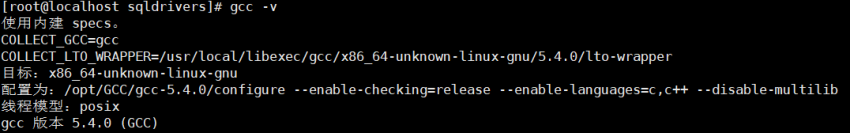

3. 请前往 [达梦云适配中心](https://eco.dameng.com/download/) 下载试用下载 QT QDM 接口源码。

### 2.4 编译 QDM 动态库

本机 QT 安装目录为 /opt/Qt5.12.1，因为每个人的安装目录都不一致，所以定义 QTDIR=/opt/Qt5.12.1/5.12.1。

1. 上传 QDM 源码到对应目录。

（1）上传 qt\_src\\plugins\_sqldrivers\\dm\_56 到 QTDIR/Src/qtbase/src/plugins/sqldrivers，并改名为 dm；

（2）上传 qt\_src\\sql\_drivers\\dm 到 QTDIR/Src/qtbase/src/sql/drivers 目录，没有此目录可以自行创建。

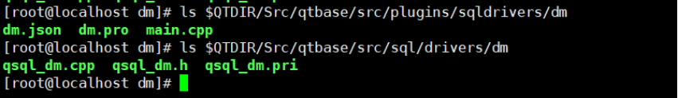

2. 生成 Makefile。进入 $QTDIR/Src/qtbase/src/plugins/sqldrivers/dm 目录执行：
```shell
qmake "INCLUDEPATH+=/home/dmdba/dm/dmdbms/include" "LIBS+=/home/dmdba/dm/dmdbms/include/libdmdpi.a -ldl"  "DEFINES+=DM64" "CONFIG+=debug_and_release" dm.pro
```

其中的 INCLUDEPATH 和 LIBS 变量目录需要根据本机环境进行更改。

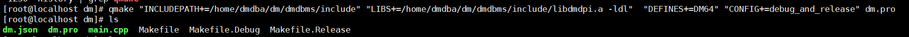

3. 编译。执行 make debug 命令，编译完成后会生成 libqsqldm.so 文件，生成目录由 Makefile.Debug 的 DESTDIR 变量决定。

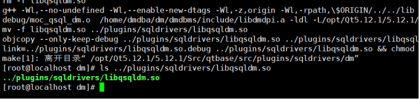

4. 拷贝 libqsqldm.so 文件到对应目录。QT 的数据库插件文件一般放在 $QTDIR/gcc\_64/plugins/sqldrivers/ 目录，因此编译完成后需要拷贝文件到此目录，否则 QT 程序会无法加载。

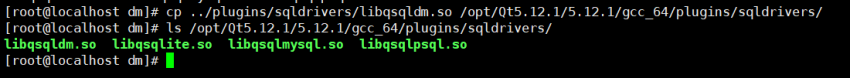

## 三、 数据库连接

上面我们已经完成了 QDM 的编译，下面我们就通过一个简单的例子来检查插件是否能够正常使用。

### 3.1 新建工程

使用 qtcreator 工具新建一个 Qt Console AppLication 工程 qdmtest：

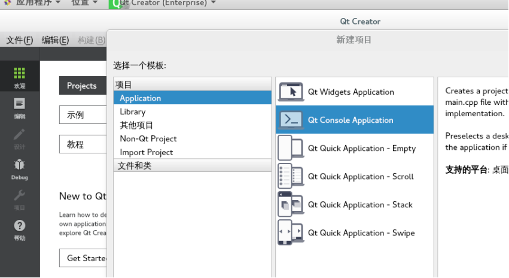

### 3.2 编写代码

因为需要访问 QT SQL 模块，所以需要在 qdmtest.pro 文件中添加：

```shell
QT += sql
INCLUDEPATH += /opt/Qt5.12.1/5.12.1/gcc_64/include/QtSql
```

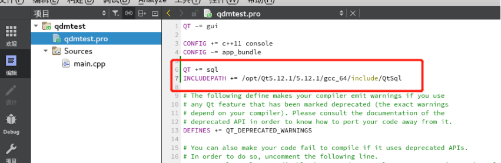

main.cpp 编译代码进行登录数据库并查询数据库版本，注意此处指定 driver 为 QDM：

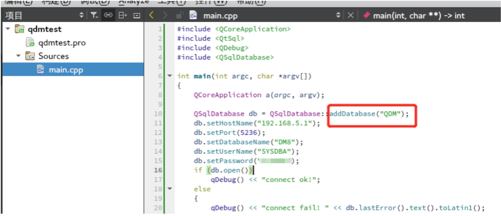

### 3.3 编译运行

选中项目右键进行构建编译，也可以在终端通过命令进行编译，编译成功后即可运行。

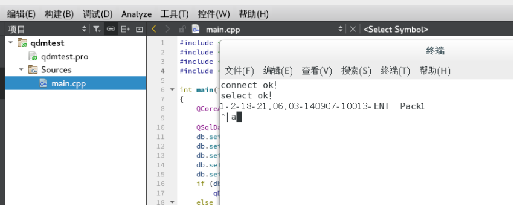

## 四、开发示例

### 4.1 基础操作示例

具体代码示例参考： [QODBC 编译](c_c++_qodbc.md) 。

代码段仅需要做如下修改即可执行：

```shell
原 QODBC 接口：QSqlDatabase db = QSqlDatabase::addDatabase("QODBC");
QDM 接口：QSqlDatabase db = QSqlDatabase::addDatabase("QDM");
```

## 五、常见问题

**1\. QT SQL 类头文件未找到**

【问题解决】：需要在.pro 文件添加 `INCLUDEPATH += $QTDIR/gcc_64/include/QtSql` 。

**2\. 对 'QSqlDatabase::defaultConnection' 未定义的引用**

【问题解决】：这是因为编译时未连接 QT SQL 动态库导致，在.pro 文件添加 `QT += sql` 解决。

**3\. 编译报错： “cannot find –lGL”**

【问题解决】：动态库路径不对导致，QT 默认查找 /usr/lib 目录下文件，可以通过 locate 定位，然后 ln -s 创建软连接解决。

**4\. QSqlDatabase: QDM driver not loaded**

【问题解决】：未加载到 libqsqldm.so 文件，需要拷贝此文件到正确目录：

```shell
cp libqsqldm.so $QTDIR/gcc_64/plugins/sqldrivers
```

**5\. 提示缺少文件：No such file or directory**

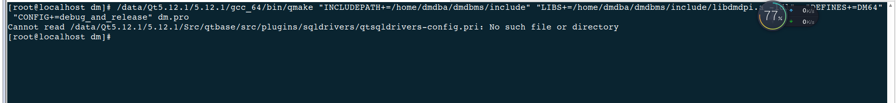

```shell
[root@localhost dm]# /data/QT 5.12.1/5.12.1/gcc_64/bin/qmake "INCLUDEPATH+=/home/dmdba/dmdbms/include " " LIBS +=/home/dmdba/dmdbms/include/libdmdpi.a  -ldl " "DEFINES+=DM64" "CONFIG+=debug_and_release" dm.pro
Cannot read /data/QT 5.12.1/5.12.1/Src/qtbase/src/plugins/sqldrivers/qtsqldrivers-config.pri : No such file or directory 
[root@localhost dm]#
```

【问题解决】：修改如下文件：

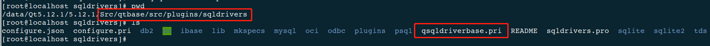

## 六、参考

1. 示例代码下载： [qt\_qdm\_code.zip](https://eco.dameng.com/eco-file-server/file/eco/download/20221222115846AVT00UAJDUDB2XL36G) 。
2. 以上文档内容参考过程中遇到任何问题，可到 [达梦技术社区](https://eco.dameng.com/community/question/) 提问交流。