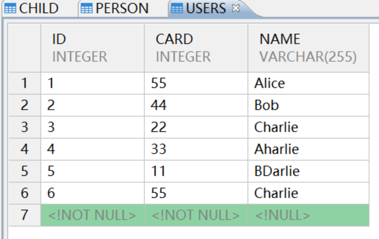
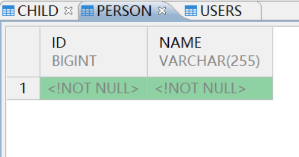
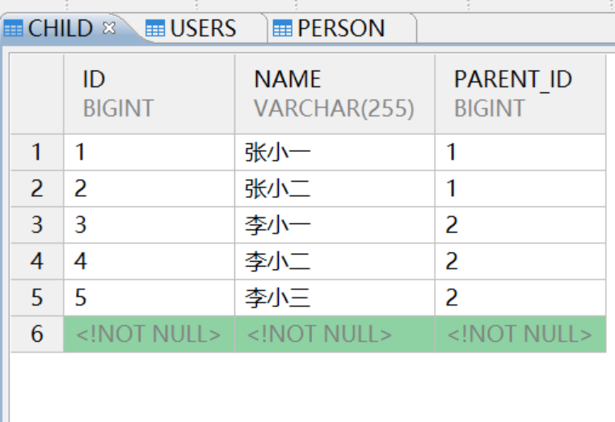
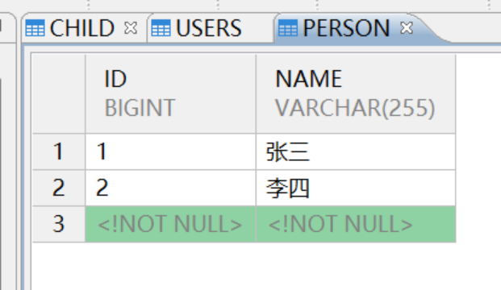

## 一、前言

Querydsl 是一个开源的 Java 框架，用于构建类型安全的 SQL 查询和其他数据查询。它通过 Java 领域特定语言（DSL）提供了一种更直观、更安全的方式来编写数据库查询，避免了传统字符串拼接 SQL 的诸多问题。

apt-maven-plugin 专门为 Querydsl 设计的插件，用于在编译前生成 Q 类，而 maven-processor-plugin 目前更新迭代快，配置比较繁琐，因此本次测试使用的 apt-maven-plugi 作为具体例子。

## 二、开发环境准备

本次测试使用的工具有 idea，本次使用引用达梦的 jar 包有 DmDialect-for-hibernate5.6，DmJdbcDriver8，位于达梦安装目录的\\drivers\\jdbc 下，使用的 JDK 版本为 JDK1.8 。

## 三、开发步骤

本次使用原生的 Querydsl ，分别对于 JPAQueryFactory 和 JPAQuery 编写测例。

### 3.1 使用 idea 创建 maven 项目

创建的项目结构如下所示：

通过 pom.xml 等方式用 maven 仓库进行引入，pom.xml 内容如下：

```java
<?xml version="1.0" encoding="UTF-8"?>
<project xmlns="http://maven.apache.org/POM/4.0.0"
         xmlns:xsi="http://www.w3.org/2001/XMLSchema-instance"
         xsi:schemaLocation="http://maven.apache.org/POM/4.0.0
                             https://maven.apache.org/xsd/maven-4.0.0.xsd">
    <modelVersion>4.0.0</modelVersion>

    <groupId>org.example</groupId>
    <artifactId>Querydsl</artifactId>
    <version>1.0-SNAPSHOT</version>

    <properties>
        <project.build.sourceEncoding>UTF-8</project.build.sourceEncoding>
        <maven.compiler.source>1.8</maven.compiler.source> <!-- Java 8 -->
        <maven.compiler.target>1.8</maven.compiler.target> <!-- Java 8 -->
        <hibernate.version>5.6.15.Final</hibernate.version> <!-- 降级到 Hibernate 5.x，兼容 Java 8 -->
        <querydsl.version>5.0.0</querydsl.version>
    </properties>

    <dependencies>
        <!-- Hibernate Core (JPA 实现) - 降级到 5.6.x，支持 Java 8 -->
        <dependency>
            <groupId>org.hibernate</groupId>
            <artifactId>hibernate-core</artifactId>
            <version>${hibernate.version}</version>
        </dependency>

        <!-- H2 Database -->
        <dependency>
            <groupId>com.h2database</groupId>
            <artifactId>h2</artifactId>
            <version>2.2.224</version>
        </dependency>

        <!-- Querydsl JPA -->
        <dependency>
            <groupId>com.querydsl</groupId>
            <artifactId>querydsl-jpa</artifactId>
            <version>${querydsl.version}</version>
        </dependency>

        <!-- Querydsl APT (用于生成 Q 类，仅编译期使用) -->
        <!-- 1. Querydsl APT 处理器 -->
        <dependency>
            <groupId>com.querydsl</groupId>
            <artifactId>querydsl-apt</artifactId>
            <version>5.0.0</version>
            <classifier>jpa</classifier>
        </dependency>
        <!-- 2. ✅ 添加 javax.annotation-api，确保 APT 处理阶段能访问到 javax.annotation.processing.Generated -->
   <!--     <dependency>
            <groupId>javax.annotation</groupId>
            <artifactId>javax.annotation-api</artifactId>
            <version>1.3.2</version>
        </dependency>-->

        <!-- （可选）Lombok -->
        <dependency>
            <groupId>org.projectlombok</groupId>
            <artifactId>lombok</artifactId>
            <version>1.18.30</version>
            <scope>provided</scope>
        </dependency>

    </dependencies>

    <build>
        <plugins>
            <!-- Maven Compiler Plugin（降级为 Java 8 配置） -->
            <plugin>
                <groupId>org.apache.maven.plugins</groupId>
                <artifactId>maven-compiler-plugin</artifactId>
                <version>3.11.0</version> <!-- 或者使用 3.8.1 等更旧的稳定版本也可以 -->
                <configuration>
                    <source>1.8</source> <!-- Java 8 -->
                    <target>1.8</target> <!-- Java 8 -->
                    <encoding>UTF-8</encoding>
                    <!-- 注意：不要使用 <release> 标签，Java 8 不支持 -->
                </configuration>
            </plugin>

            <!-- （可选）Maven Surefire Plugin -->
            <plugin>
                <groupId>org.apache.maven.plugins</groupId>
                <artifactId>maven-surefire-plugin</artifactId>
                <version>3.1.2</version>
            </plugin>

            <!-- （可选）Maven Jar Plugin -->
            <plugin>
                <groupId>org.apache.maven.plugins</groupId>
                <artifactId>maven-jar-plugin</artifactId>
                <version>3.3.0</version>
            </plugin>
            <plugin>
                <groupId>com.mysema.maven</groupId>
                <artifactId>apt-maven-plugin</artifactId>
                <version>1.1.3</version>
                <executions>
                    <execution>
                        <goals>
                            <goal>process</goal>
                        </goals>
                        <configuration>
                            <outputDirectory>${project.build.directory}/generated-sources/java</outputDirectory>
                            <processor>com.querydsl.apt.jpa.JPAAnnotationProcessor</processor>
                        </configuration>
                    </execution>
                </executions>
                <dependencies>
                    <dependency>
                        <groupId>com.querydsl</groupId>
                        <artifactId>querydsl-apt</artifactId>
                        <version>${querydsl.version}</version>
                    </dependency>
                    <!-- 如果是 JPA，还需要加 JPA 的元模型依赖 -->
                    <dependency>
                        <groupId>com.querydsl</groupId>
                        <artifactId>querydsl-jpa</artifactId>
                        <classifier>apt</classifier>
                        <version>${querydsl.version}</version>
                    </dependency>
                    <dependency>
                        <groupId>javax.annotation</groupId>
                        <artifactId>javax.annotation-api</artifactId>
                        <version>1.3.2</version>
                    </dependency>
                </dependencies>
            </plugin>
        </plugins>
    </build>

    <!-- 可选的 Java 8 Profile（非必须） -->

    <profiles>
        <profile>
            <id>java8</id>
            <activation>
                <jdk>1.8</jdk>
            </activation>
            <properties>
                <maven.comapiler.source>1.8</maven.comapiler.source>
                <maven.compiler.target>1.8</maven.compiler.target>
            </properties>
        </profile>
    </profiles>
</project>
```

### 3.2 创建相关的实体类

Child 实体类内容如下：

```java
package  org.example.model;
import javax.persistence.*;

@Entity
@Table(name = "child")
public class Child {
    @Id
    @GeneratedValue(strategy = GenerationType.IDENTITY)
    private Long id;

    @Column(name = "name", nullable = false)
    private String name;

    // 多对一关系映射
    @ManyToOne(fetch = FetchType.LAZY)
    @JoinColumn(name = "parent_id", nullable = false)
    private Parent parent;

    // 构造方法
    public Child() {}

    public Child(String name) {
        this.name = name;
    }

    // Getter和Setter
    public Long getId() {
        return id;
    }

    public String getName() {
        return name;
    }

    public void setName(String name) {
        this.name = name;
    }

    public Parent getParent() {
        return parent;
    }

    public void setParent(Parent parent) {
        this.parent = parent;
    }
}
```

Parent 实体类内容如下：

```java
package org.example.model;

import javax.persistence.*;
import java.util.ArrayList;
import java.util.List;

@Entity
@Table(name = "person")
public class Parent {
    @Id
    @GeneratedValue(strategy = GenerationType.IDENTITY)
    private Long id;

    @Column(name = "name", nullable = false)
    private String name;

    // 一对多关系映射
    @OneToMany(mappedBy = "parent", cascade = CascadeType.ALL, orphanRemoval = true)
    private List<Child> children = new ArrayList<>();

    // 构造方法
    public Parent() {}

    public Parent(String name) {
        this.name = name;
    }

    // Getter和Setter
    public Long getId() {
        return id;
    }

    public String getName() {
        return name;
    }

    public void setName(String name) {
        this.name = name;
    }

    public List<Child> getChildren() {
        return children;
    }

    public void addChild(Child child) {
        children.add(child);
        child.setParent(this);
    }

    public void removeChild(Child child) {
        children.remove(child);
        child.setParent(null);
    }
}
```

### 3.3 配置文件

此文件位于 src/main/resources/META-INF/persistence.xml,当您使用 JPA（比如 Hibernate、EclipseLink）时,容器（如 Java EE 服务器、Spring Boot）或 JPA 工具会自动读取这个文件，以初始化 EntityManagerFactory。本次使用 persistence.xml 内容如下：

```java
<?xml version="1.0" encoding="UTF-8"?>
<persistence version="2.1"
             xmlns="http://xmlns.jcp.org/xml/ns/persistence"
             xmlns:xsi="http://www.w3.org/2001/XMLSchema-instance"
             xsi:schemaLocation="http://xmlns.jcp.org/xml/ns/persistence
                                 http://xmlns.jcp.org/xml/ns/persistence/persistence_2_1.xsd">

    <persistence-unit name="my-pu" transaction-type="RESOURCE_LOCAL">

        <!-- 注册 JPA 实体类（如果有） -->
        <class>org.example.model.User</class>

        <properties>
            <!-- ===== 达梦数据库 JDBC 配置 ===== -->

            <!-- JDBC 驱动：达梦数据库驱动类 -->
            <property name="javax.persistence.jdbc.driver" value="dm.jdbc.driver.DmDriver"/>

            <!-- JDBC URL：达梦数据库连接地址，端口号通常是 5236 -->
            <!-- 请将 your_database_name 替换为您实际的达梦数据库名 -->
            <property name="javax.persistence.jdbc.url" value="jdbc:dm://localhost:5236"/>

            <!-- 数据库用户名：达梦默认超级用户通常是 SYSDBA -->
            <property name="javax.persistence.jdbc.user" value="SYSDBA"/>

            <!-- 数据库密码：请填写您的达梦数据库密码 -->
            <property name="javax.persistence.jdbc.password" value="SYSDBa111"/>

            <!-- ===== Hibernate 配置（达梦）===== -->

            <!-- Hibernate 方言：达梦数据库 -->
            <property name="hibernate.dialect" value="org.hibernate.dialect.DmDialect"/>

            <!-- 是否显示执行的 SQL -->
            <property name="hibernate.show_sql" value="true"/>

            <!-- 是否格式化 SQL 输出 -->
            <property name="hibernate.format_sql" value="true"/>

            <!-- 自动建表策略：create-drop（启动创建，结束删除，适合测试） -->
            <!-- 如果是生产，建议使用 validate 或 update -->
            <property name="hibernate.hbm2ddl.auto" value="update"/>

        </properties>
    </persistence-unit>
</persistence>
```

### 3.4 测试使用 JPAQuery

JPAQuery\_Test 测试单表插入查询，内容如下：

```java
package org.example;

import com.querydsl.core.Tuple;
import com.querydsl.jpa.impl.JPAQuery;

import org.example.model.QUser;
import org.example.model.User;

import javax.persistence.EntityManager;
import javax.persistence.EntityManagerFactory;
import javax.persistence.Persistence;

import java.util.ArrayList;
import java.util.List;

public class JPAQuery_Test {
    public static void main(String[] args) {
        EntityManagerFactory emf = Persistence.createEntityManagerFactory("my-pu");
        EntityManager em = emf.createEntityManager();
        try {
            em.getTransaction().begin();
            em.persist(new User("Alice", 55));
            em.persist(new User("Bob",44));
            em.persist(new User("Charlie",22));
            em.persist(new User("Aharlie",33));
            em.persist(new User("BDarlie",11));
            em.persist(new User("Charlie",55));
            em.getTransaction().commit();
            QUser qUser = QUser.user;
            //单独查询一个用户
            JPAQuery<User> query = new JPAQuery<>(em);
            User user1 = query.select(qUser)
                    .from(qUser)
                    .where(qUser.name.eq("Bob"))
                    .fetchFirst();
            System.out.println("单独查询结果为:");
            System.out.println("找到用户: " + user1.getName());
           //查询所有用户
            JPAQuery<User> query2 = new JPAQuery<>(em);
            List<User> user2=query2.select(qUser).from(qUser).fetch();
            System.out.println("查找所有用户结果为：");
            for (User a : user2) {
                System.out.println(">> 用户ID: " + a.getId() +
                        ", 姓名: " + a.getName() +
                        ", 卡号: " + a.getCard());
            }
            //通过card排序查询所有用户
            JPAQuery<User> query3 = new JPAQuery<>(em);
            List<User> user3=query3.select(qUser).from(qUser).orderBy(qUser.card.asc()).fetch();
            System.out.println("以card排序升序结果为：");
            for (User a : user3) {
                System.out.println(">> 用户ID: " + a.getId() +
                        ", 姓名: " + a.getName() +
                        ", 卡号: " + a.getCard());
            }
            //查询id和name
            JPAQuery<Tuple> query4 = new JPAQuery<>(em);
            List<Tuple> tupleList = query4.select(qUser.id, qUser.name)
                    .from(qUser)
                    .fetch();
            List<User> allUsers = new ArrayList<>();
            for (Tuple tuple : tupleList) {
                User user = new User();
                user.setId(tuple.get(qUser.id));
                user.setName(tuple.get(qUser.name));
                allUsers.add(user);
            }
            for (User u : allUsers) {
                System.out.println("ID: " + u.getId() + ", Name: " + u.getName());
            }
        } finally {
            em.close();
            emf.close();
        }
    }
}
```

运行结果如下：





### 3.5 测试使用 JPAQueryFactory

JPAQueryFactory\_Test 测试单表插入，查询和多表查询，内容如下：

```java
package org.example;

import com.querydsl.core.Tuple;
import com.querydsl.core.types.Expression;
import com.querydsl.jpa.JPAExpressions;
import com.querydsl.jpa.impl.JPAQueryFactory;
import org.example.model.*;

import javax.persistence.EntityManager;
import javax.persistence.EntityManagerFactory;
import javax.persistence.Persistence;
import java.util.HashMap;
import java.util.List;
import java.util.Map;

public class JPAQueryFactory_Test {
    Map<String, String> properties;
    EntityManagerFactory emf;
    EntityManager em;
    JPAQueryFactory queryFactory;

    public JPAQueryFactory_Test() {
        properties = new HashMap<>();
        properties.put("javax.persistence.jdbc.url", "jdbc:dm://localhost:5236?schema=JPAQUERYFACTORY");
        properties.put("javax.persistence.jdbc.user", "SYSDBA");
        properties.put("javax.persistence.jdbc.password", "SYSDBa111");
        properties.put("javax.persistence.jdbc.driver", "dm.jdbc.driver.DmDriver");
        properties.put("hibernate.hbm2ddl.auto", "update");
        emf = Persistence.createEntityManagerFactory("my-pu", properties);
        em = emf.createEntityManager();
        queryFactory = new JPAQueryFactory(em);
    }

    public static void main(String[] args) {
        JPAQueryFactory_Test A = new JPAQueryFactory_Test();
        // 添加用户
        A.createUser();

        // 获取单个用户
        User user = A.findUser();
        System.out.println("获取单独用户");
        String result = String.format("当前用户查询结果ID为：%d, NAME为：%s, Card为：%d",
                user.getId(),
                user.getName(),
                user.getCard());
        System.out.println(result);

        // 查询名字升序，card降序
        List<User> users = A.findUsers();
        System.out.println("获取用户排序");
        for (User a : users) {
            System.out.println(String.format("查询结果ID为：%d, NAME为：%s, Card为：%d",
                    a.getId(),
                    a.getName(),
                    a.getCard()));
        }

        // 返回所有用户的name和card
        List<Tuple> tupleList = A.findUser3();
        for (Tuple tuple : tupleList) {
            String name = tuple.get(QUser.user.name);
            Integer card = tuple.get(QUser.user.card);
            System.out.println("Name: " + name + ", Card: " + card);
        }

        // 二表关联查询
        List<Parent> parentList = A.findParentsWithMaxChildren();
        System.out.println("获取拥有最多孩子的父母");
        for (Parent parent : parentList) {
            System.out.println("Name: " + parent.getName() + ", Children: " + parent.getChildren().size());
        }
    }

    public void createUser() {
        try {
            em.getTransaction().begin();

            // 创建测试数据
            Parent parent1 = new Parent("张三");
            parent1.addChild(new Child("张小一"));
            parent1.addChild(new Child("张小二"));

            Parent parent2 = new Parent("李四");
            parent2.addChild(new Child("李小一"));
            parent2.addChild(new Child("李小二"));
            parent2.addChild(new Child("李小三"));
            em.persist(parent1);
            em.persist(parent2);

            // 创建用户数据
            User user1 = new User("Aharlie", 100);
            User user2 = new User("Aharlie", 200); // 同名用户
            User user3 = new User("Bob", 300);
            em.persist(user1);
            em.persist(user2);
            em.persist(user3);

            em.getTransaction().commit();
        } catch (Exception e) {
            if (em.getTransaction().isActive()) {
                em.getTransaction().rollback();
            }
            throw new RuntimeException(e);
        }
    }

    // 使用fetchFirst()
    public User findUser() {
        QUser qUser = QUser.user;
        return queryFactory.selectFrom(qUser)
                .where(qUser.name.eq("Aharlie"))
                .orderBy(qUser.id.asc()) // 添加排序确保结果一致性
                .fetchFirst(); // 改为fetchFirst()避免NonUniqueResultException
    }

    public List<User> findUsers() {
        QUser qUser = QUser.user;
        return queryFactory.selectFrom(qUser)
                .orderBy(qUser.name.asc(), qUser.card.desc())
                .fetch();
    }

    public List<Tuple> findUser3() {
        QUser qUser = QUser.user;
        return queryFactory.select(qUser.name, qUser.card)
                .from(qUser)
                .fetch();
    }

    public List<Parent> findParentsWithMaxChildren() {
        QParent p = QParent.parent;
        QChild c = QChild.child;

        // 子查询：获取最大孩子数量
        Expression<Long> maxChildCount = JPAExpressions
                .select(c.count().max())
                .from(c)
                .groupBy(c.parent.id);

        // 主查询：获取孩子数量等于最大值的父母
        return queryFactory.selectFrom(p)
                .where(JPAExpressions.select(c.count())
                        .from(c)
                        .where(c.parent.eq(p))
                        .groupBy(c.parent.id)
                        .having(c.count().eq(maxChildCount))
                        .exists())
                .fetch();
    }
}
```

运行结果如下：





## 四、重点

本次使用 JPAQuery 和 JPAQueryFactory 进行测试。

### 4.1 JPAQuery 和 JPAQueryFactory 的区别

1.JPAQuery：是 Querydsl 中用于构建和执行查询的核心类。它提供了链式 API 来构建查询（如 select、from、where 等）。每个 JPAQuery 实例通常用于一个查询。  
2.JPAQueryFactory：是一个工厂类，用于创建 JPAQuery 实例。它简化了 JPAQuery 的创建过程，并且提供了更简洁的方法（如 selectFrom、select 等）来开始构建查询。使用工厂的好处是可以重用同一个工厂实例来创建多个查询，并且可以统一设置一些默认选项（如查询的基路径）。

### 4.2 生成 Q 类的原理

Q 类（查询元模型）是 Querydsl 根据实体类生成的，用于类型安全的查询。生成过程通常由注解处理器（APT）在编译时完成。  
原理：在编译阶段，APT 会扫描带有特定注解（如 @Entity）的类，然后为每个实体类生成一个对应的 Q 类。这个 Q 类包含了实体类的元数据（如字段名、类型），并提供了静态变量来表示实体本身和其属性，以便在查询中使用。

### 4.3 配置文件读取

目前使用 JPAQuery 的例子是方式 1，JPAQueryFactory 的例子是方式 2。  
方式 1：只保留一个标准的 persistence.xml（推荐）  
确保该文件中定义了您需要的

只需要这样加载：  
EntityManagerFactory emf = Persistence.createEntityManagerFactory("my-pu");  
它会自动读取 META-INF/persistence.xml 中的

方式 2：不使用 persistence.xml，完全通过代码配置（编程式配置，推荐灵活场景）  
有多个配置，或者不想依赖 META-INF/persistence.xml 文件，您 完全可以不使用任何 XML 文件，而是 通过 Java 代码（Map 配置）直接创建 EntityManagerFactory。

### 4.4 需要注意的参数

配置文件 persistence.xml 需要注意 hibernate.hbm2ddl.auto 参数：此参数控制表的生成，删除于修改。

hibernate.hbm2ddl.auto 配置详解  
validate 加载 hibernate 时，验证创建数据库表结构  
如果数据库表缺少 email 列 → 抛出异常  
如果表结构匹配 → 正常启动

create 每次加载 hibernate，重新创建数据库表结构，这就是导致数据库表数据丢失的原因。  
删除现有 users 表（包括所有数据）  
创建只有 id/username/password 字段的新表

create-drop 加载 hibernate 时创建，退出是删除表结构  
启动时：创建新表  
关闭时：删除表

update 加载 hibernate 自动更新数据库结构  
如果添加了 email 字段 → 自动添加 email 列  
保留表中现有数据

### 4.5 为什么 JPAQuery 没用到实体类也会建表

只要实体类有 @Entity 注解，即使不插入任何数据，JPA 也会自动创建表结构。这个行为由 Hibernate 的 DDL 自动生成功能控制。

## 五、参考

示例代码位于下方：

[Querydsl.zip](https://eco.dameng.com/eco-file-server/file/eco/download/20250930165114PZHX71MNG576FE2HJ9)