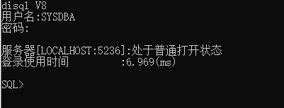
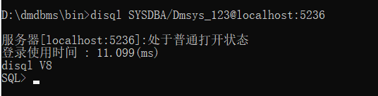
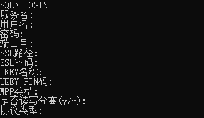

## 2.1 启动 DIsql

为了使用 DIsql，必须首先要启动 DIsql。DIsql 工具可以广泛用于各种操作系统，如 WINDOWS、LINUX 等。

启动之后，当出现“SQL>”符号时，用户就可以利用 DM 提供的 SQL 语句和数据库进行交互操作了，需要注意的是，在 DIsql 中 SQL 语句应以分号“;”结束。对于执行语句块，创建触发器、存储过程、函数、包以及模式等时需要用“/”结束。

### 2.1.1 在 windows 系统中启动 DIsql

windows 环境下，有两种启动 DIsql 的方式。第一种是启动安装软件后生成的程序菜单，第二种是启动安装目录下自带的 DIsql 工具。

#### 2.1.1.1 程序菜单启动

如果在 WINDOWS 环境中安装了 DM 数据库产品，那么可以在应用菜单中找到 `SQL交互式查询工具` ，直接双击即可启动。然后使用 LOGIN 或 CONN 命令登录到指定数据库。LOGIN 或 CONN 命令下文有详细介绍。

以 LOGIN 为例，登录到 IP 地址为 192.168.100.121，端口号为 5946 的机器上，用户名为 SYSDBA，密码以“Dmsys\_123”为例，实际运行中需要用户自行替换为数据库初始化时设定的密码。其他全部敲回车，采用缺省输入。密码不会回显到屏幕上。

图2.1 菜单启动登录界面

除密码外，其他参数可采用缺省输入，登录到本地 DM 数据库。缺省值请参考下文 LOGIN 命令。

#### 2.1.1.2 自带 DIsql 工具启动

DIsql 工具位于 DM 数据库安装目录的 bin 子目录下，例如 DM 数据库的安装目录为 D:\\dmdbms，则 DIsql 位于 D:\\dmdbms\\bin\\DIsql.exe。双击启动，然后输入用户名、密码，就可登录到本地 DM 数据库实例。密码不会回显到屏幕上。



图2.2 自带 DIsql 工具登录界面

如果后续操作想登录到其他 DM 数据库实例，可使用 LOGIN 或 CONN 命令。

### 2.1.2 命令行启动 DIsql

命令行启动 DIsql 适用于任何操作系统平台。下面以 WINDOWS 系统为例。

#### 2.1.2.1 命令行启动

从命令行启动 DIsql 并登录到数据库。在命令行工具中找到 DIsql 所在安装目录 D:\\dmdbms\\bin，输入 disql 和登录方式后回车。登录方式在下一节详细介绍。

登录界面如下：



图2.3 命令行启动登录界面

#### 2.1.2.2 DIsql 登录方式

DIsql 的登录方式。

**语法如下：**

```
DIsql 用法1：disql –h | help   显示disql版本信息和帮助信息
DIsql 用法2：disql [ [<option>] [<logon> |{/NOLOG}] [<start>] ]
<option>::=[-L] [-S]
<logon>::={{<username>[/<password>]} | /}[@<connect_identifier>][<logon_option>] [<os_auth>] 
<connect_identifier> ::=<svc_name> | {<host>[:<port>]} | <unixsocket_file>
<logon_option>::=<option_no_esc>|<option_esc>
<option_no_esc >::= #{ <extend_option>=<value>{,<extend_option>=<value>} }  //此行外层{}是为了封装参数之用，书写时需要保留
<option_esc>::= # "{ <extend_option>=<value>{,<extend_option>=<value>} } "  //此行外层"{}"是为了封装参数之用，书写时需要保留
<os_auth>::= AS {SYSDBA|SYSSSO|SYSAUDITOR|USERS|AUTO}
<start>::= <\`运行脚本> | <@运行脚本> | <@@运行脚本> | <start运行脚本> | <直接执行语句> | <直接执行设置DIsql属性命令> 
<\`运行脚本>::=\`<file_path> [<PARAMETER_VALUE>{<PARAMETER_VALUE>}]
<@运行脚本>::=@<file_path> [<PARAMETER_VALUE>{<PARAMETER_VALUE>}]
<@@运行脚本>::=@@<file_path> [<PARAMETER_VALUE>{<PARAMETER_VALUE>}]
<start运行脚本>::=START <file_path> [<PARAMETER_VALUE>{<PARAMETER_VALUE>}]
<直接执行语句>::= -E "<SQL语句>{;<SQL语句>}"
<直接执行设置DIsql属性命令>::= -C "<SET命令 | COLUMN命令>"
```

> **建议**
> 
> 文中语法符号规定：<>内的内容是必选项；  
> \[\]内的内容是可选项；{}内的内容可以出现一次或多次；  
> |为或者；::=为定义符。后文语法用法与此相同。

**\-h | help** ：h 或 help 表示显示 DIsql 版本信息和帮助信息。

**\[-L\] \[-S\]** ：-L 表示只尝试登录一次；-S 表示设置 DIsql 界面为隐藏模式，隐藏\<SQL> 标识符。

**{{\<username>\[/\<password>\]} | /}** ：为用户名和密码。普通登录方式时用户名必写，密码为 dminit 初始化时，系统强制要求设置的登录口令，本文档中以“Dmsys\_123”为示例密码，实际运行中需要用户自行替换为数据库初始化时设定的密码。/表示采用操作系统身份验证方式登录或利用 wallet 文件登录。采用操作系统身份验证方式登录时无需指定用户名和密码，即使指定也会被忽略。利用 wallet 文件登录时，dm\_svc.conf 文件中的配置项 WALLET\_LOCATION 必须非空，客户端会通过用户输入的服务名以及 WALLET\_LOCATION 配置项指定的 wallet 文件路径自动获取 wallet 文件中服务名所对应的用户名和密码，因此用户无需输入用户名和密码，若用户输入了用户名和密码，则优先使用用户输入的用户名和密码登录数据库，关于利用 wallet 文件登录数据库的更多详细介绍请参考手册《DM8 安全管理》。如果\*<\*password> 中含有特殊字符，因为特殊字符在操作系统中需要被特殊处理，因此特殊字符书写的时候需要按照要求的格式。本节末尾会针对包含特殊字符的\*<\*password> 如何书写，进行详细介绍。

**<svc\_name>：** 服务名。服务名在 dm\_svc.conf 中配置。dm\_svc.conf 的配置请参考《DM8 系统管理员手册》。例如：在 dm\_svc.conf 中配置服务名 dmsvc =(192.168.1.150:5236, 192.168.1.150:5237)。然后就可以使用服务名登录了：DIsql SYSDBA/Dmsys\_123@dmsvc。使用服务名的好处是第一个 IP 连不通，会自动连接下一个。

**host\[:port\]** ：服务器 IP 地址和端口号。缺省情况下默认为本地服务器和端口号 localhost:5236。当服务器为本机时，host 参数可直接写 localhost。当连接其他服务器时，host:port 需写上 ip 地址和端口号 portnum，例如：192.168.0.248:8888。\*<\*host> 如果是 IPv6 的地址，需要用\[\]指明是 IPv6 地址，例如\[fe80::1e6f:65ff:fed1:3724%6\]。

**<unixsocket\_file>：** 专门用于在 LINUX 系统中，当服务器与客户端之间使用 UNIXSOCKET（UNIX DOMAIN SOCKET - IPC）协议通信时，指定客户端连接的 socket 文件路径。例如：

```
./disql SYSDBA/Dmsys_123@/data/sdb/DAMENG/foo.sock#{inet_type=UNIXSOCKET}
```

**<logon\_option>** ：为扩展选项，包括 <option\_no\_esc>和 <option\_esc>两种书写方式，两种方式除了书写封装符号#{}和#"{ }"不同，其他一样。<option\_no\_esc> 适用于 Window 环境和一个 Linux 环境特殊情况（只包含一个扩展选项的情况，例如：#{inet\_type=tcp}）。<option\_esc> 适用于 Windows 和 Linux 环境。<extend\_option>=\<value>中所有 value 值不能包含空格，不能包含特殊的符号，如引号等。现支持的扩展选项 <extend\_option> 如下：

| **extend\_option** | **value** |
| --- | --- |
| mpp\_type | MPP 登录属性，此属性的设置对非 MPP 系统没有影响。取值 GLOBAL 和 LOCAL，默认为 GLOBAL。GLOBAL 表示 MPP 环境下建立的会话为全局会话，对数据库的导入导出操作在所有节点进行；LOCAL 表示 MPP 环境下建立的会话为本地会话，对数据库的导入导出操作只在本地节点进行 |
| inet\_type | 网络通信协议类型。取值 TCP/UDP/IPC/UNIXSOCKET/RDMA，缺省为 TCP。   TCP：传输控制协议，是一种面向连接的、可靠的、基于字节流的传输层通信协议；   UDP：用户数据报协议，是一种面向数据报的、不可靠的、可快速传输的传输层通信协议，和 TCP 协议互为补充。若应用程序对可靠性的要求较低，对传输性能要求较高，则可以选择 UDP 通信协议。使用 UDP 通信协议时，服务器需要设置 INI 参数 ENABLE\_UDP 非 0；   IPC：基于共享内存的通信协议，用于同一台主机的进程间通讯。使用 IPC 协议连接数据库时会忽略 IP 地址和端口号，直接连接本机上 INI 参数 ENABLE\_IPC=1 的服务器，一台机器上只能有一个服务器设置 ENABLE\_IPC=1；   UNIXSOCKET：与 IPC 协议类似，同样用于同一台主机的进程间通讯。仅 LINUX 环境下支持 UNIXSOCKET 通信协议。使用 UNIXSOCKET 通信协议时，无需指定 IP 地址和端口号，但服务器需要配置 INI 参数 UNIX\_SOCKET\_PATHNAME 指定 socket 文件路径，客户端连接服务器时也需要指定 socket 文件路径，二者必须一致；   RDMA：远程直接数据存取协议，通过网络将数据从一个系统快速移动到远程系统的存储器中，大大降低计算机处理性能的损耗。使用 RDMA 协议需要安装并配置 RDMA 网卡。使用 RDMA 协议连接数据库时需要指定 RDMA 网卡配置的 IP 地址以及服务器的端口号 |
| ssl\_path | 通信加密的 SSL 数字证书路径，缺省为不使用加密。数字证书路径由用户自己创建，将相应的证书需放入该文件夹中。其中服务器证书必须与 dmserver 目录同级，客户端目录可以任意设置。和 ssl\_pwd 一起使用。 各用户只能使用自己的 SSL 数字证书，例如 SYSDBA 账户只能使用\\bin\\CLIENT\_SSL\\SYSDBA 下的证书和密码，如果证书没有密码可以用缺省或任意数字代替。 例如：./disql SYSDBA/Dmsys\_123@192.168.1.64:5236#"{ssl\_path= /home/dmdbms/bin/client\_ssl/SYSDBA,ssl\_pwd=Password01}" |
| ssl\_pwd | 通信加密的 SSL 数字证书密码。和 ssl\_path 一起使用。缺省为不加密 |
| proxy\_client | 被代理的用户名。   例如：现创建用户 USER1 和 USER2，其中用户 USER1 为被代理用户，其用户名和密码为 USER1/Password01。用户 USER2 为代理用户，其用户名和密码为 USER2/Password02。   CREATE USER USER1 IDENTIFIED BY Password01;   GRANT DBA TO USER1;   CREATE USER USER2 IDENTIFIED BY Password02;   GRANT DBA TO USER2;   执行以下语句，赋予用户 USER2 代理用户 USER1 权限，使用户 USER2 可以认证登录用户 USER1。   ALTER USER USER1 GRANT CONNECT THROUGH USER2;   然后，使用代理用户 USER2 的用户名和密码就能登录被代理用户 USER1 的数据库，以下语句通过 proxy\_client 参数给定了被代理用户的用户名。   ./disql USER2/Password02@192.168.100.174:3400#"{inet\_type=tcp,proxy\_client=USER1}" |
| gwdsn | 指定达梦数据库互联透明网关软件 DMGateway 代理数据源，Disql 发送的消息将通过 DMGateway 转发至远程服务器。   例如：./disql SYSDBA/Dmsys\_123@192.168.1.64:5236#{gwdsn=dsn\_dm}   SYSDBA/Dmsys\_123@192.168.1.64:5236 用于连接 DMGateway 服务器，dsn\_dm 表示 DMGateway 将要连接的远程服务器配置项 |
| ukey\_name | UKEY 登录验证的 UKEY 名 |
| ukey\_pin | UKEY 登录验证时的 UKEY 密钥 |

例如，一个包含 <login\_option> 扩展选项的例子。

```
./disql SYSDBA/Dmsys_123@192.168.1.64:5236#"{mpp_type=local,inet_type=tcp}"
```

**AS <SYSDBA|SYSSSO|SYSAUDITOR|USERS|AUTO>** ：操作系统身份验证。用户可以通过将操作系统用户加入到操作系统的 dmdba|dmsso|dmauditor 用户组来使用操作系统用户登录数据库，分别对应数据库的 SYSDBA|SYSSSO|SYSAUDITOR 用户。还可以通过将操作系统用户加入到操作系统的 dmusers 用户组来使用操作系统用户登录数据库，对应数据库的同名用户。AUTO 表示按顺序自动匹配数据库用户类型。操作系统身份验证无需输入用户名和密码，若输入用户名和密码将会被忽略。关于操作系统身份验证的更多详细介绍请参考手册《DM8 安全管理》。

**/NOLOG** ：表示在未登录 DM 服务器的情况下启动 disql。此时可以进行 DIsql 的显示设置和本地变量操作。如果没有/NOLOG 选项必须登录服务器，不带参数的时候提示输入用户名和密码，此时的用户名和密码用法参考 \<logon>。且登录三次失败后退出 DIsql。

> **注意**
> 
> 命令中：<\`运行脚本>和<@运行脚本>既可以在DIsql启动时使用，也可以在进入DIsql界面之后使用。而<@@运行脚本>和 只能在进入DIsql界面之后才能使用。

**<\` 运行脚本 >：** \` 符号运行 sql 脚本文件。在登录时运行脚本，如果运行脚本使用了参数或运行脚本路径 file\_path 中有空格等特殊符号，需要给整个运行脚本加上双引号"<\` 运行脚本>"，在 Linux 环境下则需要加上单引号'<\` 运行脚本>'。<file\_path> 是运行的 sql 脚本文件的路径，建议使用绝对路径。例如：e:\\a.sql 为包含了一条 select \* from dual;语句的脚本文件。

> **注意**
> 
> Disql可使用的脚本文件大小上限为2G。

```
disql [SYSDBA/Dmsys_123@192.168.1.64:5236]\`e:\a.sql
或
SQL> \`e:\a.sql
```

**<PARAMETER\_VALUE>** ：传给 <file\_path> 脚本文件中本地变量的参数值，将其中的参数内容传给变了&1，&2，&3…以此类推。例如：e:\\b.sql 为包含了一条 select name,type from V$PARAMETER where name='&1';语句的脚本文件。

```
SQL> start E:\b.txt CTL_PATH
SQL> select name,type from V$PARAMETER where name='&1';
```

执行结果如下：

```
原值 1:select name,type from V$PARAMETER where name='&1';
新值 1:select name,type from V$PARAMETER where name='CTL_PATH';
行号    NAME   TYPE
---------- -------- ---------
1     CTL_PATH READ ONLY
```

**<@ 运行脚本 >：** @ 符号 ＋ 运行 sql 脚本文件。<file\_path> 和 <PARAMETER\_VALUE> 的用法和 <\` 运行脚本 > 相同。在登录时运行脚本，如果运行脚本使用了参数或运行脚本路径 file\_path 中有空格等特殊符号，需要给整个运行脚本加上双引号"<@ 运行脚本 >"，在 Linux 环境下则需要加上单引号'<@ 运行脚本 >'。例如：

```
disql SYSDBA/Dmsys_123@192.168.1.64:5236 @e:\a.sql
或
SQL>@e:\a.sql
```

**<@@ 运行脚本 >：** @@ 符号 ＋ 运行 sql 脚本文件。<file\_path> 和 <PARAMETER\_VALUE> 的用法和 <\` 运行脚本 > 相同。例如：

```
SQL>@@e:\a.sql
```

**\<start 运行脚本>** ：使用 START 命令运行 sql 脚本文件。<file\_path> 和 <PARAMETER\_VALUE> 的用法和 <\` 运行脚本 > 相同。例如：

```
SQL> start e:\a.sql
```

**< 直接执行语句 >** ：使用-E 参数，将在运行 DIsql 时直接执行后续的一条或多条 SQL 语句，查询结果不显示行号、执行时间以及执行号等信息，且不受-C 参数控制。需要注意的是，当-E 后存在多条 SQL 语句时，disql 实际上是将其整体当作语句块发送给服务器，此时如果其中存在多条 DDL 语句，可能跟单条执行不一样，会报错。例如：

```
disql SYSDBA/Dmsys_123 -E "SELECT TOP 1 * FROM SYSOBJECTS; SELECT TOP 1 * FROM V$CMD_HISTORY"
```

**< 直接执行设置 DIsql 属性命令 >** ：使用-C 参数，将在运行 DIsql 时直接执行后续 SET 命令或 COLUMN 命令。若存在多个-C，只有最后一个-C 生效。若 SET 命令和 COLUMN 命令在同一个-C 中，则 COLUMN 命令和写在 COLUMN 命令之后的命令均不生效。对于-C 参数的使用，存在示例如下：

```
disql SYSDBA/Dmsys_123 -C "SET LONG 1000 PAGESIZE 0"
```

> **注意**
> 
> \<password>比较特殊，因为 \<password>会用到各种特殊字符。特殊字符在操作系统中需要被特殊处理。不同操作系统，书写方式不同。

\<password> **中特殊字符的书写规范：**

**1\. 不同操作系统**

**1) WINDOWS 系统**

- DIsql 的关键字符，DIsql 的要求对连接串的特殊字符需要使用双引号括起来"Pass/word01"，操作系统的要求需要再在最外加双引号和转义"""Pass/word01"""。例如：用户名为 user01，密码为 Pass/word01，那么连接串要写成：disql user01/"""Pass/word01"""。
- 空格，需要使用双引号括起来作为一个整体（这是操作系统的要求）。例如：用户名为 user01，密码为 Pass word01，那么连接串要写成：disql user01/"Pass word01"。
- 双引号，DIsql 要求对双引号需要使用双引号括起来，同时双引号需要转义"Pass""word01"；操作系统要求再对双引号转义和最外层加双引号"""Pass""""word01"""。例如：用户名为 user01，密码为 Pass"word01，那么连接串要写成：disql user01/"""Pass""""word01"""。

**2) LINUX 系统**

LINUX 环境下，密码中的特殊字符处理过程既要考虑操作系统的要求，又要考虑 DIsql 的要求。

**首先** ，操作系统的要求。

bash 的引号设计为：在单引号中，所有的特殊字符都失去其特殊含义；在双引号中，特殊字符包括：美元符($)、反引号(\`)、转义符(\\)、感叹号(!）。

如果密码中没有单引号，则在密码外层加单引号即可；如果密码中只有单引号，那么需要在密码外层加双引号；如果既有单引号又有美元符（$）、反引号（\`）或转义符（\\）特殊字符，那么需要在密码外层加双引号，同时在特殊字符前加\\转义；如果既有单引号又有感叹号（!），那么需要在密码外层加双引号，同时在!前加\\转义然后使用双引号括起来，即写为"\\!"。例如：

'Pass\\word01' 传给 disql 为 Pass\\word01。

"Pass'word01" 传给 disql 为 Pass'word01。

"Pass'$word01" 传给 disql 为 Pass'$word01。

"Pass'"!"word01" 传给 disql 为 Pass'!word01。

**其次** ，在操作系统要求的基础上，增加 DIsql 对关键字和双引号的要求。

- DIsql 的关键字符，DIsql 的要求对连接串的特殊字符需要使用双引号括起来。例如：密码为 Pass\\word01，使用双引号括起来"Pass\\word01"，因为此密码中不含有单引号，根据操作系统的要求直接在最外面加单引号。例如：用户名为 user01，密码为 Pass/word01，那么连接串要写成：./disql user01/'"Pass/word01"'。
- 双引号，DIsql 要求对双引号需要使用双引号括起来，同时双引号需要转义。例如：密码为 Pass"\\word01，那么根据 DIsql 的要求加双引号同时转义为"Pass""\\word01"，因为没有单引号，根据操作系统的要求直接加单引号。例如：用户名为 user01，密码为 Pass"\\word01，那么连接串要写成：./disql user01/'"Pass""\\word01"'。
- 单引号，根据操作系统的要求，只能将单引号放入双引号中。例如：用户名为 user01，密码为 Pass'word01，那么连接串要写成：./disql user01/"Pass'word01"。
- 单引号 + 操作系统下的美元符（$）、反引号（\`）或转义符（\\）特殊字符，根据操作系统的要求，因为单引号只能放在双引号内，同时双引号中还有一些特殊字符不能被识别需要加反斜杠转义。例如：用户名为 user01，密码为 Pass'$word01，使用双引号将密码括起来，同时对$加反斜杠转义。那么连接串要写成：./disql user01/"Pass'$word01"。
- 单引号 + 操作系统下的感叹号（!）特殊字符，根据操作系统的要求，因为单引号只能放在双引号内，同时感叹号需要加反斜杠转义并用双引号括起来。例如：用户名为 user01，密码为 Pass'!word01，使用双引号将密码括起来，同时对!加反斜杠转义并额外用双引号括起来。那么连接串要写成：./disql user01/"Pass'"!"word01"。
- 单引号 + 双引号，根据操作系统的要求，单引号需要放在双引号中，在双引号中表示双引号则使用反斜杠转义双引号。例如：用户名为 user01，密码为 Pass"'word01，根据 DIsql 的要求双引号作为特殊字符，需要使用双引号在括起来，同时使用双引号对双引号转义"Pass""'word01";同时考虑操作系统的要求，因为含有单引号，只能将整个密码放入双引号中，同时对双引号使用反斜杠转义，那么连接串要写成：./disql user01/""Pass""'word01""。

**2.如何转义双引号**

1. DIsql 的要求使用双引号对双引号内的双引号转义。
2. WINDOWS 命令行，使用双引号或者反斜杠对双引号内的双引号转义。
3. LINUX 命令行，使用反斜杠对双引号内的双引号转义。

## 2.2 切换登录

用户进入 DIsql 界面后，如果想切换到其他 DM 数据库实例。有两种实现方式：一是使用 LOGIN 命令；二是使用 CONN 命令。登录到远程数据库，必须在服务名处使用 IP 地址或网络服务名。

### 2.2.1 LOGIN /LOGOUT

在 DIsql 界面中，使用 LOGIN/LOGOUT 命令登录/退出远程数据库。

**1\. LOGIN 登录主库建立会话**

直接输入 LOGIN 命令后，屏幕会提示输入登录信息。



图2.4 login 登录提示信息

服务名：用于连接上服务器的服务名。此处的服务名是一个统称，有三种选择：数据库服务名、IP 地址\[:端口号\]、或 UNIXSOCKET 文件路径名。其中，UNIXSOCKET 文件路径名用法例如：/home/te/foo.sock。服务名缺省的情况下，服务器的 IP 地址为 localhost，localhost 表示本地服务器，端口号为 5236。

用户名和密码：用户名缺省值为 SYSDBA，密码无缺省值，需要用户手动输入，密码不回显。

SSL 路径和 SSL 密码：用于服务器通信加密，不加密的用户不用设置，缺省为不设置。

UKEY 名称和 UKEY PIN 码：供使用 UKEY 的用户使用，普通用户不用设置，缺省为不使用。

MPP 类型：参见上一节<MPP\_TYPE>，MPP 类型是 MPP 登录属性，此属性的设置对非 MPP 系统没有影响。此属性的有效值为 GLOBAL 和 LOCAL，缺省为 GLOBAL。

是否读写分离（y/n）：缺省为 n。如果输入 y，会提示：读写分离百分比（0-100）。用户根据需要输入相应的百分比，如果输入的百分比不合法，那就相当于没有设置。

协议类型：缺省为 TCP，可选 TCP/UDP/IPC/UNIXSOCKET/RDMA。

登录成功后会显示登录时间。

**2\. LOGOUT 从登录主库注销会话**

LOGOUT 命令从登录主库注销会话。断开连接而不退出 DIsql。

```
SQL>LOGOUT
```

### 2.2.2 CONN\[ECT\] /DISC\[ONN\[ECT\]\]

**1\. CONN\[ECT\] 连接**

在 DIsql 界面中，使用 CONN\[ECT\]命令登录远程数据库。

**语法如下：**

```
CONN[ECT] <logon>
<logon>::={{<username>[/<password>]} | /}[@<connect_identifier>][<login_option>] [<os_auth>] 
<connect_identifier> ::=<svc_name> | {<host>[:<port>]} | <unixsocket_file>
<login_option>::= <option_no_esc>
<option_no_esc >::= #{ <extend_option>=<value>{,<extend_option>=<value>} }  //此行外层{}是为了封装参数之用，书写时需要保留
<os_auth>::= AS {SYSDBA|SYSSSO|SYSAUDITOR|USERS|AUTO}
```

\*<\*logon> 中更详细的参数介绍请参考 2.1.1.2 自带 DIsql 工具启动 。

> **注意**
> 
> 使用CONN\[ECT\]命令建立新会话时，会自动断开先前会话。

**示例如下：**

```
SQL>CONN SYSDBA/Dmsys_123@192.168.1.150
```

**2\. DISC\[ONN\[ECT\]\] 断开连接**

DISC\[ONN\[ECT\]\]：提交所有修改到服务器，断开连接而不退出 DIsql。与 logout 功能一样。

```
SQL>DISCONN
```

## 2.3 使用 DIsql

以一个简单的查询例子来说明如何使用 DIsql。只需要输入一条 SQL 语句，回车即可。DIsql 将 SQL 语句发送给 DM 数据库服务器并显示服务器返回的结果。SQL 语句如何书写请参考《DM8\_SQL 语言使用手册》。

```
SQL>select top 5 name,id from sysobjects;
```

执行结果如下：

```
行号       NAME       ID

---------- ---------- -----------

1          SYSOBJECTS 0

2          SYSINDEXES 1

3          SYSCOLUMNS 2

4          SYSUSER$   3

5          SYSCONS    4

已用时间: 0.415(毫秒). 执行号:518.
```

## 2.4 退出 DIsql

使用 EXIT/QUIT 命令，提交或回滚事务，断开数据库连接，并且退出 DIsql。

语法如下：

```
EXIT|QUIT [SUCCESS|FAILURE|WARNING|n|variable|:BindVariable] [COMMIT|ROLLBACK]
```

SUCCESS：正常退出，返回 0。

FAILURE：表示失败，返回 1。

WARNING：表示警告，返回 2。

n：返回数值。

variable：返回本地变量值，还可以是 SQL.SQLCODE，表示返回最近执行 sql 错误码。

BindVariable：返回 variable 命令定义变量值，只有 number, float, double 数值类型变量可以作为 exit 返回值。

COMMIT：退出前提交事务(默认提交事务)。

ROLLBACK：退出前回滚事务。

示例如下：

```
SQL>EXIT ROLLBACK
```