本文档主要介绍 DM 企业管理系统 DEM 的系统架构、系统原理，主要功能，以及如何部署并使用等。

## 第 1 章 引言

DM 企业管理系统（英文全称 DM Enterprise Manager，简称 DEM）是 DM 公司研发的、一款基于 B/S 架构模式的、管理主机和数据库的综合管理系统。DEM 提供了 SQL 开发、数据迁移、集群部署、联机大盘、联机巡检、批量执行、资源监控、告警配置、自定义监控、资源包和系统管理等多种功能。DEM 既可以管理单机数据库，又可以管理数据库集群。可部署的集群包括数据共享集群、分布计算集群、大规模并行处理集群、自治容灾集群和数据守护等。

DEM 部署成功后支持跨区域使用，用户不需要重复安装，即可在电脑、PAD、手机等任意联网终端设备上，通过浏览器随时随地使用 DEM。使用 DEM 有助于提高企业用户对数据库系统的操作与管理能力。

本文主要介绍 DEM 的概念、实现原理、部署及使用方法等。

## 第 2 章 DEM 概述

本章重点介绍 DEM 的系统架构、系统原理、系统特性等。

## 2.1 系统架构

DEM 由以下几个部分组成：

1. DEM 服务器。负责提供客户端工具并存储 dmagent 收集到的数据到 DEM 存储数据库，同时展示数据给客户端。
2. DEM 存储数据库。负责存储 DEM 的元数据和 dmagent 收集到的监控数据。
3. 数据库代理服务（dmagent）。数据库代理服务 dmagent 为部署在远程机器上的代理，DEM 通过 dmagent 访问远程主机，同时 dmagent 收集监控信息发送给 DEM。

DEM 系统架构图如下：

图 2.1 DEM 系统架构图

图中的各个部分介绍如下：

终端：用户从终端网页访问 DEM 服务器，在网页上使用 DEM 服务器提供的联机工具，进行集群维护、配置查看监控告警信息等操作。

**DEM 服务器功能模块：**

联机工具：DEM 联机工具通过 JDBC/RPC 连接对主机、单机和集群进行联机操作，实现对各主机和数据库的信息汇总与展示。

集群维护：DEM 集群维护模块向 dmagent 发送远程命令，部署在远程主机的 dmagent 接收并解析命令后，可以分别进行启动进程、读写文件等步骤，完成集群搭建、集群启停、集群卸载等操作。

监控告警：部署在远程主机的 dmagent 按照配置收集主机、数据库和进程的相关监控信息，并将信息发送给 DEM 服务器；DEM 服务器根据监控信息与告警规则生成对应的告警信息并通知用户。

**DEM 组件：**

元数据库：即 DEM 存储数据库，存储 DEM 的联机工具、集群维护和监控告警等 DEM 服务器模块的元数据信息，以及通过 dmagent 收集到的所有监控数据。

API 接口：DEM 提供的基于元数据库实现的 API 接口。使用第三方运维平台时，可通过 API 接口来对接兼容自身的运维管理系统，实现统一运维管理。

SDK 扩展：DEM 提供的 SDK 扩展模块，支持用户自定义接口实现。

## 2.2 系统原理

**1．管理对象层**

对象是指待监控的主机和主机上的数据库。此处的数据库既可以是单机数据库，也可以是数据库集群（数据共享集群、分布计算集群、大规模并行处理、数据守护和自治容灾集群）。

对象管理层的每一台主机都需要安装一个代理服务（dmagent）。dmagent 负责收集主机以及主机上运行的数据库信息。

DEM 通过 dmagent 访问和操作主机以及主机上的数据库实例。

**2．应用层**

应用层包括 DEM 存储数据库、DEM 服务器。

DEM 存储数据库主要负责存储 DEM 服务器各个模块（联机工具、集群维护和监控告警）中获取的元数据信息和 dmagent 收集到的监控数据。

DEM 服务器提供数据存/取模块、监控信息展示模块、告警模块、系统管理模块以及客户端工具等多个模块。

- 数据存/取模块

数据存/取模块负责将各个主机上的代理服务发送过来的监控数据存入数据库，以及从数据库中检索数据并交给其他模块，提供功能支持。

- 监控信息展示模块

监控信息展示模块负责组织整理监控信息，支持监控主机、数据库以及进程的执行情况，以表格或图形等多种便于用户查看的样式展示监控信息。此外还支持对同属于一个集群系统的数据库进行分组管理和数据统计。

- 告警模块

告警模块负责提供告警策略的配置、对异常状态的检测与记录，以及告警信息的发布。

- 系统管理模块

系统管理模块负责对 DEM 系统的统一管理，包括系统管理、权限管理、用户管理、用户角色管理、审计信息管理、系统状态信息查看等部分。

- 客户端工具

客户端工具包括管理工具 Manager、数据迁移工具以及集群部署工具等工具。

**3．访问层**

访问层是指终端用户的远程系统访问。DEM 系统采用了 B/S 架构，用户的访问主要通过基于 HTTP 协议的浏览器请求来完成。

## 2.3 系统特性

DEM 的系统特性表现为五个方面：集中式管理、功能全面、高度可扩展、主动监控以及安全可靠。

**1\. 集中式管理**

只要部署一套 DEM 服务器，用户就可以在任何地点通过网络地址访问 DEM，使用 DEM 提供的功能。

**2\. 功能全面**

DEM 不仅提供了基本的数据库对象管理功能、数据迁移功能以及数据库集群部署功能，同时还提供了对主机和数据库的监控和告警功能。

**3\. 高度可扩展**

DEM 按模块划分为 SQL 开发、数据迁移、集群部署和资源监控等多个模块。

DEM 管理和监控的主机和任意类型的数据库实例，都可以按统一方式管理。DEM 管理的主机和数据库实例数量均可轻松地从一个实例扩展到多个实例。

**4\. 主动监控**

DEM 通过 dmagent 定时收集数据库实例的信息，存储数据库实例的历史数据，提供分析依据，并能及时发现问题且发送告警通知。

**5\. 安全可靠**

DEM 本身提供审计功能，可以查看详细的审计信息。

## 2.4 DEM 界面

目前 DEM 支持通过 Chrome 100+、Edge 100+、Firefox 92+、Opera 79+、Safari 15.4+ 等浏览器进行访问。为了能正常访问和使用 DEM 的所有功能，用户需使用 DEM 支持的浏览器进行访问。

DEM 界面由左右两部分组成。用户可通过左侧导航栏快速切换 DEM 的各功能模块；界面右侧展示 DEM 的首页和 DEM 各功能模块的工作界面。

DEM 所提供的功能包括：SQL 开发、数据迁移、联机巡检、集群部署、联机大盘、资源监控、监控大屏、告警配置、批量执行、自定义监控、资源包和系统管理等。具体功能将在下文进行详细介绍。

### 2.4.1 DEM 首页

DEM 首页展示了告警、数据库、主机、进程、迁移和巡检的总览信息，并提供资源云点图。用户可通过点击界面右上角的配置按钮灵活调控首页展示内容。可点击最右侧“…”提供的“导出 PDF”按钮，将首页内容导出为 PDF 文件进行下载保存。


图 2.2 设置首页显示项

DEM 首页如下图所示。处于其它模块时可点击界面左上角的图标回到首页查看总览信息。

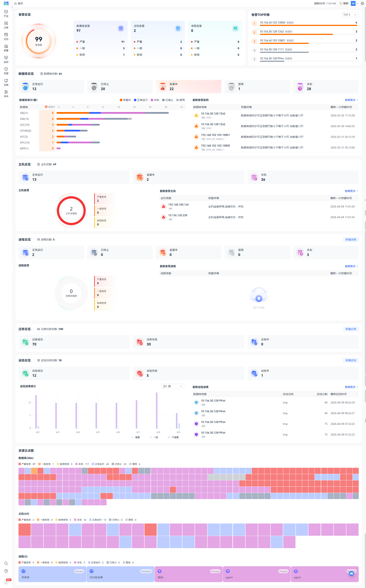

图 2.3 DEM 首页

DEM 首页中展示的各项介绍如下：

- **告警总览**

展示总告警数、各类资源各级别告警数、告警 TOP(n)对象告警情况，n 可修改。

- **数据库总览**

展示数据库和各数据库集群的运行状态情况，和最新告警实例信息。

- **主机总览**

展示主机的运行状态情况、告警情况，和最新告警主机信息。

- **进程总览**

展示进程的运行状态情况、告警情况，和最新告警进程信息。

- **迁移总览**

展示迁移任务的总执行情况。

- **巡检总览**

展示巡检的总执行情况、最近 7 天的巡检结果统计情况，和最新的几个巡检任务的简略信息。

- **资源云点图**

以不同颜色的方块展示各状态的所有数据库、主机和进程。用户可通过云点图直观了解 DEM 中资源的总体状态，方便快速定位异常情况。

### 2.4.2 DEM 功能模块界面

点击 DEM 左侧导航栏对应模块按钮可以进入对应功能模块的工作区界面。也可以通过左侧导航栏下方的“搜索”按钮，输入目标关键词进行搜索，打开指定窗口、对象、模块所在的功能模块工作区界面。


图 2.4 DEM 搜索

DEM 各功能模块的工作区界面结构大体一致，由顶部子模块导航栏和其下的模块概览信息或子模块对象列表组成，如下图所示：

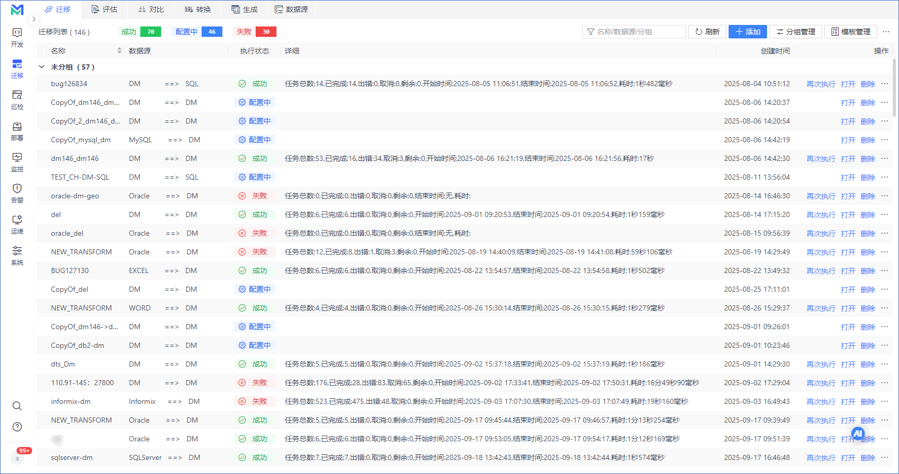

图 2.5 DEM 功能模块

### 2.4.3 登录用户

点击 DEM 界面左下角的用户按钮，可对当前登录用户进行管理。


图 2.6 设置登录用户

支持管理的选项包括：用户配置、通知查看、首选项配置、切换主题和退出登录。下面分别进行介绍：

- **用户配置**

点击用户名打开用户修改对话框，支持对用户的真实名、手机号、E-mail 和密码等进行修改。

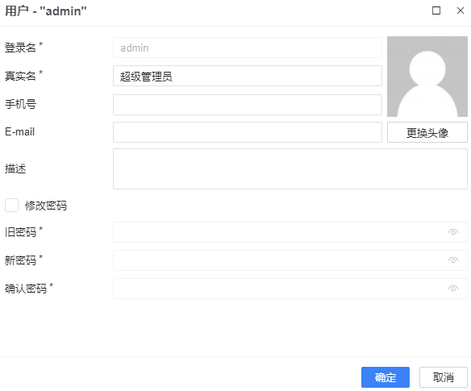

图 2.7 用户修改对话框


查看用户收到的 DEM 告警、数据库导入导出、迁移、评估、集群启停等各功能的通知消息。

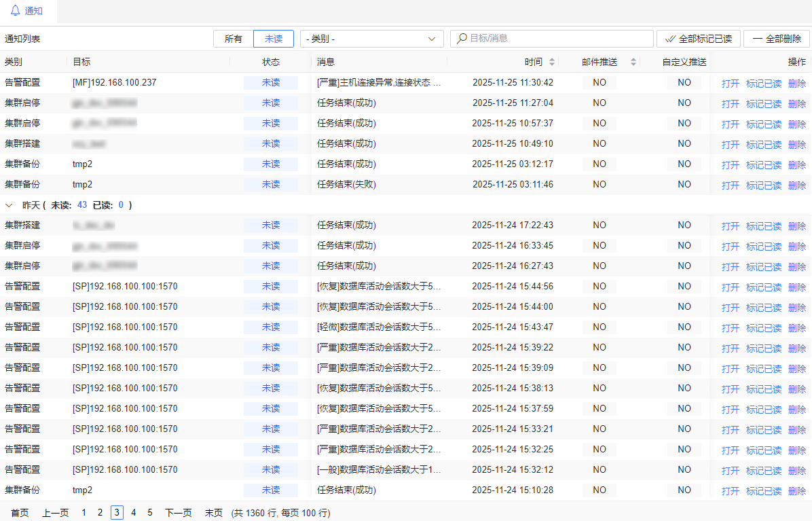

图 2.8 通知


在首选项对话框中，用户可对 SQL 开发、数据迁移和页面恢复的各种配置规则和参数进行设置。设置之后，各功能模块将按照首选项中的规则和参数进行调整。


图 2.9 首选项对话框


不同主题对应界面的色调不同，当前可选跟随系统、浅色模式和深色模式。


点击退出登录，可退出 DEM。

## 第 3 章 DEM 部署

一个 DEM 包含一个 DEM 服务器、一个 DEM 存储数据库和若干个代理服务。

## 3.1 DEM 部署所需材料

**DEM 部署需要的软件:**

1. DEM 服务器安装包：DEM WAR 包。
2. DEM 存储数据库：DM 数据库软件。
3. WEB 应用服务器：WEB 应用服务器需支持 Servlet 3.1+（例如 Tomcat 8.0+）。
4. 数据库代理服务：dmagent 软件。
5. Java 环境：Java 版本必须为 1.8+。WEB 应用服务器和数据库代理服务所在的机器均须满足 Java 环境要求。
6. 浏览器：WEB 应用服务器所在机器须提供 Chrome 13+ 版本的浏览器，用于支持 DEM 页面的 PDF 导出功能。

**DEM 部署需要的机器：**

需要三台机器。

1. 机器 A（示例 IP 为 192.168.0.104）：先配置好 Java 1.8 环境，再安装 DEM 存储数据库、WEB 应用服务器、DEM 服务器。
2. 机器 B（示例 IP 为 192.168.0.105）：先配置好 Java 1.8 环境，再安装数据库代理服务。
3. 机器 C（示例 IP 为 192.168.0.106）：使用本机上的浏览器，访问部署好的 DEM。

## 3.2 DEM 常规部署流程

DEM 服务器安装包和 WEB 应用服务器必须位于同一台机器上。DEM 存储服务器可以安装在任何机器上。

### 3.2.1 第一步 安装 DEM 存储数据库

**1\. 安装 DEM 存储数据库。**

此处以 DEM 存储数据库位于 IP 为 192.168.0.104 的机器上为示例。DEM 存储数据库选择 DM 数据库。DM 数据库安装和实例创建详见 DM 安装手册。并修改 DEM 存储数据库的 DM.INI 参数配置。

**推荐配置:**

```
MEMORY_POOL = 200
BUFFER = 1000
SORT_BUF_SIZE = 50
```

**2\. 启动 DEM 存储服务器。**

**3\. 在 DEM 存储数据库中执行 SQL 脚本 dem\_init.sql。**

dem\_init.sql 包含创建 DEM 存储库基表的 sql 语句，此 SQL 脚本编码为 UTF-8。

> **注意**
> 
> 如果使用disql执行SQL脚本，请设置set CHAR\_CODE UTF8。

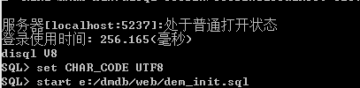

图3.1 执行SQL脚本dem\_init.sql

### 3.2.2 第二步 安装 DEM 服务器

因为 DEM 服务器处理的是浏览器的请求，所以在安装 DEM 服务器之前，需要配置一个 WEB 应用服务器 Tomcat。WEB 应用服务器专门处理 DEM 服务器和客户端（浏览器）之间的交互。

此处以 WEB 存储服务器和 DEM 服务器安装包均位于 IP 为 192.168.0.104 的机器上为例进行介绍。

**1\. 为 IP：192.168.0.104 机器配置 Java 1.8 环境。因为运行 Tomcat 需要 Java 环境。**

**2\. 配置 WEB 应用服务器（Tomcat）。**

1）在 conf/server.xml 中\<Connector port="8080" protocol="HTTP/1.1"...追加属性字段 maxPostSize="-1"。

2）修改 JVM 启动参数。

在 Linux 环境中，假定 DEM 存储数据库位于/opt/dmdbms。

```
bin/catalina.sh -> JAVA_OPTS="-server -Djava.library.path=/opt/dmdbms/bin"
```

在 Windows 环境中，假定 DEM 存储数据库位于 c:\\dmdbms。

```
bin/catalina.bat-> set JAVA_OPTS=-server -Djava.library.path=c:\dmdbms\bin
```

在非 Windows 环境中，还需要额外指定动态库加载路径的环境变量，在不同的操作系统环境下此变量名可能为 LD\_LIBRARY\_PATH、DYLD\_LIBRARY\_PATH、LIBPATH、SHLIB\_PATH 其中之一。下面为指定环境变量 LD\_LIBRARY\_PATH 的示例。

```
bin/catalina.sh -> export LD_LIBRARY_PATH="/opt/dmdbms/bin"
```

请注意，上述配置的 java.library.path 及动态库加载路径指定的数据库服务器，与之后在 DEM 中监控、运维使用的数据库服务器的版本不应相差过大，否则可能会导致 DEM 崩溃。

3）添加 Path 路径。若部署主机上未安装 DM 数据库，则需要进行该步骤，手动将执行码文件添加至路径中。

在 Linux 环境中，假定执行码文件位于/opt/dm-bin-release。

```
bin/catalina.sh -> export PATH="$PATH:/opt/dm-bin-release"
```

在 Windows 环境中，假定执行码文件位于 c:\\dm-bin-release。

```
bin/catalina.bat-> set PATH=%PATH%;c:\dm-bin-release
```

**3\. 安装 DEM 服务器。**

1）将 dem.war 包拷贝到 Tomcat 的 webapps 目录下。

2）解压缩 dem.war 包，获取 db.xml。解压 dem.war 方式有两种：一启动 Tomcat，自动解压缩 dem.war 包。二不启动 Tomcat，用户手动解压 dem.war 包。

3）修改 DEM 服务器配置文件 db.xml。

DEM 服务器通过 db.xml 文件来连接访问 DEM 存储数据库。db.xml 中登记了 DEM 存储数据库的连接信息：连接串、用户名、密码、连接池大小等。db.xml 文件位于 WEB-INF/db.xml（在 dem.war 中，解压后在 Tomcat 的路径 webapps/dem/WEB-INF/db.xml 下）中。

若要以 SSL 安全方式连接后台数据库，则需在 url 连接串中配置 sslFilesPath 和 sslKeystorePass 参数：

默认在 WEB-INF/sslDir 目录中存有密钥对。在 WEB-INF/db.xml 文件的 url 项中配置客户端连接使用的密钥文件路径（sslFilesPath）为 WEB-INF/sslDir/client\_ssl/SYSDBA；密码（sslKeystorePass）不配置时使用默认密码，对应 WEB-INF/db.xml 中配置的登录用户 SYSDBA。

```
<?xml version="1.0" encoding="UTF-8"?\>
<ConnectPool>
<Url>jdbc:dm://192.168.0.104:5236?lobFetchOptimize=true&sslFilesPath=../sslDir/client_ssl/SYSDBA</Url>
<User>SYSDBA</User>
<Password>sysDBA*00</Password>
<InitPoolSize>5</InitPoolSize>
<CorePoolSize>10</CorePoolSize>
<MaxPoolSize>500</MaxPoolSize>
<KeepAliveTime>60</KeepAliveTime>
<DbDriver></DbDriver>
<DbTestStatement>select 1</DbTestStatement>
</ConnectPool>
```

db.xml 详细的配置参数参见 [3.4 DEM 服务器配置文件 db.xml 介绍](https://eco.dameng.com/document/dm/zh-cn/pm/dem_user_manual#3.4%20DEM%20%E6%9C%8D%E5%8A%A1%E5%99%A8%E9%85%8D%E7%BD%AE%E6%96%87%E4%BB%B6%20db.xml%20%E4%BB%8B%E7%BB%8D) 。

**4\. 启动 Tomcat**

启动 Tomcat。如果在解压缩 dem.war 包过程中已经启动了 Tomcat，此处需要再次重启。

### 3.2.3 第三步 安装 dmagent

DEM 只能监控到安装了 dmagent 的机器。本节将 dmagent 安装在 IP 为 192.168.0.105 的被监控机器上。

在被监控机器上安装 dmagent 的具体步骤为：

**1\. 为 IP：192.168.0.105 机器配置 Java 1.8 环境。**

dmagent 的运行需要依赖 Java 环境，因此部署 dmagent 前需要配置 Java 环境，Java 版本必须为 Java 1.8。

**2\. dmagent 部署步骤。**

dmagent 部署步骤如下:

**1）获取 dmagent**

可以通过 2 种方式获取 dmagent：

(1) 达梦数据库安装目录的 tool 下存有 dmagent；

(2) 登录其他部署好的 DEM，在“DEM-资源包”中下载 dmagent。

拷贝 dmagent 到要部署的机器上。

**2）修改 dmagent 配置**

配置 dmagent 目录下的 agent.ini：

```
center_url=http://192.168.0.104:8080/dem #DEM地址
gather_enable=true #开启收集监控数据功能，默认打开
service_enable=true #开启远程调用功能，部署时需要打开
```

**3）核对 dmagent 和 DEM 所运行机器时间**

一般要求 dmagent 和 DEM 所运行机器时间一致，最多不要相差 M 分钟，M 取 5 分钟和主机失效时间两者中的最小值。其中，5 分钟为 dmagent 消息的有效时间，即 DEM 收到 dmagent 的消息时，如果收到的 dmagent 发送的消息的时间与 DEM 运行机器当前时间相差 5 分钟，则认为该消息无效，不处理该消息。主机失效时间 mf\_invalid\_time（单位：秒）即在主机失效时间内没有收到 dmagent 发送的信息，则认为主机失效。

若要 dmagent 可用，须保证 DEM 可以收到 dmagent 的消息，并且 dmagent 本身不是失效状态（失效状态即为“资源监控-DEM 主机监控”页面显示连接失败状态），因此 dmagent 与 DEM 所运行机器时间的差值取 5 分钟和主机失效时间的最小值，但建议 dmagent 与 DEM 所运行机器时间同步。

**4）生成并安装 service.key**

在 dmagent 目录下执行下述命令：

Windows 环境中：

```
start.bat INSTALL_SERVICE_KEY 999999 #此处的999999为指定的key，999999为默认值
```

Linux 环境中：

```
./start.sh INSTALL_SERVICE_KEY 999999 #此处的999999为指定的key，999999为默认值
```

注意：key 值应与 [4.5 系统配置](https://eco.dameng.com/document/dm/zh-cn/pm/dem_user_manual#4.5%20%E7%B3%BB%E7%BB%9F%E9%85%8D%E7%BD%AE) 中的 service\_key 配置一致。另外出于系统安全性的考虑，强烈建议修改 service\_key 的默认值 999999 为其他值。

**5）启动 dmagent**

在 dmagent 目录下执行下述命令:

Windows 环境中：

```
start.bat <DMAGENT_HOME>/agent.ini  #进程方式运行
service.bat start/restart  #服务方式运行
```

Linux 环境中：

```
start.sh <DMAGENT_HOME>/agent.ini  #进程方式运行
service.sh start/restart  #服务方式运行
```

若要部署集群并创建系统服务，在 Linux（Unix）环境下应以 root 用户运行 dmagent，在 Windows 环境下应以 Administrator 用户运行 dmagent。

若要以服务方式运行 dmagent，必须先注册服务（install），再执行启动（start）、停止（stop）、删除（delete）、查看服务状态（status）以及打印 service 脚本帮助信息（help）等操作。dmagent 使用的具体说明可以参考安装目录下 tool/dmagent/下的 readme.pdf。

### 3.2.4 第四步 安装待监控数据库

DEM 可监控和管理监控机器上的数据库。待监控的数据库既可以在部署 DEM 之前安装，也可以在部署 DEM 之后安装。不局限于此时。DM 数据库安装和实例创建详见 DM 安装手册。

此处特意在被监控机器 IP：192.168.0.105 上安装一个名为 DMDEM 的 DM 数据库，是为了供后续验证 DEM 时使用。

### 3.2.5 第五步 登录 DEM

在任何联网设备的浏览器中输入 DEM 地址，便可登录 DEM。本节使用 IP：192.168.0.106 机器上的浏览器。

DEM 位于 IP：192.168.0.104 机器上，DEM 默认用户名和密码为 admin/888888。

DEM 地址如下：

```
http://192.168.0.104:8080/dem/
```

### 3.2.6 第六步 校验 DEM 是否部署成功

登录到 DEM 界面之后，如果能看到 IP：192.168.0.104 的机器信息和待监控的数据库 DMDEM 信息，说明 DEM 部署成功。

如果 DEM 没有部署成功，则从以下两点进行操作修正：

**1）校验 DEM 与 dmagent 是否连通**

登录 DEM ，选择资源监控模块的“主机监控”，检查是否可以看到自己部署的 dmagent。

如果 dmagent 正常启动，但在 DEM 中未看到监控的机器 IP：192.168.0.104，则需检查以下事项：

(1)dmagent 和 DEM 所运行的机器时间是否一致，最多不超过 min（5 分钟，主机失效时间）（通过 DEM 界面的“系统管理-系统配置”中参数“mf\_invalid\_time”配置）。

(2) dmagent 所运行机器是否可以访问 DEM 所运行机器（检查是否可以 ping 通）。

**2）配置 dmagent 内外网信息**

登录 DEM，选择资源监控模块的“主机监控”，找到自己部署的 dmagent，在最右侧“操作”栏，打开下拉列表，选择“配置网络”，打开配置网络对话框，配置内外网信息。

其中，一般 DEM 访问 dmagent 用外网，dmagent 之间或 dmagent 所在机器的数据库之间通讯用内网。

## 3.3 DEM 高可用解决方案

DEM 作为一种监控运维工具，需要长时间且不间断地收集数据和对外提供服务，需具备高可用的特性。但 DEM 作为一个 Web 应用程序，自身无法提供高可用特性，故需通过搭建高可用的 Web 应用服务器集群来实现 DEM 的高可用。

以下为常见的几种高可用 Web 应用服务器集群搭建方式：

1. Tomcat + Nginx 搭配。
2. Tomcat + Keepalived 搭配。
3. Tomcat + Nginx + Keepalived 搭配。

具体用于实现 DEM 高可用的高可用 Web 应用服务器集群搭建方式需要根据真实的系统环境而定，详情请咨询达梦系统管理员。

## 3.4 DEM 服务器配置文件 db.xml 介绍

db.xml 配置参数包括：

表3.1 db.xml配置参数说明

| **参数名** | **说明** |
| --- | --- |
| Url | 数据库 JDBC 连接串。 JDBC 连接串属性的详细配置说明请参见 DM 程序员手册 |
| User | 数据库登录用户名 |
| Password | 数据库登录密码。通过属性 engine 设置自定义加解密类，可配置加密的密码。自定义加解密类参见 demsdk。使用 demsdk 自带的加解密类，配置如下：\<Password engine="com.dameng.dem.server.util. DefaultEncryptEngine">A72125717E5EF759 \</Password> |
| InitPoolSize | 连接池初始连接数。缺省值 5 |
| CorePoolSize | 允许的最小空闲连接数。缺省值 10 |
| MaxPoolSize | 允许的最大连接数。缺省值 500 |
| KeepAliveTime | 空闲连接存活时间，PoolType=2 时有用，缺省值 60 |
| DbDriver | Dm JDBC 驱动路径，缺省为空 |
| DbTestStatement | 测试 SQL。缺省为 select 1 |

## 3.5 DEM 后台库升级工具

### 3.5.1 工具说明

1. 目前，该工具仅支持对 DEMv7.0.1 及以上版本进行升级或初始化。
2. 部署新版本 DEM 时，若已存在旧版本的 DEM，可将 [3.2 DEM 常规部署流程](https://eco.dameng.com/document/dm/zh-cn/pm/dem_user_manual#3.2%20DEM%20%E5%B8%B8%E8%A7%84%E9%83%A8%E7%BD%B2%E6%B5%81%E7%A8%8B) 中的第一步  
	安装 DEM 存储数据库，替换为使用 DEM 升级工具将旧版本的存储数据库升级到新版本。使用这种方式的好处是可以保留旧版本 DEM 的配置与数据。
3. 当后台库升级结束后，还需要执行 [3.2 DEM 常规部署流程](https://eco.dameng.com/document/dm/zh-cn/pm/dem_user_manual#3.2%20DEM%20%E5%B8%B8%E8%A7%84%E9%83%A8%E7%BD%B2%E6%B5%81%E7%A8%8B) 的第二步到第六步，进行部署 DEM 服务器与 dmagent 等操作，同时在解压新版本 dem.war 包后，将旧版本的应用数据（tomcat/webapps/dem/repository）拷贝到新版本服务器的相同目录下。若想将新版本 DEM 与旧版本 DEM 的服务器部署在同一路径，则需要提前备份旧版本的应用数据。

### 3.5.2 DEM 常规升级流程

#### 3.5.2.1 第一步 运行升级程序

打开 em-migrate.exe（DEM 后台库迁移助手），运行升级程序。

#### 3.5.2.2 第二步 连接数据库

在升级程序中填入正确的数据库连接串、用户名和密码。如下图所示：

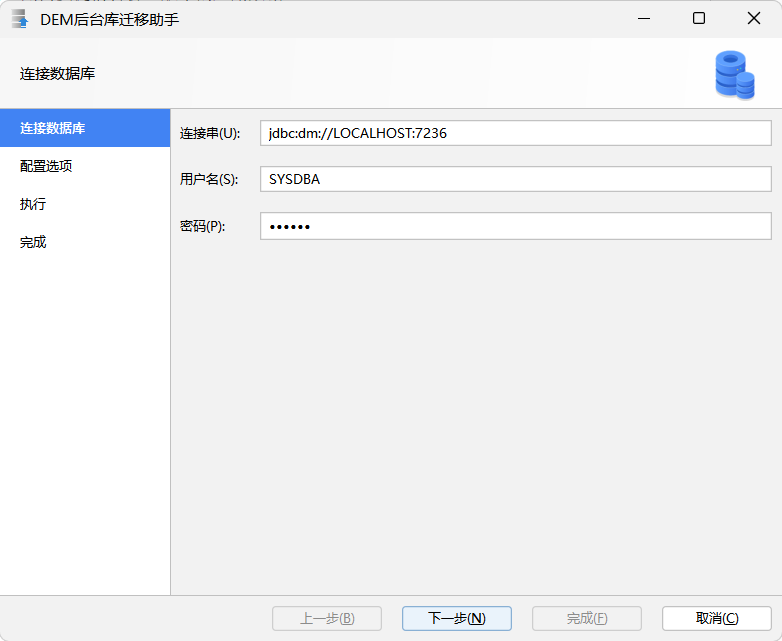

图3.2 连接数据库

完成后，点击“下一步”，进入“配置选项”界面。

#### 3.5.2.3 第三步 初始化/升级配置

在“配置选项”界面中可选择进行“初始化后台库”或“升级后台库”两种操作。升级程序会自动查询后台库的版本信息，并根据查询情况，自动选择“初始化后台库”或“升级后台库”选项。

- **初始化后台库：**

当查询结果显示数据库并未初始化过时，会自动选中“初始化后台库”选项，默认初始化至最新版本，用户也可以自由选择需要支持的版本，如下图所示：

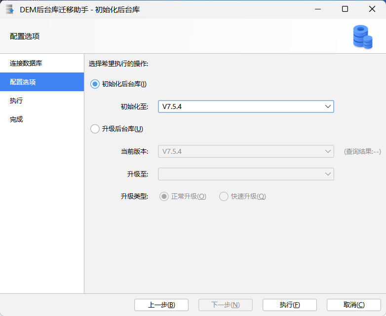

图3.3 配置选项-初始化后台库

- **升级后台库：**

当查询结果显示后台库处于某一版本时，会自动选中“升级后台库”选项，并填充当前版本，默认升级至最新版本。由于当前版本可能查询有误，支持用户自定义修正，并需要注意，进行升级时一定要保证当前版本的正确性，否则可能会导致升级失败。如下图所示：

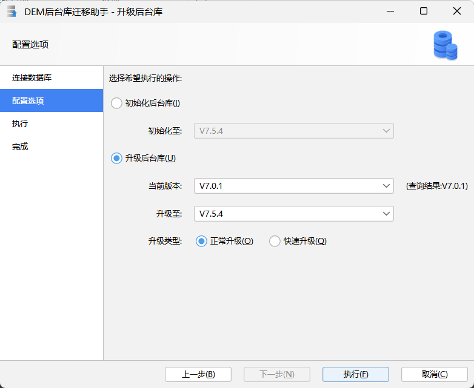

图3.4 配置选项-升级后台库

配置完成后，点击“执行”，进入“执行”界面。

#### 3.5.2.4 第四步 执行初始化/升级任务

升级程序根据第三步中的配置信息执行初始化或升级任务。此处以升级任务为例，如下图所示：

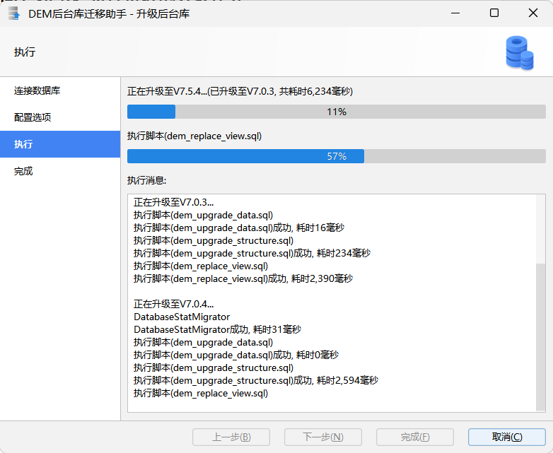

图3.5 执行-执行中

执行结束，如下图所示：

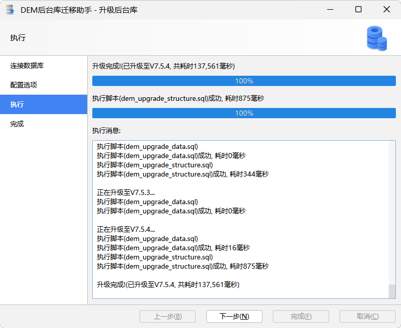

图3.6 执行-执行结束

点击“下一步”进入“完成”界面，如下图所示：

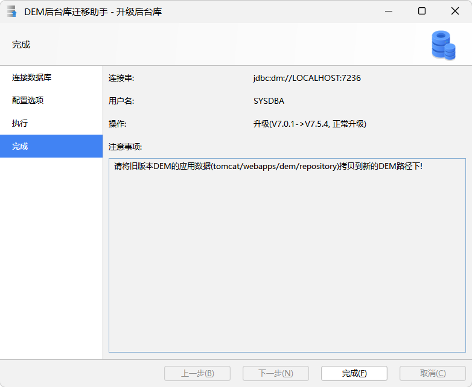

图3.7 完成-升级任务

后台库升级结束后，还需要重新进行部署 DEM 服务器与 dmagent 等步骤，参考 [3.2 DEM 常规部署流程](https://eco.dameng.com/document/dm/zh-cn/pm/dem_user_manual#3.2%20DEM%20%E5%B8%B8%E8%A7%84%E9%83%A8%E7%BD%B2%E6%B5%81%E7%A8%8B) 中的第二步至第六步。在部署 DEM 服务器解压新版本 dem.war 包后，需要将旧版本应用数据（tomcat/webapps/dem/repository）拷贝到新版本 DEM 的服务器相同路径。

若想将新版本 DEM 与旧版本 DEM 的服务器部署在同一路径，即删除旧版本的 tomcat/webapps/dem 与 tomcat/webapps/dem.war，放入新的 dem.war 包部署时，需要提前将应用数据（tomcat/webapps/dem/repository）备份。

## 第 4 章 系统管理

系统管理功能模块中包括用户管理、角色管理、审计信息、系统状态、系统配置部分。下面分别对这些配置管理项进行介绍。

## 4.1 用户管理

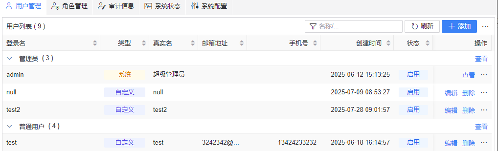

图4.1 用户管理

DEM 的用户管理页面展示了当前系统中存在的全部用户。用户管理模块主要包括以下几个方面：

1. 用户与权限
2. 创建用户
3. 修改用户
4. 启/禁用用户
5. 删除用户

### 4.1.1 用户与权限

每个用户都属于一个角色，用户拥有所属角色的所有模块权限，同时继承该角色所有可使用对象，用户不可取消继承自角色的授权。此外，还可单独授权其他的对象的使用权给该用户。

可以更改用户角色，但要注意其对应的模块和对象权限都将发生更改，请谨慎使用。

### 4.1.2 创建用户

管理员必须为每个需要登录 DEM 的人创建一个用户账户，并为每个用户指定一个角色及相关权限。

部署 DEM 时预设了一个内置管理员用户 admin。之后可通过登录这个用户，创建其他的普通用户、高级用户或管理员。用 admin 用户创建的管理员用户，拥有与 admin 完全同等的权限。

管理员创建用户账户的具体步骤如下：

1. 在系统管理下，点击用户管理，打开用户管理界面；
2. 在用户管理界面工具栏，点击“添加”按钮；

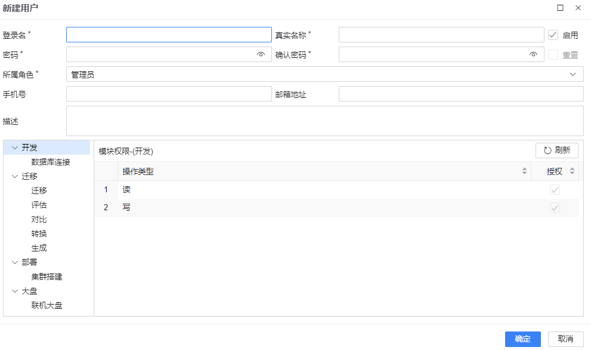

图4.2 新建用户

3. 输入唯一用户登录名和密码；
4. 指定用户角色；
5. 根据实际情况配置新用户关于各模块、对象权限的授权情况；
6. 将带星号项填写完毕后，点击确定，完成用户创建。

### 4.1.3 修改用户

DEM 支持用户使用以下方式对用户进行修改：

1. 管理员修改用户信息。

管理员可在用户管理界面修改内置用户外的所有用户，可修改其登录名外包括权限在内所有用户信息，界面内容与用户创建界面一致。

2. 用户登录后，可以修改当前用户的信息。

具体可查看 [2.4.3 登录用户](https://eco.dameng.com/document/dm/zh-cn/pm/dem_user_manual#2.4.3%20%E7%99%BB%E5%BD%95%E7%94%A8%E6%88%B7) 。

### 4.1.4 启/禁用用户

管理员可在用户管理界面编辑用户，修改用户启/禁用状态，用户被禁用后无法登录 DEM。若用户登录时密码连续输入错误 5 次（默认值 5，可进行配置，详见参数 user\_login\_limit\_count），用户将被锁定无法登录，默认锁定时间为 60 分钟（默认值 60 分钟，管理员和超级管理员可自行配置，详见参数 user\_login\_lock\_time）。用户被锁定后，可请管理员到用户管理界面右键清理登录锁定，进行解锁。

> **注意**
> 
> 如果登录用户超过账号存活时间（默认值为0，表示不做限制，管理员和超级管理员可自行配置，详见参数user\_keep\_alive\_time）且未做任何请求操作，则会被强制退出

### 4.1.5 删除用户

对于自定义的用户，可以通过点击用户管理中菜单栏的 “删除” 按钮，删除对应用户。

## 4.2 角色管理


图4.3 角色管理

DEM 的角色管理界面展示了当前系统中存在的全部角色。角色管理模块主要包括以下几个方面的功能：

1. 角色与权限
2. 创建角色
3. 修改角色
4. 删除角色

除了上述的几个主要功能，用户还可以通过点击“刷新”对页面中展示的角色列表进行更新。

### 4.2.1 角色与权限

DEM 系统内置了三种角色，内置角色不允许修改和删除。三种内置角色如下，其中只有管理员拥有系统管理模块的使用权限。

- 管理员：拥有包括系统管理模块在内的所有模块的读写权限，以及所有类型对象的使用权限；
- 高级用户：拥有除系统管理模块外其他模块的读写权限；
- 普通用户：拥有除系统管理模块外其他模块的只读权限。

DEM 中系统权限分为模块权限和对象权限。模块权限是指：是否拥有某个功能模块的使用权限，模块权限细分为模块的读、写权限（读即查看，写即增删改）；对象权限是指：是否拥有系统中某个对象的使用权限，对象权限细分为公有和私有，公有指所有人都可用，私有指只有被授权角色和用户可用。管理员可以在创建角色或修改角色时对角色的权限进行分配。

DEM 中的模块权限分为：开发、迁移、部署、巡检、监控、大盘、大屏、告警、批量、自定义、资源包、系统。每个模块权限下还有相关的对象权限，分类如下：

开发：数据库连接；

迁移：迁移、评估、对比、转换、生成；

部署：集群搭建；

巡检：联机巡检；

资源监控：主机监控、数据库监控、进程监控、监控大屏；

告警：告警配置、告警模板；

大盘：联机大盘；

大屏：监控大屏；

批量：批量执行；

自定义：自定义 SQL、自定义脚本；

资源包：资源包；

系统：系统管理。

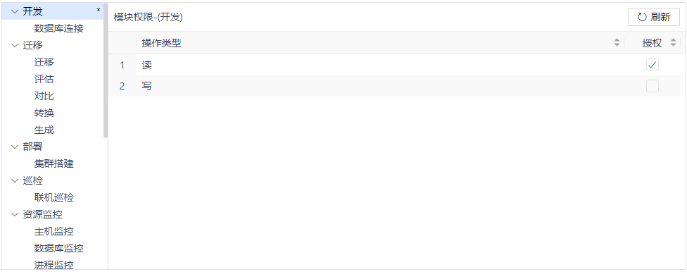

图4.4 权限分配

对于对象权限，可以在相应的对象列表中右键要调整权限的对象，点击“权限管理”，打开权限管理界面，在该界面中设置对象为公有或私有；进一步的，可以指定特定角色或用户为私有。图 4.5 为设置数据库监控对象的使用权为指定角色私有。

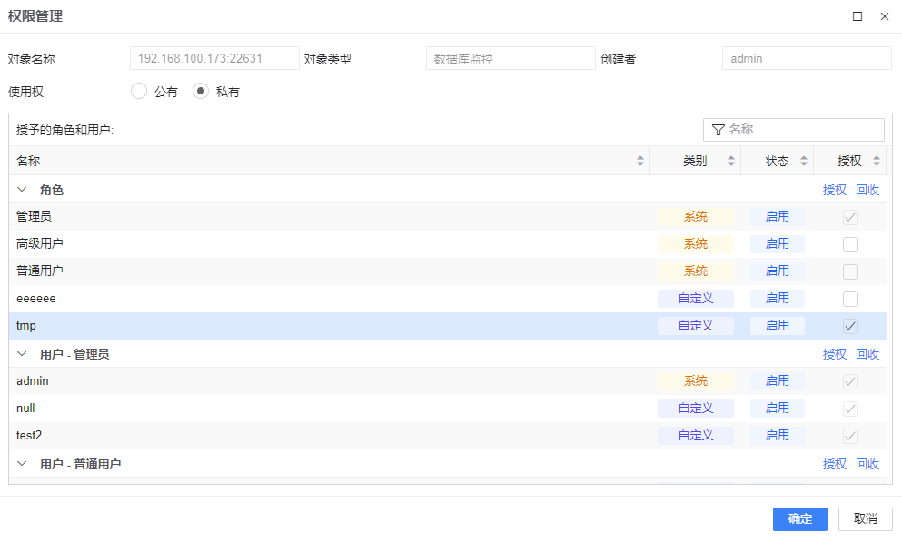

图4.5 设置对象权限

### 4.2.2 创建角色

用户也可以创建自定义角色，自行分配合适的权限。点击角色管理中菜单栏的 “添加”  
按钮可打开“新建角色”的对话框，如下所示：

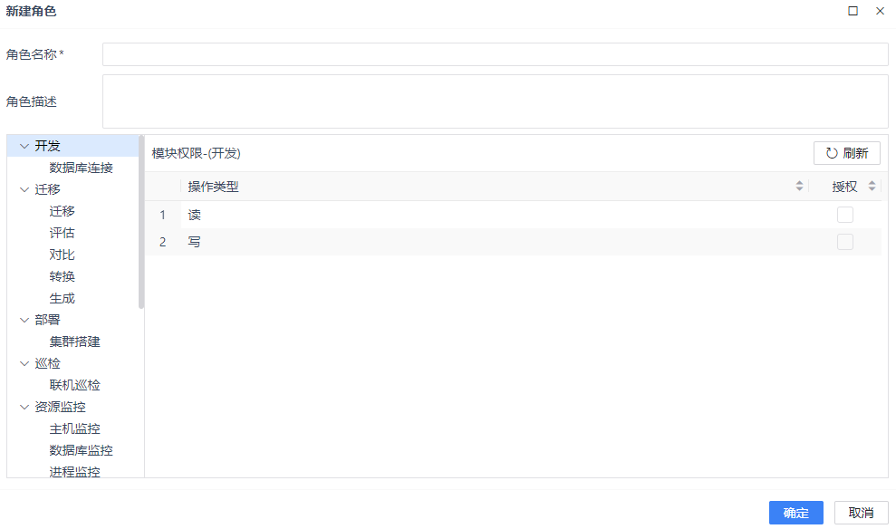

图4.6 新建角色

创建角色时可指定各个模块的读写权限，以及各个模块下可使用的对象。在指定对象权限前，需确保已指定了对应的模块权限。

### 4.2.3 修改角色

除内置角色不可修改外，对于用户自定义的角色，可以通过点击角色管理中菜单栏的“编辑”按钮，打开修改指定角色的对话框，对用户名、描述与权限进行修改。

### 4.2.4 删除角色

内置角色不可删除。若角色被引用，需先删除所有引用关系，才能删除角色。对于用户自定义的角色，可以通过点击角色管理中菜单栏的  
“删除” 按钮，删除指定角色。

## 4.3 审计信息

DEM 系统自带审计功能，可以记录用户每一步操作信息。并且审计功能可以通过参数配置来决定是否开启。配置参数 audit，默认为 0，表示不开启 DEM 系统审计。

如果开启 DEM 系统审计，则 DEM 每隔一个 audit\_flush\_freq（系统配置参数，默认值为 30 秒）将审计信息存储到 DEM 后台库。

管理员和超级管理员用户可以通过 DEM 界面访问审计信息。路径： 系统管理->审计信息 。

打开审计信息面板，查看具体审计信息。

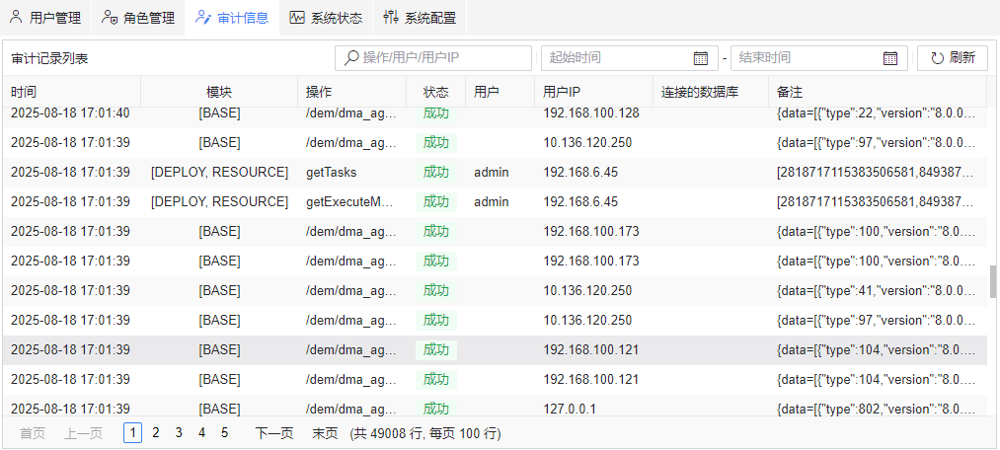

图4.7 DEM审计信息面板

审计信息面板详细记录了时间、模块、操作、状态、用户、用户 IP、连接的数据库和备注等信息。

## 4.4 系统状态

以图表方式展示 DEM 的运行状态信息。具体包括如下内容：

总览：运行时间、总请求数、总响应时间、总数据库连接数。

CPU 使用率：系统 CPU 使用占比。

内存使用率：系统内存使用占比。

内存占用：实存与虚存使用大小。

IO 吞吐速率：磁盘读写速率。

每秒处理请求数：系统吞吐量，每秒处理的请求数。

响应时间：系统响应时间（ms）。

数据库连接池：数据库连接缓存池状态信息。

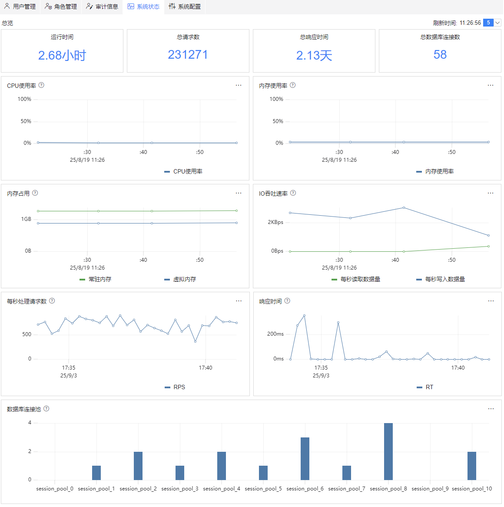

图4.8 DEM系统状态面板

## 4.5 系统配置

用户可通过系统配置参数来对 DEM 的各项功能进行设置。具体包括客户端工具配置、监控告警配置、监控频率配置、系统邮箱配置、自定义推送配置、安全配置以及其他功能。

系统配置位于 DEM 界面的“系统管理-系统配置”中。

表4.1 DEM系统配置参数说明

<table><tbody><tr><td><b>模块类别</b></td><td><b>参数</b></td><td><b>默认值</b></td><td><b>描述</b></td></tr><tr><td rowspan="9">客户端工具配置</td><td>callback_ip</td><td>127.0.0.1</td><td>客户端工具回调DEM的IP地址，支持配置IPV6地址，应确保DEM所在主机能通过该IP访问到DEM自身</td></tr><tr><td>db_session_check_freq</td><td>60</td><td>客户端工具中的数据库连接有效性检查频率（秒），最小值1</td></tr><tr><td>db_session_invalid_time</td><td>1800</td><td>客户端工具中的数据库连接的失效时间（秒），最小值60</td></tr><tr><td>db_session_pool_count</td><td>11</td><td>用于管理所有用户的数据库会话的池大小（重启生效）</td></tr><tr><td>dem_page_size</td><td>100</td><td>前端页面中的表格分页时的页大小</td></tr><tr><td>dashboard_refresh_freq</td><td>10</td><td>联机大盘监测状态刷新频率（秒），最小值1</td></tr><tr><td>dashboard_points</td><td>30</td><td>联机大盘页面中保留的监测次数，最小值1</td></tr><tr><td>dashboard_invisible_continue_refresh</td><td>true</td><td>（true/false）不显示的联机大盘页面是否继续刷新数据</td></tr><tr><td>sql_prompts_update_interval</td><td>300</td><td>SQL提示缓存更新间隔（秒），最小值10</td></tr><tr><td rowspan="13">监控告警配置</td><td>dem_page_refresh_freq</td><td>60</td><td>资源监控页面状态自动刷新频率（秒），最小值60</td></tr><tr><td>alert_his_re_notify_time</td><td>600</td><td>同一主机或数据库的同类警告在该时间间隔内不再重复发送（秒），最小值600</td></tr><tr><td>alert_check_thread_count</td><td>2</td><td>监控告警监测任务线程数（重启生效）</td></tr><tr><td>alert_notify_thread_count</td><td>2</td><td>监控告警通知任务线程数（重启生效）</td></tr><tr><td>alert_rule_reload_freq</td><td>60</td><td>内存中告警规则缓存的刷新频率（秒），最小值60</td></tr><tr><td>db_invalid_time</td><td>300</td><td>指定时间内没有收到数据库信息，则认为数据库失效（秒），最小值120</td></tr><tr><td>mf_invalid_time</td><td>180</td><td>指定时间内没有收到主机信息，则认为主机失效（秒），最小值20</td></tr><tr><td>process_invalid_time</td><td>300</td><td>指定时间内没有收到进程信息，则认为进程失效（秒），最小值120</td></tr><tr><td>db_license_threshold</td><td>100</td><td>license信息到期告警提示阈值</td></tr><tr><td>db_user_password_threhold</td><td>100</td><td>数据库用户密码到期告警提示阈值</td></tr><tr><td>db_sqllog_datasource</td><td>0</td><td>获取数据库SQL日志信息的后台表，0存放动态视图数据的后台表，1存放日志文件数据的后台表</td></tr><tr><td>db_sqllog_include_error_sql</td><td>false</td><td>（true/false）查看历史负载的SQL分析时，是否包含错误SQL的数据</td></tr><tr><td>message_token_validity</td><td>300000</td><td>远端agent发送消息的有效期（毫秒），0表示不限制</td></tr><tr><td rowspan="55">监控频率配置</td><td>gather_mf_info_freq</td><td>[60]</td><td>主机基本信息收集频率（秒），最小值10</td></tr><tr><td>gather_mf_stat_freq</td><td>[60]</td><td>收集主机状态信息的频率（秒），最小值10</td></tr><tr><td>gather_mf_os_log_freq</td><td>[300]</td><td>收集主机系统日志信息的频率（秒），最小值10</td></tr><tr><td>gather_mf_group_info_freq</td><td>[60]</td><td>收集主机组基本信息的频率（秒），最小值10</td></tr><tr><td>gather_mf_group_stat_freq</td><td>[60]</td><td>收集主机组状态信息的频率（秒），最小值10</td></tr><tr><td>gather_process_stat_freq</td><td>[60]</td><td>收集进程状态信息的频率（秒），最小值10</td></tr><tr><td>gather_process_group_stat_freq</td><td>[60]</td><td>收集进程组状态信息的频率（秒），最小值10</td></tr><tr><td>gather_db_info_freq</td><td>[60]</td><td>数据库基本信息收集频率（秒），最小值10</td></tr><tr><td>gather_db_stat_freq</td><td>[60]</td><td>收集数据库状态信息的频率（秒），最小值10</td></tr><tr><td>gather_db_buffer_pool_freq</td><td>[60]</td><td>收集数据库数据缓冲区信息的频率（秒），最小值10</td></tr><tr><td>gather_db_mem_pool_freq</td><td>[60]</td><td>收集数据库内存池信息的频率（秒），最小值10，0表示禁用</td></tr><tr><td>gather_db_lock_freq</td><td>[60]</td><td>收集数据库锁信息的频率（秒），最小值10</td></tr><tr><td>gather_db_deadlock_freq</td><td>[60]</td><td>收集数据库死锁信息的频率（秒），最小值10</td></tr><tr><td>gather_db_trxwait_freq</td><td>[60]</td><td>收集数据库事务等待信息的频率（秒），最小值10</td></tr><tr><td>gather_db_event_freq</td><td>[60]</td><td>收集数据库事件信息的频率（秒），最小值10</td></tr><tr><td>gather_db_danger_event_freq</td><td>[60]</td><td>收集数据库重要事件信息的频率（秒），最小值10</td></tr><tr><td>gather_db_session_freq</td><td>[60]</td><td>收集数据库会话信息的频率（秒），最小值10</td></tr><tr><td>gather_db_tablespace_freq</td><td>[600]</td><td>收集数据库表空间信息的频率（秒），最小值10</td></tr><tr><td>gather_db_user_freq</td><td>[600]</td><td>收集数据库用户信息的频率（秒），最小值10</td></tr><tr><td>gather_db_table_freq</td><td>[60]</td><td>收集数据库表数据信息的频率（秒），最小值10</td></tr><tr><td>gather_db_audit_record_freq</td><td>[0]</td><td>收集数据库审计记录的频率（秒），最小值10</td></tr><tr><td>gather_db_serverlog_freq</td><td>[60]</td><td>收集数据库运行日志记录的频率（秒），最小值10</td></tr><tr><td>gather_db_serverlog_distinct_enable</td><td>true</td><td>收集数据库运行日志记录是否去重，（true/false）</td></tr><tr><td>gather_db_serverlog_infolevel_enable</td><td>false</td><td>收集数据库运行日志记录是否包含info级别，（true/false）</td></tr><tr><td>gather_db_rlog_freq</td><td>[60]</td><td>收集数据库Redo日志信息的频率（秒），最小值10</td></tr><tr><td>gather_db_backup_freq</td><td>[60]</td><td>执行数据库备份的检查频率（秒），最小值10</td></tr><tr><td>gather_db_arch_freq</td><td>[60]</td><td>收集数据库归档信息的频率（秒），最小值10</td></tr><tr><td>gather_db_backupset_freq</td><td>[60]</td><td>收集数据库备份集信息的频率（秒），最小值10</td></tr><tr><td>gather_db_backupset_check_days</td><td>3</td><td>收集时校验最近多久的数据库备份集（天），0表示不校验</td></tr><tr><td>gather_db_ini_view_freq</td><td>[60]</td><td>收集数据库ini视图（如v$dm_ini,v$dm_arch_ini）的频率（秒），最小值10</td></tr><tr><td>gather_db_ini_file_freq</td><td>[180]</td><td>收集数据库ini配置文件（如dm.ini,dmarch.ini）的频率（秒），最小值10</td></tr><tr><td>gather_db_sqllog_file_freq</td><td>[60]</td><td>收集数据库SQL日志（日志文件）的频率（秒），最小值10</td></tr><tr><td>gather_db_sqllog_file_exectime</td><td>1000</td><td>收集数据库SQL日志（日志文件）的最小执行耗时（毫秒），最小值0</td></tr><tr><td>gather_db_sqllog_file_buffer</td><td>100</td><td>收集数据库SQL日志（日志文件）的缓存大小，最小值100</td></tr><tr><td>gather_db_sqllog_file_param_record</td><td>false</td><td>（true/false），收集数据库SQL日志（日志文件）时是否记录参数信息</td></tr><tr><td>gather_db_sqllog_file_param_stmt_count</td><td>10000</td><td>收集数据库SQL日志（日志文件）时带有参数的句柄缓存大小，最小值100</td></tr><tr><td>gather_db_sqllog_file_param_batch_count</td><td>1</td><td>收集数据库SQL日志（日志文件）时批量绑定参数时参数缓存大小，最小值1</td></tr><tr><td>gather_db_sqllog_view_freq</td><td>[60]</td><td>收集数据库SQL日志（动态视图）的频率（秒），最小值60</td></tr><tr><td>gather_db_sqllog_view_exectime</td><td>1000</td><td>收集数据库SQL日志（动态视图）的最小执行耗时（毫秒），最小值0</td></tr><tr><td>gather_db_sqllog_filter</td><td></td><td>收集数据库SQL日志时的过滤条件配置</td></tr><tr><td>gather_db_sqlverify_enable</td><td>false</td><td>（true/false），收集数据库SQL日志时是否审核，开启时必须配置SQL审核规则上下文</td></tr><tr><td>gather_db_sqlverify_rule_context</td><td></td><td>收集数据库SQL日志时的SQL审核规则上下文</td></tr><tr><td>gather_db_job_history_freq</td><td>[60]</td><td>收集数据库作业历史记录的频率（秒），最小值10</td></tr><tr><td>gather_db_index_freq</td><td>[60]</td><td>收集数据库索引信息的频率（秒），最小值10</td></tr><tr><td>gather_db_stack_freq</td><td>[60]</td><td>收集数据库堆栈信息的频率（秒），最小值10</td></tr><tr><td>gather_db_stack_mode</td><td>1</td><td>数据库堆栈信息采集方式：0 ：兼容方式；1：仅使用dmstack采集信息；2：仅使用pstack采集信息，对服务器性能产生一定影响</td></tr><tr><td>gather_db_group_info_freq</td><td>[60]</td><td>收集集群基本信息的频率（秒），最小值10</td></tr><tr><td>gather_db_group_stat_freq</td><td>[60]</td><td>收集数据库集群状态信息的频率（秒），最小值10</td></tr><tr><td>gather_db_group_dpc_sql_freq</td><td>[60]</td><td>收集DPC集群SQL信息的频率（秒），最小值10</td></tr><tr><td>gather_db_group_dpc_sql_plan_freq</td><td>[60]</td><td>收集DPC集群SQL计划信息的频率（秒），最小值10</td></tr><tr><td>gather_db_group_session_freq</td><td>[60]</td><td>收集数据库集群会话信息的频率（秒），最小值10</td></tr><tr><td>gather_db_group_dpc_rw_stat_freq</td><td>[60]</td><td>收集DPC集群读写分离信息的频率（秒），最小值10</td></tr><tr><td>gather_connection_pool_size</td><td>50</td><td>数据库连接池大小，值小于等于0时不启用连接池</td></tr><tr><td>gather_connection_life_time</td><td>600</td><td>（s）数据库连接池缓存的连接有效期</td></tr><tr><td>gather_sql_query_timeout</td><td>0</td><td>(s)数据库信息收集SQL执行超时时间，0时表示不限制</td></tr><tr><td rowspan="8">系统邮箱配置</td><td>mail_enable</td><td>true</td><td>（true/false），开启时需完成邮箱配置</td></tr><tr><td>mail_smtp_host</td><td></td><td>SMTP服务器地址或者SMTP服务器地址:端口</td></tr><tr><td>mail_address</td><td></td><td>系统邮箱地址</td></tr><tr><td>mail_account</td><td></td><td>系统邮件账号，用于邮箱登录认证，未设置则使用系统邮箱地址作为系统邮件账号</td></tr><tr><td>mail_password</td><td>******</td><td>系统邮箱密码</td></tr><tr><td>mail_ssl</td><td>false</td><td>（true/false），开启SSL加密，仅当mail_smtp_host中指定端口时有效</td></tr><tr><td>mail_config</td><td></td><td>邮箱服务器连接配置属性，格式为key=value，多个以;间隔</td></tr><tr><td>mail_signature</td><td>Dameng Database Develop Team</td><td>系统邮件签名</td></tr><tr><td rowspan="2">自定义推送配置</td><td>custom_notify_enable</td><td>false</td><td>（true/false），开启时必须实现自定义推送功能</td></tr><tr><td>custom_notify_class</td><td></td><td>自定义推送类，需实现接口com.dameng.dem.server.util.[INotify或IPhoneNotify]</td></tr><tr><td rowspan="7">安全配置</td><td>user_login_limit_count</td><td>5</td><td>限制用户登录连续错误次数，若超过将锁定账号，最小值3</td></tr><tr><td>user_login_lock_time</td><td>60</td><td>账号锁定的时间（分钟），最小值10</td></tr><tr><td>user_keep_alive_time</td><td>0</td><td>账户存活时间（秒），最小值60，0表示不限制</td></tr><tr><td>audit</td><td>0</td><td>系统审计级别（0: 关闭; 1: SET; 2: GET和SET）</td></tr><tr><td>audit_flush_freq</td><td>30</td><td>审计信息刷盘频率（秒），最小值1</td></tr><tr><td>audit_parameter</td><td>false</td><td>（true/false），审计是否记录http请求的参数信息</td></tr><tr><td>audit_sql</td><td>false</td><td>（true/false），审计是否记录执行的sql语句</td></tr><tr><td rowspan="21">其他功能</td><td>prometheus_metric_mf_nodes</td><td></td><td>响应prometheus信息拉取请求的主机列表，以;间隔，信息拉取频率由prometheus自身配置</td></tr><tr><td>prometheus_metric_db_nodes</td><td></td><td>响应prometheus信息拉取请求的数据库列表，以;间隔，信息拉取频率由prometheus自身配置</td></tr><tr><td>subscription_push_freq</td><td>3600</td><td>订阅推送频率（秒），最小值600</td></tr><tr><td>subscription_sql_top</td><td>10</td><td>订阅信息包含高频SQL，慢SQL，错误SQL和死锁SQL数目，最大值20</td></tr><tr><td>auditrecord_receiver_address</td><td></td><td>审计日志接收服务器地址，格式：IP:PORT</td></tr><tr><td>auditrecord_target_db</td><td></td><td>发送目标数据库的审计日志</td></tr><tr><td>auditrecord_mark_config_path</td><td></td><td>连接审计目标数据库所使用的密标配置文件路径</td></tr><tr><td>auditrecord_send_freq</td><td>120</td><td>审计日志发送频率（秒），最小值为60</td></tr><tr><td>database_baseinfo_udp_send_freq</td><td>60</td><td>数据库基础信息的UDP协议发送频率（秒），最小值为60</td></tr><tr><td>database_configinfo_udp_send_freq</td><td>60</td><td>数据库配置信息的UDP协议发送频率（秒），最小值为60</td></tr><tr><td>database_statusinfo_udp_send_freq</td><td>60</td><td>数据库状态信息的UDP协议发送频率（秒），最小值为60</td></tr><tr><td>database_info_udp_reciver_address</td><td></td><td>数据库信息的UDP协议接收网络地址，格式：IP：PORT</td></tr><tr><td>database_info_udp_send_db_list</td><td></td><td>数据库信息的UDP协议发送限定的数据库列表，列表项以;分隔</td></tr><tr><td>api_crypt_class</td><td>com.dameng.dem.server.util.DefaultEncryptEngine</td><td>实现接口com.dameng.dem.server.util.IEncryptEngine，用于用户密码的加解密</td></tr><tr><td>snmp_enable</td><td>false</td><td>（true/false），开启时必须实现SNMP协议</td></tr><tr><td>snmp_udp_port</td><td>161</td><td>SNMP协议监听网络端口号</td></tr><tr><td>resource_package_storage_path</td><td></td><td>资源包存储路径（绝对路径），默认为DEM应用内部路径repository/resource_pkg</td></tr><tr><td>service_key</td><td>******</td><td>远程RPC服务调用时所使用的校验key</td></tr><tr><td>process_name_list</td><td></td><td>用于筛选进程，为空表示在所有进程中查找，例如：[dmserver,java]</td></tr><tr><td>ai_task_process_class</td><td>com.dameng.em.server.main.service.ai.OuterAITask</td><td>AI任务处理类，默认使用DM公网AI服务，用户可以通过实现sdk接口（com.dameng.sdk.ai.IAITask）扩展私有AI服务</td></tr><tr><td>ai_task_concurrence</td><td>100</td><td>支持同时发起AI请求的并发数，最小值1（重启生效）</td></tr></tbody></table>

对于 DEM 系统的各项配置项，在 DEM 系统配置界面中还提供了刷新、保存、导出、导入、加解密引擎、推送测试（邮件推送测试和自定义推送测试）、高级配置（历史数据管理和设置日志级别）、通过搜索框筛选等功能。界面截图如下：

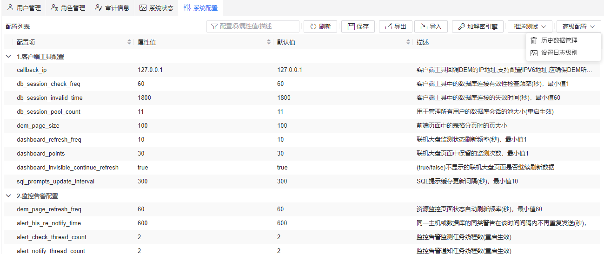

图4.9 DEM系统配置面板

下面对系统配置中的各项功能进行介绍：

刷新：刷新各系统配置项的值。

保存：保存修改后的系统配置项的值。

导出：点击导出按钮，在打开的“导出系统配置”对话框中选中需要导出的配置项信息，点击“导出”按钮，将配置项信息导出为 XML 文件。

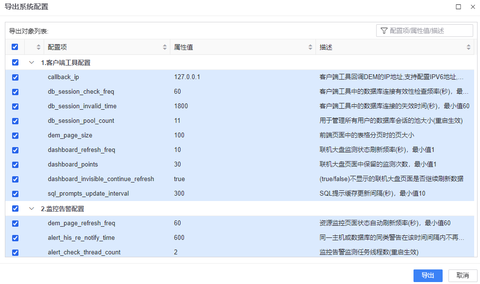

图4.10 DEM系统配置导出对话框

导入：从导出的 XML 文件中导入系统配置项信息。

邮件推送测试：开启邮件推送功能后，在对话框中输入收件人邮箱和邮件内容，点击“发送”按钮，测试系统邮箱配置部分的信息配置是否合适。

自定义推送测试：开启自定义推送功能后，在对话框中输入发送用户和发送内容，点击“发送”按钮，测试自定义推送配置部分的信息配置是否合适。

加解密引擎：可以使用 DM 默认加解密类对输入文本进行加密或解密操作。

高级配置-历史数据管理：可以在“历史数据管理”对话框中调整 DEM 各系统记录表中的历史数据的保留时间，默认为无限制，可以调整为 7 天、15 天、30 天、90 天、180 天、360 天、720 天。勾选需要调整的表后选择数据保留时间，再点击“保存”按钮后即可完成保留时长的调整。

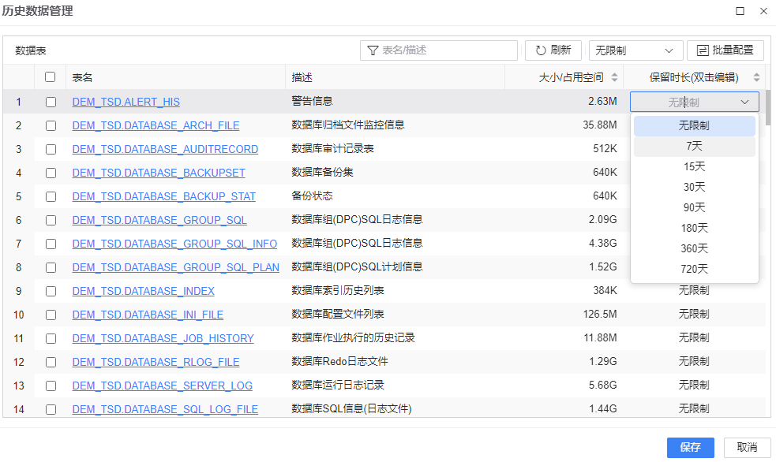

图4.11 历史数据管理对话框

高级配置-设置日志级别：配置 DEM 进程的日志记录级别。

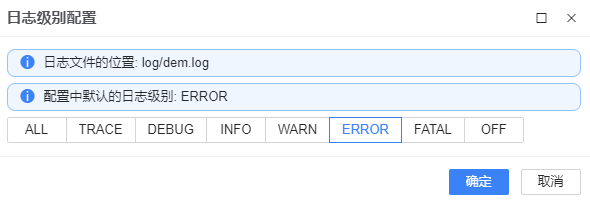

图4.12 设置日志级别对话框

搜索框：为了便于快速定位配置项，可以在搜索框中输入配置项的部分名称、属性、描述进行筛选。

## 第 5 章 DEM 网络交互

一个完整的 DEM 包含一个 DEM 服务器、一个 DEM 存储数据库和多个数据库代理服务（dmagent）。

## 5.1 网络交互

在 DEM 系统中涉及到的网络交互类型主要有以下几种：

a. DEM 服务器与代理服务（dmagent）之间的交互

b. DEM 服务器与数据库进行的交互

c. DEM 服务器与远程机器进行的交互

d. DEM 服务器与浏览器进行的交互

下表汇总了 DEM 各功能模块用到的网络交互类型。

表5.1 各个功能模块涉及的网络交互类型

| **功能模块** | **涉及的交互** | **备注** |
| --- | --- | --- |
| SQL 开发 | b |  |
| 数据迁移 | b |  |
| 集群部署 | a |  |
| 联机大盘 | a b |  |
| 联机巡检 | b |  |
| 批量执行 | SQL: b Script: a SSH: c | 批量执行分几种不同类型，涉及的交互方式不一致 |
| 资源监控 | a b |  |
| 告警配置 | 无 |  |
| 自定义监控 | a |  |
| 资源包 | d | 用户上传/下载文件到 DEM |

## 5.2 配置交互

为了满足各个交互的顺利进行，所需的配置：

**1\. DEM 服务器**

DEM 服务器就是一个常规的 web 应用服务，与常规 web 应用服务一样需要一个 http 端口。

**2\. 代理服务（dmagent）**

需要指明与 DEM 服务器通信的一个 service 端口和 DEM 地址。

表5.2 dmagent的交互配置项

<table><tbody><tr><td><b>参数名</b></td><td><b>默认值</b></td><td><b>描述</b></td></tr><tr><td colspan="3"><b>#general(常规配置项)</b></td></tr><tr><td>center_url</td><td>http://192.168.2.10:8080/dem</td><td>dem的url地址</td></tr><tr><td colspan="3"><b>#service(远程调用服务)</b></td></tr><tr><td>service_enable</td><td>true</td><td>是否启用dmagent远程调用服务功能。true:启用；false:关闭</td></tr><tr><td>service_port</td><td>6364</td><td>服务端口号</td></tr></tbody></table>

**3\. 与外部系统的交互**

与外部系统的交互有以下几种：

- 邮件推送：告警通知和订阅信息的推送是通过邮件完成的。
- 自定义推送：告警通知除了邮件还支持自定义方式推送，例如手机短信推送。
- 审计日志推送：数据库的审计日志支持 Syslog 标准格式推送到指定的日志服务器进行存储。
- Prometheus：资源监控信息支持 prometheus 数据拉取。拉取通过 http 请求访问 DEM 的 servlet 来完成，http 访问地址：\<DEM 服务器地址 >/metrics。
- SNMP：DEM 服务器实现了 SNMP 协议，支持作为 SNMP 的被管资源。

相关的配置项在 DEM 系统配置中指定（配置入口：DEM 主界面-系统配置）。

表5.3 DEM系统配置中的交互配置项

<table><tbody><tr><td><b>模块类别</b></td><td><b>参数</b></td><td><b>默认值</b></td><td><b>描述</b></td></tr><tr><td rowspan="8">系统邮箱配置</td><td>mail_enable</td><td>true</td><td>（true/false），开启时需完成邮箱配置</td></tr><tr><td>mail_smtp_host</td><td></td><td>SMTP服务器地址或者SMTP服务器地址:端口</td></tr><tr><td>mail_address</td><td></td><td>系统邮箱地址</td></tr><tr><td>mail_account</td><td></td><td>系统邮件账号，用于邮箱登录认证，未设置则使用系统邮箱地址作为系统邮件账号</td></tr><tr><td>mail_password</td><td>******</td><td>系统邮箱密码</td></tr><tr><td>mail_ssl</td><td>false</td><td>（true/false），开启SSL加密，仅当mail_smtp_host中指定端口时有效</td></tr><tr><td>mail_config</td><td></td><td>邮箱服务器连接配置属性，格式为key=value，多个以;间隔</td></tr><tr><td>mail_signature</td><td>Dameng Database Develop Team</td><td>系统邮件签名</td></tr><tr><td rowspan="2">自定义推送配置</td><td>custom_notify_enable</td><td>false</td><td>(true/false) ，开启时必须实现自定义推送功能</td></tr><tr><td>custom_notify_class</td><td></td><td>自定义推送类，需实现接口com.dameng.dem.server.util.[INotify或IPhoneNotify]</td></tr><tr><td rowspan="2">prometheus</td><td>prometheus_metric_mf_nodes</td><td></td><td>响应prometheus信息拉取请求的主机列表，以;间隔，信息拉取频率由prometheus自身配置</td></tr><tr><td>prometheus_metric_db_nodes</td><td></td><td>响应prometheus信息拉取请求的数据库列表，以;间隔，信息拉取频率由prometheus自身配置</td></tr><tr><td rowspan="4">审计日志推送配置</td><td>auditrecord_receiver_address</td><td></td><td>审计日志接收服务器地址，格式：IP:PORT</td></tr><tr><td>auditrecord_target_db</td><td></td><td>发送目标数据库的审计日志</td></tr><tr><td>auditrecord_mark_config_path</td><td></td><td>连接审计目标数据库所使用的密标配置文件路径</td></tr><tr><td>auditrecord_send_freq</td><td>120</td><td>审计日志发送频率(秒)，最小值为60</td></tr><tr><td rowspan="2">SNMP配置</td><td>snmp_enable</td><td>false</td><td>(true/false),开启时必须实现SNMP协议</td></tr><tr><td>snmp_udp_port</td><td>161</td><td>SNMP协议监听网络端口号</td></tr></tbody></table>

## 第 6 章 DEM 功能模块

DEM 包含多个功能模块，主要有 SQL 开发、数据迁移、联机巡检、集群部署、联机大盘、资源监控、监控大屏、告警配置、批量执行、自定义执行和资源包等。下面分别进行介绍。

## 6.1 SQL 开发

SQL 开发功能与桌面版 manager 的对象管理功能一致。用户可通过 DEM 直接访问要管理的数据库实例，DEM 通过导航树方式展示数据库对象，并通过右键操作方式操作数据库对象。

SQL 开发界面由顶部工具栏、左侧对象导航视图、右侧窗口区和底部信息栏组成。

顶部工具栏提供主菜单、新建对象、SQL 查询、SQL 调试、SQL 审核、SQL 调优、数据生成和统计信息等工具。各工具功能将在下文中进行详细介绍。

左侧对象导航视图包括数据库对象视图和打开窗口视图。数据库对象记录显示所有数据库连接对象；打开窗口记录显示右侧窗口区打开的所有窗口。

右侧窗口区包含展示各种工具工作时打开的操作窗口，无窗口打开时提供 SQL 开发模块中各工具的简单介绍与立即体验入口。

底部信息栏展示当前被操作对象的详细信息。

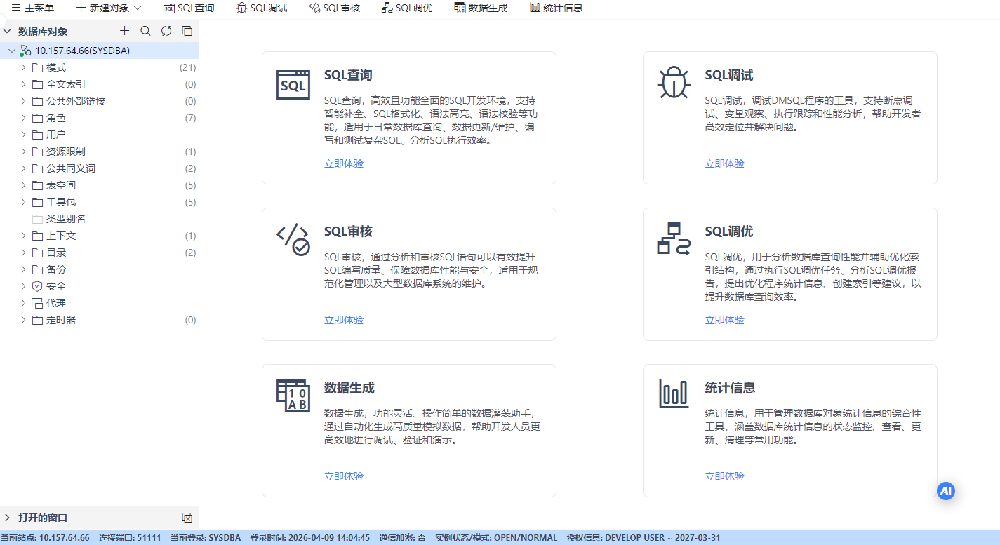

图6.1.1 SQL开发

### 6.1.1 SQL 连接池配置

浏览器中的每次数据库操作都需要有对应的数据库连接（DBSession），若在每次操作时创建 DBSession，性能较差，故通常将建立的 DBSession 缓存起来，供下次操作重复使用。DEM 中也是采用这种策略，创建的 DBSession 会分配一个全局唯一 ID，并被缓存到连接池（SessionPool）中，浏览器中的操作请求会附带该 DBSession 的 ID，发至 DEM，DEM 通过该 ID 在 SessionPool 中找到对应的 DBSession，执行相应的数据库操作。为了提升并发性能，DEM 内置多个 SessionPool 来均衡负载。如下图：

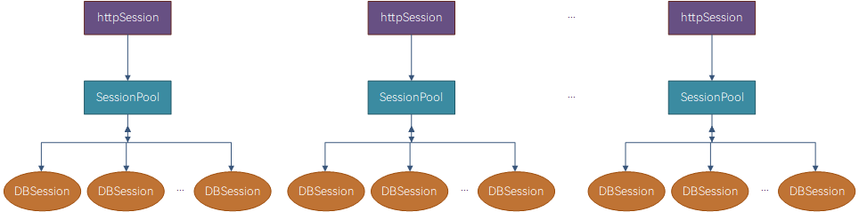

图6.1.2 SQL开发实现原理图

每个请求包含一个对应的 httpSession 信息，根据 httpSession 映射到 SessionPool，从对应 SessionPool 中取出对应的 DBSession。

其中 httpSession 为前端存储 session 相关信息，DBSession 为实际的对应的数据库连接，SessionPool 为数据库会话管理池。

数据库会话管理池大小即为 SessionPool 的数量，管理员和超级管理员可以通过 DEM 界面的系统配置界面进行配置，路径：客户端工具配置->db\_session\_pool\_count，默认 11。详细请参考 [第 4 章 系统管理](https://eco.dameng.com/document/dm/zh-cn/pm/dem_user_manual#%E7%AC%AC%204%20%E7%AB%A0%20%E7%B3%BB%E7%BB%9F%E7%AE%A1%E7%90%86) 。

**DBSession 的增删查:**

1. 增加 DBSession

每次在 SQL 开发-数据库连接模块中新建连接，都会创建一个 DBSession，然后根据 DBSession  
ID，存储在对应 SessionPool 中。

2. 删除 DBSession

删除 DBSession 有 2 种方式:

1. 在 DEM 界面的 SQL 开发-数据库连接模块中断开连接，会根据 DBSession ID 将 DBSession 从 SessionPool 中移除，并断开连接；
2. 定时检查有效性，检查频率由参数“db\_session\_check\_freq”控制，有效时间由“db\_session\_invalid\_time”控制，默认 1800s，即如果 1800s 没有被使用过，则认为失效。这 2 个参数可由管理员或超级管理员配置。
3. 查询 DBSession

在 SQL 开发-数据库连接模块中，新建连接，创建 DBSession 后，会在相应对象保留 DBSession，并传入对应前端存储的 httpSession 中，后续每次操作，都会传入 httpSession，然后通过 httpSession 中的 DBSession ID，查找到对应的 SessionPool，然后再根据 DBSession ID 从 SessionPool 中取出 DBSession。

### 6.1.2 SQL 开发简介

#### 6.1.2.1 主菜单

1. 文件

文件功能通过对文件的导入导出实现开发内容的本地保存与加载复用。

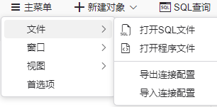

图6.1.3 SQL开发主菜单文件功能

- **打开 SQL 文件/程序文件**

支持通过主菜单从文件系统中打开本地 SQL 文件和程序文件到新窗口进行应用。

可被打开的各类程序文件可选的文件名后缀可以在“主菜单->首选项->开发->程序”控制与调整。

除主菜单的文件功能外，还可以在右侧窗口中右键文件导出当前窗口内容，或右键文件导入 SQL 文件/程序文件内容到当前窗口。

- **导入/导出连接配置**

支持通过主菜单完成数据库对象连接配置的导入/导出。

导出功能可以选择导出列表中所有或部分数据库连接。点击导出连接配置后，在导出数据库连接对话框中勾选需要导出配置的数据库连接，完成选择后点击“导出”按钮得到对应的 XML 配置文件。如下图所示：

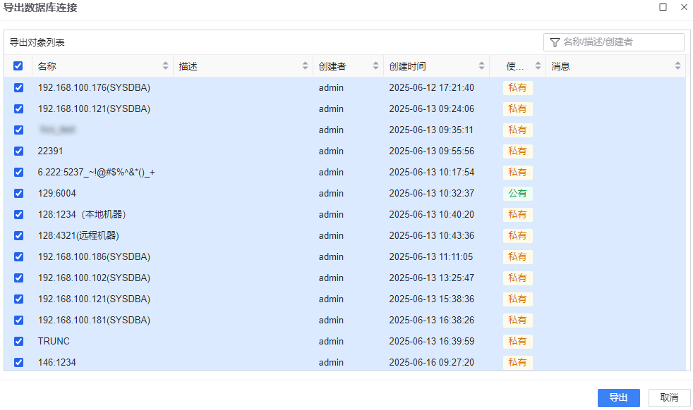

图6.1.4 导出数据库连接对话框

导入功能基于导出的 XML 配置文件（不推荐用户手动进行配置）进行，可以实现数据库连接信息配置的复用。

点击导入连接配置，进入导入数据库连接对话框，上传并打开需要导入的 XML 配置文件，并在该页面中选择需要从 XML 配置文件中导入的数据库连接；默认会勾选文件中的全部连接，若不想导入则可以取消勾选。完成选择后，点击“导入”按钮，将选中的数据库连接加入 SQL 开发模块的数据库对象列表。如下图所示：

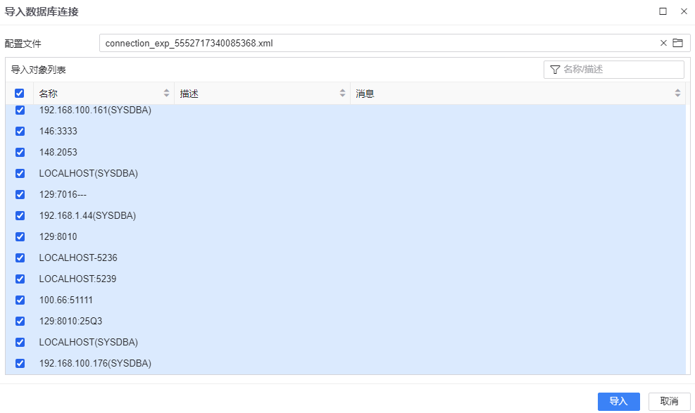

图6.1.5 导入数据库连接对话框

2. 窗口

主菜单窗口功能支持关闭当前窗口、关闭所有窗口、查看 SQL 执行历史和查看导入导出历史。

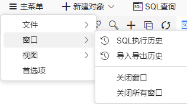

图6.1.6 SQL开发主菜单窗口功能

- **SQL 执行历史**

查看已记录的各 SQL 编辑器的 SQL 执行历史。默认关闭 SQL 执行历史记录功能，可在“主菜单->首选项->开发->查询分析器->SQL 日志”勾选“记录 SQL 执行历史”开启该功能，并支持配置 SQL 执行历史记录的“最大缓存数量”和“最大 SQL 长度”。

除可通过“主菜单->窗口->SQL 执行历史”查看记录的历史信息外，还可在 SQL 编辑器窗口中右键“高级”，查看当前编辑器的 SQL 执行历史。

如下图所示：

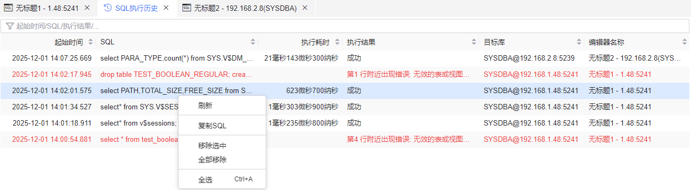

图6.1.7 SQL执行历史

- **导入导出历史**

查看 SQL 开发所有对象的导入导出历史记录，同时可点击“打开”查看导入导出操作的参数文件内容和执行日志，并支持下载其内容，如下图所示：

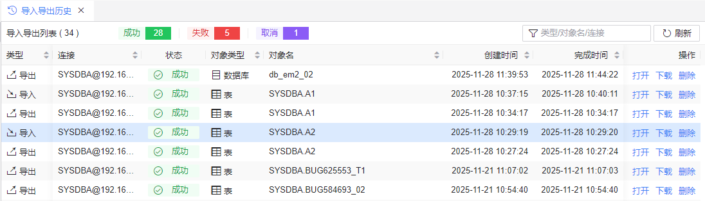

图6.1.8 SQL开发导入导出历史列表

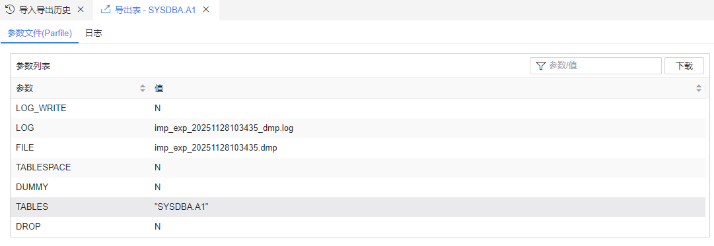

图6.1.9 SQL开发导入导出参数文件

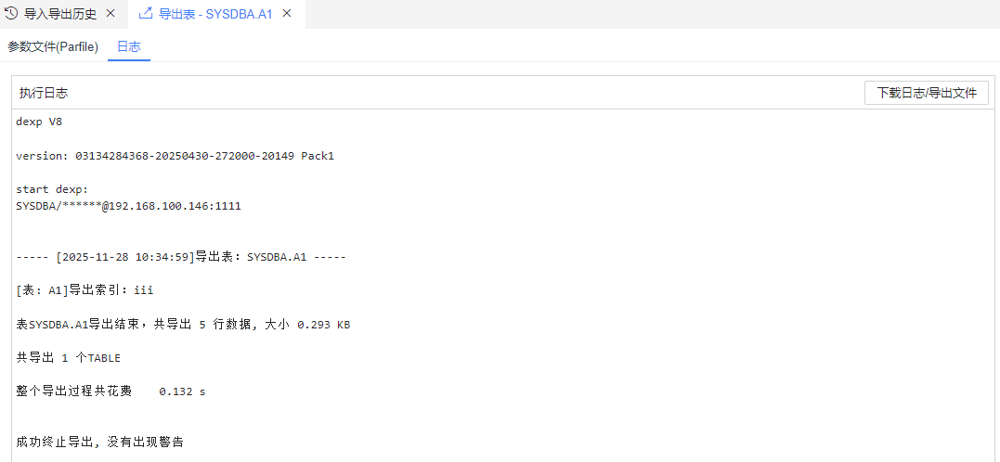

图6.1.10 SQL开发导入导出日志

3. 视图

视图功能用于控制左侧数据库对象视图下是否展示“打开窗口”视图。

4. 首选项

可通过首选项功能对 SQL 开发的各种配置规则和参数进行设置。

#### 6.1.2.2 新建对象

区别于数据库导航树中，各种数据库对象位于不同导航节点下，顶部工具栏提供的新建对象功能以列表形式直观展示所有类型的对象，方便用户快速创建各种数据库对象。

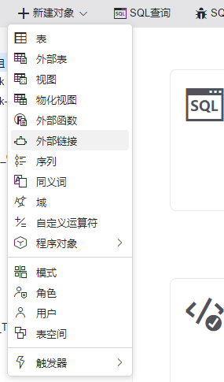

图6.1.11 新建对象

#### 6.1.2.3 数据库对象

所有数据库连接记录展示在数据库对象视图下。视图工具栏提供了仅显示已连接过滤、导航树搜索、添加连接、导航树收缩、导航树刷新等功能。

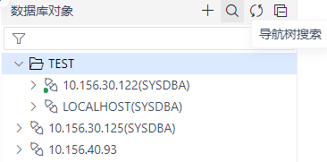

图6.1.12 数据库对象视图

- **添加连接**

如下图所示，填写数据库连接信息，其中“\*”项为必填项。

点击“测试”按钮测试输入信息对应数据库的连接状态，点击“确定”完成添加。

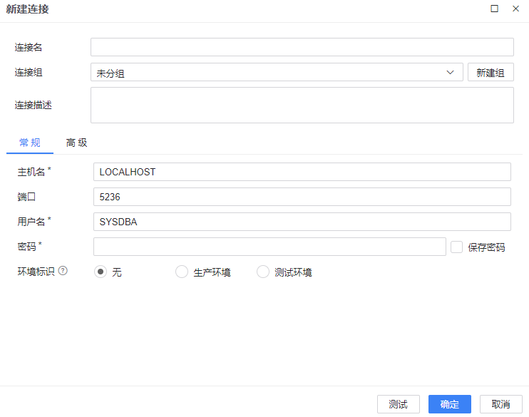

图6.1.13 新建数据库连接对话框

环境标识：标识当前操作库的环境类型，设置该标识会在操作区增加水印进行提示。

- **分组管理**

可在新建连接时，在连接组项中选择已有分组进行添加或新建分组进行添加。

可在新建连接后右键连接通过管理组功能新建组——添加新组放置该连接；组迁移——将连接迁移到其它组；从组中移除——将连接改为未分组。

可选中组右键新建组、解散当前组、重命名当前组。

DEM 提供的 SQL 开发功能的数据库对象管理与桌面版管理工具 manager 的对象管理功能一致，详细使用方式请参见管理工具 manager 的联机帮助手册。

#### 6.1.2.4 打开窗口

在界面左侧的对象列表中展示界面右侧窗口已打开的所有连接对象视图。当已打开了大量窗口时，可通过此对象视图快速选择、关闭、复制、新建指定窗口。默认不显示该视图，可通过“主菜单->视图->打开窗口”控制是否显示该视图。

### 6.1.3 SQL 查询

SQL 查询模块提供了高效且功能全面的 SQL 开发环境，支持智能补全、SQL 格式化、语法高亮、语法校验等功能，适用于日常数据库查询、数据更新/维护、编写和测试复杂 SQL、分析 SQL 执行效率。

可通过点击 DEM 的 SQL 开发界面顶部工具栏的“SQL 查询”按钮，或点击无窗口时 SQL 查询介绍的“立即体验”快速入口，或右键库连接节点点击“SQL 查询”按钮打开 SQL 编辑器窗口进行 SQL 查询。

DEM 的 SQL 编辑器功能与桌面版 manager 的 SQL 编辑器功能一致。SQL 编辑器通过 DEM 直接访问要管理的数据库实例，在 DEM 界面中编辑 SQL，通过 JDBC 连接数据库实例执行 SQL，且同样提供了全新的 SQL 助手 2.0，能够对用户输入的 SQL 语句进行实时的语法检查，定位错误的 SQL 语法，同时能够对用户输入 SQL 进行实时的智能提示。

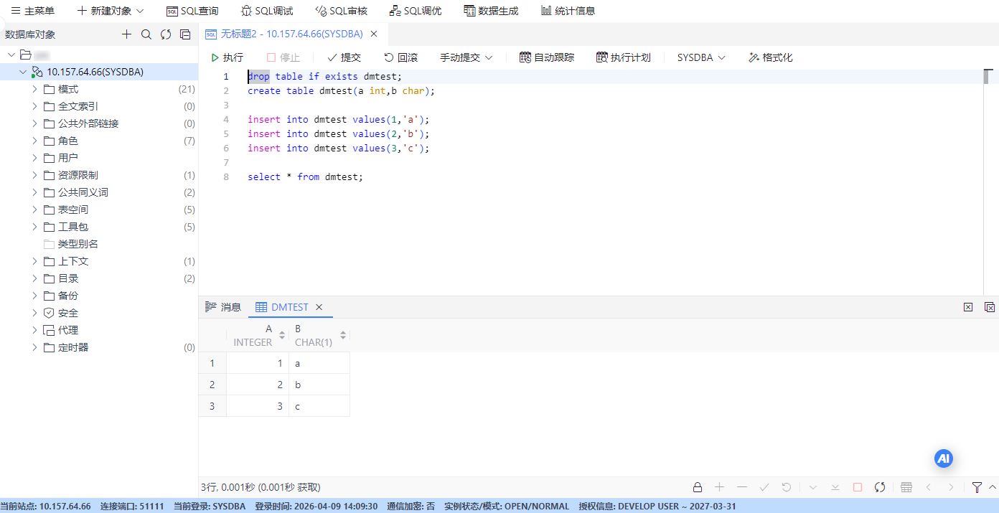

图6.1.14 SQL编辑器界面

可在“首选项->开发->查询分析器”查看修改 SQL 查询相关选项配置。

SQL 编辑器从上到下依次为工具栏、编辑区和消息区。

#### 6.1.3.1 工具栏

SQL 编辑器的工具栏中提供了如下功能选项：

- 执行：执行选中文本或执行所有文本。
- 停止：停止正在执行中的 SQL 操作。
- 提交：提交更改到数据库。
- 回滚：回滚到上一个保存点。
- 切换事务提交模式：切换手动提交与自动提交。
- 自动跟踪：显示 SQL 语句自动跟踪的计划。
- 执行计划：显示 SQL 语句的执行计划（相当于语法 explain+SQL）。
- 切换会话模式：设置当前编辑器会话所属的模式。
- 格式化：格式化选中文本或所有文本。

#### 6.1.3.2 编辑区

SQL 编辑区的右键功能介绍如下：

- 执行：
	- 执行：执行选中文本或执行所有文本。
		- 闪回查询：设置闪回查询条件并执行。
		- 执行 SQL\[全部窗口\]：将选中 SQL 或所有 SQL 在所有打开的查询窗口中执行。
- 会话只读：将当前编辑器会话切换为只读/读写模式。
- SQL 监控：打开/关闭当前会话的监控功能。
- AI 助手：打开并使用 AI 助手。
- SQL 脚本：包含了一些常用的文本操作，例如，缩进、注释、复制、移动和大小写切换等。
- 格式化：格式化选中文本或所有文本。
- 文件：导入或导出 SQL 文件。
- 展开/折叠：展开或折叠 SQL 语句
- 高级：
	- SQL 执行历史：当开启记录 SQL 执行历史功能时，查看当前编辑器的 SQL 执行历史。
- 查找：在编辑器中查找指定内容。
- 复制：复制选中内容。
- 剪切：剪切选中内容。
- 首选项：查看、配置开发相关首选项。

#### 6.1.3.3 消息区

消息区是 SQL 查询各功能的执行结果输出区域。

SQL 结果集的右键功能介绍如下：

- 复制：复制选中内容。
- 高级复制：按照配置规则复制选中内容。
- 全选：全选表格内容。
- 查看详情：打开对话框查看完整的结果集数据内容和列信息。可设置按文本格式、JSON 格式、XML 格式和 16 进制格式查看结果集内容。
- 复制 SQL：复制结果集表的创建 SQL 语句、结果集数据涉及的用于增删查改的 SQL 语句。
- 导出当前结果集：导出已加载的结果集数据到文件中。
- 导出所有结果集：导出所有结果集数据到文件中。

结果集导出操作（包含导出当前或所有结果集）步骤如下：

1. 选择文件类型：选择导出文件类型，支持 CSV、EXCEL、HTML、JSON、Markdown、SQL、TEXT、WORD、XML 类型；
2. 配置目的端数据源：配置导出的文件名和文本格式，其中带“\*”项为必填项；
3. 配置导出策略：根据实际需求和页面提示配置导出策略和列映射规则；
4. 详情总览：提供导出任务的详细信息供用户预览与确认；
5. 执行导出任务：显示导出任务的执行情况和执行结果；点击“下载所有导出文件”获得最终导出文件。

支持导出本次导出任务的配置文件，可以在后续进行导出时直接导入并应用该导出配置文件。

### 6.1.4 SQL 调试

SQL 调试，调试 DMSQL 程序的工具，支持断点调试、变量观察、执行跟踪和性能分析，可以帮助开发者高效定位并解决问题。

用户可通过点击 SQL 开发界面顶部工具栏的“SQL 调试”按钮，或点击无窗口时 SQL 调试介绍的“立即体验”快速入口，或右键库连接节点点击“SQL 调试器”按钮打开 SQL 调试器窗口。

DEM 的 SQL 调试器功能与桌面版 manager 的  
SQL 调试功能一致，可以通过 DEM 直接访问要管理的数据库实例，详细请参见管理工具 manager 的联机帮助手册。

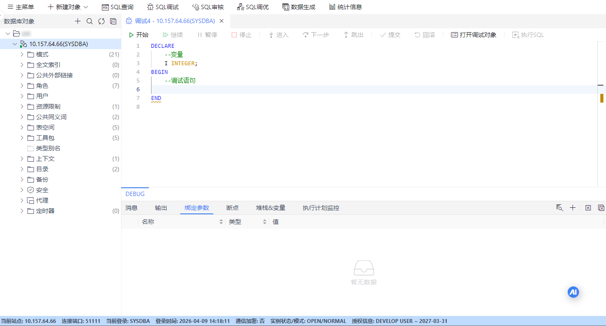

图6.1.15 SQL调试器

可在“首选项->开发->SQL 调试”查看并修改 SQL 调试的相关配置选项。

### 6.1.5 SQL 审核

SQL 审核，通过分析和审核 SQL 语句可以有效提升 SQL 编写质量、保障数据库性能与安全，适用于规范化管理以及大型数据库系统的维护。

DEM 的 SQL 审核功能是基于 SQL 审核规则的集合，自动化和智能化地实现指定对 SQL 语句的审核，并提供改进和优化建议。

可通过点击 SQL 开发界面顶部工具栏的“SQL 审核”按钮，或点击无窗口时 SQL 审核介绍的“立即体验”快速入口打开 SQL 审核窗口。

SQL 审核功能的使用流程为：连接数据库、指定 SQL 语句、配置审核规则、执行审核并获取建议，下面将具体介绍各个流程中的内容。

#### 6.1.5.1 连接数据库

选择已有数据源，或输入指定数据库连接信息，点击连接按钮，连接待进行 SQL 审核的数据库。

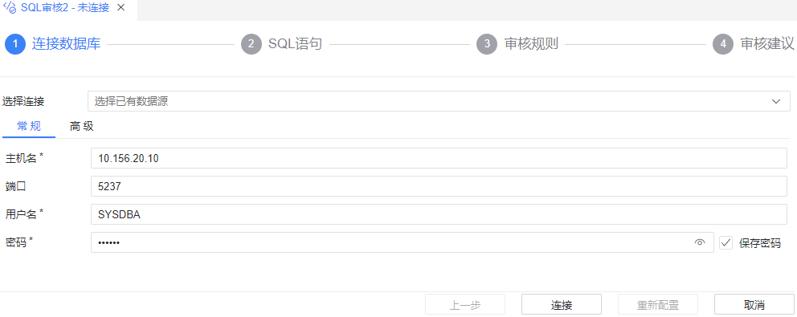

图6.1.16 连接数据库

#### 6.1.5.2 指定 SQL 语句

指定需要审核的 SQL 语句，SQL 来源可选择：

- 输入 SQL 语句：直接在文本框中输入待审核的 SQL。
- 指定 SQL 脚本文件：指定包含待审核 SQL 的脚本文件。
- 查询数据库 SQL 语句：查询 V$SQL\_HISTORY 获取待审核的 SQL。

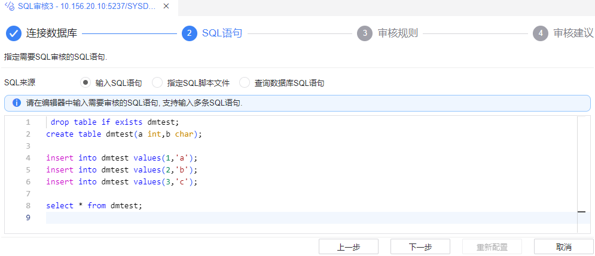

图6.1.17 输入SQL语句

指定好需要审核的 SQL 语句后，点击“下一步”，对审核规则进行配置。

#### 6.1.5.3 审核规则

配置审核规则。SQL 审核规则包含名称、描述、类别、等级、启用状态和参数等信息。DEM 为用户提供了一套内置的审核规则，用户可以根据需求更改规则的等级、启用、参数。

DEM 内置的审核规则包括：DDL-表、DDL-字段、DDL-索引、DML-插入、DML-更新、DML-删除、查询、条件。除了内置的审核规则，DEM 还支持根据自定义规则开发规范定义自定义审核规则。DEM  
提供了 dmsdk.jar，其包含了审核规则接口 com.dameng.sdk.sqlverify.IRule，用户可以通过自定义类来实现该接口。具体使用规则参考《DM8\_dmsdk 使用手册》。

DEM 支持审核规则的导入导出，导入导出的文本格式为 TXT，文本内容为审核规则的 JSON 串，用户可以选择点击“规则导入”，导入审核规则；或点击“规则导出”，将当前所设置的审核规则进行导出。

使用建议：用户在审核规则页可以自定义配置各规则的自定义项（等级、启用、参数），此时可以导出规则，下次审核时可以导入规则达到快速配置审核规则的目的。另外，导出的规则文本中 level、status、parameterList 中的 value（分别对应等级、启用、参数值）可以修改，其他内容不建议进行变更。

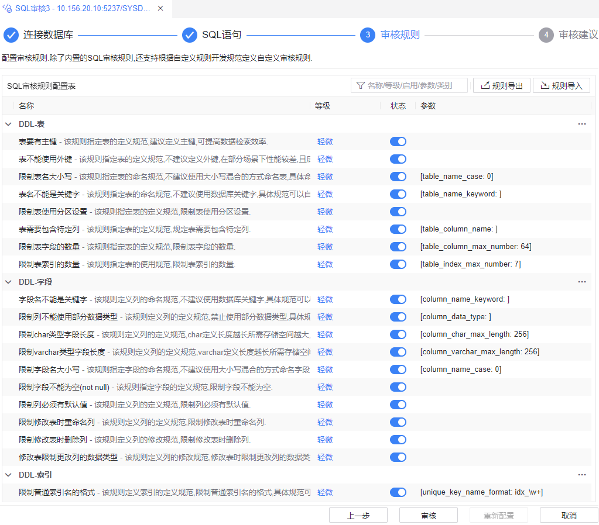

图6.1.18 配置审核规则

审核规则配置完成后，点击“审核”，对 SQL 语句进行审核。

#### 6.1.5.4 审核建议

显示 SQL 审核的进度和审核建议，支持导出审核建议文件和执行消息文件。

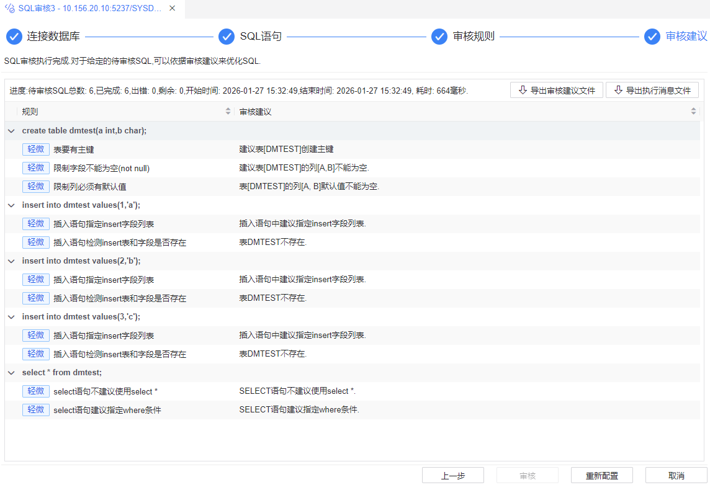

图6.1.19 查看审核建议

### 6.1.6 SQL 调优

SQL 调优，用于分析数据库查询性能并辅助优化索引结构，通过执行 SQL 调优任务、分析 SQL 调优报告，提出优化程序统计信息、创建索引等建议，以提升数据库查询效率。

可通过点击 SQL 开发界面顶部工具栏的“SQL 调优”按钮，或点击无窗口时 SQL 调优介绍的“立即体验”快速入口打开 SQL 调优窗口。

SQL 调优功能的使用流程为：指定 SQL 语句、执行 SQL 调优并获取建议、执行调优语句，下面将具体介绍各个流程中的内容。

#### 6.1.6.1 指定 SQL 语句

指定需要优化的 SQL 语句，SQL 来源可选择：

- 输入 SQL 语句：直接在文本框中输入待分析的 SQL。
- 指定 SQL 脚本文件：指定包含待分析 SQL 的脚本文件。
- 查询数据库 SQL 语句：查询 V$SQL\_HISTORY 获取待分析的 SQL。

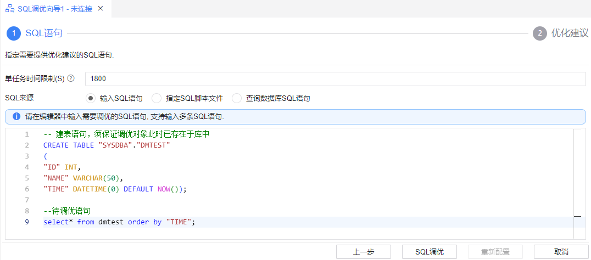

图6.1.20 指定SQL语句

确定单任务时间限制，并指定好需要优化的 SQL 语句后，点击“SQL 调优”按钮，开始 SQL 调优任务。

#### 6.1.6.2 优化建议

显示 SQL 调优的进度信息、优化建议和执行消息。

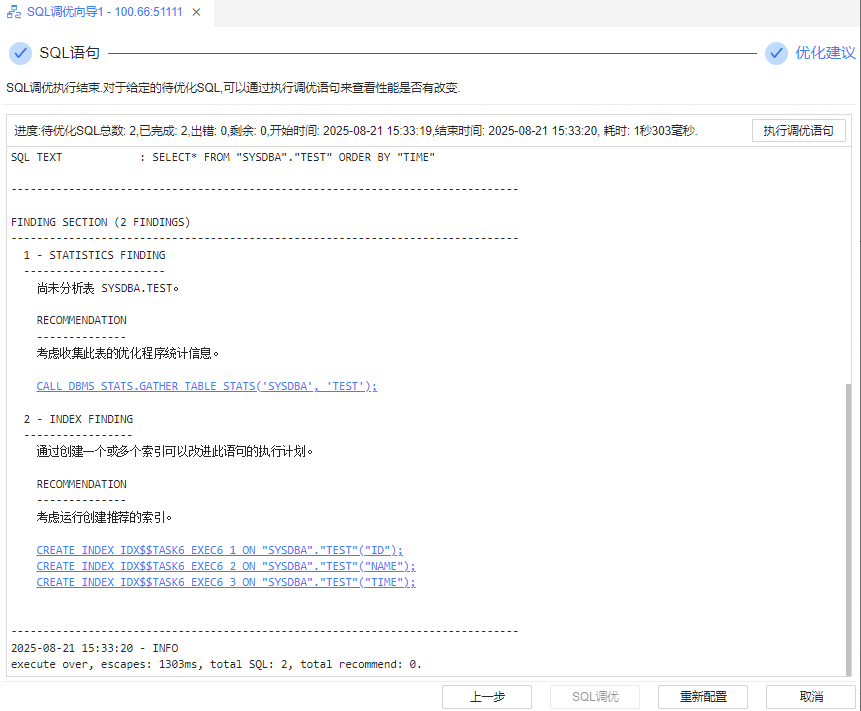

图6.1.21 查看优化建议

分析建议可能包括收集统计信息和创建指定索引等。此时可以点击“执行调优语句”按钮来根据优化建议执行调优语句。

#### 6.1.6.3 执行调优语句

根据优化建议，用户按需选择需要执行的 SQL 调优语句。

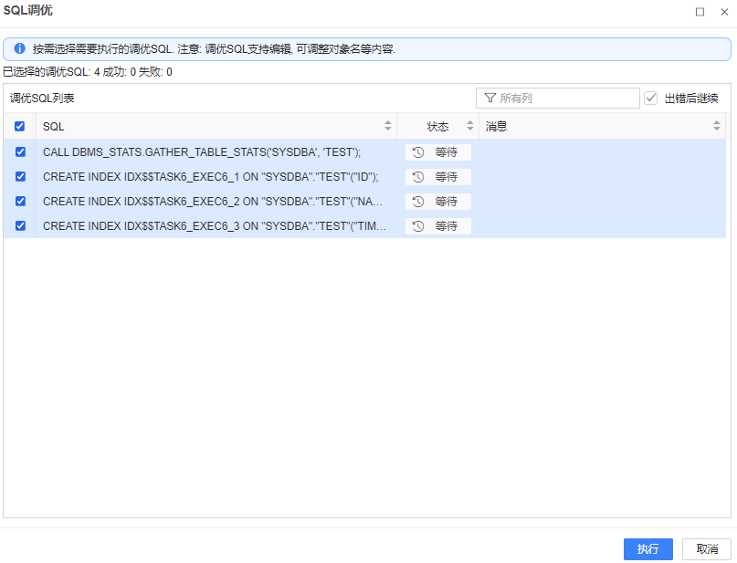

图6.1.22 执行SQL调优语句

### 6.1.7 数据生成

数据生成，功能灵活、操作简单的数据灌装助手，通过自动化生成高质量模拟数据，帮助开发人员更高效地进行调试、验证和演示。

可通过点击 SQL 开发界面顶部工具栏的“数据生成”按钮，或点击无窗口时数据生成介绍的“立即体验”快速入口打开数据生成窗口。

完整的数据生成功能介绍详见数据迁移中的 [6.2.5 数据生成](https://eco.dameng.com/document/dm/zh-cn/pm/dem_user_manual#6.2.5%20%E6%95%B0%E6%8D%AE%E7%94%9F%E6%88%90) 。

### 6.1.8 统计信息

统计信息，是 DEM 提供的用于管理数据库对象统计信息的综合性工具，涵盖数据库统计信息的状态监控、查看、更新、清理等常用功能。

可通过点击 SQL 开发界面顶部工具栏的“统计信息”选项，或点击无窗口时统计信息介绍的“立即体验”快速入口打开统计信息窗口。

统计信息窗口中支持的操作有：统计信息监控、更新统计信息、导入统计信息、导出统计信息、锁定统计信息、解锁统计信息、清理统计信息、管理统计信息表和统计信息属性设置，下面将具体介绍统计信息支持的各操作。

#### 6.1.8.1 统计信息监控

连接数据库，查看和管理该库对象的统计信息状态与内容。

选择统计信息监控中要查看与管理的目标模式，以列表展示该模式下对象的统计信息状态和内容，双击统计对象可进一步查看列和索引的统计信息状态与内容，如下图所示：

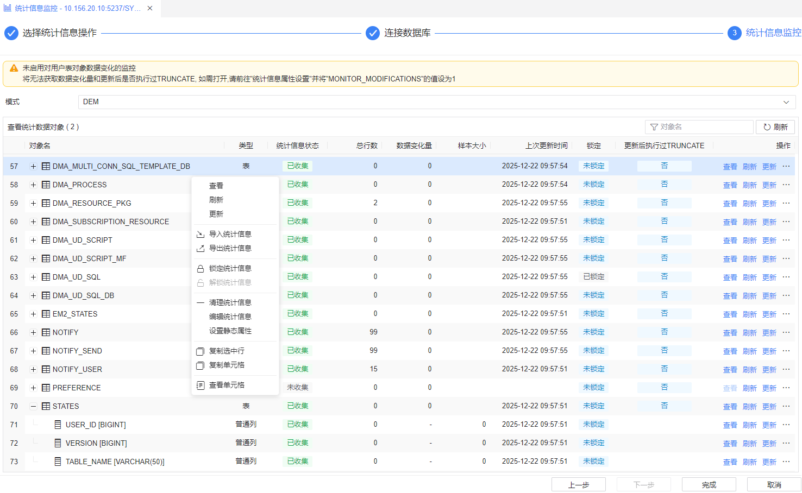

图6.1.23 统计信息监控

可右键对统计对象进行查看、刷新、更新、导入、导出、锁定、解锁、清理、编辑和设置统计信息操作。本小节中仅对查看、刷新、编辑统计信息等操作进行介绍，更新、导入、导出、锁定、解锁、清理统计信息操作请参见后续章节介绍。

##### 6.1.8.1.1 刷新

刷新该对象当前统计监控信息。

##### 6.1.8.1.2 查看

查看表、列和索引的统计信息。

- 表统计信息：包括 OWNER 模式名、TABLE\_NAME 表名、NUM\_ROWS 表的总行数、LEAF\_BLOCKS 总的页数、LEAF\_USED\_BLOCKS 已经使用的页数。
- 列统计信息：包括 OWNER 模式名、TABLE\_NAME 表名、COLUMN\_NAME 列名、SAMPLE\_SIZE 样本容量、NUM\_BUCKETS 直方桶的个数、NUM\_DISTINCT 不同列值的个数、NUM\_NULLS 空值的个数、LOW\_VALUE 列最小值、HIGH\_VALUE 列最大值、直方图、直方图信息。
- 索引统计信息：包括 OWNER 模式名、TABLE\_NAME 表名、NAME 索引名、COLUMN\_NAME 列名、BLEVEL B\_tree 的层次、LEAF\_BLOCKS 总的页数、DISTINCT\_KEYS 不同样本的个数、CLUSTERING\_FACTOR 聚集因子（表示索引的数据分布与物理分布之间的关系，暂不支持）、NUM\_ROWS 表的总行数、SAMPLE\_SIZE 样本容量、LOW\_VALUE 列最小值、直方图、直方图信息。索引的直方图就是它的第一个索引列的直方图；直方图支持通过右上角的导出功能导出直方图的 PNG 图片或 CSV 文件。

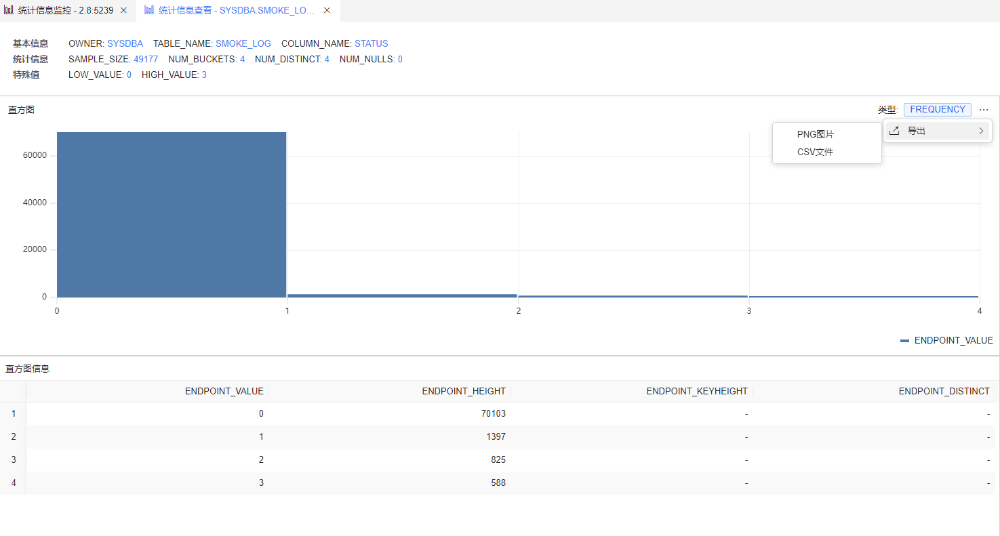

图6.1.24 统计信息直方图

直方图用于描述和展示列收集的统计样本数据，说明这个列的列值的分布特征。可以将采样的数据按照不同的分布特征生成相应的直方图，有两种类型的直方图：频率直方图和等高直方图。根据算法分析表的数据分布特征（以不同值的数据量达到 1 万作为分界线），确定直方图的类型，频率直方图的每个桶（保存统计信息的对象）的高度不同；等高直方图的每个桶的高度相同。在生成直方图时，如果不同值的数据少于 1 万个则使用频率直方图，否则使用等高直方图。

直方图信息介绍见下表：

表6.1 直方图信息表

| **名称** | **解释** |
| --- | --- |
| ENDPOINT\_VALUE | 样本值 |
| ENDPOINT\_HEIGHT | 对于频率直方图，样本值的个数；对于等高直方图，小于样本值大于前一个样本值的个数 |
| ENDPOINT\_KEYHEIGHT | 对于频率直方图无效；对于等高直方图，样本值的个数 |
| ENDPOINT\_DISTINCT | 对于频率直方图无效；对于等高直方图，小于样本值大于前一个样本值之间不同样本的个数 |

##### 6.1.8.1.3 编辑统计信息

查看和修改表与列的统计信息值。需要注意，修改统计信息值为高风险操作。统计信息是数据库执行优化的重要依据，随意修改可能会产生严重性能问题或者其他难以预知的后果。强烈建议仅在用户为数据库专家，并为了解决特定性能问题时再使用本功能。

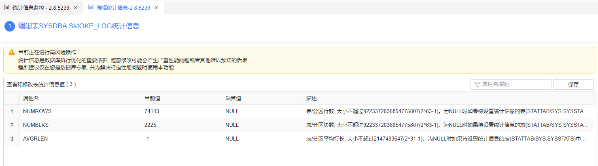

图6.1.25 编辑统计信息

表和列支持修改的统计信息值介绍分别见下面两表：

表6.2 支持修改的表统计信息

| **属性名** | **缺省值** | **描述** |
| --- | --- | --- |
| NUMROWS | NULL | 表/分区行数，大小不超过 9223372036854775807(2^63-1)。为 NULL 时如果待设置统计信息的表(STATTAB/SYS.SYSSTATS)中存在行数时不做修改，否则插入默认值 2000；若不为 NULL，则更新为指定行数 |
| NUMBLKS | NULL | 表/分区块数，大小不超过 9223372036854775807(2^63-1)。为 NULL 时如果待设置统计信息的表(STATTAB/SYS.SYSSTATS)中存在块数时不做修改，否则插入默认值 100；若不为 NULL，则更新为指定块数 |
| AVGRLEN | NULL | 表/分区平均行长, 大小不超过 2147483647(2^31-1)。为 NULL 时如果待设置统计信息的表(STATTAB/SYS.SYSSTATS)中存在平均列宽时不做修改，否则插入默认值 100 |

表6.3 支持修改的列统计信息

| **属性名** | **描述** |
| --- | --- |
| DISTCNT | 唯一值个数 |
| NULLCNT | 空值个数 |
| AVGCLEN | 平均列宽 |

##### 6.1.8.1.4 设置静态属性

查看和修改表静态属性值。

修改后，点击右上角“保存”按钮保存修改后的属性设置，如下图所示：

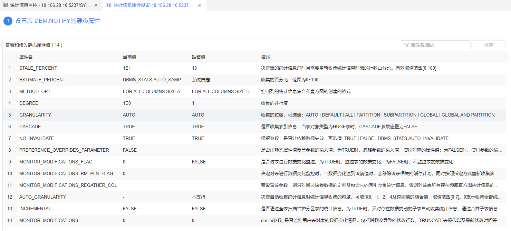

图6.1.26 设置表静态属性

支持修改的静态属性如下：

- STALE\_PERCENT：决定表的统计信息过时且需要重新收集统计信息时表的行数百分比。取值范围为 0~100，缺省值为 10。
- ESTIMATE\_PERCENT：收集的百分比，取值范围为 0~100，缺省值为系统自定。
- METHOD\_OPT：控制列的统计信息集合和直方图的创建的格式，缺省值为 FOR ALL COLUMNS SIZE DEFAULT。
- DEGREE：收集的并行度，缺省值为 1。
- GRANULARITY：收集的粒度，可选值为 AUTO、DEFAULT、ALL、PARTITION、SUBPARTITION、GLOBAL、GLOBAL AND PARTITION，缺省值为 AUTO。
- CASCADE：是否收集索引信息，当表对象类型为 HUGE 表时，CASCADE 参数应置为 FALSE，缺省值为 TRUE。
- NO\_INVALIDATE：保留参数，设置是否让依赖游标失效，可选值为 TRUE、FALSE、DBMS\_STATS.AUTO\_INVALIDATE，缺省值为 TRUE。
- PREFERENCE\_OVERRIDES\_PARAMETER：是否用静态属性值覆盖参数的输入值。为 TRUE 时，忽略参数的输入值，使用对应的属性值；为 FALSE 时，使用参数的输入值。
- MONITOR\_MODIFICATIONS\_FLAG：是否对表进行数据变化监控。为 TRUE 时，监控表的数据变化；为 FALSE 时，不监控表的数据变化；缺省值为 FALSE。
- MONITOR\_MODIFICATIONS\_RM\_PLN\_FLAG：决定对表进行数据变化监控时，当数据变化达到该阈值时，会移除该表相关的缓存计划，同时按照指定方式重新收集该表的统计信息。
- MONITOR\_MODIFICATIONS\_REGATHER\_COL：若设置该参数，则只对通过该参数指的定列及包含它的索引收集统计信息，否则对该表所有存在频率直方图统计信息的列和索引收集统计信息，同一张表上可指定多个不同的列。必须先指定 MONITOR\_MODIFICATIONS\_RM\_PLN\_FLAG 后才可设置该参数。
- AUTO\_GRANULARITY：决定自动收集统计信息时统计信息收集的粒度。可取值 0、1、2、4 及这些值的组合值，取值范围为 0~7，缺省值为 0。
	- 0 表示收集全部统计信息，包括表、表中的列和表上的索引的统计信息；
		- 1 表示仅收集表和列的统计信息；
		- 2 表示仅收集表和索引的统计信息；
		- 4 表示仅收集表和索引涉及列的统计信息；
		- 支持使用上述有效值的组合值，如 3 表示同时取值 1 和 2，即收集表、列、索引的统计信息。
- INCREMENTAL：是否通过全表扫描维护分区表的统计信息。为 TRUE 时，只对存在数据变动的子表自动收集统计信息，通过合并子表信息来维护分区表的统计信息；为 FALSE 时，通过全表扫描来维护分区表的统计信息；缺省值为 FALSE。
- MONITOR\_MODIFICATIONS：dm.ini 参数，监控用户表对象的数据变化情况设置，包括增删改导致的修改行数、TRUNCATE 表操作以及最新修改时间等。0：不监控；1：对所有表进行监控；2：只对用户执行过 SET\_TABLE\_PREFS 的表进行监控。DMDPC 环境下不支持动态修改该参数。

#### 6.1.8.2 更新统计信息

收集更新指定对象的统计信息，更新操作流程有：连接数据库、选择模式、选择对象、配置更新选项、详情总览、执行统计信息任务。

##### 6.1.8.2.1 连接数据库

选择已有数据源，或输入指定数据库连接信息，连接数据库。

##### 6.1.8.2.2 选择模式

选择需要更新统计信息的模式。

##### 6.1.8.2.3 选择对象

选择需要更新统计信息的对象，并确定是否一起更新对象索引、索引列和普通列的统计信息。

##### 6.1.8.2.4 配置更新选项

配置统计信息更新选项，如下图所示：

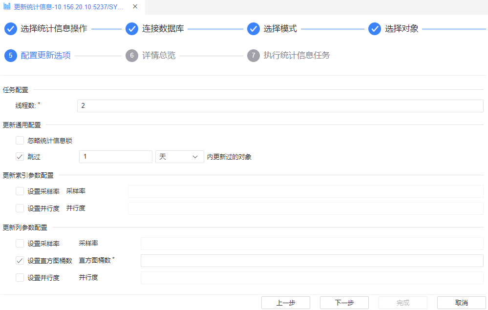

图6.1.27 配置统计信息更新选项

##### 6.1.8.2.5 详情总览

提供更新统计信息任务的详细信息供用户预览与确认。

##### 6.1.8.2.6 执行统计信息任务

执行任务，显示执行统计信息任务的执行情况和执行结果。支持点击“停止执行”按钮，终止正在执行的任务。

#### 6.1.8.3 导入统计信息

从统计信息表中导入对象统计信息。导入操作流程为：连接数据库、选择模式、选择对象、配置导入选项、详情总览、执行统计信息任务。

##### 6.1.8.3.1 连接数据库

选择已有数据源，或输入指定数据库连接信息，连接数据库。

##### 6.1.8.3.2 选择模式

选择需要导入统计信息的模式。

##### 6.1.8.3.3 选择对象

选择需要导入统计信息的对象。

##### 6.1.8.3.4 配置导入选项

配置统计信息导入选项，配置导入任务执行线程数、选择导入统计信息来源表。

##### 6.1.8.3.5 详情总览

提供导入统计信息任务的详细信息供用户预览与确认。

##### 6.1.8.3.6 执行统计信息任务

执行任务，显示任务的执行情况和执行结果。支持点击“停止执行”按钮，终止正在执行的任务。

#### 6.1.8.4 导出统计信息

将对象统计信息导出到统计信息表。导出操作流程为：连接数据库、选择模式、选择对象、配置导出选项、详情总览、执行统计信息任务。

##### 6.1.8.4.1 连接数据库

选择已有数据源，或输入指定数据库连接信息，连接数据库。

##### 6.1.8.4.2 选择模式

选择需要导出统计信息的模式。

##### 6.1.8.4.3 选择对象

选择需要导出统计信息的对象。

##### 6.1.8.4.4 配置导出选项

配置统计信息导出选项，配置导出任务执行线程数、选择导出目的统计信息表。支持选择指定模式新建一个统计信息表存放本次导出的统计信息，如下图所示：

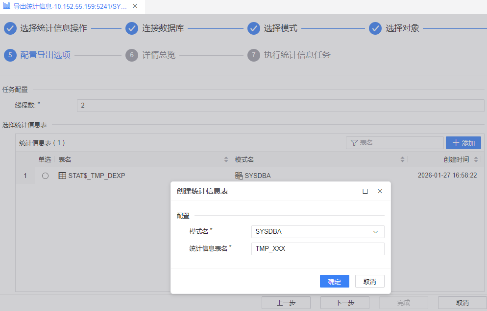

图6.1.28 配置统计信息导出选项

##### 6.1.8.4.5 详情总览

提供导出统计信息任务的详细信息供用户预览与确认。

##### 6.1.8.4.6 执行统计信息任务

执行任务，显示任务的执行情况和执行结果。支持点击“停止执行”按钮，终止正在执行的任务。

#### 6.1.8.5 锁定统计信息

锁定指定对象的统计信息。锁定操作流程为：连接数据库、选择模式、选择对象、配置锁定选项、详情总览、执行统计信息任务。

##### 6.1.8.5.1 连接数据库

选择已有数据源，或输入指定数据库连接信息，连接数据库。

##### 6.1.8.5.2 选择模式

选择需要锁定统计信息的模式。

##### 6.1.8.5.3 选择对象

选择需要锁定统计信息的对象。

##### 6.1.8.5.4 配置锁定选项

配置统计信息锁定选项：配置锁定任务执行线程数。

##### 6.1.8.5.5 详情总览

提供锁定统计信息任务的详细信息供用户预览与确认。

##### 6.1.8.5.6 执行统计信息任务

执行任务，显示任务的执行情况和执行结果。支持点击“停止执行”按钮，终止正在执行的任务。

#### 6.1.8.6 解锁统计信息

解锁指定对象的统计信息。解锁操作流程为：连接数据库、选择模式、选择对象、配置解锁选项、详情总览、执行统计信息任务。

##### 6.1.8.6.1 连接数据库

选择已有数据源，或输入指定数据库连接信息，连接数据库。

##### 6.1.8.6.2 选择模式

选择需要解锁统计信息的模式。

##### 6.1.8.6.3 选择对象

选择需要解锁统计信息的对象。

##### 6.1.8.6.4 配置解锁选项

配置统计信息解锁选项：配置解锁任务执行线程数。

##### 6.1.8.6.5 详情总览

提供解锁统计信息任务的详细信息供用户预览与确认。

##### 6.1.8.6.6 执行统计信息任务

执行任务，显示任务的执行情况和执行结果。支持点击“停止执行”按钮，终止正在执行的任务

#### 6.1.8.7 清理统计信息

删除指定对象的统计信息。清理操作流程为：连接数据库、选择模式、选择对象、配置清理选项、详情总览、执行统计信息任务。

##### 6.1.8.7.1 连接数据库

选择已有数据源，或输入指定数据库连接信息，连接数据库。

##### 6.1.8.7.2 选择模式

选择需要清理统计信息的模式。

##### 6.1.8.7.3 选择对象

选择需要清理统计信息的对象，并确定是否一起清理对象索引、索引列和普通列的统计信息。

##### 6.1.8.7.4 配置清理选项

配置统计信息清理选项：配置清理任务执行线程数、任务执行时是否忽略统计信息锁。

##### 6.1.8.7.5 详情总览

提供清理统计信息任务的详细信息供用户预览与确认。

##### 6.1.8.7.6 执行统计信息任务

执行任务，显示任务的执行情况和执行结果。支持点击“停止执行”按钮，终止正在执行的任务。

#### 6.1.8.8 管理统计信息表

连接数据库，创建和删除该数据库的统计信息表。

支持查看已有的统计信息表内容，可删除已有统计信息表、添加新统计信息表，如下图所示：


图6.1.29 管理统计信息表

#### 6.1.8.9 统计信息属性设置

连接数据库，查看或设置该数据库统计信息的相关表或全局静态属性。

如下图所示，修改后点击右上角“保存”按钮可以保存修改完成后的属性设置。


图6.1.30 统计信息属性设置

支持设置的统计信息属性如下：

- STALE\_PERCENT：决定表的统计信息过时且需要重新收集统计信息时表的行数百分比。取值范围为 0~100，缺省值为 10。
- DEGREE：收集的并行度，缺省值 1。
- AUTO\_GRANULARITY：决定自动收集统计信息时统计信息收集的粒度。可取值 0、1、2、4 及这些值的组合值，取值范围为 0~7，缺省值为 0。
	- 0 表示收集全部统计信息，包括表、表中的列和表上的索引的统计信息；
		- 1 表示仅收集表和列的统计信息；
		- 2 表示仅收集表和索引的统计信息；
		- 4 表示仅收集表和索引涉及列的统计信息。
		- 支持使用上述有效值的组合值，如 3 表示同时取值 1 和 2，即收集表、列、索引的统计信息。
- INCREMENTAL：是否通过全表扫描维护分区表的统计信息，可取值为 TRUE、FALSE，缺省值为 FALSE。
	- 为 TRUE 时，只对存在数据变动的子表自动收集统计信息，通过合并子表信息来维护分区表的统计信息；
		- 为 FALSE 时，通过全表扫描来维护分区表的统计信息。
- MONITOR\_MODIFICATIONS：dm.ini 参数，监控用户表对象的数据变化情况设置，包括增删改导致的修改行数、TRUNCATE 表操作以及最新修改时间等。0：不监控；1：对所有表进行监控；2：只对用户执行过 SET\_TABLE\_PREFS 的表进行监控。DMDPC 环境下不支持动态修改该参数。

## 6.2 数据迁移

数据迁移包括数据库迁移、迁移评估、数据库对比、数据库转换、数据生成和数据源管理六部分。

### 6.2.1 数据库迁移

DEM 数据库迁移模块通过 Web 页面方式向用户提供数据库迁移功能。

用户通过 Web 页面配置数据源信息、迁移对象以及迁移策略，DEM 服务器根据这些配置信息将源端数据中的待迁移对象迁移至目标数据源，使在完成数据库迁移的过程中不需要安装客户端，仅通过一个打开的 Web 页面进行配置便可方便的完成数据库的迁移。

DEM 的数据库迁移模块提供的功能有以下几个：

- 迁移管理
- 迁移配置
- 迁移执行
- 迁移模板

#### 6.2.1.1 迁移管理

数据库迁移界面的迁移列表展示了已创建的迁移任务的名称、数据源、执行状态、详细信息和创建时间等信息。数据库迁移界面主要支持了以下几个方面的功能：

- 添加：创建新迁移任务。
- 分组管理：对迁移对象进行批量分组配置。
- 模板管理：打开迁移模板管理界面。
- 再次执行：将当前执行成功的迁移任务再次执行。
- 打开：打开当前迁移任务进行查看。
- 删除：删除所选迁移任务。
- 创建副本：复制当前迁移配置新建迁移任务。
- 导入配置文件：从本地导入迁移配置文件，将文件配置内容转换录入迁移列表。
- 导出配置文件：将所选迁移任务的配置信息导出到本地保存。
- 导出 PDF 文件：将当前页内容导出为 PDF 文件下载保存。
- 查看历史：查看当前迁移的所有执行历史。
- 查看上一次执行报告：查看当前迁移上一次执行成功后的执行报告。
- 查看上一次执行日志：查看当前迁移上一次执行成功后的执行日志。
- 权限管理：授予或收回指定角色或用户当前迁移对象的权限。
- 属性：查看当前迁移的编号、名称、类型、使用权、创建者、添加/编辑时间和描述等信息。

#### 6.2.1.2 迁移配置与执行

使用 DEM 进行数据库迁移的具体步骤与桌面版数据迁移工具 DTS 类似，下面简单介绍 DEM 的数据库迁移执行步骤，详细请参见桌面版 DTS 联机帮助手册。

1）新建迁移，输入迁移名称，选择迁移所属分组，配置最大历史保留次数；

2）选择迁移方式：

DEM 提供如下的多种迁移方式：

- 达梦数据库之间的迁移；
- 其他数据库迁移到达梦；
- 达梦迁移到其他数据库；
- 达梦迁移到文件；
- 文件迁移到达梦。

3）配置源端数据源相关信息；

4）配置目的端数据源相关信息；

5）配置迁移策略，配置数据转换、任务并发、数据迁移等相关策略，可将当前已配置的策略保存，也可加载以前保存的策略直接复用；

6）指定模式，选择要迁移的模式和对象类型，也可以选择通过输入查询 SQL 或导入文件来获取对象；

7）指定对象，选择需要迁移的数据库对象；

8）指定执行方式，选择本地执行还是远程执行；

9）详情总览，提供该迁移的详细信息供用户预览与确认；

10）执行迁移任务，执行完成后，可执行查看报告、查看日志、查看错误数据等操作；若存在失败任务，支持查看对应任务的详细错误信息与重做失败任务。

#### 6.2.1.3 迁移模板

DEM 提供数据库迁移模板应用功能，可以通过统一的迁移策略配置模板、迁移数据转换模板和迁移语法规则模板，更方便快捷地实现数据迁移操作。

在迁移界面点击“模板管理”按钮打开迁移模板管理界面。

##### 6.2.1.3.1 迁移策略配置模板

选择“迁移策略配置模板”，打开迁移策略配置模板界面。


图6.2.1 迁移策略配置模板

DEM 自带三个系统内置模板，分别对应“对象比较多场景”、“数据量比较大场景”和“对象比较多以及数据量比较大场景”，用户可以通过点击“查看”按钮查看具体的策略，但内置模板不支持编辑与删除。除了内置模板，用户也可以根据实际需要点击“添加”按钮，自行定义所需的迁移策略模板，或从本地导入已有模板进行应用。

点击“添加”按钮，打开策略模板配置框，输入模板名，按需勾选模板策略，编辑调整对应策略的策略值。

配置完成后点击“确定”，即可完成策略模板的添加。

对于用户定义的策略模板，可以通过“编辑”功能进行调整，或点击“删除”按钮将其删除。


图6.2.2 迁移支持的策略模板

用户可点击“导出”选项，将用户定义模板内容导出为 XML 格式文件保存。而导入模板功能基于此导出的 XML 配置文件进行，可以实现用户定义模板的复用。

##### 6.2.1.3.2 迁移数据转换模板

选择“迁移数据转换模板”，打开迁移数据转换模板界面。


图6.2.3 迁移数据转换模板

DEM 自带 10 个系统内置模板：“去除字符串前导和尾随空格”、“去除字符串所有前导空格”、“去除字符串所有尾随空格”、“中国大陆手机号字段遮盖中间 4 位”、“中国大陆身份证号只展示前 3 位和后 4 位”、“中国大陆银行卡号仅显示最后 4 位”、“空值转换为半角空格”、“空值转换为全角空格”、“空字符串转换为半角空格”、“空字符串转换为全角空格”，用户可以点击“查看”按钮查看模板具体内容，但不允许编辑与删除内置模板。除了内置模板，用户也可以从本地导入已有模板进行应用，或根据实际需要点击“添加”按钮，在“新建数据转换模板”对话框中自行定义所需模板。


图6.2.4 新建数据转换模板对话框

用户配置完模板名称后，需要选择转换类型，当前 DEM 支持进行配置的转换类型有：数学函数、字符串函数、日期/时间函数、空值判断函数、相等判断函数、杂类函数、静态脱敏函数、动态脱敏、数据库函数、用户自定义函数。

选中所需的转换类型后，在函数名称一栏对应的下拉框处选择转换函数。可点击“可用函数”按钮，查看可选内置函数的具体信息。


图6.2.5 可用静态脱敏函数列表

进行转换模板配置时存在以下使用说明：

1）用户定义的模板名称是唯一的，可与系统内置模板重名；

2）系统内置模板不能编辑；

3）非数据库函数参数用<?>代替表列；

4）非数据库函数可以点击“校验”按钮测试结果是否正确；

5）转换类别为数据库函数时，表达式使用?代替表列参数，如：LOWER(?)；

6）动态脱敏需要配置 DBMS\_RLS 环境，用户自创建策略函数和掩码函数，脱敏表不在 SYSDBA 模式下，不指定模式名的话将使用目的表模式。

可以点击“校验”按钮，对所配置的数据转换模板进行检验，查看所输入列数据的转换结果是否符合预期。


图6.2.6 转换模板校验

配置完毕后点击确定，完成策略模板的添加。

对于已配置的用户定义类型数据转换模板，可以点击“编辑”选项进行调整，也可以点击“删除”选项进行删除。

DEM 还支持配置用户自定义函数包，可点击对应按钮，打开配置用户自定义函数对话框，上传 JAR 文件进行添加。自定义函数的实现请参见 DM 数据迁移工具 DTS 手册。

用户可点击“导出”选项，将用户定义模板内容导出为 XML 格式文件保存。而导入模板功能基于此导出的 XML 配置文件进行，可以实现用户定义模板的复用。

##### 6.2.1.3.3 迁移语法规则模板

选择“迁移语法规则模板”，打开迁移语法规则模板界面。


图6.2.7 迁移语法规则模板

迁移语法规则的模板中无系统内置模板，用户可以从本地导入已有模板应用，或根据实际需要点击“添加”按钮，在“新建转换规则模板”对话框中自行定义所需模板。


图6.2.8 新建转换规则模板对话框

用户配置完模板名称后，选择数据源类型。当前 DEM 支持进行配置的数据源类型包括 SQLServer 和 MySQL。

选中所需的数据源类型后，从转换规则列表中选择需要的转换规则，可通过所选规则操作栏编辑功能调整对应规则的参数。支持自定义添加转换规则，如下图，配置好规则名、正则表达式和替换内容，点击“确定”按钮完成添加。进行语法转换时，会将匹配其正则表达式的内容转换成规则中设置的替换内容。


图6.2.9 自定义转换规则

配置完毕后点击“确定”按钮，完成转换规则模板的添加。

对于已配置的模板，可以点击“编辑”选项进行调整，或点击“删除”选项将其删除。

用户可点击“导出”选项，将用户定义模板内容导出为 XML 格式文件保存。而导入模板功能基于此导出的 XML 配置文件进行，可以实现用户定义模板的复用。

### 6.2.2 数据库迁移评估

数据库迁移评估帮助用户评估迁移数据库之间的兼容性、迁移数据的规格、迁移风险等。评估内容包括但不限于：源库信息采集、目的库配置推荐、对象兼容情况、SQL 语句兼容情况和程序兼容情况。用户可以根据评估结果对源库对象的兼容度、改造工作量以及迁移成本拥有直观的了解。

评估结束后可在线查看报告，也可下载 HTML 格式的报告文件保存在本地查看。在线查看报告时可以对不兼容的历史执行 SQL 和目的 DDL 在线修改并分析修改后语句的兼容性；同时支持导出 DDL 语句和 SQL 语句文件。

#### 6.2.2.1 评估管理

数据库迁移评估界面的评估列表展示了已创建的迁移评估任务的名称、数据源、执行状态、详细信息和创建时间等信息。数据库迁移评估界面主要支持以下几个方面的功能：

- 添加：创建新评估任务。
- 分组管理：对评估对象进行批量分组配置。
- 模板管理：打开迁移评估模板管理界面。
- 再次执行：将当前执行成功的评估任务再次执行。
- 打开：打开当前迁移评估进行查看。
- 删除：删除所选评估。
- 创建副本：复制当前评估配置并新建评估任务。
- 导入配置文件：从本地导入评估配置文件，将文件配置内容转换录入评估列表。
- 导出配置文件：将所选评估任务的配置信息导出到本地保存。
- 导出 PDF 文件：将当前页内容导出为 PDF 文件下载保存。
- 查看历史：查看当前评估所有执行历史。
- 查看上一次执行报告：查看当前评估上一次执行成功后的执行报告。
- 查看上一次执行日志：查看当前评估上一次执行成功后的执行日志。
- 权限管理：授予或收回指定角色或用户当前评估对象的权限。
- 属性：查看当前迁移的编号、名称、类型、使用权、创建者、添加/编辑时间和描述等信息。

#### 6.2.2.2 评估配置与执行

##### 6.2.2.2.1 基本信息

点击“添加”按钮，打开新建迁移评估界面，开始基本信息配置，如下图所示：


图6.2.10 新建迁移评估

填写迁移评估名称和描述并进行分组。

填写最大保留历史次数控制保留的历史评估信息条数，当进行评估的次数超过最大保留历史次数，将只保留最近执行的几条评估历史。评估历史可在评估界面中间栏中右键需要查看的评估的名称，选择“查看历史”进行查看。

选择待评估内容：评估对象、评估 SQL 和评估程序。选择评估 SQL 时，继续选择 SQL 采集方式，支持从源库和文件中采集两种方式。

选择目的库。目的库如果使用“内置”，则系统用内置库的语法解析来解析要评估的对象；如果使用“指定”，则系统会连接指定库来解析要评估的对象。建议跟实际要迁移的目的数据库版本一致。

在“源==>目的列表”中选择迁移评估类型。

完成所有基本信息的配置后，点击“下一步”，进入“源端数据源”界面，输入数据源连接信息。

##### 6.2.2.2.2 源端数据源

在当前页面填写迁移评估的源数据库信息，DEM 根据填写的信息连接源数据库。


图6.2.11 DM数据源常规模式

可点击“加载”按钮直接在已有数据源中选择数据库加载并应用。若不选择已有数据源，进行手动配置，可点击“保存”按钮将当前页面中所配置的数据库信息保存加入数据源中，供以后加载复用。

各类数据库数据源的详细配置可参考 [6.2.6.2 数据源配置](https://eco.dameng.com/document/dm/zh-cn/pm/dem_user_manual#6.2.6.2%20%E6%95%B0%E6%8D%AE%E6%BA%90%E9%85%8D%E7%BD%AE) 。

源数据库信息填写正确，数据库连接成功后，进入下一步。若基本信息配置时目的库选择“内置”，则点击“下一步”后直接进入“评估策略”界面；若基本信息配置时目的库选择“指定”，则进入“目的端数据源”页，配置目的端的达梦数据库连接信息，配置需求与“源端数据源”中的达梦数据库配置一致，配置连接成功后进行下一步，接着进入“评估策略”界面。

##### 6.2.2.2.3 评估策略

配置评估内容策略和评估策略。

**1）评估内容策略**

按照基本信息配置中选择的评估内容，进一步确认具体的评估内容策略。

- 评估对象，确定要评估对象内容是否包含统计表信息，及确定若包含将具体包含哪些统计信息。
- 评估 SQL，确定 SQL 采集和转换相关配置策略。对于不同待评估数据源类型和不同 SQL 采集方式，需要配置的内容不同。

SQL 采集方式包括从源库采集 SQL 和从文件采集 SQL。


图6.2.12 Mysql->DM评估内容策略-从源库采集SQL

\*\*从源库中采集：\*\*从源端数据源直接通过数据字典表或视图获取 SQL 执行历史进行评估。需要配置评估 SQL 的采集 SQL 和采集时间等。

采集的 SQL：从源库中采集评估 SQL 的查询语句，支持用户自定义查询，自定义的采集 SQL 的返回字段必须为要评估的 SQL 文本字段。

采集时间：即查询哪个时间段的 SQL 历史，仅在未自定义采集的 SQL 时有效（自定义采集的 SQL 的过滤由自定义采集的 SQL 本身控制）。


图6.2.13 Mysql->DM评估内容策略-从文件采集SQL

\*\*从文件中采集：\*\*评估从文件中抽取出的 SQL。

支持从以下几种文件格式中抽取 SQL：

（1）支持从文本文件抽取 SQL 进行评估

文本文件中 SQL 分隔符可以自定义，默认按$$分隔。例如：

```
Select 1 from dual;
$$
Select 2 from dual;
```

（2）支持从应用配置的 MYBATIS 的 SQLMAP 配置文件抽取 SQL 进行评估

如果多个 SQLMAP 配置文件之间存在相互引用关系，只需同时上传这些文件即可。

（3）支持从应用配置的 IBATIS 的 SQLMAP 配置文件抽取 SQL 进行评估

- 评估程序，评估是否支持业务代码中使用的 Java 接口，OCI 接口和 Pro\*C 接口。

**2）评估策略**

配置评估执行策略，具体配置项如下图所示，用户可以通过将系统光标置于配置项名称后的问号图标上，来查看各配置项具体说明信息。


图6.2.14 配置评估策略

支持点击“加载”按钮直接应用评估模板，加载后系统会自动将模板信息填入本页对应的配置框中；若不使用模板，进行手动配置，可点击“保存”按钮将当前页中的配置信息创建为新评估模板，供以后加载复用。

完成评估策略后点击“下一步”，进入“指定模式”界面。

##### 6.2.2.2.4 指定模式

选择要评估的模式和对象类型。可选“选择评估对象”或“评估指定类型的对象”，评估指定类型的对象与选择评估对象相比，不需要把每个对象列出来，适合在评估某一类型的所有对象时选择，指定模式的下一步会直接进入指定执行方式界面，不需要再指定具体评估的对象。


图6.2.15 指定DM要评估的对象类型

支持评估的对象类型包括模式及模式对象、公共同义词、目录、上下文、作业、程序、调度、表空间、用户、角色和资源限制等，根据不同数据源，支持评估的对象类型不同。

如上图为 DM 数据源支持评估的对象类型，包括模式及模式对象、公共同义词、上下文、目录、表空间、用户、角色和资源限制；而下图为 SQLServer 数据源支持评估的对象类型，仅支持评估模式及模式对象。


图6.2.16 指定SQLServer要评估的对象类型

模式及模式对象，包括模式、表、视图、物化视图、序列、存储过程/函数、触发器、包、类、同义词以及自定义类型。根据数据源不同，支持的模式及模式对象也不同。如上两图所示，以 DM 为源数据库时模式对象包括几乎所有对象，而以 SQLServer 为源数据库时，只支持模式、表、视图、序列、存储过程/函数、触发器和自定义类型。以 Mysql 为源数据库时，只支持模式、表、视图、存储过程/函数和触发器。当源数据库不支持序列时，则列表中不会显示“序列”列。

如果评估对象类型选择模式及模式对象，则在右边的表格中选择源模式、是否创建模式以及需要评估的迁移对象类型。

对于模式及模式对象之外的评估对象类型，都表示是否评估迁移该类型。

选定评估对象类型后，点击“下一步”，进入下一步操作。

##### 6.2.2.2.5 指定对象

如下图，勾选要评估的数据库对象。


图6.2.17 指定要评估的对象

可点击“高级”按钮，通过对象类型、表类型、是否有大字段、行数范围和表大小范围等进一步查询过滤评估对象；可点击“分析对象”按钮，查看已选对象的分析信息，如下图所示；可点击操作预览查看被选对象的定义语言。


图6.2.18 分析评估对象

支持导入、导出评估对象，导入文件说明如下：

```
#格式：source_schema,source_object,dest_schema,dest_object,object_type
#例如："SYSTEM","T1","SYSTEM","T2","table"
#说明：
##1.如果目的和源一样，可以不指定，例如："SYSTEM","T1","table"
##2.如果对象是表，可以不指定，例如："SYSTEM","T1"
##3.object_type包括如下值：
table,view,schema,sequence,procedure,function,package,synonym,public_synonym,class,trigger,mview,type,directory,context,job,program,schedule,profile,user,role,tablespace
##4.对于库对象(不属于某个模式)，source_schema应该置空
```

指定要评估对象后，点击下一步，进入“指定执行方式”界面。

##### 6.2.2.2.6 指定执行方式

选择执行方式，可选择为本地执行或远程执行。本地执行，即为在 DEM 主机本地执行；远程执行，即通过添加的 DTS 代理远程执行。

添加代理：配置代理主机名、端口、校验 KEY、执行端口和启动参数。若不配置执行端口，任务将由代理进程执行，适用于任务规模较小的情况；若配置了执行端口，代理将启动一个占用此端口的进程来执行任务，此时任务执行与 DTS 代理使用的资源隔离，任务的执行不会对代理造成影响，该方式适用于任务规模较大的情况，此时可以通过启动参数项配置该进程的启动参数。

点击下一步，进入“详情总览”界面。

##### 6.2.2.2.7 详情总览

当前页面显示迁移评估对象的详细信息，如下图所示：


图6.2.19 迁移评估详情总览

在本界面中：可点击“导出”获取评估配置文件；可点击“查看”了解具体的评估执行命令；可点击对象列表行的“详细”查看每个评估对象的具体评估配置信息。

在仔细阅读详情总览信息，确认配置无误后，点击“开始执行”，进入“执行评估任务”界面，开始执行迁移评估任务。

##### 6.2.2.2.8 执行评估任务

当前页面实时显示评估任务进度和任务日志，如下图所示：


图6.2.20 执行评估任务

执行完成后，点击“查看报告”打开报告查看页面，报告包括“概述”和“详细”两页。支持通过右上角的导出功能导出评估报告，也支持对评估内容选择性地导出。

**1）概述**

达梦评估报告概述包括源库画像、目的库/目的库推荐、兼容性分析和任务耗时 4 个部分。

- **源库画像**

源库画像包括基本信息、性能趋势、对象统计和表统计信息四项。

基本信息：显示源数据库连接信息、版本信息、编码信息、页大小、大小写敏感、实例数、时区、空闲连接数、物理内存和逻辑 CPU 数等统计信息。

性能趋势：展示源数据库的 TPS 和 QPS 趋势图，仅当源数据库支持该项统计时展示。

对象统计：展示各评估对象类型的评估对象个数。

表统计信息：仅在配置评估策略时勾选“统计表信息”后展示。以图表格式依次展示各勾选项对应的表统计信息。


图6.2.21 评估报告-概述-源库画像

- **目的库/目的库推荐**

选择内置目的库进行评估时，目的库推荐部分展示评估后推荐目的库的编码信息、页大小、大小写敏感、实例数、时区、空格填充模式、兼容参数、空闲连接数和逻辑 CPU 数等信息。

选择指定目的库进行评估时，目的库部分展示对指定目的库编码信息、页大小、大小写敏感、操作系统、模式使用空间、空格填充模式、兼容参数、空闲连接数等信息的评估结果。

- **兼容性分析**

所有类型内容兼容性分析概述：环状饼图按比例展示所有评估内容完成兼容、转换后兼容、不兼容和未知四种兼容情况；表格展示各类型评估内容类型、兼容率、总数、完全兼容数、转化后兼容数、不兼容数和兼容状态未知数统计信息。

按照基本信息配置时所选评估内容分类展示各内容兼容概要。“对象兼容概要”、“SQL 兼容概要”和“程序兼容概要”展示图表结构基本一致：表格展示各类对象的兼容情况，兼容率、总数、完全兼容数、转化后兼容数、不兼容数、兼容状态未知数和任务进度，对象兼容概要多一列类型分类；并以环状饼图的形式对完全兼容、转换后兼容、不兼容和未知四种兼容情况占比进行直观的展示。


图6.2.22 评估报告-概述-兼容性分析

- **任务耗时**

“任务耗时-TOP10”展示评估过程中耗时最长的 10 个任务，展示其名称、类型、兼容情况、耗时等信息，点击操作一栏中的“查看详情”可以查看对象名、对象类型、对象属性、兼容情况、来源、原 SQL、原对象 DDL、目的 SQL 和目的对象 DDL 等详细信息，不同任务类型对应的查看详情内容不同。


图6.2.23 评估报告-概述-任务耗时

**2）详细**

评估报告中的详细页面，记录了所有评估内容对象的评估结果与兼容详情。可以通过对象列表、兼容情况选择和筛选框查看特定对象的兼容评估情况。


图6.2.24 评估报告-详细

可以通过点击操作栏中的“查看配置”操作按钮，查看评估任务详细信息，具体如下图：


图6.2.25 序列评估任务详细对话框

可以通过点击操作栏中的“查看详细”操作，查看对象的详细评估信息，具体如下图：


图6.2.26 SQL评估详细对话框

包括源对象 DDL/源 SQL，源与目的不兼容的原因，转换后对象 DDL/转换后 SQL，以及转换后还不兼容的原因。可以手动编辑转换后的 SQL，然后校验编辑后的 SQL 是否兼容，并可以保存编辑的 SQL。

可以通过点击操作栏中的“修改建议”操作，查看不兼容的修改建议，具体如下图：


图6.2.27 SQL评估修改建议对话框

#### 6.2.2.3 评估模板

DEM 提供数据库迁移评估模板应用功能，可以通过统一的评估策略配置模板和评估语法规则模板，更方便快捷地实现迁移评估的操作。

在评估界面点击“模板管理”按钮打开评估模板管理界面。

##### 6.2.2.3.1 评估策略配置模板

选择“评估策略配置模板”，打开评估策略配置模板界面。

“评估策略配置模板”与“迁移策略配置模板”相比，除了 DEM 支持的可选策略列表和系统自带内置模板内容不同，其他管理配置功能基本一致。详细配置管理内容可以参考 [6.2.1.3.1 迁移策略配置模板](https://eco.dameng.com/document/dm/zh-cn/pm/dem_user_manual#6.2.1.3.1%20%E8%BF%81%E7%A7%BB%E7%AD%96%E7%95%A5%E9%85%8D%E7%BD%AE%E6%A8%A1%E6%9D%BF) 。

##### 6.2.2.3.2 评估语法规则模板

选择“评估语法规则模板”，打开评估语法规则模板界面。

“评估语法规则模板”与“迁移语法规则模板”相比，除了 DEM 支持的可选转换规则列表不同，其他管理配置功能基本一致。详细内容可以参考 [6.2.1.3.3 迁移语法规则模板](https://eco.dameng.com/document/dm/zh-cn/pm/dem_user_manual#6.2.1.3.3%20%E8%BF%81%E7%A7%BB%E8%AF%AD%E6%B3%95%E8%A7%84%E5%88%99%E6%A8%A1%E6%9D%BF) 。

### 6.2.3 数据库对比

提供两种对比方式：

- 达梦数据库之间的对比；
- 其他数据库与达梦之间的对比。

具体可以对比的内容有：

1. 数据库对象
- 支持数据库对象的对比，包括模式及模式对象、目录、公共同义词、上下文、作业、程序以及调度等，根据不同数据源，支持对比的对象不同。
- 支持模式对象的对比，包括表、视图、物化视图、序列、存储过程/函数、触发器、包、类、同义词以及自定义类型，根据数据源不同，支持的模式对象也不同。
2. 表数据

支持表数据的对比。

#### 6.2.3.1 对比管理

迁移对比界面对比列表展示了已创建的迁移对比任务的名称、数据源、执行状态、详细信息和创建时间等信息。迁移对比界面主要支持以下几个方面的功能：

- 添加：创建新对比任务。
- 分组管理：对对比对象进行批量分组配置。
- 模板管理：打开迁移对比模板管理界面。
- 再次执行：将当前执行成功的对比任务再次执行。
- 打开：打开当前迁移对比任务进行查看。
- 删除：删除所选对比任务。
- 创建副本：复制当前对比任务的配置并新建对比任务。
- 导入配置文件：从本地导入对比配置文件，将文件配置内容转换录入对比列表。
- 导出配置文件：将所选对比任务的配置信息导出到本地保存。
- 导出 PDF 文件：将当前页内容导出为 PDF 文件下载保存。
- 查看历史：查看当前对比任务的所有执行历史。
- 查看上一次执行报告：查看当前对比任务上一次执行成功后的执行报告。
- 查看上一次执行日志：查看当前对比任务上一次执行成功后的执行日志。
- 权限管理：授权或收回指定角色或用户当前对比对象的权限。
- 属性：查看当前对比任务的编号、名称、类型、使用权、创建者、添加/编辑时间和描述等信息。

#### 6.2.3.2 对比配置与执行

下面对数据库对比的具体使用步骤与界面进行介绍：

##### 6.2.3.2.1 基本信息

点击“添加”按钮，打开新建对比界面，开始配置基本信息，如下图所示：


图6.2.28 数据库对比-基本信息

填写对比名称和描述并分组。

填写最大保留历史次数控制保留的历史对比信息条数，当进行对比的次数超过最大保留历史次数时，将只保留最近执行的几条对比历史。对比历史可在对比界面中间栏中右键需要查看的对比任务的名称，选择“查看历史”进行查看。

从“源<==>目的”列表选择对比类型。

点击下一步，进入“源端数据源”界面，输入数据源连接信息。

##### 6.2.3.2.2 源端数据源

在该步骤中输入数据源的信息。各种源数据库需要配置的内容与迁移评估一致，详细内容可以参考 [6.2.2.2.2 源端数据源](https://eco.dameng.com/document/dm/zh-cn/pm/dem_user_manual#6.2.2.2.2%20%E6%BA%90%E7%AB%AF%E6%95%B0%E6%8D%AE%E6%BA%90) 。

配置完成后，点击“下一步”。

##### 6.2.3.2.3 目的端数据源

在该步骤中输入目的数据库的信息。各种目的数据库需要配置的内容与迁移评估一致，详细内容可以参考 [6.2.2.2.2 源端数据源](https://eco.dameng.com/document/dm/zh-cn/pm/dem_user_manual#6.2.2.2.2%20%E6%BA%90%E7%AB%AF%E6%95%B0%E6%8D%AE%E6%BA%90) 。

配置完成后，点击“下一步”。

##### 6.2.3.2.4 对比策略

在该步骤中配置对比策略。具体配置项如下图所示，可以通过将系统光标置于配置项名称后的问号图标上，查看各配置项具体说明信息。


图6.2.29 数据库对比策略配置

点击“加载”按钮可以直接应用评估模板。加载后系统会自动将模板信息填入本页对应的配置框中。若不使用模板，进行手动配置，可点击“保存”按钮将当前页中的配置信息创建为新的对比模板，供以后加载复用。

完成对比策略配置后点击“下一步”，进入指定模式界面。

##### 6.2.3.2.5 指定模式

选择要对比的模式和对象类型。当前支持获取对象的方式有：选择对比对象、对比指定类型的对象、导入对比对象。

选择对比对象：即给出源和目的对象供用户选择配置，用户可以随意选择其中的对象进行对比，并可以对每个对象单独配置对比策略。

对比指定类型的对象：即对比所有指定类型的对象，例如对比指定模式下的所有表等，这种方式的特点在于所有同类型的对象对比策略一致。

导入对比对象：即从文本文件中读取要对比的对象，文本文件的内容格式参见“导入文件说明”，同时也可以通过设置文件格式来设置文件的列分隔符，文本限定符，文件编码等信息。


图6.2.30 指定对比模式

若勾选对比模式及模式对象，则须在右方选择待对比的模式和模式对象。选择模式对象的时，用户可以通过区间、选择、反选和重置功能，快速地进行配置。用户也可以在选中一条模式记录后，点击操作栏中的配置按钮，在弹出的对话框中修改需要对比的目的模式名，并且可以将在该模式中勾选的对比模式对象选项应用到其他模式中。

配置完成后，点击“下一步”。选择对比对象，进入“指定对象”界面进一步指定对比对象；对比指定类型的对象或导入对比对象时，进入“对象策略”界面配置对象对比策略。

##### 6.2.3.2.6 指定对象

在该步骤中选择需要对比的具体对象。


图6.2.31 指定对比对象

指定对象的方式可以为从文件导入、批量添加或直接添加。

若需要从文件导入，可以在点击“导入对比对象”按钮后，在导入对比对象对话框中打开待导入的文件；DEM 支持在该步骤中设置文件格式，包括文件编码（默认为自动识别）、列分隔符（默认为逗号）、文本限定符（默认为双引号）。若用户希望对比对象时忽略大小写匹配，可以在勾选对应选项后点击“确定”，完成添加；否则直接点击“确定”即可。如下图所示：


图6.2.32 导入对比对象

若使用批量添加方式，对象匹配策略为按名称匹配对比，可选择是否忽略大小写。批量添加会在列表中批量添加上一步所选模式下所有模式对象。

若使用直接添加方式，则可以点击“添加目的”或“添加源”按钮，打开“添加对比目的对象”对话框或“添加源对比对象”对话框。这两个对话框的界面与选项一致，此处以“添加源对比对象”对话框为例进行介绍。

在该对话框中，用户可以通过在查找框里输入关键词或使用查找框右侧的下拉框来对源模式中的对象进行快速筛选，并勾选希望进行对比的对象。可点击“高级”按钮，打开高级查询对话框，通过对象类型、表类型、是否有大字段、行数范围和表大小范围等进一步查询过滤评估对象。可点击“分析对象”按钮查看添加对象统计信息。

支持在添加对比源对象的同时，勾选“同步添加相同名称的目的对象”，将同名称的目的对象一起指定，加入列表；支持勾选“忽略大小写”，勾选则在对比选中对象时忽略大小写差异。选择完成后，点击“确定”将对象添加至指定对象界面的列表中。如下图所示：


图6.2.33 添加对比源对象

完成添加需要对比的对象后，在指定对象界面的列表中，可以通过查找框或查找框右侧的下拉框选择对象类型，对已指定的对象进行筛选；也可以点击“高级”按钮使用高级查询功能进一步筛选过滤；还可以勾选“仅显示选中的”，只显示列表中被选中的对象。

可以点击“导出对比对象”按钮，将列表中被勾选的对象导出至 txt 文件中；或点击“移除”，通过指定的移除选项（移除选中、移除所有、移除所有源为空、移除所有目的为空、移除所有源为空或目的为空）将对象从列表中移除。

对于列表中的每一个指定的对比对象，可以通过点击操作栏中的“配置”按钮，打开对比配置对话框，不同的对象类型可以进行配置的选项也不同，此处以对比表配置对话框为例进行介绍。

对比表配置对话框中会显示源和目的信息。根据配置的对比选项，支持更进一步地配置具体的对比策略：勾选“对比定义”，可以配置定义的对比策略；勾选“对比数据”，可以配置数据对比策略和数据对比列；用户也可以自定义表数据查询 SQL。下面进行具体的说明：

1）对比定义

当勾选了“对比定义”时，可以在定义对比策略栏中选择“对比表属性”，按所选表属性进行对比，或选择“直接对比定义脚本”。支持选择的表属性有：对比表类型、对比列（对比列数、对比列类型、对比列精度和标度、对比列非空属性、对比列自增属性）、对比主键、对比外键、对比唯一约束、对比 CHECK 约束、对比索引、对比注释、对比存储选项。如下图所示：


图6.2.34 对比表配置-定义对比策略

2）对比数据

当勾选了“对比数据”时，可以在数据对比策略栏和数据对比列栏中对数据的相关对比选项进行配置。在数据对比策略栏中，可以选择是否对比数据行数和对比数据详细。当勾选了“对比数据详细”时，用户可以配置下图中所示的数据对比策略详细选项。


图6.2.35 对比表配置-数据对比策略

在数据对比列栏中，用户可以配置对比列的策略：是否对比大字段列，是否仅对比匹配列；也可以直接对源表和目的表中需要对比的列进行添加或勾选。


图6.2.36 对比表配置-数据对比列

3）自定义表数据查询 SQL

若用户想自定义表数据查询 SQL，则可以在对比表配置对话框中的对应栏中，输入自定义的 SQL 语句，需要注意 SQL 返回列要与数据对比列一致。


图6.2.37 对比表配置-自定义表数据查询SQL

当配置好了对比策略后，用户可以勾选“应用当前选项到其他同类对象”选项，将已配置好的对比策略应用至当前列表里的其他同类对象上。点击“确定”，完成对比策略的配置。

配置完成后，点击“下一步”，进入“指定执行方式”界面。

##### 6.2.3.2.7 对象策略

当在指定模式步骤中选择了对比指定类型的对象时，或导入对比对象时，需在该步骤中配置对象对比策略。对象按名称匹配对比，支持配置为忽略大小写。


图6.2.38 对比对象策略

如图，支持对所选数据库对象分别进行定义对比策略配置，此外表还额外支持数据对比策略配置。

按实际需求配置好各对象的对比策略后，点击“下一步”，进入“指定执行方式”界面。

##### 6.2.3.2.8 指定执行方式

在该步骤中选择对比任务是在本地执行还是远程执行。配置的内容与迁移评估一致，详细内容可以参考 [6.2.2.2.6 指定执行方式](https://eco.dameng.com/document/dm/zh-cn/pm/dem_user_manual#6.2.2.2.6%20%E6%8C%87%E5%AE%9A%E6%89%A7%E8%A1%8C%E6%96%B9%E5%BC%8F) 。

配置完成后，点击“下一步”，进入“详情总览”页面。

##### 6.2.3.2.9 详情总览

在该步骤中查看数据库对比的总览信息。


图6.2.39 数据库对比-详情总览

可以通过点击“导出”选项，将该对比任务的详情总览导出为 XML 文件。

可以通过点击执行命令处的“查看”选项，查看该对比任务的执行命令详情。

可以通过点击对象列表中的“详细”选项，打开对比任务详细对话框，查看该对比任务的具体对象和对比策略配置信息。

确认对比任务的信息配置无误后，点击“下一步”，执行对比任务。

##### 6.2.3.2.10 执行对比任务

在该步骤中显示对比任务的执行情况和执行结果。


图6.2.40 执行对比任务

该页面以列表形式展示对比任务中的各个对象执行对比的结果，还提供了正在运行任务和失败任务的查看功能。可以点击“刷新”按钮对当前页面进行刷新；可以点击“查看报告”按钮，打开对比报告页面；可以点击“查看日志”按钮，查看对比任务执行的日志，支持单独筛选出错误日志；可以点击“查看配置”按钮，查看任务的配置详情，界面与信息与“详情总览”步骤一致；可以点击“停止执行”按钮，停止当前正在执行的全部对比任务；可以点击“重做失败任务”，重新执行失败的对比任务。

执行完成后，点击“查看报告”打开报告查看页面。对比报告通过概述和详细两页展示对比任务的执行结果。支持通过右上角导出功能导出完整对比报告，或对对比内容选择性导出。支持的导出选项有：导出 HTML 报告、导出 EXCEL 报告、导出所有对象、导出不一致对象、导出更新不一致对象的 SQL、导出创建仅源中存在的对象的 SQL、导出删除仅目的中存在的对象的 SQL、导出不一致数据处理 SQL，不同选项导出的文件类型不同。

**1）概述**

达梦对比报告概述包括基本信息、对比概要和任务耗时三部分。对比报告以图表形式直观地展示了对比任务的执行情况。


图6.2.41 对比报告-概述

- 基本信息

显示源端数据源连接信息、目的端数据源连接信息和对比执行结果。

- 对比概要

以环状饼图的形式直观地展示各种对比结果的占比情况：源和目的一致、源和目的不一致、仅源中存在、仅目的中存在和未知；

通过表格展示各类对象的对比情况：对象类型、源总共数、目的总共数、一致数、不一致数、仅源中存在数、仅目的中存在数、源未知数、目的未知数和任务进度。

- 任务耗时

“任务耗时-TOP10”展示对比过程中耗时最长的 10 个对比任务，展示其对比类型、源对象、对比结果、目的对象和耗时等信息。

**2）详细**

对比报告详细以列表的形式展示对比任务的执行情况，可以通过对象类型列表、对比结果列表和筛选框查看特定对象特定对比结果的情况。


图6.2.42 对比报告-详细

相比于对比概述，对比详细列表中包含更详细的对比任务执行信息。可以通过点击操作栏中的“查看配置”按钮，查看列表中每个对象的具体对比配置策略。可以通过点击操作栏中的“查看详细”按钮查看列表中每个对象的具体对比详细情况。如下图所示：


图6.2.43 对比报告-对比表详细情况

#### 6.2.3.3 对比模板

DEM 提供数据库对比模板应用功能，可以通过统一的策略配置模板，更方便快捷地实现对比的操作。

##### 6.2.3.3.1 对比策略配置模板

选择“对比策略配置模板”，打开对比策略配置模板界面。

“对比策略配置模板”与“迁移策略配置模板”相比，除了 DEM 支持的可选策略列表和自带系统内置模板内容不同，其他管理配置功能基本一致。详细配置管理内容可以参考 [6.2.1.3.1 迁移策略配置模板](https://eco.dameng.com/document/dm/zh-cn/pm/dem_user_manual#6.2.1.3.1%20%E8%BF%81%E7%A7%BB%E7%AD%96%E7%95%A5%E9%85%8D%E7%BD%AE%E6%A8%A1%E6%9D%BF) 。

### 6.2.4 数据库转换

DEM 提供了数据库转换功能，支持将其他数据库的 SQL 转换为 DM 支持的 SQL。

#### 6.2.4.1 转换管理

转换界面转换列表展示了已创建的转换任务的名称、数据源、执行状态、详细信息和创建时间等信息。转换界面主要支持以下几个方面的功能：

- 添加：创建新转换任务。
- 分组管理：将转换任务进行批量分组配置。
- 模板管理：打开转换模板管理界面。
- 导入配置文件：从本地导入转换配置文件，将文件配置内容转换录入转换列表。
- 导出配置文件：将所选转换任务的配置信息导出到本地保存。
- 导出 PDF 文件：将当前页内容导出为 PDF 文件下载保存。
- 打开：打开当前转换查看。
- 删除：删除所选转换任务。
- 创建副本：复制当前转换任务的配置并新建转换任务。
- 编辑：修改转换名称、分组和描述。
- 权限管理：授予或收回指定角色或用户当前转换对象的权限。
- 属性：查看当前转换的编号、名称、类型、使用权、创建者、添加/编辑时间和描述等信息。

#### 6.2.4.2 转换配置与执行

下面对数据库转换的具体使用步骤与界面进行介绍。

**1\. 新建转换**

点击“添加”按钮，配置转换名称、分组和描述。


图6.2.44 新建转换任务

点击确定，新建转换并打开转换操作界面，如下图所示：


图6.2.45 转换操作界面

**2\. 输入待转换 SQL 并配置转换规则**

选择待转换为 DM SQL 语句的 SQL 类型：Oracle、MySQL 或 SQLServer

将需要转换的 SQL 输入“待转换 SQL”编辑栏中，或点击“导入”按钮从文件导入待转换 SQL。

点击“配置”按钮打开修改转换规则对话框，按需配置转换规则，如下图所示：


图6.2.46 修改转换规则

支持导入已有转换模板应用，也支持将当前配置规则保存为模板供其他转换复用。

**3\. 查看转换结果**

点击“转换”按钮执行转换操作，获得转换后的 SQL。日志栏中同步展示转换执行日志，用户可以点击“导出”按钮将日志导出到文件。


图6.2.47 查看转换结果

用户可以点击“导出”按钮将转换后的 SQL 结果导出到文件；也可以点击“校验”按钮对转换后的 SQL 语句进行校验；用户还可以通过点击“对比”按钮对转换结果进行对比，在“对比转换结果”界面中会显示 SQL 语句转换前后的变化。


图6.2.48 对比转换结果

日志栏中显示了转换过程中进行的操作与耗时，用户可以点击“导出”按钮将日志导出到文件。

#### 6.2.4.3 转换模板

DEM 提供 SQL 转换模板应用功能，可以通过统一的转换语法规则模板，更方便地实现转换操作。

##### 6.2.4.3.1 转换语法规则模板

在转换界面中点击“模板管理”按钮，打开转换语法规则模板界面。

“转换语法规则模板”与“迁移语法规则模板”相比，除了 DEM 支持的可选转换规则列表不同，其他管理配置功能基本一致。详细内容可以参考 [6.2.1.3.3 迁移语法规则模板](https://eco.dameng.com/document/dm/zh-cn/pm/dem_user_manual#6.2.1.3.3%20%E8%BF%81%E7%A7%BB%E8%AF%AD%E6%B3%95%E8%A7%84%E5%88%99%E6%A8%A1%E6%9D%BF) 。

### 6.2.5 数据生成

数据生成，功能灵活、操作简单的数据灌装助手，通过自动化生成高质量模拟数据，帮助开发人员更高效地进行调试、验证和演示。

#### 6.2.5.1 生成管理

数据生成界面生成列表展示了已创建的生成任务的名称、数据源、执行状态、详细信息和创建时间等信息。生成界面主要支持以下几个方面的功能：

- 添加：创建新数据生成任务。
- 分组管理：对数据生成任务进行批量分组配置。
- 模板管理：打开数据生成模板管理界面。
- 再次执行：将当前执行成功的数据生成任务再次执行。
- 打开：打开当前数据生成查看。
- 删除：删除所选数据生成。
- 创建副本：复制当前数据生成配置并新建数据生成任务。
- 导入配置文件：从本地导入数据生成配置文件，将文件配置内容转换录入生成列表。
- 导出配置文件：将所选数据生成任务的配置信息导出到本地保存。
- 导出 PDF 文件：将当前页内容导出为 PDF 文件下载保存。
- 查看历史：查看当前数据生成所有执行历史。
- 查看上一次执行报告：查看当前数据生成上一次执行成功后的执行报告。
- 查看上一次执行日志：查看当前数据生成上一次执行成功后的执行日志。
- 权限管理：授予或收回指定角色或用户当前数据生成对象的权限。
- 属性：查看当前数据生成任务的编号、名称、类型、使用权、创建者、添加/编辑时间和描述等信息。

#### 6.2.5.2 生成配置与执行

下面对数据生成的具体使用步骤与界面进行介绍。

##### 6.2.5.2.1 基本信息

点击“添加”按钮，打开新建数据生成界面，开始基本信息配置，如下图所示：


图6.2.49 数据生成基本信息

填写数据生成名称、描述并分组。

填写最大保留历史次数控制保留的历史生成信息条数，当进行数据生成的次数超过最大保留历史次数，将只保留最近执行的几条数据生成历史。数据生成历史可在生成界面中间栏中右键需要查看的数据生成的名称，选择“查看历史”进行查看。

从“源==>目的”列表选择数据生成目的类型。当前支持将数据生成到 CSV、EXCEL、HTML、JSON、Markdown、SQL、TXT 和 WORD 文件中，或将生成的数据直接插入 DM、MySQL、Oracle 和 SQLServer 数据库的表中。

点击下一步，进入“目的端数据源”界面。

##### 6.2.5.2.2 目的端数据源

配置数据生成目的端信息，不同目的端对应配置不同。

**1\. 生成到文件**

1）生成到 TXT 文件


图6.2.50 数据生成目的端-TXT文件

输入生成文件名，并确定是否为文件名附加时间戳后缀；指定 NULL 数据记录值；确定生成文件的文件编码、行分隔符、列分隔符和文本限定符；确定生成文件第一行是否含有列名称、文件过大时是否分割为多个文件；以及若分割，指定文件大小达到多少兆时分割文件。

2）生成到 CSV 文件

配置信息与生成到 TXT 文件一致。

3）生成到 EXCEL 文件


图6.2.51 数据生成目的端-EXCEL文件

输入生成文件名并确定是否为文件名附加时间戳后缀；指定 NULL 数据记录值；确定生成 EXCEL 文件的文件类型（xls/xlsx）、文件编码、是否将数据值导出为文本、文件过大时是否将 EXCEL 文件分割为多个文件；以及若分割，指定单文件行数最大达到多少行时分割文件。

4）生成到 HTML 文件


图6.2.52 数据生成目的端-HTML文件

输入生成文件名并确定是否为文件名附加时间戳后缀；指定 NULL 数据记录值；确定生成文件的文件编码和是否输出表名和列名。

5）生成到 JSON 文件


图6.2.53 数据生成目的端-JSON文件

输入生成文件名并确定是否为文件名附加时间戳后缀；指定 NULL 数据记录值；确定生成文件的文件编码；确定是否输出表名、数据行是否缩进、属性间是否换行；以及是否禁用 HTML 字符转义。

6）生成到 Markdown 文件


图6.2.54 数据生成目的端-Markdown文件

输入生成文件名并确定是否为文件名附加时间戳后缀；指定 NULL 数据记录值；确定生成文件的文件编码。

7）生成到 SQL 文件


图6.2.55 数据生成目的端-SQL文件

输入生成文件名并确定是否为文件名附加时间戳后缀；确定生成文件的文件编码；确定文件过大时是否分割为多个文件；以及若分割，单文件中达到多少条 SQL 时分割文件。

8）生成到 WORD 文件


图6.2.56 数据生成目的端-WORD文件

输入生成文件名并确定是否为文件名附加时间戳后缀；指定 NULL 数据记录值；指定生成文件类型为 doc 还是 docx。

配置好目的生成文件信息后，点击下一步，进入“指定对象”。

**2\. 生成到数据库**

在该步骤中输入目的数据库的信息。各种目的数据库需要配置的内容与源端数据源配置一致，详细内容可以参考 [6.2.2.2.2 源端数据源](https://eco.dameng.com/document/dm/zh-cn/pm/dem_user_manual#6.2.2.2.2%20%E6%BA%90%E7%AB%AF%E6%95%B0%E6%8D%AE%E6%BA%90) 。

配置好目的数据库信息后，点击下一步，进入“生成策略”

##### 6.2.5.2.3 生成策略

配置数据生成到数据库的生成策略。具体配置项如下截图所示，可以通过将系统光标置于配置项名称后的问号图标上，查看各配置项具体说明信息。


图6.2.57 数据生成策略

点击“加载”按钮可直接应用生成模板。加载后自动将模板信息填入本页对应的配置框中。若不使用模板，进行手动配置，可点击“保存”按钮将当前页配置信息创建为新生成模板，供以后加载复用。

完成生成策略配置后点击“下一步”，进入指定模式界面。

##### 6.2.5.2.4 指定模式

指定待生成数据的数据库模式。指定模式后，点击“下一步”，进入指定对象界面。

##### 6.2.5.2.5 指定对象

配置指定生成对象信息。生成到文件和生成到数据库都会用到数据生成器，生成器配置如下：


图6.2.58 数据生成器

- 选择分类

数据生成器分类有常规、时间、人员、支付、商业、位置、产品、计算机和其他。

- 选择生成器

不同分类包含不同内容数据的生成器。

常规：图片、UUID、序列、随机文件、布尔值、外键、小数、枚举、空值、整数、二进制、JSON、正则表达式和固定值；

时间：时间、日期时间、时间间隔和日期；

人员：婚姻状况、昵称、学历、手机号、职位、年龄、姓名、性别、身份证号、民族、电子邮箱和大学；

支付：订单号、信用卡类型、交易号、支付方式和银行卡号；

商业：部门、公司名和行业；

位置：地址、省市区、国家和地区；

产品：产品类型、颜色、产品名称、条码、尺寸、单位和 SKU；

计算机：IP 地址、MAC 地址、网址和文件路径。

- 生成器设置

配置各种生成器生成数据时的具体规则。

以人员姓名生成器为例，可以设置预生成姓名是否为英文。

- 预览数据

点击刷新，预览所设生成器生成的结果数据。

- 应用到

将当前生成器配置应用到其他列。

- 重置

将当前生成器设置重置为最初状态。

- 保存

将当前生成器配置保存到指定文件。

- 加载

选择已有生成器配置文件，将其配置加载到当前生成器。

生成目的类型不同，指定对象配置不同。下面分别介绍生成到文件与生成到数据库：

**1\. 生成到文件**

数据生成到文件时，指定对象是指构造要生成的表结构，并指定生成器。


图6.2.59 数据生成-文件-指定对象-表生成策略

生成表名与目的端数据源配置文件名一致。选定表对象，在其右侧配置该表的生成策略：

- 生成行数：指定生成多少行数据；
- 忽略错误：如果生成的数据中某条数据有问题时，是否忽略。如果选中，则忽略，会继续生成，错误数据保存到文件，可以查看，也可以重新生成；否则，在出现错误时直接抛出错误，停止该表的数据生成任务；
- 一次生成行数：数据生成一次生成多少行数据；
- 缓存批数：设置缓存队列的长度，通过调整该参数可以调整数据生成过程中内存的使用；
- 并发生成，并发数：是否多进程任务并发生成数据，若为并发则指定并发数。

点击“添加”按钮添加预生成表数据列。双击列名称可编辑修改列名，点击操作栏“删除”按钮可删除所选列对象。选定列对象，在其右侧配置对应的列生成器和列属性。列生成器配置项请参考上文中对于生成器的说明；列属性支持配置列名、数据类型、精度和标度。


图6.2.60 数据生成-文件-指定对象-列属性

当表和列对象的配置项都配置好后，用户可点击“预览”按钮预览该配置策略下生成的数据，方便用户快速判断配置是否得当；可点击“导出”按钮导出该步骤配置下对应的表定义 SQL；可点击“导入”按钮导入表定义 SQL，以解析得到待生成的表和列对象。

**2\. 生成到数据库**

数据生成到数据库时，指定对象是指选择待生成数据的表对象。


图6.2.61 数据生成-数据库-指定对象

对象列表默认展示指定模式阶段所选模式下所有目的对象。从对象列表选择待生成数据的目的对象。

可以点击“导出生成对象”按钮，将列表中被勾选的对象导出至 txt 文件中。

可以点击“导入生成对象”按钮，在导入生成对象对话框中导入配置文件，获取生成对象列表；同时可以点击“导入文件说明”按钮查看导入文件格式说明。支持在该步骤中设置文件格式，包括文件编码（默认为自动识别）、列分隔符（默认为逗号）、文本限定符（默认为双引号）；并选择是否忽略大小写匹配。导入配置后点击“确定”，完成添加。

对于列表中每一个选择的目的对象，可以通过点击操作栏“配置”按钮，打开配置生成选项对话框，配置所选表的数据生成规则。生成策略配置说明如下：

- 生成行数：指定生成多少行数据；
- 删除已有数据，级联删除：确定是否删除表中已有数据，若删除进一步选择是否级联删除；
- 普通表/大字段表：确定表类型为普通表还是大字段表；
- 忽略错误：如果生成的数据中某条数据有问题时，是否忽略。如果选中，则忽略，会继续生成，错误数据保存到文件，可以查看，也可以重新生成；否则，在出现错误时直接抛出错误，停止该表的数据生成任务；
- 一次生成行数：指定数据生成一次生成多少行数据；
- 缓存批数：缓存队列的长度，调整该参数可以调整数据生成过程中内存的使用；
- 并发生成，并发数：是否多进程任务并发生成数据，若并发则指定并发数；
- 并发导入，并发数：是否多进程任务并发导入数据，若并发则指定并发数；
- 使用快速装载：是否使用 DM 的快速装载，也可以配置使用快速装载“多实例”。  
	如果勾选，则相当于使用多个快速装载工具同时向同一张表中迁移数据，在某些性能要求比较高的情况下可以勾选该选项，但多实例的使用有一些场景的限制。


图6.2.62 配置生成选项

配置好生成策略后，再在生成器配置中给每列配置好各自的生成器。支持将生成选项应用到其它同类对象。

对于列表中的每一个选择的目的对象，可以通过点击操作栏“预览”按钮，查看该对象在当前生成规则下生成数据的示例。

指定好生成对象后，点击“下一步”，进入“指定执行方式”界面。

##### 6.2.5.2.6 指定执行方式

在该步骤中选择生成任务是在本地执行还是远程执行。配置的内容与迁移评估一致，详细内容可以参考 [6.2.2.2.6 指定执行方式](https://eco.dameng.com/document/dm/zh-cn/pm/dem_user_manual#6.2.2.2.6%20%E6%8C%87%E5%AE%9A%E6%89%A7%E8%A1%8C%E6%96%B9%E5%BC%8F) 。

配置完成后，点击“下一步”，进入“详情总览”页面。

##### 6.2.5.2.7 详情总览

在该步骤中查看数据生成的总览信息。


图6.2.63 数据生成-详情总览

可以通过点击“导出”选项，将该生成任务的详情总览导出为 XML 文件。

可以通过点击执行命令处的“查看”选项，查看该数据生成任务的执行命令详情。

可以通过点击对象列表中的“详细”选项，打开对数据生成任务详细对话框，查看该生成任务的具体对象和生成策略信息。

确认数据生成任务的配置无误后，点击“下一步”，执行生成任务。

##### 6.2.5.2.8 执行生成任务

在该步骤中显示数据生成任务的执行情况和执行结果。


图6.2.64 数据生成-执行任务

该页面以列表形式展示各任务执行进度、耗时和结果，还提供了正在运行任务、失败任务和当前日志的查看功能。可以点击“刷新”按钮对当前页面进行刷新；可以点击“查看报告”按钮，打开数据生成报告页面；可以点击“查看日志”按钮，查看生成任务的执行日志，支持单独筛选出错误日志；可以点击“查看配置”按钮，查看任务的配置详情，界面与信息与“详情总览”步骤一致；可以点击“停止执行”按钮，停止当前正在执行的全部生成任务；可以点击“重做失败任务”，重新执行失败的生成任务；对于数据生成到文件的任务，可点击“下载所有导出文件”获得生成的数据文件。

执行完成后，可以点击“查看报告”按钮打开报告查看页面。可点击报告页面右上角“导出”按钮导出完整报告。支持的导出选项有：导出 HTML 报告、导出 EXCEL 报告和导出所有对象，不同选项导出的文件类型不同。


图6.2.65 数据生成-执行任务

达梦数据库数据生成报告包括基本信息、任务概要和任务耗时-TOP10 三部分。报告以图表形式直观地展示了生成任务的执行情况。

**1\. 基本信息**

显示数据生成源、目的和生成结果。

**2\. 任务概要**

以环状图展示任务成功率，以表格展示各任务类型的任务总数、执行完成数、剩余任务数、成功任务数、失败任务数、取消任务数、任务耗时以及任务进度。

**3\. 任务耗时-TOP10**

“任务耗时-TOP10”展示数据生成过程中耗时最长的 10 个生成任务，展示任务、状态、生成行数和耗时等信息。可点击操作栏“任务详情”查看任务执行详情。

#### 6.2.5.3 生成模板

DEM 提供数据生成模板应用功能，可以通过统一的数据生成策略配置模板，更方便快捷地实现数据生成的操作。

在数据生成界面点击“模板管理”按钮打开数据生成模板管理界面。

##### 6.2.5.3.1 生成策略配置模板

选择“生成策略配置模板”，打开生成策略配置模板界面。

“生成策略配置模板”与“迁移策略配置模板”相比，除了 DEM 支持的可选策略列表不同，其他管理配置功能基本一致。详细配置管理内容可以参考 [6.2.1.3.1 迁移策略配置模板](https://eco.dameng.com/document/dm/zh-cn/pm/dem_user_manual#6.2.1.3.1%20%E8%BF%81%E7%A7%BB%E7%AD%96%E7%95%A5%E9%85%8D%E7%BD%AE%E6%A8%A1%E6%9D%BF) 。

### 6.2.6 数据源

DEM 提供数据源保存管理功能。将常用数据库连接配置信息保存记录到数据源中，在其他迁移功能需要连接这些数据库时可以快速加载复用。

#### 6.2.6.1 数据源管理

数据源界面数据源列表展示了已创建的数据源的名称、数据源、详细信息和创建时间等信息。数据源界面主要支持以下几个方面的功能：

- 添加：创建添加新数据源。
- 分组管理：对数据源进行批量分组配置。
- 导入配置文件：从本地导入数据源配置文件，将文件配置内容转换录入数据源列表。
- 导出配置文件：将所选数据源的配置信息导出到本地保存。
- 导出 PDF 文件：将当前页内容导出为 PDF 文件下载保存。
- 编辑：修改当前数据源配置信息。
- 测试：测试所选数据源连接状态。
- 删除：删除所选数据源。
- 创建副本：复制当前数据源配置新建数据源对象。
- 权限管理：授权或收回指定角色或用户当前数据源对象的权限。
- 属性：查看当前数据源的编号、名称、类型、使用权、创建者、添加/编辑时间和描述等信息。

#### 6.2.6.2 数据源配置

点击“添加”按钮，打开新建数据源对话框，开始数据源配置。

输入数据源名称、选择数据源类型并分组。当前支持的数据源类型包括 DM、DM6、MySQL、SQLServer、Oracle、Informix、ShenTong、Kingbase、Access、DB2、Sybase 和 PostgreSQL。

不同数据库连接需要的数据库信息不完全一致，所以根据源数据库的不同，打开的“数据源”配置对话框也有所不同。不同“数据源”的配置介绍如下：

**1\. DM**

DM 数据源界面提供了常规与高级两种数据库连接方式。

**1）常规模式**


图6.2.66 DM数据源常规模式

根据源数据库信息配置好相关参数。

支持会话属性配置，用来设置当前会话的一些属性，比如时区信息、日期串格式、大小写敏感等等；采用 key=value 格式，多个参数使用&分隔。

使用自定义 URL，选中“自定义 URL”选项后，用户可对 URL 的输入框内容进行自定义修改；可以点击“选择参数”按键选择需要使用的参数。


图6.2.67 选择参数

选择驱动，可以使用默认驱动或指定驱动。使用默认驱动，即使用 DM 安装程序自带的驱动连接；指定驱动，即打开指定驱动对话框，使用用户指定的驱动连接数据库服务器。如下图所示：


图6.2.68 指定驱动

在指定驱动对话框中输入正确的驱动信息。文件上传：输入 JDBC 驱动文件路径，或点击“上传”按钮上传文件；驱动类名：输入 JDBC 驱动文件的 Java 类名，点击自动获取按钮，会自动在下拉框中列出可以供用户选择的类名。

**2）高级模式**

在高级模式中需要填写的信息如下图所示，其中，“全局 MPP”建立的会话将为全局会话；“局部 MPP”建立的会话将为局部会话。


图6.2.69 DM数据源高级模式

**2\. DM6**


图6.2.70 DM6数据源

根据源数据库信息配置好相关参数。点击刷新按钮获取已有的数据库，在数据库下拉列表中选择需要连接的库。如果选择<默认>，则连接到 SYSTEM 库上。

自定义 URL 和指定驱动配置与 DM 一致。

**3\. Oracle**


图6.2.71 Oracle数据源

根据源数据库信息配置好相关参数。

**4\. SQLServer**


图6.2.72 SQLServer数据源

根据源数据库信息配置好相关参数。点击刷新按钮获取已有的数据库，在数据库下拉列表中选择需要连接的库。如果选择<默认>，则连接到 master 库上。

**5\. MySQL**


图6.2.73 MySQL数据源

MySQL 数据源界面需要填写的数据库信息与 SQLServer 的基本一致。其中点击刷新按钮获取已有的数据库，在数据库下拉列表中选择需要连接的库。如果选择<默认>，则连接到 MySQL 库上。

**6\. DB2**


图6.2.74 DB2数据源

根据源数据库信息配置好相关参数。

**7\. PostgreSQL**

PostgreSQL 数据源界面需要填写的数据库信息与 SQLServer 的一致。其中点击刷新按钮获取已有的数据库，在数据库下拉列表中选择需要连接的库。如果选择<默认>，则连接到 tpcw 库上。

**8\. Informix**


图6.2.75 Informix数据源

根据源数据库信息配置好相关参数。

**9\. Kingbase**

Kingbase 数据源界面需要填写的数据库信息与 SQLServer 的一致。其中点击刷新按钮获取已有的数据库，在数据库下拉列表中选择需要连接的库。

**10\. ShenTong**

ShenTong 数据源界面需要填写的数据库信息与 SQLServer 的一致。其中点击刷新按钮获取已有的数据库，在数据库下拉列表中选择需要连接的库。

**11\. Sybase**


图6.2.76 Sybase数据源

根据源数据库信息配置好相关参数。字符集用于指定字符集来连接数据库。

**12\. Access**


图6.2.77 Access数据源

根据源数据库信息配置好相关参数。文件上传——输入 Access 数据库文件；使用自定义 URL，选中该选项后，用户可对 URL 的输入框内容进行自定义修改。

## 6.3 集群部署

集群部署往往涉及环境比较复杂、组件多、配置文件和配置项多，部署集群工具采用了友好向导式部署方式，能实现远程部署，用户只需访问 DEM 即可完成在多台机器上部署集群组件。DEM 集群部署模块目前支持部署单实例、分布式、大规模并行处理、数据共享、自治容灾、数据守护（实时主备、读写分离、大规模并行处理主备、数据共享主备）和组监视器。

集群部署界面展示已创建部署集群的名称、类型、执行状态、详细信息和创建时间等信息，还支持以下几个方面的功能：

- 过滤查询：支持通过点击顶部状态个数，过滤仅展示该状态部署集群；支持根据输入的名称/类型/分组信息，在列表中搜索筛选对应的部署集群。
- 刷新：刷新集群部署的列表信息。
- 添加：添加部署新集群。
- 分组管理：对列表中部署集群进行批量分组配置。
- 导出 PDF 文件：将当前页内容导出为 PDF 文件下载保存。
- 打开：打开当前集群部署向导页。
- 删除：删除所选部署集群。
- 权限管理：授予或收回指定角色或用户当前集群部署的权限。
- 属性：支持查看当前集群部署的编号、名称、类型、使用权、创建者、添加/编辑时间和描述等信息。
- 导出配置文件：点击分组管理按钮右侧操作栏中“…”下拉框内的导出选项进行导出操作。可以选择导出当前页面列表中所有或部分集群部署的详细配置信息（为 XML 文件组成的压缩包 ZIP 文件），其中有各个被选中集群的具体部署信息以及使用的 DEM 版本信息。
- 导入配置文件：导入功能基于通过该页面导出的配置文件压缩包 ZIP 进行（其中的 XML 文件不推荐用户手动进行配置），可以实现集群部署配置信息的复用。点击分组管理按钮右侧操作栏中“…”下拉框内的导入选项，打开导入集群搭建对话框，上传需要导入的配置文件压缩包 ZIP，从解析出的对象列表中选择需要导入的集群部署信息，点击“导入”按钮，完成选中对象的导入。

> **说明**
> 
> 数据守护需要与服务器版本相匹配，即最新的支持数据守护V4.0，则需要上传的服务器必须支持数据守护V4.0，服务器版本信息详细参见DM数据守护与读写分离集群手册。

下面的各个小节将根据不同的集群种类分别介绍其部署过程。

### 6.3.1 单实例

**1\. 基本信息**

配置集群搭建名称、分组和描述等基本信息。

**2\. 集群类型**

选择要搭建的集群类型：单实例。


图6.3.1 选择部署集群类型

**3\. 环境准备**

提前准备好要部署集群的机器，在该机器上部署好 dmagent，部署时在环境准备页主机列表中选择该主机，如下图所示：


图6.3.2 环境准备

**4\. 实例规划**

配置实例的主机分布，以及实例相关端口划分。如下图所示：


图6.3.3 单实例实例规划

可以通过“添加实例”按钮添加实例，或通过“删除”按钮删除实例。

可以在表格中分别对每个实例的相关参数进行编辑，也可以通过“参数配置”，对所有实例进行统一编辑。参数配置如下图所示，windows/linux 工作目录，所有 windows/linux 主机下数据库统一部署为工作目录；实例名前缀，所有数据库实例名的统一前缀，前缀后按顺序拼接序号“01”、“02”、“03”等自动配置所有数据库实例名；PORT\_NUM 初始值，数据库实例端口配置初始值，所有数据库实例端口按顺序取值：初始值 +0、初始值 +1、初始值 +2 等。


图6.3.4 单实例参数配置

勾选“部署 DMAP”，为每一个主机部署一个 DMAP 实例，由同一主机上数据库实例共享使用；填写“AP\_PORT”，选择部署 DMAP 时 DMAP 的端口号。

如果要将实例及相关组件部署为服务，则可以选择“注册服务”，并可点击“配置脚本名”，配置部署实例后实例的启停脚本名。如下图所示：


图6.3.5 服务器名配置

**5\. dm.key 文件**

配置 dm.key 文件。可选不配置文件、各个主机配置同一个文件和各个主机单独配置文件。当选择配置 dm.key 时，可点击操作栏中的“上传”按钮，选择本地文件上传或资源包文件上传。


图6.3.6 dm.key文件

上传后可点击“查看”按钮查看 key 详细信息。

**6\. 库初始化参数**

配置初始化（dminit）相关参数，参数详细参见 dminit 使用手册。支持同步修改所有实例，也支持将所选实例的配置应用到其他实例。


图6.3.7 库初始化参数

**7\. dm.ini 配置**

配置 dm.ini 相关参数。除默认参数外，可以通过点击自定义参数配置右侧的配置按钮来添加自定义参数配置。支持同步修改所有实例，也支持将所选实例的配置应用到其他实例。如下图所示：


图6.3.8 dm.ini配置

**8\. dmarch.ini 参数配置**

配置各实例的 dmarch.ini 相关参数。单实例部署并不要求必须配置归档，但用户也可以根据应用实际需要进行配置，勾选“配置归档”选择框，即可进行配置。如下图所示：


图6.3.9 dmarch.ini配置

**9\. 上传服务器资源包**

配置集群部署用执行码。在该步骤中选择要上传的服务器资源包或者指定主机上已存在的服务器执行码目录。如下图所示：


图6.3.10 上传服务器

上传时可以选择“各个主机配置同一个文件”，即所有 linux 的主机上传一份服务器资源包，所有 windows 的主机上传一份服务器资源包；也可以选择“各个主机单独配置文件”，即分别为每个的节点上传服务器资源包；还可以选择“各个主机配置已存在的文件路径”，在各个应用主机上指定对应的执行码目录。

当前支持上传\*.iso、\*.zip、\*.tar.gz 类型的服务器资源包。

为版本统一，建议使用“各个主机配置同一个文件”，但如果使用了 linux 不同平台，则使用的服务器版本也会不同，无法使用同一份达梦数据库服务器资源包，则需每个节点单独上传服务器资源包。

**10\. 详情总览**

在详情总览页面中可以查看并检查前置页的所有配置，若发现配置错误可返回相应配置页修改或重新配置，确认无误后，点击“保存并执行”。如下图所示：


图6.3.11 详情总览

**11\. 创建并执行任务**

该页面显示所有任务的执行情况。


图6.3.12 创建并执行

点击“查看详细信息”，可以对部署配置信息进行详细浏览。

执行过程中，点击“停止所有任务”，将停止执行所有任务。

执行结束后，点击“回滚任务”，可以回滚所有执行的任务，清除环境。

执行结束后，如果有任务执行失败，点击“重做失败任务”，即可重新执行失败的任务。

若执行结束且所有任务均执行成功，支持点击“添加到监控”，将跳转到“数据库监控”页面，同时会将部署的集群添加到数据库监控列表中。

### 6.3.2 大规模并行处理集群 DMMPP

DMMPP 分为普通 MPP 和 MPP 主备，本节主要详细介绍普通 MPP 集群的部署步骤，MPP 主备的部署请参见 [6.3.6.3 MPP 主备部署 DW](https://eco.dameng.com/document/dm/zh-cn/pm/dem_user_manual#6.3.6.3%20MPP%20%E4%B8%BB%E5%A4%87%E9%83%A8%E7%BD%B2%20DW) 。

普通 MPP 部署流程如下图所示，与单实例部署相比，差别之处仅在于：普通 MPP 部署“集群类型”时选择“大规模并行处理”；“实例规划”中每个实例需要配置 MAL\_PORT；且在 dm.ini 配置后多一个 dmmal.ini 配置步骤；其余步骤与单实例部署一致，参见章节 [6.3.1 单实例](https://eco.dameng.com/document/dm/zh-cn/pm/dem_user_manual#6.3.1%20%E5%8D%95%E5%AE%9E%E4%BE%8B) 。


图6.3.13 普通MPP部署流程

**dmmal.ini 参数配置**

配置 dmmal.ini 相关参数，如下图所示，dmmal.ini 的详细参数请参见 DM 大规模并行处理 MPP 手册。


图6.3.14 dmmal.ini参数配置

### 6.3.3 分布计算集群 DMDPC

**1\. 基本信息**

配置集群搭建名称、分组和描述等基本信息。

**2\. 集群类型**

选择要搭建的集群类型：分布式集群。

**3\. 环境准备**

与单实例环境准备内容一致，参见章节 [6.3.1 单实例](https://eco.dameng.com/document/dm/zh-cn/pm/dem_user_manual#6.3.1%20%E5%8D%95%E5%AE%9E%E4%BE%8B) 。

**4\. 实例规划**

配置实例的主机分布，以及划分端口。如下图所示：


图6.3.15 DPC实例规划

DMDPC 集群支持快速添加实例，用户可以点击“快速添加实例”选项，通过导入配置文本进行实例添加。使用快速添加实例需要注意存在如下的配置规则：

```
1.用中括号包裹主机外网IP地址，表示接下来的实例都配置在这台主机上，直到遇到下一个中括号包围的主机
2.每一个实例独占一行，实例需要配置相关参数，参数之间用(多个)空格或者(多个)制表符分隔。需要配置的参数:
实例类型(SP/MP/BP)，实例名，所属RAFT组(MP不需要配置)，影子库(可选值Y/N，MP/BP可选配，不配置默认为N)。
3. #为注释符号，在一行中#后面所有的内容全部为注释
4. 配置内容示例：
#实例类型 →#实例名 → #RAFT组 → #影子库
[192.168.0.1]
SP SP1 RAFT_SP1
MP MP_A N
BP BP1_A RAFT_1 N
[192.168.0.2]
BP BP1_B RAFT_1 N
[192.168.0.3]
BP BP1_C RAFT_1 N
```

DMDPC 可通过是否勾选“BS 模式”，来确定新增 BP 实例是否以 BS 模式启动。

DMDPC 支持创建混合表空间，若勾选“创建混合表空间”选项，在集群搭建完成后，为 BP 实例的 RAFT 组创建默认混合表空间。

另外 DMDPC 支持使用独立执行码，若勾选“独立执行码”选项，每个实例将使用单独的一套执行码，与实例数据文件在相同目录。

**5\. SP 组、BP 组**

配置 SP 组、BP 组相关信息，如下图所示：


图6.3.16 SP组、BP组配置

用户可以在该步骤根据实际情况对 SP 组、BP 组做出规划与配置。

**SP 组**

SP 组是一个逻辑概念，它是 SP RAFT 组的集合，可作为 DPC 系统中所有 SP RAFT 组集合的全集、子集甚至可以为空集。SP 组的作用是将不同用户、不同应用使用的计算节点进行隔离，以便更好地管理硬件资源。若无需求可不配置。

1）一个 SP 组由一个或多个 SP RAFT 组成。

2）一个 SP RAFT 组只能加入一个 SP 组。

**BP 组**

BP 组是一个逻辑概念，它是 BP RAFT 组的集合，可作为 DPC 系统中所有 BP RAFT 组集合的全集、子集甚至空集（可以为空集，但没有实际意义，搭建过程中将会直接忽略）。BP 组只是用于简化用户建表操作中对存储 BP 的指定，若无需求可不配置。。

1）一个 BP 组由一个或多个 BP RAFT 组成。

2）RAFT 组的创建不依赖于 BP 组，一个 RAFT 组既可以隶属于多个 BP 组，又可以独立存在，不加入任何 BP 组。

**6\. 地域、数据中心和容错域配置**

配置 DMDPC 地域、数据中心和容错域的相关信息。

地域：通常指一个地理区域，一个 DMDPC 环境下最多可包含 16 个地域。

数据中心：指一个计算机集中存放的地方，其必须从属于一个地域。DMDPC 环境下一个地域中最多包含 256 个数据中心。

容错域：是一个逻辑概念，它是一套完整的数据节点的集合，必须从属于一个数据中心。一个数据中心中最多包含 4096 个容错域。

一个副本实例可以不加入任何容错域，也可以选择其中一个加入，但不能同时加入多个，且同一个 RAFT 组的实例不能同时加入同一个容错域。即一个容错域只能包含一个 RAFT 组的一个副本。一个容错域中最多包含 4096 个副本。

配置如下图所示：


图6.3.17 地域、数据中心和容错域配置

用户可以根据需求对集群节点的地域、数据中心和容错域进行配置；若不需要配置该项，则可以直接进行跳过该步骤。

按需添加配置地域、数据中心和容错域后，可将左侧实例右移加入指定容错域。部署时不会设置主容错域，若需要设置主容错域，可在集群部署结束且添加到数据库监控后，通过集群维护功能设置。

**7\. 多租户**

配置数据库租户的相关信息，如下图所示：


图6.3.18 DPC集群部署租户配置

多租户软件架构技术，可以在多个用户共用同一套系统时，仍能确保各用户间数据的隔离性。分布计算集群的多租户模式将租户视为资源分配单位。

租户与 BP/SP 绑定，每个租户可以有多个 BP/SP RAFT 组，每个 BP/SP RAFT 组属于一个租户。

租户与 USER 绑定，租户用户只能访问本租户内的数据，非租户用户只能访问非租户数据。

若无需求则可不添加租户；若按需添加配置了租户和用户，则必须将左侧所有 RAFT 组右移加入指定租户。

**8\. dm.key 文件**

该步骤内容与单实例部署一致，请根据分布计算集群的实际需求配置 dm.key 文件，具体请参见章节 [6.3.1 单实例](https://eco.dameng.com/document/dm/zh-cn/pm/dem_user_manual#6.3.1%20%E5%8D%95%E5%AE%9E%E4%BE%8B) 。

**9\. 库初始化参数**

该步骤内容与单实例部署一致，请根据分布计算集群的实际需求配置初始化参数，具体请参见章节 [6.3.1 单实例](https://eco.dameng.com/document/dm/zh-cn/pm/dem_user_manual#6.3.1%20%E5%8D%95%E5%AE%9E%E4%BE%8B) 。

**10\. dm.ini**

该步骤内容与单实例部署一致，请根据分布计算集群的实际需求配置 dm.ini 参数，具体请参见章节 [6.3.1 单实例](https://eco.dameng.com/document/dm/zh-cn/pm/dem_user_manual#6.3.1%20%E5%8D%95%E5%AE%9E%E4%BE%8B) 。

**11\. dmarch.ini**

MP/BP 实例配置归档信息，如下图所示：


图6.3.19 DMDPC dmarch.ini参数配置

在该步骤配置 BP 和 MP 的 dmarch.ini，默认为初始化生成的默认值，如需修改，则可以通过自定义参数配置，以“参数名=参数值”的格式且多参数用换行的方式进行配置。

多副本相关的系统参数配置说明请参见 DM 分布计算集群手册，其他参数的配置说明请参见 DM 系统管理员手册。

**12\. 服务器执行码**

该步骤内容与单实例部署一致，具体请参见章节 [6.3.1 单实例](https://eco.dameng.com/document/dm/zh-cn/pm/dem_user_manual#6.3.1%20%E5%8D%95%E5%AE%9E%E4%BE%8B) 。

**13\. 详情总览**

该步骤内容与单实例部署一致，具体请参见章节 [6.3.1 单实例](https://eco.dameng.com/document/dm/zh-cn/pm/dem_user_manual#6.3.1%20%E5%8D%95%E5%AE%9E%E4%BE%8B) 。

**14\. 创建并执行任务**

该步骤内容与单实例部署一致，具体请参见章节 [6.3.1 单实例](https://eco.dameng.com/document/dm/zh-cn/pm/dem_user_manual#6.3.1%20%E5%8D%95%E5%AE%9E%E4%BE%8B) 。

### 6.3.4 自治容灾集群 DMAFC

**1\. 基本信息**

配置集群搭建名称、分组和描述等基本信息。

**2\. 集群类型**

选择要搭建的集群类型：自治容灾集群。

**3\. 环境准备**

与单实例环境准备内容一致，具体请参见章节 [6.3.1 单实例](https://eco.dameng.com/document/dm/zh-cn/pm/dem_user_manual#6.3.1%20%E5%8D%95%E5%AE%9E%E4%BE%8B) 。

**4\. 实例规划**

配置实例的主机分布，以及划分端口，如下图所示：


图6.3.20 AFC实例规划

自治容灾集群 DMAFC 支持使用独立执行码，若勾选“独立执行码”选项，每个实例将使用单独的一套执行码，与实例数据文件在相同目录。

**5\. 地域、数据中心**

配置 AFC 地域、数据中心和容错域的相关信息，如下图所示：


图6.3.21 AFC地域、数据中心配置

地域：通常指一个地理区域。一个 AFC 环境下最多可包含 18 个地域。

数据中心：指一个计算机集中存放的地方，其必须从属于一个地域。一个 AFC 环境最多包含 18 个数据中心，这最多 18 个数据中心可以配置在同一地域下。

一个副本实例可以不加入任何数据中心，也可以选择其中一个加入，但不能同时加入多个。一个数据中心中最多包含 4096 个副本。

数据中心不能脱离于副本实例单独存在，即在搭建过程中未配置实例的数据中心将不会被创建。同理，若某个地域下的所有数据中心均未配置实例，该地域也不会被创建。

用户可以根据需求对集群节点的地域、数据中心进行配置；若不需要配置该项，可以直接进行跳过该步骤。

**6\. dm.key 文件**

该步骤内容与单实例部署一致，请根据自治容灾集群的实际需求配置 dm.key 文件，具体请参见章节 [6.3.1 单实例](https://eco.dameng.com/document/dm/zh-cn/pm/dem_user_manual#6.3.1%20%E5%8D%95%E5%AE%9E%E4%BE%8B) 。

**7\. 库初始化参数**

该步骤内容与单实例部署一致，请根据自治容灾集群的实际需求配置初始化参数，具体请参见章节 [6.3.1 单实例](https://eco.dameng.com/document/dm/zh-cn/pm/dem_user_manual#6.3.1%20%E5%8D%95%E5%AE%9E%E4%BE%8B) 。

**8\. dm.ini**

该步骤内容与单实例部署一致，请根据自治容灾集群的实际需求配置 dm.ini 参数，具体请参见章节 [6.3.1 单实例](https://eco.dameng.com/document/dm/zh-cn/pm/dem_user_manual#6.3.1%20%E5%8D%95%E5%AE%9E%E4%BE%8B) 。

**9\. dmarch.ini**

该步骤内容与 DMDPC 部署一致，请根据自治容灾集群的实际需求配置 dmarch.ini 参数，具体请参见章节 [6.3.3 分布计算集群 DMDPC](https://eco.dameng.com/document/dm/zh-cn/pm/dem_user_manual#6.3.3%20%E5%88%86%E5%B8%83%E8%AE%A1%E7%AE%97%E9%9B%86%E7%BE%A4%20DMDPC) 。

**10\. 服务器执行码**

该步骤内容与单实例部署一致，具体请参见章节 [6.3.1 单实例](https://eco.dameng.com/document/dm/zh-cn/pm/dem_user_manual#6.3.1%20%E5%8D%95%E5%AE%9E%E4%BE%8B) 。

**11\. 详情总览**

该步骤内容与单实例部署一致，具体请参见章节 [6.3.1 单实例](https://eco.dameng.com/document/dm/zh-cn/pm/dem_user_manual#6.3.1%20%E5%8D%95%E5%AE%9E%E4%BE%8B) 。

**12\. 创建并执行任务**

该步骤内容与单实例部署一致，具体请参见章节 [6.3.1 单实例](https://eco.dameng.com/document/dm/zh-cn/pm/dem_user_manual#6.3.1%20%E5%8D%95%E5%AE%9E%E4%BE%8B) 。

### 6.3.5 数据共享集群 DMDSC

**1\. 基本信息**

配置集群搭建名称、分组和描述等基本信息。

**2\. 集群类型**

选择要搭建的集群类型：数据共享。

**3\. 环境准备**

与单实例环境准备内容一致，具体请参见章节 [6.3.1 单实例](https://eco.dameng.com/document/dm/zh-cn/pm/dem_user_manual#6.3.1%20%E5%8D%95%E5%AE%9E%E4%BE%8B) 。

**4\. 实例规划**

配置实例的主机分布，以及划分端口。如下图所示：


图6.3.22 DMDSC实例规划

在选择了多个主机时，默认会在选中的前两个主机上，各配置 1 个实例；若只选择了一个主机，则默认会在该主机上配置 2 个实例。用户可以在这一步中根据实际情况在集群中添加和删除实例。

若存在裸/块设备，则需要勾选对应选项，并配置是否“清空裸/块设备目录”和“裸/块设备目录”；若不存在裸/块设备，则使用模拟共享磁盘目录，用户需指定“（模拟）共享磁盘目录名”，默认目录名称为“asmdisks”。因为 DEM 进行了统一管理，会将共享磁盘自动部署在工作目录对应的路径下，此处只需指定目录名称，实际的完整目录为：部署目录 + 部署名称 +（模拟）共享磁盘目录名。ASM 登录密码的配置也在该步骤中进行。

规划 DMDSC 集群时还可以选择是否开启 ASM 镜像，若需要开启 ASM 镜像，则勾选“开启 ASM 镜像”选项。

**5\. dmdcr\_cfg.ini**

配置 dmdcr\_cfg.ini 相关参数，如下图所示，dmdcr\_cfg.ini 详细参数配置说明参见 DM 数据共享集群手册。


图6.3.23 dmdcr\_cfg.ini配置

**6\. dmasvrmal.ini**

配置 dmasvrmal.ini 相关参数，如下图所示，dmasvrmal.ini 详细参数配置说明参见 DM 数据共享集群手册。


图6.3.24 dmasvrmal.ini配置

**7\. dmdcr.ini**

配置 dmdcr.ini 相关参数，如下图所示，dmdcr.ini 详细参数配置说明参见 DM 数据共享集群手册。


图6.3.25 dmdcr.ini配置

**8\. 磁盘组与数据库文件**

配置 DSC 磁盘组与数据库文件的相关参数，如下图所示：


图6.3.26 磁盘组与数据库文件配置

- 在界面上方的磁盘组配置中：

根据用户需求配置磁盘组相关信息。可以编辑配置磁盘组名称、共享磁盘位置与文件大小等属性；可以点击“添加自定义磁盘组”、“添加共享磁盘”向数据共享集群添加磁盘组与共享磁盘。仅集群开启 ASM 镜像时，支持配置系统磁盘组，支持“添加故障磁盘组”选项。

- 在界面下方的数据库文件配置中：

根据用户需求对数据库文件的相关参数进行配置。可以调整数据库文件的文件位置与文件大小，支持分别调整不同实例的日志文件分布，对实例的日志文件进行增删操作。

**9\. dm.key 文件**

该步骤内容与单实例部署一致，请根据数据共享集群的实际需求配置 dm.key 文件，具体请参见章节 [6.3.1 单实例](https://eco.dameng.com/document/dm/zh-cn/pm/dem_user_manual#6.3.1%20%E5%8D%95%E5%AE%9E%E4%BE%8B) 。

**10\. 库初始化参数**

该步骤内容与单实例部署一致，请根据数据共享集群的实际需求配置初始化参数，具体请参见章节 [6.3.1 单实例](https://eco.dameng.com/document/dm/zh-cn/pm/dem_user_manual#6.3.1%20%E5%8D%95%E5%AE%9E%E4%BE%8B) 。

**11\. dm.ini 配置**

该步骤内容与单实例部署一致，请根据数据共享集群的实际需求配置 dm.ini 参数，具体请参见章节 [6.3.1 单实例](https://eco.dameng.com/document/dm/zh-cn/pm/dem_user_manual#6.3.1%20%E5%8D%95%E5%AE%9E%E4%BE%8B) 。

**12\. dmmal.ini 配置**

该步骤内容与 DM  
MPP 部署一致，请根据数据共享集群的实际需求配置 dmmal.ini 参数，具体请参见章节 [6.3.2 大规模并行处理集群 DMMPP](https://eco.dameng.com/document/dm/zh-cn/pm/dem_user_manual#6.3.2%20%E5%A4%A7%E8%A7%84%E6%A8%A1%E5%B9%B6%E8%A1%8C%E5%A4%84%E7%90%86%E9%9B%86%E7%BE%A4%20DMMPP) 。

**13\. dmarch.ini 配置**

该步骤内容与单实例部署一致，请根据数据共享集群的实际需求配置 dmarch.ini 参数，具体请参见章节 [6.3.1 单实例](https://eco.dameng.com/document/dm/zh-cn/pm/dem_user_manual#6.3.1%20%E5%8D%95%E5%AE%9E%E4%BE%8B) 。

数据共享集群可选择是否配置归档，且可以选择是否配置远程归档，具体的 DMDSC 归档配置规则参见 DM 数据共享集群手册。

**14\. 监视器 DMCSSM**

配置监视器 DMCSSM 相关属性。可选择是否给 DMDSC 集群部署监视器。选择添加则添加后下一步进入 dmcssm.ini 页配置监视器 dmcssm.ini 参数，否则直接进入服务器执行码页进行执行码配置。

如下图所示：


图6.3.27 监视器dmcssm配置

**15\. dmcssm.ini**

配置 dmcssm.ini 参数，如下图所示，相关参数详细参见 DM 数据共享集群手册。


图6.3.28 dmcssm.ini配置

**16\. 上传服务器资源包**

该步骤内容与单实例部署一致，具体请参见章节 [6.3.1 单实例](https://eco.dameng.com/document/dm/zh-cn/pm/dem_user_manual#6.3.1%20%E5%8D%95%E5%AE%9E%E4%BE%8B) 。

**17\. 详情总览**

该步骤内容与单实例部署一致，具体请参见章节 [6.3.1 单实例](https://eco.dameng.com/document/dm/zh-cn/pm/dem_user_manual#6.3.1%20%E5%8D%95%E5%AE%9E%E4%BE%8B) 。

**18\. 创建并执行任务**

该步骤内容与单实例部署一致，具体请参见章节 [6.3.1 单实例](https://eco.dameng.com/document/dm/zh-cn/pm/dem_user_manual#6.3.1%20%E5%8D%95%E5%AE%9E%E4%BE%8B) 。

### 6.3.6 数据守护集群

DEM 支持搭建的数据守护集群分为：实时主备、读写分离、大规模并行处理主备（MPP 主备）、数据共享主备。下面将详细展开介绍这 4 种集群的搭建。

#### 6.3.6.1 实时主备部署 DW

**1\. 基本信息**

配置集群搭建名称、分组和描述等基本信息。

**2\. 集群类型**

选择要搭建的集群类型：数据守护 v4.0-实时主备。

**3\. 环境准备**

与单实例环境准备内容一致，具体请参见章节 [6.3.1 单实例](https://eco.dameng.com/document/dm/zh-cn/pm/dem_user_manual#6.3.1%20%E5%8D%95%E5%AE%9E%E4%BE%8B) 。

**4\. 实例规划**

与单实例相比，仅配置的参数有所不同，相关参数配置参见 DM 数据守护与读写分离集群手册，具体规划配置介绍请参见章节 [6.3.1 单实例](https://eco.dameng.com/document/dm/zh-cn/pm/dem_user_manual#6.3.1%20%E5%8D%95%E5%AE%9E%E4%BE%8B) 。

**5\. 主备关系配置**

配置实例之间的主备关系，如下图所示：


图6.3.29 主备关系配置

首先通过点击“添加主库”来选择配置哪个实例作为主库，如下图所示：


图6.3.30 选择主库

实时主备的主库需为单节点类型，若想使用 DMDSC 集群作为主库，请在选择集群类型时选择“数据共享主备”，具体配置请查看 [6.3.6.1 实时主备部署 DW](https://eco.dameng.com/document/dm/zh-cn/pm/dem_user_manual#6.3.6.1%20%E5%AE%9E%E6%97%B6%E4%B8%BB%E5%A4%87%E9%83%A8%E7%BD%B2%20DW)

主库添加完成后，点击“添加备库”进行备库的选择，如下图所示：


图6.3.31 选择备库

可以在该界面中选择备库实例类型，支持配置为实时备库、即时备库、异步备库、同步备库和订阅备库。

本小节说明的是实时主备的部署，故选择“实时备库”。

同样的，若想使用 DMDSC 集群作为备库，请在选择集群搭建类型时选择“数据共享主备”，具体配置请查看 [6.3.6.4 数据共享数据守护部署 DW](https://eco.dameng.com/document/dm/zh-cn/pm/dem_user_manual#6.3.6.4%20%E6%95%B0%E6%8D%AE%E5%85%B1%E4%BA%AB%E4%B8%BB%E5%A4%87%E9%83%A8%E7%BD%B2%20DW) 。

**6\. dm.key**

该步骤内容与单实例部署一致，请根据实时主备的实际需求配置 dm.key 文件，具体请参见章节 [6.3.1 单实例](https://eco.dameng.com/document/dm/zh-cn/pm/dem_user_manual#6.3.1%20%E5%8D%95%E5%AE%9E%E4%BE%8B) 。

**7\. 库初始化参数**

该步骤内容与单实例部署一致，请根据实时主备的实际需求配置初始化参数，具体请参见章节 [6.3.1 单实例](https://eco.dameng.com/document/dm/zh-cn/pm/dem_user_manual#6.3.1%20%E5%8D%95%E5%AE%9E%E4%BE%8B) 。

**8\. dm.ini**

该步骤内容与单实例部署一致，请根据实时主备的实际需求配置 dm.ini 参数，具体请参见章节 [6.3.1 单实例](https://eco.dameng.com/document/dm/zh-cn/pm/dem_user_manual#6.3.1%20%E5%8D%95%E5%AE%9E%E4%BE%8B) 。实时主备相关参数的详细说明请参见 DM 数据守护与读写分离集群手册。

**9\. dmmal.ini**

该步骤内容与 DM  
MPP 部署一致，请根据实时主备的实际需求配置 dmmal.ini 参数，具体请参见章节 [6.3.2 大规模并行处理集群 DMMPP](https://eco.dameng.com/document/dm/zh-cn/pm/dem_user_manual#6.3.2%20%E5%A4%A7%E8%A7%84%E6%A8%A1%E5%B9%B6%E8%A1%8C%E5%A4%84%E7%90%86%E9%9B%86%E7%BE%A4%20DMMPP) 。

**10\. dmarch.ini**

该步骤内容与单实例部署一致，请根据实时主备的实际需求配置 dmarch.ini 参数，具体请参见章节 [6.3.1 单实例](https://eco.dameng.com/document/dm/zh-cn/pm/dem_user_manual#6.3.1%20%E5%8D%95%E5%AE%9E%E4%BE%8B) 。由于实时主备必须配置归档信息，因此没有“是否配置归档”选择框。

**11\. dmwatcher.ini**

配置 dmwatcher.ini 参数，如下图所示，相关参数的详细说明请参见 DM 数据守护与读写分离集群手册。


图6.3.32 dmwatcher.ini参数配置

**12\. 监视器 dmmonitor**

配置监视器 dmmonitor 的主机分布以及划分端口。默认不部署监视器，可通过点击“添加监视器”按钮添加监视器，配置监视器名、通讯端口、是否为多实例模式以及部署完成后是否启动监视器。


图6.3.33 监视器dmmonitor配置

可点击“参数配置”对所有监视器参数进行统一配置。打开监视器参数配置对话框，可以选择配置监视器名前缀和监视器通讯端口初始值，如下图所示：


图6.3.34 监视器参数配置

**13\. dmmonitor.ini**

配置 dmmonitor.ini 参数，如下图所示，相关参数的详细说明请参见《DM8 数据守护与读写分离集群 V4.0》。


图6.3.35 dmmonitor.ini参数配置

**14\. 上传服务器资源包**

该步骤内容与单实例部署一致，具体请参见章节 [6.3.1 单实例](https://eco.dameng.com/document/dm/zh-cn/pm/dem_user_manual#6.3.1%20%E5%8D%95%E5%AE%9E%E4%BE%8B) 。

**15\. 部署信息预览**

该步骤内容与单实例部署一致，具体请参见章节 [6.3.1 单实例](https://eco.dameng.com/document/dm/zh-cn/pm/dem_user_manual#6.3.1%20%E5%8D%95%E5%AE%9E%E4%BE%8B) 。

**16\. 执行部署**

该步骤内容与单实例部署一致，具体请参见章节 [6.3.1 单实例](https://eco.dameng.com/document/dm/zh-cn/pm/dem_user_manual#6.3.1%20%E5%8D%95%E5%AE%9E%E4%BE%8B) 。

#### 6.3.6.2 读写分离部署 RW

在部署集群类型时选择“数据守护 v4.0”下的“读写分离”。

部署步骤同 [6.3.6.1 实时主备部署 DW](https://eco.dameng.com/document/dm/zh-cn/pm/dem_user_manual#6.3.6.1%20%E5%AE%9E%E6%97%B6%E4%B8%BB%E5%A4%87%E9%83%A8%E7%BD%B2%20DW) ，差别仅在于：在“主备关系配置”步骤中选择备库时，需将备库配置为“即时备库”。

#### 6.3.6.3 MPP 主备部署 DW

在部署集群类型时选择“数据守护 v4.0”下的“大规模并行处理主备”。

部署步骤同 [6.3.6.1 实时主备部署 DW](https://eco.dameng.com/document/dm/zh-cn/pm/dem_user_manual#6.3.6.1%20%E5%AE%9E%E6%97%B6%E4%B8%BB%E5%A4%87%E9%83%A8%E7%BD%B2%20DW) ，差别仅在于：在“主备关系配置”步骤中选择备库时，需将备库配置为“MPP 备库”。

#### 6.3.6.4 数据共享主备部署 DW

**1\. 基本信息**

配置集群搭建名称、分组和描述等基本信息。

**2\. 集群类型**

选择要搭建的集群类型：数据守护 v4.0-数据共享主备。

**3\. 环境准备**

与单实例环境准备内容一致，具体内容请参见章节 [6.3.1 单实例](https://eco.dameng.com/document/dm/zh-cn/pm/dem_user_manual#6.3.1%20%E5%8D%95%E5%AE%9E%E4%BE%8B) 。

**4\. 实例规划**

配置实例的主机分布，以及划分端口，如下图所示：


图6.3.36 DWDSC实例规划

点击“添加实例”，可以选择实例类型为 DSC 或 DB（单节点）。

除部分参数外其余的配置与选项与单实例均一致，具体可参考 [6.3.1 单实例](https://eco.dameng.com/document/dm/zh-cn/pm/dem_user_manual#6.3.1%20%E5%8D%95%E5%AE%9E%E4%BE%8B) 。

**5\. 主备关系**

配置实例之间的主备关系，如下图所示：


图6.3.37 主备关系配置

首先通过点击“添加主库”选择配置哪个实例作为主库，接着点击主库操作栏“添加备库”配置备库。

在配置备库时，可以选择单节点的实例类型为实时备库、即时备库、异步备库、同步备库或订阅备库；选择数据共享集群的实例类型为实时备库、即时备库、同步备库或异步备库。

**6\. DMDSC 实例规划**

配置 DMDSC 节点相关属性及 DMDSC 实例的端口，如下图所示：


图6.3.38 DMDSC实例规划

**7\. dmdcr\_cfg.ini**

配置 dmdcr\_cfg.ini 相关参数，如下图所示，dmdcr\_cfg.ini 详细参数配置说明请参见 DM 数据共享集群手册。


图6.3.39 dmdcr\_cfg.ini配置

**8\. dmasvrmal.ini**

配置 dmasvmal.ini 相关参数，如下图所示，dmasvrmal.ini 详细参数配置说明请参见 DM 数据共享集群手册。


图6.3.40 dmasvrmal.ini配置

**9\. dmdcr.ini**

该步骤内容与数据共享集群部署一致，请根据数据共享主备的实际需求配置 dmdcr.ini 参数，具体请参见章节 [6.3.5 数据共享集群 DMDSC](https://eco.dameng.com/document/dm/zh-cn/pm/dem_user_manual#6.3.5%20%E6%95%B0%E6%8D%AE%E5%85%B1%E4%BA%AB%E9%9B%86%E7%BE%A4%20DMDSC) 。

**10\. 磁盘组与数据库文件**

该步骤内容与数据共享集群部署一致，请根据数据共享主备的实际需求配置磁盘组与数据库文件，具体请参见章节 [6.3.5 数据共享集群 DMDSC](https://eco.dameng.com/document/dm/zh-cn/pm/dem_user_manual#6.3.5%20%E6%95%B0%E6%8D%AE%E5%85%B1%E4%BA%AB%E9%9B%86%E7%BE%A4%20DMDSC) 。

**11\. dm.key 文件**

该步骤内容与单实例部署一致，请根据数据共享主备的实际需求配置 dm.key 文件，具体请参见章节 [6.3.1 单实例](https://eco.dameng.com/document/dm/zh-cn/pm/dem_user_manual#6.3.1%20%E5%8D%95%E5%AE%9E%E4%BE%8B) 。

**12\. 库初始化参数**

该步骤内容与单实例部署一致，请根据数据共享主备的实际需求配置初始化参数，具体请参见章节 [6.3.1 单实例](https://eco.dameng.com/document/dm/zh-cn/pm/dem_user_manual#6.3.1%20%E5%8D%95%E5%AE%9E%E4%BE%8B) 。数据共享环境要求各实例的初始化库参数必须一致，因此修改共享环境中一个实例的初始化参数时，将级联修改同一数据共享环境下的其他实例。

**13\. dm.ini**

该步骤内容与单实例部署一致，请根据实时主备的实际需求配置 dm.ini 参数，具体请参见章节 [6.3.1 单实例](https://eco.dameng.com/document/dm/zh-cn/pm/dem_user_manual#6.3.1%20%E5%8D%95%E5%AE%9E%E4%BE%8B) 。主备相关参数的详细说明请参见 DM 数据守护与读写分离集群手册。

**14\. dmmal.ini**

该步骤内容与 DM  
MPP 部署一致，请根据数据共享主备的实际需求配置 dmmal.ini 参数，具体请参见章节 [6.3.2 大规模并行处理集群 DMMPP](https://eco.dameng.com/document/dm/zh-cn/pm/dem_user_manual#6.3.2%20%E5%A4%A7%E8%A7%84%E6%A8%A1%E5%B9%B6%E8%A1%8C%E5%A4%84%E7%90%86%E9%9B%86%E7%BE%A4%20DMMPP) 。

**15\. dmarch.ini**

配置各实例的 dmarch.ini 相关参数，如下图所示：


图6.3.41 DWDSC的dmarch.ini配置

因源库对异步备库的异步归档、订阅备库对源库的订阅归档需要配置定时器，需选中异步归档/订阅归档类型行，点击 ARCH\_TIMER\_NAME 右侧按钮进行配置，配置界面如下图所示，定时器相关参数的详细说明请参见 DM 数据守护与读写分离集群手册。


图6.3.42 dmarch.ini定时器配置

**16\. dmwatcher.ini**

该步骤内容与实时主备部署一致，请根据数据共享主备的实际需求配置 dmwatcher.ini 参数，具体请参见章节 [6.3.6.1 实时主备部署 DW](https://eco.dameng.com/document/dm/zh-cn/pm/dem_user_manual#6.3.6.1%20%E5%AE%9E%E6%97%B6%E4%B8%BB%E5%A4%87%E9%83%A8%E7%BD%B2%20DW) 。

**17\. 监视器 DMCSSM**

该步骤内容与数据共享集群部署一致，请根据数据共享主备的实际需求配置 DMCSSM，具体请参见章节\[ [6.3.5 数据共享集群 DMDSC](https://eco.dameng.com/document/dm/zh-cn/pm/dem_user_manual#6.3.5%20%E6%95%B0%E6%8D%AE%E5%85%B1%E4%BA%AB%E9%9B%86%E7%BE%A4%20DMDSC) 。

**18\. 监视器 dmmonitor**

该步骤内容与实时主备部署一致，请根据数据共享主备的实际需求配置 dmmonitor 参数，具体请参见章节 [6.3.6.1 实时主备部署 DW](https://eco.dameng.com/document/dm/zh-cn/pm/dem_user_manual#6.3.6.1%20%E5%AE%9E%E6%97%B6%E4%B8%BB%E5%A4%87%E9%83%A8%E7%BD%B2%20DW) 。

**19\. 服务器执行码**

该步骤内容与单实例部署一致，具体请参见章节 [6.3.1 单实例](https://eco.dameng.com/document/dm/zh-cn/pm/dem_user_manual#6.3.1%20%E5%8D%95%E5%AE%9E%E4%BE%8B) 。

**20\. 详情总览**

该步骤内容与单实例部署一致，具体请参见章节 [6.3.1 单实例](https://eco.dameng.com/document/dm/zh-cn/pm/dem_user_manual#6.3.1%20%E5%8D%95%E5%AE%9E%E4%BE%8B) 。

**21\. 创建并执行任务**

该步骤内容与单实例部署一致，具体请参见章节 [6.3.1 单实例](https://eco.dameng.com/document/dm/zh-cn/pm/dem_user_manual#6.3.1%20%E5%8D%95%E5%AE%9E%E4%BE%8B) 。

### 6.3.7 组监视器

**1\. 基本信息**

配置集群搭建名称、分组和描述等基本信息。

**2\. 集群类型**

选择要搭建的集群类型：组监视器。

**3\. 环境准备**

与单实例环境准备内容一致，具体请参见章节 [6.3.1 单实例](https://eco.dameng.com/document/dm/zh-cn/pm/dem_user_manual#6.3.1%20%E5%8D%95%E5%AE%9E%E4%BE%8B) 。

**4\. 实例规划**

配置实例的主机分布，以及划分端口，如下图所示：


图6.3.43 组监视器实例规划

通过“添加实例”按钮添加实例，通过“删除”按钮删除实例。

**5\. dmgrpmon.ini**

配置 dmgrpmon.ini 相关参数，如下图所示，参数配置说明参见 DM 数据守护与读写分离集群手册。


图6.3.44 gmgrpmon.ini配置

**6\. 服务器执行码**

该步骤内容与单实例部署一致，具体请参见章节 [6.3.1 单实例](https://eco.dameng.com/document/dm/zh-cn/pm/dem_user_manual#6.3.1%20%E5%8D%95%E5%AE%9E%E4%BE%8B) 。

**7\. 详情总览**

该步骤内容与单实例部署一致，具体请参见章节 [6.3.1 单实例](https://eco.dameng.com/document/dm/zh-cn/pm/dem_user_manual#6.3.1%20%E5%8D%95%E5%AE%9E%E4%BE%8B) 。

**8\. 创建并执行任务**

该步骤内容与单实例部署一致，具体请参见章节 [6.3.1 单实例](https://eco.dameng.com/document/dm/zh-cn/pm/dem_user_manual#6.3.1%20%E5%8D%95%E5%AE%9E%E4%BE%8B) 。

## 6.4 联机大盘

联机大盘为 DEM 的实时监控工具，提供对数据库、主机、常规进程等对象状态的监控功能，支持用户自定义组装布局监控面板。可以在左侧导航栏“监控”项展开的二级导航菜单中选择“大盘”，进入相应功能界面。

联机大盘相关的 DEM 系统配置参数有 dashboard\_refresh\_freq、dashboard\_points 和 dashboard\_invisible\_continue\_refresh。dashboard\_refresh\_freq 控制联机大盘监测状态刷新频率；dashboard\_points 控制联机大盘页面中保留的监测次数；dashboard\_invisible\_continue\_refresh 用于控制不显示的联机大盘页面是否继续刷新数据。


图6.4.1 联机大盘

联机大盘能够提供主机、单实例数据库、DW 集群数据库、RW 集群数据库、DSC 集群数据库、MPP 集群数据库、DPC 集群数据库、AFC 集群数据库、进程和自定义配置的实时监控指标。不同的大盘类型所显示的实时监控指标略有不同，具体可查看下表中展示的联机大盘显示内容。

表6.4 联机大盘简介

| **大盘名称简称** | **含义** | **联机大盘显示内容** |
| --- | --- | --- |
| DB | 单实例数据库 | CPU、内存、磁盘读写、网络读写、会话、事务等实时信息 |
| DPC | 分布计算集群 DMDPC | CPU、内存、磁盘读写、网络读写、会话、事务、任务、实例等实时信息 |
| AFC | 自治容灾集群 DMAFC | 主备时延、CPU、内存、磁盘读写、网络读写、会话、事务、实例等实时信息 |
| MPP | 大规模并行处理集群 DMMPP | CPU、内存、磁盘读写、网络读写、会话、事务、实例等实时信息 |
| DSC | 数据共享集群 DMDSC | CPU、内存、磁盘读写、网络读写、会话、事务、实例等实时信息 |
| RW | 读写分离数据库集群 | 主备时延、CPU、内存、磁盘读写、网络读写、会话、事务、实例等实时信息 |
| DW | 主备数据库集群 | 主备时延、CPU、内存、磁盘读写、网络读写、会话、事务、实例等实时信息 |
| MF | 单个主机机器 | CPU、内存、磁盘读写、网络读写等实时信息 |
| PROCESS | 单个主机进程 | CPU、内存、虚存、磁盘读写等实时信息 |
| 自定义 | 多个数据库、主机、进程组合 | 多个数据库、主机、进程的实时信息 |

### 6.4.1 联机大盘管理

联机大盘列表中的对象为已创建的联机大盘对象。联机大盘界面主要支持以下几个方面的功能：

- 添加：新建联机大盘。
- 分组管理：对所有联机大盘进行分组配置管理。
- 导出 PDF 文件：将当前页内容导出为 PDF 文件下载保存。
- 打开：打开该对象联机大盘的实时监控界面。
- 删除：删除对应的联机大盘。
- 权限管理：右键点击“权限管理”授予或回收指定角色或用户当前联机大盘的权限。
- 属性：右键点击“属性”查看当前联机大盘的编号、名称、类型、使用权、创建者、添加/编辑时间和描述等信息。

DEM 在联机大盘模块中提供了配置文件的导入/导出功能，操作入口位于界面分组管理右侧的“…”下拉框中：

导出功能可以选择导出当前页面列表中所有或部分联机大盘的配置。选择导出选项，可以在“导出联机大盘”对话框中勾选需要导出配置的联机大盘，完成选择后点击“导出”按钮，即可得到对应的 XML 文件。

导入功能基于通过导出该页面配置的 XML 文件（不推荐用户手动进行配置）进行，可以实现联机大盘配置的复用。选择导入选项，进入“导入联机大盘”对话框，上传并打开需要导入的 XML 配置文件，选择需要从 XML 配置文件中导入的联机大盘信息，默认会勾选文件中的全部联机大盘信息，若不想导入某条配置可以取消勾选；完成选择后，点击“导入”按钮，即可以将选中的配置信息加入联机大盘的信息列表中。

### 6.4.2 联机大盘配置

在联机大盘面板上点击“添加”按钮，进入联机大盘配置界面，根据提示完成每一页上的配置即可。

**1\. 配置基础信息**

输入联机大盘名称和联机大盘描述，并将其分组。

如下图所示，当前页面展示了 DEM 当前支持的所有联机大盘类型。


图6.4.2 联机大盘类型选择

选择联机大盘类型，点击下一步，进入数据源配置界面。

**2\. 配置数据源**

根据选择的不同联机大盘类型，数据源类型也有不同，大致可分为主机、单机、集群和进程四种类型。不同类型数据源对应的数据源配置页不同，几种数据源配置页简单介绍如下：

1）主机配置（在上一步中选择联机大盘类型为 MF）


图6.4.3 联机大盘主机配置

如上图所示，点击“添加”按钮打开“选择主机”对话框，选择添加监控主机。

2）单机配置（在上一步中选择联机大盘类型为 DB）


图6.4.4 联机大盘单机配置

如上图所示，可以选择点击“添加”按钮手动填写待监控数据库连接信息，也可点击“从监控中导入”按钮从打开的“选择数据库”对话框中勾选待监控数据库对象。

选中已添加至列表中的数据库对象，可根据实际需求修改数据库信息；也可点击“测试”按钮，测试当前配置信息下数据库的连接状态，进而根据测试结果调整数据源配置。

3）集群配置（在上一步中选择联机大盘类型为 DPC/AFC/MPP/DSC/RW/DW）


图6.4.5 联机大盘集群配置

上图为 DPC 联机大盘的数据源配置页面，以此为例，与单机配置页相比，集群配置页仅多一个“扫描添加”按钮，其它按钮功能与单机配置页一致。

点击“扫描添加”按钮，打开“扫描数据库实例”对话框，配置数据库连接信息，如下图所示：


图6.4.6 扫描添加-配置数据库连接信息


图6.4.7 批量添加-选择数据库实例

4）进程配置（在上一步中选择联机大盘类型为 PROCESS）


图6.4.8 联机大盘进程配置

点击“添加”按钮，打开“选择进程”对话框，选择主机，进程列表自动刷新当前该主机上的进程信息，可以在筛选框中输入关键词筛选所需的进程。如下图所示：


图6.4.9 选择进程对话框

添加进程后，可点击“测试”按钮查看当前进程的有效性。

5）自定义配置（在上一步中选择联机大盘类型为自定义）

DEM 支持用户自定义联机大盘监控项。

用户在页面右侧配置大盘监控选项，左侧会同步显示当前配置下对应的联机大盘布局预览，如下图所示：


图6.4.10 自定义配置监控项

用户可点击“添加”按钮新增监控项；可点击“克隆”按钮快速复制一个与所选项配置一致的监控项；可点击“删除”按钮删除左侧所选监控项；可点击“清理”按钮删除所有监控项重新配置；还可点击“测试连接”按钮测试监控对象连接状态。

对于每个监控项，可以在界面左侧选中待配置的监控项，在界面右侧填写该监控的名称、数据类型和显示类型，并根据所选不同数据类型，按需填写其它配置信息，必须填写完善监控项所有带\*号的信息。

其中 DEM 联机大盘自定义配置支持配置的数据类型（监控项）有：主机 CPU 使用率、主机内存使用率、主机磁盘读写速率、主机网络读写速率、主机磁盘空间使用、进程 CPU 使用率、进程内存使用率、进程虚存使用、进程磁盘读写速率、数据库 CPU 使用率、数据库内存使用率、数据库磁盘读写速率、数据库网络读写速率、数据库自定义 SQL。

联机大盘中支持显示的图表类型有：时序线图、时序面积图、饼图、环图、仪表盘、表格、指标值。

添加监控项后，可在界面左侧调整联机大盘的整体布局，支持通过拖拽监控图右下角调整监控图展示大小；支持通过拖拉监控图顶部调整监控图位置。

配置好数据源后，点击“保存”按钮，完成联机大盘配置，联机大盘创建成功。

### 6.4.3 联机大盘查看

联机大盘用于查看设置对象的实时监控信息。可点击“查看连接”按钮测试当前监控对象的连接状态。联机大盘默认每 15s 刷新一次监控信息（可以通过右上角刷新倒计时旁的下拉列表临时修改当前页刷新频率）。

联机大盘中时序线图和时序面积图右上角的“…”提供了更多辅助功能，可以帮助用户进一步全面了解管理联机大盘的监控信息。

- 查看数据：可查看图中所有点的数据信息，并支持将数据导出到 CSV 文件中；
- 详情图：当一个时序图存在多个对象的监控信息时，可通过详情图查看每一个对象的监控情况；
- 全屏/退出全屏：支持通过全屏更清楚查看时序图信息；
- 导出：直接将时序图导出为 PNG 图片或 CSV 文件。


图6.4.11 时序图功能

不同类型的联机大盘对应的监测内容也有所不同。

将系统光标移动到时序图上，可以查看某个监测时间点的具体监测内容。

#### 6.4.3.1 主机大盘

在联机大盘列表中选中数据源对象，点击“打开”按钮，打开该对象的实时监控页。若所选数据源仅一个主机，则直接展示该主机的主机大盘；若所选数据源多于一个，则以列表形式展示各主机的监控信息，须再点击操作栏中的“大盘”按钮才打开某主机的主机大盘。


图6.4.12 多主机实时监控

主机大盘包括概述、文件系统和主机进程三个页面。

**1\. 概述**

主机大盘概述页面展示主机的主机名、操作系统、CPU、内存大小、磁盘大小和运行时长信息；仪表盘展示主机健康度，列举显示健康度检测项和对应建议；时序图显示主机 CPU 使用率、内存使用率/使用大小/空闲大小、网络吞吐速率、IO 吞吐速率和 IO 耗时信息。

如下图所示：


图6.4.13 主机大盘-概述

**2\. 文件系统**

文件系统页面以列表形式展示主机所有磁盘的磁盘名、使用率、磁盘类型、磁盘总大小、磁盘空闲大小信息。


图6.4.14 主机大盘-文件系统

**3\. 主机进程**

主机进程页面以列表形式展示主机所有进程的进程名、PID、连接状态、执行用户、启动命令、运行时长、CPU 使用率、内存使用率、物理内存使用大小、虚拟内存使用大小、磁盘读写速率和健康度信息。可点击某主机进程的“大盘”按钮打开该进程的进程大盘。


图6.4.15 主机大盘-主机进程

#### 6.4.3.2 数据库大盘

数据库大盘包括概述、会话和表空间三个页面。

**1\. 概述**

数据库大盘概述页面信息包括数据库实例名、数据库版本、页大小/时区、字符集/大小写敏感、运行时长、状态/模式、死锁数、阻塞锁数/总锁数、等待事务数、等待任务数/平均等待时间、重要事件数、启动次数、会话数、TPS（每秒事务数）/QPS（每秒请求数）、主机和数据库 CPU 使用率、主机和数据库内存使用率、IO 吞吐速率和网络吞吐速率、联机日志信息、归档信息和数据库健康度。

如下图所示：


图6.4.16 数据库大盘概述

**2\. 会话**

会话页面以列表形式显示数据库的会话实时信息。如下图所示：


图6.4.17 数据库大盘会话

通过右键某一会话，可以关闭会话、终止会话操作以及查看会话属性。查看会话属性示例如下图所示：


图6.4.18 数据库大盘会话查看对话框

**3\. 表空间**

表空间页面以列表形式展示数据库中各表空间的实时信息。如下图所示：


图6.4.19 数据库大盘表空间

#### 6.4.3.3 DPC 集群大盘

DPC 集群大盘包括概述、任务、会话、实例和拓扑图五个页面。

**1\. 概述**

DPC 集群大盘概述页面信息包括总任务数、执行任务数、等待任务数、启动次数、SP 实例数、BS 实例数、MP 实例数、RAFT 组数、CPU 使用率（最大值）、内存使用率（最大值）、磁盘读写速率（最大值）、网络读写速率（最大值）、会话数、TPS（每秒事务数）/QPS（每秒请求数）。

如下图所示：


图6.4.20 DPC集群大盘概述

**2\. 任务**

DPC 集群大盘任务页面显示集群当前所有执行中的任务。

页面中的列表会显示任务的会话 ID、状态、执行耗时、执行进度、内存占用和 SQL 信息。


图6.4.21 DPC集群大盘任务

可通过点击操作栏中的“终止”按钮终止任务。

**3\. 会话**

DPC 集群大盘会话页面与数据库大盘会话页面大致一致，唯一不同处在于，DPC 集群有多个数据库，所以会话将按所属数据库分组显示。


图6.4.22 DPC集群大盘会话

**4\. 实例**

DPC 集群大盘实例页面以列表形式显示集群中各数据库实例的实例名、连接状态、健康度、运行时长、状态、模式、会话、TPS、QPS、等待任务数、锁数、CPU 使用率、内存使用率、磁盘读写速率和网络读写速率。可通过点击某实例的“大盘”按钮打开该实例的数据库大盘。


图6.4.23 DPC集群大盘实例

**5\. 拓扑图**

支持显示逻辑结构和物理结构的拓扑图。逻辑拓扑图，按集群中数据库间的逻辑关系展示；物理拓扑图，按集群中数据库的物理位置信息展示。

支持“仅显示异常示例”、“显示负载信息”；可选择“收起”、“展开”拓扑图；可调整拓扑图缩放比例，通过“适合页面”自动调整拓扑图适合当前页面的比例与位置，通过“重置”还原拓扑图为最初布局。


图6.4.24 DPC逻辑拓扑图

#### 6.4.3.4 MPP 集群大盘

MPP 集群大盘包括概述、会话、实例和拓扑图四个页面。

其中会话、实例和拓扑图页面内容与 DPC 集群大盘基本一致，具体请参见 [6.4.3.3 DPC 集群大盘](https://eco.dameng.com/document/dm/zh-cn/pm/dem_user_manual#6.4.3.3%20DPC%20%E9%9B%86%E7%BE%A4%E5%A4%A7%E7%9B%98) 关于会话、实例和拓扑图页面的介绍。

MPP 集群大盘概述页面信息包括启动次数、会话数、Active 会话数、TPS（每秒事务数）、QPS（每秒请求数）、CPU 使用率、内存使用率、磁盘读写速率、网络读写速率。

如下图所示：


图6.4.25 MPP集群大盘概述

#### 6.4.3.5 DSC 集群大盘

DSC 集群大盘包括概述、会话、实例和拓扑图四个页面。

其中会话、实例和拓扑图页面内容与 DPC 集群大盘基本一致，具体请参见 [6.4.3.3 DPC 集群大盘](https://eco.dameng.com/document/dm/zh-cn/pm/dem_user_manual#6.4.3.3%20DPC%20%E9%9B%86%E7%BE%A4%E5%A4%A7%E7%9B%98) 关于会话、实例和拓扑图页面的介绍。

DSC 集群大盘概述页面信息包括主控节点数、普通节点数、启动次数、会话数、活动会话数、TPS（每秒事务数）、QPS（每秒请求数）、CPU 使用率、内存使用率、磁盘读写速率、网络读写速率。

如下图所示：


图6.4.26 DSC集群大盘概述

#### 6.4.3.6 DW 集群大盘

DW 集群大盘包括概述、会话、实例和拓扑图四个页面。

其中会话、实例和拓扑图页面内容与 DPC 集群大盘基本一致，具体请参见 [6.4.3.3 DPC 集群大盘](https://eco.dameng.com/document/dm/zh-cn/pm/dem_user_manual#6.4.3.3%20DPC%20%E9%9B%86%E7%BE%A4%E5%A4%A7%E7%9B%98) 关于会话、实例和拓扑图页面的介绍。

DW 集群大盘概述页面信息包括启动次数、故障切换次数、主库数、即时备库数、实时备库数、异步备库数、订阅备库数、同步备库数、主备时延、主库发送归档速率、备库重演归档速率、归档等待任务数、备库重演任务堆积内存大小、会话数、活动会话数、TPS（每秒事务数）、QPS（每秒请求数）、CPU 使用率、内存使用率、磁盘读写速率、网络读写速率。

如下图所示：


图6.4.27 DW集群大盘概述

#### 6.4.3.7 RW 集群大盘

RW 集群大盘与 DW 集群大盘内容相同，参见章节 [6.4.3.6 DW 集群大盘](https://eco.dameng.com/document/dm/zh-cn/pm/dem_user_manual#6.4.3.6%20DW%20%E9%9B%86%E7%BE%A4%E5%A4%A7%E7%9B%98) 。

#### 6.4.3.8 AFC 集群大盘

AFC 集群大盘包括概述、会话、实例和拓扑图四个页面。

AFC 集群大盘概述部分展示的指标值有启动次数、RAFT VALID、LEADER、CANDIDATE、FOLLOWER。除指标值展示不一致外，其他大盘内容与 DW 集群大盘内容相同，参见章节 [6.4.3.6 DW 集群大盘](https://eco.dameng.com/document/dm/zh-cn/pm/dem_user_manual#6.4.3.6%20DW%20%E9%9B%86%E7%BE%A4%E5%A4%A7%E7%9B%98) 。

#### 6.4.3.9 进程大盘

在联机大盘列表中选中数据源对象，点击“打开”按钮，打开该对象的实时监控页。若所选数据源仅一个进程，则直接展示该进程的进程大盘；若所选数据源多于一个，则以列表形式展示各进程的监控信息，须再点击操作栏中的“大盘”按钮才打开某进程的进程大盘。


图6.4.28 多进程实时监控

进程大盘信息包括进程名、PID、启动命令、运行时长、进程状态、线程数、文件句柄数、CPU 使用率、内存使用率、内存占用和 IO 吞吐率。

如下图所示：


图6.4.29 进程大盘

#### 6.4.3.10 自定义大盘

自定义大盘的流程同 [6.4.2 联机大盘配置](https://eco.dameng.com/document/dm/zh-cn/pm/dem_user_manual#6.4.2%20%E8%81%94%E6%9C%BA%E5%A4%A7%E7%9B%98%E9%85%8D%E7%BD%AE) ，可自定义配置界面中左侧布局显示监控内容。

自定义大盘同样支持通过拖拽监控图右下角调整监控图展示大小，支持通过拖拉监控图顶部调整监控图位置。


图6.4.30 自定义大盘

## 6.5 联机巡检

联机巡检为 DEM 提供的数据库集群及单实例巡检工具，用户可以直接通过 DEM 预设的十几个巡检任务和几十个健康度规则，也可以通过自定义的巡检任务与规则，对数据库及相关服务器的运行状况进行检查与健康度打分，并生成巡检报告。


图6.5.1 联机巡检列表

巡检的内容包括但不限于：一 数据库所在主机信息，操作系统、CPU、内存、磁盘、网络等信息；二 数据库信息，达梦数据库名称、版本、实例信息、数据文件、控制文件、日志、归档、备份、用户情况、集群状态等信息。除以上内容外，用户也可以自定义巡检项目（需要提供有结果集的 SQL 语句）。

联机巡检还会对收集到的巡检内容做自动分析与异常检查，根据健康度规则为数据库进行评分。健康度的默认评分规则具体如下表所示：

表6.5 健康度默认评分规则

| **扣分项** | **扣分值** |
| --- | --- |
| 巡检项执行出错 | 5 |
| 主机 CPU 使用率超过 80% | 2 |
| 主机 CPU 使用率超过 90% | 5 |
| 主机磁盘使用率超过 80% | 2 |
| 主机磁盘使用率超过 90% | 5 |
| 主机内存使用率超过 80% | 2 |
| 主机内存使用率超过 90% | 5 |
| 主机交换区使用率超过 80% | 2 |
| 主机交换区使用率超过 90% | 5 |
| 主机在一天内发生过重启 | 2 |
| 数据库在一天内发生过重启 | 2 |
| 数据库未配置任何归档 | 5 |
| 数据库本地或远程归档未设置磁盘空间限制 | 2 |
| 未检测到数据库（备库除外）存在有效的备份 | 10 |
| 有效备份天数超过一星期 | 5 |
| 有效备份天数超过一个月 | 10 |
| 存在校验失败的备份 | 5 |
| 数据库状态为 SUSPEND | 10 |
| 数据库状态为 MOUNT | 20 |
| 数据库处于关闭状态 | 100 |
| 数据库发生死锁 | 2 |
| 数据库频繁发生死锁 | 5 |
| 数据库存在失效索引 | 2 |
| 数据库 BUFFER 设置不合理 | 2 |
| INI 参数 SORT\_BUF\_SIZE 配置小于 2M 不合理 | 2 |
| INI 参数 SORT\_BUF\_SIZE 配置大于 50M 不合理 | 2 |
| INI 参数 SORT\_BUF\_SIZE 配置大于 100M 不合理 | 3 |
| 数据库临时表空间未设置上限大小 TEMP\_SPACE\_LIMIT | 1 |
| INI 参数 WORKER\_THREADS 配置不合理 | 2 |
| LINCENSE 授权将在 90 天内到期 | 20 |
| LINCENSE 授权将在 60 天内到期 | 40 |
| LINCENSE 授权将在 30 天内到期 | 60 |
| 用户口令即将过期 | 3 |
| 用户口令已过期 | 5 |
| 会话数已达到会话上限的 80% | 2 |
| 活动会话响应间隔超过 30 秒 | 1 |
| 数据库存在阻塞会话 | 2 |
| 临时表空间大小超过 5G | 3 |
| 临时表空间大小超过 10G | 5 |
| 非自动扩展表空间使用率超过 80% | 5 |
| 非自动扩展表空间使用率超过 90% | 10 |
| 用户登录被锁定 | 5 |
| 数据库存在未启用作业 | 2 |
| 数据库存在执行失败的作业 | 2 |
| DSC 实例状态异常 | 5 |
| ASM 磁盘组使用率超过 80% | 3 |
| ASM 磁盘组使用率超过 90% | 5 |
| 数据守护状态异常 | 5 |

### 6.5.1 联机巡检管理

联机巡检界面的列表展示了所有联机巡检任务的名称、启/禁用状态、执行频率、执行状态、任务执行详细和创建时间。联机巡检界面主要支持以下几个方面的功能：

- 添加：新建联机巡检。
- 分组管理：对所有联机巡检进行分组配置管理。
- 导出 PDF 文件：将当前页内容导出为 PDF 文件下载保存。
- 打开：打开当前联机巡检的巡检执行页，查看巡检任务的进度与巡检报告。
- 删除：删除当前联机巡检。
- 启用/禁用：当执行频率非“单次执行”时，支持调整当前巡检的启/禁用状态。
- 权限管理：右键点击“权限管理”授予或回收指定角色或用户当前联机巡检任务的权限。
- 属性：右键点击“属性”查看当前联机巡检的编号、名称、类型、使用权、创建者、添加/编辑时间、描述、状态、频率和邮件/自定义通知状态等信息。

DEM 在联机巡检模块中提供了配置文件的导入/导出功能，操作入口位于分组管理按钮右侧的“…”下拉框中。

使用导出功能可以选择导出当前页面列表中所有或部分联机巡检的配置。选择导出选项，在导出联机巡检对话框中勾选需要导出配置的联机巡检记录，完成选择后点击“导出”按钮即可得到对应的 XML 文件。

导入功能基于导出功能导出的 XML 文件（不推荐用户手动进行配置）进行，可以实现联机巡检配置的复用。选择导入选项，进入导入联机巡检对话框，上传并打开需要导入的 XML 配置文件，选择需要从 XML 配置文件中导入的联机巡检信息，默认会勾选文件中的全部联机巡检信息；若不想导入则可以取消勾选。完成选择后，点击“导入”按钮，即可完成联机巡检信息的导入添加操作。

### 6.5.2 联机巡检配置与执行

**1\. 新建并配置基础信息**

在联机巡检界面栏中点击“添加”按钮新建巡检任务，进入配置联机巡检基础信息界面，如下图所示：


图6.5.2 配置联机巡检基础信息

用户在该界面中可以修改联机巡检的名称、分组、描述、消息回调地址、执行频率、通知方式和通知用户，其中带\*的信息为必填项。执行频率可以选择设置为固定频率、自定义和单次执行，设置为固定频率时，用户需填写执行频率的时分秒，默认开始时间为配置完成后；设置为自定义时，除执行频率外，用户还需要设置开始时间；设置为单次执行则只执行一次巡检。在通知用户部分，可以对需要进行通知的用户进行设置，支持添加或删除通知用户，但至少需要保留一位通知用户。

**2\. 配置巡检目标及巡检任务**

配置完联机巡检的基础信息后，点击“下一步”进入配置巡检目标及巡检任务步骤，用户需要在该步骤中添加需要进行联机巡检的数据库，如下图所示：


图6.5.3 配置巡检目标及巡检任务

联机巡检可对多目标进行多任务巡检。联机巡检任务分为预设任务和自定义任务。预设任务包括服务器资源使用情况、内存池、缓存池、字典缓存、段中大对象、段中碎片对象、表空间、redo 日志、归档、备份集、会话概况、死锁、用户、失效索引、作业、外部链接、运行日志和 dmini 配置；自定义任务为用户根据特定需求设置添加的任务，自定义任务必须要有结果集。

配置说明：

1）添加巡检目标数据库

a. 添加单个数据库

点击“添加数据库”，添加一个巡检目标数据库。在打开的“新增巡检目标数据库”对话框中进行数据库连接信息的配置和巡检信息的配置，带\*号的选项为必填项，如下图所示：


图6.5.4 新增巡检目标数据库对话框

用户可根据实际需要调整该界面中的配置项，配置项的具体说明如下：

JDBC 连接串：格式 jdbc:dm://host:post\[?propertyName1=propertyValue1\]\[& propertyName2=propertyValue2\]…；

用户名：数据库登录用户名，需要有数据字典表和动态性能视图的查询权限；

密码：数据库登录密码；

备份路径：备份搜索路径，若不设置则仅搜索数据库默认备份路径，多个备份路径用英文分号';'分隔；

dmagent 服务地址：目标数据库所在主机的 dmagent 服务地址，端口为 agent.ini 中的 service\_port 字段；若连接失败，不影响巡检流程；

归档查看天数：巡检收集的归档日志文件信息只会取最近 X 天的数据（X 为设置的值，下同）；

备份查看天数：巡检收集的备份信息只会取最近 X 天的数据；

备份校验天数：只校验最近 X 天的备份集，校验调用系统函数 SF\_BAKSET\_CHECK，过程非常耗时，因此不建议设置得过大；

死锁查看天数：巡检收集的死锁记录只会取最近 X 天的数据；

运行日志查看天数：巡检收集的示例运行日志（WARN、ERROR、FATAL）只会取最近 X 天的数据；

健康度规则：可根据实际需要调整健康度规则，修改、删除已有规则或新增自定义规则。若自行修改健康度规则后想还原为默认规则，可点击“使用默认规则”还原。

b. 批量添加数据库

点击“批量添加数据库”，打开“扫描数据库实例”对话框，配置数据库连接信息，当前支持批量添加的集群类型有：DPC、DSC、DW、AFC、MPP、RW，带\*号的选项为必填项，如下图所示：


图6.5.5 扫描数据库对话框-填写SP或BS实例信息

配置完数据库连接信息后，点击“扫描实例”进入选择实例步骤，默认会勾选集群中的全部实例，如下图所示：


图6.5.6 扫描数据库对话框-选择实例

使用批量方式添加的数据库的各个配置项均为默认值，后续可以选中数据库并点击“编辑”进行修改。

c. 从监控中导入数据库

点击“从监控中导入数据库”，打开“选择数据库”对话框，从数据库列表选择待巡检数据库，如下图所示：


图6.5.7 选择数据库对话框

从监控中导入的数据库的各个配置项均为默认值，后续可以选中数据库并点击“编辑”进行修改。

2）编辑数据库

点击数据库操作栏中的“编辑”按钮编辑指定数据库的巡检配置信息。

3）删除数据库

点击数据库操作栏中的“删除”按钮删除指定数据库。

4）配置应用到其他数据库

点击数据库操作栏“…”下拉按钮“配置应用到…”，打开“应用配置到其他数据库”对话框，选择需要应用到其它数据库的配置，选中需要应用配置的目标数据库，点击确认将被勾选配置应用到所选的数据库。如下图所示：


图6.5.8 巡检配置应用到..对话框

5）添加自定义任务

点击数据库操作栏“…”下拉按钮“添加自定义任务”，打开“新增自定义任务”对话框，在输入任务名后，通过 SQL 语句设置自定义任务。可以直接输入执行 SQL，也可以选择“从自定义 SQL 导入”来配置自定义任务：


图6.5.9 新建自定义任务对话框

6）还原预设任务

点击数据库操作栏“…”下拉按钮“还原预设任务”，还原所有预设任务为默认设置。

7）编辑任务

仅自定义任务可编辑，预设任务只可查看不可编辑。

点击自定义任务操作栏中的 “查看/编辑”按钮，打开任务对话框编辑修改自定义任务。

8）删除任务

点击任务操作栏中的“删除”按钮删除指定任务。

当巡检目标和巡检任务都配置好后，点击下一步，进入“详情总览”页面。

**3\. 详情总览**

详情总览页面显示联机巡检的完整配置信息，如下图所示：


图6.5.10 联机巡检详情总览

仔细阅读详情总览信息，确认配置无误后，点击保存，将保存巡检当前的配置；点击保存并执行，则开始执行巡检任务，并进入“执行巡检任务，预览和下载巡检报告”页面。

**4\. 执行巡检任务，预览和下载巡检报告**

该页面默认显示最新巡检执行进度与巡检结果，如下图所示：


图6.5.11 联机巡检执行

可点击“停止执行”按钮停止巡检。

当所有巡检任务完成后，可点击“查看巡检报告”按钮，查看巡检报告内容。

可在该页面查看当前巡检的历史执行情况。如下图所示，选中某条历史执行记录，该页面将同步刷新为该历史记录对应的执行情况。


图6.5.12 联机巡检历史执行

除了在线查看巡检报告，DEM 还提供了 HTML 格式的巡检报告文件下载功能，方便本地保存和传送。

### 6.5.3 联机巡检报告

达梦联机巡检报告分为四个部分：简报、详情-数据库维度、详情-巡检项维度和 dmini 全部配置。可点击报告界面左上部分的图标打开报告目录，通过目录导航可快速定位至指定部分查看报告内容。

下面分别对这四个报告进行详细介绍。

1） 简报

简报页面显示各个巡检目标的数据库名称、健康度和扣分项数量。如下图所示：


图6.5.13 巡检报告-简报

2）详情-数据库维度

巡检报告-详情-数据库维度如下图所示：


图6.5.14 巡检报告-详情-数据库维度

数据库维度页面中按顺序显示每个巡检目标库的巡检结果，并在每个目标数据库中依次显示各巡检项的结果，可以在巡检库目录中快速选择需要查看的数据库巡检内容。

每个数据库的联机巡检报告均从健康度、主机、数据库、性能、表空间、归档、备份、会话、对象统计、运行时、自定义任务这几个方面对巡检结果进行展示；展示完一个数据库的巡检内容后再对另一个数据的巡检内容进行展示。

健康度：显示各个巡检目标的数据库健康度、扣分项和提分建议，用户可以根据建议对数据库做出相应的调整。

主机：数据库所在主机的基本信息。包括主机 IP、操作系统、内存大小、CPU 核心数、运行时长、磁盘使用情况。

数据库概况：数据库基本信息。包括数据库名称、数据库状态、数据库启动时间、数据库版本号、实例名称、数据库模式、所属集群类型、字符集、页大小、簇大小和大小写敏感、序列号、服务端版本、有效期、授权用户名称、授权用户数。

性能：数据库及其所在主机的 CPU 使用率、内存使用率、交换区使用率、网络收发速率、磁盘读写速率、内存池（前 10）、缓存池（前 10）、字典缓存、段中大对象（前 10）、段中碎片对象（前 10）。

表空间：数据库表空间信息。包括表空间数据文件总个数、表空间总量和表空间总量增量，以及各个表空间的表空间大小、总大小、总大小增量、空闲大小、使用率、数据文件名称、数据文件路径和是否为自动扩展。

归档：数据库 Redo 日志、归档配置和归档日志的相关信息。Redo 日志包括日志总量、日志空闲量、空闲率、已刷盘 LSN、当前 LSN、日志文件名称、日志文件路径、日志文件总大小，归档配置包括归档名称、归档方式、归档目标、归档状态、归档文件空间限制，归档日志(数据库最近 N 天的归档信息。“N”由配置巡检时的参数“归档查看天数”配置)包括归档路径、归档文件大小、归档文件关闭日期。

备份：数据库最近 N 天的备份信息，“N”由配置巡检时的参数“备份查看天数”配置，校验最近的 M 天由配置巡检时的参数“备份校验天数”配置。包括备份级别、备份文件总数、备份文件总量，以及每次备份的备份路径、备份名称、备份时间、备份有效性、备份类型、备份级别、备份大小和备份文件列表。

会话：数据库会话信息，分为会话概况、活动会话、阻塞会话、最近 N 天的死锁信息（“N”由配置巡检时的参数“死锁查看天数”配置）。其中会话概况包括上限会话数、当前会话数、活动会话数；活动会话包括会话 ID、用户名、会话创建时间、会话响应间隔（秒）、客户端 IP、客户端类型；阻塞会话包括会话 ID、事务 ID、等待时间（秒）、会话状态、被等待会话 ID、被等待事务 ID；死锁包括序列号、会话 ID、事务 ID、SQL 语句、发生时间、用户名、会话 IP、应用名称。

对象统计：数据库对象统计信息，分为用户、失效索引、作业列表、外部链接。其中用户包括用户名、状态、当前会话数、上限会话数、口令过期日期、表数量、表数增量；失效索引包括失效索引名、类型、模式名、表名；作业列表包括作业名、是否启用、创建者、最近修改时间、最近一次执行时间、错误码、错误信息；外部链接包括链接名、链接类型、所有者、登录用户、主机信息。

运行时：由数据库最近 N 天的运行日志信息（“N”由创建自动巡检时的参数“运行日志查看天数”配置）与 dmini 配置组成。运行日志信息包括每条日志的发生时间、日志级别和日志信息；dmini 配置包括数据库配置了的参数名和参数值。

自定义任务：展示自定义任务的执行情况。

3）详情-巡检项维度

巡检报告-详情-巡检项维度如下图所示：


图6.5.15 巡检报告-详情-巡检项维度

巡检项维度页面中按顺序显示每个巡检项目的巡检结果，每个巡检中依次显示各数据库在这个巡检项目中的结果，可以在巡检项目录中快速选择需要查看的巡检项。巡检项维度与数据库维度仅在巡检信息展示的角度上所有区分，同样展示健康度、主机、数据库、性能、表空间、归档、备份、会话、对象统计、运行时、自定义任务这几个方面的巡检信息，具体可以查看 2）详情（数据库维度）。

4）dmini 全部配置

巡检报告-dmini 全部配置如下图所示：


图6.5.16 巡检报告-dmini全部配置

dmini 全部配置页面按顺序依次显示各数据库的全部 dmini 配置参数信息，可以根据数据库列表快速选择需要查看的数据库。

## 6.6 批量执行

批量执行支持多个对象同时执行指定内容，包括多主机通过 agent 服务批量执行脚本命令、多数据库通过 JDBC 批量执行 SQL 语句和多主机创建 SSH 客户端批量执行命令。可以在左侧导航栏“运维”项展开的二级导航菜单中选择“批量”，进入相应功能界面。如下图所示：


图6.6.1 批量执行

### 6.6.1 批量执行管理

批量执行界面的列表展示了所有批量执行任务的名称、执行类型、执行状态、任务执行详细和创建时间。批量执行界面主要支持以下几个方面的功能：

- 添加：新建批量执行任务。
- 分组管理：对所有批量执行任务进行分组配置管理。
- 导出 PDF 文件：将当前页内容导出为 PDF 文件下载保存。
- 打开：打开当前批量执行的向导页，继续配置或查看批量执行日志。
- 删除：删除当前批量执行。
- 权限管理：右键点击“权限管理”授予或回收指定角色或用户当前批量执行的权限。
- 属性：右键点击“属性”查看当前批量执行的编号、名称、类型、使用权、创建者、添加/编辑时间、描述等信息。

DEM 在批量执行模块中提供了配置文件的导入/导出功能，操作入口位于分组管理按钮右侧的“…”下拉框中。

导出功能可以选择导出当前页面的列表中所有或部分批量执行的配置。选择导出配置后，可以在导出批量执行对话框中勾选需要导出配置的批量执行信息，完成选择后点击“导出”按钮即可得到对应的 XML 文件。

导入功能基于通过导出该页面配置的 XML 文件进行（不推荐用户手动进行配置），可以实现批量执行配置的复用。选择导入选项，进入导入批量执行对话框，上传并打开需要导入的 XML 配置文件，选择需要从 XML 配置文件中导入的批量执行信息，默认会勾选文件中的全部批量执行信息，若不想导入则可以取消勾选；完成选择后，点击“导入”按钮，则可以将选中的配置信息加入批量执行的信息列表中。

### 6.6.2 批量执行配置与执行

下面以批量执行 SQL 语句为例介绍配置批量执行的流程。

**1\. 配置批量执行基础信息**

填写批量执行的名称，选择批量执行所属分组，按需填写描述信息。如下图所示：


图6.6.2 配置批量执行基础信息

配置完成后，点击“下一步”。

**2\. 选择批量执行类型**

从所给列表中选择批量执行的类型，可选 SQL（连接数据库执行 SQL）、SCRIPT（连接主机执行脚本）和 SSH（创建 SSH 客户端执行命令）。如下图所示：


图6.6.3 选择批量执行类型

选择完成后，点击“下一步”。

**3\. 批量执行配置**

进入批量执行配置界面，添加配置批量执行的对象信息和批量执行内容。如下图所示：


图6.6.4 批量执行配置

- 任务 ID：批量执行的任务 ID，不可重复。
- 依赖任务 ID：此任务依赖的其他任务 ID 集合，格式：id1,id2,...。待依赖任务执行完后再接着执行本任务。
- JDBC URL：数据库连接串（SQL 配置），格式：
```
jdbc:dm://host:port[?propertyName1=propertyValue1][&propertyName2=propertyValue2]...
```
- 远端 AGENT 服务 URL：待进行批量执行的主机的 AGENT 服务连接串（SCRIPT 配置），格式如下，host 为主机 IP，service\_port 为主机上 AGENT 配置的 service\_port。
```
rpc://host:service_port
```
- IP：待批量执行主机 IP（SSH 配置）。
- 端口号：SSH 连接端口号（SSH 配置）。
- 用户名：SQL 批量执行时，为数据库登录用户名；SCRIPT 和 SSH 批量执行时，为批量执行主机的登录用户名。
- 密码：SQL 批量执行时，为数据库登密码；SCRIPT 和 SSH 批量执行时，为批量执行主机的登录用户密码。
- 出错继续：设置执行 SQL 语句出错是否继续（SQL 配置）。
- 工作目录：执行脚本命令所在的工作目录（SCRIPT 配置）。
- 超时时间：认定批量执行任务超时的时间。
- SQL：待进行批量执行的具体 SQL 语句（SQL 配置）。
- 命令：待进行批量执行的具体命令语句（SCRIPT/SSH 配置）。

点击“添加”、“扫描添加”或“从监控中导入”添加任务。支持点击“应用”按钮将所选任务配置应用到其他任务，进行快速配置。

完善各个配置项后，点击“下一步”。

**4\. 详情总览**

该页面显示批量执行的配置相关信息，如下图所示：


图6.6.5 批量执行-详情总览

确认配置信息无误后，点击“保存并执行”。

**5\. 查看执行结果**

批量执行完成后，页面中会显示批量执行日志。用户可以通过点击“导出日志”来导出批量执行的 log 日志文件；还可以通过选择日志级别与任务编号来对执行日志信息进行筛选，日志级别包括 INFO、WARN、ERROR，任务编号则为批量执行配置过程中配置的对应任务的编号；或者可以选择再次执行或重新配置。如下图所示：


图6.6.6 批量执行完成

## 6.7 资源监控

DEM 资源监控包括主机监控、数据库监控和进程监控。点击左侧导航栏中的“监控”选项即可进入相应功能界面。

### 6.7.1 主机监控

DEM 的主机监控页面展示主机的监控信息，并提供针对被监控主机的一些操作。其中监控信息包括状态、CPU、内存、磁盘、网络等基础信息，以及告警信息、负载分析信息、实时监控信息等主机的详细信息。

主机监控页面每隔 1 分钟（该时间间隔可以通过参数“dem\_page\_refresh\_freq”配置）会自动刷新主机监控信息。在主机监控分组管理按钮右侧的“…”下拉框中会显示最新监测时间，表示所有主机中收到最新的主机信息的时间。

#### 6.7.1.1 主机监控管理

主机监控页面由主机列表和工具栏两部分组成。

主机列表展示所有监控主机的名称、连接状态、运行时长、CPU 核数、CPU 使用率、内存容量、内存使用率、交换区容量、交换区使用率、文件系统容量（本地）、文件系统使用率、磁盘读写速率、磁盘读写等待用时、网络读写速率、告警数和健康度等信息。


图6.7.1 主机监控

工具栏展示主机的各种统计信息，包括主机总数、各状态主机个数、各类型主机个数和有各类告警的主机个数。支持通过点击类型个数，过滤仅展示该统计类主机监控信息。此外还提供搜索框、刷新按钮、分组管理按钮，以及包含列设置、配置网络、忽略告警、导出、收起、展开功能并显示最新监测时间的“…”下拉操作栏。下拉操作栏显示如下图所示：


图6.7.2 主机监控-下拉操作栏

##### 6.7.1.1.1 分组管理

点击工具栏中的“分组管理”按钮打开主机分组界面，可以对主机进行分组管理。


图6.7.3 主机监控-分组管理

DEM 中存在默认分组“未分组”，新加入的主机默认会位于“未分组”内。可点击界面中的“添加”按钮新增分组，或通过点击操作一栏中的“解散”删除分组。

选中分组列表中的分组，可在界面右侧配置该分组的配置信息。填写组名称后，根据需求填写描述与监控配置，接着从其下方左边的成员列表中选择成员分配给该分组。

配置完成后，点击“保存”，完成分组管理操作。

##### 6.7.1.1.2 列设置

点击工具栏中“…”下拉操作栏里的“列设置”按钮打开列设置对话框，设置主机监控列表展示的监控项和监控项展示顺序。可以通过是否勾选“显示”控制是否在监控列表中展示该列；可以通过“固定到列首”、“固定到列尾”和鼠标点击名称列前图标拖动控制该列展示位置。


图6.7.4 主机监控-列设置对话框

##### 6.7.1.1.3 配置网络

若主机有多个网卡，需要用户手动配置网络环境。所谓的网络环境是指数据库代理连接数据库收集监控信息的 IP 地址（内网 IP）以及 DEM 中心与数据库代理进行通信的 IP 地址（外网 IP）。


图6.7.5 主机监控-配置网络对话框

点击工具栏中“…”下拉操作栏里的“配置网络”按钮，打开配置网络对话框，双击需要编辑的信息栏，配置主机监控信息列表中的主机内外网 IP 信息。编辑完成后，按保存键保存修改。支持在该界面对内外网 IP 信息进行批量配置。

##### 6.7.1.1.4 忽略告警

点击工具栏中“…”下拉操作栏里的“忽略告警”按钮，将所有主机产生的告警都标记为已忽略。

##### 6.7.1.1.5 导出 PDF

将当前页内容导出为 PDF 文件进行下载保存。

##### 6.7.1.1.6 最新监测时间

下拉操作栏最下方的刷新时间显示主机监控页面刷新的倒计时与最新检测时间，该时间表示所有主机中收到最新的主机信息的时间。点击该选项可开启或关闭自动刷新。

主机监控页面每隔 1 分钟（该时间间隔可以通过参数“dem\_page\_refresh\_freq”配置）会自动刷新主机监控信息

#### 6.7.1.2 主机监控操作

支持对主机监控信息列表中的每个主机对象和主机组对象进行单独操作。

对于主机监控信息列表中的每个主机对象，可以右键该主机对象（或点击右侧操作栏按钮）对该主机进行操作：打开、编辑、删除、告警历史、配置网络、升级代理、应用自定义脚本、权限管理、属性。如下图所示：


图6.7.6 主机监控-对象操作栏

对于用户创建的主机组，右键提供了打开、编辑、解散、告警历史、应用自定义脚本和权限管理的功能，其显示与功能类似于主机对象的操作，此处不进行赘述。

##### 6.7.1.2.1 打开

点击打开选项，显示对应主机或主机组的监控信息页面，默认打开为概述页面，用户可以按照需求进行切换，页面显示的具体内容可以查看 [6.7.1.3 主机监控信息](https://eco.dameng.com/document/dm/zh-cn/pm/dem_user_manual#6.7.1.3%20%E4%B8%BB%E6%9C%BA%E7%9B%91%E6%8E%A7%E4%BF%A1%E6%81%AF) 或 [6.7.1.4 主机组监控信息](https://eco.dameng.com/document/dm/zh-cn/pm/dem_user_manual#6.7.1.4%20%E4%B8%BB%E6%9C%BA%E7%BB%84%E7%9B%91%E6%8E%A7%E4%BF%A1%E6%81%AF) 。

##### 6.7.1.2.2 编辑

点击编辑选项，可以对选中主机的名称、分组、描述和监控配置信息进行修改；可以对选中主机组的名称、描述、监控配置和组成员进行修改。

##### 6.7.1.2.3 删除

点击删除选项，可以将选中主机从主机监控信息列表中删除。删除主机操作将会级联删除主机上的所有数据库监控，该操作需用户进行二次确认。

##### 6.7.1.2.4 解散

点击解散选项，可以解散删除选中的主机组，该主机组成员回到“未分组”。

##### 6.7.1.2.5 告警历史

点击告警历史选项，打开对应主机或主机组的监控信息页面的告警页，页面显示的具体内容可以查看 [6.7.1.3.2 告警](https://eco.dameng.com/document/dm/zh-cn/pm/dem_user_manual#6.7.1.3.2%20%E5%91%8A%E8%AD%A6) 或 [6.7.1.4.2 告警](https://eco.dameng.com/document/dm/zh-cn/pm/dem_user_manual#6.7.1.4.2%20%E5%91%8A%E8%AD%A6) 。

##### 6.7.1.2.6 配置网络

网络环境是指数据库代理连接数据库收集监控信息的 IP 地址（内网 IP）以及 DEM 中心与数据库代理进行通信的 IP 地址（外网 IP）。

点击配置网络选项，打开配置网络对话框，双击需要编辑的信息栏，配置主机监控信息列表中的主机内外网 IP 信息。编辑完成后，按保存键保存修改。

##### 6.7.1.2.7 升级代理

主机上的数据库代理版本过低可能会影响部分功能的使用，例如监控信息的收集以及部署的功能等。因此当主机上的数据库代理版本过低时，建议升级至与 DEM 版本一致。

选择升级代理选项，即可对该主机上的代理进行升级。需要注意的是，进行升级代理操作会导致此主机上代理暂时不可用，且会打断此代理所有正在进行的动作。代理升级完成后会弹出升级成功的提示，状态栏会显示升级成功或失败。

升级代理对话框如下图所示：


图6.7.7 升级代理确认对话框

##### 6.7.1.2.8 应用自定义脚本

点击应用自定义脚本选项打开应用自定义脚本对话框，支持通过添加/删除按钮给主机配置应用自定义脚本。

##### 6.7.1.2.9 权限管理

点击权限管理选项打开权限管理对话框，可以授权或收回指定角色或用户当前主机/主机组的权限，进行权限管理修改需要用户具有对应的权限。

##### 6.7.1.2.10 属性

点击属性查看主机属性信息，包括主机编号、名称、类型、使用权、创建者、添加/编辑时间、描述、检测时间、连接状态、内/外网、主机、系统、CPU、内存、运行时长、代理版本和代理目录信息。如下图所示：


图6.7.8 主机监控-属性对话框

其中连接状态为该主机最近一次监测时的连接状态，可能为正常或未知。正常指 DEM 服务器与该主机网络通信成功，未知指 DEM 服务器与该主机网络通信失败，失败的可能原因为：主机未进行网络配置、主机上的数据库代理版本过低等。

#### 6.7.1.3 主机监控信息

主机监控信息页面分为四个部分：概述、告警、负载分析和实时监控。下面分别对这四部分进行介绍。

##### 6.7.1.3.1 概述

概述页从上到下依次展示主机基础信息、代理信息、告警概述信息、资源使用情况和主机健康度信息。如下图所示：


图6.7.9 主机监控-概述

**1\. 基础信息**

展示主机内外网 IP、操作系统、CPU、内存、磁盘和运行时长等基础信息。

**2\. 代理信息**

展示主机代理版本、服务端口、启动用户和工作目录。

**3 告警**

展示该主机告警总数、各类告警总数以及最近的告警信息，可点击“查看更多”进入告警页查看所有告警。

**4\. 资源使用情况**

显示主机当前 CPU、磁盘、内存、swap 使用率，显示主机磁盘读写速率和网络收发速率。可点击“查看更多”进入负载分析页查看更多资源使用情况。

**5\. 健康度**

显示主机健康度分数，并列举检测项和建议内容。

##### 6.7.1.3.2 告警

用户可以在告警页面中查看该主机的全部告警历史信息，包括告警所属配置、告警详情、告警时间、恢复时间、告警级别、告警状态、告警通知情况等。可点击“查看规则”按钮查看该主机应用的所有告警配置规则信息。如下图所示：


图6.7.10 主机监控-查看告警规则

对于告警页面的更多介绍可查看 [6.9.4 告警历史](https://eco.dameng.com/document/dm/zh-cn/pm/dem_user_manual#6.9.4%20%E5%91%8A%E8%AD%A6%E5%8E%86%E5%8F%B2) 。

##### 6.7.1.3.3 负载分析

负载分析页显示系统记录并统计的主机负载的历史信息，负载分析页面又分为四个部分：总览、文件系统、系统日志、自定义监控。在数据库实例变慢时，可通过该统计信息所示数据库实例所在主机资源的使用情况，辅助确认性能问题的根本原因。


图6.7.11 主机监控-负载分析工具栏

负载分析界面中各个部分显示内容的时间范围统一由界面工具栏右侧的时间选项控制，支持通过自定义选项，由用户自主设置起始时间与结束时间（对于界面中的时序图，还可以通过自由选中图中指定时间段进行缩放查看分析）。时间选项右侧的倒计时为自动刷新倒计时，可通过点击该倒计时开启或关闭自动刷新。可通过倒计时右侧的下拉列表临时修改当前负载分析监控的数据刷新频率。可通过点击“刷新”按钮立刻刷新监控数据，重新开始倒计时。

负载分析支持环比分析。点击工具栏中的“环比”按钮，选择“显示环比”，可灵活选定环比时间（1 天前、1 月前、1 年前等）；点击确定后，负载分析页面内新增展示环比数据，用户可直观对比数据变化情况。


图6.7.12 主机监控-负载分析-环比

支持将负载分析内容导出为 PDF 文件进行保存。点击最右侧“…”提供的“导出 PDF”按钮，在打开的对话框中勾选导出内容，点击“导出”可得到包含勾选内容的 PDF 文件。

在负载分析界面中时序图的右上角“…”里提供了更多辅助负载分析的功能，如下图所示。

- 查看数据：可查看图中所有点的数据信息，支持将数据导出到 CSV 文件中；
- 全屏/退出全屏：支持通过全屏更清楚查看时序图信息；
- 撤销缩放：取消对时序图指定时间段的选定缩放查看；
- 导出：直接将时序图导出为 PNG 图片或 CSV 文件。


图6.7.13 主机监控-负载分析-时序图功能

**1.总览**

总览页面以图表形式展示主机性能的历史数据，具体分为以下五个图表：CPU 使用率、内存使用率、网络吞吐速率、IO 吞吐速率和 IO 耗时（显示主机 IO 等待的历史数据，目前仅支持 Linux 平台记录，Windows 平台均显示为 0）。如下图所示：


图6.7.14 主机监控-负载分析-总览

**2.文件系统**

文件系统页面展示主机磁盘当前的使用率情况，并以图表形式展示主机磁盘使用率的历史信息，包括每个分区的磁盘名称、磁盘类型、磁盘使用率、空闲大小以及磁盘总大小等。可以将系统光标移动到曲线图上，查看某个时间点的具体记录。如下图所示：


图6.7.15 主机监控-负载分析-文件系统

**3.系统日志**

系统日志页面显示系统日志的历史数据，数据由 dmagent 获取，目前仅支持 Linux 平台，如下图所示：


图6.7.16 主机监控-负载分析-系统日志

**4.自定义脚本**

在自定义脚本页面中显示 DEM 系统中应用至该主机上的自定义脚本的执行情况（执行结果：成功/失败），这些脚本往往与实际应用需求相关，无法详列，故只能通过自定义方式进行配置，根据实际情况进行指定。dmagent 会按一定频率（添加自定义脚本时设置的监控频率）执行自定义的脚本，并将结果发送给 DEM，DEM 在主机监控-负载分析-自定义监控页面中显示自定义脚本的执行情况。配置自定义脚本的具体说明与步骤请查看 [6.10 自定义监控](https://eco.dameng.com/document/dm/zh-cn/pm/dem_user_manual#6.10%20%E8%87%AA%E5%AE%9A%E4%B9%89%E7%9B%91%E6%8E%A7) 。

自定义监控页面具体展示脚本名称、脚本内容和自定义脚本执行历史；自定义脚本执行历史以时序线图形式显示主机执行自定义脚本结果的历史数据，同时通过列表展示自定义脚本每次执行的执行时间、执行结果、执行的详细信息、执行状态和执行耗时。如下图所示：


图6.7.17 主机监控-负载分析-自定义监控

##### 6.7.1.3.4 实时监控

主机监控的实时监控界面与联机大盘模块中的主机大盘界面一致，具体说明可以参考 [6.4.3.1 主机大盘](https://eco.dameng.com/document/dm/zh-cn/pm/dem_user_manual#6.4.3.1%20%E4%B8%BB%E6%9C%BA%E5%A4%A7%E7%9B%98) 。

#### 6.7.1.4 主机组监控信息

在主机监控信息列表中将鼠标停留在某一主机组对象上，悬浮窗中会显示该主机组描述信息，通过点击该对象的“打开”选项可以获取主机组监控的具体信息。主机组监控信息包括四部分：概述、告警、负载分析和实时监控，下面分别对这四部分进行介绍。

##### 6.7.1.4.1 概述

主机组的概述页面从上到下依次展示主机组基础信息、主机状态、告警信息、主机负载概览和主机负载明细。如下图所示：


图6.7.18 主机组监控信息-概述

**1\. 基础信息**

展示主机组的名称、类型、主机数、使用权、创建者、添加/编辑时间和描述。

**2\. 主机状态**

展示主机总数和各状态主机个数与占比。

**3 告警**

展示该主机告警总数、各类告警总数以及最近的告警信息，可点击“查看更多”进入告警页查看所有告警。

**4\. 主机负载概览**

展示主机组前 n 个 TOP/Lowest 的 CPU 使用率、内存使用率、磁盘使用率、磁盘读/写速率和网络读/写速率的主机和其相应的负载情况。

**5\. 主机负载明细**

依次展示主机组中每个主机的 CPU 使用率、内存使用率、磁盘读写速率和网络读写速率等负载信息，可点击“打开”进入对应主机的监控信息页面查看更多监控信息。

##### 6.7.1.4.2 告警

告警页面显示该主机组中的所有主机的全部告警信息。页面的更多说明介绍可参考 [6.9.4 告警历史](https://eco.dameng.com/document/dm/zh-cn/pm/dem_user_manual#6.9.4%20%E5%91%8A%E8%AD%A6%E5%8E%86%E5%8F%B2) 。

##### 6.7.1.4.3 负载分析

主机组的负载分析页面显示系统记录并统计的主机组负载的历史信息。主机组负载分析页面又分为两个部分：总览和主机。

负载分析界面中各个部分显示内容的时间范围统一由界面工具栏右侧的时间选项控制，支持通过自定义选项，由用户自主设置起始时间与结束时间（对于界面中的时序图，还可以通过自由选中图中指定时间段进行缩放查看分析）。时间选项右侧的倒计时为自动刷新倒计时，可通过点击该倒计时开启或关闭自动刷新。可通过倒计时右侧的下拉列表临时修改当前负载分析监控的数据刷新频率。可通过点击“刷新”按钮立刻刷新监控数据，重新开始倒计时。

负载分析支持环比分析。点击工具栏的“环比”按钮，选择“显示环比”，可灵活选定环比时间（1 天前、1 月前、1 年前等）；点击确定后，负载分析页面内新增展示环比数据，用户可直观对比数据变化情况。

支持将负载分析内容导出为 PDF 文件进行保存。点击最右侧“…”提供的“导出 PDF”按钮，在打开的对话框中勾选导出内容，点击“导出”可得到包含勾选内容的 PDF 文件。

负载分析界面中的时序图右上角“…”提供了更多辅助负载分析的功能，如下图所示。

- 查看数据：可查看图中所有点的数据信息，支持将数据导出到 CSV 文件中；
- 详情图：当一个时序图存在多个对象的监控信息时，可通过详情图查看每一个对象的监控情况；
- 全屏/退出全屏：支持通过全屏更清楚查看时序图信息；
- 撤销缩放：取消对时序图指定时间段的选定缩放查看；
- 导出：直接将时序图导出为 PNG 图片或 CSV 文件。


图6.7.19 主机组监控-负载分析-时序图功能

**1.总览**

总览页面以图表形式展示主机组整体性能的历史统计数据，具体分为以下五个图表：CPU 使用率累计值（显示组内所有主机 CPU 使用率的历史统计数据）、内存使用率累计值（显示组内所有主机内存使用率的历史统计数据）、网络吞吐速率累计值（显示组内所有主机网络接收/发送速率的历史统计数据）、IO 吞吐速率累计值（显示组内所有主机磁盘读写速率的历史统计数据）、IO 耗时累计值（显示组内所有主机 IO 等待时间的历史统计数据，目前仅支持 Linux 平台，Windows 平台均显示为 0）。

如下图所示：


图6.7.20 主机组监控-负载分析-总览

**2.主机**

主机页面以图表形式展示主机组中各个主机的性能历史数据，具体分为以下八个图表：CPU 使用率（显示组内所有主机 CPU 使用率的历史数据）、内存使用率（显示组内所有主机内存使用率的历史数据）、SWAP  
使用率（显示组内所有主机交换区使用率的历史数据）、网络每秒接收数据量（显示组内所有主机网络接收速率的历史数据）、网络每秒发送数据量（显示组内所有主机网络发送速率的历史数据）、磁盘每秒读取数据量（显示组内所有主机磁盘读速率的历史数据）、磁盘每秒写入数据量（显示组内所有主机磁盘写速率的历史数据）、IO 所有请求平均耗时（显示组内所有主机 IO 等待的历史数据，目前仅支持 Linux 平台，Windows 平台均显示为 0）。如下图所示：


图6.7.21 主机组监控-负载分析-主机

##### 6.7.1.4.4 实时监控

主机组监控的实时监控界面与联机大盘模块中的主机组大盘界面一致，具体说明可以参考 [6.4.3.1 主机大盘](https://eco.dameng.com/document/dm/zh-cn/pm/dem_user_manual#6.4.3.1%20%E4%B8%BB%E6%9C%BA%E5%A4%A7%E7%9B%98) 。

#### 6.7.1.5 应用问题分析

本章节主要针对三个常见问题进行分析：无法检查到主机问题、内外网问题以及版本问题。

##### 6.7.1.5.1 无法检查到主机问题

若在 dmagent 启动时，DEM 上未显示对应主机或主机显示连接失败，此时需做如下检查:

1. 检查 dmagent 所在机器防火墙，与 DEM 服务器是否可以 ping 通；
2. 检查 dmagent 所在机器时间和 DEM 服务器时间是否一致，最多相差 5min（主机失效时间，详见参数 mf\_invalid\_time）。

##### 6.7.1.5.2 内外网问题

DEM 连接 dmagent 用外网，dmagent 收集数据库实例监控信息或集群部署时配置集群内部通讯用内网。

建议配置内外网信息，若不配置，DEM 中的很多模块都将无法直接使用该主机，比如数据库监控模块添加实例时将无法选择该主机，无法添加该主机上的数据库进行监控。

##### 6.7.1.5.3 版本问题

dmagent 版本最好与 DEM 版本一致，建议从 DEM 下载安装，或通过 DEM 升级到一致，否则会导致部分功能出现问题。

### 6.7.2 数据库监控

DEM 的数据库监控页面展示数据库实例和数据库集群的监控信息，并提供了针对被监控的数据库和数据库集群的一些操作。其中数据库的监控信息包括状态、服务器版本、数据库版本、归档状态、所属主机等基础信息，以及告警信息、负载分析信息、实时监控信息等数据库的详细信息。

数据库监控页面每隔 1 分钟（该时间间隔可以通过参数“dem\_page\_refresh\_freq”配置）会自动刷新数据库监控信息。在数据库监控分组管理按钮右侧的“…”下拉框中会显示最新监测时间，表示所有数据库中收到最新的数据库信息的时间。

#### 6.7.2.1 数据库监控管理

数据库监控界面由数据库列表和工具栏组成。

数据库列表展示所有监控数据库的名称、连接状态、运行时长、许可证到期天数、状态、模式、会话、TPS、QPS、QPS(IN PL\\SQL)、等待任务数、锁数、CPU 使用率、内存使用率、磁盘读写、网络读写、告警数和健康度等信息。如下图所示：


图6.7.22 数据库监控

工具栏展示数据库的各种统计信息，包括数据库总数、各状态数据库个数、启用/禁用数据库个数、各类集群个数和有各类告警的数据库个数。支持通过点击统计个数进行过滤，仅展示该统计类的数据库监控信息。此外还提供搜索框、刷新按钮、添加按钮，以及包含列设置、集群设置、忽略告警、导出、导入、收起、展开功能并显示最新监测时间的“…”下拉操作栏。下拉操作栏显示如下图所示：


图6.7.23 数据库监控-工具栏下拉操作栏

##### 6.7.2.1.1 添加监控

点击“添加”按钮，添加要监控的单实例数据库或数据库集群。

**1\. 添加单实例**

根据实际需求与页面提示配置数据库信息。可以点击“测试”按钮对数据库配置信息下的连接状态进行测试，可选直连测试或代理测试。配置好后点击“保存”完成添加。如下图所示：


图6.7.24 添加单实例数据库监控

**2\. 添加集群**

根据实际需求与页面提示填写集群名称、描述与监控配置。如下图所示：


图6.7.25 添加数据库集群监控

选择集群类型后添加待监控的数据库集群实例。支持直接创建实例添加：配置与添加单实例监控一致；也支持通过扫描实例的方式添加：点击“扫描实例添加”选项，填写数据库集群的主库连接信息，再点击“扫描实例”得到集群的其他实例信息，选择需要监控的实例后点击“完成”按钮，即可完成扫描实例添加。


图6.7.26 批量添加-配置数据库连接信息


图6.7.27 批量添加-选择数据库实例

确认配置无误后点击“保存”，将集群监控添加到数据库监控页面。

若需要将一些并不属于同一集群的数据库分为一组进行统一管理，则可选择集群类型“OTHER”，通过点击“创建实例添加”按钮将数据库逐个进行添加。点击“保存”按钮后，这些手动添加的数据库在数据库监控页面将以同一个数据库组显示。

##### 6.7.2.1.2 列设置

点击工具栏中“…”下拉操作栏里的“列设置”按钮打开列设置对话框，设置数据库监控列表展示的监控项和监控项展示顺序。可以通过是否勾选“显示”控制是否在监控列表中展示该列；可以通过“固定到列首”、“固定到列尾”和鼠标点击名称列前图标拖动控制该列展示位置。

##### 6.7.2.1.3 集群设置

点击工具栏中“…”下拉操作栏里的“集群设置”按钮打开集群设置对话框，可通过集群设置控制数据库集群在监控列表中是否展示以及展示顺序。通过是否勾选“显示”控制是否在监控列表中展示该集群，通过置顶、置底和鼠标点击名称列前符号拖动控制该集群展示位置。


图6.7.28 数据库监控-集群设置对话框

##### 6.7.2.1.4 忽略告警

点击工具栏中“…”下拉操作栏里的“忽略告警”按钮，将所有数据库中产生的告警都标记为已忽略。

##### 6.7.2.1.5 导出

点击工具栏中“…”下拉操作栏里的“导出-导出配置”按钮，打开“导出数据库监控”对话框，在该对话框中勾选需要导出配置信息的数据库，然后点击“导出”，将选中数据库的配置信息导出为 XML 文件。如下图所示：


图6.7.29 数据库监控-导出数据库监控

点击工具栏中“…”下拉操作栏里的“导出-导出 PDF”按钮，可将当前页内容导出为 PDF 文件下载保存。

##### 6.7.2.1.6 导入

点击工具栏中“…”下拉操作栏里的“导入”按钮，打开“导入数据库监控”对话框，上传 XML 配置文件（XML 文件为基于该模块导出功能导出的 XML 配置文件，该文件不推荐用户手动进行配置），从解析出的数据库监控对象列表中勾选需要导入的数据库监控，点击“导入”，将选中的数据库导入至数据库监控信息列表中，实现监控配置的复用。

##### 6.7.2.1.7 最新监测时间

下拉操作栏最下方的刷新时间显示数据库监控页面刷新的倒计时与最新检测时间，该时间表示所有数据库中收到最新的数据库信息的时间。点击该选项可开启或关闭自动刷新。

数据库监控页面每隔 1 分钟（该时间间隔可以通过参数“dem\_page\_refresh\_freq”配置）会自动刷新数据库监控信息。

#### 6.7.2.2 数据库监控操作

支持对数据库监控信息列表中的每个数据库实例对象和集群对象进行单独操作。

对于数据库监控信息列表中的每个数据库实例对象，可通过右键该数据库实例（或点击右侧操作栏按钮）对该数据库实例进行操作：打开、编辑、删除、告警历史、启停、维护、配置、卸载、巡检、禁用/启用、导出、应用自定义 SQL、权限管理、属性。如下图所示：


图6.7.30 单个数据库实例支持的操作

对于数据库集群，其支持的操作与单个数据库实例基本一致，增加了三个选项：备份还原、忽略告警和记录清除。对于不同类型集群和集群的不同配置，该操作下拉框中还显示集群对应的特殊选项，例如，DW/RW/DSC 集群可能有特殊选项“集群监视器”和“ASM 文件管理”。如下图所示：


图6.7.31 数据库集群（DSC）支持的操作

下面对支持的各个操作选项进行介绍。

##### 6.7.2.2.1 打开

点击打开，显示对应数据库实例或集群的数据库监控信息页面，默认打开为概述页面，用户可以按照需求进行切换，页面显示的具体内容可以查看 [6.7.2.3 数据库监控信息](https://eco.dameng.com/document/dm/zh-cn/pm/dem_user_manual#6.7.2.3%20%E6%95%B0%E6%8D%AE%E5%BA%93%E7%9B%91%E6%8E%A7%E4%BF%A1%E6%81%AF) 和 [6.7.2.4 数据库集群监控信息](https://eco.dameng.com/document/dm/zh-cn/pm/dem_user_manual#6.7.2.4%20%E6%95%B0%E6%8D%AE%E5%BA%93%E9%9B%86%E7%BE%A4%E7%9B%91%E6%8E%A7%E4%BF%A1%E6%81%AF) 。

##### 6.7.2.2.2 编辑

点击单个数据库实例的编辑操作选项，进入配置数据库信息界面，用户可以在该界面中对数据库的主机、端口号、用户名、密码、连接参数等信息进行修改。

点击数据库集群的编辑操作选项，进入配置组信息界面，用户可以在该界面中对数据库集群的名称、描述、监控配置、集群类型、数据库列表等信息进行修改。

##### 6.7.2.2.3 删除

点击删除，将对应数据库实例或数据库集群从数据库监控界面中删除。

##### 6.7.2.2.4 告警历史

点击告警历史，打开对应数据库或集群的监控信息页面的告警页面，页面显示的具体内容可以查看 [6.7.2.3.2 告警](https://eco.dameng.com/document/dm/zh-cn/pm/dem_user_manual#6.7.2.3.2%20%E5%91%8A%E8%AD%A6) 或 [6.7.2.4.2 告警](https://eco.dameng.com/document/dm/zh-cn/pm/dem_user_manual#6.7.2.4.2%20%E5%91%8A%E8%AD%A6) 。

##### 6.7.2.2.5 启停

点击启停，进入数据库启动与停止界面，用户可以在该界面中按需完成启停配置并执行启停任务。

支持以进程或服务方式启动/停止数据库，可勾选是否使用“无日志模式”；是否使用“强杀停止”以及是否使用“主库优先启动”；可点击“刷新”按钮刷新数据库列表中数据信息；可勾选需要进行操作的数据库实例后，点击“启动”和“停止”按钮，对选中的数据库进行启动和停止操作。

界面上方的数据库信息列表中展示了该数据库集群中的各个数据库实例信息、实例名、启动命令（选择以进程方式进行启停显示为“启动命令”，若选择以服务方式进行启停，则显示为“服务名”）、自动拉起状况、连接状态、进程状态、任务执行状态（由启动/停止数据库状态和读取运行日志状态组成）。点击“浏览日志”，可在界面下方查看对应实例的运行日志。


图6.7.32 数据库启动与停止

界面下方的运行日志栏展示启停任务的所有运行日志信息，可以通过筛选栏选择展示级别为 INFO、WARNING、ERROR、FATAL 的日志。点击“导出日志”按钮，可以将当前执行信息栏中显示的日志导出为 TXT 文件。

当勾选好需要进行启停的数据库后，点击“启动”或“停止”按钮，出现“已选数据库列表”对话框，用户可以在该对话框中预览已选数据库，还可以选择是否勾选“自动拉起”以开启守护功能，可以右键该选项应用至所有；若勾选自动拉起，当检测到进程不存在后，代理会自动拉起进程。配置完成后点击“确定”，执行启停任务，执行状态会显示于上方的“任务状态列表”栏中。

##### 6.7.2.2.6 维护

点击单个数据库实例的维护选项，打开数据库维护界面。支持进行实例执行码升降级，支持在线或离线更新 key 文件。如下图所示：


图6.7.33 数据库维护类型选择

点击数据库集群的维护选项，打开集群维护界面。支持进行实例执行码升降级，支持在线或离线更新 key 文件，支持配置 DPC/AFC 集群地域、数据中心、容错域，支持 AFC 集群新增或删除 LEARNER 节点、将 LEARNER 副本切换为 RAFT 副本，支持租户配置、表空间配置、调整实例数量、重建实例、影实转换实例、切换实例类型和滚动升级，支持切换为集中式库。不同集群支持维护类型不同，以 DPC 集群为例，如下图所示：


图6.7.34 数据库集群维护类型选择

支持的各维护操作介绍如下。

###### 6.7.2.2.6.1 升/降级实例执行码

**1.维护类型。**

从维护类型列表中选择升/降级实例执行码项，点击“下一步”。

**2.实例规划**


图6.7.35 升降级执行码-实例规划

在列表中选择待维护数据库实例，点击“下一步”。

**3.服务器执行码**

确定待更新服务器执行码。支持上传服务器执行码，也支持直接选择主机本地的服务器执行码；支持各个主机配置同一个服务器执行码，也支持各个主机各自单独配置文件。如下图所示：


图6.7.36 升降级执行码-服务器执行码

**4.脚本配置**

升/降级执行码脚本配置中存在几个执行顺序不可变动的固定操作：StopDb（停止数据库）、CHECK\_SVR\_VERSION（若要修改配置文件 dm.ini 中的参数，需设置 CHECK\_SVR\_VERSION=0；该操作仅降级执行码时存在）、ReplaceBin（替换执行码文件）、StartDb（启动数据库）、CHECK\_DB\_INDEX()（在检查数据库升级/降级执行码后，检查重建的索引的合法性，简单校验数据库正确性。该步骤可能耗时过长，仅在勾选“检查索引合法性”后执行检查）。界面如下图所示：


图6.7.37 升降级执行码-脚本配置

除五个固定操作外，支持在任意步骤前后插入自定义脚本。自定义脚本类型包括目标为主机的 sh/bat 脚本，或目标为数据库的 SQL 脚本。

可点击“插入脚本”按钮，直接自定义脚本内容配置，如下图所示：


图6.7.38 升降级执行码-新增脚本

选择脚本插入位置、填写新增脚本名、选择新增脚本类型、选择脚本执行目标、脚本目标是主机时输入主机连接的用户名、密码和判断执行成功的退出码，最后填写脚本内容。可点击“测试”按钮测试当前配置信息下主机连接情况。点击“确定”完成脚本添加。

可点击“从自定义模块导入”按钮，选择自定义模块中配置的自定义脚本配置应用，如下图所示：


图6.7.39 升降级执行码-脚本配置-自定义模块导入

选择导入脚本类型、选择脚本插入位置、选择脚本执行目标、脚本目标是主机时输入主机连接的用户名、密码和退出码，最后从列表中选择自定义脚本。点击“确定”完成脚本添加。

**5.详情总览**

总览前置页的所有配置，若发现配置错误可返回相应配置页修改或重新配置，确认无误后，点击“保存并执行”。


图6.7.40 升降级执行码-详情总览

**6.创建并执行任务**

通过执行任务列表，展示任务实时执行状态、执行耗时与执行日志。可点击表格按钮停止所有任务、重做失败任务、回滚所有任务。如下图所示：


图6.7.41 升降级执行码-创建并执行任务

###### 6.7.2.2.6.2 在线/离线更新 KEY 文件

执行步骤与升/降级实例执行码维护操作基本一致。

区别在于，在线/离线更新 KEY 文件界面中将升/降级实例执行码维护操作的“服务器执行码”步骤变更为了“dm.key 文件”步骤；两步骤操作也类似，只是上传选择的文件在该操作中换成了 KEY 文件，KEY 上传后可点击查看按钮查看 KEY 解读信息；脚本配置中的固定操作也各有不同，但自定义脚本配置功能一致。


图6.7.42 在线/离线更新key文件-脚本配置

###### 6.7.2.2.6.3 地域、数据中心、容错域配置

DPC/AFC 集群配置地域、数据中心和容错域的相关信息。

地域：通常指一个地理区域. 一个 DPC 环境下最多可包含 16 个地域。

数据中心：指一个计算机集中存放的地方，其必须从属于一个地域。一个地域中最多包含 256 个数据中心。

容错域：是一个逻辑概念，它是一套完整的数据节点的集合，必须从属于一个数据中心。一个数据中心中最多包含 4096 个容错域。一个容错域中最多包含 4096 个副本。

一个副本实例可以不加入任何容错域，也可以选择其中一个加入，但不能同时加入多个，且同一个 RAFT 组的实例不能同时加入同一个容错域。即一个容错域只能包含一个 RAFT 组的一个副本。配置如下图所示：


图6.7.43 地域、数据中心和容错域配置

按需添加地域、数据中心和容错域，可将左侧实例右移加入指定容错域。并按需配置数据中心的日志提交规则、容错域/实例的优先级，以及描述信息。

最初添加地域、数据中心和容错域时，优先级最高的容错域将被选作主容错域。之后再次维护地域、数据中心和容错域时，可手动更换主容错域。

配置好后，点击“下一步”进入详情总览页，如下图所示：


图6.7.44 地域、数据中心、容错域配置-详情总览

总览前置页的所有配置，若发现配置错误可返回相应配置页修改或重新配置。确认无误后，点击“保存并执行”。

创建并执行任务界面通过执行任务列表，展示任务实时执行状态、执行耗时与执行日志。可点击表格按钮停止所有任务、重做失败任务、回滚所有任务。

###### 6.7.2.2.6.4 租户配置

为 DMDPC 集群添加或删除租户用户。

在多个用户共用同一套系统时，多租户软件架构技术仍能确保各用户间数据的隔离性。分布计算集群的多租户模式将租户视为资源分配单位。租户与 BP/SP 绑定，每个租户可以有多个 BP/SP RAFT 组，每个 BP/SP  
RAFT 组属于一个租户。租户与 USER 绑定，租户用户只能访问本租户内的数据，非租户用户只能访问非租户数据。


图6.7.45 数据库监控-多租户配置

配置好后，点击“下一步”进入详情总览页面。总览前置页的所有配置，若发现配置错误可返回相应配置页修改或重新配置。

确认无误后，点击“保存并执行”，进入创建并执行任务页。该页面通过执行任务列表，展示任务实时执行状态、执行耗时与执行日志。可点击表格按钮停止所有任务、重做失败任务、回滚所有任务。

###### 6.7.2.2.6.5 表空间配置

将 DMDPC 集群中某个表空间从当前 RAFT 组迁移到其他 RAFT 组。

待删除的 BP RAFT 组必须先将表空间迁移到其他 BP RAFT 组，待新增的 BP RAFT 组可以从其他 BP RAFT 组迁移表空间。


图6.7.46 数据库监控-表空间迁移

点击“添加迁移表空间”按钮，打开添加迁移表空间对话框，在该对话框中选择待迁移表空间所属的源 RAFT 组、源 RAFT 组内待迁移表空间、迁移目标 RAFT 组、迁移方式（可选为 NOT READ ONLY 或 READ ONLY）。若 DMDPC 集群配置了租户，则仅支持迁移到同租户的其他 RAFT 组。配置后，点击“确定”完成迁移配置。


图6.7.47 数据库监控-添加迁移表空间

当 DMDPC 集群配置了租户时，需要给待迁移表空间配置租户用户账号密码。点击操作栏“配置租户用户”，如下图所示，选择表空间所属租户下的一个用户输入登录密码，配置后，将登录该用户连接执行表空间迁移操作。


图6.7.48 数据库监控-迁移表空间-配置租户用户

配置好后，点击“下一步”进入详情总览页。总览前置页的所有配置，若发现配置错误可返回相应配置页修改或重新配置。

确认无误后，点击“保存并执行”，进入创建并执行任务页面。该页面通过执行任务列表，展示任务实时执行状态、执行耗时与执行日志。可点击表格按钮停止所有任务、重做失败任务、回滚所有任务。

###### 6.7.2.2.6.6 调整实例数量

新增/删除集群监控实例。


图6.7.49 数据库监控-调整示例数量-实例规划

点击“添加实例”按钮，在添加实例弹窗中选择实例类型、输入实例名、实例主机和其他实例参数（以 SP 实例为例，需配置 PORT\_NUM、AP\_PORT\_NUM、RAFT 组名），配置完成后点击“确定”新增集群节点。新增的实例在实例名前会有“+”的标记。


图6.7.50 数据库监控-调整示例数量-快速添加实例

在数据守护集群中，点击“添加 DMDSC 备库”按钮，在打开对话框中配置数据共享名、备库类型，选择配置裸/块设备/共享磁盘目录/ASM 镜像的相关内容，给 DMDSC 备库配置添加实例后，点击“确定”完成 DMDSC 备库添加。


图6.7.51 数据库监控-调整示例数量-添加DMDSC备库

勾选“保留原实例文件”，删除、重建、转化实例时，保留原始实例的文件。

选中集群中的某一实例，点击“删除”按钮，实例名前面将用“-”符号进行标记，表示该实例将被删除。

对于新增/删除的实例，可点击“重置状态”按钮，取消该实例的新增/删除配置。

配置好后，进入下一步。

**主机规划**


图6.7.52 数据库监控-调整示例数量-主机规划

在集群中新增备库时，需要进行“备份设置及实例规划”；当 DMDPC 增减 BP  
RAFT 组时，需要进行“表空间迁移”配置；除此之外，其它后续配置项可参考 [6.3 集群部署](https://eco.dameng.com/document/dm/zh-cn/pm/dem_user_manual#6.3%20%E9%9B%86%E7%BE%A4%E9%83%A8%E7%BD%B2) 中的相关配置介绍。

**备份设置及实例规划**

配置新增副本数 RAFT 组、重建 RAFT 组和影实转换 RAFT 组的备份来源，预览和修改重建实例和影实转换实例的配置文件。


图6.7.53 数据库监控-调整示例数量-备份设置及实例规划

1. 选中展示备份方式的 RAFT 组或实例行，在界面下方编辑配置其备份来源。
- 联机备份，选择当前集群的一个实例进行联机备份还原。备份配置选项的详细说明请参见 DM 备份与还原手册。当不备份到共享目录时，备份集会生成到 agent 资源目录下，在使用完毕后删除；当备份到共享目录时，备份集会生成到指定的共享目录，使用完毕后保留不删除。支持将配置的备份配置选项、是否备份到共享目录和具体备份共享目录应用到其它 RAFT 组。
- 脱机备份（当 DMDPC 集群重建实例时可选），选择当前集群的一个实例进行脱机备份还原。脱机备份配置与联机备份配置一致。
- 远程备份，从远端主机的远端备份集目录获取备份集进行备份还原。
- 上传备份，从本地上传的备份集或选择已上传的资源包的备份集进行备份还原。
- 无需备份，不进行备份还原。
2. 选中实例行，在界面下方编辑“手动添加配置文件”，配置该实例的各种 INI 配置文件。
3. 配置 DMAP。

勾选“联机备份使用 DMAP 辅助”选项后可配置需要使用的 DMAP 信息。EXTERNAL\_AP\_PORT 展示值为集群中某一个实例的 EXTERNAL\_AP\_PORT 当前值。

集群中的各实例可能已经配置了对应的 DMAP 进程，辅助备份会重新启动一个指定端口的 DMAP 进程，并将各个实例的 EXTERNAL\_AP\_PORT 修改为指定的端口号，指向新启动的 DMAP 进程。备份结束后，会尝试统一改回 EXTERNAL\_AP\_PORT 展示值，而不是逐个改回原值。集群维护的连接方式不支持联机 MP/BP 查看和修改 EXTERNAL\_AP\_PORT，只能通过连接 SP 统一修改。因此，使用 DMAP 辅助备份的操作可能会将某个实例的 EXTERNAL\_AP\_PORT 修改为与其当前配置不同的值。

**表空间迁移**

待删除的 BP RAFT 组必须先将表空间迁移到其他 BP RAFT 组，待新增的 BP RAFT 组可以从其他 BP RAFT 组迁移表空间。若 DMDPC 集群配置了租户，则仅支持迁移到同租户的其他 RAFT 组。

此页面在首次加载时会自动填充，以实现在缩扩容后，数据在 RAFT 组中均衡分布，具体策略为尽可能让每个 RAFT 组拥有相同数量的表空间。可继续对此预设的迁移计划做个性化调整。具体配置介绍可参见 [6.7.2.2.6.5 表空间配置](https://eco.dameng.com/document/dm/zh-cn/pm/dem_user_manual#6.7.2.2.6.5%20%E8%A1%A8%E7%A9%BA%E9%97%B4%E9%85%8D%E7%BD%AE) 。


图6.7.54 数据库监控-调整示例数量-表空间迁移

###### 6.7.2.2.6.7 重建实例

对于数据文件损坏或缺失的实例，可以使用原配置重建实例，也可以进行修改实例的工作空间等操作。


图6.7.55 数据库监控-重建示例-实例规划

选中集群中的某一实例，点击“重建”按钮，打开重建实例对话框，对话框展示该实例的实例名、主机、PORT\_NUM、AP\_PORT\_NUM 等信息。勾选“修改注册信息”后，可以输入实例重建后的新主机、新 PORT\_NUM 和 AP\_PORT\_NUM 等信息，重建导致的配置变化会同步展示在对话框上方的表格中。需要注意的是，重建完成后需要手动重启集群。


图6.7.56 重建实例对话框

配置完重建信息后，会在该实例前进行图标标记。可以点击“重置状态”按钮，将配置还原，取消重建。

确认配置的实例规划信息无误后，进入下一步。后续的“备份设置及实例规划”配置过程可参考 [6.7.2.2.6.6 调整实例数量](https://eco.dameng.com/document/dm/zh-cn/pm/dem_user_manual#6.7.2.2.6.6%20%E8%B0%83%E6%95%B4%E5%AE%9E%E4%BE%8B%E6%95%B0%E9%87%8F) 中相关的配置介绍；其它后续配置项可参考 [6.3 集群部署](https://eco.dameng.com/document/dm/zh-cn/pm/dem_user_manual#6.3%20%E9%9B%86%E7%BE%A4%E9%83%A8%E7%BD%B2) 中相关的配置介绍。

###### 6.7.2.2.6.8 影实转换实例

执行步骤与重建实例维护操作基本一致。

区别在于，本维护操作的实例规划页为指定实例 RAFT 库与影子库相互转换。界面如下图所示：


图6.7.57 数据库监控-影实转换实例-实例规划

选中集群中的某一实例，点击“影实转换”按钮，会在该实例前进行图标标记，表示会将影子库转换为 RAFT 库，将 RAFT 库转换为影子库。可点击“重置状态”取消还原转换配置。

其它步骤介绍可参考 [6.7.2.2.6.7 重建实例](https://eco.dameng.com/document/dm/zh-cn/pm/dem_user_manual#6.7.2.2.6.7%20%E9%87%8D%E5%BB%BA%E5%AE%9E%E4%BE%8B) 。

###### 6.7.2.2.6.9 切换实例类型

指定实例进行主备切换、主备均衡和动态切换等。


图6.7.58 数据库监控-切换实例类型-实例规划

选中集群中的某一实例，点击“主备切换”按钮，将选中的备库切换为主库；点击“动态切换”，将选择的实时/即时备库转为同步/异步备库，或将同步/异步备库转为实时/即时备库（仅数据守护集群支持动态切换）；也可以选择点击“主备均衡”按钮，功能同主备切换，支持批量将备库切换成主库，切换规则：1.备库优先级高于当前主库；2.备库在主容错域内而当前主库不在；3.备库的选举超时的时间小于当前主库。

配置好后，点击“下一步”进入详情总览页。总览前置页的所有配置，若发现配置错误可返回相应配置页修改或重新配置。

确认无误后，点击“保存并执行”，进入创建并执行任务页面。该页面通过执行任务列表，展示任务实时执行状态、执行耗时与执行日志。可点击表格按钮停止所有任务、重做失败任务、回滚所有任务。

###### 6.7.2.2.6.10 滚动升级

在不停止集群服务的情况下，按照 MP RAFT、BP RAFT、SP 的顺序轮流更新升级各实例版本（仅支持使用独立执行码的集群）。

操作步骤为：选择维护类型、实例规划、服务器执行码、详情总览和创建并执行任务。

服务器执行码步骤可参考 [6.7.2.2.6.1 升/降级实例执行码](https://eco.dameng.com/document/dm/zh-cn/pm/dem_user_manual#6.7.2.2.6.1%20%E5%8D%87/%E9%99%8D%E7%BA%A7%E5%AE%9E%E4%BE%8B%E6%89%A7%E8%A1%8C%E7%A0%81) 的服务器执行码步骤。

配置好服务器执行码后，点击“下一步”进入详情总览页。总览前置页的所有配置，若发现配置错误可返回相应配置页修改或重新配置。

确认无误后，点击“保存并执行”，进入创建并执行任务页。该页通过执行任务列表，展示任务实时执行状态、执行耗时与执行日志。可点击表格按钮停止所有任务、重做失败任务、回滚所有任务。

##### 6.7.2.2.7 配置

点击配置，进入配置文件查看与修改界面，用户可以在该界面中按需完成配置文件的查看与修改。

在配置界面中，支持以集群或单个数据库为单位对配置文件进行查看；提供了以集群或单个数据库为单位的修改面板；支持配置 dm.ini、dmap.ini、dmarch.ini、mp.ini、dmwatcher.ini、dmmonitor.ini、dmmal.ini、dmdcr.ini、dmcssm.ini、dmasvmal.ini、dmtimer.ini、sqllog.ini 等配置文件。进行一次集群配置可完成对多个 INI 配置文件的修改。

支持联机修改与脱机修改两种修改方式，如下图所示：


图6.7.59 数据库监控-集群配置联机修改


图6.7.60 数据库监控-集群配置脱机修改

界面左侧的列表中展示了集群中的所有实例及实例中的配置文件。选中需要修改的 INI 配置文件后，可以在界面右侧的修改面板中进行修改。

文件配置修改可选脱机修改或联机修改，配置文件包含“(联机)”字样表示可以点击该文件进行联机修改，点击其它文件进行脱机修改。联机修改后无需重启，修改后的值就会生效；脱机修改后需要重启修改后的值才会生效。目前只有 dm.ini 文件支持联机修改与脱机修改，其他文件仅支持脱机修改；若对 dm.ini 同时进行了联机和脱机修改，DEM 会首先执行脱机修改，后执行联机修改，即最后以联机修改为准。

修改后可点击界面右上方工具栏中的“还原”按钮，还原整个文件的所有修改。对于联机修改，还支持右键修改行还原当前行修改。

集群配置提供了“应用参数”功能，用户可使用该功能将参数（修改或未修改过的均可使用）应用给其他同类型文件。由于部分参数具有唯一性，应用价值不高，故允许用户自定义设置各配置文件中不可应用的参数。联机修改下，应用参数不可应用 PARA\_TYPE 为 READ ONLY 的参数。可以点击界面右上角应用下拉列表的“应用配置”按钮打开应用配置对话框，配置应用参数是否可应用，如下图所示：


图6.7.61 数据库监控-集群配置应用配置

点击右上角应用下拉列表的“应用参数到同类型文件”按钮打开应用到其他对象对话框，选择所需的应用参数和应用对象，然后点击“确定”完成参数应用，如下图所示：


图6.7.62 数据库监控-集群配置参数应用

由于部分 INI 文件中的参数要求在整个集群环境中保持完全相同，集群配置给脱机修改提供了“应用文件”功能，用户可使用该功能将文件内容（修改或未修改过均可使用）应用给其他同类型文件。对于大部分文件而言，该功能是危险的，可能会由于误操作等因素导致文件内容或修改信息丢失，因此允许用户自定义设置可应用文件的类型，避免出现问题。

点击右上角应用下拉列表的“应用配置”按钮打开应用配置对话框，配置可应用文件。点击右上角应用下拉列表的“应用文本到同类型文件”按钮打开应用到其他对象对话框，选择应用对象，点击“确定”完成文件应用。

dmmal.ini、dmasvrmal.ini、dmtimer.ini 等类型的文件批量应用时建议使用“应用文本到同类型文件”选项，因为同一集群下各实例的 dmmal.ini、dmasvrmal.ini 中配置了异步备库的主库与该主库的实时备库的 dmtimer.ini，需要保持相同，其他类型的文件不建议使用该功能。

集群配置还支持快照功能。点击右上角快照下拉列表的“备份快照”按钮，可以将当前时刻文件的内容生成为快照，记录快照名称、快照描述、数据库名、文件类型、修改方式，如下图所示；点击“应用快照”按钮，可以将已生成的快照应用至当前 INI 文件中，会将 INI 文件内容替换为快照内容；点击“管理快照”，可以查看、编辑并删除已备份的快照。


图6.7.63 备份文件快照对话框

##### 6.7.2.2.8 备份还原

点击备份还原，进入集群备份还原界面，配置执行备份计划、查看备份集和备份历史、新增还原任务、查看还原历史。


图6.7.64 集群备份还原

**1\. 备份计划**

点击“添加”按钮新增备份计划，根据实际需求与页面提示配置备份基本信息、备份选项和高级选项。

- 启用：仅执行频率非单次执行时可配置启用/禁用备份计划
- 备份名：指定备份集名称，若未指定则默认由系统生成，形如：DB\_数据库名称\_备份类型\_备份时间。建议不指定备份名。
- 格式串：实际备份生成到配置的备份集目录时，按规则替换备份集目录中的占位符。占位符规则如下：
```
%I：数据库魔数
%P：数据库持久魔数
%s：备份集魔数
%d：数据库名称
%N：表空间名称
%L：表名称
%c：生成备份集的通道ID，仅通道的FORMAT配置有效
%Y：备份时间的年，格式为YYYY
%M：备份时间的月，格式为MM
%D：备份时间的日，格式为DD
%T：备份时间的年月日，格式为YYYYMMDD
%H：备份时间的小时+分钟+秒
%S：备份时间的毫秒
%t：备份集时间戳，格式为%T_%H_%S
%R：备份范围。DB：库备份；TS：表空间备份；TAB：表备份；ARCH：归档备份；SPFILE：镜像备份
%E：备份类型。FULL：完全备份；INCREMENT：增量备份
%U：根据备份范围，默认是%R_%d_%E_%t等形式，通道配置的Format最后添加_%c
```
- 备份类型：可选完全备份或增量备份。因为每次增量备份都是基于最近一次的完全备份进行的，所以使用增量备份时必须已执行过一次完全备份。
- 数据库克隆：仅拷贝元数据不拷贝数据。对于数据库中的表来说，只备份表的定义不备份表中的数据。注意：进行数据库克隆必须备份日志。


图6.7.65 新增备份计划

其他更多备份配置的详细说明请参见 DM 备份与还原手册。

将配置保存后，DEM 会根据备份计划对集群执行备份任务，生成备份集。

备份计划执行完成后，可右键该备份计划，点击“执行历史”查看该备份计划的所有执行历史；点击任务操作栏的“查看执行日志”可查看执行的详细信息。


图6.7.66 备份执行历史

**2\. 备份集**

备份集页面包含所有备份计划备份成功的备份集，如下图所示：


图6.7.67 备份集

点击操作栏中的“删除”可删除该条备份集记录；点击“删除文件”可删除该备份集文件；点击“打开”将打开备份集信息页，可查看备份集详细信息、备份集文件信息和备份的数据库信息，如下图所示：


图6.7.68 备份集信息

**3.** **还原恢复**

还原恢复页面列表展示左侧所选备份目标的所有还原历史。支持删除还原历史记录、导出还原历史记录的配置文件。

选中一条还原历史记录，下方任务列表同步展示该还原记录的所有任务执行情况，可点击查看每个任务的执行日志、非执行成功任务的警告/报错信息。


图6.7.69 备份集信息

可点击“新增还原任务”按钮进行备份还原操作，根据实际需求与页面提示配置还原参数。其中带\*的配置参数为必填项，可点击参数后的“?”图标查看各参数介绍。


图6.7.70 新增还原任务

支持设置备份集的来源为：选择已有备份、从远端目录获取、上传备份或自定义。

- **选择备份**

从 DEM 管理的数据库备份中选择备份集。


图6.7.71 选择备份集

- **远端目录**

直接使用远端主机上已存在的备份集目录。

- **上传备份**

从本地或资源包中上传备份集压缩文件。

- **自定义**

自行填充备份集路径、介质类型、介质参数。

其他更多还原配置参数的详细说明请参见 DM 备份与还原手册。

配置完成后，点击“执行”完成集群还原操作。

##### 6.7.2.2.9 卸载

点击卸载，进入实例预览页面，用户可以在该页面中预览待卸载集群内的实例情况，在确保实例已全部停止后将进行删除目录文件的操作，可以选择是否保留实例数据文件和是否保留实例日志文件。进行卸载操作须确保实例已全部停止，且卸载操作不可逆。


图6.7.72 卸载集群-实例预览

确认无误后，点击“下一步”，进入详情总览页面。该页面提供前面所有配置的总览，若发现配置错误，可返回相应配置页修改或重新进行配置。可以通过点击“导出”按钮，将总览信息导出为 TXT 文件。

确认无误后，点击“保存并执行”，进入执行界面。


图6.7.73 执行卸载任务

执行完成后，可以点击“刷新”或“查看部署信息”来刷新执行任务信息或查看配置信息，也可以点击“从监控删除”按钮，将该已卸载的数据库从资源监控列表中移除。

##### 6.7.2.2.10 巡检

点击巡检，进行联机巡检基础信息的配置，与联机巡检模块的界面一致，具体可查看 [6.5 联机巡检](https://eco.dameng.com/document/dm/zh-cn/pm/dem_user_manual#6.5%20%E8%81%94%E6%9C%BA%E5%B7%A1%E6%A3%80) 。

##### 6.7.2.2.11 禁用/启用

点击禁用/启用按钮，可以变更数据库或集群的启用状态。禁用后，资源监控模块将停止收集该数据库或集群的监控信息，且在其他功能应用中选择数据库时都将不再包含被禁用的数据库或集群。

##### 6.7.2.2.12 导出

点击导出按钮，可选择导出堆栈、运行日志和 SQL 日志。

**1\. 导出堆栈**

选择需要导出的数据库站点，在执行配置页中配置批量执行 Stack。可以将系统光标置于表头上查看该列的具体配置说明，其中用户名与密码为必须配置项。支持通过应用功能，将指定参照站点对应的配置项内容批量设置到选择的应用站点。


图6.7.74 导出堆栈-执行配置

确认配置后，点击“下一步”，进入详情总览页，显示导出堆栈的配置详情。确认无误后，点击“保存并执行”。

可以在执行页中查看任务的执行情况。执行完成后点击“下载堆栈”按钮，可以下载导出的堆栈信息。用户也可以在该界面中选择再次执行或者重新配置。


图6.7.75 导出堆栈-批量执行Stack

**2\. 导出运行日志**

选择需要导出的数据库站点，在执行配置页中配置批量执行运行日志任务。可以将系统光标置于表头上查看该列的具体配置说明，其中开始时间与结束时间为必须配置项。支持通过应用功能将指定的参照站点对应的配置项内容批量设置到选中的应用站点。


图6.7.76 导出运行日志-执行配置

确认配置后，点击“下一步”，进入详情总览页，显示导出运行日志的配置详情。确认无误后，点击“保存并执行”，进入执行界面。

可以在执行页中查看任务的执行情况。执行完成后点击“下载运行日志”按钮，下载导出的运行日志压缩文件，用户可以解压后进行查看。用户也可以在该界面中选择再次执行或者重新配置，调整导出运行日志的时间范围。


图6.7.77 导出运行日志-批量执行Server Log

**3\. 导出 SQL 日志**

导出 SQL 日志的流程与导出运行日志一致，详情可以参考导出运行日志部分。

##### 6.7.2.2.13 应用自定义 SQL

点击应用自定义 SQL 选项打开应用自定义 SQL 对话框，支持通过添加/删除按钮给数据库配置应用自定义 SQL。

##### 6.7.2.2.14 权限管理

点击权限管理选项打开权限管理对话框，可以授予或收回指定角色或用户关于当前数据库/集群的权限，且进行权限管理修改需要用户具有对应的权限。

##### 6.7.2.2.15 属性

点击属性选项可以查看数据库属性信息，属性页包括数据库编号、名称、类型、使用权、创建者、添加/编辑时间、描述、监测时间、连接状态、内外网、端口号、实例名、状态/模式、服务器版本、数据库版本、页大小、字符集、归档状态、LSN、KEY 信息、启动/创建时间、用户密码过期时间、进程号、服务名、启动命令、是否代理守护、主机、主机编号、系统、CPU、内存等。

其中监测时间为最近一次收到该数据库信息的时间；连接状态为该数据库最近一次监测时的连接状态，可能为成功、未知或失败。

##### 6.7.2.2.16 忽略告警

点击数据库集群的忽略告警操作选项，将忽略监控组内所有数据库上的告警，把全部告警标记为已处理。

##### 6.7.2.2.17 记录清除

点击数据库集群的记录清除操作选项，可选择为清除重启次数或清除故障切换次数，清除 DEM 中记录的相关次数。记录次数可以通过将光标移动至数据库监控列表中的集群名称上显示的悬浮窗中查看，如下图所示：


图6.7.78 查看集群相关活动的次数记录

##### 6.7.2.2.18 集群监视器

点击 DW/RW/DSC 集群的集群监视器选项，在确认监视器文件弹窗中查看其配置内容是否正确，若不正确可以在此弹窗中进行修改，如下图所示：


图6.7.79 查看监视器配置文件

确认无误后点击“确定”，打开集群监视器，可以在该界面中输入监视器命令，查看集群信息，具体的监视器命令可以参考 DM 数据共享集群手册。界面右侧提供了历史命令和命令发送者记录表格，可以直观地展示监视器中已执行的命令。界面下方为命令输入栏，用户可以在此处输入集群监视器命令；或点击“下载监视器日志”按钮，下载监视器的运行日志；或点击“查看命令等待队列”按钮，在命令队列弹窗中查看等待中的命令、命令发送者和发送时间；或点击“查看 dmcssm.ini”按钮，查看当前监视器的 ini 配置文件内容。如下图所示：


图6.7.80 集群监视器

##### 6.7.2.2.19 ASM 文件管理

点击集群的 ASM 文件管理选项，在打开的登录 ASM 对话框中输入密码点击确定登录。


图6.7.81 登录ASM对话框

登录后，进入 ASM 文件系统管理界面，如下图所示：


图6.7.82 ASM文件系统管理

创建磁盘组：点击工具栏的“+”按钮会弹出“创建磁盘组”对话框，填写磁盘组名和磁盘路径后，点击“确定”即可创建磁盘组。


图6.7.83 创建磁盘组

删除磁盘组：支持三种方式触发删除磁盘组操作，分别为 ① 选中磁盘组，点击工具栏“-”按钮；② 右键磁盘组会弹出工具栏，选择“删除选项”；③ 点击“操作”列按钮会弹出工具栏，

扩展磁盘组：右键磁盘组或点击“操作”列会弹出工具栏，选择“扩展”选项会弹出“扩展磁盘组”对话框，填充磁盘路径后，点击“确定”即可扩展磁盘组。


图6.7.84 扩展磁盘组

下载：右键磁盘组或点击“操作”列会弹出工具栏，选择“下载”选项会立即下载磁盘组上的所有文件。

属性：右键磁盘组或点击“操作”列会弹出工具栏，选择“属性”选项，弹出属性对话框，可以查看磁盘组的详细信息。


图6.7.85 磁盘组属性

浏览磁盘组文件：点击“打开”或双击磁盘组，可浏览磁盘组上的文件。同时，允许删除、扩展、截断、下载文件以及查看文件属性。


图6.7.86 磁盘文件

截断文件：右键文件或点击“操作”列会弹出工具栏，再点击“截断文件”选项会弹出“截断 ASM 文件”对话框，填写文件截断后大小（单位 MB），点击“确定”按钮，即可截断文件。


图6.7.87 截断ASM文件

文件支持的其他操作与磁盘组类似，此处不再赘述。

#### 6.7.2.3 数据库监控信息

数据库监控信息页面分为四个部分：概述、告警、负载分析和实时监控。下面分别对这四部分进行介绍：

##### 6.7.2.3.1 概述

概述页面从上到下依次展示数据库基础信息、主机信息、告警概述信息、资源使用情况、数据库关键指标和数据库健康度信息。如下图所示：


图6.7.88 数据库监控-概述

**1.基础信息**

展示数据库 IP:PORT、实例名、数据库类型、许可证到期天数、数据库版本、数据库模式/状态、连接数、启动次数、运行时长、归档和 CUR\_LSN 等基础信息。

**2.主机信息**

展示实例主机的内外网 IP、操作系统、CPU、内存和磁盘信息。

**3.告警**

展示数据库实例和主机的告警总数、各类告警总数以及最近的几个告警信息，可点击“查看更多”进入告警页查看所有告警。

**4.资源使用情况**

展示实例网络收发速率、磁盘读写速率、CPU 和内存使用率。

展示主机网络收发速率、磁盘读写速率、CPU、内存、磁盘、Swap 使用率。

**5.数据库关键指标**

展示数据库 TPS、QPS、活动会话占比的实时监控数据，和 TPS、QPS、会话数最近 30min 的监控数据。

**6.健康度**

显示数据库健康度分数，并列举检测项和检测建议。

##### 6.7.2.3.2 告警

数据库监控信息中的告警页面与主机监控一致，具体可参考 [6.7.1.3.2 告警](https://eco.dameng.com/document/dm/zh-cn/pm/dem_user_manual#6.7.1.3.2%20%E5%91%8A%E8%AD%A6) 。

##### 6.7.2.3.3 负载分析

数据库监控信息的负载分析页面显示系统记录并统计的数据库负载的历史信息，数据库监控的负载分析页面分为 16 个部分，分别为：总览、会话、事务、SQL、日志、内存、表空间、联机日志、归档、事件、登录锁定、备份集、作业、堆栈、INI 配置、自定义 SQL。

负载分析页面中各个部分显示的内容的时间范围统一由工具栏右侧的时间选项控制，支持通过自定义选项，由用户自主设置起始时间与结束时间（对于页面中的时序图，还可以通过自由选中图中指定时间段进行缩放查看分析）。其右侧倒计时为自动刷新倒计时，可通过点击该倒计时开启或关闭自动刷新；可通过倒计时右侧的下拉列表临时修改当前负载分析监控的数据刷新频率；可通过点击“刷新”按钮立刻刷新监控数据，并重新开始倒计时。

负载分析支持环比分析。点击工具栏中的“环比”按钮，选择“显示环比”，可灵活选定环比时间（1 天前、1 月前、1 年前等）；点击确定后，负载分析页面内新增展示环比数据，用户可直观对比数据变化情况。

支持将负载分析内容导出为 PDF 文件进行保存。点击最右侧“…”提供的“导出 PDF”按钮，在打开的对话框中勾选导出内容，点击“导出”可得到包含勾选内容的 PDF 文件。

负载分析页面中的时序图右上角“…”提供了更多辅助负载分析的功能。

- 查看数据：可查看图中所有点的数据信息，支持将数据导出到 CSV 文件中；
- 全屏/退出全屏：支持通过全屏更清楚查看时序图信息；
- 撤销缩放：取消对时序图指定时间段的选定缩放查看；
- 导出：直接将时序图导出为 PNG 图片或 CSV 文件。

###### 6.7.2.3.3.1 总览

数据库监控负载分析总览页面展示了数据库资源和性能情况的历史信息，具体分为以下几个图表：CPU 使用率、内存使用率/使用大小(当前值/增量值)/空闲大小、网络吞吐速率、IO 吞吐速率、TPS/QPS（显示数据库每秒事务数/查询数的历史数据）、已管理的内存总大小(当前值/增量值)/数据缓冲区总大小(当前值/增量值)/内存池总大小(当前值/增量值)、哈希连接内存使用率、等待任务数、任务平均等待时长。将系统光标移动到曲线图上，可以查看某个时间点的具体记录。当图表跨时间段较长不好定位到具体的时间点时，可通过在图表中框选一段范围，临时放大指定区间的曲线图。

如下图所示：


图6.7.89 数据库监控负载分析-总览

###### 6.7.2.3.3.2 会话

数据库监控负载分析会话页面展示数据库中会话的历史情况，包括以图表展示的会话数（显示数据库会话数和活动会话数的历史数据），横坐标为时间，纵坐标为会话数。将鼠标放到曲线图的某一点上，可以在悬浮窗中查看该时刻的会话数信息；或点击曲线上的某一点，在会话信息列表中显示该时刻的详细信息。当图表跨时间段较长不好定位到具体的时间点时，可以使用鼠标在图表中框选一段范围，临时放大指定区间的曲线图。

下方会话信息列表为当前所选时刻的会话信息，包括会话 ID、SQL ID、SQL 语句、用户、应用名称、客户 IP、客户端主机名称、会话响应间隔、会话创建时间、网络接收字节数、网络发送字节数、执行 SQL 数、执行 PLSQL 数、运行时对象占用空间、I/O 等待时间、全表扫描次数、哈希连接次数、已使用句柄占比。会话的具体信息列表支持通过某列进行排序，可以选择升序或降序。

如下图所示：


图6.7.90 数据库监控负载分析-会话

###### 6.7.2.3.3.3 事务

数据库监控负载分析事务页面展示数据库中事务的历史情况，分死锁、等待事务和锁三页展示。具体包括以图表展示的死锁数（显示数据库死锁个数的历史数据）、等待事务数（显示数据库等待事务的历史数据）、锁数（显示数据库事务锁个数的历史数据）以及用列表形式展示的产生死锁的具体信息、等待事务的具体信息、锁的具体信息。将鼠标放到曲线图的某一点上，可以在悬浮窗中查看该时刻的信息；或点击曲线上的某一点，在下方的具体信息列表中显示该时刻的详细信息。当图表跨时间段较长不好定位到具体的时间点时，可通过在图表中框选一段范围，临时放大指定区间的曲线图。

产生死锁的具体信息列表展示序列号、会话 ID、事务 ID、SQL 语句、发生时间、用户名、会话 IP、应用名称的信息。

等待事务的具体信息列表展示事务 ID、等待时长、会话 ID、会话 IP、应用名称、执行的 SQL。

锁的具体信息列表展示阻塞锁地址、事务 ID、类型、模式、阻塞、对象 ID、行信息、TID 锁对象事务、忽视标记、关联对象所属节点号。

如下图所示：


图6.7.91 数据库监控负载分析-事务

###### 6.7.2.3.3.4 SQL

数据库监控负载分析 SQL 页面用于查看指定时间段内数据库实例执行的 SQL 语句的历史情况。慢 SQL 和高频 SQL 支持在列表中显示：具体 SQL 语句、执行次数、最大耗时、最小耗时、平均耗时和操作栏；错误 SQL 支持在列表中显示：具体 SQL 语句、执行次数、出错次数、错误信息和操作栏；内存占用/CPU 时间/逻辑读/物理读 SQL 支持在列表中显示：具体 SQL 语句、执行次数、最大内存占用大小/最大 CPU 时间/最大逻辑读次数/最大物理读次数和操作栏；审核 SQL 支持在列表中显示审核规则和审核建议。

如下图所示：


图6.7.92 数据库监控负载分析-SQL

其中慢 SQL、高频 SQL、错误 SQL、内存占用 SQL、CPU 时间 SQL、逻辑读 SQL、物理读 SQL 和审核 SQL 的定义分别为：

1. 慢 SQL 为执行时间最长的前 100 条 SQL 语句；
2. 高频 SQL 为执行次数最多的前 100 条 SQL 语句；
3. 错误 SQL 即执行出错的时间最近的前 100 条 SQL 语句；
4. 内存占用 SQL 为内存占用最大的前 100 条 SQL 语句；
5. CPU 时间 SQL 为 CPU 耗时最多的前 100 条 SQL 语句；
6. 逻辑读 SQL 为最大逻辑读次数最多的前 100 条 SQL 语句；
7. 物理读 SQL 为最大物理读次数最多的前 100 条 SQL 语句；
8. 审核 SQL 为进行了审核的最近的前 100 条 SQL 语句。

###### 6.7.2.3.3.5 日志

数据库监控负载分析日志页面用于查看指定时间段内数据库实例的运行日志信息和备份还原日志信息。

上方的运行日志柱状图显示指定时间段内日志中各级别日志信息的历史数据。运行日志数据由查询 V$INSTANCE\_LOG\_HISTORY 获取，日志级别包括：INFO、WARN、ERROR、FATAL。备份还原日志数据从 dm\_bakres\_xx.log 备份日志文件中读取，日志级别包括：CMD、CMD\_PARSE、INFO、WARN、ERROR、FATAL。将系统光标移动到柱状图上，可以查看该时间段内产生的各类日志的具体条数；点击图中的某根柱子，可以在下方列表中展示该时间段内的具体日志信息。

下方列表记录指定时间段内数据库的所有日志信息。通过表格上方工具栏的日志类型选择框和搜索栏，可以查看该时间段内指定类型、指定日志内容的日志信息。支持通过表格右上角的“…”操作功能将日志信息导出到 CSV 文件中

如下图所示：


图6.7.93 数据库监控负载分析-运行日志

###### 6.7.2.3.3.6 内存

数据库监控负载分析内存页面用于查看指定时间段内数据库数据缓冲区和内存池的使用情况。

**1\. 数据缓冲区**

数据缓冲区具体包括以图表展示的数据缓冲区使用率、使用大小(当前值)、空闲大小、使用大小(增量值)、脏页率、脏页数(当前值)、脏页数(增量值)、命中率、逻辑读次数(当前值)、物理读次数(当前值)、逻辑读次数(增量值)、物理读次数(增量值)、批量物理读次数(当前值)、批量物理读次数(增量值)、淘汰页数(当前值)、淘汰页数(增量值)，如下图所示：


图6.7.94 数据库监控负载分析-数据缓冲

**2\. 内存池**

内存池页上方的时序图显示指定时间段内存池总大小(当前值)、分配大小、数据使用大小和总大小(增量值)。当鼠标移动到曲线图上，可以查看对应时刻各内存池当前值、最大值和平均值；点击图上某点，可以在下方列表中展示该时刻各内存池信息。

内存池页下方列表具体展示内存池名称、初始大小、总大小、分配大小、数据使用大小、单次扩展大小、目标大小、扩展链长度、分配次数、扩展次数(目标大小内)、扩展次数(目标大小外)和释放次数。


图6.7.95 数据库监控负载分析-内存池

###### 6.7.2.3.3.7 表空间

数据库监控负载分析表空间页面用于查看指定时间段内数据库实例各个表空间的使用情况。

页面上方图表为指定时间段中数据库内每个表空间的使用率(分配)、使用率(最大)、使用大小(当前值)、使用大小(增量值)、使用大小(日增量值)、使用大小(周增量值)、使用大小（月增量值）。将系统光标移动到曲线图上，可以查看某个时间点的具体记录。当图表展示的时间跨度较大，不好定位到具体的时间点时，可以通过在图表中框选一段范围，临时放大指定区间的曲线图。

页面下方列表为收集到的所选时刻表空间监控信息，包括表空间名称、使用率分配情况(百分比)、最大使用率(百分比)、空闲大小、分配大小、最大大小、文件数、是否自动扩展、类型、状态、完整路径。

如下图所示：


图6.7.96 数据库监控负载分析-表空间

###### 6.7.2.3.3.8 联机日志

数据库监控负载分析联机日志页面用于查看指定时间段内数据库实例的联机日志历史信息。

以四个图表展示联机日志相关信息，分别为：联机日志（包括使用率、使用大小(当前值)、空闲大小、使用大小(增量值)）、LSN、刷盘大小（包括刷盘大小每秒值和累计值）、刷盘次数（包括刷盘次数每秒值和累计值）。将系统光标移动到曲线图上，可以查看某个时间点的具体记录。当图表展示的时间跨度较大，不好定位到具体的时间点时，可以通过在图表中框选一段范围，临时放大指定区间的曲线图。

如下图所示：


图6.7.97 数据库监控负载分析-联机日志

###### 6.7.2.3.3.9 归档

数据库监控负载分析归档页面用于查看指定时间段内数据库实的归档历史信息。以图表形式展示归档等待任务数、归档任务平均等待时长、归档文件大小增速。将系统光标移动到曲线图上，可以查看某个时间点的具体记录。当图表展示的时间跨度较大，不好定位到具体的时间点时，可以通过在图表中框选一段范围，临时放大指定区间的曲线图。对于未配置归档的数据库，该页面中不显示数据。

如下图所示：


图6.7.98 数据库监控负载分析-归档

###### 6.7.2.3.3.10 事件

数据库监控信息事件页面用于查看指定时间段内数据库实例中事件的历史情况，可以分为两个模块：事件和重要事件，这两个模块均由上下两部分组成。

**1\. 事件**

上方为事件等待时长图表，显示数据库事件等待时长累计值/平均值/最大值/最小值历史数据。将系统光标移动到曲线图上，可以查看某个时间点的具体记录；或点击曲线上的某一点，在下方的信息列表中显示该时刻的详细信息。当图表跨时间段较长不好定位到具体的时间点时，可以通过在图表中框选一段范围，临时放大指定区间的曲线图。

下方为事件列表：记录当前所选时刻的事件等待信息，包括事件编号、事件全称、等待次数、累计等待时间、平均等待时间、最大等待时间、最小等待时间。


图6.7.99 数据库监控负载分析-事件

**2\. 重要事件**

上方为重要事件图表，显示数据库重要事件的历史数据，展示指定时间段内重要事件的发生次数。

下方为重要事件列表，记录当前所选时间段内的重要事件发生情况，包括发生时间、执行用户、发生事件详情。

###### 6.7.2.3.3.11 登录锁定

数据库监控负载分析登录锁定页面通过列表形式展示指定时间段内数据库用户登录被锁定的历史记录，包括用户 ID、用户名、状态、最后锁定时间和锁定时长。


图6.7.100 数据库监控负载分析-登录锁定

###### 6.7.2.3.3.12 备份集

数据库监控负载分析备份集页面用于查看指定时间段内数据库实例的备份集历史数据。

上方图表显示备份历史信息，显示数据库备份集的数据。当鼠标移动到曲线图上，可以查看某个时间点的具体记录。点击曲线上的某一点，在下方的信息列表中显示该时刻的详细信息。

下方的列表用于显示备份集的具体信息，包括备份名、备份类型、状态、时间、耗时、起始 LSN、结束 LSN、大小和执行信息。

如下图所示：


图6.7.101 数据库监控负载分析-备份集

###### 6.7.2.3.3.13 作业

数据库监控负载分析作业页面用于查看指定时间段内数据库实例中的作业历史数据。

上方的图表显示各数据库作业的执行历史。将系统光标移动到曲线图上，可以查看某个时间点的具体记录。点击曲线上的某一点，在下方的信息列表中显示该时刻的详细信息。

下方的列表用于显示作业历史的具体信息，包括名称、执行 ID、执行耗时、开始时间、结束时间、错误码和执行信息。

如下图所示：


图6.7.102 数据库监控负载分析-作业

###### 6.7.2.3.3.14 堆栈

数据库监控负载分析堆栈页面用于查看指定时间段内数据库堆栈线程数的历史数据。数据通过专有的堆栈工具计算获取。

页面上方的图表展示时间段内现成数历史。将系统光标移动到曲线图上，可以查看某个时间点的具体记录。点击曲线上的某一点，在页面下方显示该时刻的堆栈详细信息。


图6.7.103 数据库监控负载分析-堆栈

在页面下方点击堆栈比较，切换为比较视图。左侧为切换堆栈比较前展示的堆栈信息，在上方图中点击选择待比较时间点，右侧展示该时间点堆栈信息，与左侧堆栈进行比较。


图6.7.104 数据库监控负载分析-堆栈比较

###### 6.7.2.3.3.15 INI 配置

数据库监控负载分析 INI 配置页面用于查看指定时间段内的 INI 参数配置历史。

列表中展示所有 INI 参数名称、整个时间段内参数值和参数当前值，并支持通过操作栏变更历史查看 INI 参数配置历史（包括变更时间、变更前值和变更后值）。可通过列表上方变更状态按钮过滤查询指定状态的 INI 参数。

如下图所示：


图6.7.105 数据库监控负载分析-INI配置

###### 6.7.2.3.3.16 自定义 SQL

数据库监控负载分析的自定义 SQL 页面用于查看指定时间段内应用至该数据库上的自定义 SQL 语句的执行情况。

dmagent 会按一定频率（添加自定义脚本时设置的监控频率）在数据库上执行自定义 SQL，并将结果发送给 DEM，DEM 在此处显示自定义 SQL 的执行情况。配置自定义 SQL 的具体说明与步骤请查看 [6.10 自定义监控](https://eco.dameng.com/document/dm/zh-cn/pm/dem_user_manual#6.10%20%E8%87%AA%E5%AE%9A%E4%B9%89%E7%9B%91%E6%8E%A7) 。

数据库监控的自定义监控页面具体展示自定义 SQL 的名称、SQL 语句内容和自定义 SQL 执行历史。自定义 SQL 执行历史以曲线图形式显示数据库自定义 SQL 执行结果的历史数据，由自定义 SQL 设置图例标签决定曲线图展示结果集首列的值，还是展示结果集所有数值列值。同时也通过列表记录形式，展示自定义 SQL 的执行时间、执行结果、执行状态和执行耗时。支持通过在搜索栏中输入名称或 SQL 语句筛选指定的自定义监控记录。当鼠标移动到曲线图上，可以查看每个时间点的具体记录。

如下图所示：


图6.7.106 数据库监控负载分析-自定义SQL

##### 6.7.2.3.4 实时监控

数据库监控的实时监控界面与联机大盘模块中的数据库大盘的界面一致，具体说明可以参考 [6.4.3.2 数据库大盘](https://eco.dameng.com/document/dm/zh-cn/pm/dem_user_manual#6.4.3.2%20%E6%95%B0%E6%8D%AE%E5%BA%93%E5%A4%A7%E7%9B%98) 。

#### 6.7.2.4 数据库集群监控信息

数据库集群监控信息页面分为概述、告警、负载分析、实时监控四个部分，下面分别进行介绍。

##### 6.7.2.4.1 概述

数据库集群监控概述页面从上到下依次展示集群基础信息、集群实例状态、告警概述信息、数据库资源负载、数据库关键指标和主机负载概览。如下图所示：


图6.7.107 数据库集群监控概述

**1.基础信息**

展示集群类型、实例数、启动次数、切换次数、使用权、创建者、添加/编辑时间和描述等基础信息。

**2.实例状态**

展示集群实例总数，各状态实例数和占比。

**3.告警**

展示数据库集群实例和主机的告警总数、各类告警总数以及最近的几个告警信息，可点击“查看更多”进入告警页查看所有告警。

**4.数据库资源负载**

展示集群实例 CPU 和内存平均使用率，以及使用率前三的实例和使用率情况。

展示集群实例磁盘读写和网络读写总速率和平均速率，以及使用率前三的实例和使用率情况。

**5.数据库关键指标**

展示数据库 TPS/QPS/活动会话占比的实时监控数据，和 TPS/QPS/会话数最近 30min 的监控数据。

**6.主机资源概览**

显示集群主机的 CPU 和内存使用率、磁盘读写速率和网络读写速率。可选择展示重点主机或展示全部主机。

重点主机展示时，显示重点主机的最新监控数据并排名。

全部主机展示时，可选择展示每个主机的最新监控数据，也可选择展示每个主机最近 30min 的监控数据库了解资源使用趋势。可点击操作栏“打开”查看该主机具体监控信息。

##### 6.7.2.4.2 告警

告警页显示该集群所有数据库的全部告警信息。页面更多说明介绍可参考 [6.9.4 告警历史](https://eco.dameng.com/document/dm/zh-cn/pm/dem_user_manual#6.9.4%20%E5%91%8A%E8%AD%A6%E5%8E%86%E5%8F%B2) 。

##### 6.7.2.4.3 负载分析

数据库集群监控信息的负载分析页面显示系统记录并统计的整个数据库集群负载的历史信息，数据库集群监控的负载分析页面分为 6 个部分，分别为：总览、集群、节点、会话分析、SQL 分析、自定义 SQL 监控。

负载分析页面中各个部分显示内容的时间范围统一由工具栏右侧的时间选项控制，支持通过自定义选项，由用户自主设置起始时间与结束时间（对于页面中的时序图，还可以通过自由选中图中指定时间段进行缩放查看分析）。其右侧倒计时为自动刷新倒计时，可通过点击该倒计时开启或关闭自动刷新。可通过倒计时右侧的下拉列表临时修改当前负载分析监控的数据刷新频率。可通过点击刷新按钮立刻刷新监控数据，重新开始倒计时。

负载分析支持环比分析。点击工具栏的“环比”按钮，选择“显示环比”，可灵活选定环比时间（1 天前、1 月前、1 年前等）；点击确定后，负载分析页面内新增展示环比数据，用户可直观对比数据变化情况。

支持将负载分析内容导出为 PDF 文件进行保存。点击最右侧“…”提供的“导出 PDF”按钮，在打开的对话框中勾选导出内容，点击“导出”可得到包含勾选内容的 PDF 文件

负载分析页面中时序图右上角的“…”中提供了更多辅助负载分析的功能。

- 查看数据：可查看图中所有点的数据信息，支持将数据导出到 CSV 文件中；
- 详情图：当一个时序图存在多个对象的监控信息时，可通过详情图查看每一个对象的监控情况；
- 全屏/退出全屏：支持通过全屏更清楚查看时序图信息；
- 撤销缩放：取消对时序图指定时间段的选定缩放查看；
- 导出：直接将时序图导出为 PNG 图片或 CSV 文件。

###### 6.7.2.4.3.1 总览

数据库集群监控负载分析总览页面展示数据库集群整体的资源和性能情况的历史信息。

集群数据库监控总览页面中由以下八个图表组成，显示的均为集群中所有数据库的整体情况：TPS（显示集群所有数据库每秒事务数的历史数据）、QPS（显示集群所有数据库每秒查询数的历史数据）、CPU 使用率统计值、内存使用率统计值、网络每秒接收数据量统计值、网络每秒发送数据量统计值、磁盘每秒读取数据量统计值、磁盘每秒写入数据量统计值。统计值包括最大值、累计值、平均值。将系统光标移动到曲线图上，可以查看某个时间点的具体记录。当图表展示的时间跨度较大，不好定位到具体的时间点时，可以通过在图表中框选一段范围，临时放大指定区间的曲线图。

如下图所示：


图6.7.108 数据库集群监控负载分析-总览

###### 6.7.2.4.3.2 集群

数据库集群监控负载分析集群页面展示数据库集群中各数据库节点执行任务的历史信息。

仅部分集群存在集群页面，且不同集群该页面内容也不一样。DW/RW/AFC 集群页面由五个图表组成：主库发送归档速率、备库重演归档速率、主备时延、备库重演任务堆积数、备库重演任务堆积内存大小。DPC 集群页面由三个图表组成：主节点读事务数（显示集群节点作为从节点读的事务个数的历史数据）、从节点读事务数（显示集群节点作为从节点读的事务个数的历史数据）、事务数（显示集群节点已分配的事务数量的历史数据）。将系统光标移动到曲线图上，可以查看某个时间点的具体记录。当图表展示的时间跨度较大，不好定位到具体的时间点时，可以通过在图表中框选一段范围，临时放大指定区间的曲线图。

DPC 集群页面如下图所示：


图6.7.109 数据库集群监控负载分析-DPC集群

###### 6.7.2.4.3.3 节点

数据库集群监控负载分析节点页面展示数据库集群中各数据库节点的资源和性能情况的历史信息。在某些集群中节点页面会根据节点类型分别展示，例如 DPC 集群监控的节点部分会分为 SP、MP、BS 三个模块进行展示。

节点页面中由以下六个图表组成，图表中的每条曲线均代表数据库中的节点：CPU 使用率、内存使用率、网络每秒接收数据量、网络每秒发送数据量、每秒从磁盘读取数据量、每秒写入磁盘数据量。将系统光标移动到曲线图上，可以查看某个时间点的具体记录。当图表展示的时间跨度较大，不好定位到具体的时间点时，可以通过在图表中框选一段范围，临时放大指定区间的曲线图。

如下图所示：


图6.7.110 数据库集群监控负载分析-节点

###### 6.7.2.4.3.4 会话

数据库集群监控负载分析会话页面显示数据库集群会话的历史数据，包括以图表展示的会话数（显示集群库会话数和活动会话数的历史数据）。将系统光标放到曲线图的某一点上，可以在悬浮窗中查看该时刻的会话数信息；或点击曲线上的某一点，在会话信息列表中显示该时刻的详细信息。当图表展示的时间跨度较大，不好定位到具体的时间点时，可以通过在图表中框选一段范围，临时放大指定区间的曲线图。

下方会话信息列表为当前所选时刻的集群会话信息，列表中的会话信息根据集群中的各节点进行分组，包括会话 ID、SQL ID、SQL 语句、用户、应用名称、客户 IP、客户端主机名称、会话响应间隔、会话创建时间、网络接收字节数、网络发送字节数、执行 SQL 数、语块中执行 SQL 数、运行时对象占用空间大小、I/O 等待时间、全表扫描次数、哈希连接次数。

如下图所示：


图6.7.111 数据库集群监控负载分析-会话

###### 6.7.2.4.3.5 SQL

数据库集群监控负载分析 SQL 页面展示数据库集群中各类 SQL 语句执行的历史信息。不同集群中所分析的 SQL 语句类型与分析各类 SQL 语句所展示的信息也不完全相同。例如 DPC 集群展示前 20 条慢 SQL、高频 SQL、SQL 影响行数、SQL 物理读、SQL 逻辑读和 SQL 计划，其他集群展示前 20 条慢 SQL 和高频 SQL。如下图所示：


图6.7.112 数据库集群监控负载分析-SQL

###### 6.7.2.4.3.6 自定义 SQL

数据库集群监控负载分析自定义 SQL 监控页面展示数据库集群在指定时间段内执行自定义 SQL 的历史信息。界面与单个数据库实例一致，可以参考 [6.7.2.3.3.16 自定义 SQL](https://eco.dameng.com/document/dm/zh-cn/pm/dem_user_manual#6.7.2.3.3.16%20%E8%87%AA%E5%AE%9A%E4%B9%89%20SQL) 。

##### 6.7.2.4.4 实时监控

数据库集群监控的实时监控界面与联机大盘模块中的各个集群大盘的界面一致，具体说明可以参考 [6.4.3 联机大盘查看](https://eco.dameng.com/document/dm/zh-cn/pm/dem_user_manual#6.4.3%20%E8%81%94%E6%9C%BA%E5%A4%A7%E7%9B%98%E6%9F%A5%E7%9C%8B) 。

#### 6.7.2.5 应用问题分析

数据库监控常见的问题主要为数据库监控列表中连接状态不正确。添加数据库后，数据库正常启动，但数据库监控列表中连接状态一直失败。

连接状态获取流程：

在添加数据库后的一个收集频率（配置参数“gather\_db\_info\_freq”）才开始收集该数据库的信息，并且收集到的信息需要发送到 DEM 存储到后台数据库，然后按页面状态刷新频率（配置参数“dem\_page\_refresh\_freq”），从 DEM 后台数据库中查询出数据库的信息。

此时需要检查：

1. 最新检测时间

鼠标移动到对应数据库监控行的第一列“数据库”，查看检测时间，可以查看最新收到的数据库信息的时间。

2. 数据库基本信息收集频率

参数配置中的“gather\_db\_info\_freq”。

如果超过“gather\_db\_info\_freq”设置的收集频率，则手动点击数据库监控页面的“刷新”按钮。

如果超过“gather\_db\_info\_freq”设置的收集频率并且无法刷新出最新的数据库状态，则需检查数据库所在机器与 DEM 是否连通，检查数据库所在机器的 dmagent 是否正常运行。

### 6.7.3 进程监控

DEM 的进程监控页面展示进程的监控信息，并提供了针对被监控的进程的一些操作。其中进程的监控信息包括类型、添加/编辑时间、连接状态、启动命令、进程号的基础信息，以及告警信息、负载分析信息、实时监控信息等进程的详细信息。

进程监控页面每隔 1 分钟（该时间间隔可以通过参数“dem\_page\_refresh\_freq”配置）会自动刷新进程监控信息。在进程监控分组管理右侧的“…”操作栏-下拉操作框中会显示最新监测时间，表示所有进程中收到最新的进程信息的时间。

#### 6.7.3.1 进程监控管理

进程监控页由进程列表和工具栏组成。

进程列表展示所有监控进程的名称、连接状态、运行时长、CPU 使用率、内存使用率、物理内存使用大小、虚拟内容使用大小、磁盘读写、告警数和健康度等信息。如下图所示：


图6.7.113 进程监控

工具栏展示进程各种统计信息，包括进程总数、各状态进程个数、各类型进程个数和有各类告警的进程个数。支持通过点击统计个数，过滤仅展示该统计类进程监控信息。此外还提供搜索框、刷新按钮、添加按钮，以及包含列设置、忽略告警、导入、导出、收起、展开功能并显示最新监测时间的“…”下拉操作栏。

##### 6.7.3.1.1 添加

点击添加按钮，打开配置进程界面添加要监控的进程。


图6.7.114 添加进程监控配置

在配置进程信息界面中配置进程名称、是否启用、分组、类型、主机、启动命令、描述、监控配置、进程拉起命令、是否自动拉起、拉起用户和密码等信息，界面中带\*号的选项为必须配置项。其中类型可选为 Process、DEM、DMAgent、Database、Middleware、AppServer。选择主机后，点击进程启动命令行右侧的选择按钮，打开进程选择弹窗，从列表中选择待监控进程，如下图所示：


图6.7.115 进程选择

当配置完成后，可以点击“测试”按钮对进程的有效性进行测试。确认配置无误后，点击“保存”按钮，将该进程添加至进程监控列表。

##### 6.7.3.1.2 分组管理

点击分组管理按钮打开进程分组界面对进程进行分组管理。


图6.7.116 进程分组

DEM 中存在名为“未分组”的默认分组，可点击添加按钮新增分组，或通过点击解散操作删除分组。

选中分组列表中的分组，可在右边配置该分组的配置信息。填写组名称后，根据需求填写描述与监控配置，接着从其下左边成员列表中选择成员分配给该分组。

配置完成后，点击“保存”，完成分组管理操作。

##### 6.7.3.1.3 列设置

点击工具栏中“…”下拉操作栏里的“列设置”按钮打开列设置对话框，设置控制进程监控列表展示的监控项和监控项展示顺序。可以通过是否勾选“显示”控制是否在监控列表中展示该列；可以通过“固定到列首”、“固定到列尾”和鼠标点击名称列前图标拖动控制该列展示位置。

##### 6.7.3.1.4 忽略告警

点击工具栏中“…”下拉操作栏里的“忽略告警”按钮，将所有进程监控中产生的告警都标记为已忽略。

##### 6.7.3.1.5 导出

点击工具栏中“…”下拉操作栏里的“导出-导出配置”按钮，打开“导出进程监控”对话框，可以导出当前进程监控信息列表中的所有或部分进程对象的配置信息（XML 文件）。

点击工具栏中“…”下拉操作栏里的“导出-导出 PDF”按钮，可将当前页内容导出为 PDF 文件下载保存。

##### 6.7.3.1.6 导入

点击工具栏中“…”下拉操作栏里的“导入”按钮，打开“导入进程监控”对话框，上传 XML 配置文件（XML 文件为基于该模块导出功能导出的 XML 配置文件，该文件不推荐用户手动进行配置），从解析出的进程监控对象列表中勾选需要导入的进程监控，点击“导入”，将选中的进程导入至进程监控信息列表中，实现监控配置的复用。

##### 6.7.3.1.7 最新监测时间

下拉操作栏最下方显示进程监控页面刷新的倒计时与最新检测时间，该时间表示所有进程中收到最新的进程信息的时间。点击该选项可开启或关闭自动刷新。

进程监控页面每隔 1 分钟（该时间间隔可以通过参数“dem\_page\_refresh\_freq”配置）会自动刷新进程监控信息。

#### 6.7.3.2 进程监控操作

支持对进程监控信息列表中的每个进程对象和进程组进行单独操作。

对于进程监控信息列表中的每个进程对象，可右键该进程（或点击右侧操作栏按钮）对该进程进行操作：打开、编辑、删除、告警历史、启用/禁用、权限管理和属性。

对于进程监控信息列表中的每个进程组，可右键该进程组（或点击右侧操作栏按钮）对该进程组进行操作：打开、编辑、解散、告警历史、启用/禁用和权限管理。

如下图所示：


图6.7.117 进程监控支持的操作

##### 6.7.3.2.1 打开

点击打开，显示对应进程或进程组的进程监控信息页面，默认打开为概述页面，用户可以按照需求进行切换，页面显示的具体内容可以查看 [6.7.3.3 进程监控信息](https://eco.dameng.com/document/dm/zh-cn/pm/dem_user_manual#6.7.3.3%20%E8%BF%9B%E7%A8%8B%E7%9B%91%E6%8E%A7%E4%BF%A1%E6%81%AF) 和 [6.7.3.4 进程组监控信息](https://eco.dameng.com/document/dm/zh-cn/pm/dem_user_manual#6.7.3.4%20%E8%BF%9B%E7%A8%8B%E7%BB%84%E7%9B%91%E6%8E%A7%E4%BF%A1%E6%81%AF) 。

##### 6.7.3.2.2 编辑

点击进程对象的编辑操作选项，进入配置进程信息界面，用户可以在该界面中对进程的名称、类型、主机、启动命令、描述、监控配置、拉起等信息进行修改。

点击进程组的编辑操作选项，进入配置组信息界面，用户可以在该界面中对进程组的名称、描述、监控配置、资源列表等信息进行修改。

##### 6.7.3.2.3 删除

点击删除，将对应进程或进程组从进程监控界面中删除。

##### 6.7.3.2.4 解散

点击解散，解散删除该进程组，该进程组的成员回到“未分组”中。

##### 6.7.3.2.5 告警历史

点击告警历史，打开对应进程或进程组的监控信息页面的告警页，页面显示的具体内容可以查看 [6.7.3.3.2 告警](https://eco.dameng.com/document/dm/zh-cn/pm/dem_user_manual#6.7.3.3.2%20%E5%91%8A%E8%AD%A6) 或 [6.7.3.4.2 告警](https://eco.dameng.com/document/dm/zh-cn/pm/dem_user_manual#6.7.3.4.2%20%E5%91%8A%E8%AD%A6) 。

##### 6.7.3.2.6 启用/禁用

点击启用/禁用，变更进程或进程组的启用状态。禁用后，将停止收集该进程或进程组的监控信息，且其他功能应用选择进程时都将不再包含禁用的进程或进程组。

##### 6.7.3.2.7 权限管理

点击权限管理选项打开权限管理对话框，可以授权或收回指定角色或用户当前进程/进程组的权限，进行权限管理修改需要用户具有对应的权限。

##### 6.7.3.2.8 属性

点击属性查看进程属性信息，包括进程编号、名称、类型、使用权、创建者、添加/编辑时间、描述、监测时间、连接状态、启动命令、启动时间、启动用户、进程号、是否代理守护、主机、主机编号、系统、CPU、内存等。

其中监测时间为最近一次收到该进程信息的时间；连接状态为该进程最近一次监测时的连接状态，可能为成功、未知或失败。

#### 6.7.3.3 进程监控信息

进程监控信息界面分为四个部分：概述、告警、负载分析和实时监控。下面分别对这四部分进行介绍：

##### 6.7.3.3.1 概述

概述页面从上到下依次展示进程基础信息、主机信息、告警概述信息、进程和主机系统资源使用情况，以及进程健康度信息。

如下图所示：


图6.7.118 进程监控概述

**1.基础信息**

展示进程 PID、启动命令、运行时长、启动用户和是否代理守护等信息。

**2.主机信息**

展示进程主机内外网 IP、操作系统、CPU、内存和磁盘信息。

**3.告警**

展示进程和主机的告警总数、各类告警数以及最近的几个告警信息，可点击“查看更多”进入告警页查看所有告警。

**4.系统资源**

展示进程网络收发速率、磁盘读写速率、CPU 和内存使用率。

展示主机网络收发速率、磁盘读写速率、CPU、内存、磁盘、Swap 使用率。

**5.健康度**

显示进程健康度分数，并列举检测项和检测建议。

##### 6.7.3.3.2 告警

进程监控信息中的告警页面与主机监控一致，具体可参考 [6.7.1.3.2 告警](https://eco.dameng.com/document/dm/zh-cn/pm/dem_user_manual#6.7.1.3.2%20%E5%91%8A%E8%AD%A6) 。

##### 6.7.3.3.3 负载分析

进程监控信息的负载分析页面显示系统记录并统计的进程负载的历史信息，进程监控的负载分析页面展示资源总览情况，

负载分析页面显示内容的时间范围由工具栏右侧的时间选项进控制，支持通过自定义选项，由用户自主设置起始时间与结束时间（对于页面中的时序图，还可以通过自由选中图中指定时间段进行缩放查看分析）。其右侧倒计时为自动刷新倒计时，可通过点击该倒计时开启或关闭自动刷新；可通过倒计时右侧的下拉列表临时修改当前负载分析监控的数据刷新频率；可通过点击刷新按钮立刻刷新监控数据，重新开始倒计时。

负载分析支持环比分析。点击工具栏的“环比”按钮，选择“显示环比”，可灵活选定环比时间（1 天前、1 月前、1 年前等）；点击确定后，负载分析页面内新增展示环比数据，用户可直观对比数据变化情况。

支持将负载分析内容导出为 PDF 文件进行保存。点击最右侧“…”提供的“导出 PDF”按钮，在打开的对话框中勾选导出内容，点击“导出”可得到包含勾选内容的 PDF 文件。

负载分析页面中的时序图右上角的“…”中提供了更多辅助负载分析的功能。

- 查看数据：可查看图中所有点的数据信息，支持将数据导出到 CSV 文件中；
- 全屏/退出全屏：支持通过全屏更清楚查看时序图信息；
- 撤销缩放：取消对时序图指定时间段的选定缩放查看；
- 导出：直接将时序图导出为 PNG 图片或 CSV 文件。

进程监控负载分析总览页面展示进程库资源和性能情况的历史信息，具体分为以下四个图表：CPU 使用率、内存使用率、内存占用（显示进程实存和虚存使用大小的历史数据）、IO 吞吐速率（显示进程磁盘读写速率的历史数据）。当鼠标移动到曲线图上，可以查看某个时间点的具体记录。当图表跨时间段较长不好定位到具体的时间点时，可以使用鼠标在图表中框选一段范围，临时放大指定区间的曲线图。

如下图所示：


图6.7.119 进程监控负载分析-总览

##### 6.7.3.3.4 实时监控

进程监控的实时监控界面与联机大盘模块中的进程大盘的界面一致，具体说明可以参考 [6.4.3.9 进程大盘](https://eco.dameng.com/document/dm/zh-cn/pm/dem_user_manual#6.4.3.9%20%E8%BF%9B%E7%A8%8B%E5%A4%A7%E7%9B%98) 。

#### 6.7.3.4 进程组监控信息

进程组监控信息页面分为概述、告警、负载分析、实时监控四个部分，下面分别进行介绍。

##### 6.7.3.4.1 概述

进程组监控概述页面从上到下依次展示进程组基础信息、进程状态、告警信息和进程负载明细。如下图所示：


图6.7.120 进程组监控概述

**1.基础信息**

展示进程组名、进程数、使用权、创建者、添加/编辑时间和描述等基础信息。

**2.进程状态**

展示组内进程总数、各状态进程数和占比。

**3.告警**

展示告警总数、各类告警总数以及最近的几个告警信息，可点击“查看更多”进入告警页查看所有告警。

**4.进程负载明细**

展示组内各进程的 CPU 使用率、内存使用率和磁盘读写速率。可选择展示最新监控数据，也可选择展示最近 30min 的监控数据库了解资源使用趋势。可点击操作栏“打开”查看该进程具体监控信息。

##### 6.7.3.4.2 告警

告警页显示该集群所有进程的全部告警信息。页面更多说明介绍可参考 [6.9.4 告警历史](https://eco.dameng.com/document/dm/zh-cn/pm/dem_user_manual#6.9.4%20%E5%91%8A%E8%AD%A6%E5%8E%86%E5%8F%B2) 。

##### 6.7.3.4.3 负载分析

进程组监控信息的负载分析页面显示系统记录并统计的整个进程组负载的历史信息，进程组监控的负载分析页面分为 2 个部分，分别为：总览和进程。

负载分析页面中各个部分显示内容的时间范围统一由工具栏右侧的时间选项控制，支持通过自定义选项，由用户自主设置起始时间与结束时间对于页面中的时序图，还可以通过自由选中图中指定时间段进行缩放查看分析）。其右侧倒计时为自动刷新倒计时，可通过点击该倒计时开启或关闭自动刷新；可通过倒计时右侧的下拉列表临时修改当前负载分析监控的数据刷新频率；可通过点击刷新按钮立刻刷新监控数据，重新开始倒计时。

负载分析支持环比分析。点击工具栏的“环比”按钮，选择“显示环比”，可灵活选定环比时间（1 天前、1 月前、1 年前等）；点击确定后，负载分析页面内新增展示环比数据，用户可直观对比数据变化情况。

支持将负载分析内容导出为 PDF 文件进行保存。点击最右侧“…”提供的“导出 PDF”按钮，在打开的对话框中勾选导出内容，点击“导出”可得到包含勾选内容的 PDF 文件。

负载分析页面中的时序图右上角的“…”中提供了更多辅助负载分析的功能。

- 查看数据：可查看图中所有点的数据信息，支持将数据导出到 CSV 文件中；
- 查看详情图：当一个时序图存在多个对象的监控信息时，可通过详情图查看每一个对象的监控情况；
- 全屏/退出全屏：支持通过全屏更清楚查看时序图信息；
- 撤销缩放：取消对时序图指定时间段的选定缩放查看；
- 导出：直接将时序图导出为 PNG 图片或 CSV 文件。

###### 6.7.3.4.3.1 总览

进程组监控信息总览页面展示进程组整体的资源和性能情况的历史信息，具体由四个图表组成：CPU 使用率累计值（显示进程组所有进程 CPU 使用率的历史统计数据）、内存使用率累计值（显示进程组所有进程内存使用率的历史统计数据）、内存占用累计值（显示进程组所有进程内存使用率的历史统计数据）、IO 吞吐速率累计值（显示进程组所有进程磁盘读写速率的历史统计数据）。将系统光标移动到曲线图上，可以查看某个时间点的具体记录。当图表展示的时间跨度较大，不好定位到具体的时间点时，可以通过在图表中框选一段范围，临时放大指定区间的曲线图。

如下图所示：


图6.7.121 进程组监控负载分析-总览

###### 6.7.3.4.3.2 进程

进程组监控信息进程页面展示进程组中各个进程的历史信息，具体由六个图表组成：CPU 使用率、内存使用率、虚拟内存大小、常驻内存大小、每秒从磁盘读取数据量、每秒写入磁盘数据量。当鼠标移动到曲线图上，可以查看某个时间点的具体记录。当图表跨时间段较长不好定位到具体的时间点时，可以使用鼠标在图表中框选一段范围，临时放大指定区间的曲线图。

如下图所示：


图6.7.122 进程组监控负载分析-进程

##### 6.7.3.4.4 实时监控

进程组监控的实时监控界面与联机大盘模块中的进程组大盘的界面一致，具体说明可以参考 [6.4.3.9 进程大盘](https://eco.dameng.com/document/dm/zh-cn/pm/dem_user_manual#6.4.3.9%20%E8%BF%9B%E7%A8%8B%E5%A4%A7%E7%9B%98) 。

## 6.8 监控大屏

DEM 支持用户自定义选择监控指标、监控对象和监控展示形式来设计监控大屏。可以在左侧导航栏“监控”项展开的二级导航菜单中选择“大屏”，进入相应功能界面。

### 6.8.1 监控大屏管理

监控大屏管理页展示所有已创建的监控大屏。支持添加、分组管理、导入、导出等操作。如下图所示：


图6.8.1 监控大屏列表

#### 6.8.1.1 添加

点击“添加”按钮打开监控大屏配置页配置监控大屏信息。

输入监控大屏名称，确定监控大屏所属小组，支持新建分组配置。确定资源监控指标和数据库概览区域内容。


图6.8.2 配置监控大屏

**资源监控指标**

DEM 监控大屏最多支持显示 8 个指标，其中慢 SQL 统计指标会占据 2 个指标位置。

用户可以按需选择大屏需要监控的指标。

- 监控大屏功能提供了 19 个可选数据库监控指标：CPU 使用率、内存使用率、磁盘 IO 读、磁盘 IO 写、网络 IO 读、网络 IO 写、TPS、QPS、等待任务数、任务平均等待时间、数据缓冲区大小、内存池大小、活跃会话数、总会话数、等待事务数、死锁数、重要事件数、联机日志大小、慢 SQL。
- 监控大屏功能提供了 6 个可选主机监控指标：CPU 使用率、内存使用率、磁盘 IO 读、磁盘 IO 写、网络 IO 读、网络 IO 写。

**数据库概览区域**

数据来源：可选“展示全部数据库”或“划分业务组显示”。

- 展示全部数据库：该监控大屏展示全部数据库的监控信息。
- 划分业务组显示：点击“添加”按钮添加业务组，监控大屏按照添加的业务组展示监控信息。

中心区域展示形式：设置监控大屏中心区域监控信息的展示形式。支持通过表格、图片、拓扑图（仅划分业务组显示时支持）展示。

业务组添加：点击“添加”按钮，在打开对话框中配置业务组名称、选择业务组数据库，点击“确定”按钮完成业务组添加。由于不同展示形式对应的可选数据源可能不同（如拓扑图不可选单实例数据库），切换展示形式时，用户需重新添加业务组。


图6.8.3 监控大屏-添加业务组

配置完成后，点击右下角的“保存”按钮，完成自定义监控大屏的添加。

#### 6.8.1.2 分组

点击“分组管理”按钮打开监控大屏分组界面，对监控大屏进行分组管理。各页面的分组管理操作和主机监控基本一致，详情可以参见 [6.7.1.1.1 分组管理](https://eco.dameng.com/document/dm/zh-cn/pm/dem_user_manual#6.7.1.1.1%20%E5%88%86%E7%BB%84%E7%AE%A1%E7%90%86) 。

#### 6.8.1.3 导出

点击工具栏中分组管理右侧“…”下拉操作栏里的“导出-导出配置”按钮，打开“导出监控大屏”对话框，可以导出当前监控大屏列表中的所有或部分对象的配置信息（XML 文件）。

点击工具栏中分组管理右侧“…”下拉操作栏里的“导出-导出 PDF”按钮，可将当前页内容导出为 PDF 文件下载保存。

#### 6.8.1.4 导入

点击工具栏中分组管理右侧“…”下拉操作栏里的“导入”按钮，打开“导入监控大屏”对话框，上传 XML 配置文件（XML 文件为基于该模块导出功能导出的 XML 配置文件，该文件不推荐用户手动进行配置），从解析出的监控大屏对象列表中勾选需要导入的监控大屏，点击“导入”，将选中的对象导入至监控大屏管理列表中，实现监控配置的复用。

### 6.8.2 监控大屏操作

支持对监控大屏列表中的每个大屏对象单独进行操作。可右键某监控大屏（或点击右侧操作栏按钮）对该大屏进行打开、编辑、删除、权限管理和属性操作。

- 打开：打开展示该对象对应的监控大屏。
- 编辑：进入监控大屏配置界面，用户可以在该界面中重新修改监控大屏的配置。
- 删除：将对应监控大屏对象从管理界面中删除。
- 权限管理：打开权限管理对话框，可以授予或收回指定角色或用户当前监控大屏的权限，进行权限管理修改需要用户具有对应的权限。
- 属性：查看监控大屏的属性信息，包括大屏编号、名称、类型、使用权、创建者和添加/编辑时间等。

### 6.8.3 监控大屏展示

在监控大屏管理列表中选中大屏对象，点击“打开”按钮打开该对象的监控大屏网页。

#### 6.8.3.1 顶部区域

大屏顶部左侧实时显示当前时间。

大屏顶部右侧提供大屏显示控制配置。可修改配置大屏显示监控信息的最近时间范围；可查看下一次监控信息的刷新倒计时，默认每分钟刷新一次监控信息；可通过倒计时右侧的下拉列表修改当前页监控信息的刷新频率；可点击刷新按钮手动刷新大屏此刻的监控信息。可点击最右侧的“全屏”按钮进入或退出全屏模式。

#### 6.8.3.2 周边区域

大屏左上部分固定显示监控对象的告警统计信息。除左上部分外，其它周边区域依次展示各自定义监控指标对应的监控内容。可自由调控显示监控指标的 TOPn 条监控信息。

#### 6.8.3.3 中心区域

大屏中心区域显示监控对象的监控信息总览。可点击中心区域顶部业务组名切换中心区域展示的各业务组监控情况。根据配置，中心区域有表格、图片、拓扑图三种展示形式。

**表格**

中心区域以表格形式展示时，表格按集群分别展示各数据库的实例信息、主机状态、主机/数据库 CPU 使用率、主机/数据库内存使用率、TPS 和 QPS 信息。表格顶部依次展示正常运行、已停止、告警中、禁用和未知数据库/主机统计个数。


图6.8.4 监控大屏-表格展示

**图片**

中心区域以图片形式展示时，最中心展示当前业务组的总数据库套数，其四周环绕展示正常运行、已停止、告警中、禁用和未知数据库/主机统计个数。


图6.8.5 监控大屏-图片展示

**拓扑图**

中心区域以拓扑图形式展示时，支持以逻辑拓扑图和物理拓扑图展示。逻辑拓扑图，按集群中数据库间的逻辑关系展示；物理拓扑图，按集群中数据库的物理位置信息展示。


图6.8.6 监控大屏-拓扑图展示

## 6.9 告警配置

DEM 的告警功能可以帮助用户更快更准地定位数据库问题。通过设置各资源的阈值，当告警对象出现问题，资源占用达到所设的阈值时，DEM 会及时将警报信息通知给用户。

DEM 内置了一些常用的告警规则，用户也可以自定义 SQL 语句或自定义脚本进行告警监测。

DEM 支持对数据库资源（包括相关组件）、主机资源和进程资源设置告警。

### 6.9.1 告警概览

告警概览页面展示了当前未处理告警情况和近期告警的环比情况，方便用户快速了解最近监控对象的告警健康状态。

如下图所示，该页面统计展示了当前未处理的总告警数，最近 1 天/7 天未处理的告警数、数据库/主机/进程各自未处理的告警数，以及环比前 1 天/7 天的告警增长情况；同时用列表展示了所有未处理告警的详细信息，用户可通过该列表快速查看处理所有待处理的告警。


图6.9.1 告警概览

### 6.9.2 告警规则配置

告警规则配置界面的列表中展示了所有已创建的告警配置对象。支持通过指定配置名称、规则详情、规则级别、告警对象、告警对象类型和状态过滤筛选目标告警规则。如下图所示：


图6.9.2 告警规则-规则配置

告警规则配置界面支持以下几个方面的功能：

- 添加：新建告警配置。
- 分组管理：对所有告警配置进行分组配置管理。
- 导出 PDF 文件：将当前页内容导出为 PDF 文件下载保存。
- 编辑：打开当前告警配置向导页，修改告警配置。
- 删除：删除告警配置。
- 启用/禁用：右键点击“启用”/“禁用”更改告警启用状态。
- 权限管理：右键点击“权限管理”授予或收回指定角色或用户当前告警配置的权限。
- 属性：右键点击“属性”查看当前告警配置的编号、名称、类型、使用权、创建者、添加/编辑时间、描述和状态等信息。

DEM 在告警配置模块中提供了配置文件的导入/导出功能，操作入口位于分组管理按钮右侧的“…”下拉框中。

使用导出功能可以选择导出部分或所有告警的配置。选择“导出配置”选项，在导出告警配置对话框中勾选需要导出的告警配置，完成选择后点击“导出”按钮即可得到对应的 XML 文件。

导入功能基于通过导出该页面配置的 XML 文件（不推荐用户手动进行配置）进行，可以实现告警规则配置的复用。选择“导入”选项，进入导入告警配置对话框，上传并打开需要导入的 XML 配置文件，选择需要从 XML 配置文件中导入的告警配置，默认会勾选文件中的全部告警规则配置，若不想导入则可以取消勾选；完成选择后，点击“导入”按钮，则可以将选中的配置加入告警配置列表中。

#### 6.9.2.1 创建告警配置

在告警规则配置面板上点击“添加”按钮创建新的告警，进入告警配置界面，根据提示完成每一页上的配置即可完成告警配置的创建。配置可分为三个步骤：

- 配置告警对象
- 配置规则详情
- 配置用户信息

##### 6.9.2.1.1 配置告警对象

如下图所示，配置告警名称，确定告警启/禁用状态，选择告警所属分组（支持选择新建分组），按需填写告警描述。告警对象可选全部主机、全部数据库、全部进程，或自定义告警对象。自定义告警对象可以通过点击添加按钮，在打开的资源列表中勾选待告警对象。


图6.9.3 配置告警对象

配置完成后，点击“下一步”。

##### 6.9.2.1.2 配置规则详情

用户可根据自身需要选择添加合适的告警规则，包含：基础规则、高级规则和规则模板。其中，基础规则为系统提供的针对资源的单个监控指标的基础告警规则；高级规则使用“DEM-自定义监控”中自定义的 SQL 语句或自定义脚本的执行结果作为告警判断规则；规则模板直接应用用户自创的规则模板中的告警规则。

可选择的告警规则中存在部分规则支持恢复，会在异常发生后且后续异常恢复时，记录告警信息，告警级别为“恢复”。

可选择的告警规则中存在部分规则支持多级别，用户在配置时可以根据实际需求，将选中规则不同范围的阈值对应配置为不同的告警级别。

选择“确定”后，会在告警规则列表中添加相应行。


图6.9.4 配置规则详情-添加告警规则

添加选中的告警规则后，规则详情列表如下图所示：


图6.9.5 配置规则详情

其中，列表中的“--”符号表示当前配置项不可编辑，若没有“--”符号，则用户可以双击编辑当前配置项。各个告警规则的默认告警级别不同，用户可以自行对告警级别进行更改，可选择的告警级别包括“严重”、“一般”、“轻微”。用户也可以在该列表中自定义告警信息，或进行告警例外情况的配置，即支持在某个告警规则的基础上，添加一些例外情况，进行额外的微调。点击表中的“告警例外情况”，在对话框中进行配置，具体的配置说明可以查看下图。


图6.9.6 配置告警例外情况

配置完成后，点击“下一步”。

##### 6.9.2.1.3 配置用户信息

如下图所示：


图6.9.7 告警通知用户配置

指定通知给哪些用户，以及设置以什么方式通知给用户（邮件或自定义通知）。

点击“保存并关闭”，完成告警的配置。

### 6.9.3 告警规则模板

DEM 提供了告警模板功能。用户可以将常用的告警规则配置记录成模板，方便在后续创建告警配置时快速添加复用。如下图所示：


图6.9.8 告警规则-规则模板

告警规则模板界面支持以下几个方面的功能：

- 添加：新建告警规则模板。
- 分组管理：对所有告警规则模板进行分组配置管理。
- 编辑：打开当前告警规则模板配置页，修改告警模板。
- 删除：删除告警规则模板。
- 权限管理：右键点击“权限管理”授予或收回指定角色或用户当前告警规则模板的权限。
- 属性：右键点击“属性”查看当前告警规则模板的编号、名称、类型、使用权、创建者、添加/编辑时间和描述信息。

DEM 在告警规则模块中提供了导入/导出功能，操作入口位于分组管理按钮右侧的“…”下拉框中。

使用导出功能可以选择导出部分或所有告警规则模块。选择“导出”选项，在导出告警模板对话框中勾选需要导出的模板，点击“导出”按钮即可得到对应的 XML 导出文件。

导入功能基于通过导出该页面配置的 XML 文件（不推荐用户手动进行配置）进行，可以实现告警规则配置的复用。选择“导入”选项，进入导入告警模板对话框，上传并打开需要导入的 XML 配置文件，选择需要从 XML 配置文件中导入的告警模板，默认会勾选文件中的全部告警模板，若不想导入则可以取消勾选；完成选择后，点击“导入”按钮，则可以将选中的模板加入告警模板列表中。

#### 6.9.3.1 创建告警模板

在告警模板界面中点击“添加”按钮，打开配置告警模板信息界面，在该界面配置告警模板的名称、分组、描述和规则。可选规则包括基础规则和高级规则。


图6.9.9 配置告警模板信息

完成规则的选择后，点击“保存”按钮，即可完成告警模板的创建。之后可以在告警规则配置时选择该告警模板进行应用，具体请参考 [6.9.2.1.2 配置规则详情](https://eco.dameng.com/document/dm/zh-cn/pm/dem_user_manual#6.9.2.1.2%20%E9%85%8D%E7%BD%AE%E8%A7%84%E5%88%99%E8%AF%A6%E6%83%85) 。

配置告警时无法直接修改应用自告警模板的告警规则，若需修改，须对所应用的模板进行修改并保存。

### 6.9.4 告警历史

用户可以在 DEM 的告警历史页面中查看所有告警对象的所有告警的历史记录，也可从资源监控模块的主机、数据库、进程对应监控记录打开的监控告警页面查看各自的告警历史记录。

告警历史页支持按规则统计查看和按天统计查看。

- **按规则统计**

按规则统计，即把同一个告警配置的同一条告警规则对同一个告警对象的重复告警统计汇总成一条记录进行展示。统计信息包括该告警配置的该条告警规则对该告警对象首次/末次产生该告警的时间和重复告警次数。用户可通过列表上方展开提供的配置名称、规则详情、告警对象、告警对象类型、首次告警时间、末次告警时间、恢复时间、级别、告警状态和通知状态筛选框，筛选过滤查询对应告警历史。如下图所示：


图6.9.10 告警历史-按规则统计

- **按天统计**

按天统计，即告警列表按告警时间的先后进行降序排列，并按日期分组显示；组标题后面统计展示了各级别各状态告警数。同样的，用户可通过列表上方展开提供的配置名称、规则详情、告警对象、告警对象类型、告警时间、恢复时间、级别、告警状态和通知状态筛选框，筛选过滤查询对应告警历史。如下图所示：


图6.9.11 告警历史-按天统计

告警状态包括告警中、已忽略、已恢复。用户可以通过点击“忽略”按钮忽略单条告警记录，也可点击“忽略全部告警”按钮将所有告警的状态修改为已忽略；或可以通过点击“清理已恢复”按钮删除所有已恢复的告警记录。

点击“详情”按钮可查看告警详情，包括告警信息、告警原因和处理建议。用户还可以点击“AI 助手”，使用 AI 辅助分析。如下图所示：


图6.9.12 查看告警详情

在告警历史列表中，级别为“恢复”的告警记录表示告警对应规则为支持恢复的告警规则，且在异常发生后系统成功恢复正常。“恢复”级别的告警的告警消息中记载了恢复后的状态以及恢复前的异常信息，例如：存在数据库连接异常的情况成功恢复后，记录恢复级别的告警内容为“数据库连接异常，连接状态 – 正常 --Original-- 数据库连接异常，连接状态 – 异常”，前面的连接状态为当前连接状态，Original 后跟的是恢复前的异常状态信息。

### 6.9.5 告警通知

告警信息除了通过指定的邮件或自定义方式通知之外，还会通知到用户的通知中心。用户登录 DEM 后，可点击 DEM 主界面的左下角的用户图标，点击“通知”选项打开通知页，在类别下拉框中选择“告警”，查看当前用户的所有告警通知。


图6.9.13 打开用户通知中心

## 6.10 自定义监控

自定义监控，通过应用对象定时执行自定义脚本或自定义 SQL 来进行自定义监控项管理。可以在左侧导航栏“运维”项展开的二级导航菜单中选择“自定义”，进入相应功能界面。


图6.10.1 自定义监控

### 6.10.1 自定义监控管理

自定义脚本/自定义 SQL 界面的列表展示了所有自定义任务的名称、监控频率、超时时间、脚本内容/SQL 语句和创建时间。自定义界面主要支持以下几个方面的功能：

- 添加：新建自定义监控。
- 分组管理：对所有自定义监控进行分组配置管理。
- 导出 PDF 文件：将当前页内容导出为 PDF 文件下载保存。
- 应用：给自定义监控添加应用执行对象。
- 编辑：修改当前自定义监控配置。
- 删除：删除当前自定义监控。
- 执行历史：查看当前自定义监控的执行历史。
- 权限管理：右键点击“权限管理”授予或回收指定角色或用户当前自定义监控的权限。
- 属性：右键点击“属性”查看当前自定义监控的编号、名称、类型、使用权、创建者、添加/编辑时间、描述等信息。

DEM 在自定义监控模块中提供了配置文件的导入/导出功能，操作入口位于分组管理按钮右侧的“…”下拉框中。

导出功能可以选择导出当前页面列表中部分或所有自定义监控的配置。选择导出选项，在导出自定义监控对话框中勾选需要导出配置的自定义监控信息，完成选择后点击“导出”按钮即可得到对应的 XML 文件。

导入功能基于通过导出该页面配置的 XML 文件（不推荐用户手动进行配置）进行，可以实现自定义 SQL 和自定义脚本配置的复用。选择导入选项，进入导入自定义监控对话框，上传并打开需要导入的 XML 配置文件，选择需要从 XML 配置文件中导入的自定义监控信息，默认会勾选文件中的全部自定义监控信息，若不想导入则可以取消勾选；完成选择后，点击“导入”按钮，则可以将选中的配置信息加入自定义监控的信息列表中。

### 6.10.2 自定义监控配置

以新建自定义 SQL 为例。在自定义 SQL 界面中点击“添加”按钮，进入自定义 SQL 配置界面，配置自定义监控内容。界面中的各项带“\*”的信息为必填信息。监控频率可选固定频率或自定义频率，选择自定义频率时支持用户选择开始时间，在到达开始时间之后，自定义 SQL 按照配置的频率定期执行。

自定义 SQL 比自定义脚本多一项为“资源监控-负载分析-自定义监控”展示设置的“图例标签”配置。当自定义 SQL 的图例标签选择为“结果集数值列对应的列名”时，以最后一条 SQL 的结果集首行所有数值列的列名作为图例标签生成自定义监控历史图表；当图例标签选择为“结果集首列的值”时，以最后一条 SQL 的结果集首列数据作为图例标签生成自定义监控历史图表。

自定义 SQL 支持配置多条 SQL，但监控历史只展示最后一条 SQL 的执行结果，并只用最后一条 SQL 的结果集进行告警触发。


图6.10.2 新建自定义SQL

添加自定义监控后，可以选择该监控并右键点击“应用”添加自定义监控应用对象，应用的对象将按监控频率定时执行监控内容。


图6.10.3 自定义SQL的应用

自定义监控应用对象可配置相应的告警高级规则，对该自定义监控的执行结果进行告警监控。


图6.10.4 应用自定义监控告警

### 6.10.2 自定义监控执行历史

在自定义监控界面列表中右键点击“执行历史”，可打开对应监控的执行历史页面，查看该自定义监控的所有执行历史，如下图所示：


图6.10.5 自定义SQL-执行历史

自定义 SQL 的执行历史页面中展示了执行时间、执行结果（可点击操作栏中的“查看结果”以列表格式查看 SQL 查询结果）、执行状态和执行耗时。

自定义脚本的执行历史页面中展示了自定义脚本的执行时间、执行结果、执行信息（执行输出信息）、执行状态和执行耗时。

执行历史会按执行对象分组展示执行结果，用户可以通过在搜索框中输入应用对象的相关信息对执行历史进行筛选，也可以通过时间范围对执行记录进行筛选。

此外，在应用对象打开的负载分析的自定义监控页面中可查看以图表形式展示的自定义监控历史结果。其中，自定义脚本以退出码作为历史图表的纵坐标；当自定义 SQL 的图例标签选择为“结果集数值列对应的列名”时，以最后一条 SQL 的结果集首行所有数值列的列名作为图例标签生成历史图表，当图例标签选择为“结果集首列的值”时，则以最后一条 SQL 的结果集首列数据作为图例标签生成历史图表。

## 6.11 资源包

资源包为 DEM 的资源文件存储管理中心，支持上传安装包、服务器执行码等通用资源供其他模块的用户下载复用。可以在左侧导航栏“运维”项展开的二级导航菜单中选择“资源包”，进入相应功能界面。


图6.11.1 资源包

### 6.11.1 资源包管理

资源包界面的列表展示了所有资源包的名称、类型、文件大小、版本号、SHA256 和创建时间。资源包界面主要支持以下几个方面的功能：

- 添加：上传新资源包。
- 分组管理：对所有资源包进行分组配置管理。
- 导出 PDF 文件：将当前页内容导出为 PDF 文件下载保存。
- 下载：下载当前资源包。
- 编辑：修改当前资源包配置。
- 删除：删除当前资源包。
- 权限管理：右键点击“权限管理”授予或回收指定角色或用户当前资源包的权限。
- 属性：右键点击“属性”查看当前自定义监控的编号、名称、类型、使用权、创建者、添加/编辑时间、描述等信息。

### 6.11.2 资源包配置

点击“添加”按钮，打开配置资源包信息界面上传资源包，界面中的各项带“\*”的信息为必填信息。如下图所示：


图6.11.2 配置资源包信息

资源包支持本地上传和远端上传两种上传方法。

本地上传：点击上传按钮打开本地资源管理器，上传本地资源文件。

远端上传：点击上传按钮打开文件选择对话框上传文件。输入远端主机 IP，从文件列表选择待上传文件，选择后点击“确认”按钮上传文件。如下图所示：


图6.11.3 资源包文件选择

文件上传后系统会自动填充上传文件的 SHA256 值和文件大小，用户还需要手动配置资源类型、版本号、分组和描述信息，最后点击“保存”按钮完成资源上传。

## 第 7 章 接口

DEM 为用户提供多种访问 DEM 资源的接口。接口分为两大类：一类是基于 HTTP 协议开发的接口；另一类是基于 UDP 协议开发的接口。

## 7.1 基于 HTTP 协议开发的接口

DEM 为用户提供多种访问 DEM 资源的 HTTP 接口。HTTP 接口是基于 HTTP 协议开发的接口，给用户提供向指定的 URL 请求资源或提交数据的一种方式。即用户通过 URL 指定参数，然后获取返回的消息。

按照 HTTP 接口的功能，将 HTTP 接口分为以下 2 类：

1. 管理 prometheus 监控数据的接口，访问 URL 为：
```
http://<dem_ip>:<dem_port>/<dem_web_app_name>/prometheus_metrics
```

消息返回格式符合 prometheus 的监控数据格式，具体信息请查阅 prometheus 相关文档。

2. 管理 DEM 的资源、监控、告警、巡检、用户、角色、审计信息和系统配置等的 DEM  
	API(V2)接口（对应的老版本 DEM API 已弃用）。访问 URL 为：
```
http://<dem_ip>:<dem_port>/<dem_web_app_name>/api/v2
```

通过请求参数 action 来指定请求内容，具体信息请查阅 api.md 文档。

本章主要介绍 prometheus 监控数据接口的具体访问方式和使用示例。

### 7.1.1 管理 prometheus 监控数据的接口

DEM 为 prometheus 提供了数据收集功能。

获取 prommetheus 访问的 URL：

```
http://<dem_ip>:<dem_port>/<dem_web_app_name>/prometheus_metrics
```

具体收集哪些主机和数据库的数据需要在 DEM 系统配置中设置。设置步骤为：

1.“系统配置”→“其他功能”→“prometheus\_metric\_mf\_nodes”中设置主机列表。

2.“系统配置”→“其他功能”→“prometheus\_metric\_db\_nodes”中设置数据库列表。

DEM 将根据此列表将相关主机和数据库的收集信息提供给 prometheus。

> **注意**
> 
> 指定的数据库需要先在数据库监控中添加对该数据库的监控，才可以在prometheus\_metric\_db\_nodes中配置。

#### 7.1.1.1 使用示例

DEM 提供 prometheus 监控数据的获取接口，要使用 DEM 获取 prometheus 监控数据需要以下配置:

1. 在 DEM 系统配置中设置需要收集信息的主机和数据库；
2. 配置 prometheus.yml，指定要监控的资源，示例如下：
```
- job_name: 'dem'
metrics_path: /dem/prometheus_metrics
static_configs:
- targets: ['192.168.0.1:8080']
```

prometheus.yml 配置的 Endpoint 为 http://192.168.0.1:8080/dem/metrics。

prometheus 收集数据的时间频率在 prometheus.yml 内配置，详情请参见 prometheus 相关文档，DEM 只负责被动发送数据。

#### 7.1.1.2 指标信息

DEM 发给 prometheus 监控数据的相关指标信息，如下所示。

表7.1 prometheus指标信息

| **名称** | **数据类别** | **说明** |
| --- | --- | --- |
| dm\_global\_status\_tps | 数据库 | 每秒事务数 |
| dm\_global\_status\_qps | 数据库 | 每秒执行 SQL 语句数 |
| dm\_global\_status\_qps\_in\_plsql | 数据库 | 每秒执行 PLSQL 数 |
| dm\_global\_status\_nio\_ips | 数据库 | 每秒从客户端接收字节数 |
| dm\_global\_status\_nio\_ops | 数据库 | 每秒往客户端发送字节数 |
| dm\_global\_status\_fio\_ips | 数据库 | 每秒读取字节数 |
| dm\_global\_status\_fio\_ops | 数据库 | 每秒写入字节数 |
| dm\_global\_status\_mem\_used | 数据库 | 内存占用字节数 |
| dm\_global\_status\_cpu\_use\_rate | 数据库 | cpu 使用率，单位 % |
| dm\_global\_status\_swap | 数据库 | 系统交换分区相关，单位 B。属性 type： 1)total：总交换分区。 2)used：已使用交换分区。 |
| dm\_global\_status\_sessions | 数据库 | 会话数相关。属性 type： 1)total：会话总数。 2)active：活动会话数。 |
| dm\_global\_status\_task\_waiting | 数据库 | 等待处理任务数 |
| dm\_global\_status\_task\_ready | 数据库 | 已处理任务数 |
| dm\_global\_status\_task\_total\_wait\_time | 数据库 | 已处理任务的总等待时间 |
| dm\_global\_status\_avg\_wait\_time | 数据库 | 已处理任务的平均等待时间 |
| dm\_global\_status\_threads | 数据库 | 活动线程数 |
| dm\_dem\_dma\_db\_ud\_sql\_result | 数据库 | 自定义 SQL 查询结果 |
| dm\_dem\_dma\_db\_ud\_sql\_successful | 数据库 | 自定义 SQL 执行结果。 0：执行失败；1：执行成功 |
| dm\_mf\_status\_cpu\_use\_rate | 主机 | cpu 使用率，单位 %。属性 type： 1)sys：系统进程 cpu 使用率。 2)used：总 cpu 使用率。 3)user：用户进程 cpu 使用率。 4)wait：cpu 等待。 |
| dm\_mf\_status\_memory\_mem\_total\_bytes | 主机 | 总内存大小，单位 B |
| dm\_mf\_status\_memory\_mem\_used\_bytes | 主机 | 已使用的内存大小，单位 B |
| dm\_mf\_status\_memory\_swap\_total\_bytes | 主机 | 总交换区大小，单位 B |
| dm\_mf\_status\_memory\_swap\_used\_bytes | 主机 | 已使用的交换区大小，单位 B |
| dm\_mf\_status\_memory\_swap\_page\_in | 主机 | 交换区读取页数 |
| dm\_mf\_status\_memory\_swap\_page\_out | 主机 | 交换区写入页数 |
| dm\_mf\_status\_disk\_total\_bytes | 主机 | 总磁盘大小，单位 B |
| dm\_mf\_status\_disk\_used\_bytes | 主机 | 已使用的磁盘大小，单位 B |
| dm\_mf\_status\_disk\_write\_speed\_bytes | 主机 | 磁盘写入速率，单位 Bps |
| dm\_mf\_status\_disk\_read\_speed\_bytes | 主机 | 磁盘读取速率，单位 Bps |
| dm\_mf\_status\_network\_receive\_speed\_bytes | 主机 | 网络接收速率，单位 Bps |
| dm\_mf\_status\_network\_transmit\_speed\_bytes | 主机 | 网络发送速率，单位 Bps |
| dm\_mf\_status\_filesystem\_total\_bytes | 主机 | 分区总大小，单位 B。属性 directory 为分区路径 |
| dm\_mf\_status\_filesystem\_used\_bytes | 主机 | 分区已使用大小，单位 B。属性 directory 为分区路径 |

### 7.1.2 DEM API(V2)接口

具体请查阅 api.md 文档。

## 7.2 基于 UDP 协议开发的接口

DEM 还为用户提供了访问 DEM 资源的 UDP 接口。SNMP AGENT 就是一款基于 UDP 协议开发的接口。

### 7.2.1 SNMP AGENT

简单网络管理协议（SNMP）是专门设计用于在 IP 网络管理网络节点的一种标准的应用层协议。通过实现 SNMP  
AGENT，DEM 支持使用 SNMP 监控和管理数据库节点信息。

SNMP AGENT 的配置、实现和使用举例如下介绍。

#### 7.2.1.1 DEM 配置

DEM 可以在“系统配置”->“其他功能”->“snmp\_enable”中设置 SNMP  
AGENT 监听的开启和关闭；在“系统配置”->“其他功能”->“snmp\_udp\_port”中设置 SNMP 监听的端口号。DEM 将根据这两个配置信息配置 SNMP  
AGENT，监听 SNMP 请求并响应。

请注意，如果在监听开启时，新的数据库实例被 DEM 监控，SNMP  
AGENT 无法获取到这些新数据库实例的相关参量值；如需获取最新的所有数据库实例的相关参量值，请重启 SNMP 监控。

#### 7.2.1.2 DM SNMP AGENT 的实现

本章节提供了 PUBLIC RDBMS  
MIB 在达梦实现中的各个变量的信息。请注意，本章节只强调了达梦的实现。有关这些变量的其他实现替代方案的信息，请参阅 RDBMS-MIB 相关文档。

本章节包括一些小节，介绍达梦在下表中实现的 PUBLIC RDBMS MIB 变量

- rdbmsDbTable
- rdbmsDbInfoTable
- rdbmsSrvTable
- rdbmsSrvInfoTable
- rdbmsSrvParamTable
- rdbmsRelTable

请注意，达梦没有实现 PUBLIC RDBMS MIB 的表包括：

- rdbmsDbParamTable
- rdbmsDbLimitedResourceTable
- rdbmsSrvLimitedResourceTable
- rdbmsTraps

尝试访问达梦未实现的任何变量将导致返回 noSuchName（SNMPv1）或 noSuchInstance（SNMPv2）。

##### 7.2.1.2.1 rdbmsDbTable

rdbmsDbTable 包含 DEM 监控的每个数据库的基本信息。任意被监控数据库（无论是否处于存活状态）都由 rdbmsDbTable 中的一行表示，并且每行都由 rdbmsDbIndex 索引唯一确定。rdbmsDbTable 变量的值从 DEM 后台数据库检索得到。

下面列出了达梦实现的 rdbmsDbTable 表变量、对应的 OID 及其实现方式。

表7.2 rdbmsDbTable

| **变量** | **OID** | **DM 实现方式** |
| --- | --- | --- |
| rdbmsDbIndex | 1.3.6.1.2.1.39.1.1.1.1 | 语义更改为 OctetString，其值是此数据库的唯一标识值，可以在 DEM 的数据库管理界面查看 |
| rdbmsDbPrivateMIBOID | 1.3.6.1.2.1.39.1.1.1.2 | 不支持 |
| rdbmsDbVendorName | 1.3.6.1.2.1.39.1.1.1.3 | 硬编码为“Dameng” |
| rdbmsDbName | 1.3.6.1.2.1.39.1.1.1.4 | 此变量的值是从 DEM 后台数据库中获取。此名称是全局唯一的，格式为“ip:port” |
| rdbmsDbContact | 1.3.6.1.2.1.39.1.1.1.5 | 硬编码为“www.dameng.com” |

##### 7.2.1.2.2 rdbmsDbInfoTable

rdbmsDbInfoTable 包含 DEM 监控的处于存活状态的数据库实例的其他基本信息。如果数据库处于非存活状态，则尝试访问此表中的相应变量实例可能会导致返回 noSuchName（SNMPv1）或 noSuchInstance（SNMPv2）。“存活状态”由该数据库对应的 rdbmsRelTable 表中 rdbmsRelState 值确定。

rdbmsDbInfoTable 中的每行表示 DEM 监控的处于存活状态的数据库实例，每行都由 rdbmsDbIndex 索引唯一确定。但是，由于 rdbmsDbTable 包含 DEM 监控的每个数据库的一行数据，无论其是否处于存活状态，因此在任意时间点，rdbmsDbTable 和 rdbmsDbInfoTable 两个表中的数据之间都可能不存在一对一的对应关系。rdbmsDbInfoTable 表变量的值从 DEM 后台数据库检索得到。

下表列出了达梦实现的 rdbmsDbInfoTable 表变量、对应的 OID 及其实现方式。

表7.3 rdbmsDbInfoTable

| **变量** | **OID** | **DM 实现方式** |
| --- | --- | --- |
| rdbmsDbInfoProductName | 1.3.6.1.2.1.39.1.2.1.1 | 数据库实例名 |
| rdbmsDbInfoVersion | 1.3.6.1.2.1.39.1.2.1.2 | 数据库版本号 |
| rdbmsDbInfoSizeUnits | 1.3.6.1.2.1.39.1.2.1.3 | 1~5 |
| rdbmsDbInfoSizeAllocated | 1.3.6.1.2.1.39.1.2.1.4 | 数据库实例所有表空间的大小总和 |
| rdbmsDbInfoSizeUsed | 1.3.6.1.2.1.39.1.2.1.5 | 数据库实例所有表空间已使用大小总和 |
| rdbmsDbInfoLastBackup\* | 1.3.6.1.2.1.39.1.2.1.6 | 不支持 |

达梦不支持用星号标记的变量。试图访问这些变量可能会导致 noSuchName（SNMPv1）或 noSuchInstance（SNMPv2）。

PUBLIC RDBMS  
MIB 规定的 rdbmsDbInfoSizeUnits 共有 5 种可选值，代表 rdbmsDbInfoSizeAllocated 和 rdbmsDbInfoSizeUsed 的单位，用于度量此数据库实例大小，分别为 bytes(1)、kbytes(2)、mbytes(3)、gbytes(4)、tbytes(5)，每个单位的换算值都是二进制倍数（1K=1024）。达梦设置 rdbmsDbInfoSizeUnits 的值为允许 rdbmsDbInfoSizeAllocated 表示为 32 位整数的最小值。rdbmsDbInfoSizeUsed 应始终小于或等于 rdbmsDbInfoSizeAllocated。

注意，DM 没有实现 rdbmsDbInfoLastBackup，因为 DM 允许备份单个表空间；因此，最后一次完整数据库备份的时间没有意义。

##### 7.2.1.2.3 rdbmsSrvTable

rdbmsSrvTable 包含 DEM 监控的处于存活状态的数据库服务的基本信息。在 DM 标准的数据库配置中，一个服务支持一个数据库。因此，虽然 rdbmsSrvTable 的内容本质上反映了 rdbmsDbTable 的内容，但 DM 选择实现这两个表，以便遵守 PUBLIC RDBMS MIB 标准的中心原则之一。这一原则是，为了考虑其他数据库供应商的体系结构必须区分数据库及其服务。

任意被监控的数据库（无论是否处于存活状态）都由 rdbmsDbTable 中的一行表示。rdbmsSrvTable 中的每行表示 DEM 上给定的数据库服务器，每行都由 applIndex 索引唯一确定。rdbmsSrvTable 表变量的值从 DEM 后台数据库检索得到。

下表列出了达梦实现的 rdbmsSrvTable 表变量、对应的 OID 及其实现方式。

表7.4 rdbmsSrvTable

| **变量** | **OID** | **DM 实现方式** |
| --- | --- | --- |
| rdbmsSrvPrivateMIBOID\* | 1.3.6.1.2.1.39.1.5.1.1 | 不支持 |
| rdbmsSrvVendorName | 1.3.6.1.2.1.39.1.5.1.2 | 硬编码为“Dameng” |
| rdbmsSrvProductName | 1.3.6.1.2.1.39.1.5.1.3 | 硬编码为“Dameng Server” |
| rdbmsSrvContact | 1.3.6.1.2.1.39.1.5.1.4 | 硬编码为“www.dameng.com” |

如果私有 MIB 不存在对象标识符，尝试访问此对象将返回 noSuchName（SNMPv1）或 noSuchInstance（SNMPv2）。

##### 7.2.1.2.4 rdbmsSrvInfoTable

rdbmsSrvInfoTable 包含 DEM 监控的每个数据库的服务的附加信息。如果数据库处于非存活状态，则尝试访问此表中的相应变量实例可能会返回 noSuchName（SNMPv1）或 noSuchInstance（SNMPv2）。“存活状态”由该数据库对应的 rdbmsRelTable 表中 rdbmsRelState 值确定。

rdbmsSrvInfoTable 中的每行表示 DEM 监控处于存活状态的数据库服务器实例，每行都由 applIndex 索引唯一确定。rdbmsSrvInfoTable 表变量的值从 DEM 后台数据库检索得到。

下表列出了达梦实现的 rdbmsSrvInfoTable 表变量、对应的 OID 及其实现方式。

表7.5 rdbmsSrvInfoTable

| **变量** | **OID** | **DM 实现方式** |
| --- | --- | --- |
| rdbmsSrvInfoStartupTime | 1.3.6.1.2.1.39.1.6.1.1 | 数据库实例最近一次启动时间 |
| rdbmsSrvInfoFinishedTransactions | 1.3.6.1.2.1.39.1.6.1.2 | 语义更改为 Counter64，数据库实例完成的总事务数 |
| rdbmsSrvInfoDiskReads | 1.3.6.1.2.1.39.1.6.1.3 | 语义更改为 Counter64，数据库实例物理磁的盘读取字节总数 |
| rdbmsSrvInfoLogicalReads\* | 1.3.6.1.2.1.39.1.6.1.4 | 不支持 |
| rdbmsSrvInfoDiskWrites | 1.3.6.1.2.1.39.1.6.1.5 | 语义更改为 Counter64，数据库实例物理的磁盘写入字节总数 |
| rdbmsSrvInfoLogicalWrites\* | 1.3.6.1.2.1.39.1.6.1.6 | 不支持 |
| rdbmsSrvInfoPageReads\* | 1.3.6.1.2.1.39.1.6.1.7 | 不支持 |
| rdbmsSrvInfoPageWrites\* | 1.3.6.1.2.1.39.1.6.1.8 | 不支持 |
| rdbmsSrvInfoDiskOutOfSpaces\* | 1.3.6.1.2.1.39.1.6.1.9 | 不支持 |
| rdbmsSrvInfoRequestsHandled\* | 1.3.6.1.2.1.39.1.6.1.10 | 不支持 |
| rdbmsSrvInfoRequestsRecvs\* | 1.3.6.1.2.1.39.1.6.1.11 | 不支持 |
| rdbmsSrvInfoRequestSends\* | 1.3.6.1.2.1.39.1.6.1.12 | 不支持 |
| rdbmsSrvInfoHighwaterIn-boundAssociations\* | 1.3.6.1.2.1.39.1.6.1.13 | 不支持 |
| rdbmsSrvInfoMaxInboundAssociations\* | 1.3.6.1.2.1.39.1.6.1.14 | 不支持 |

达梦不支持用星号标记的变量。试图访问这些变量可能会返回 noSuchName（SNMPv1）或 noSuchInstance（SNMPv2）。

##### 7.2.1.2.5 rdbmsSrvParamTable

rdbmsSrvParamTable 包含 DEM 监控的每个数据库服务的配置参数信息。如果数据库处于非存活状态，则尝试访问此表中的相应变量实例可能会返回 noSuchName（SNMPv1）或 noSuchInstance（SNMPv2）。“存活状态”由该数据库对应的 rdbmsRelTable 表中 rdbmsRelState 值确定。

rdbmsSrvParamTable 中的每行表示 DEM 监控的数据库服务的配置参数，每行首先由 applIndex 索引，然后由 rdbmsSrvParamName 索引，最后由 rdbmsSrvParamSubIndex 索引；因此，数据库服务与其配置参数之间通常存在一对多关系，配置参数与其多个值之间通常存在一对多关系。但是，在 DM 实现中，配置参数的多个值被连接到该参数的单行中。每个 rdbmsSrvParamTable 变量的值直接从 DEM 后台数据库检索得到。

下表列出了达梦实现的 rdbmsSrvParamTable 表变量、对应的 OID 及其实现方式。

表7.6 rdbmsSrvParamTable

| **变量** | **OID** | **DM 实现方式** |
| --- | --- | --- |
| rdbmsSrvParamName | 1.3.6.1.2.1.39.1.7.1.1 | 动态视图 v$dm\_ini 中参数名 |
| rdbmsSrvParamSubIndex | 1.3.6.1.2.1.39.1.7.1.2 | 硬编码为 1 |
| rdbmsSrvParamID\* | 1.3.6.1.2.1.39.1.7.1.3 | 不支持 |
| rdbmsSrvParamCurrValue | 1.3.6.1.2.1.39.1.7.1.4 | 动态视图 v$dm\_ini 中参数对应的实际参数值 |
| rdbmsSrvComment\* | 1.3.6.1.2.1.39.1.7.1.5 | 不支持 |

达梦不支持用星号标记的变量。试图访问这些变量可能会返回 noSuchName（SNMPv1）或 noSuchInstance（SNMPv2）。

##### 7.2.1.2.6 rdbmsRelTable

rdbmsRelTable 表示 DEM 监控的数据库和数据库服务的关联。在 DM 标准的数据库配置中，一个服务支持一个数据库；因此，实现 rdbmsRelTable 表是为了遵循 PUBLIC RDBMS MIB 的标准。

rdbmsRelTable 中的每行表示数据库服务和 DEM 监控的数据库之间的映射，每行首先由 rdbmsDbIndex 索引，然后由 applIndex 索引；因此，对于每个数据库一个服务的 DM 标准配置，这两个索引是相同的。

下表列出了 DM 实现的 rdbmsRelTable 表变量、对应的 OID 及其实现方式。

表7.7 rdbmsRelTable

| **变量** | **OID** | **DM 实现方式** |
| --- | --- | --- |
| rdbmsRelState | 1.3.6.1.2.1.39.1.9.1.1 | 2 或 5 |
| rdbmsRelActiveTime\* | 1.3.6.1.2.1.39.1.9.1.2 | 不支持 |

达梦不支持用星号标记的变量。试图访问这些变量可能会返回 noSuchName（SNMPv1）或 noSuchInstance（SNMPv2）。

PUBLIC RDBMS MIB 规定了 rdbmsRelState 共有五种状态值，但是达梦对于 rdbmsRelState 设置的可选项只有 Active（2）和 Unavailable（5）。Active（2）表示数据库被 DEM 监控并且处于存活状态。Unavailable（5）表示数据库被 DEM 监控但是不处于存活状态。

#### 7.2.1.3 应用举例

按照如下步骤使用 SNMP 协议查询达梦数据库实例的相关信息。请注意，SNMP 请求中的 OID 参数需要附加非末尾索引的长度信息。同时，第三方 SNMP 工具 iReasoning MIB Brower 和 SNMPUTIL 等不支持字符串类型的 OID 自动转换为 SNMP AGENT 可识别 OID，需要手动将例子中引号内容转换为对应的 ASCLL 码；NET-SNMP 支持字符串类型的 OID 自动转换为 SNMP AGENT 可识别 OID；具体工具的使用请查阅相关官网。

首先需要在 DEM 系统配置中通过修改配置项打开 DEM SNMP 服务，并且配置 SNMP 监听端口号，默认为 161。


图7.1 SNMP系统配置

下面为使用的具体步骤：

1. 在 DEM 数据库监控中查看要查询的数据库实例的唯一标识 ID，例如单实例数据库 192.168.6.7:5236 的编号为 152851559993006849；此编号可以在资源监控-数据库监控模块中，通过将系统光标移动至数据库列表的数据库实例上方，在显示的悬浮窗中查看，或右键属性进行查看与复制。


图7.2 查看数据库唯一标识

2. 使用第三方工具（以下示例使用 NET-SNMP 作为第三方工具）按照 SNMP 请求规则发起请求等待 DEM  
	SNMP 的响应。下面举例介绍：

1）查询某个数据库实例 OID 为 1.3.6.1.2.1.39.1.1.1.4 的值，表示该数据库实例 rdbmsDbName 参量值；利用在步骤 1 中查看的该数据库实例的唯一标识 ID，拼接"152851559993006849"作为查询索引（因为此索引为末尾索引，所以不需要附加其长度信息）；最后，使用 NET-SNMP 执行 snmpget 命令即可得到 SNMP 响应结果。


图7.3 使用SNMP查询指定数据库名字

2）查询某个数据库实例 OID 为 1.3.6.1.2.1.39.1.7.1.4，表示该数据库实例  
rdbmsSrvParamCurrValue 参量值；利用在步骤 1 中查看的该数据库的唯一标识 ID、要查询的某个参数名（例如本例中为"HAGR\_DISTINCT\_OPT\_FLAG"），拼接 18.'152851559993006849'.22.'HAGR\_DISTINCT\_OPT\_FLAG'.1 作为查询索引（因为此索引包含三个信息，唯一标识 ID 和参数名不是末尾索引，按照 SNMP 请求规则需要附加其长度信息），最后，使用 NET-SNMP 执行 snmpget 命令即可得到 SNMP 响应结果。


图7.4 使用SNMP查询指定数据库的指定参数值

3）查询某个数据库实例 OID 为 1.3.6.1.2.1.39.1.9.1.1，表示该数据库实例的状态信息参量值；利用在步骤 1 中查看的该数据库的唯一标识 ID，拼接 18.'152851559993006849'.'152851559993006849'作为查询索引（因为此索引包含两个信息，唯一标识 ID 不是末尾索引，按照 SNMP 请求规则需要附加其长度信息），最后，使用 NET-SNMP 执行 snmpget 命令即可得到 SNMP 响应结果。


图7.5 使用SNMP查询指定数据的指定参数值

## 第 8 章 适配事项

## 8.1 Jakarta EE 适配

Java EE（Java Platform，Enterprise Edition）是企业级 Java 应用的标准，由 Oracle 维护。2018 年 Oracle 将 Java EE 捐赠给 Eclipse 基金会，Java EE 因 Java 商标授权问题被重命名为 Jakarta EE。这一转变带来了以下主要变化：

1. Java EE 的 API 命名空间从 javax.\*更改为 jakarta.\*；
2. 依赖库更新以适应新的命名空间。

为了确保 DEM 能够在 Jakarta EE 环境中正常运行，DM 使用 Tomcat 提供的迁移工具 jakartaee-migration-1.0.9-bin 对原始 dem.war 包进行了转换，并与 dem.war 包同时提供，命名为 dem-jakartaee.war。若想将 DEM 部署在 Jakarta EE 环境的服务器中，只需将 dem-jakartaee.war 重命名为 dem.war 进行部署即可。

以 Tomcat 为例，Tomcat 9 到 Tomcat 10 的版本更新中进行了 Java EE 和 Jakarta EE 标准的转变，为了确保 DEM 能够在 Tomcat 10 及更高版本上顺利运行，只需将 dem-jakartaee.war 重命名为 dem.war 进行部署即可。

**注意：**

1. 由于 Tomcat 服务器与迁移工具是在持续更新的，dem-jakartaee.war 可能并不兼容 Tomcat 10 以后的所有版本。请咨询系统管理员确认本机 Tomcat 版本与迁移工具 jakartaee-migration-1.0.9-bin 是否兼容。
2. DEM 使用 Tomcat 官网提供的迁移工具进行转换，可能并不适配其他 Jakarta EE 标准的中间件，如遇兼容问题，请咨询系统管理员或查询中间件官网。

## 第 9 章 DEM 帮助

## 9.1 AI 助手

DEM 为用户提供了达梦 AI 智能小助手，帮助用户快速对遇到的问题进行检索分析。

可通过点击各功能模块中提供的 AI 助手按钮、点击 DEM 页面中的 AI 悬浮球、或通过快捷键 Ctrl+Alt+I 打开 AI 对话面板，开始 AI 问答。


图9.1 AI助手

DEM AI 助手除了进行知识百科问题解答的知识检索外，还提供了 DEM 定制化功能：

（1）对给定的异常进行分析并给出处理建议的异常分析；

（2）对给定的告警进行分析并给出处理建议的告警分析；

（3）给定 SQL 语句，分析所给 SQL 的功能及可能导致的问题的 SQL 分析；

（4）通过描述 SQL 要实现的功能，生成对应的 SQL 语句的 SQL 生成。

点击问题类别，输入问题内容，然后按“Enter”发送问题，AI 助手会在思考完成后给出解答内容。支持将回答导出为 Markdown 文件下载保存。

在默认配置下，DEM 的 AI 助手会链接至达梦数据官网，由官网的达梦智能小助手 AI 模型提供各模块的功能。如果用户想使用自定义 AI 模型实现相关功能，可以通过 DM 提供的 dmsdk.jar 包中的功能接口进行开发，具体说明请参考《DM-dmsdk 开发指南》。


图9.2 AI助手思考解答示例

## 9.2 帮助

用户可以通过点击 DEM 左侧侧边栏下方的“帮助”按钮获取 DEM 帮助服务。


图9.3 DEM帮助服务

DEM 提供的各类帮助服务的介绍如下：

- **显示快捷键**

打开首选项窗口，查看或修改快捷键配置。

- **达梦官网**

跳转访问达梦官网。

- **达梦服务社区**

跳转进入达梦服务社区。

- **DEM 使用手册**

打开 DEM 说明文档《DMDEM 达梦企业管理系统使用手册》，可以查看了解使用 DEM 的相关信息。

- **版本说明**

查看 DEM 各历史版本的更新说明。

- **关于**

查看当前使用的 DEM 版本信息（对应的 dmagent 的版本信息与 DEM 版本信息保持一致）。


图9.4 DEM版本信息
