## V9.0.1 更新日志

## 版本信息

- 当前版本：V9.0.1
- 前置版本：V7.9.1
- 发版时间：2026-05
- 可由版本 V7.0.0 及以上直升本版本

## 亮点

- 重构 DEM 界面布局，调整模块展示逻辑与排版样式，提升页面视觉层次感与操作便捷性，优化用户浏览与交互体验

## 新增功能

- 本次版本共新增【26 项】实用功能，覆盖【基础通用】【开发】【迁移】【监控】【告警】【系统】【API】等关键场景，聚焦用户操作效率提升、功能场景补全

**基础通用**

- 新增【首页总览】，帮助用户快速了解监控全局，提升工作效率

- 新增【AI 助手】，可点击 AI 悬浮球，或快捷键【Ctrl+Alt+I】打开 AI 对话面板，快速检索分析目标问题
- 新增【搜索】功能，支持全模块搜索打开指定窗口、对象、模块页面

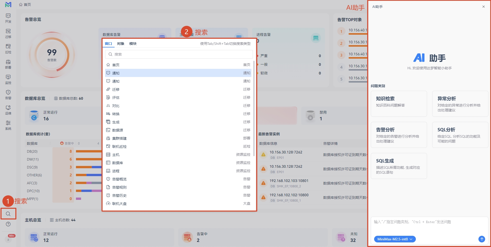

- 丰富完善【帮助】功能
	- 显示快捷键：打开首选项窗口，查看配置功能快捷键
		- 达梦官网：跳转访问达梦官网
		- 达梦服务社区：跳转进入达梦服务社区
		- 版本说明：查看 DEM 各历史版本的更新说明

| 步骤 1、2 | 步骤 3 |
| --- | --- |
| 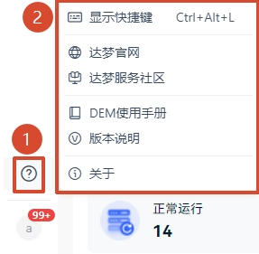 | 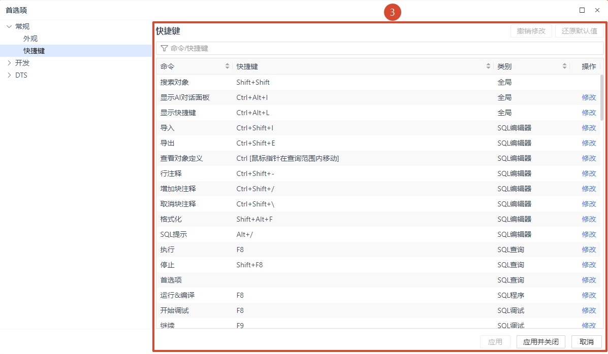 |

- 各模块新增对象【分组管理】功能，通过灵活的分组机制，实现对象精细化管理

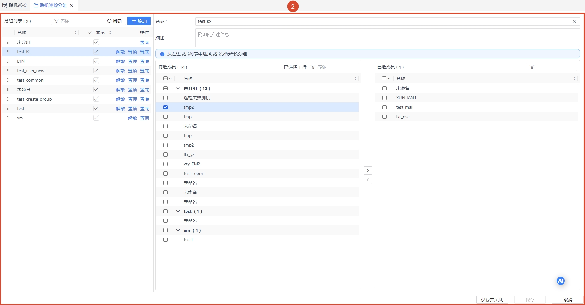

- 各模块常驻的对象导航列表、监控、告警各页面新增【导出 PDF】功能

**开发**

- 新增顶部工具栏，提供各功能便捷操作入口
- 新增开发子功能模块介绍并提供立即体验入口

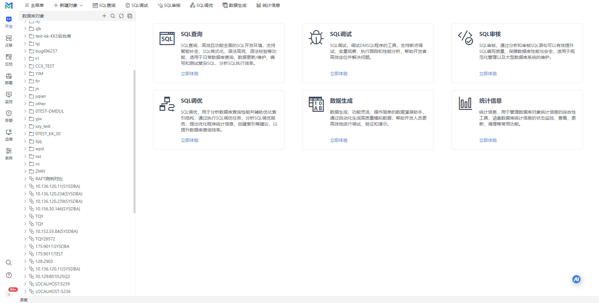

- 新增【主菜单】管理
	- 文件：可打开本地 SQL 文件、打开本地程序文件、导入导出连接配置
		- 窗口：可查看 SQL 执行历史、查看导入导出历史、关闭当前窗口、关闭所有窗口
		- 视图：支持在一个视图内对打开的窗口进行统一管理
		- 首选项：查看修改各首选项配置
- 丰富开发【首选项】配置，新增数据库授权到期提醒、多会话模式、空间数据等众多配置

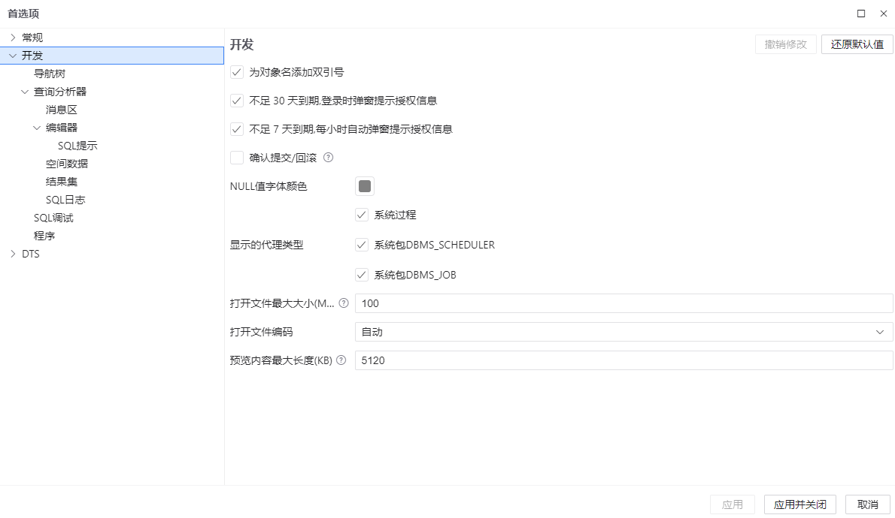

- 新增【数据生成】工具，可自动化生成高质量模拟数据
- 新增【统计信息】工具，涵盖数据库统计信息的状态监控、查看、更新、导入导出、锁定解锁、清理等常用功能
- 完善数据库【导航树】
	- 导航树新增节点子项数量统计展示，无须展开节点即可预判节点内容规模
		- 导航树节点右键新增”对象关系图“查看，通过可视化呈现辅助快速了解数据库对象关系

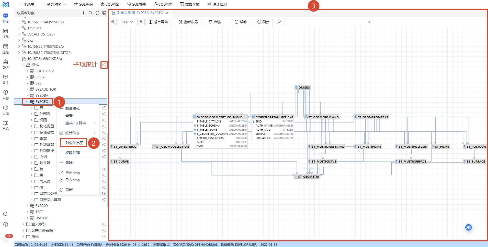

**迁移**

- 丰富【迁移类型】，新增 XML 和 DM 间的数据迁移，新增支持 Oracle 迁移数据到 SQL 文件
- 新增数据【生成】工具，可自动化生成高质量模拟数据
- 新增【数据源】管理，将数据库连接配置持久化至数据源，可一键加载复用，提升数据操作安全性与开发效率

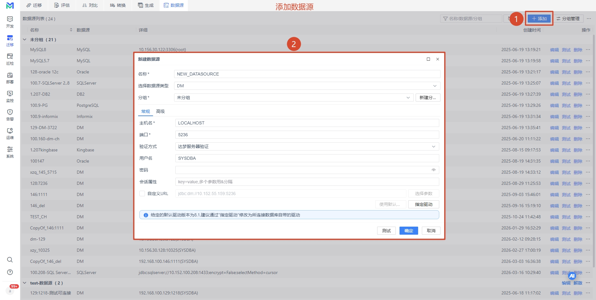

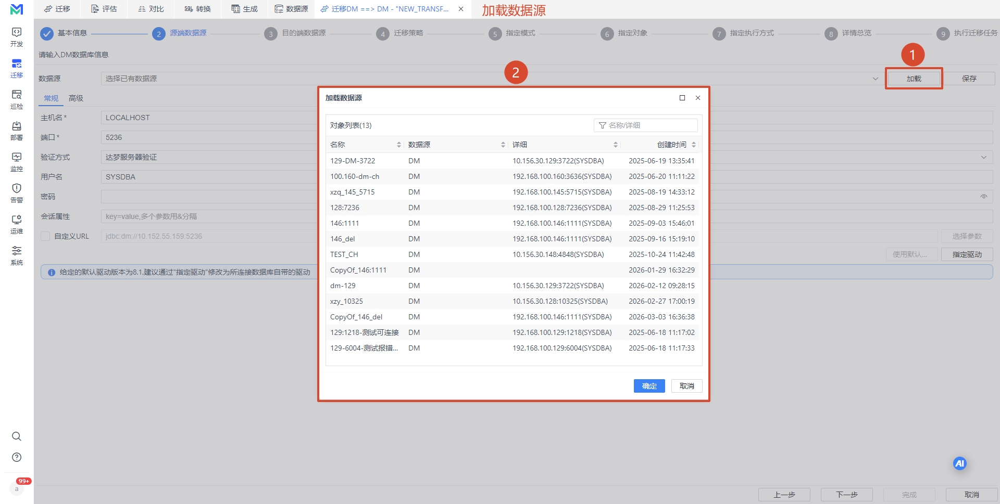

**部署**

- 数据守护集群搭建，新增【自动接管优先级】配置。主备关系配置时，可自由指定各实例故障时自动接管的优先级

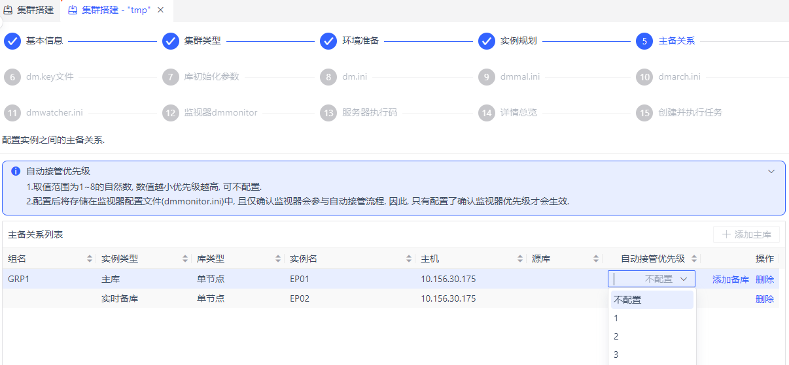

**监控**

- 新增【监控大屏】自定义监控配置，满足不同场景监控需求，呈现更贴合业务的可视化效果

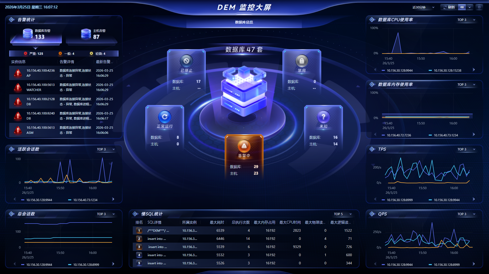

- 主机/数据库/进程新增【列设置】功能，支持自由选择列表展示列和列展示顺序

| 步骤 1、2 | 步骤 3 |
| --- | --- |
| 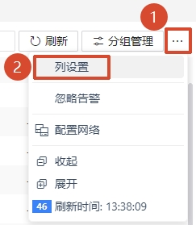 | 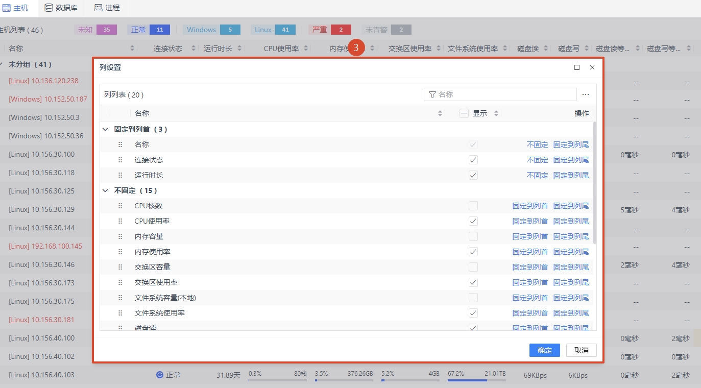 |

- 完善【负载分析】
	- 丰富负载分析指标，主机新增【系统日志】监控分析，数据库新增【内存】、【堆栈】、【INI 配置】、【日志-备份还原日志】监控分析
		- 负载分析功能栏新增环比功能，与上一周期数据对比分析，实时掌握业务短期变化动态
		- 数据库负载分析的 SQL 监控收集慢 SQL 的同时新增收集其【执行计划】
		- 数据库负载分析的 SQL 监控新增【SQL 调优】功能

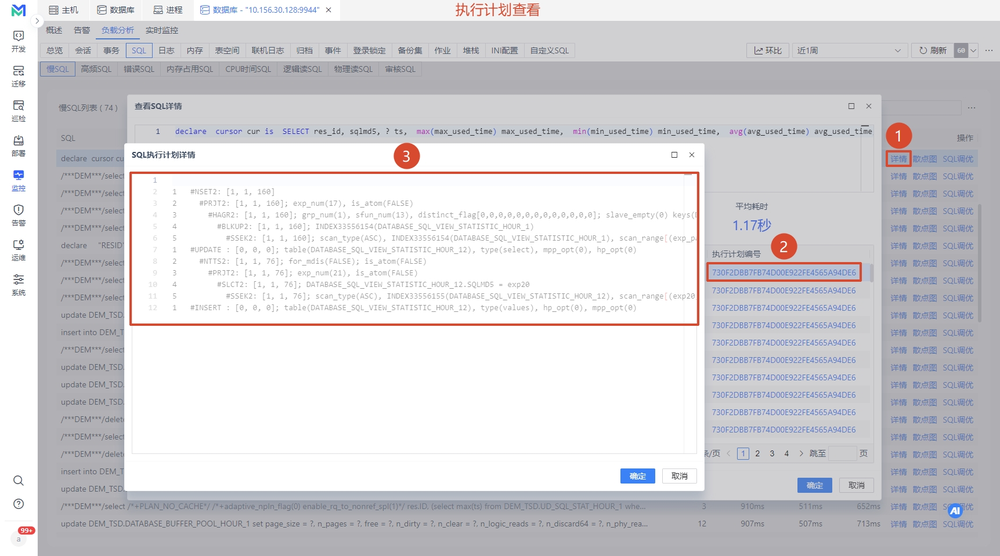

- 完善主机实时监控，原实时监控内容拆分为【概述】和【文件系统】展示，并新增【主机进程】实时监控

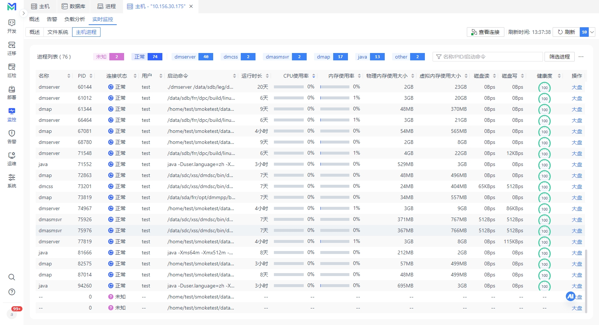

- 完善数据库实时监控，死锁、阻塞锁数、等待事务等监控指标新增【查看更多】功能

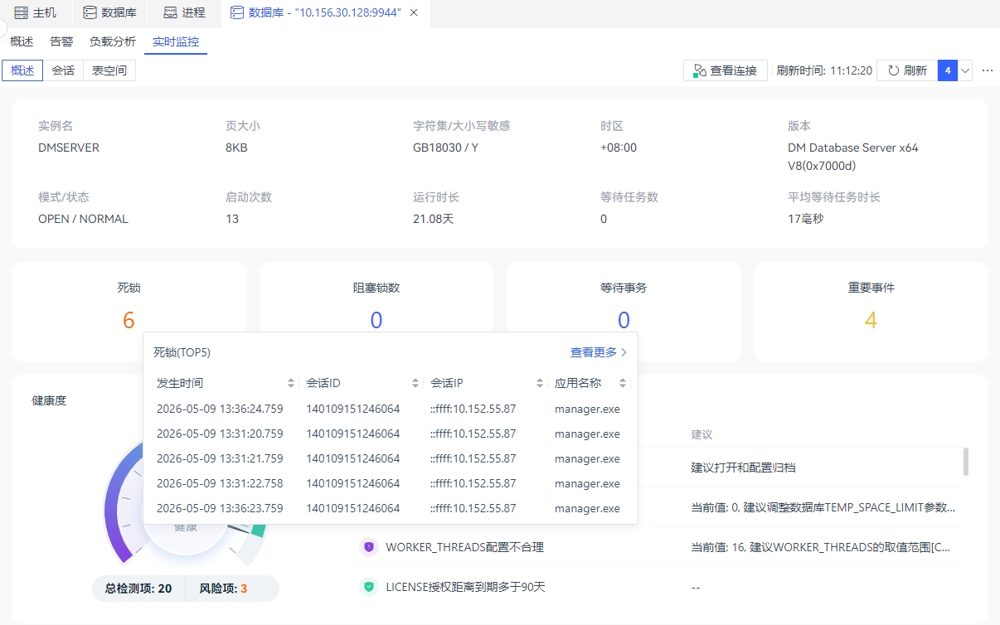

- 优化数据库/集群维护功能
	- 升/降级实例执行码，新增支持选择是否执行 CHECK\_DB\_INDEX 步骤
		- 实例重建，新增支持选择是否“保留原实例文件”
		- 切换备库类型，新增支持 DSC 实时/即时备库与异步/同步备库的相互切换
- 监控时序图，新增辅助分析功能
	- 查看数据：查看图中所有数据点的数据信息，支持将数据导出到 CSV 文件
		- 查看详情图：一个时序图存在多组数据信息时，可通过详情图查看每组的数据情况
		- 全屏/退出全屏：全屏更清楚查看时序图信息
		- 导出：将时序图导出为 PNG 图片或 CSV 文件

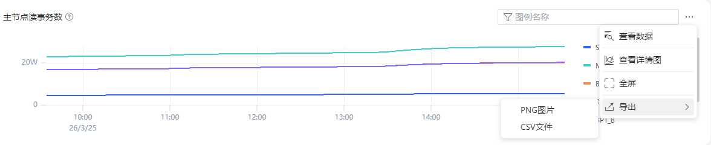

**告警**

- 新增【告警概览】查看，帮助用户快速掌握告警整体情况

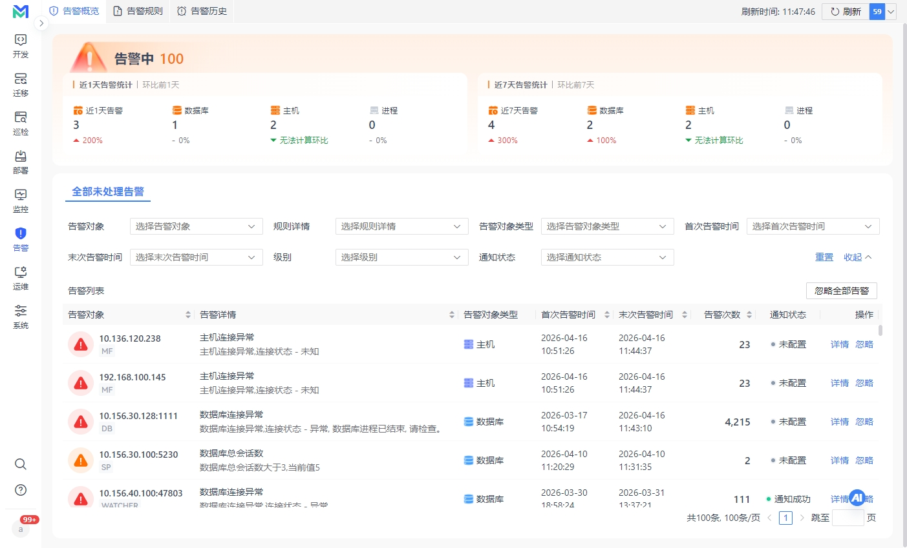

**系统**

- 用户新增描述属性，用户管理列表右键新增【清理登录锁定】功能，支持管理员给因多次密码错误而被锁用户清理登录锁定
- 系统管理新增【高级配置-日志级别配置】，支持调整 DEM 进程日志记录级别

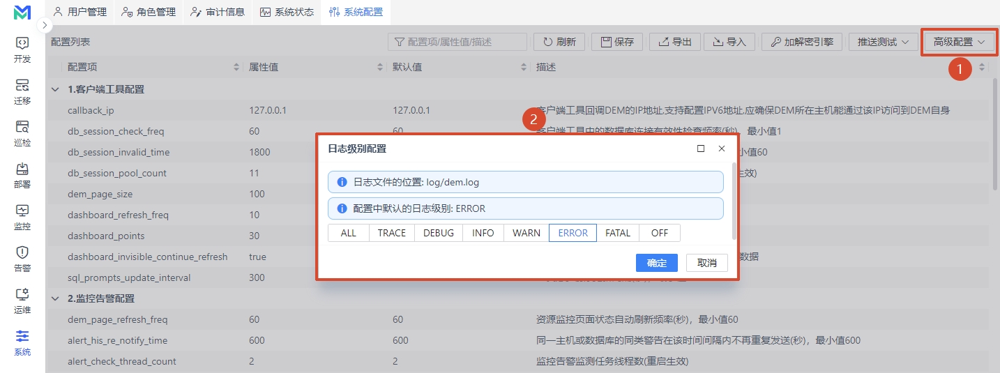

**API**

- 新增告警模板和告警规则相关添加、修改接口
- 新增主机网络配置接口

## 优化改进

- 本次版本围绕现有功能体验、操作流程等方面，共完成【18 项】针对性优化，重点解决用户使用过程中的繁琐操作、响应延迟等问题，优化后操作更便捷、性能更稳定，同时统一界面交互风格，提升整体使用体验

**基础通用**

- 优化调整 DEM 左侧导航栏，新增二级导航
	- 资源监控、大屏、大盘移入【监控】二级导航
		- 批量、自定义、资源包移入【运维】二级导航
- 改造优化 DEM 工作区，调整各模块使用各自专属独立工作区，提升单模块操作专注度与流畅度，强化系统界面的模块化、规范化与易用性
- 重构对象列表布局，将左侧局部区域展示优化为全屏沉浸式展示，充分利用可视区域空间，提升列表信息密度与可读性，强化整体操作视野与数据查阅效率

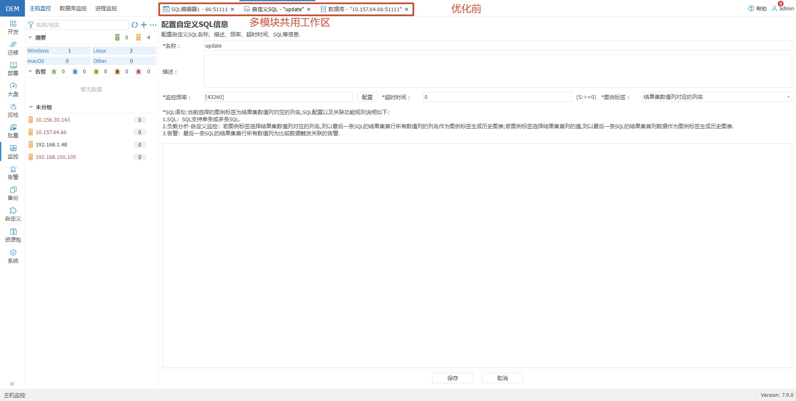

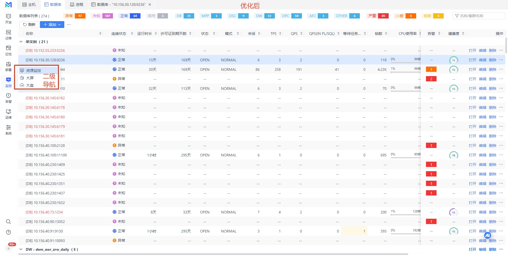

- 改造优化 DEM 对象配置流程，新增顶部【步骤向导】导航，实现配置进度可视化与已完成步骤快速跳转，流程更清晰、操作更高效

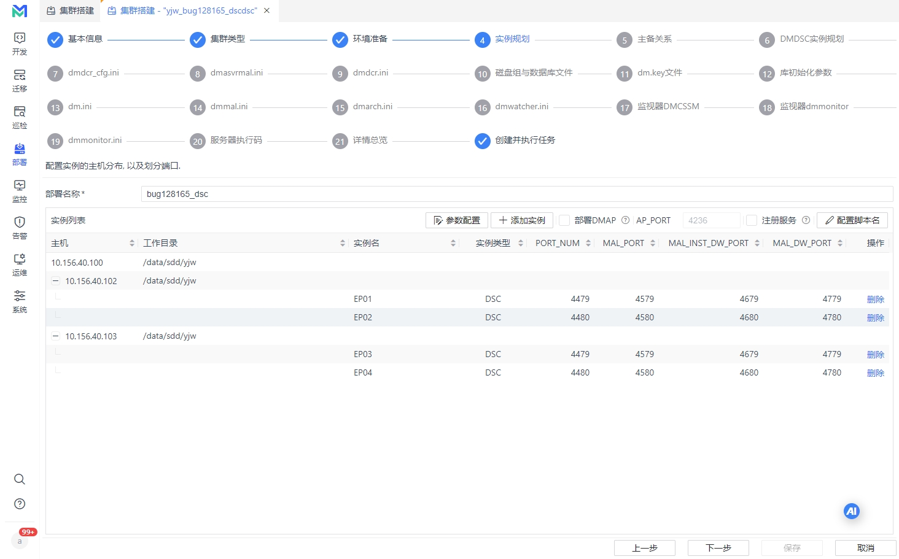

- 改造优化权限配置，DEM 取消“系统管理-对象管理“，优化升级对象列表中对象的使用权配置为【授权管理】，可直接快速配置对象的使用权和授权对象，操作更便捷高效

| 步骤 1 | 步骤 2 |
| --- | --- |
|  | 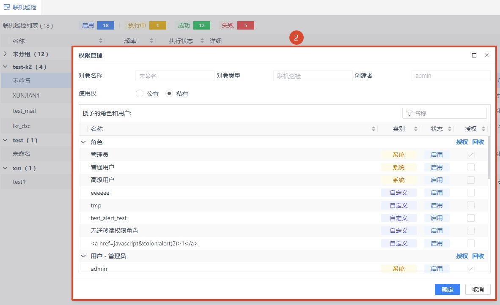 |

- 优化快捷键管理，大幅扩充快捷键配置并支持个性化修改，全面满足多样化操作习惯，显著提升交互效率
- 多个模块配置资源时，新增【从监控中导入】辅助配置功能，简化配置操作，显著提升配置速度与数据一致性

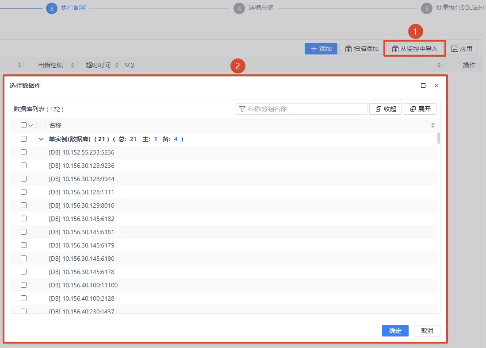

- 优化 DEM 通知功能
	- 通知和模块、系统对象解耦，新增通知类型：例如告警通知不再是告警配置，更正为告警；部署通知细分为部署、维护、配置等；其他模块策略一致
		- 已读通知不再提供标记已读操作
		- 优化通知闭环，有开始通知，则必要有对应成功/失败/取消通知
		- 优化通知页标记、删除等操作后的刷新策略，由操作后刷新回第一页改为刷新当前页

**开发**

- 优化 SQL 查询，调整功能按钮，重构 SQL 编辑器，新增提供会话只读、SQL 监控、AI 助手等功能和更多编辑配置

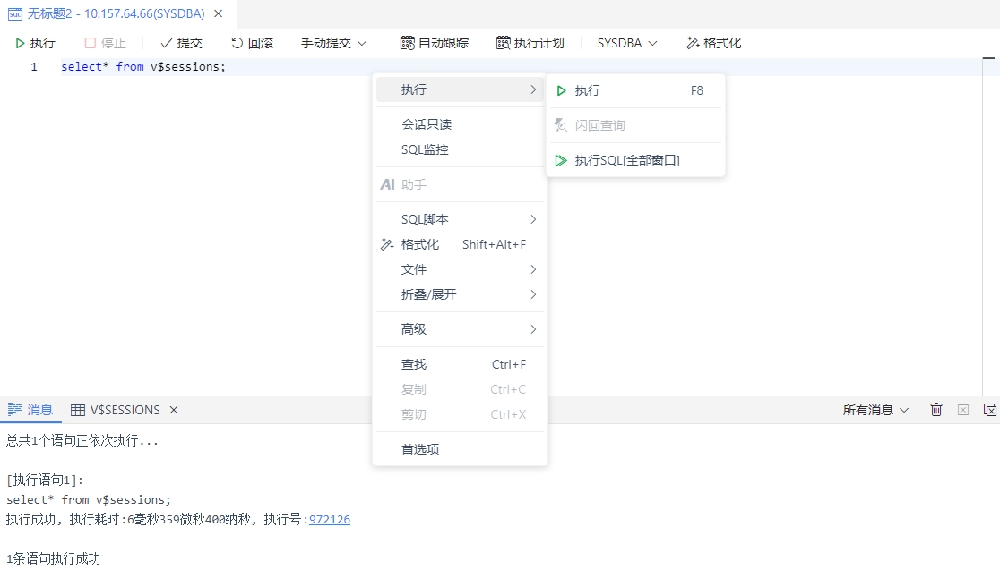

**大盘**

- 联机大盘重构部分对象类型设计，主机/主机组和进程/进程组统一整合为主机和进程类型，实现对象类型体系归一化管理
- 重构集群大盘实例页，新增实例状态、模式、等待任务数、锁数等实时监控项，新增单实例大盘直通访问链接，取消精简/物理结构切换展示

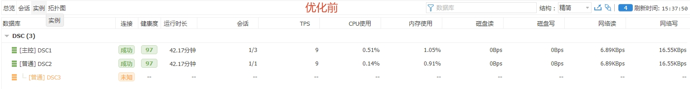

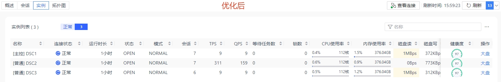

- 重构集群大盘拓扑图页，新增支持仅显示异常实例

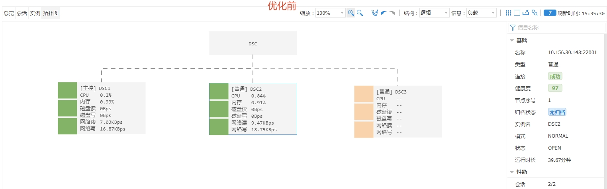

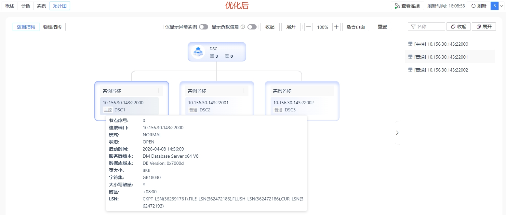

**监控**

- 重构各【资源概览】页，由纯文字属性展示优化为全屏多图可视化呈现，信息更直观，查阅更高效
- 重构【备份还原】功能，备份模块拆解下沉至资源监控各集群对象，可根据集群特性动态调整备份还原策略，增强各对象功能的灵活性与复用独立性。同时还原功能新增支持数据共享集群同步 dm.ini、支持更多还原参数

| 备份还原新入口 |
| --- |
| 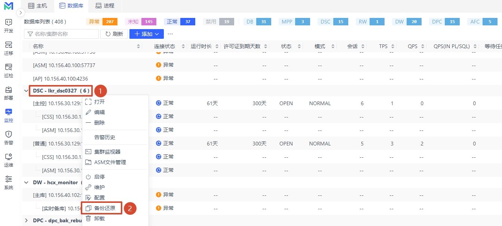 |

| 备份 |
| --- |
| 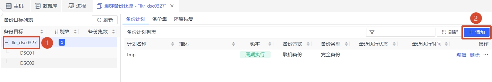 |
| 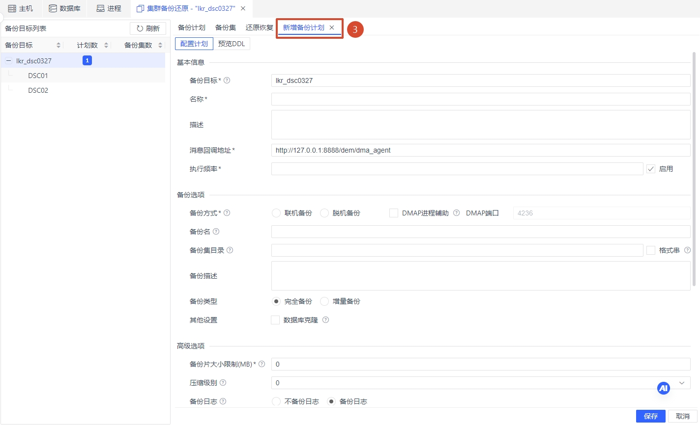 |

| 还原 |
| --- |
| 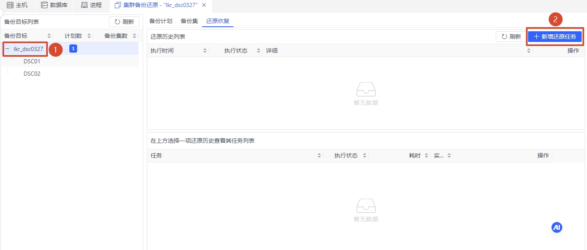 |
| 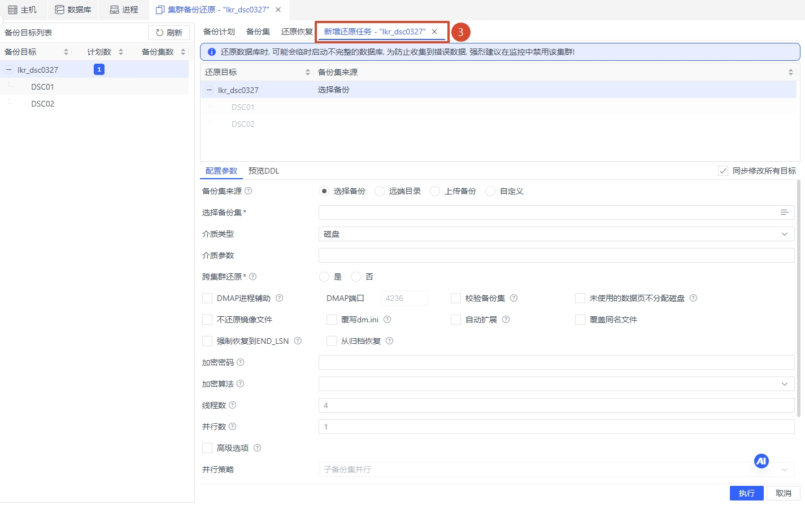 |

**告警**

- 重构告警配置布局，告警配置与告警模板统一至告警规则下，新增多维度下拉筛选框，提升配置管理效率
- 新增告警历史分页，支持按规则/按天统计，扩展多维度筛选，并新增清理已恢复告警、删除告警历史功能

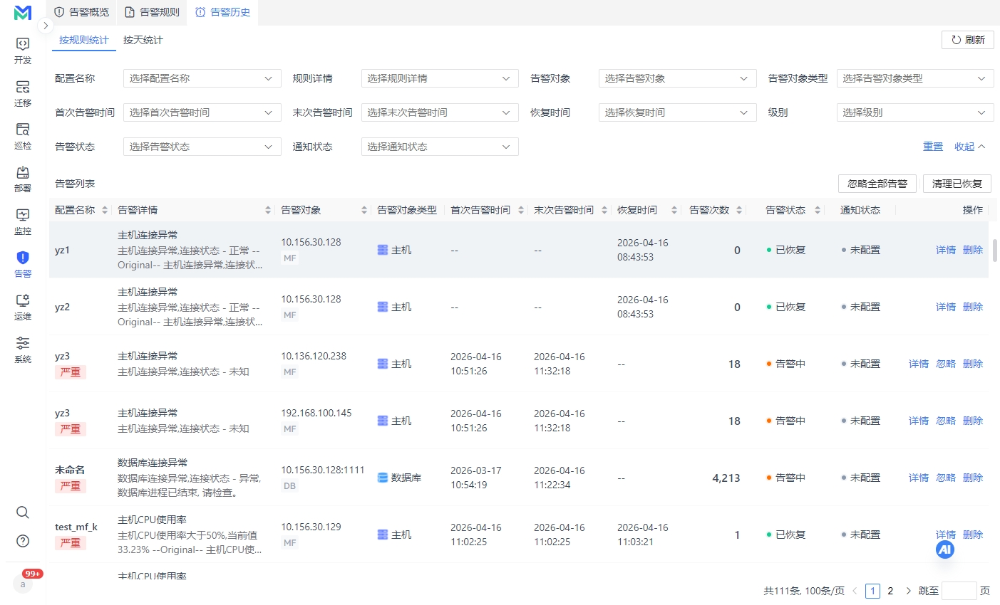

**自定义**

- 自定义脚本新增【执行历史】查看，清晰追溯过往执行状态，方便对比结果、快速排除异常

**系统**

- 优化系统管理界面，配置项列表新增默认值展示，工具栏使用菜单按钮合并展示同类功能按钮

## Bug 修复

- 本次版本针对上一版本反馈的功能异常、显示问题、操作报错等问题，共修复【16 项】Bug，涵盖【开发】【迁移】【巡检】【部署】【监控】【告警】【系统】【Agent】等场景，所有修复均经过严格测试，确保解决现有问题的同时，不影响系统正常运行及原有数据安全

**API**

- 修复 DEM API(V2) SQL 明细接口提供返回结果类型非 pplication/json 类型问题
- 修复 DEM API(V2) 查询告警历史列表，solved 参数配置失效问题
- 修复 Prometheus 接口获取自定义监控数据时偶尔出现错位信息问题

**开发**

- 修复 DEM 查询结果集导出到 excel 和 csv 时 number 类型为文本类型非数值类型问题
- 修复 DEM 开发数据库对象获取创建用户命令结果和 MANAGER 管理工具获取结果不一致问题

**迁移**

- 修复 DM-DM 的迁移，当表上有函数索引时，迁移报错、删除函数索引后迁移成功问题
- 修复迁移 ORACLE 存储过程迁移报错问题
- 修复 DEM 首选项全局配置快速装载参数功能无法使用，只能针对单独的迁移任务进行使用问题

**巡检**

- 修复联机巡检模块列表应默认不显示数据库监控创建的巡检但实际显示问题
- 修复联机巡检邮件推送出现报错文件不存在问题

**部署**

- 修复集群初始化配置时配置两同名参数但只显示一个配置问题

**监控**

- 修复数据库负载分析 temp 表空间监控上限与 dm.ini 配置的 TEMP SPACE LIMIT 值不一致问题

**告警**

- 修复告警触发通知用户中存在禁用用户时，后台报错 Alert history notify fail!问题

**系统**

- 修复系统配置添加“发送目标数据库的审计日志”时报错异常问题

**漏洞**

- 安全漏洞修复

**Agent**

- 修复 agent 执行 SQL 失败时 agent 日志存在大量相关报错问题

## 废弃/删除

- 删除审计信息、系统状态的导出功能