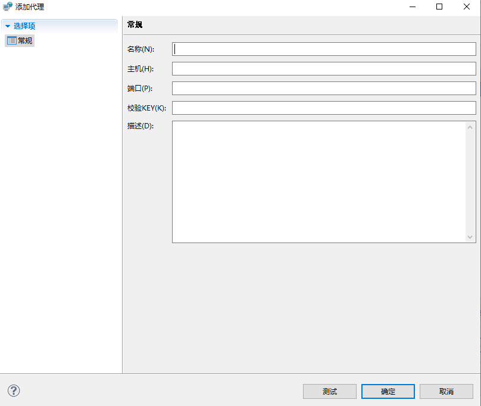
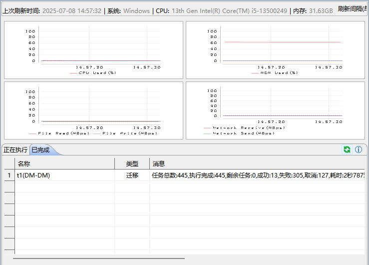
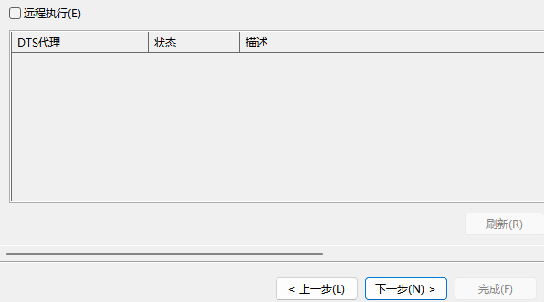
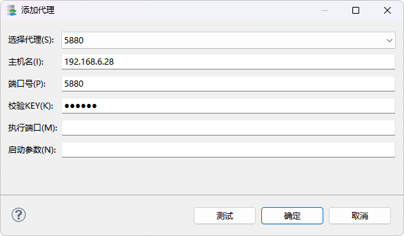

## 3.1 实现原理

DTS 代理（主代理、子代理）在远程机器上以命令行或服务方式启动，主要用于接收任务指令，执行迁移、对比等任务，并返回执行的相关信息。其中主代理为在所有部署成功的代理中被指定成为处理中心的 DTS 代理，除与子代理一样拥有执行任务的功能，还支持接收 DTS 中心传输的请求，生成并分发任务。详见 [2.1.2 多机 DTS](introduction_to_dts.md) 中的介绍。

## 3.2 远程机器代理部署

在使用代理之前，需要在远程机器上提前部署代理。

### 3.2.1 代理获取

DTS 代理利用 DTS 命令行版本启动，命令行位于安装目录下，一般来说，安装目录下有 tool+jdk 目录就可以启动 DTS 代理，但如果需要使用 DM 的快速装载功能，还需要有 bin 目录。故建议在要启动 DTS 代理的机器上正常安装 DM 数据库。安装完成后，DTS 代理的启动脚本位于 tool 目录下：dts\_cmd\_run.bat（Windows）或 dts\_cmd\_run.sh（Linux）。

### 3.2.2 设置校验 KEY

考虑到端口安全，DTS 代理启动时会从根目录下读取 service.key 文件，设置 KEY。DTS 中心获取连接时需要传输 KEY 至 DTS 代理进行校验，只有通过校验后，DTS 中心才能连接 DTS 代理。DTS 代理自带一个 service.key，缺省 KEY 为 888888，也可以使用以下语句设置 DTS 代理的校验 KEY（dts\_cmd\_run.bat(windows 环境)和./dts\_cmd\_run.sh(linux 环境)）：

```
./dts_cmd_run.sh install_service_key [-e <engine>] <password>
或
dts_cmd_run.bat install_service_key [-e <engine>] <password>
```

参数 install\_service\_key 代表设置 DTS 代理的校验 KEY，其中\<engine>为密码引擎名，\<password>为密码,密码长度不少于 6 位不多于 16 位，\[\]代表里面的内容可省略。

### 3.2.3 启动代理

启动代理只需给定没有被其他应用占用的端口即可。可以使用以下语句启动代理（dts\_cmd\_run.bat(windows 环境)和./dts\_cmd\_run.sh(linux 环境)）：

```
./dts_cmd_run.sh agent <port>
或
dts_cmd_run.bat agent <port>
```

参数 agent 代表启动代理，\<port>代表代理端口号。

图3.1 windows环境下开启以5880为端口号的代理（密码缺省）

代理启动后，即可通过 DTS 工具连接并使用。

## 3.3 本机代理管理

远程机器配置代理后，可在本机 DTS 的工程中新增一项“代理”，方便后续在迁移/对比等的过程中直接使用，如下图示：


图3.2 DTS工程新增“代理”项页面

可以右键点击“代理”项，选择“添加代理”，打开如下页面:



图3.3 添加代理页面

其中各项内容解释如下：

名称：新添加代理的名称。

主机：代理所在的主机名。

端口：代理部署时选择的端口号。

校验 KEY ：代理部署前，通过命令设置的密码，若未设置密码，则使用缺省密码“888888”。

在点击“确定”之前，可以先点击“测试”，确认代理可连接。

成功添加代理后可打开监控页面，监控页面分为两部分，如下图所示：



图3.4 监控页面

上半部分展示的为代理基本信息，可以通过 CPU 使用率，内存使用率等信息判断代理是否可以继续启动任务。

下半部分展示的为正在执行和已完成的迁移/对比等，双击可以查看执行的详情，但仅可查看该代理执行的任务。迁移/对比等的执行页面可以查看所有代理执行结果的汇总情况。

## 3.4 代理使用

远程 DTS 代理部署完成后，本机可在迁移/对比等向导的“执行方式”页连接，用于执行迁移/对比等。

执行方式页面如下，勾选“远程执行”，即可添加代理并使用代理执行任务；不勾选时，则为本地执行。



图3.5 执行方式页面

选择远程执行后，需要在“添加代理”框中配置代理的相关信息。



图3.6 添加代理页面

支持配置的代理信息如下：

选择代理：可以直接选择“本机代理管理”中配置好的代理。对于多次使用的代理，无需重复填写信息。选择对应代理名称之后，主机名、端口号，校验 KEY 会自动填写。当代理管理中未配置代理信息时，也可直接填写主机名等对应项。

主机名：代理所在的主机名。

端口号：代理部署时选择的端口号。

校验 KEY：代理部署前，通过命令设置的密码，若未设置密码，则使用缺省密码“888888”。

执行端口：如果未配置执行端口，则迁移/对比等任务将由代理进程执行，适用于任务规模较小的情况；如果任务规模较大，可能会因为任务占用过多资源导致代理接收和发送信息卡顿；如果配置了执行端口，代理将启动一个进程来执行任务，此时任务执行与 DTS 代理使用的资源隔离，任务的执行不会代理造成影响，代理启动的进程将占用此端口。通常建议配置执行端口。

启动参数：配置执行端口后，代理会启动一个进程，可以通过此项来配置进程启动参数，常用的参数有：-Xms40m -Xmx4g。

可以添加多个代理共同执行一个迁移/对比等任务。

> **注意**
> 
> 1\. 建议配置执行端口，配置执行端口会多占用一个端口，但对于一次执行任务来说，会单独起一个进程执行此次任务，多人执行时可以互相不影响，并且不影响中心从代理获取状态信息。  
> 2\. 配置远程执行后需要检查数据源连接的主机名，建议不要配置为localhost，而是配置成具体IP地址，DTS目前不支持对主机名配置的转换。

## 3.5 常见问题

### 3.5.1 代理适用场景

代理本质上是使用远程服务器的资源来执行任务，所以代理适用于对内存和 CPU 等资源有较高要求的场景。下述的适用与不适用是指对比本地执行是否能大幅提升性能。

\*\*推荐使用场景：\*\*任务中包含大量的迁移数据和对比数据任务，当一台远程机器资源不足时（即 CPU 和内存等资源占用高），可使用多代理。

\*\*不推荐使用场景：\*\*评估，仅迁移表结构，仅对比表结构。

### 3.5.2 执行页面获取信息失败

使用代理执行时，客户端工具仅供显示，不影响实际执行结果。出现获取信息失败的情况，应当刷新页面，若刷新后信息正常，则获取信息失败可能仅是暂时的网络问题，不影响执行结果；若刷新后仍失败，需要检查本机与远程机器的连接是否通畅，必要时需要登录远程机器检查代理是否仍在运行。

### 3.5.3 解析 xml 任务显示连接失败

解析 xml 任务显示连接失败，一般是因为连接数据库失败，建议检查源库或目的库是否允许代理所在机器连接；以及客户端工具是否使用 localhost 连接，因为使用代理时，数据源连接信息中主机名需要填写完整 IP，不要使用 localhost。

### 3.5.4 多个代理部署在一台机器

在不调整脚本情况下，用同一个脚本启动的代理会使用同一路径，同时使用这两个代理会因为路径冲突而出错。故一般不推荐一台机器启动两个代理，这样做没有实际意义。若在特殊情况下，在启动脚本中使用-Dlog\_and\_report\_dir=\<PATH>，调整代理存储文件的路径，可以保证两个代理所用路径不同。

### 3.5.5 页面卡顿

已经配置过代理的迁移/对比，打开时会检测代理是否正在执行该任务。若正在执行，则工具会直接进入执行页面，显示执行情况。若出现页面卡顿，多为代理无法连接，此次检测需要耗费最大连接时间。

### 3.5.6 运行中代理无法访问

这种情况一般出现于未使用执行端口时，代理缺省的启动参数为-Xms1024m  
\-Xmx1024m，直接使用代理进行迁移，使用较大并发且迁移较大数据时，容易出现 OOM，即便不出现 OOM 也会导致代理申请空间需要很长时间，无法及时回应访问。使用执行端口可以避免这一情况。