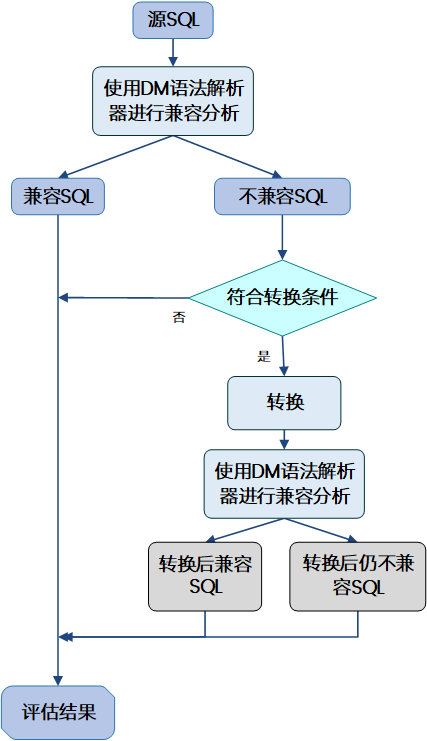
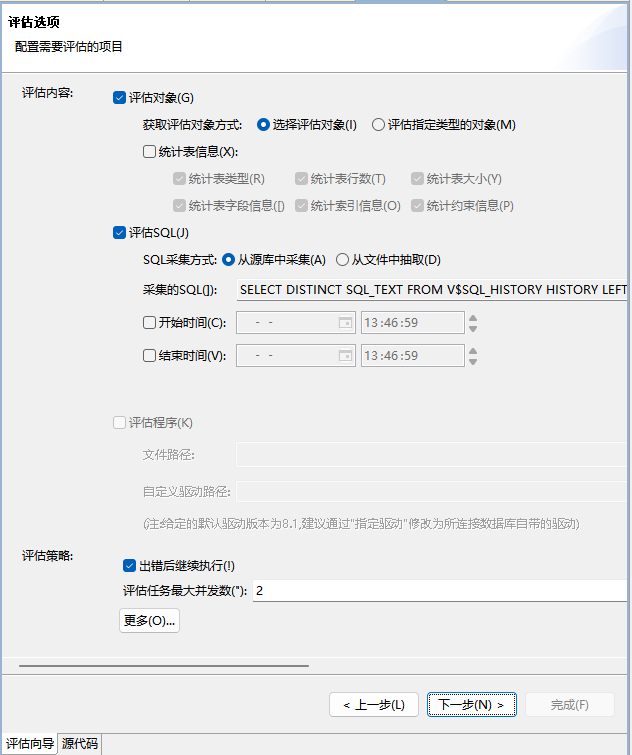
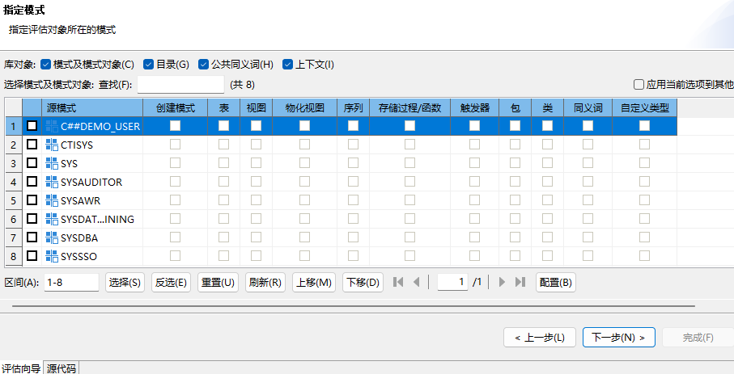
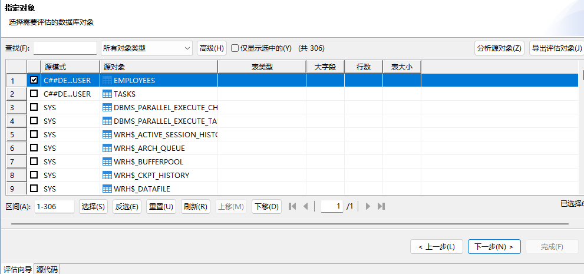
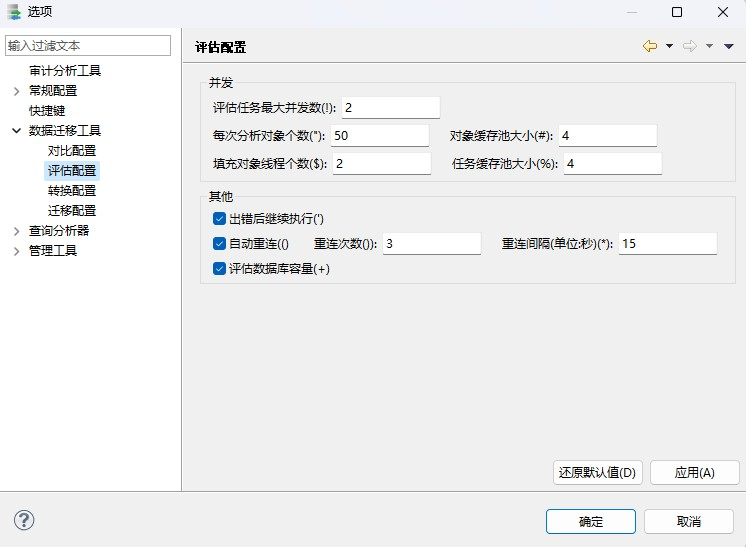

DTS 提供数据库评估功能。数据库评估是指在进行数据库迁移工作之前，对源库中的内容进行系统性分析，为后续操作的可行性提供数据支持的过程。DTS 主要对数据库进行兼容性分析，确定两个数据库之间兼容和不兼容的对象，并反馈给操作者，操作者可根据该反馈结果对不兼容部分制定合适的迁移策略。DTS 支持 DM 数据库之间的评估和其他大型主流数据库到 DM 数据库的评估。

## 6.1 实现原理

DTS 评估包括对象评估，SQL 评估和程序评估。

1. **对象评估**

对象评估实现原理如下:

图6.1 对象评估流程

如上图所示，对于源库中的每一个对象，先获取对象的定义信息，然后对定义进行兼容分析，如果兼容则分析结束，否则，需要获取对象的详细信息，进行转换。转换后，再对转换后的定义进行兼容分析，确定兼容或不兼容。其中兼容性分析是通过是否可以在 DM 上语法解析通过来判断，评估工具中会内置一个 DM 语法解析器，但该解析器的版本可能跟实际要迁移到的 DM 的版本不一致，这样也可以指定连接一个跟要迁移的 DM 版本一致的目的库，通过连接的目的库的解析器来解析。

2. **SQL 评估**

SQL 对比实现原理如下：

图6.2 SQL评估流程

如上图所示，对于从源库获取 SQL 执行历史信息，然后对每条 SQL 进行兼容分析，确定兼容或不兼容。其中兼容性分析跟对象兼容性分析一致。对于某些特殊情况，DTS 支持进行 SQL 转换，并在转换后进行二次兼容性分析，特殊情况为：源库为 MYSQL 且配置了语法转换规则。

3. **程序评估**

评估是否支持业务代码中使用的 JAVA 接口、OCI 接口和 Proc\*C 接口。

目前仅支持源目的库为 Oracle，Mysql 的程序评估。

## 6.2 评估配置

评估节点配置与前两类节点一样，包括三类配置：评估节点个性化配置、全局配置和模板配置。全局配置具体参见 6.2.7 全局选项配置 ，模板配置具体参见 6.2.8 评估模板配置 。

评估节点个性化配置根据数据源和评估选项的不同，需要配置的项也不同，总体上主要包括以下几个方面：配置数据源、配置评估选项，指定评估对象、配置远程代理、配置执行页面显示方式。

### 6.2.1 配置数据源连接

配置路径：向导页->“数据源”或”目的”。

配置数据源的连接信息。

同迁移的数据源连接配置，参见 [4.2.1 配置数据源连接](dts_migrate.md) 。

但评估的目的数据源可以没有，通过在源数据源配置中指定是否需要指定目的数据源来决定。

#### 6.2.1.1 使用目的库

配置是否使用目的库，如果勾选则点击下一页会出现目的库连接界面，执行评估任务时会在目的库上模拟运行 DDL 语句与收集的 SQL 语句。如果不勾选，点击下一页会直接进入指定评估对象界面，执行评估任务时会对 DDL 语句与收集的 SQL 语句进行语法分析。

### 6.2.2 配置评估选项

配置路径：向导页->“评估选项”。

图6.3 评估选项配置界面

#### 6.2.2.1 评估内容

配置评估哪些对象，包括是否评估对象、是否评估 SQL、是否评估程序。

##### 6.2.2.1.1 评估对象

即数据库对象的评估，直接连接源端数据库，自动获取源端数据库对象的信息，评估源端数据库至 DM 对应版本的兼容性。

要评估的对象获取方式可以用户选择部分对象评估，也可以评估指定类型或指定模式的某些类型的所有对象。同迁移的获取对象方式，参见 [4.2.2.1 获取对象的方式](dts_migrate.md) ，支持其中 2 种，包括：选择评估对象和评估指定类型的对象。

##### 6.2.2.1.2 评估 SQL

即评估执行的 SQL 语句，目前支持以下几种 SQL 来源：

1. 直接连接源数据库，直接扫描系统表/视图，获取 SQL 执行历史，并评估其兼容性，其获取 SQL 执行的 SQL 语句可以自定义，如果不自定义，也可以指定时间范围，只评估一段时间的 SQL。
2. 从文本文件(缺省以”$$”分隔)评估 SQL 兼容性。
3. 直接从 MyBatis 或 Ibatis 配置文件解析 SQL 语句，评估其兼容性。

可以对获取的 SQL 语句配置转换规则：点击“配置转换规则”即可选取转换规则项进行配置。也可以使用模板进行配置，模板配置方式可参考 6.2.8.2 语法规则模板 。

##### 6.2.2.1.3 评估程序

支持 OCI、PRO\*C、JAVA 的评估。

通过评估上传的程序文件，评估程序文件与 DM 对应版本的兼容性。

目前仅支持源目的库为 Oracle，Mysql 的程序评估。

对于 JAVA 程序评估如果勾选使用自定义驱动，会从上传驱动中读取 JAVA 接口用于评估；如果不勾选，则从默认驱动中读取 JAVA 接口用于评估。

#### 6.2.2.2 评估策略

##### 6.2.2.2.1 评估任务最大并发数

该参数配置有多少个评估任务同时进行评估。缺省为 2，指可以有 2 个评估任务同时进行。

##### 6.2.2.2.2 每次分析对象个数

参数和迁移一样。详细参见 [4.2.2.2.8 每次分析对象个数](dts_migrate.md) 。

##### 6.2.2.2.3 对象缓存池大小

参数和迁移一样。详细参见 [4.2.2.2.9 对象缓存池大小](dts_migrate.md) 。

##### 6.2.2.2.4 填充对象线程个数

参数和迁移一样。详细参见 [4.2.2.2.10 填充对象线程个数](dts_migrate.md) 。

##### 6.2.2.2.5 任务缓存池大小

参数和迁移一样。详细参见 [4.2.2.2.11 任务缓存池大小](dts_migrate.md) 。

##### 6.2.2.2.6 出错后继续执行

参数和迁移一样。详细参见 [4.2.2.2.6 出错后继续执行](dts_migrate.md) 。

##### 6.2.2.2.7 自动重连

参数和迁移一样。详细参见 [4.2.2.2.27 自动重连](dts_migrate.md) 。

##### 6.2.2.2.8 评估数据库容量

是否评估数据库容量。

### 6.2.3 指定模式

配置路径：向导页->“指定模式”。

配置要评估的对象类型，包括库对象类型以及要评估的模式和模式对象类型。

图6.4 指定评估对象所在模式

如果源端数据源是 Oracle，且版本大于等 12，则会有配置“包含 Oracle 维护的”选项，详细参见 [4.2.3.1 包含 Oracle 维护](dts_migrate.md) 。

### 6.2.4 指定对象

配置路径：向导页->“指定对象”。

选择要评估的对象。

图6.5 指定待评估对象

导出评估对象是指导出评估对象的对象名信息到文本文件。可以作为迁移的导入迁移对象方式的输入文件，详细参见 DTS 迁移的 [4.2.2.1 对象获取的方式](dts_migrate.md) 和 [4.2.2.2 迁移策略](dts_migrate.md) 。

### 6.2.5 配置远程代理

配置路径：向导页->“执行方式”。

详细参见 DTS 迁移的 [4.2.7 配置远程代理](dts_migrate.md) 。

### 6.2.6 配置执行页面显示方式

配置路径：向导页->“审阅评估任务”。

详细参见 DTS 迁移的 [4.2.8 配置执行页面显示方式](dts_migrate.md) 。

### 6.2.7 全局选项配置

#### 6.2.7.1 整体全局选项配置

该部分全局选项配置同迁移的整体全局选项配置，具体可参考 [4.2.9.1 整体全局配置选项](dts_migrate.md) 。

#### 6.2.7.2 评估全局选项配置

配置路径：窗口->选项->数据迁移工具->评估配置。

评估全局选项配置即配置后对所有评估都适用，配置后应用，刷新导航树对应的评估工程节点即可生效。

图6.6 评估全局选项配置

各全局选项配置同 6.2.2.2 评估策略 。

### 6.2.8 评估模板配置

DTS 节点进行评估配置时，可提前配置规则模板，并保存在对应模板管理中，供后续配置评估节点时使用。目前 DTS 评估有两类模板可进行配置，分别为策略配置模板和语法规则模板。

#### 6.2.8.1 策略配置模板

策略配置模板中配置的内容为评估过程中的整体策略，如评估最大并发数，出错是否继续执行等，对应向导页“评估选项”中的评估策略内容，配置项可参考 6.2.2.2 评估策略 的介绍。系统中默认存在一个策略配置模板“对象比较多场景”，设置了较大的对象缓存池等项，方便较多对象进行评估。

DTS 创建和使用评估策略配置模板的方式和迁移对比策略模板类似，具体参考 [4.2.10.1 策略配置模板](dts_migrate.md) 。

#### 6.2.8.2 语法规则模板

评估语法规则模板中配置的内容是 SQL 语句在兼容分析中执行转换时需要遵循的语法规则，其中每条语法转换规则的描述都在“配置转换规则”弹窗中对应行中有说明。该模板仅支持 SQLServer->DM 和 MYSQL->DM 的评估，对应于 6.2.2.1.2 评估 SQL 中的 SQL 转配置。

DTS 创建和使用评估语法规则模板的方式和迁移语法规则模板类似，具体参考 [4.2.10.3 语法规则模板](dts_migrate.md) 。

## 6.3 评估报告

查看路径与评估报告类似，可参考 [4.4 迁移报告](dts_migrate.md) 。

评估报告支持导出到文件：评估报告对话框->点击导出按钮，即可导出评估报告文件。

评估报告内容报告：

1. **评估概述**

包括源和目的连接信息，如果是数据库，包括数据库版本和驱动版本信息；也包括评估对象信息：总共多少对象、完全兼容的对象多少、转换后兼容的对象的多少、不兼容的对象多少、未知的多少。

2. **数据库信息**

包括源库的基本信息和目的库推荐配置：数据库类型、数据库版本、数据库编码、数据库页大小、数据库大小写敏感。

3. **对象兼容详细**

包括每个对象具体的名称、所属模式、对象类型、兼容情况。

4. **SQL 兼容详细**

包括每条 SQL 兼容情况。

5. **程序兼容详细**

包括每一个程序文件兼容情况。

> **注意**
> 
> DTS可在节点创建时指定保存历史迁移信息的次数，默认次数为1，超过次数会覆盖旧信息，建议用户及时导出报告信息，或修改最大保留历史次数为合适范围。

## 6.4 评估日志

查看路径与迁移日志类似，可参考 [4.5 迁移日志](dts_migrate.md) 。

评估日志包括本次评估的详细评估记录，一个评估一份评估日志信息。

评估日志支持导出到文件，并且支持仅导出错误的评估日志到文件。

> **注意**
> 
> DTS可在节点创建时指定保存历史迁移信息的次数，默认次数为1，超过次数会覆盖旧信息，建议用户及时导出日志信息，或修改最大保留历史次数为合适范围。

## 6.5 评估常见问题

性能调优问题是 DTS 评估常见问题。

DTS 整个评估过程为从源端获取要对比的对象->填充对象信息->评估对象。

其中获取对象和填充对象在分析对象任务中执行，评估对象由任务执行器执行。

整体的性能调优可以通过调整分析对象任务和执行器执行任务进行。

其中分析对象任务调优与 DTS 迁移的分析对象任务调优相同，详细参见 [4.6.1 性能调优问题](dts_migrate.md) 。

执行任务调优具体如下：

DTS 评估是按对象生成评估任务的，通常每个对象/SQL/程序文件生成一个评估任务，每一个评估任务都可以可以并发执行，可以调整“窗口”->“选项”->“数据迁移工具”->“评估工具”->“评估并发数”，值越大，并发越大。