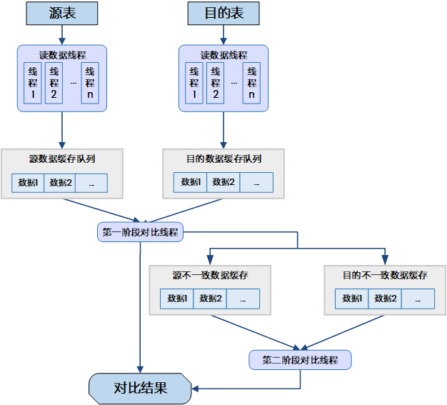
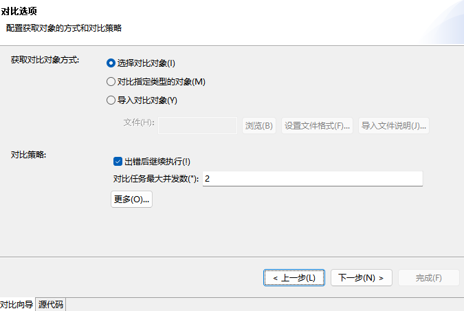
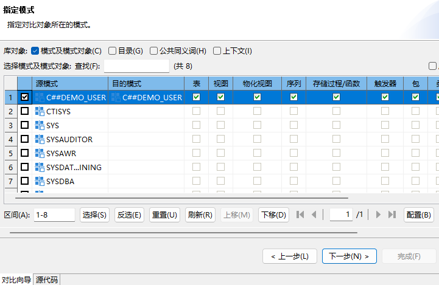
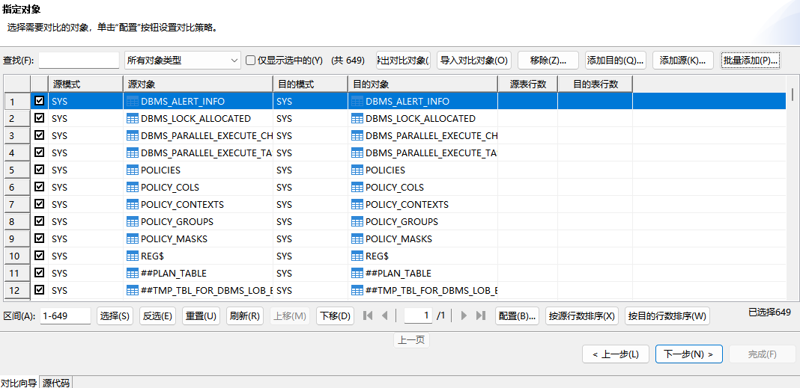
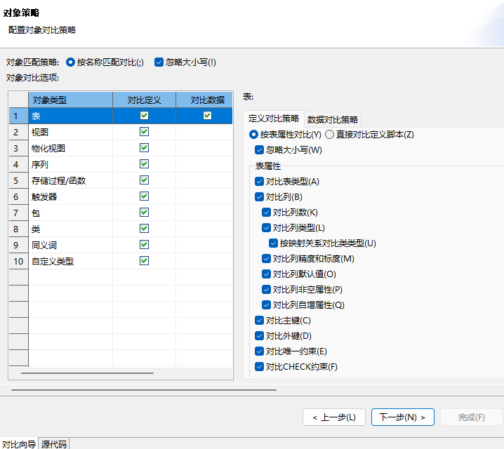
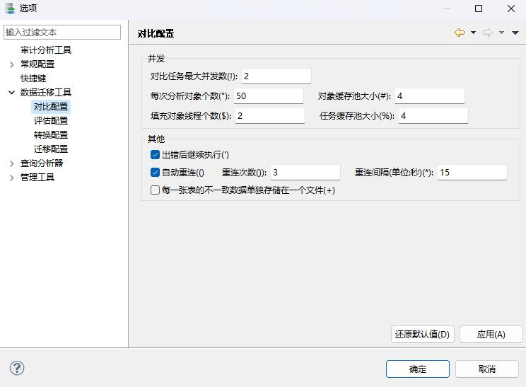

DTS 工具支持数据库对比功能。数据库对比是指将两个数据库之间的对象、数据等进行一致性对比，找出两个数据库之间的差异，并进行反馈。该功能往往应用于数据库迁移完成后，目的是为了验收迁移过程的执行结果，确认迁移完整性和准确性。此外，对比功能也可应用于其他需要确认数据库同步的地方。DTS 支持 DM 数据库之间的对比和其他大型主流数据库与 DM 数据库之间的对比。

## 5.1 实现原理

DTS 对比实施过程包括对象对比和数据对比。

1. **对象对比**

对象对比实现原理如下:

图5.1 对象对比流程

如上图所示，对象对比是源读对象线程和目的读对象线程分别从源和目的读取对象信息，放入缓存队列，同时对比线程分别从源和目的队列读取对象，进行对比。具体包括对象匹配对比和具体的对象对比:

1）对象匹配对比

是指源和目的中是否存在相同对象类型相同对象名称的对象，这里主要对比项包括对象类型和对象名称，其中对象名称可以配置是否忽略大小写进行对比。

2）具体的对象对比

是指源和目的中要对比的 2 个对象是否相同。这里要对比的对象，可以是用户指定，也可以是根据对象匹配对比匹配相同的 2 个对象。主要的对比项可以为对象的定义，也可以为对象的组成部分。如果对比对象的定义，则读对象线程直接获取对象的定义信息，对比线程直接对定义信息进行文本对比；如果分别对比对象的组成部分，则读对象线程获取对象的组成部分信息，比如表，分别获取列信息、主键信息、外键信息、索引信息、注释信息等，对比线程分别对比各组成部分。

2. **数据对比**

数据对比实现原理如下：

图5.2 数据对比流程

如上图所示，数据对比是读数据线程分别从源和目的中读取数据，计算每行数据的 MD5 值，读到一批数据后，放入到数据缓存队列中。第一阶段对比线程从缓存队列中分别取一批数据进行对比，对比 2 行数据的 MD5 值，如果 MD5 值一致，则认为这 2 行数据一致；否则 MD5 值不一致。如果存在确定对比行的列(主键列或唯一约束列或指定的匹配列)，且确定对比行的列对应的值一致，则认为该 2 行数据不一致，即认为源中的这一行，和目的中的这一行不一致，否则如果不存在确定行的列，即无法确定匹配行，则需要进行第二阶段对比。第二阶段对比按 MD5 值排序后对比。

## 5.2 对比配置

对比节点配置和迁移节点一样，包括三类配置：对比节点个性化配置、全局配置和模板配置。全局配置完成后应用于所有工程的所有对比节点，具体参见 5.2.8 全局选项配置 ，模板配置完成后，节点可选择是否应用到本节点上，具体参见 5.2.9 对比模板配置 。

对比节点个性化配置较为复杂，根据数据源和获取对象方式的不同，每一个对比节点需要配置的内容也不同，总体上主要包括以下几个方面：配置源数据源、配置目的数据源、配置对比对象、配置对比策略、配置远程连接、配置执行页面显示方式，具体可根据实际使用中 DTS 的向导页指引进行配置。以下是对迁移节点中各向导页中配置项的介绍。

### 5.2.1 配置数据源连接

配置路径：向导页->“数据源”或“目的”。

配置数据源的连接信息。

同迁移的数据源连接配置，参见 [4.2.1 配置数据源连接](dts_migrate.md) 。

### 5.2.2 配置对比选项

配置路径：向导页->“对比选项”。

图5.3 对比选项配置界面

#### 5.2.2.1 获取对象的方式

同迁移的获取对象方式，参见 [4.2.2.1 获取对象的方式](dts_migrate.md) ，对比对象方式支持其中 3 种，包括：导入对比对象、对比指定类型的对象、选择对比对象 3 种方式。

#### 5.2.2.2 对比策略

对比策略可以单独配置以下各项，也可使用模板进行配置，模板配置可参考 5.2.9 对比模板配置 。

##### 5.2.2.2.1 对比任务最大并发数

该参数配置有多少个对比任务同时进行对比。缺省为 2，指可以有 2 个对比任务同时进行。

##### 5.2.2.2.2 每次分析对象个数

参数和迁移一样。详细参见 [4.2.2.2.8 每次分析对象个数](dts_migrate.md) 。

##### 5.2.2.2.3 对象缓存池大小

参数和迁移一样。详细参见 [4.2.2.2.9 对象缓存池大小](dts_migrate.md) 。

##### 5.2.2.2.4 填充对象线程个数

参数和迁移一样。详细参见 [4.2.2.2.10 填充对象线程个数](dts_migrate.md) 。

##### 5.2.2.2.5 任务缓存池大小

参数和迁移一样。详细参见 [4.2.2.2.11 任务缓存池大小](dts_migrate.md) 。

##### 5.2.2.2.6 出错后继续执行

参数和迁移一样。详细参见 [4.2.2.2.6 出错后继续执行](dts_migrate.md) 。

##### 5.2.2.2.7 自动重连

参数和迁移一样。详细参见 [4.2.2.2.27 自动重连](dts_migrate.md) 。

##### 5.2.2.2.8 每一张表的不一致数据单独存储在一个文件

对比的不一致结果，是否每张表单独一个文件。缺省为 false，即所有的不一致结果放在一个文件中。

### 5.2.3 指定模式

配置路径：向导页->“指定模式”。

配置要对比的对象类型，包括库对象类型以及要对比的模式和模式对象类型。

图5.4 指定对比对象所在模式

如果源端数据源是 Oracle，且版本大于等于 12，则会有配置”包含 Oracle 维护的”选项，详细参见 [4.2.3.1 包含 Oracle 维护](dts_migrate.md) 。

### 5.2.4 指定对象

配置路径：向导页->“指定对象”。

选择要对比的对象，可以指定要对比的源对象和目的对象，并通过配置按键配置每一个对象的对比策略。

图5.5 指定需要对比的对象

#### 5.2.4.1 导入对比对象

导入对比对象是从文件中获取要对比的对象名信息，可以直接选中对应的对象进行迁移，不用自己一个一个选。

导入对比对象文件，存放的是要对比对象的模式名和对象名，可以按照一定的行分隔符、列分隔符、文本限定符以及是否第一行为列信息的格式进行存储，导入时只要设置的文件格式与实际文件存储的格式一致即可。

#### 5.2.4.2 导出对比对象

导出对比对象的对象名信息到文本文件。可以作为下次对比的导入对比对象方式的输入文件，详细参见 [4.2.2.1 配置获取对象的方式](dts_migrate.md) 。

#### 5.2.4.3 对象对比策略

对象对比包括定义对比和数据对比，配置对象对比策略包括配置是否对比定义、是否对比数据、如何对比定义、如何对比数据。

##### 5.2.4.3.1 定义对比

是否对比定义。除表之外，其他对象，如果不需要对比定义，则只要源和目的中存在对象类型相同，名称匹配的对象，就认为这 2 个对象一致。

###### 5.2.4.3.1.1 表

表定义对比按其组成部分进行对比，包括表类型、列、主键、外键、唯一约束、索引、CHECK 约束、注释和存储选项、是否对比表类型、列、主键、外键、唯一约束、索引、CHECK 约束、注释和存储选项，可以在界面配置，默认是对比表类型、列、主键、外键、唯一约束、索引和 CHECK 约束。具体的如何对比这些组成部分如下：

1. 表类型

直接对比表类型是否一致(普通表，分区表)。

2. 列

对比列数、列类型、精度和标度、默认值、NULL 属性、自增列属性。

3. 主键

对比主键列。

4. 外键

对比外键名、外键列以及外键引用列。

5. 唯一约束

对比唯一约束名、约束列。

6. 索引

对比索引名、是否位图索引、是否全局索引、是否空间索引、是否数组索引、是否位图连接索引、索引列。

7. CHECK 约束

对比 CHECK 表达式和 VALID 属性。

8. 注释

对比注释列名和注释内容。

9. 存储选项

ORACLE-DM 对比表空间名。

DM-DM 对比表空间名、初始分配簇数、下次分配簇数、最小保留簇数、填充比例、空间限制、LIST 表选项、分支数、是否支持超长记录存储。

###### 5.2.4.3.1.2 视图

视图定义对比直接对比视图的定义，可以直接对比源视图和目的视图的定义，或根据迁移转换策略把源定义转化为目的定义再和目的视图的定义进行对比。

###### 5.2.4.3.1.3 触发器

触发器定义对比按触发器组成部分对比，分别对比触发器类型、触发器体、触发器表名、触发事件、触发器表模式、When 子句、对比是行/列级、触发时间(操作之前或操作之后)、对比表/列级触发器、对比新别名、老别名、是否启用、触发器列名、是否对触发器定义加密、时间触发器。

###### 5.2.4.3.1.4 同义词

同义词定义对比按同义词组成部分对比，分别对比对象所属模式名、对象名、外部链接串、对象所属目录名。

###### 5.2.4.3.1.5 序列

序列定义对比按序列组成部分对比，分别对比起始值、增量、最小值、最大值、当前值、循环、高速缓存、顺序，其中是否需要对比起始值、增量、最小值、最大值、当前值、循环、高速缓存、顺序可配置。

###### 5.2.4.3.1.6 存储过程/函数

存储过程/函数定义对比直接对比存储过程/函数的定义，可以对比源存储过程/函数和目的存储过程/函数的定义，或根据迁移转换策略把源定义转化为目的定义再和目的存储过程/函数的定义进行对比。

###### 5.2.4.3.1.7 物化视图

物化视图定义对比按物化视图组成部分对比，分别对比物化视图列、子查询、构建模式、查询改写选项、是否需要刷新、是否手动刷新、是否自动提交、是否含有所有 PRIMARY KEY、是否含有 ROWID、是否增量刷新、是否完全刷新、是否强制刷新、首次刷新时间、下次刷新时间间隔、是否可以设置首次刷新时间、是否可以设置下次刷新时间间隔。

###### 5.2.4.3.1.8 上下文

上下文定义对比按上下文组成部分对比，分别对比关联对象模式名，关联对象名。

###### 5.2.4.3.1.9 目录

目录定义对比按目的组成部分对比，对比内容为目录路径。

###### 5.2.4.3.1.10 公共同义词

公共同义词定义按公共同义词组成部分对比，分别对比对象所属模式名、对象名、外部链接串与对象所属目录名。

###### 5.2.4.3.1.11 包

包定义对比按包组成部分对比，分别对比包规范、包体。

###### 5.2.4.3.1.12 自定义类型

自定义类型定义对比按自定义类型组成部分对比，分别对比自定义类型定义、类型体、父类型模式名、父类型名、对比是否有父类型、能否被继承、能否被实例化、是否加密、类型体是否加密。

###### 5.2.4.3.1.13 类

类定义对比按类组成部分对比，分别对比类声明、类实现、类是否加密、类体是否加密、父类模式名、是否有父类、能否被继承、是否被实例化。

###### 5.2.4.3.1.14 作业

作业定义对比按作业组成部分对比，分别对比将被执行的 PL/SQL 代码块、何时将运行作业、作业重执行次数、作业类型、执行操作、参数数量、计划开始时间、计划结束时间、重复间隔、作业分类、是否启动、完成后是否自动删除、作业凭证、目标、作业风格、关联程序名称、计划名称、作业邮件、作业参数。

###### 5.2.4.3.1.15 调度

调度定义对比按调度组成部分对比，分别对比调度类型、开始时间、结束时间、重复间隔。

###### 5.2.4.3.1.16 程序

程序定义对比按照程序组成部分对比，分别对比程序类型、操作、参数数量、是否启用、程序参数、程序参数位置、参数名称、参数数据类型、参数当前值、是否为输出参数。

###### 5.2.4.3.1.17 表空间

表空间定义对比按照表空间组成部分对比，分别对比表空间文件，包括：文件名、总大小、是否支持自动扩展、文件每次扩展大小、文件最大大小；以及对比是否为 UNDO 表空间。

###### 5.2.4.3.1.18 用户

用户定义对比按照用户组成部分对比，分别对比用户所属角色、用户系统权限和用户对象权限。

###### 5.2.4.3.1.19 角色

角色定义对比按照角色组成部分对比，分别对比角色所属角色、角色系统权限和角色对象权限。

###### 5.2.4.3.1.20 资源限制

资源限制定义对比按照资源限制组成部分对比，分别对比最大会话数、会话空闲期、会话持续期、请求使用 CPU 时间、会话使用 CPU 时间、会话私有内存、请求读取页数、会话读取页数、登录失败次数、口令有效期、口令等待期、口令变更次数、口令锁定期、口令宽限期。

##### 5.2.4.3.2 数据对比

是否对比数据。即对于表对象，是否需要对比数据，包括数据行数、和数据详细。

数据对比策略包括如下配置项：

###### 5.2.4.3.2.1 采样率

即配置数据对比率，如果为 1，则全部进行对比，否则，按采样率取部分数据进行对比。

###### 5.2.4.3.2.2 源/目的一次读取行数

设置源/目的一次读取行数，即 fetchsize。

###### 5.2.4.3.2.3 源/目的缓冲池大小

设置源/目的的数据在内存中缓存的批数。

###### 5.2.4.3.2.4 一次对比的行数

设置一次对比的行数，即一批从源/目的中取多少行数据进行对比。

###### 5.2.4.3.2.5 对比方式

设置对比方式，包括自动对比和排序后对比。自动对比即从源和目的中通过 select \* from  
表取出数据，然后通过对比工具计算 MD5 值，通过对 MD5 值排序后根据 MD5 值匹配确定数据对比行进行对比。排序对比，即从源和目的中通过 select \* from 表 order by 取出数据，然后对比工具按取出的数据的顺序确定数据对比行进行对比，即依赖源和目的的排序功能来确定对比行。

###### 5.2.4.3.2.6 最大不一致行数

即不一致行数最大达到多少行时停止对比。

**占源总行数的百分比**

也可以配置不一致行数为源表数据总行数百分之多少时停止对比。

###### 5.2.4.3.2.7 对比列类型

对比列的类型，包括按源列类型对比，按目的列类型对比，按原有列类型对比。如果按源列类型对比，则会根据源列的类型取源和目的的数据进行转换后对比；如果按目的列类型对比，则按目的列的类型取源和目的的数据进行转换后对比；如果按原有列类型对比，则源按源列的类型取数据进行转换后，与目的按目的列的类型取数据进行转换后进行对比。

###### 5.2.4.3.2.8 并发读取源/目的，并发数

是否并发读取源/目的的数据，并发数为多少。

###### 5.2.4.3.2.9 不一致数据是否导入到表

对比数据时，如果出现不一致的数据，不一致数据是否保存到数据库表中。其中数据库表可以选择创建源端或目的端，可以指定数据库表所属的模式/库，表的名称自动生成。

###### 5.2.4.3.2.10 近似值类型保留小数位数

即 float、double 等类型对比保留多少位小数进行对比。

###### 5.2.4.3.2.11 精确值类型保留小数位数

即 number、numeric 等类型对比保留多少位小数进行对比。

###### 5.2.4.3.2.12 时间类型格式

即 time 等类型对比按什么格式进行对比。

###### 5.2.4.3.2.13 日期时间类型格式

即 datetime 等类型对比按什么格式进行对比。

###### 5.2.4.3.2.14 源/目的最大记录不一致行数

源/目的最大记录不一致行数，即对比不一致数据中，源/目的表数据最大记录行数。

###### 5.2.4.3.2.15 记录不一致数据的 ROWID

是否记录不一致数据的 ROWID。  
对比源库为 Oracle 或 DM 时由于必须要查 ROWID，所以不提供此配置选项，同时源库 SQLServer、Sybase、Access 不支持 ROWID，同样不提供此配置选项。

###### 5.2.4.3.2.16 记录不一致数据的原始对比值

是否记录不一致数据的原始对比值。如果记录原始对比值，则可以比较方便地查看为什么不一致，但由于记录原始比较值导致存储的信息比较多，如果不一致特别多的情况下，则会影响性能。

### 5.2.5 配置对象对比策略

配置路径：向导页->”配置对象对比策略”。

当获取对比对象方式为“对比指定类型的对象”或“导入对比对象”时才会进入该界面，统一配置所有要对比的对象的迁移策略，对于同类对象对比策略一致。

图5.6 配置待对比对象类型的对比策略

具体可以配置：

1. **对象匹配策略**

即确定源中的一个对象和目的中的哪个对象进行对比，默认按名称匹配，名称大小写完全匹配，即源和目的中对象类型相同，且名称完全一致的 2 个对象进行对比，也可以选择忽略大小写进行匹配，即源和目的中对象类型相同，且名称忽略大小写后一致的 2 个对象进行对比。

2. **对象对比策略**

即每一类对象是否需要对比定义，是否需要对比数据对比的属性名称是否忽略大小写。

3. **数据对比策略**

即表对象的数据对比策略，详细参见 5.2.4.3.2 数据对比 。

### 5.2.6 配置远程代理

配置路径：向导页->“执行方式”。

详细参见 DTS 迁移的 [4.2.7 配置远程代理](dts_migrate.md) 。

### 5.2.7 配置执行页面显示方式

配置路径：向导页->“审阅对比任务”。

详细参见 DTS 迁移中 [4.2.8 配置执行页面显示方式](dts_migrate.md) 。

### 5.2.8 全局选项配置

#### 5.2.8.1 整体全局选项配置

该部分全局选项配置同迁移的整体全局选项配置，具体可参考 [4.2.9.1 整体全局配置选项](dts_migrate.md) 。

#### 5.2.8.2 对比全局选项配置

配置路径：窗口->选项->数据迁移工具->对比配置。

对比全局选项配置即配置后对所有对比都适用，配置后应用，刷新导航树对应的对比工程节点即可生效。

图5.7 对比全局迁移选项配置

各全局选项配置的相关介绍请参考 5.2.2.2 对比策略 。

### 5.2.9 对比模板配置

DTS 节点进行对比配置时，可提前配置对比规则模板，并保存在对应模板管理中，供后续配置对比节点时使用。目前 DTS 对比仅支持策略配置模板。

#### 5.2.9.1 策略配置模板

策略配置模板中配置的内容为对比过程中的整体策略，如对比任务最大并发数、出错后是否继续执行等，对应向导页“对比选项”中的对比策略配置，配置项可参考 5.2.2.2 对比策略 的介绍。系统中默认存在一个策略配置模板“对象比较多场景”，设置了较大的对象缓存池等项，方便较多对象进行对比。

DTS 创建和使用对比策略配置模板的方式和迁移对比策略模板的方式类似，具体参考 [4.2.10.1 策略配置模板](dts_migrate.md) 。

## 5.3 对比报告

查看路径与迁移报告类似，可参考 [4.4 迁移报告](dts_migrate.md) 。

对比报告内容包括：

1. **对比概述**

包括源和目的连接信息，如果是数据库，包括数据库版本和驱动版本信息；也包括对比对象信息、总共多少对象、一致的对象多少、不一致的多少、仅源端存在的多少、仅目的端存在的多少、未知的多少。

2. **对比详细**

包括每个对象的对比结果(一致/不一致/仅源中存在/仅目的端存在/未知)。

对比报告支持导出到 html 或 excel 文件，另外也可以导出对比结果不一致的对象到文件，这样可以通过”导入对比对象”(详见 [4.2.2.1.1 导入迁移对象](dts_migrate.md))，重新直接再次对比不一致的对象。

> **注意**
> 
> DTS可在节点创建时指定保存历史迁移信息的次数，默认次数为1，超过次数会覆盖旧信息，建议用户及时导出报告信息，或修改最大保留历史次数为合适范围。

## 5.4 对比日志

查看路径与迁移日志类似，可参考 [4.5 迁移日志](dts_migrate.md) 。

对比日志包括本次对比的详细对比记录，一个对比一份对比日志信息。

对比日志支持导出到文件，并且支持仅导出错误的对比日志到文件。

> **注意**
> 
> DTS可在节点创建时指定保存历史迁移信息的次数，默认次数为1，超过次数会覆盖旧信息，建议用户及时导出日志信息，或修改最大保留历史次数为合适范围。

## 5.5 对比常见问题

### 5.5.1 性能调优问题

DTS 整个对比过程为从源端获取要对比的对象->填充对象信息->对比对象。

其中获取对象和填充对象在分析对象任务中执行，对比对象由任务执行器执行。

整体的性能调优可以通过调整分析对象任务和执行器执行任务进行。

其中分析对象任务调优与 DTS 迁移的分析对象任务调优相同，详细参见 [4.6.1 性能调优问题](dts_migrate.md) 。

执行任务调优具体如下：

DTS 对比是按对象生成对比任务的，通常每个对象生成一个对比任务，对比任务可以多个任务同时执行，即任务并发，可以调整”窗口”->”选项”->”数据迁移工具”->”对比工具”->”对比并发数”，值越大，并发越大。对于表数据对比，可以配置：

1. 并发读

向导页”选择对比对象”->选中要对比的表->点击”配置”->数据对比策略->选中”并发读取源/目的，并发数”，配置并发读源/目的数据。

或向导页”配置对象对比策略”->数据对比策略->选中”并发读取源/目的，并发数”。

2. 数据批量

即一次从源/目的中读取多少数据，因为读数据和写数据是并发执行的，中间需要一个数据缓存池，所以可以调整：

1）数据对比策略->配置”源/目的一次读取行数”，即设置源/目的的 fetchsize。

2）数据对比策略->配置”源/目的缓存池大小”，即内存中存放源/目的数据的批数。

3）数据对比策略->配置”一次对比的行数”，即源和目的分别读到多少行之后进行对比。

3. 采样率

数据对比策略->“采样率”，可以减少对比的数据量，该参数最好配合“排序对比”使用。

4. 最大不一致行数

数据对比策略->“最大不一致行数”，即当不一致行数达到多少行或达到源不一致行数百分之多少时，停止对比。

### 5.5.2 对比结果查看问题

查看方式包括：

1. 在执行页面中单击要查看的对比任务的“消息”列，打开对比结果对话框查看。
2. 双击要查看对比任务，打开任务详细信息的对话框，然后点击对比结果的”详细”  
	按钮，打对比结果对话框查看。
3. 在执行页面点击“查看对比报告”，打开对比报告对话框，查看所有对象的对比结果，如果对比结果”不一致”，可以通过单击查看详细按钮，打开对比结果对话框查看。

其中对比报告的查看，如果执行页面关闭，也可以在左边导航树中选择对应的对比节点，右键，选择“上一次对比历史”，然后选择“对比报告”；打开对比报告对话框。

对比结果对话框包括对象对比结果，定义对比结果和数据对比结果，根据配置的对比策略显示对比结果，具体的：

1. 对象对比结果

显示具体每种对象类型包含多少对象，多少对象一致，多少对象仅源中存在，多少对象仅目的中存在。

2. 定义对比结果

显示具体的每个对象的每个对比项的对比结果，哪些对比项一致，哪些对比项不一致，不一致的地方是什么。

3. 数据对比结果

显示源和目的的数据总行数，以及具体的不一致数据。不一致数据以表格方式显示，具体查看为什么存在不一致：

1）如果一行中的源数据和目的数据都存在，说明对比工具是按这按这一行中显示的源数据行和目的数据行进行对比的，可以分别单击这一行的源数据列和目的数据列，进行对比查看(不一致数据表格中的下面的表格中，单击对比)，查看为什么源数据列和目的数据列不一致。

2）如果一行中仅存在源数据，或仅存在目的数据，说明对比工具无法确定匹配行，只能确定源中这一行数据在目的中不存在，或目的中这一行数据在源中不存在，这时可以自己选择源中的一行，再选择目的中的一行，进行对比查看，或者通过“设置匹配列”设置按哪一列的值进行匹配，匹配后操作同上述 1)。