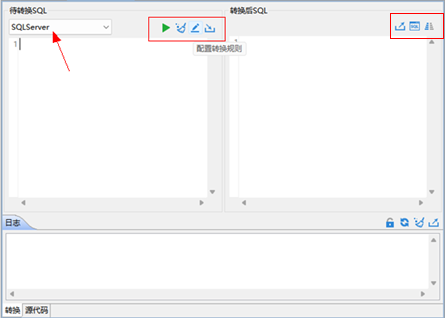
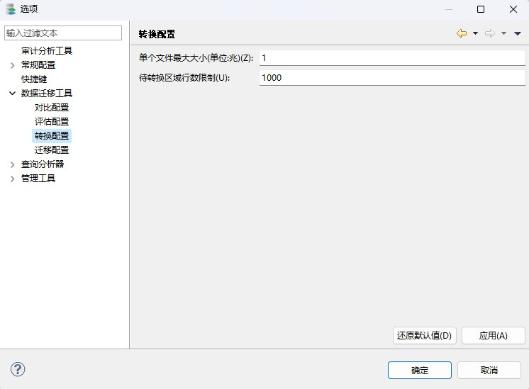
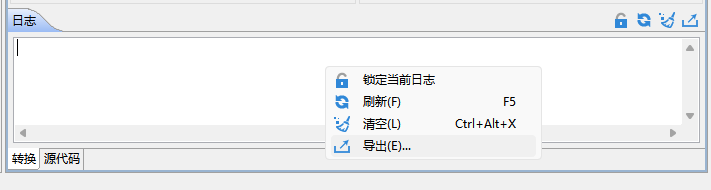

执行迁移时，对于一些重要且复杂的数据操纵语句或存储过程等内容，手动重写和适配仍然是常见且必要的方式。DTS 转换提供了异构数据库的 SQL 语言转换为符合 DM 语法的 SQL 语句的功能，这能够帮助更好地完成复杂数据迁移过程。目前，DTS 支持 SqlServer 和 MYSQL 到 DM 的语句转换。

## 7.1 实现原理

SQL 转换提供异构数据库到 DM 的 SQL 语句转换功能，其实现流程如下:

图7.1 SQL转换流程

SQL 转换是通过语法解析，解析出源 SQL 的各组成语法单元，然后 DTS 根据各组成单元和转换规则配置，转换成对应目的 SQL 的各组成语法单元，根据目的 SQL 的语法，拼成创建目的 SQL。

## 7.2 转换配置

转换配置相较于其他功能配置较为简单，同样包括转换节点个性化配置、全局配置和模板配置。全局转换配置请参考 7.2.2 全局选项配置 ，模板配置请参考 7.2.3 转换模板配置 。

转换节点配置包括源库选择，待转换 SQL 语句，和配置转换规则，这些均可在一个向导页上完成配置。

### 7.2.1 配置转换节点

配置路径：转换页面。

图7.2 转换页面配置转换规则

可点击左上角的选择框进行 SQL 语句来源，配置为 SqlServer 或者 MYSQL。

可直接在左侧的文本框输入 SQL 语句，也可点击其右上角的导入图标进行 SQL 文件导入。

可点击左侧文本框右上角的配置转换规则图标进行转换规则配置。SQL 转换内置很多转换规则，即可以转换哪些转换点，用户可以根据需要来勾选所需要的转换点。部分转换规则也可以配置参数，由用户来配置如何转。如果已经配置了语法规则模板，也可以点击“导入模板”，选择配置好的语法转换规则进行转换规则配置。

配置完成后，点击“运行”键级即可进行 SQL 语句转换，对于转换后的 SQL 语句，可进行校验、对比、导出为 SQL 文件等一系列操作。

### 7.2.2 全局选项配置

配置路径：窗口->选项->数据迁移工具->转换配置。

转换全局选项配置即配置后对所有工程的评估节点都适用，配置后应用，刷新导航树对应的转换工程节点即可生效。

图7.3 转换全局迁移选项配置

主要包括的配置选项包括：

#### 7.2.2.1 单个文件最大大小

SQL 转换支持转换 SQL 脚本文件，文件大小默认限制 1 兆，可以通过该参数配置修改，单位为兆。

#### 7.2.2.2 待转换区域行数限制

SQL 转换待转换区域最大 SQL 行数，缺省 1000，如果设置过大可能会有内存问题。

### 7.2.3 转换模板配置

DTS 节点进行转换配置时，可提前配置规则模板，并保存在对应模板管理中，供后续配置转换节点时使用。目前 DTS 转换仅支持语法规则模板。

#### 7.2.3.1 语法规则模板

语法规则模板中配置内容为输入的 SQL 语句转换为 DM 时需要遵守的语法转换规则。其中每条语法转换规则的描述都在“配置转换规则”弹窗中对应行中有说明。DTS 创建和使用评估语法规则模板的方式和迁移语法规则模板类似，具体参考 [4.2.10.3 语法规则模板](dts_migrate.md) 。

## 7.3 转换报告

查看路径与迁移报告类似，可参考 [4.4 迁移报告](dts_migrate.md) 。

转换报告不支持导出到文件，但是支持转换对象导出到文件：评估报告对话框->选择转换详情->点击“导出对象”，即可导出转换对象。

## 7.4 转换日志

查看路径：转换页面->下面“日志”区域，可即时查看转换日志，也可以通过右击日志区域->导出，导出日志到文件。

图7.4 导出转换日志操作

另外，如果转换界面已关闭，可点击对应节点进行日志查看，方式与迁移日志关闭节点后的查看方式一致，可参考 [4.5 迁移日志](dts_migrate.md) 。

日志中会详细记录源 SQL 的第几行第几列，利用什么转换规则，具体做了什么转换。

## 7.5 转换常见问题

转换后 SQL 语句可能无法在 DM 执行。源端和目的端 SQL 语法存在较大差异时，即使转换也不会完全表达源 SQL 的语义，SQL 转换工具只是作为异构数据源迁移过程中的辅助工具，尽量减少人工操作，部分 SQL 语句需要根据实际使用场景进行调整。